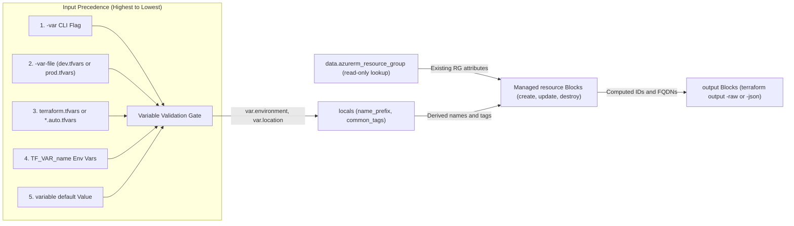
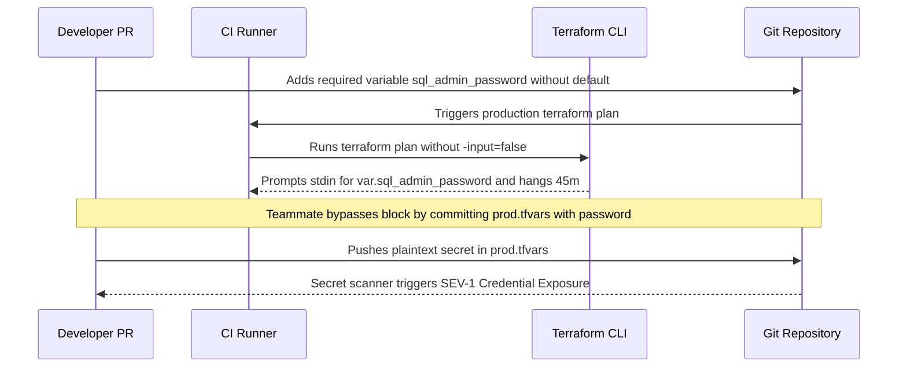

# Variables, Outputs & Data Sources

> **Prerequisites:** Terraform resource blocks, implicit dependencies, and `azurerm` provider version pinning (Modules 00–02).  
> **Estimated Reading Time:** 30 minutes  
> **Target Audience:** Backend Engineers, DevOps Engineers, Platform Engineers.

> [!TIP]
> **The Golden Rule of Variables, Outputs & Data Sources:** Use `variable` blocks for caller-supplied inputs, `locals` for derived internal expressions, and `data` blocks strictly for read-only lookups of pre-existing Azure resources you do not own—and never forget that `sensitive = true` hides console output only while `terraform.tfstate` still holds values in plaintext.

---

## Why This Matters

Everything you've written so far hard-codes names, regions, and CIDR ranges directly in resource blocks. That doesn't scale: you can't reuse a config for dev *and* prod, you can't cleanly hand off a value like a cluster's FQDN to whoever needs it, and you can't reference the resources other teams already built. Variables, outputs, locals, and data sources fix all four — they're what turn a one-off script into reusable, composable infrastructure code, and they're prerequisites for writing modules (module 04).

---

## 1. Architectural Mental Model: Data Flow In (`var.` / `data.`), Computation (`local.`), and Export (`output`)

Every Terraform configuration forms a clean pipeline: caller parameters enter through `variable` validation gates, pre-existing Azure resources are queried read-only via `data`, internal naming/tagging expressions are standardized in `locals`, and created resource attributes flow back out via `output` blocks:



### Core Concepts

#### Input Variables
A `variable` block declares a parameter your config accepts, so callers can change behavior without editing resource blocks:

```hcl
variable "location" {
  type        = string
  default     = "eastus"
  description = "Azure region for all resources"
}
```

You reference it as `var.location`. Key fields:

- `type` — `string`, `number`, `bool`, or complex types (`list(string)`, `map(string)`, `object({...})`). Terraform enforces the type.
- `default` — makes the variable optional. **No default = required**; if the caller doesn't supply it, Terraform prompts (interactively) or errors (in automation).
- `description` — documents it (shows up in errors and tooling).
- `sensitive = true` — redacts the value from plan/apply output (use for anything secret; note it's still stored in state).
- `validation { ... }` — a custom rule (e.g. "must be one of these regions") that rejects bad input at plan time.

#### How Variable Values Get Supplied
Terraform resolves a variable's value from the first source that provides it, in this precedence (highest wins):

1. `-var` on the command line: `terraform apply -var="location=westus"`.
2. `-var-file`: `terraform apply -var-file=prod.tfvars`.
3. **Automatically loaded** `terraform.tfvars` and `*.auto.tfvars` files.
4. Environment variables named `TF_VAR_<name>` (e.g. `TF_VAR_location`).
5. The `default` in the `variable` block.

The everyday pattern: declare variables with sensible defaults, and put per-environment overrides in a `dev.tfvars` / `prod.tfvars` file you pass with `-var-file`. **Never put secrets in a `.tfvars` file you commit** — use `TF_VAR_` env vars or a secrets manager for those.

#### Locals: Named Expressions, Not Inputs
A `locals` block names a computed value used in multiple places. Unlike a variable, a local is *not* an input — the caller can't override it; it's internal DRY-ing:

```hcl
locals {
  name_prefix = "${var.project}-${var.environment}"
  common_tags = {
    environment = var.environment
    managed_by  = "terraform"
    project     = var.project
  }
}
```

Reference them as `local.name_prefix`, `local.common_tags`. Use variables for things a caller should control; use locals for values you *derive* from variables (or from resource attributes) and want to reuse.

#### Output Values
An `output` block surfaces a value after apply — on the terminal, and (more importantly) for other configurations/modules to consume:

```hcl
output "resource_group_name" {
  value       = azurerm_resource_group.main.name
  description = "The name of the created resource group"
}
```

Outputs are how a module hands results back to its caller (module 04) and how you programmatically grab a value (`terraform output -raw resource_group_name`) to feed into a script or a `kubectl` command. Mark an output `sensitive = true` to keep it out of console logs.

#### Data Sources: Referencing What You Didn't Create
A `resource` block *creates and manages* something. A **`data` block** *reads* something that already exists — whether another team made it, you made it in the portal, or another Terraform config owns it:

```hcl
data "azurerm_resource_group" "existing" {
  name = "rg-shared-networking"
}
```

You reference its attributes as `data.azurerm_resource_group.existing.location`. Terraform does not manage or destroy a data source — it only queries it during refresh. This is the clean way to deploy *into* a shared VNet another team owns without taking ownership of it: read it with a `data` block, reference its ID, and let the other team's Terraform keep managing it. In a plan, data sources show as `<=` (read).

#### Variable Validation
A `validation` block catches bad input before any API call:

```hcl
variable "environment" {
  type = string
  validation {
    condition     = contains(["dev", "staging", "prod"], var.environment)
    error_message = "environment must be dev, staging, or prod."
  }
}
```

This turns a class of runtime failures (typo'd environment name → wrongly named resources) into an immediate, readable plan-time error.

---

## 2. Taxonomic Comparison: Precedence, Scoping & Lifecycle Ownership

| Precedence Rank | Variable Source | Auto-Loaded? | Secret-Safe in Git? | Ideal Use Case |
| :--- | :--- | :--- | :--- | :--- |
| **1 (Highest)** | `-var="key=val"` CLI flag | Explicit | N/A (command line) | Quick one-off manual overrides |
| **2** | `-var-file=env.tfvars` | Explicit | No (plaintext file) | Environment-specific non-secret settings |
| **3** | `terraform.tfvars` / `*.auto.tfvars` | **Yes** | No (plaintext file) | Repo-wide defaults without passing flags |
| **4** | `TF_VAR_<name>` environment variable | **Yes** | **Yes** (memory/CI secret store) | Passwords, tokens, CI/CD injected credentials |
| **5 (Lowest)** | `default = ...` inside `variable` | **Yes** | No (committed `.tf`) | Safe development fallback values |

| Construct | Direction | Overridable by Caller? | Supports `validation`? | Supports `sensitive`? |
| :--- | :--- | :--- | :--- | :--- |
| **`variable`** | External Input (`var.<name>`) | **Yes** | **Yes** | **Yes** |
| **`locals`** | Internal Expression (`local.<name>`) | No | No | Inherited from expressions |
| **`output`** | Exported Result (`module.<x>.<name>`) | No | `precondition` | **Yes** |

| Block Type | Plan Symbol | Lifecycle Ownership | Behavior When Target Missing in Azure | Behavior on `terraform destroy` |
| :--- | :--- | :--- | :--- | :--- |
| **`resource`** | `+` / `~` / `-/+` / `-` | Owned by this state | Creates the resource | Destroys the resource |
| **`data`** | `<=` | External (read-only) | Fails refresh (`not found`) | Untouched (never destroyed) |

---

## 3. Command Reference & Flag Breakdown

| Command | What it does | Example |
|---|---|---|
| `terraform plan -var` | Sets one variable inline | `terraform plan -var="location=westus"` |
| `terraform apply -var-file` | Loads variables from a file | `terraform apply -var-file=prod.tfvars` |
| `terraform output` | Prints all output values | `terraform output` |
| `terraform output <name>` | Prints one output | `terraform output resource_group_name` |
| `terraform output -raw <name>` | Prints one output with no quotes/formatting (for scripts) | `terraform output -raw kube_config` |
| `terraform output -json` | Prints all outputs as JSON | `terraform output -json` |
| `terraform console` | Interactive expression evaluator (test `local.`/`var.` expressions) | `terraform console` |
| `terraform plan -var-file` | Plans with a var file | `terraform plan -var-file=dev.tfvars` |

**Flag breakdown — `terraform apply -var-file=prod.tfvars`:**
- `-var-file=<file>` — loads variable assignments from the named file. Pass it explicitly for files not auto-loaded (anything not named `terraform.tfvars` or `*.auto.tfvars`). This is how you keep dev and prod values in separate, reviewable files.

**Flag breakdown — `terraform output -raw <name>`:**
- `-raw` — prints the value with no surrounding quotes or HCL formatting, so it's safe to embed directly in a shell command, e.g. `az aks get-credentials -g "$(terraform output -raw rg_name)" ...`. Only works for string/number outputs.

---

## 4. Production War Story Post-Mortem: Hung CI Pipeline & Plaintext `.tfvars` Secret Leak

| Field | Incident Details |
| :--- | :--- |
| **Severity** | SEV-1 (Deployment Pipeline Freeze & Production Secret Exposure) |
| **Detection Time** | 45 minutes (CI/CD job hit build-agent timeout waiting on stdin prompt) |
| **Resolution Time** | 2 hours 10 minutes (secret rotation, Git history purge, CI pipeline hardening) |
| **Impact** | Production deployment queue stalled for 45 minutes; database admin password exposed in committed `prod.tfvars` and unencrypted state |

### What Happened
A developer added a new required `variable "sql_admin_password"` with `sensitive = true` and no `default` to `variables.tf`, then merged the pull request without updating the CI workflow's `-var-file` or environment variables. When the main deployment pipeline ran `terraform plan` without `-input=false`, Terraform stalled waiting interactively for stdin input until the 45-minute runner timeout killed the job. To unblock the hotfix quickly, a teammate put the password inside `prod.tfvars` and pushed it to Git, assuming `sensitive = true` kept secrets safe.



### Root Cause Analysis
1. **Interactive Mode Enabled in CI:** Omitting `-input=false` caused Terraform to block indefinitely on missing required variables instead of failing immediately.
2. **Misconception Around `sensitive = true`:** `sensitive = true` redacts terminal logs only; values inside committed `.tfvars` files and `terraform.tfstate` remain plaintext.
3. **Lack of Input Validation & Pre-Commit Secret Hygiene:** No `validation` rules or secret hooks prevented plaintext credential commits in `*.tfvars`.

### The Fix & Architectural Hardening
1. Added `-input=false` to all automated `terraform plan` and `terraform apply` invocations so missing variables fail within 1 second.
2. Rotated the exposed database credential, removed `prod.tfvars` secrets from Git, and injected secrets exclusively via `TF_VAR_*` backed by Azure Key Vault / CI OIDC secrets.
3. Enforced `.gitignore` patterns for `*.secret.tfvars` and added `validation` blocks on environment/region variables to catch typos prior to ARM calls.

---

## 5. Multi-Language Production Implementation

Production deployment wrappers read `terraform output -json` programmatically (instead of brittle text parsing) while checking `sensitive` output flags and scanning `.tfvars` files for accidental plaintext credentials before executing `terraform plan -input=false`.

````carousel
**Go — Typed `terraform output -json` Consumer & `.tfvars` Secret Guard**
```go
package main

import (
	"encoding/json"
	"fmt"
	"os"
	"os/exec"
	"regexp"
)

type tfOutputEntry struct {
	Sensitive bool `json:"sensitive"`
	Value     any  `json:"value"`
}

func verifyAndReadOutputs(workDir string, varFile string) error {
	rawVars, err := os.ReadFile(varFile)
	if err != nil {
		return err
	}
	secretKey := regexp.MustCompile(`(?i)(password|secret|token|connection_string)\s*=`)
	if secretKey.Match(rawVars) {
		return fmt.Errorf("plaintext secret pattern detected in %s; use TF_VAR_ env vars", varFile)
	}

	planCmd := exec.Command("terraform", "-chdir="+workDir, "plan", "-input=false", "-var-file="+varFile)
	if out, err := planCmd.CombinedOutput(); err != nil {
		return fmt.Errorf("non-interactive plan failed: %s", string(out))
	}

	outBytes, err := exec.Command("terraform", "-chdir="+workDir, "output", "-json").Output()
	if err != nil {
		return err
	}
	var outputs map[string]tfOutputEntry
	if err := json.Unmarshal(outBytes, &outputs); err != nil {
		return err
	}
	for k, v := range outputs {
		if v.Sensitive {
			fmt.Printf("Output %s: [REDACTED sensitive]\n", k)
		} else {
			fmt.Printf("Output %s: %v\n", k, v.Value)
		}
	}
	return nil
}

func main() {
	if err := verifyAndReadOutputs(".", "dev.tfvars"); err != nil {
		fmt.Fprintln(os.Stderr, err)
		os.Exit(1)
	}
}
```
<!-- slide -->
**TypeScript — Typed `terraform output -json` Consumer & `.tfvars` Secret Guard**
```typescript
import { execFileSync } from "node:child_process";
import { readFileSync } from "node:fs";

interface TerraformOutputItem<T = unknown> {
  sensitive: boolean;
  type: unknown;
  value: T;
}

function inspectOutputsAndVarFile(workDir: string, varFile: string): void {
  const tfvars = readFileSync(varFile, "utf8");
  if (/(password|secret|token|api_key)\s*=/i.test(tfvars)) {
    throw new Error(
      `Refusing to use ${varFile}: plaintext secret keys belong in TF_VAR_* env vars.`
    );
  }

  execFileSync(
    "terraform",
    [`-chdir=${workDir}`, "plan", "-input=false", `-var-file=${varFile}`],
    { stdio: "inherit" }
  );

  const rawJson = execFileSync(
    "terraform",
    [`-chdir=${workDir}`, "output", "-json"],
    { encoding: "utf8" }
  );
  const outputs: Record<string, TerraformOutputItem> = JSON.parse(rawJson);

  for (const [name, entry] of Object.entries(outputs)) {
    const display = entry.sensitive ? "<sensitive>" : JSON.stringify(entry.value);
    console.log(`${name} = ${display}`);
  }
}

inspectOutputsAndVarFile(".", "dev.tfvars");
```
<!-- slide -->
**Python — Typed `terraform output -json` Consumer & `.tfvars` Secret Guard**
```python
import json
import re
import subprocess
from pathlib import Path


def run_non_interactive_and_read_outputs(work_dir: Path, var_file: Path) -> dict:
    tfvars_text = var_file.read_text(encoding="utf-8")
    if re.search(r"(password|secret|token|client_secret)\s*=", tfvars_text, re.IGNORECASE):
        raise ValueError(
            f"Plaintext secret found in {var_file}; inject via TF_VAR_* environment variables."
        )

    subprocess.run(
        [
            "terraform",
            f"-chdir={work_dir}",
            "plan",
            "-input=false",
            f"-var-file={var_file}",
        ],
        check=True,
    )

    raw = subprocess.check_output(
        ["terraform", f"-chdir={work_dir}", "output", "-json"], text=True
    )
    parsed = json.loads(raw)
    return {
        k: ("<redacted>" if v.get("sensitive") else v.get("value"))
        for k, v in parsed.items()
    }


if __name__ == "__main__":
    print(run_non_interactive_and_read_outputs(Path("."), Path("dev.tfvars")))
```
<!-- slide -->
**C# — Typed `terraform output -json` Consumer & `.tfvars` Secret Guard**
```csharp
using System;
using System.Diagnostics;
using System.IO;
using System.Text.Json;
using System.Text.RegularExpressions;

public static class TerraformOutputReader
{
    public static void Main()
    {
        string varFile = "dev.tfvars";
        string tfvars = File.ReadAllText(varFile);
        if (Regex.IsMatch(tfvars, @"(password|secret|token|client_secret)\s*=", RegexOptions.IgnoreCase))
            throw new InvalidDataException($"Plaintext credential detected in {varFile}; use TF_VAR_* instead.");

        var planPsi = new ProcessStartInfo("terraform", $"plan -input=false -var-file={varFile}")
        {
            UseShellExecute = false
        };
        using var planProc = Process.Start(planPsi) ?? throw new InvalidOperationException("Cannot start terraform");
        planProc.WaitForExit();
        if (planProc.ExitCode != 0) Environment.Exit(planProc.ExitCode);

        var outPsi = new ProcessStartInfo("terraform", "output -json")
        {
            RedirectStandardOutput = true,
            UseShellExecute = false
        };
        using var outProc = Process.Start(outPsi)!;
        string json = outProc.StandardOutput.ReadToEnd();
        outProc.WaitForExit();

        using var doc = JsonDocument.Parse(json);
        foreach (var prop in doc.RootElement.EnumerateObject())
        {
            bool isSensitive = prop.Value.GetProperty("sensitive").GetBoolean();
            string val = isSensitive ? "<sensitive>" : prop.Value.GetProperty("value").ToString();
            Console.WriteLine($"{prop.Name} = {val}");
        }
    }
}
```
````

---

## 6. Practical Hands-On Verification CLI Workflows

Free resources again (RG + VNet + subnet). Destroy at the end.

1. **Set up with variables.** New directory:
   ```bash
   mkdir -p ~/tf-labs/03-variables && cd ~/tf-labs/03-variables
   export ARM_SUBSCRIPTION_ID="$(az account show --query id -o tsv)"
   ```
   Create `variables.tf`:
   ```hcl
   variable "project" {
     type        = string
     description = "Short project slug used in resource names"
     default     = "tflab"
   }

   variable "location" {
     type        = string
     description = "Azure region"
     default     = "eastus"
   }

   variable "environment" {
     type        = string
     description = "Deployment environment"
     validation {
       condition     = contains(["dev", "staging", "prod"], var.environment)
       error_message = "environment must be dev, staging, or prod."
     }
   }
   ```
   Note `environment` has **no default** — it's required.

2. **Add locals and resources that use them.** Create `main.tf` with the provider skeleton, then:
   ```hcl
   locals {
     name_prefix = "${var.project}-${var.environment}"
     common_tags = {
       environment = var.environment
       managed_by  = "terraform"
     }
   }

   resource "azurerm_resource_group" "main" {
     name     = "rg-${local.name_prefix}"
     location = var.location
     tags     = local.common_tags
   }

   resource "azurerm_virtual_network" "hub" {
     name                = "${local.name_prefix}-vnet"
     resource_group_name = azurerm_resource_group.main.name
     location            = azurerm_resource_group.main.location
     address_space       = ["10.0.0.0/16"]
     tags                = local.common_tags
   }
   ```

3. **Watch validation reject bad input.** Try an invalid environment:
   ```bash
   terraform init
   terraform plan -var="environment=production"
   ```

   **Expected Output:**
   ```text
   │ Error: Invalid value for variable
   │
   │   on variables.tf line 13:
   │   13: variable "environment" {
   │     ├────────────────
   │     │ var.environment is "production"
   │
   │ environment must be dev, staging, or prod.
   ```
   > Verify: it fails immediately with your custom message (`environment must be dev, staging, or prod.`) — no Azure call made. Now run `terraform plan -var="environment=dev"` and confirm it plans `2 to add`, with names like `rg-tflab-dev`.

4. **Use a tfvars file instead of `-var`.** Create `dev.tfvars`:
   ```hcl
   environment = "dev"
   location    = "eastus"
   ```
   Then:
   ```bash
   terraform apply -var-file=dev.tfvars
   ```

   **Expected Output:**
   ```text
   Apply complete! Resources: 2 added, 0 changed, 0 destroyed.
   ```
   > Verify: resources are created with `-dev` in their names. Confirm with `az group show -n rg-tflab-dev -o table`.

5. **Add outputs.** Create `outputs.tf`:
   ```hcl
   output "resource_group_name" {
     value       = azurerm_resource_group.main.name
     description = "Name of the created resource group"
   }

   output "vnet_id" {
     value       = azurerm_virtual_network.hub.id
     description = "Full Azure resource ID of the VNet"
   }
   ```
   Run `terraform apply -var-file=dev.tfvars` again, then:
   ```bash
   terraform output
   terraform output -raw resource_group_name
   ```

   **Expected Output:**
   ```text
   resource_group_name = "rg-tflab-dev"
   vnet_id = "/subscriptions/.../resourceGroups/rg-tflab-dev/providers/Microsoft.Network/virtualNetworks/tflab-dev-vnet"

   rg-tflab-dev
   ```
   > Verify: `terraform output` lists both; `-raw` prints just the group name with no quotes — the form you'd pipe into another command.

6. **Reference an output from a real command.** Prove outputs are useful for scripting:
   ```bash
   az group show -n "$(terraform output -raw resource_group_name)" -o table
   ```
   > Verify: it shows your resource group, fetched by feeding Terraform's output straight into `az`.

7. **Add a data source for an existing resource.** First, create something *outside* Terraform with `az` to read back:
   ```bash
   az group create -n rg-preexisting-lab -l eastus
   ```
   Add to `main.tf`:
   ```hcl
   data "azurerm_resource_group" "external" {
     name = "rg-preexisting-lab"
   }

   output "external_rg_location" {
     value = data.azurerm_resource_group.external.location
   }
   ```
   Run `terraform plan -var-file=dev.tfvars`.

   **Expected Output:**
   ```text
   data.azurerm_resource_group.external: Reading...
   data.azurerm_resource_group.external: Read complete after 0s

   Changes to Outputs:
     + external_rg_location = "eastus"
   ```
   > Verify: the data source shows as a read (`<=`), *not* a create, and the plan adds only the new output — Terraform reads `rg-preexisting-lab` but does **not** try to create or manage it. Apply, then `terraform output external_rg_location` prints `eastus`.

8. **Diagnose and fix: a data source that doesn't exist.** Point the data source at a non-existent group:
   ```hcl
   data "azurerm_resource_group" "external" {
     name = "rg-does-not-exist-xyz"
   }
   ```
   Run `terraform plan -var-file=dev.tfvars`.

   **Expected Output:**
   ```text
   │ Error: Resource Group "rg-does-not-exist-xyz" was not found
   ```
   > Verify: it errors during refresh with something like `Resource group "rg-does-not-exist-xyz" was not found`. A data source must reference something that *actually exists* — unlike a resource, Terraform won't create it. Fix by pointing it back at `rg-preexisting-lab`.

9. **Experiment in the console.** Test expressions without applying:
   ```bash
   terraform console -var-file=dev.tfvars
   ```
   At the prompt type `local.name_prefix` and `local.common_tags`, then `exit`.

   **Expected Output:**
   ```text
   > local.name_prefix
   "tflab-dev"
   > local.common_tags
   {
     "environment" = "dev"
     "managed_by" = "terraform"
   }
   ```
   > Verify: it evaluates them to `tflab-dev` and the tag map — a fast way to debug expressions before they hit a resource.

10. **Clean up both groups.** The data-source group isn't managed by Terraform, so `destroy` won't remove it — delete it separately:
    ```bash
    terraform destroy -var-file=dev.tfvars
    az group delete -n rg-preexisting-lab --yes --no-wait
    ```
    > Verify: `terraform destroy` removes only the resources it manages (the `-dev` group and its VNet), and leaves `rg-preexisting-lab` untouched — which is exactly why you delete that one by hand. Confirm both are gone with `az group list -o table`.

### Independent Challenge
Without copying the exercises, write a configuration that is fully parameterized for **two environments**: it should build a resource group and a VNet whose names, region, and address space all come from variables, with a `dev.tfvars` and a `prod.tfvars` that put dev in one region with `10.0.0.0/16` and prod in another region with `10.1.0.0/16`. Deploy *both* (they must not collide — different names), then use outputs to print each VNet's ID, and finally destroy both. As a stretch, add a data source that reads the *dev* resource group from within the prod config to prove one config can reference another's output. This builds on this module's variables/outputs/data-sources and track 5's non-overlapping-address-space discipline.

<details><summary>Stuck? One hint</summary>

To run two environments from one config directory without them clobbering each other's state, either use two separate directories each with its own `.tfvars`, or use `terraform workspace new prod` / `terraform workspace select dev` so each environment gets its own state file. The simplest, clearest approach for learning is two directories. Make sure every resource name derives from `var.environment` so `dev` and `prod` names never collide.

</details>

---

## 7. Operational Validation Checkpoints

<details><summary><strong>Checkpoint 1: After a colleague adds a required variable with no default, your GitHub Actions job hangs until timeout during `terraform plan`. Why, and how do you fix the runner command?</strong></summary>

Without `-input=false`, Terraform pauses waiting on interactive stdin to collect any required variable lacking a default value. Pass `-input=false` on every CI `plan`/`apply` invocation so missing variables fail immediately, and supply the value via `-var-file` or `TF_VAR_<name>`.

</details>

<details><summary><strong>Checkpoint 2: You exported `export TF_VAR_location="westus"`, yet `terraform plan` still targets `eastus` defined inside `terraform.tfvars`. Which precedence rule explains this?</strong></summary>

`terraform.tfvars` and `*.auto.tfvars` sit at precedence rank 3, which outranks `TF_VAR_<name>` environment variables (rank 4). To override `terraform.tfvars` on the command line, pass `-var="location=westus"` (rank 1) or `-var-file` (rank 2).

</details>

<details><summary><strong>Checkpoint 3: A security reviewer flags a database admin password variable even though `sensitive = true` is set on both `variable` and `output`. What vulnerability remains?</strong></summary>

`sensitive = true` masks terminal stdout logs only; Terraform still persists the secret in plaintext inside `terraform.tfstate`. You must secure the state backend itself (remote encrypted Azure Storage with restricted RBAC, covered in Module 05) and never commit local state or secret `.tfvars` files.

</details>

---

## Common Mistakes & Troubleshooting

- **Putting secrets in a committed `.tfvars` file.** `.tfvars` files are plaintext and often committed. Use `TF_VAR_<name>` env vars or a secrets manager for anything sensitive, and `.gitignore` any `*.tfvars` holding secrets.
- **Expecting a data source to create the resource.** `data` blocks only *read*. If the target doesn't exist, refresh fails — data sources are for things that already exist, `resource` blocks are for things you own.
- **Confusing variables and locals.** Variables are caller-supplied inputs (overridable); locals are internally-derived values (not overridable). If a caller should control it, it's a variable.
- **Forgetting a required variable in automation.** A variable with no `default` prompts interactively — which *hangs* a CI job. Supply every required variable via `-var-file`/`TF_VAR_` in automation.
- **Marking something `sensitive` and thinking it's now safe in state.** `sensitive = true` only redacts console output; the value is still stored in plaintext in state. Protect state itself (module 05).
- **Cost pitfall:** `terraform destroy` only removes resources Terraform *manages* — anything you created with `az` (like the data-source group here) survives and keeps billing if it's a paid resource. Track out-of-band resources yourself and delete them explicitly.

---

## Checkpoint Quiz

Write down your answer to each question before expanding it — checking without attempting first is the single easiest way to fool yourself into thinking you've learned this.

1. What makes a variable *required* versus optional?
2. Rank these value sources by precedence (which wins): a `default`, a `-var` flag, a `terraform.tfvars` file, a `TF_VAR_` env var.
3. What's the difference between a `variable` and a `local`?
4. What does an `output` block do, and name two things you'd use one for.
5. What's the fundamental difference between a `resource` block and a `data` block?
6. In a plan, what symbol marks a data source, and does Terraform ever destroy what a data source reads?
7. You need a cluster password never to appear in `terraform plan` output. What do you set — and what's the important caveat about state?
8. `terraform destroy` ran cleanly, but a resource you created earlier with `az` is still there and billing. Why, and whose job is it to remove it?

<details><summary>Show answers</summary>

1. A variable is required if it has **no** `default`. With no default and no supplied value, Terraform prompts (interactively) or errors (in automation).
2. Highest to lowest: `-var` flag > `terraform.tfvars` file (auto-loaded) > `TF_VAR_` env var > `default`. (A `-var-file` sits with the file tier, above env vars.)
3. A variable is a caller-supplied input that can be overridden; a local is an internally-computed named value that callers cannot override — used to DRY up derived expressions.
4. It surfaces a value after apply, on the console and for other modules/configs to consume. Uses: handing a result to a calling module, or grabbing a value (`-raw`) to feed into a script/`az`/`kubectl`.
5. A `resource` creates and manages something (Terraform owns its lifecycle); a `data` block only reads an existing thing Terraform does not own or destroy.
6. `<=` (read). No — Terraform never creates or destroys what a data source references; it only queries it.
7. `sensitive = true` on the variable/output. Caveat: it only redacts console output — the value is still stored in plaintext in the state file, so you must also protect state itself.
8. `terraform destroy` only removes resources in *its* state (things Terraform manages). The `az`-created resource was never managed by Terraform, so it's your responsibility to delete it separately.

</details>

---

## Sources & Further Reading

- HashiCorp Terraform Language: [Input Variables & Validation](https://developer.hashicorp.com/terraform/language/values/variables)
- HashiCorp Terraform Language: [Local Values & Outputs](https://developer.hashicorp.com/terraform/language/values/outputs)
- HashiCorp Terraform Language: [Data Sources](https://developer.hashicorp.com/terraform/language/data-sources)

---

## Next
[04 — Modules & code organization](../04-modules-and-code-organization/README.md): package a reusable chunk of infrastructure with its own inputs and outputs, and stop copy-pasting the same resource blocks between projects.
