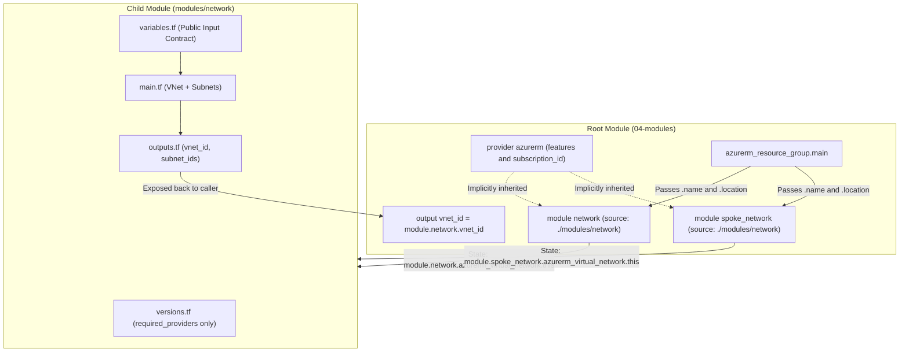
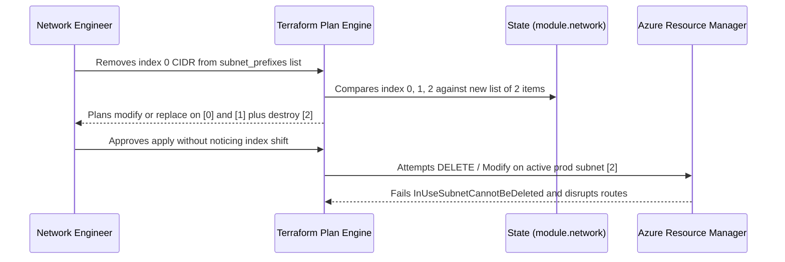

# Modules & Code Organization

> **Prerequisites:** Variables, locals, outputs, data sources, and the core Terraform workflow (Modules 00–03).  
> **Estimated Reading Time:** 35 minutes  
> **Target Audience:** Backend Engineers, DevOps Engineers, Platform Infrastructure Architects.

> [!TIP]
> **The Golden Rule of Terraform Modules:** Configure `provider "azurerm"` blocks strictly in the root module while keeping only `required_providers` inside child modules, prefer `for_each` over `count` for resources with distinct identities so removals do not renumber active infrastructure, and always inspect `Plan: N to add` before confirming module loops.

---

## Why This Matters

By now you can write a resource group, a VNet, subnets, and NSGs. The moment you need that same network in three environments — or a second team wants "a standard VNet like yours" — copy-pasting resource blocks becomes a maintenance nightmare. A **module** packages a set of resources behind a clean input/output interface so you can reuse it like a function. Modules are how real Terraform codebases stay DRY, reviewable, and consistent, and they're the organizing unit your capstone (module 08) is built from.

---

## 1. Architectural Mental Model: Root vs. Child Encapsulation & State Namespacing

Terraform treats the directory where you invoke `terraform` as the **root module**, which holds the active `provider "azurerm"` configuration and wires inputs into reusable **child modules**. Every resource inside a child module is encapsulated behind `variables.tf` and `outputs.tf` and automatically namespaced in state under `module.<call_name>`:



### Core Concepts

#### What a Module Actually Is
A module is just **a directory containing `.tf` files**. You've been writing modules the whole time without knowing it — the directory you run `terraform` in is the **root module**. A **child module** is another directory you call from the root with a `module` block. There's no special syntax to "make" a module; any directory of `.tf` files with `variable` (inputs) and `output` (outputs) blocks is reusable as one.

#### The Module Interface: Variables In, Outputs Out
A well-designed module exposes:

- **Inputs** — its `variable` blocks. The caller supplies these as arguments in the `module` block.
- **Outputs** — its `output` blocks. The caller reads these as `module.<name>.<output>`.
- **Internals** — the `resource`/`local`/`data` blocks, which the caller neither sees nor touches.

This is exactly the encapsulation you know from functions: a stable interface hiding implementation. A caller of your "network" module says "I want a VNet with *this* address space in *this* resource group" and gets back "*here's* the subnet IDs" — without caring how the subnets are wired internally.

#### Calling a Module
You call a child module with a `module` block, whose `source` points at the directory (or registry, or Git URL):

```hcl
module "network" {
  source              = "./modules/network"
  resource_group_name = azurerm_resource_group.main.name
  location            = azurerm_resource_group.main.location
  vnet_name           = "hub-vnet"
  address_space       = ["10.0.0.0/16"]
  subnet_prefixes     = ["10.0.1.0/24", "10.0.2.0/24"]
}
```

Every argument after `source` maps to a `variable` the module declares. You then reference its outputs elsewhere: `module.network.subnet_ids[0]`. After adding or changing a `module` block you must run `terraform init` again so Terraform installs/links the module.

#### A Conventional File Layout
Terraform doesn't enforce filenames — it concatenates all `.tf` files in a directory — but a strong convention keeps modules readable:

```text
modules/network/
  main.tf         # the resource blocks
  variables.tf    # input declarations
  outputs.tf      # output declarations
  versions.tf     # required_providers / required_version (no provider config)
```

Crucial detail: **child modules should declare `required_providers` but not configure a `provider` block.** Provider *configuration* (the `features {}`, subscription, auth) lives in the root module and is passed down implicitly. A child module that defines its own `provider "azurerm" {}` block causes problems (especially with `for_each`/`count` on the module and with destroy). Declare provider *requirements* in the child; configure the provider only at the root.

#### `count` and `for_each` on Modules and Resources
You can instantiate a resource or a whole module multiple times:

- `count = 3` — makes three copies, addressed `[0]`, `[1]`, `[2]`. Good for "N identical things."
- `for_each = toset([...])` or `for_each = { ... }` — makes one per element, addressed by key. Better when the things have stable identities (so adding/removing one doesn't renumber the rest).

**This is also the single biggest cost-and-blast-radius footgun in Terraform.** A `for_each` over the wrong collection, or a `count` wired to a variable that's larger than you think, can create dozens of billable resources in one apply. You'll deliberately trigger and read this in the exercises. The defense is always the same: **read the plan's "N to add" before typing yes.**

#### Versioning Modules
For local modules (`source = "./modules/network"`), the "version" is just whatever's in your Git repo at that commit — you version the whole repo. For **shared** modules pulled from a registry or Git, you pin a version so a module change doesn't silently alter your infra:

```hcl
module "network" {
  source  = "app.terraform.io/myorg/network/azurerm"
  version = "~> 2.1"      # only valid for registry sources
  # ...
}

module "other" {
  source = "git::https://github.com/myorg/tf-modules.git//network?ref=v2.1.0"
}
```

The `version` argument works only for **registry** sources; for Git sources you pin with a `?ref=<tag>` in the URL. Either way the rule matches provider pinning (module 02): pin so upgrades are deliberate, not accidental.

---

## 2. Taxonomic Comparison: Root vs. Child, Loops & Module Pinning

| Architectural Aspect | Root Module | Child Module (`modules/<name>`) |
| :--- | :--- | :--- |
| **`provider "azurerm" {}` Block** | **Yes** (centralized auth & `features {}`) | **Never** (breaks `for_each` / `count` & destroy) |
| **`required_providers` Block** | **Yes** (`versions.tf` or `main.tf`) | **Yes** (`versions.tf` declares compatibility) |
| **Backend State Configuration** | **Yes** (where `terraform` runs) | **No** (inherits root state with `module.<name>.` prefix) |
| **Visibility of Internals** | Direct access to its own resources | Hidden; callers access `output` blocks only |

| Iteration Construct | State Address Example | Deleting Middle Element | Best Fit |
| :--- | :--- | :--- | :--- |
| **`count = length(list)`** | `module.network.azurerm_subnet.this[1]` | Shifts every subsequent index (`[2]` becomes `[1]`), triggering `-/+` replacements | `N` identical ephemeral copies or boolean `count = var.enabled ? 1 : 0` |
| **`for_each = map/set`** | `module.network.azurerm_subnet.this["app"]` | Deletes **only** `"app"` while leaving other keyed resources untouched | Named subnets, NSGs, environments, multi-region stacks |

| Module `source` Type | Example | `version =` Valid? | Pinning Mechanism |
| :--- | :--- | :--- | :--- |
| **Local Path** | `"./modules/network"` | **No** | Monorepo Git commit SHA |
| **Terraform Registry** | `"app.terraform.io/myorg/network/azurerm"` | **Yes** | `version = "~> 2.1"` |
| **Git Repository URL** | `"git::https://github.com/myorg/tf-modules.git//network?ref=v2.1.0"` | **No** | `?ref=<tag-or-sha>` query string |

---

## 3. Command Reference & Flag Breakdown

| Command | What it does | Example |
|---|---|---|
| `terraform init` | Also installs/links modules referenced by `module` blocks | `terraform init` |
| `terraform get` | Downloads/updates modules without touching providers | `terraform get -update` |
| `terraform state list` | Shows module resources with a `module.` address prefix | `terraform state list` |
| `terraform plan` | Reports adds/changes across root and child modules | `terraform plan` |
| `terraform console` | Evaluate `module.<name>.<output>` expressions | `terraform console` |

**Flag breakdown — `terraform get -update`:**
- `-update` — re-fetches modules and checks for newer versions within your constraints (for registry/Git sources). Plain `terraform init` also installs modules; use `get -update` when you want to refresh modules without re-initializing providers/backends.

**Addressing note** — after calling a module named `network` that contains a `azurerm_subnet.this` resource, its state address is `module.network.azurerm_subnet.this`. Module resources are namespaced under `module.<call-name>.`.

---

## 4. Production War Story Post-Mortem: `count` Index-Shift Outage & Child Provider Trap

| Field | Incident Details |
| :--- | :--- |
| **Severity** | SEV-1 (Production Subnet Replacement Attempt & Application Outage) |
| **Detection Time** | 2 minutes (failed Azure ARM subnet delete due to active NICs + route drops) |
| **Resolution Time** | 1 hour 50 minutes (`terraform state mv` migration from list indices to map keys) |
| **Impact** | Removing one retired subnet at index `0` caused Terraform to attempt `-/+` replacement on two live production subnets (`[1]` and `[2]`) |

### What Happened
A platform network module created subnets using `count = length(var.subnet_prefixes)` with `subnet_prefixes = ["10.0.1.0/24", "10.0.2.0/24", "10.0.3.0/24"]`. Months later, an engineer removed the decommissioned first CIDR `"10.0.1.0/24"` from the list. Because `[1]` shifted to `[0]` and `[2]` shifted to `[1]`, Terraform saw different CIDRs at indices `0` and `1` and planned in-place updates / replacements across live application subnets while destroying `[2]`. On the same week, another squad embedded `provider "azurerm"` inside a shared child module, blocking a `for_each` multi-region refactor when Terraform refused to destroy or iterate over legacy provider instances.



### Root Cause Analysis
1. **Positional `count` Indexing for Named Resources:** Using `count` on a list coupled resource state identity to array position rather than a stable logical name.
2. **Missed Plan Summary Inspection:** Failing to review `Plan: ... to add, ... to change, ... to destroy` allowed cascading index renumbering into `apply`.
3. **Provider Block Embedded Inside Child Module:** Placing `provider "azurerm" {}` inside a child module coupled module instances to a non-for-eachable provider configuration.

### The Fix & Architectural Hardening
1. Migrated the network module from `count` over a list to `for_each` over a keyed map (`{ web = "10.0.1.0/24", app = "10.0.2.0/24" }`) using `terraform state mv` so removing one key touches only that single subnet.
2. Added a CI module-lint policy forbidding `provider` configuration blocks inside `modules/**` while requiring `versions.tf` with `required_providers`.
3. Added a blast-radius gate verifying maximum planned additions/destructions on every PR touching `for_each` or `count` variables.

---

## 5. Multi-Language Production Implementation

Platform repositories run automated module-contract checks before `terraform plan`: confirming every directory under `modules/` follows the conventional 4-file layout, rejecting any child module that embeds a `provider "..."` configuration block, and enforcing a max blast-radius threshold on JSON plans generated from `count`/`for_each` loops.

````carousel
**Go — Child Module Contract & Blast-Radius Guard**
```go
package main

import (
	"encoding/json"
	"fmt"
	"os"
	"path/filepath"
	"regexp"
)

type planSummary struct {
	ResourceChanges []struct {
		Address string `json:"address"`
		Change  struct {
			Actions []string `json:"actions"`
		} `json:"change"`
	} `json:"resource_changes"`
}

func validateChildModule(modDir string) error {
	required := []string{"main.tf", "variables.tf", "outputs.tf", "versions.tf"}
	for _, f := range required {
		if _, err := os.Stat(filepath.Join(modDir, f)); err != nil {
			return fmt.Errorf("module %s missing conventional file %s", modDir, f)
		}
	}

	providerBlockRe := regexp.MustCompile(`(?m)^\s*provider\s+"azurerm"\s*\{`)
	files, _ := filepath.Glob(filepath.Join(modDir, "*.tf"))
	for _, tf := range files {
		raw, _ := os.ReadFile(tf)
		if providerBlockRe.Match(raw) {
			return fmt.Errorf("child module %s must not configure provider blocks (%s)", modDir, tf)
		}
	}
	return nil
}

func checkBlastRadius(planJson []byte, maxMutations int) error {
	var p planSummary
	if err := json.Unmarshal(planJson, &p); err != nil {
		return err
	}
	if len(p.ResourceChanges) > maxMutations {
		return fmt.Errorf("blast radius %d exceeds threshold %d; verify count/for_each inputs",
			len(p.ResourceChanges), maxMutations)
	}
	return nil
}

func main() {
	if err := validateChildModule("modules/network"); err != nil {
		fmt.Fprintln(os.Stderr, err)
		os.Exit(1)
	}
	fmt.Println("Child module contract verified.")
}
```
<!-- slide -->
**TypeScript — Child Module Contract & Blast-Radius Guard**
```typescript
import { existsSync, readdirSync, readFileSync } from "node:fs";
import { join } from "node:path";

interface PlanOutput {
  resource_changes?: Array<{ address: string; change: { actions: string[] } }>;
}

function verifyChildModuleContract(moduleDir: string): void {
  for (const required of ["main.tf", "variables.tf", "outputs.tf", "versions.tf"]) {
    if (!existsSync(join(moduleDir, required))) {
      throw new Error(`Module ${moduleDir} is missing ${required}`);
    }
  }

  for (const file of readdirSync(moduleDir).filter((f) => f.endsWith(".tf"))) {
    const content = readFileSync(join(moduleDir, file), "utf8");
    if (/^\s*provider\s+"azurerm"\s*\{/m.test(content)) {
      throw new Error(
        `Child module ${moduleDir}/${file} defines a provider block; declare required_providers only.`
      );
    }
  }
}

function assertBlastRadius(planJsonPath: string, maxChanges: number): void {
  const plan: PlanOutput = JSON.parse(readFileSync(planJsonPath, "utf8"));
  const mutations = (plan.resource_changes ?? []).filter(
    (rc) => !rc.change.actions.every((a) => a === "no-op")
  );
  if (mutations.length > maxChanges) {
    throw new Error(
      `Blast radius guard triggered: ${mutations.length} resource mutations exceed limit (${maxChanges}).`
    );
  }
}

verifyChildModuleContract("modules/network");
console.log("Child module contract passed.");
```
<!-- slide -->
**Python — Child Module Contract & Blast-Radius Guard**
```python
import json
import re
from pathlib import Path


def validate_child_module(module_dir: Path) -> None:
    expected = ("main.tf", "variables.tf", "outputs.tf", "versions.tf")
    for fname in expected:
        if not (module_dir / fname).is_file():
            raise FileNotFoundError(f"{module_dir} missing conventional module file {fname}")

    provider_re = re.compile(r'^\s*provider\s+"azurerm"\s*\{', re.MULTILINE)
    for tf_file in module_dir.glob("*.tf"):
        if provider_re.search(tf_file.read_text(encoding="utf-8")):
            raise ValueError(
                f"Child module {tf_file} must not declare provider configuration; keep providers in root."
            )


def enforce_blast_radius(plan_json_path: Path, max_mutations: int = 10) -> None:
    plan = json.loads(plan_json_path.read_text(encoding="utf-8"))
    mutations = [
        rc["address"]
        for rc in plan.get("resource_changes", [])
        if rc["change"]["actions"] != ["no-op"]
    ]
    if len(mutations) > max_mutations:
        raise RuntimeError(
            f"Blast-radius cap exceeded ({len(mutations)} > {max_mutations}): {mutations}"
        )


if __name__ == "__main__":
    validate_child_module(Path("modules/network"))
    print("Module contract verified.")
```
<!-- slide -->
**C# — Child Module Contract & Blast-Radius Guard**
```csharp
using System;
using System.IO;
using System.Linq;
using System.Text.Json;
using System.Text.RegularExpressions;

public static class ModuleContractValidator
{
    public static void ValidateChildModule(string moduleDir)
    {
        string[] requiredFiles = { "main.tf", "variables.tf", "outputs.tf", "versions.tf" };
        foreach (string f in requiredFiles)
        {
            if (!File.Exists(Path.Combine(moduleDir, f)))
                throw new FileNotFoundException($"Missing required module file: {f}");
        }

        var providerRegex = new Regex(@"^\s*provider\s+""azurerm""\s*\{", RegexOptions.Multiline);
        foreach (string tf in Directory.GetFiles(moduleDir, "*.tf"))
        {
            if (providerRegex.IsMatch(File.ReadAllText(tf)))
                throw new InvalidOperationException($"Child module {tf} must not configure provider blocks.");
        }
    }

    public static void EnforceBlastRadius(string planJsonPath, int maxMutations)
    {
        using var doc = JsonDocument.Parse(File.ReadAllText(planJsonPath));
        int count = doc.RootElement.GetProperty("resource_changes")
            .EnumerateArray()
            .Count(rc => rc.GetProperty("change").GetProperty("actions")
                .EnumerateArray().Any(a => a.GetString() != "no-op"));

        if (count > maxMutations)
            throw new InvalidOperationException($"Blast radius {count} exceeds cap {maxMutations}.");
    }

    public static void Main()
    {
        ValidateChildModule("modules/network");
        Console.WriteLine("Child module structure and provider rules verified.");
    }
}
```
````

---

## 6. Practical Hands-On Verification CLI Workflows

Free resources (RG + VNet + subnets + NSG). Destroy at the end.

1. **Set up a root + child layout.** Create the directory tree:
   ```bash
   mkdir -p ~/tf-labs/04-modules/modules/network && cd ~/tf-labs/04-modules
   export ARM_SUBSCRIPTION_ID="$(az account show --query id -o tsv)"
   ```

2. **Write the child module.** In `modules/network/variables.tf`:
   ```hcl
   variable "resource_group_name" { type = string }
   variable "location"            { type = string }
   variable "vnet_name"           { type = string }
   variable "address_space"       { type = list(string) }
   variable "subnet_prefixes"     { type = list(string) }
   ```
   In `modules/network/main.tf`:
   ```hcl
   resource "azurerm_virtual_network" "this" {
     name                = var.vnet_name
     resource_group_name = var.resource_group_name
     location            = var.location
     address_space       = var.address_space
   }

   resource "azurerm_subnet" "this" {
     count                = length(var.subnet_prefixes)
     name                 = "${var.vnet_name}-subnet-${count.index}"
     resource_group_name  = var.resource_group_name
     virtual_network_name = azurerm_virtual_network.this.name
     address_prefixes     = [var.subnet_prefixes[count.index]]
   }
   ```
   In `modules/network/outputs.tf`:
   ```hcl
   output "vnet_id"    { value = azurerm_virtual_network.this.id }
   output "subnet_ids" { value = azurerm_subnet.this[*].id }
   ```
   In `modules/network/versions.tf` (note: requirements, **no** provider config):
   ```hcl
   terraform {
     required_providers {
       azurerm = {
         source  = "hashicorp/azurerm"
         version = "~> 4.0"
       }
     }
   }
   ```

3. **Write the root module that calls it.** In `main.tf` at the root, put the full provider skeleton (with `features {}` and subscription), a resource group, and the module call:
   ```hcl
   resource "azurerm_resource_group" "main" {
     name     = "rg-tf-modules"
     location = "eastus"
   }

   module "network" {
     source              = "./modules/network"
     resource_group_name = azurerm_resource_group.main.name
     location            = azurerm_resource_group.main.location
     vnet_name           = "hub-vnet"
     address_space       = ["10.0.0.0/16"]
     subnet_prefixes     = ["10.0.1.0/24", "10.0.2.0/24"]
   }

   output "vnet_id" {
     value = module.network.vnet_id
   }
   ```

4. **Init (which now links the module) and plan.** Run:
   ```bash
   terraform init
   terraform plan
   ```

   **Expected Output:**
   ```text
   Initializing modules...
   - network in modules/network
   ...
   Plan: 4 to add, 0 to change, 0 to destroy.
   ```
   > Verify: `init` reports `Initializing modules...` and the plan shows `Plan: 4 to add` (RG + VNet + 2 subnets). The subnet resources appear with `module.network.` prefixes.

5. **Apply and inspect module addressing.** `terraform apply` (`yes`), then:
   ```bash
   terraform state list
   ```

   **Expected Output:**
   ```text
   azurerm_resource_group.main
   module.network.azurerm_subnet.this[0]
   module.network.azurerm_subnet.this[1]
   module.network.azurerm_virtual_network.this
   ```
   > Verify: you see `azurerm_resource_group.main` at the root and `module.network.azurerm_virtual_network.this` plus `module.network.azurerm_subnet.this[0]` / `[1]` under the module.

6. **Read a module output.** Run:
   ```bash
   terraform output vnet_id
   ```

   **Expected Output:**
   ```text
   "/subscriptions/.../resourceGroups/rg-tf-modules/providers/Microsoft.Network/virtualNetworks/hub-vnet"
   ```
   > Verify: it prints the VNet ID, which the root got via `module.network.vnet_id`. The caller never referenced the VNet resource directly — only the module's published output.

7. **Reuse the module a second time.** Add a second call to `main.tf` for a spoke network (non-overlapping, per track 5):
   ```hcl
   module "spoke_network" {
     source              = "./modules/network"
     resource_group_name = azurerm_resource_group.main.name
     location            = azurerm_resource_group.main.location
     vnet_name           = "spoke-vnet"
     address_space       = ["10.1.0.0/16"]
     subnet_prefixes     = ["10.1.1.0/24"]
   }
   ```
   Run `terraform plan`.

   **Expected Output:**
   ```text
   Plan: 2 to add, 0 to change, 0 to destroy.
   ```
   > Verify: `Plan: 2 to add` (a second VNet + one subnet) — the *same* module, reused with different inputs, no copy-paste of resource blocks. Apply it.

8. **Diagnose and fix: a `count`/`for_each` blast-radius mistake.** This is the money footgun. Temporarily change the hub call's `subnet_prefixes` to a *much* bigger list (imagine a variable that came from the wrong place):
   ```hcl
     subnet_prefixes = [
       "10.0.1.0/24", "10.0.2.0/24", "10.0.3.0/24", "10.0.4.0/24",
       "10.0.5.0/24", "10.0.6.0/24", "10.0.7.0/24", "10.0.8.0/24"
     ]
   ```
   Run `terraform plan` and **read the summary line**.

   **Expected Output:**
   ```text
   Plan: 6 to add, 0 to change, 0 to destroy.
   ```
   > Verify: the plan now wants to add **6 more subnets** (`Plan: 6 to add`). Imagine each of these were a paid resource instead of a free subnet — this is exactly how a `count`/`for_each` mistake creates far more than you intended. **The catch is reading the plan count.** Fix by reverting `subnet_prefixes` back to two entries and confirm the plan drops to `0 to add, ..., 6 to destroy` for the extras — then apply the revert so you're back to two subnets.

9. **Pin a shared-module version (recognition, no apply).** You won't wire up a private registry here, but write (in a comment or scratch file) how you'd pin a shared module two ways: a registry source with `version = "~> 2.1"`, and a Git source with `?ref=v2.1.0`. Confirm you understand *why* `version =` is invalid on a `./local` source (there's no registry to resolve a version against — local = whatever's on disk).

10. **Clean up.** Destroy everything the root manages:
    ```bash
    terraform destroy
    ```

    **Expected Output:**
    ```text
    Destroy complete! Resources: 6 destroyed.
    ```
    > Verify: `Destroy complete!` removes the RG, both VNets, and all subnets. Confirm with `az group show -n rg-tf-modules -o table`.

### Independent Challenge
Without copying the exercises, write a **reusable NSG module** (in `modules/nsg/`) that takes a resource group, location, NSG name, and a *list of allowed inbound TCP ports* as inputs, creates one `azurerm_network_security_group` with one security rule per port, and outputs the NSG's ID. Then, from a root module, call it twice: once for a "web" NSG allowing 80 and 443, once for an "admin" NSG allowing just 22. Predict each plan's "N to add" before applying. This reproduces track 5 module 02's NSG work, now packaged as a reusable module, and forces you to use `count` or `for_each` deliberately — watch the plan count so you create exactly the rules you intend. Destroy when done.

<details><summary>Stuck? One hint</summary>

Generate one `security_rule` per port with `count = length(var.allowed_ports)` on the rule — but note a cleaner approach is a **dynamic block**: `dynamic "security_rule" { for_each = var.allowed_ports; content { ... } }` inside the single NSG resource, since `security_rule` is a nested block, not a separate resource. Each rule needs a unique `priority` — derive it from the index (e.g. `100 + index`). Read the `azurerm_network_security_group` registry page for the exact `security_rule` field names rather than guessing.

</details>

---

## 7. Operational Validation Checkpoints

<details><summary><strong>Checkpoint 1: You add a new `module "nsg"` call in root `main.tf` and run `terraform plan`, receiving "Module not installed." What command was missed?</strong></summary>

`terraform init` (or `terraform get`). Terraform installs and links local, registry, and Git modules at initialization time; adding or changing a `module` block's `source` requires re-running `terraform init`.

</details>

<details><summary><strong>Checkpoint 2: A child module defines `provider "azurerm" { features {} }` in its `versions.tf`, and now the root module tries to call it with `for_each = toset(["eastus", "westus"])`. Why does Terraform reject this?</strong></summary>

Modules that contain their own `provider` configuration blocks cannot be used with `count`, `for_each`, or `depends_on` on the `module` block, and they complicate `terraform destroy` when module calls are later removed. Keep `required_providers` in the child module and configure `provider` blocks strictly in the root module.

</details>

<details><summary><strong>Checkpoint 3: A module manages 4 subnets using `count = length(var.subnet_prefixes)`, and removing the second element from the list triggers updates/replacements across subnets 2, 3, and 4. How do you eliminate index shifting?</strong></summary>

Switch from positional `count` over a list to `for_each` over a stable map (e.g., `for_each = var.subnets` keyed by `"web"`, `"app"`, `"db"`). When refactoring existing live infrastructure, run `terraform state mv` to re-map `[0]`/`[1]` addresses to keyed addresses without destroying subnets.

</details>

---

## Common Mistakes & Troubleshooting

- **Putting a `provider` block in a child module.** Declare `required_providers` there, but configure the provider (`features {}`, subscription, auth) only at the root. A provider config inside a child module breaks module `for_each`/`count` and complicates destroy.
- **Forgetting `terraform init` after adding a `module` block.** Modules are installed at init time; a new or moved `module` block needs another `init` or you'll get "module not installed" errors.
- **Reaching into a module's internals.** You can't reference `module.network.azurerm_subnet.this[0].id` from the caller — only the module's declared `output`s are visible. If you need a value out, add an `output` to the module.
- **Using `version =` on a local `./` source.** That argument is only valid for registry sources; local and Git sources are pinned by disk state or `?ref=` respectively.
- **`count` vs `for_each` renumbering.** With `count`, removing a middle element shifts every later index, causing needless destroy/recreate. For collections of distinct things, prefer `for_each` keyed by a stable identifier.
- **Cost pitfall:** a module makes it trivially easy to instantiate an expensive stack many times. A `for_each` over a big map, or a `count` fed by a miscounted variable, can multiply billable resources in one apply. Always read `Plan: N to add` before confirming.

---

## Checkpoint Quiz

Write down your answer to each question before expanding it — checking without attempting first is the single easiest way to fool yourself into thinking you've learned this.

1. What, physically, *is* a Terraform module?
2. What are the three parts of a module's "interface," and which two can a caller see and use?
3. Why should a child module declare `required_providers` but not configure a `provider` block?
4. How do you read a value back out of a module you called `network`?
5. What's the difference between `count` and `for_each`, and when is `for_each` the safer choice?
6. Why can't you put `version = "~> 2.1"` on a module whose `source` is `./modules/network`?
7. You add a `module` block and run `terraform plan`, getting a "module not installed" error. What did you forget?
8. In one sentence: why is `for_each`/`count` on a module the biggest cost footgun, and what's the one habit that defends against it?

<details><summary>Show answers</summary>

1. A directory containing `.tf` files. The directory you run Terraform in is the root module; any other directory of `.tf` files you call is a child module.
2. Inputs (`variable` blocks), outputs (`output` blocks), and internals (resources/locals/data). The caller sees and uses inputs and outputs; internals are hidden.
3. Provider *configuration* (features, subscription, auth) belongs at the root and is passed down implicitly; a provider config inside a child module breaks module `for_each`/`count` and complicates destroy. The child only declares which providers it *requires*.
4. `module.network.<output_name>` — e.g. `module.network.vnet_id` — and only outputs the module explicitly declares are accessible.
5. `count` makes N copies addressed by numeric index; `for_each` makes one per element addressed by a stable key. `for_each` is safer when the items have distinct identities, because removing one doesn't renumber (and needlessly recreate) the others.
6. The `version` argument only works for registry sources; a local `./` source has no registry to resolve a version against — its "version" is just whatever's on disk (pin via Git).
7. `terraform init` (or `terraform get`) — modules are installed/linked at init time, and a newly added `module` block needs another init.
8. A single `count`/`for_each` wired to the wrong or larger-than-expected collection can create many billable resources in one apply; the defense is reading the plan's `N to add` summary before confirming.

</details>

---

## Sources & Further Reading

- HashiCorp Terraform Language: [Modules Overview & Standard Module Structure](https://developer.hashicorp.com/terraform/language/modules/develop)
- HashiCorp Terraform Language: [Providers Within Modules](https://developer.hashicorp.com/terraform/language/modules/develop/providers)
- HashiCorp Terraform Language: [`for_each` and `count` Meta-Arguments](https://developer.hashicorp.com/terraform/language/meta-arguments/for_each)

---

## Next
[05 — Remote state & collaboration](../05-remote-state-and-collaboration/README.md): move state off your laptop into Azure Storage, add locking, and understand why local state falls apart the moment a second person joins.
