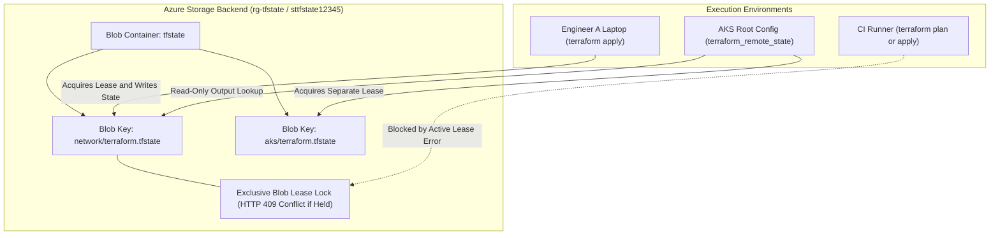
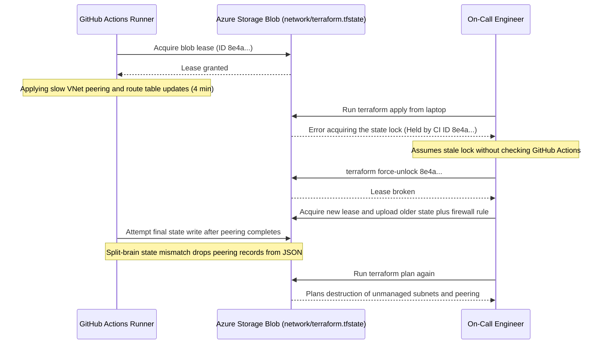

# Remote State & Collaboration

> **Prerequisites:** Completed Modules 00–04 (Terraform workflow, resource lifecycles, variables/outputs, `data` sources, and modules), Azure CLI installed and authenticated (`az login`), and `ARM_SUBSCRIPTION_ID` exported.  
> **Estimated Reading Time:** 35 minutes  
> **Target Audience:** Backend Engineers, Platform Engineers, DevOps & Cloud Infrastructure Engineers.

> [!TIP]
> **The Golden Rule of Terraform Remote State:** Never store shared infrastructure state on a local laptop or commit `terraform.tfstate` to Git—always bootstrap a dedicated Azure Storage account out-of-band, configure the `azurerm` backend with a unique `key` per stack, verify `-migrate-state` when transitioning from local state, and never run `terraform force-unlock` until you have proven no other apply is alive.

---

## Why This Matters

Everything so far kept `terraform.tfstate` as a file on your laptop. That's fine for solo learning and catastrophic for a team: two people can't share it, it's a single point of loss, it holds plaintext secrets, and nothing stops two applies from running at once and corrupting it. This module moves state into an **Azure Storage backend** with **locking** — the setup every real Terraform-on-Azure team uses, and a prerequisite for the CI/CD in module 07 and the capstone in module 08.

---

## 1. Architectural Mental Model: `azurerm` Blob Backend, Lease Locking & Cross-Stack Reads

A remote backend separates **execution** (your laptop or an ephemeral CI runner) from **state persistence and coordination** (an Azure Storage container). Each independent Terraform root configuration writes to its own isolated blob `key`, protected by an Azure Storage **blob lease** whenever a state-mutating operation runs:



### Core Concepts

#### Why local state breaks in a team
Local state has four failure modes that all appear the instant a second person (or a CI runner) is involved:

- **No sharing.** Your teammate's Terraform has no idea what yours created — their state file is empty, so their `plan` wants to create duplicates of everything.
- **No locking.** If you and a colleague `apply` at the same time, two processes write the same state file and one clobbers the other, corrupting it. There's no coordination.
- **Single point of loss.** State lives on one laptop. Lose the laptop (or the file), and Terraform forgets it manages your entire production estate.
- **Secret exposure.** State is plaintext and can contain secrets; a file on a laptop or in Git is a leak waiting to happen.

Remote state solves all four: one shared, durable, access-controlled, lockable copy.

#### Backends: where state lives
A **backend** determines where Terraform reads and writes state. The default is `local` (the file you've been using). For Azure the standard choice is the **`azurerm` backend**, which stores the state file as a **blob** in an Azure Storage account container:

```hcl
terraform {
  backend "azurerm" {
    resource_group_name  = "rg-tfstate"
    storage_account_name = "sttfstate12345"
    container_name       = "tfstate"
    key                  = "network/terraform.tfstate"
  }
}
```

- `resource_group_name` / `storage_account_name` / `container_name` — where the blob lives.
- `key` — the blob name; effectively the path/identity of *this* config's state. Different configs (or environments) use different keys in the same container so their states never collide.

#### The chicken-and-egg problem (and how to solve it)
The storage account that holds your state can't itself be created by the same Terraform config that *uses* it as a backend — the backend must exist before `init` can configure it. The standard solution is **bootstrap the backend storage once with `az`** (or a tiny separate Terraform config with local state), then point every other config's backend at it. You'll do exactly this in the exercises: create the storage account with `az`, then configure the `azurerm` backend to use it.

#### State locking with the `azurerm` backend
The `azurerm` backend acquires a **blob lease** on the state blob for the duration of any state-modifying operation (`apply`, `destroy`, some `state` commands). While the lease is held, a second Terraform run against the same state **blocks / fails** rather than corrupting it — that's the locking. Locking is automatic with the `azurerm` backend; you don't configure anything extra. If a run is interrupted (killed mid-apply, lost network), the lease can be left dangling, and the next run reports the state as locked — which you fix with `terraform force-unlock <LOCK_ID>` (carefully — only when you're sure no other apply is actually running).

#### Migrating existing local state to a backend
When you add a `backend` block to a config that already has local state, the next `terraform init` detects the change and offers to **copy your existing state up** to the new backend:

```bash
terraform init -migrate-state
```

Answer `yes` and your local `terraform.tfstate` contents are uploaded to the blob; from then on Terraform reads/writes the remote copy. Get this step right and you keep managing your existing resources; skip it and Terraform starts from an empty remote state (thinking it manages nothing).

#### Reading another config's state
Teams often split infrastructure across configs (a "network" config, an "AKS" config). The AKS config can read the network config's outputs via a `terraform_remote_state` data source pointing at the network config's state blob — a read-only way to consume another team's outputs without managing their resources. It's the cross-config sibling of the `data`-source pattern from module 03; you'll see the direction of it here and can lean on it in the capstone.

---

## 2. Taxonomic Comparison: State Backends, Init Modes & Lock Operations

| Dimension | `local` Backend | `azurerm` Blob Backend | HCP Terraform / Managed Remote |
| :--- | :--- | :--- | :--- |
| **Storage Location** | Workstation disk (`terraform.tfstate`) | Azure Storage Blob (`*.tfstate`) | HashiCorp managed cloud storage |
| **Team Sharing** | None (manual copying breaks) | Native via RBAC / Entra ID / SAS | Native via workspace permissions |
| **Concurrency Locking** | Local OS lock only (useless across machines) | Automatic Azure Blob Lease (`infinite` lease during apply) | Server-side run queue & lock |
| **Encryption & Versioning** | Plaintext disk file | Encrypted at rest + Blob Versioning & Soft Delete | Server-encrypted + state history UI |
| **Bootstrap Overhead** | Zero | One-time `az` storage account + container creation | Workspace creation + token/OIDC |
| **Best Use Case** | Throwaway solo experiments | Production Terraform on Azure teams | Multi-cloud enterprise governance |

| Operation / Flag | Behavior on Existing State | When to Use | Risk if Misused |
| :--- | :--- | :--- | :--- |
| `terraform init -migrate-state` | Copies state from previous backend (e.g. `local`) to newly configured backend | First transition from local to remote `azurerm`, or moving blobs across keys | Interrupting mid-upload leaves stale local state if not cleaned up |
| `terraform init -reconfigure` | Ignores/detaches prior state and initializes cleanly against the configured backend | Fresh workspace cloning an existing remote backend (teammate/CI runner) | Using it instead of `-migrate-state` on an already-applied local stack starts empty and recreates everything |
| `terraform force-unlock <LOCK_ID>` | Breaks the remote blob lease without rolling back resources | After proving a prior runner crashed mid-operation and left an orphaned lease | Breaking an active teammate/CI lease causes concurrent writes and split-brain corruption |
| `terraform state push` | Overwrites remote state JSON with a local file | Last-resort recovery from an `errored.tfstate` backup | Overwriting newer remote state silently orphans live Azure resources |

---

## 3. Production War Story Post-Mortem: The `force-unlock` Split-Brain Outage

- **Severity:** SEV-1 (Production Platform & Shared Networking State Corruption)
- **Detection Time:** 18 minutes (after two engineers received conflicting `apply` summaries)
- **Resolution Time:** 2 hours 40 minutes (manual state snapshot restoration and `terraform import` reconciliation)
- **Impact:** An active CI deployment creating hub-spoke VNet peering was interrupted mid-flight when an on-call engineer manually ran `terraform force-unlock` and applied a separate change. Overlapping state writes dropped 4 subnet resource entries from `network/terraform.tfstate`, and the next scheduled apply queued deletion of live production subnets.

### What Happened



### Root Cause Analysis

1. **False-Positive Stale Lock Assumption:** The engineer ran `terraform force-unlock` solely because their terminal timed out waiting, without checking whether the CI pipeline job in the lock `Who`/`Info` metadata was still actively executing against ARM.
2. **No Storage-Level Guardrails:** The `tfstate` blob container lacked **Blob Versioning** and **Soft Delete**, making rollback to the pre-collision state snapshot require manual reconstruction from `errored.tfstate` and `terraform import`.
3. **Human Laptops Permitted to Write Production State:** Engineers held `Storage Blob Data Contributor` directly on the production state container alongside CI, bypassing the single-writer serialized pipeline pattern.

### The Fix & Architectural Hardening

- Enabled **Blob Versioning** (`--enable-versioning true`) and **14-day Blob Soft Delete** on `sttfstate*` so any corrupted state overwrite can be restored in seconds.
- Restricted direct human RBAC on production state blobs to `Storage Blob Data Reader` (read-only for `terraform plan` / `state pull`), granting write access exclusively to the CI OIDC service principal.
- Adopted a mandatory **Lock-Owner Verification Runbook**: inspect `Lock Info` (`Who`, `Created`, `Operation`), confirm the owning CI run ID is dead/cancelled, run `terraform state pull > backup.tfstate`, and only then run `force-unlock`.

---

## 4. Multi-Language Production Implementation: Remote State Lease Guard & Hygiene Automation

In production platforms, teams automate lease diagnostics so CI pipelines and engineers never blindly break an active lease. Each implementation below inspects the `azurerm` state blob's Azure Storage lease state and metadata, blocks breaking any lock newer than a safety TTL, and only releases genuinely orphaned leases.

````carousel
```go
package main

import (
	"context"
	"errors"
	"fmt"
	"os"
	"time"

	"github.com/Azure/azure-sdk-for-go/sdk/azidentity"
	"github.com/Azure/azure-sdk-for-go/sdk/storage/azblob"
	"github.com/Azure/azure-sdk-for-go/sdk/storage/azblob/lease"
)

// GuardedLeaseInspector checks whether a Terraform remote state blob lease is stale
// before permitting a break-lease operation.
func GuardedLeaseInspector(ctx context.Context, accountURL, container, blobKey string, staleAfter time.Duration) error {
	cred, err := azidentity.NewDefaultAzureCredential(nil)
	if err != nil {
		return fmt.Errorf("azure auth failed: %w", err)
	}

	client, err := azblob.NewClient(accountURL, cred, nil)
	if err != nil {
		return fmt.Errorf("create blob client: %w", err)
	}

	blobClient := client.ServiceClient().NewContainerClient(container).NewBlobClient(blobKey)
	props, err := blobClient.GetProperties(ctx, nil)
	if err != nil {
		return fmt.Errorf("fetch state blob properties: %w", err)
	}

	leaseStatus := ""
	if props.LeaseStatus != nil {
		leaseStatus = string(*props.LeaseStatus)
	}
	if leaseStatus != "locked" {
		fmt.Printf("State blob %s/%s is unlocked (status=%s).\n", container, blobKey, leaseStatus)
		return nil
	}

	// Terraform writes Lock Info into blob metadata or LastModified reflects active lock acquisition.
	age := time.Since(*props.LastModified)
	if age < staleAfter {
		return fmt.Errorf("REFUSING force break: lease active for %s (threshold %s); verify running CI job first",
			age.Round(time.Second), staleAfter)
	}

	leaseClient, err := lease.NewBlobClient(blobClient, nil)
	if err != nil {
		return fmt.Errorf("init lease client: %w", err)
	}

	if _, err := leaseClient.BreakLease(ctx, &lease.BlobBreakOptions{}); err != nil {
		return fmt.Errorf("break orphaned lease: %w", err)
	}
	fmt.Printf("Safely broke orphaned lease on %s/%s (idle age %s).\n", container, blobKey, age.Round(time.Second))
	return nil
}

func main() {
	ctx, cancel := context.WithTimeout(context.Background(), 15*time.Second)
	defer cancel()

	accountURL := os.Getenv("TFSTATE_ACCOUNT_URL")
	if accountURL == "" {
		fmt.Fprintln(os.Stderr, "Set TFSTATE_ACCOUNT_URL=https://<account>.blob.core.windows.net")
		os.Exit(1)
	}

	err := GuardedLeaseInspector(ctx, accountURL, "tfstate", "remote-demo/terraform.tfstate", 30*time.Minute)
	if err != nil && !errors.Is(err, context.Canceled) {
		fmt.Fprintf(os.Stderr, "State lease guard error: %v\n", err)
		os.Exit(1)
	}
}
```
<!-- slide -->
```typescript
import { DefaultAzureCredential } from "@azure/identity";
import { BlobServiceClient } from "@azure/storage-blob";

interface LockGuardResult {
  blobPath: string;
  leaseStatus: string;
  leaseState: string;
  actionTaken: "none" | "refused_active" | "broken_stale";
}

export async function inspectAndGuardStateLease(
  accountUrl: string,
  containerName: string,
  stateKey: string,
  staleThresholdMs: number
): Promise<LockGuardResult> {
  const credential = new DefaultAzureCredential();
  const serviceClient = new BlobServiceClient(accountUrl, credential);
  const blobClient = serviceClient
    .getContainerClient(containerName)
    .getBlobClient(stateKey);

  const props = await blobClient.getProperties();
  const leaseStatus = props.leaseStatus ?? "unknown";
  const leaseState = props.leaseState ?? "unknown";

  if (leaseStatus !== "locked") {
    return {
      blobPath: `${containerName}/${stateKey}`,
      leaseStatus,
      leaseState,
      actionTaken: "none",
    };
  }

  const lastModifiedMs = props.lastModified?.getTime() ?? Date.now();
  const idleAgeMs = Date.now() - lastModifiedMs;

  if (idleAgeMs < staleThresholdMs) {
    throw new Error(
      `Refusing lease break on ${stateKey}: lock age ${Math.round(idleAgeMs / 1000)}s is below threshold ${Math.round(staleThresholdMs / 1000)}s.`
    );
  }

  const leaseClient = blobClient.getBlobLeaseClient();
  await leaseClient.breakLease(0);

  return {
    blobPath: `${containerName}/${stateKey}`,
    leaseStatus,
    leaseState,
    actionTaken: "broken_stale",
  };
}
```
<!-- slide -->
```python
from dataclasses import dataclass
from datetime import datetime, timedelta, timezone
from azure.identity import DefaultAzureCredential
from azure.storage.blob import BlobServiceClient, BlobLeaseClient


@dataclass(frozen=True)
class LeaseAuditReport:
    blob_key: str
    lease_status: str
    lease_state: str
    action: str


def guard_remote_state_lease(
    account_url: str,
    container_name: str,
    blob_key: str,
    stale_after: timedelta = timedelta(minutes=30),
) -> LeaseAuditReport:
    """Inspect an azurerm state blob lease and only break genuinely orphaned locks."""
    credential = DefaultAzureCredential()
    service_client = BlobServiceClient(account_url=account_url, credential=credential)
    blob_client = service_client.get_blob_client(container=container_name, blob=blob_key)

    props = blob_client.get_blob_properties()
    lease_status = str(props.lease.status or "unlocked")
    lease_state = str(props.lease.state or "available")

    if lease_status != "locked":
        return LeaseAuditReport(blob_key, lease_status, lease_state, "no_lock_present")

    idle_age = datetime.now(timezone.utc) - props.last_modified
    if idle_age < stale_after:
        raise RuntimeError(
            f"Refusing to break active state lease on '{blob_key}': "
            f"age {idle_age.total_seconds():.0f}s < threshold {stale_after.total_seconds():.0f}s"
        )

    lease_client = BlobLeaseClient(blob_client)
    lease_client.break_lease(lease_break_period=0)
    return LeaseAuditReport(blob_key, lease_status, lease_state, "broken_stale_lease")
```
<!-- slide -->
```csharp
using Azure.Identity;
using Azure.Storage.Blobs;
using Azure.Storage.Blobs.Models;
using Azure.Storage.Blobs.Specialized;

namespace Platform.StateGuard;

public sealed record StateLeaseReport(
    string BlobKey,
    string LeaseStatus,
    string LeaseState,
    string ActionTaken);

public static class RemoteStateLeaseGuard
{
    public static async Task<StateLeaseReport> InspectAndGuardAsync(
        Uri accountUri,
        string containerName,
        string blobKey,
        TimeSpan staleThreshold,
        CancellationToken cancellationToken = default)
    {
        var credential = new DefaultAzureCredential();
        var serviceClient = new BlobServiceClient(accountUri, credential);
        var blobClient = serviceClient
            .GetBlobContainerClient(containerName)
            .GetBlobClient(blobKey);

        BlobProperties props = (await blobClient.GetPropertiesAsync(cancellationToken: cancellationToken)).Value;
        string status = props.LeaseStatus.ToString();
        string state = props.LeaseState.ToString();

        if (props.LeaseStatus != LeaseStatus.Locked)
        {
            return new StateLeaseReport(blobKey, status, state, "NoActiveLease");
        }

        TimeSpan age = DateTimeOffset.UtcNow - props.LastModified;
        if (age < staleThreshold)
        {
            throw new InvalidOperationException(
                $"Refusing to break lease on '{blobKey}': age {age.TotalMinutes:F1}m is under safety threshold {staleThreshold.TotalMinutes:F1}m.");
        }

        BlobLeaseClient leaseClient = blobClient.GetBlobLeaseClient();
        await leaseClient.BreakAsync(breakPeriod: TimeSpan.Zero, cancellationToken: cancellationToken);

        return new StateLeaseReport(blobKey, status, state, "BrokenOrphanedLease");
    }
}
```
````

---

## 5. Command Reference & Flag Breakdowns

| Command | What it does | Example |
|---|---|---|
| `terraform init -migrate-state` | Initializes and copies existing state into a newly configured backend | `terraform init -migrate-state` |
| `terraform init -reconfigure` | Re-initializes the backend *without* migrating (start fresh against it) | `terraform init -reconfigure` |
| `terraform force-unlock <ID>` | Releases a stuck state lock by its lock ID | `terraform force-unlock 3f2a...` |
| `terraform state pull` | Prints the current remote state to stdout | `terraform state pull` |
| `terraform state push` | Overwrites remote state from a local file (dangerous) | `terraform state push errored.tfstate` |
| `az storage account create` | Creates the storage account for the backend | see exercises |
| `az storage container create` | Creates the blob container that holds state | see exercises |

Flag breakdown — `terraform init -migrate-state`:
- `-migrate-state` — when the backend config changed (e.g. local → azurerm), copies the existing state into the new backend after prompting. Use this the first time you point an already-applied config at a remote backend.

Flag breakdown — `terraform force-unlock <LOCK_ID>`:
- `<LOCK_ID>` — the ID Terraform prints when it reports state is locked. This *only* releases the lock; it does not roll back a partial apply. Run it **only** when you're certain no other Terraform process is actually operating on that state — force-unlocking a genuinely-in-progress apply reintroduces the corruption locking exists to prevent.

---

## 6. Practical Hands-On Verification CLI Workflows

The storage account is nearly free (a state blob is tiny), but you'll clean it up at the end anyway. Storage account names must be **globally unique** and lowercase alphanumeric — append random digits.

1. **Bootstrap the backend storage with `az`.** State can't create its own backend, so use `az`:
   ```bash
   SUFFIX=$RANDOM
   az group create -n rg-tfstate -l eastus
   az storage account create -n "sttfstate${SUFFIX}" -g rg-tfstate \
     -l eastus --sku Standard_LRS --min-tls-version TLS1_2
   az storage container create -n tfstate \
     --account-name "sttfstate${SUFFIX}"
   echo "Your storage account name is: sttfstate${SUFFIX}"
   ```
   **Expected Output:**
   ```text
   {
     "created": true
   }
   Your storage account name is: sttfstate18492
   ```
   > Verify: note the printed account name — you'll paste it into the backend block. Confirm with `az storage account show -n sttfstate${SUFFIX} -g rg-tfstate -o table`.

2. **Create a config with local state first.** New directory:
   ```bash
   mkdir -p ~/tf-labs/05-remote-state && cd ~/tf-labs/05-remote-state
   export ARM_SUBSCRIPTION_ID="$(az account show --query id -o tsv)"
   ```
   Create `main.tf` with the provider skeleton and a simple resource group named `rg-tf-remote-demo` in `eastus`. Then:
   ```bash
   terraform init
   terraform apply
   ```
   **Expected Output:**
   ```text
   Apply complete! Resources: 1 added, 0 changed, 0 destroyed.
   ```
   > Verify: a local `terraform.tfstate` file now exists (`ls`), and the group exists in Azure. This is the state you'll migrate.

3. **Add the azurerm backend block.** Add to the `terraform { ... }` block in `main.tf` (using *your* account name from exercise 1):
   ```hcl
   terraform {
     backend "azurerm" {
       resource_group_name  = "rg-tfstate"
       storage_account_name = "sttfstateNNNNN"   # your name here
       container_name       = "tfstate"
       key                  = "remote-demo/terraform.tfstate"
     }
     # ... keep your required_providers here too
   }
   ```

4. **Migrate the state to the backend.** Run:
   ```bash
   terraform init -migrate-state
   ```
   Answer `yes` when it asks to copy existing state.
   **Expected Output:**
   ```text
   Initializing the backend...
   Do you want to copy existing state to the new backend?
     Enter a value: yes

   Successfully configured the backend "azurerm"! Terraform will automatically
   use this backend unless the backend configuration changes.
   ```
   > Verify: it reports `Successfully configured the backend "azurerm"!` and that it copied state. Confirm the blob exists: `az storage blob list --account-name sttfstateNNNNN -c tfstate -o table` shows `remote-demo/terraform.tfstate`. Your local `terraform.tfstate` is now just a leftover — the real state lives in the blob.

5. **Prove state is now remote.** Run `terraform state pull | head` — it fetches state from the blob. Then run `terraform plan`.
   **Expected Output:**
   ```text
   {
     "version": 4,
     "terraform_version": "1.9.x",
     "serial": 1,
     ...
   No changes. Your infrastructure matches the configuration.
   ```
   > Verify: `No changes` — Terraform read the migrated remote state, sees the resource group already exists, and knows it manages it. Migration preserved everything.

6. **Observe locking in action.** In your terminal, start a long-running-ish operation and, in a *second* terminal (same directory), try to run another. The simplest reliable demo: run `terraform plan` in one shell while... actually, `plan` doesn't lock for long. Instead, observe the lock message directly:
   ```bash
   terraform apply -auto-approve &   # backgrounded apply grabs the lease
   terraform plan                    # immediately try another op
   ```
   **Expected Output (when colliding inside the lease window):**
   ```text
   Error: Error acquiring the state lock

   Error message: state blob is already locked
   Lock Info:
     ID:        2f9d3a10-7c45-4c11-b81e-92a1e5e4b011
     Path:      tfstate/remote-demo/terraform.tfstate
     Operation: OperationTypeApply
     Who:       user@workstation
   ```
   > Verify: the second command may print `Error acquiring the state lock` with a `Lock Info` block (ID, who, when) if it hits the window while the lease is held. This is the backend refusing concurrent state access. (If the apply finishes too fast to catch it, that's fine — you've seen what the lock error looks like; on a real multi-resource apply the window is much wider.)

7. **Diagnose and fix: a stuck lock.** Simulate a dangling lease. Manually acquire a lease on the state blob with `az` so Terraform thinks it's locked (this mimics an apply that was killed mid-run):
   ```bash
   az storage blob lease acquire \
     --account-name sttfstateNNNNN -c tfstate \
     -b remote-demo/terraform.tfstate --lease-duration -1
   ```
   Now run `terraform plan`.
   **Expected Output:**
   ```text
   Error: Error acquiring the state lock
   Error message: state blob is already locked
   ```
   > Verify: Terraform fails with `Error acquiring the state lock` and shows a `Lock Info` block. **Fix it** — first make absolutely sure no real Terraform run is in progress (there isn't; you faked it), then break the lease:
   > ```bash
   > az storage blob lease break \
   >   --account-name sttfstateNNNNN -c tfstate \
   >   -b remote-demo/terraform.tfstate
   > ```
   > Run `terraform plan` again — it now succeeds. (In a *real* Terraform-created lock you'd use `terraform force-unlock <ID>` with the ID from the error; here the lease was created out-of-band by `az`, so you release it the same way you made it. The lesson is identical: only break a lock when you're certain nothing legitimate holds it.)

8. **See why the `key` matters.** Imagine a second config for AKS. It would use the **same** storage account and container but a **different** key (e.g. `aks/terraform.tfstate`), so the two states never collide. Confirm your understanding by listing blobs — there's exactly one so far, at your key:
   ```bash
   az storage blob list --account-name sttfstateNNNNN -c tfstate -o table
   ```

9. **Clean up in the right order.** Destroy the managed resource first (while the backend still works), *then* remove the backend storage:
   ```bash
   terraform destroy
   az group delete -n rg-tfstate --yes --no-wait
   ```
   **Expected Output:**
   ```text
   Destroy complete! Resources: 1 destroyed.
   ```
   > Verify: `terraform destroy` removes `rg-tf-remote-demo`. Deleting `rg-tfstate` removes the storage account and the state blob with it. Order matters: if you delete the backend storage *first*, Terraform can't read state to destroy the managed resources. Confirm both groups are gone with `az group list -o table`.

### Independent challenge
Without copying the exercises, stand up a **shared backend** and use it for **two separate configs** that share one storage account/container but different `key`s — a "network" config (a resource group + VNet) and a "compute" config (just a second resource group). Migrate each to the backend, confirm from the storage account that there are now **two** state blobs at two keys, and then — the real goal — make the compute config read an output from the network config's state using a `terraform_remote_state` data source, proving one team's config can consume another's outputs without managing its resources. Destroy both configs and delete the backend storage last. This draws on this module's backend/key concepts, module 03's data-source thinking, and module 04's multi-config organization.

<details><summary>Stuck? One hint</summary>

The `terraform_remote_state` data source points at the *other* config's backend and exposes its `outputs`:

```hcl
data "terraform_remote_state" "network" {
  backend = "azurerm"
  config = {
    resource_group_name  = "rg-tfstate"
    storage_account_name = "sttfstateNNNNN"
    container_name       = "tfstate"
    key                  = "network/terraform.tfstate"
  }
}
```

Then reference `data.terraform_remote_state.network.outputs.<name>` — which means the network config must actually *declare* that `output`. Give each config a distinct `key` in its own backend block so their state blobs don't overwrite each other.

</details>

---

## 7. Common Mistakes & Troubleshooting

- **Trying to create the backend storage account inside the config that uses it.** Chicken-and-egg — the backend must exist before `init`. Bootstrap it with `az` (or a separate local-state config) first.
- **Skipping `-migrate-state` when adding a backend to an applied config.** Without migration, the remote state starts empty and Terraform thinks it manages nothing — a subsequent apply tries to recreate everything. Always migrate when moving existing state.
- **Reusing the same `key` for two different configs.** They'd share one state blob and stomp on each other. Every distinct config/environment gets its own `key`.
- **Force-unlocking a genuinely-running apply.** `force-unlock` (or breaking the lease) while another apply is truly in progress reintroduces exactly the corruption locking prevents. Only unlock when you're certain nothing legitimate holds the lock.
- **Committing the leftover local `terraform.tfstate` after migrating.** It's stale and still plaintext. Keep it `.gitignore`d; the source of truth is now the blob.
- **Cost pitfall:** the state storage account is tiny and cheap, but it's a *persistent* resource that outlives your ephemeral labs — it won't get swept up by a `terraform destroy` of your workload config. Track it separately and delete `rg-tfstate` when you're truly done, or it lingers (cheaply, but forgotten) forever.

---

## 8. Operational Validation Checkpoints

<details><summary><strong>Checkpoint 1: A teammate clones your repo and runs <code>terraform init</code> against the existing <code>azurerm</code> backend, but accidentally passes <code>-migrate-state</code> when they have no local state—versus passing <code>-reconfigure</code>. Which is right when onboarding a fresh workstation?</strong></summary>

**Answer:** `terraform init` (or `terraform init -reconfigure` if switching local backend settings) is used on a fresh workstation because there is no local `terraform.tfstate` to upload; the source of truth already lives in the remote blob. You only use `-migrate-state` when migrating existing state *from* an older backend (such as local state) *into* a new backend. On a fresh clone, standard `terraform init` simply wires `.terraform/` to read the existing remote blob.

</details>

<details><summary><strong>Checkpoint 2: Your production pipeline fails with <code>Error acquiring the state lock</code> citing Lock ID <code>a91e...</code> created 3 hours ago by <code>github-actions</code>. What exact steps must occur before running <code>terraform force-unlock a91e...</code>?</strong></summary>

**Answer:** First inspect the CI workflow run referenced in the lock metadata (`Who` / `Created`) and confirm the runner truly crashed or was cancelled—not simply waiting on a long `azurerm_kubernetes_cluster` creation or approval step. Second, verify no secondary runner has started. Third, pull a local safety backup via `terraform state pull > pre-unlock-backup.tfstate`. Only after verifying zero active ARM writers exist should you execute `terraform force-unlock a91e...`.

</details>

<details><summary><strong>Checkpoint 3: A developer accidentally ran <code>az group delete -n rg-tfstate</code> while the AKS cluster managed by that state is still running in <code>rg-tf-prod</code>. What breaks immediately, and how do you recover?</strong></summary>

**Answer:** `terraform plan` and `terraform destroy` can no longer read the remote state file (backend container missing), so Terraform loses track of all live resources in `rg-tf-prod` and cannot destroy or safely update them. Recovery requires either restoring the deleted storage account/blob if soft-delete or backups exist, or bootstrapping a fresh backend storage account and using `terraform import` (or `import {}` blocks) to re-bind every surviving resource in `rg-tf-prod` into state before planning or destroying.

</details>

---

## 9. Checkpoint Quiz & Cumulative Review

### Checkpoint quiz
Write down your answer to each question before expanding it — checking without attempting first is the single easiest way to fool yourself into thinking you've learned this.

1. Name three distinct ways local state breaks the moment a second person joins the project.
2. What is a "backend," and what does the `azurerm` backend use to store state?
3. What does the `key` field in an `azurerm` backend block identify, and why must two different configs use different keys?
4. Why can't the storage account that holds your state be created by the same config that uses it as a backend? What do you do instead?
5. How does the `azurerm` backend implement state locking, and is it automatic or something you configure?
6. You added a backend block to an already-applied config. What flag do you pass to `init`, and what happens if you forget it?
7. Terraform reports the state is locked, but you're sure no apply is running. What command releases it, and what's the one condition you must verify first?
8. How can an "AKS" config read an output from a separate "network" config's remote state without managing the network's resources?

<details><summary>Show answers</summary>

1. Any three of: no sharing (teammates' state is empty and they recreate duplicates); no locking (concurrent applies corrupt the file); single point of loss (one laptop holds it); secret exposure (plaintext state on a laptop/Git).
2. A backend determines where Terraform stores and reads state. The `azurerm` backend stores it as a blob in an Azure Storage container.
3. `key` is the blob name — the identity/path of *this* config's state. Different configs need different keys so their state blobs don't overwrite each other in the same container.
4. The backend must exist before `terraform init` can configure it (chicken-and-egg). Bootstrap the storage account/container first with `az` (or a small separate local-state config), then point the backend at it.
5. It takes a blob lease on the state blob for the duration of state-modifying operations, so a concurrent run blocks/fails instead of corrupting state. It's automatic — no extra configuration.
6. `terraform init -migrate-state` (and answer `yes` to copy state up). If you forget, the remote state starts empty and Terraform thinks it manages nothing, so the next apply tries to recreate everything.
7. `terraform force-unlock <LOCK_ID>` (using the ID from the error). First verify that no other Terraform process is genuinely operating on that state — unlocking a real in-progress apply reintroduces corruption.
8. With a `terraform_remote_state` data source pointing at the network config's backend/key, then referencing `data.terraform_remote_state.network.outputs.<name>` — read-only, no management of the other config's resources.

</details>

### Cumulative review
Closed-book. Cover the answers and write each out first — this mixes everything from modules 00-05, the halfway mark of the track.

1. Give the imperative-vs-declarative distinction in one sentence, and name the file that makes Terraform's declarative reconciliation possible.
2. What two blocks are mandatory in any minimal Azure config, and what empty block must the provider block contain?
3. Walk the full first-time lifecycle of a resource: which commands, in order, from nothing to created-and-recorded to torn down?
4. In a plan you see `-/+` on an `azurerm_kubernetes_cluster`. Explain what that means and why you'd stop and investigate before applying.
5. What's the difference between a `variable`, a `local`, an `output`, and a `data` source — one clause each?
6. You want to deploy *into* a VNet another team owns and manages, without taking it over. Which construct do you use, and how does the plan show it?
7. What's the difference between a child module declaring `required_providers` and configuring a `provider` block, and which should it do?
8. A single `terraform apply` proposes creating 40 resources when you expected 4. Name the two most likely causes and the one habit that catches it.
9. Why does local state break for a team, and what specifically does the `azurerm` backend add to fix locking?
10. You migrated a config to a remote backend but a later `plan` wants to recreate everything. What did you most likely skip?

<details><summary>Show answers</summary>

1. Imperative tells Azure the exact actions to run now; declarative describes desired end state and Terraform reconciles reality to it idempotently. The **state file** makes that reconciliation possible.
2. The `terraform` block (with `required_providers`) and the `provider "azurerm"` block; the provider block must contain an empty `features {}`.
3. `terraform init` → `terraform plan` → `terraform apply` (creates and records in state) → `terraform destroy` (tears down).
4. `-/+` is destroy-and-recreate: an immutable attribute changed, so Terraform would delete the cluster and build a new one — for AKS that means downtime and a brand-new cluster, so you investigate what's forcing replacement first.
5. `variable` = caller-supplied input; `local` = internally-derived named value; `output` = value surfaced after apply for consumers; `data` source = read-only reference to something that already exists.
6. A `data` source (or `terraform_remote_state` for another config's outputs). It shows in the plan as a read (`<=`), never a create/destroy, because Terraform doesn't manage it.
7. `required_providers` declares which providers/versions the module needs; a `provider` block configures auth/features/subscription. A child module should declare `required_providers` only and let the root configure the provider.
8. Likely causes: a `count`/`for_each` wired to the wrong or larger-than-expected collection, or a change that forced widespread replacement. The habit that catches it: reading the plan's `N to add` summary before confirming.
9. Local state can't be shared, isn't locked (concurrent applies corrupt it), lives on one machine, and leaks secrets. The `azurerm` backend adds locking via a blob lease so concurrent state writes block instead of corrupting.
10. `terraform init -migrate-state` (answering yes to copy existing state up) — without it the remote state started empty, so Terraform thinks it manages nothing.

</details>

---

## Next
[06 — Provisioning real Azure infrastructure](../06-provisioning-azure-infrastructure/README.md): put it all together and rebuild, declaratively, the VNet+NSG from track 5 and the AKS cluster + ACR from track 7 — the by-hand work now as code.
