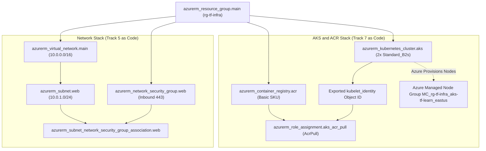
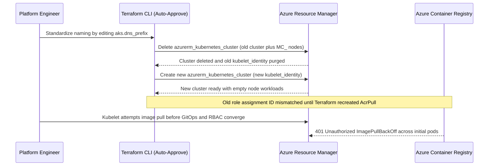

# Provisioning Real Azure Infrastructure

> **Prerequisites:** Completed Modules 00–05 (Terraform workflow, `azurerm` provider, variables/outputs, remote state backend), plus foundational understanding of Azure VNets/NSGs (Track 5) and AKS/ACR (Track 7).  
> **Estimated Reading Time:** 40 minutes  
> **Target Audience:** Backend Engineers, Kubernetes Platform Engineers, Cloud Infrastructure Engineers.

> [!TIP]
> **The Golden Rule of Declarative Azure Provisioning:** Treat every `terraform plan` output for stateful compute (`azurerm_kubernetes_cluster`, subnets, or databases) like a database schema migration—never approve an unreviewed `-/+` force-replacement line, always bind `AcrPull` to `kubelet_identity[0].object_id` (not the control-plane identity), and run `terraform destroy` immediately after completing billable labs.

---

## Why This Matters

This is the payoff module. Everything before it was mechanics; here you rebuild — declaratively — the exact infrastructure you created by hand in tracks 5 and 7: a VNet with subnets and an NSG, then an AKS cluster with an attached ACR. When you're done you'll have one `terraform apply` that stands up what previously took a dozen carefully-ordered `az` commands, and one `terraform destroy` that removes all of it. This is also the **first module that creates genuinely billable resources** (an AKS cluster's node VMs) — so the destroy discipline you've been practicing on free resources now matters for real.

> **Cost warning.** An AKS cluster bills for its worker-node VMs (and their disks, and any load balancers/public IPs) for as long as it exists, whether or not you run workloads on it — exactly as track 7 warned. Use a small node count and a burstable VM size, and **`terraform destroy` the moment you finish**, or `az aks stop` between sessions. Read every plan's `N to add` before confirming.

---

## 1. Architectural Mental Model: Terraform Dependency Graph & AKS-ACR Identity Wiring

Instead of manually sequencing imperative `az` commands, Terraform derives an exact Directed Acyclic Graph (DAG) from resource attribute references (`azurerm_subnet.web.id`, `kubelet_identity[0].object_id`), provisioning upstream parents before wiring downstream associations and RBAC bindings:



### Core Concepts

#### The VNet + subnet + NSG stack, declaratively
This is track 5 modules 01-02 as code. The NSG rule fields map one-to-one to the `az network nsg rule create` flags you used:

```hcl
resource "azurerm_network_security_group" "web" {
  name                = "web-nsg"
  location            = azurerm_resource_group.main.location
  resource_group_name = azurerm_resource_group.main.name

  security_rule {
    name                       = "allow-https"
    priority                   = 100
    direction                  = "Inbound"
    access                     = "Allow"
    protocol                   = "Tcp"
    source_port_range          = "*"
    destination_port_range     = "443"
    source_address_prefix      = "*"
    destination_address_prefix = "*"
  }
}

resource "azurerm_subnet_network_security_group_association" "web" {
  subnet_id                 = azurerm_subnet.web.id
  network_security_group_id = azurerm_network_security_group.web.id
}
```

Note the **separate association resource**: in `azurerm`, attaching an NSG to a subnet is its own resource (`azurerm_subnet_network_security_group_association`), not a field on the subnet. This mirrors the fact that in track 5 the NSG and its subnet binding were distinct steps.

#### AKS as a resource
`azurerm_kubernetes_cluster` is track 7 module 01's `az aks create`. The core arguments map directly to the flags you used:

```hcl
resource "azurerm_kubernetes_cluster" "aks" {
  name                = "aks-tf-learn"
  location            = azurerm_resource_group.main.location
  resource_group_name = azurerm_resource_group.main.name
  dns_prefix          = "akstflearn"

  default_node_pool {
    name       = "system"
    node_count = 2
    vm_size    = "Standard_B2s"
  }

  identity {
    type = "SystemAssigned"
  }
}
```

- `default_node_pool` — the system node pool (track 7's concept): `vm_size` is `--node-vm-size`, `node_count` is `--node-count`.
- `identity { type = "SystemAssigned" }` — gives the cluster a managed identity, the modern default and what the AcrPull assignment will target.
- `dns_prefix` — required; forms part of the cluster's API server FQDN.

The cluster's kubelet identity (a separate managed identity AKS creates for pulling images) is exported as `azurerm_kubernetes_cluster.aks.kubelet_identity[0].object_id` — you need it for the ACR attach.

#### ACR and the AcrPull attach
`azurerm_container_registry` is `az acr create`. The attach is a role assignment granting the cluster's kubelet identity `AcrPull` on the registry — which is literally what `az aks update --attach-acr` does:

```hcl
resource "azurerm_container_registry" "acr" {
  name                = "acrtflearn12345"   # globally unique, alphanumeric
  resource_group_name = azurerm_resource_group.main.name
  location            = azurerm_resource_group.main.location
  sku                 = "Basic"
  admin_enabled       = false
}

resource "azurerm_role_assignment" "aks_acr_pull" {
  principal_id                     = azurerm_kubernetes_cluster.aks.kubelet_identity[0].object_id
  role_definition_name             = "AcrPull"
  scope                            = azurerm_container_registry.acr.id
  skip_service_principal_aad_check = true
}
```

Because the role assignment references both the cluster's kubelet identity *and* the ACR's ID, Terraform's dependency graph creates the cluster and registry first, then wires them together — the ordering you had to do manually with `az` is now automatic.

#### Getting kubeconfig out via an output
Track 7's `az aks get-credentials` has a Terraform analogue: the cluster exports `kube_config_raw` (the full kubeconfig). You surface it as a **sensitive** output and can write it to a file:

```hcl
output "kube_config" {
  value     = azurerm_kubernetes_cluster.aks.kube_config_raw
  sensitive = true
}
```

Then `terraform output -raw kube_config > ~/.kube/aks-tf-config`. It's sensitive because it contains cluster credentials — and, as module 03 warned, it's still stored in plaintext in state, another reason your state belongs in the locked remote backend from module 05.

---

## 2. Taxonomic Comparison: `az` Imperative vs `azurerm` Declarative, AKS Identities & Mutability

### Mapping `az` resources to `azurerm` resource types
Each thing you made with `az` in tracks 5/7 has a direct `azurerm` counterpart. The mapping you'll use in this module:

| Track 5/7 `az` command | `azurerm` resource type |
|---|---|
| `az network vnet create` | `azurerm_virtual_network` |
| `az network vnet subnet create` | `azurerm_subnet` |
| `az network nsg create` + rules | `azurerm_network_security_group` |
| (associate NSG to subnet) | `azurerm_subnet_network_security_group_association` |
| `az acr create` | `azurerm_container_registry` |
| `az aks create` | `azurerm_kubernetes_cluster` |
| `az aks update --attach-acr` | `azurerm_role_assignment` (AcrPull) |

The last two rows are the interesting ones — the AKS↔ACR attach that was a single `az aks update --attach-acr` flag becomes an explicit **role assignment** in Terraform, which is actually a more honest picture of what that flag did under the hood (grant the cluster's kubelet identity `AcrPull` on the registry).

### Cluster Control-Plane Identity vs Kubelet Identity

| Identity Attribute | Azure Scope & Purpose | Used For | Common Mistake |
| :--- | :--- | :--- | :--- |
| `identity[0].principal_id` | Cluster Control Plane (ARM API calls) | Managing Azure Load Balancers, Public IPs, and Managed Disks | Granting `AcrPull` here leaves nodes unable to pull container images (`ImagePullBackOff`) |
| `kubelet_identity[0].object_id` | Node VM Kubelet Agent | Authenticating node pulls against Azure Container Registry (`AcrPull`) | Omitting `[0]` index throws a HCL list-indexing error |

### AKS Attribute Mutability (In-Place Update vs Replacement)

| Attribute Modified | Terraform Plan Symbol | Azure Behavior | Operational Impact |
| :--- | :--- | :--- | :--- |
| `default_node_pool.node_count` | `~` (update in-place) | Scales VMSS nodes up/down | Zero control-plane outage |
| `tags` | `~` (update in-place) | Updates ARM metadata | Zero downtime |
| `dns_prefix` | `-/+` (forces replacement) | Destroys cluster & creates new cluster | Complete outage + new `kubelet_identity` + lost workloads |
| `default_node_pool.name` | `-/+` (forces replacement) | Cannot rename system pool in-place | Complete cluster rebuild unless `temporary_name_for_rotation` is used |

---

## 3. Production War Story Post-Mortem: The Unreviewed `dns_prefix` Edit That Rebuilt Production AKS

- **Severity:** SEV-1 (Complete Production Kubernetes Cluster Wipe)
- **Detection Time:** 4 minutes (Kubernetes ingress endpoints & health probes failed simultaneously)
- **Resolution Time:** 1 hour 55 minutes (cluster rebuild + Helm/GitOps re-sync + DNS cutover)
- **Impact:** All running production pods, persistent volume claims with `Delete` reclaim policies, and the cluster's `kubelet_identity` were wiped during a routine network PR merge, causing 115 minutes of downtime and `ImagePullBackOff` errors even after the new cluster booted.

### What Happened



### Root Cause Analysis

1. **Unchecked `-/+` Forces Replacement:** Changing `dns_prefix` triggered `# forces replacement` on `azurerm_kubernetes_cluster`. Because `terraform apply -auto-approve` ran without inspecting plan actions, Terraform destroyed the production cluster first (`create_before_destroy` wasn't even viable due to identical cluster name).
2. **Missing `prevent_destroy` Lifecycle Guard:** The `azurerm_kubernetes_cluster` block lacked `lifecycle { prevent_destroy = true }`, allowing automated tooling to delete a Tier-0 cluster without failing the plan step.
3. **RBAC Propagation Delay:** Creating a brand-new cluster also rotated `kubelet_identity[0].object_id`, forcing replacement of `azurerm_role_assignment.aks_acr_pull` and briefly breaking image pulls.

### The Fix & Architectural Hardening

- Added `lifecycle { prevent_destroy = true }` to stateful production resources (`azurerm_kubernetes_cluster`, `azurerm_container_registry`, `azurerm_virtual_network`) so any accidental replacement aborts before touching Azure.
- Integrated an automated **Plan JSON Destruction Guard** in CI that parses `terraform show -json tfplan` and blocks any PR containing `"delete"` inside `resource_changes[].change.actions` for AKS clusters unless explicitly overridden by a Change Advisory label.

---

## 4. Multi-Language Production Implementation: Terraform Plan Replacement & `AcrPull` Guard

Production platform teams run automated plan analyzers against `terraform show -json tfplan` before `apply` to catch destructive AKS replacements (`["delete", "create"]`) and verify `azurerm_role_assignment` correctly targets `kubelet_identity` with `AcrPull`.

````carousel
```go
package main

import (
	"encoding/json"
	"fmt"
	"os"
)

type PlanDocument struct {
	ResourceChanges []ResourceChange `json:"resource_changes"`
}

type ResourceChange struct {
	Address string `json:"address"`
	Type    string `json:"type"`
	Change  Change `json:"change"`
}

type Change struct {
	Actions []string       `json:"actions"`
	After   map[string]any `json:"after"`
}

func ValidateInfraPlan(planJSON []byte) error {
	var doc PlanDocument
	if err := json.Unmarshal(planJSON, &doc); err != nil {
		return fmt.Errorf("parse tfplan json: %w", err)
	}

	for _, rc := range doc.ResourceChanges {
		if rc.Type == "azurerm_kubernetes_cluster" && contains(rc.Change.Actions, "delete") {
			return fmt.Errorf("BLOCKED: %s proposes destructive action %v (check immutable fields like dns_prefix)",
				rc.Address, rc.Change.Actions)
		}
		if rc.Type == "azurerm_role_assignment" && rc.Change.After != nil {
			role, _ := rc.Change.After["role_definition_name"].(string)
			if role == "Owner" || role == "Contributor" {
				return fmt.Errorf("BLOCKED: %s uses over-privileged role %q; scope AKS pulls strictly to AcrPull",
					rc.Address, role)
			}
		}
	}
	return nil
}

func contains(items []string, target string) bool {
	for _, item := range items {
		if item == target {
			return true
		}
	}
	return false
}

func main() {
	path := "plan.json"
	if len(os.Args) > 1 {
		path = os.Args[1]
	}
	data, err := os.ReadFile(path)
	if err != nil {
		fmt.Fprintf(os.Stderr, "Read %s: %v\n", path, err)
		os.Exit(1)
	}
	if err := ValidateInfraPlan(data); err != nil {
		fmt.Fprintln(os.Stderr, err)
		os.Exit(1)
	}
	fmt.Println("Plan safety check passed: zero AKS replacements and least-privilege AcrPull verified.")
}
```
<!-- slide -->
```typescript
import { readFileSync } from "node:fs";

interface ResourceChange {
  address: string;
  type: string;
  change: {
    actions: string[];
    after: Record<string, unknown> | null;
  };
}

interface TerraformPlan {
  resource_changes?: ResourceChange[];
}

export function validateAksPlan(planPath: string): void {
  const raw = readFileSync(planPath, "utf-8");
  const plan: TerraformPlan = JSON.parse(raw);

  for (const rc of plan.resource_changes ?? []) {
    const actions = rc.change.actions;

    if (rc.type === "azurerm_kubernetes_cluster" && actions.includes("delete")) {
      throw new Error(
        `CRITICAL: ${rc.address} has destructive plan actions [${actions.join(", ")}]. Revert immutable field changes.`
      );
    }

    if (rc.type === "azurerm_container_registry" && rc.change.after) {
      if (rc.change.after["admin_enabled"] === true) {
        throw new Error(
          `POLICY VIOLATION: ${rc.address} sets admin_enabled=true. Use AcrPull role assignment on kubelet_identity instead.`
        );
      }
    }
  }
}
```
<!-- slide -->
```python
import json
import sys
from pathlib import Path


def guard_aks_plan(plan_json_path: Path) -> None:
    """Block forced AKS replacements and enforce AcrPull least-privilege in tfplan JSON."""
    plan = json.loads(plan_json_path.read_text(encoding="utf-8"))
    violations: list[str] = []

    for rc in plan.get("resource_changes", []):
        r_type = rc.get("type")
        addr = rc.get("address")
        actions = rc.get("change", {}).get("actions", [])
        after = rc.get("change", {}).get("after") or {}

        if r_type == "azurerm_kubernetes_cluster" and "delete" in actions:
            violations.append(
                f"{addr}: proposes destructive actions {actions} (# forces replacement)"
            )

        if r_type == "azurerm_role_assignment":
            role = after.get("role_definition_name")
            if role and role != "AcrPull":
                violations.append(
                    f"{addr}: expected least-privilege role 'AcrPull', found '{role}'"
                )

    if violations:
        raise SystemExit("Plan guard failed:\n - " + "\n - ".join(violations))

    print("Plan guard passed: AKS preserved and AcrPull least-privilege verified.")


if __name__ == "__main__":
    guard_aks_plan(Path(sys.argv[1] if len(sys.argv) > 1 else "plan.json"))
```
<!-- slide -->
```csharp
using System.Text.Json;
using System.Text.Json.Nodes;

namespace Platform.PlanGuards;

public static class AksInfraPlanValidator
{
    public static void Validate(string planJsonPath)
    {
        string rawJson = File.ReadAllText(planJsonPath);
        JsonNode? root = JsonNode.Parse(rawJson);
        JsonArray? changes = root?["resource_changes"]?.AsArray();

        if (changes is null)
        {
            return;
        }

        foreach (JsonNode? node in changes)
        {
            string? type = node?["type"]?.GetValue<string>();
            string? address = node?["address"]?.GetValue<string>();
            List<string> actions = node?["change"]?["actions"]?
                .AsArray()
                .Select(a => a!.GetValue<string>())
                .ToList() ?? [];

            if (type == "azurerm_kubernetes_cluster" && actions.Contains("delete"))
            {
                throw new InvalidOperationException(
                    $"Blocked: {address} scheduled for destructive actions [{string.Join(", ", actions)}].");
            }

            if (type == "azurerm_container_registry")
            {
                bool? adminEnabled = node?["change"]?["after"]?["admin_enabled"]?.GetValue<bool>();
                if (adminEnabled == true)
                {
                    throw new InvalidOperationException(
                        $"Policy failure on {address}: admin_enabled must be false; attach kubelet_identity via AcrPull.");
                }
            }
        }
    }
}
```
````

---

## 5. Command Reference & Argument Breakdown

| Command | What it does | Example |
|---|---|---|
| `terraform apply` | Builds the whole stack after confirmation | `terraform apply` |
| `terraform output -raw kube_config` | Extracts the raw kubeconfig from a sensitive output | `terraform output -raw kube_config > ~/.kube/aks-tf` |
| `terraform state show <addr>` | Inspects a provisioned resource's recorded attributes | `terraform state show azurerm_kubernetes_cluster.aks` |
| `az aks get-credentials` | Alternative way to fetch kubeconfig for the created cluster | `az aks get-credentials -g rg-tf-infra -n aks-tf-learn` |
| `kubectl get nodes` | Confirms the Terraform-built cluster's nodes are Ready | `kubectl get nodes -o wide` |
| `az acr repository list` | Confirms images can be pushed/pulled from the ACR | `az acr repository list -n acrtflearn12345` |
| `terraform destroy` | Tears the entire billable stack down | `terraform destroy` |

Argument breakdown — `azurerm_role_assignment` for AcrPull:
- `principal_id` — *who* gets the role: the cluster's kubelet managed identity (`kubelet_identity[0].object_id`), the identity that actually pulls images.
- `role_definition_name = "AcrPull"` — *what* they can do: pull (not push) from the registry.
- `scope` — *where*: the specific ACR's resource ID.
- `skip_service_principal_aad_check = true` — avoids a race where the identity isn't yet replicated in Entra ID when the assignment is created; standard for freshly-created managed identities.

---

## 6. Practical Hands-On Verification CLI Workflows

**These create billable resources.** Do them in one sitting and run the cleanup at the end. Use a remote backend if you finished module 05, or local state is fine for a single-sitting lab.

1. **Set up.** New directory; export subscription:
   ```bash
   mkdir -p ~/tf-labs/06-infra && cd ~/tf-labs/06-infra
   export ARM_SUBSCRIPTION_ID="$(az account show --query id -o tsv)"
   ```
   Create `main.tf` with the provider skeleton and a resource group `rg-tf-infra` in `eastus`. Add `variables.tf` with a variable `acr_name` (type `string`, no default — ACR names are globally unique, so you'll supply your own) and `outputs.tf` (empty for now).

2. **Build the network layer first.** Add to `main.tf` a VNet (`10.0.0.0/16`), one subnet `web-subnet` (`10.0.1.0/24`), an NSG allowing inbound TCP 443, and the subnet↔NSG association — using the blocks from the Concepts section. Then:
   ```bash
   terraform init
   terraform plan
   ```
   **Expected Output:**
   ```text
   Plan: 5 to add, 0 to change, 0 to destroy.
   ```
   > Verify: `Plan: 5 to add` (RG, VNet, subnet, NSG, association). Apply it. Confirm with `az network nsg show -g rg-tf-infra -n web-nsg -o table` — the same NSG you built by hand in track 5 module 02.

3. **Add the ACR.** Append the `azurerm_container_registry` block (Basic SKU, `admin_enabled = false`), using `var.acr_name` for its name. Plan and apply, supplying a unique name:
   ```bash
   terraform apply -var="acr_name=acrtflearn$RANDOM"
   ```
   **Expected Output:**
   ```text
   Plan: 1 to add, 0 to change, 0 to destroy.
   ...
   Apply complete! Resources: 1 added, 0 changed, 0 destroyed.
   ```
   > Verify: `Plan: 1 to add`. Confirm with `az acr show -n <your-acr-name> -o table`. (Keep the exact name — pass the same `-var` on every subsequent command, or put it in a `terraform.tfvars` so it's auto-loaded.)

4. **Add the AKS cluster.** Append the `azurerm_kubernetes_cluster` block (2 × `Standard_B2s`, `SystemAssigned` identity, a `dns_prefix`). Plan and read carefully:
   ```bash
   terraform plan -var="acr_name=<same-name>"
   ```
   **Expected Output:**
   ```text
   Plan: 1 to add, 0 to change, 0 to destroy.
   ```
   > Verify: `Plan: 1 to add` for the cluster. **This is the billable one.** Apply it — it takes several minutes, same as `az aks create`. Confirm: `az aks show -g rg-tf-infra -n aks-tf-learn -o table` shows `Succeeded`.

5. **Wire up the AcrPull attach.** Append the `azurerm_role_assignment` block from Concepts. Plan and apply.
   **Expected Output:**
   ```text
   Plan: 1 to add, 0 to change, 0 to destroy.
   ```
   > Verify: `Plan: 1 to add`. Confirm the attach worked the same way track 7 module 03 did: `az role assignment list --scope $(az acr show -n <acr-name> --query id -o tsv) -o table` shows an `AcrPull` assignment for the cluster's kubelet identity.

6. **Get kubeconfig two ways.** Add the sensitive `kube_config` output, apply, then extract it:
   ```bash
   terraform output -raw kube_config > ~/.kube/aks-tf-config
   KUBECONFIG=~/.kube/aks-tf-config kubectl get nodes -o wide
   ```
   Then compare against the `az` path you know from track 7:
   ```bash
   az aks get-credentials -g rg-tf-infra -n aks-tf-learn --file ~/.kube/aks-tf-config2
   ```
   **Expected Output:**
   ```text
   NAME                                STATUS   ROLES    AGE   VERSION   INTERNAL-IP
   aks-system-12345678-vmss000000      Ready    <none>   3m    v1.30.x   10.224.0.4
   aks-system-12345678-vmss000001      Ready    <none>   3m    v1.30.x   10.224.0.5
   ```
   > Verify: both show two `Ready` nodes. You've reproduced `az aks get-credentials` via a Terraform output.

7. **Push an image to prove the attach.** Confirm the cluster can actually pull from the ACR by pushing a test image (reusing track 2/7 skills):
   ```bash
   az acr import -n <acr-name> --source mcr.microsoft.com/hello-world:latest --image hello-world:v1
   az acr repository list -n <acr-name> -o table
   ```
   **Expected Output:**
   ```text
   Result
   -----------
   hello-world
   ```
   > Verify: `hello-world` appears. A pod referencing `<acr-name>.azurecr.io/hello-world:v1` would pull without an image pull secret, because the AcrPull role assignment (exercise 5) is in place — the whole point of the attach.

8. **Diagnose and fix: a resource deleted out-of-band.** This is the classic "Terraform's confusion" scenario. Delete the NSG behind Terraform's back with `az`:
   ```bash
   az network nsg rule delete -g rg-tf-infra --nsg-name web-nsg -n allow-https
   ```
   Now run `terraform plan -var="acr_name=<name>"`.
   > Observe: Terraform detects the rule is gone (drift) and plans to **recreate** it to match config — `Plan: 0 to add, 1 to change` (or a rule re-add), reasserting your code as the source of truth. Now do a harsher version — delete the whole NSG:
   > ```bash
   > az network nsg delete -g rg-tf-infra -n web-nsg
   > ```
   > `terraform plan` again. Terraform now wants to recreate the NSG *and* its association (the association depended on the NSG). **Fix by applying** — `terraform apply` rebuilds exactly what was deleted, which is precisely the recovery superpower IaC gives you over click-ops: reality is restored from code, not from memory.

9. **Diagnose and fix: an unexpected replacement.** Change the cluster's `dns_prefix` (an immutable field):
   ```hcl
     dns_prefix = "akstflearn2"
   ```
   Run `terraform plan -var="acr_name=<name>"`.
   **Expected Output:**
   ```text
   # azurerm_kubernetes_cluster.aks must be replaced
   -/+ resource "azurerm_kubernetes_cluster" "aks" {
         ~ dns_prefix = "akstflearn" -> "akstflearn2" # forces replacement
   ...
   Plan: 2 to add, 0 to change, 2 to destroy.
   ```
   > Observe: `-/+ destroy and recreate` on the *entire AKS cluster* with `# forces replacement` on `dns_prefix`. Applying this would **delete your cluster and build a new one** — minutes of downtime and a new identity, breaking the AcrPull assignment until it's re-created. This is the plan you never blind-apply. **Fix by reverting** `dns_prefix` and confirming `plan` shows no changes.

10. **Clean up — this is the billable teardown.** Destroy everything in one command:
    ```bash
    terraform destroy -var="acr_name=<name>"
    ```
    Review the `Plan: 0 to add, 0 to change, N to destroy` summary, confirm it lists the AKS cluster, then `yes`. Verify nothing survives:
    ```bash
    az group show -n rg-tf-infra -o table
    az group list -o table
    ```
    **Expected Output:**
    ```text
    Destroy complete! Resources: 8 destroyed.
    ERROR: (ResourceGroupNotFound) Resource group 'rg-tf-infra' could not be found.
    ```
    > Verify: `rg-tf-infra` is gone (`ResourceGroupNotFound`), and the AKS-managed `MC_*` group (track 7) is gone too — Terraform's destroy removed the cluster, which cascades to the node resource group. One command tore down what took a dozen `az` commands to build. **Confirm `az aks list -o table` is empty** so you know nothing is still billing.

### Independent challenge
Without copying the exercise blocks, reproduce the AKS + ACR setup **using the reusable `network` module you wrote in module 04** as the source of the cluster's networking — i.e. don't inline the VNet/subnet again; call your module and feed the cluster into a subnet it produces (AKS with the `azure` CNI network plugin takes a `vnet_subnet_id` on its default node pool). Build the network via the module, an ACR, an AKS cluster placed in the module's subnet, and the AcrPull attach, all parameterized by variables with a `terraform.tfvars`. Prove the nodes are Ready and that an image pushed to the ACR is visible, then destroy everything and confirm `az aks list` is empty. This integrates module 04 (modules), module 03 (variables/outputs), and this module's provisioning — the shape of your capstone.

<details><summary>Stuck? One hint</summary>

To place AKS in a specific subnet you set `default_node_pool { ... vnet_subnet_id = module.network.subnet_ids[0] }` and configure `network_profile { network_plugin = "azure" }` on the cluster. Your module 04 network module already outputs `subnet_ids` — that's the value you pass in. Read the `azurerm_kubernetes_cluster` registry page for the exact `network_profile` fields (e.g. `network_plugin`, `service_cidr`, `dns_service_ip`) rather than guessing — with `azure` CNI some of these have interdependencies. Keep the node pool small and destroy promptly; this is a full billable cluster.

</details>

---

## 7. Common Mistakes & Troubleshooting

- **Forgetting the separate NSG-association resource.** In `azurerm`, attaching an NSG to a subnet is its own `azurerm_subnet_network_security_group_association` resource, not a field on the subnet. Leaving it out means the NSG exists but protects nothing.
- **Non-unique ACR or storage names.** ACR names are globally unique and alphanumeric-only. A collision fails at apply, not plan. Use a random suffix.
- **Referencing `kubelet_identity` wrong.** It's a list — `kubelet_identity[0].object_id`. Using `identity` (the cluster's control-plane identity) instead of `kubelet_identity` for AcrPull grants the wrong principal and pulls silently fail.
- **Blind-applying a cluster replacement.** Changing `dns_prefix`, `default_node_pool.name`, or other immutable fields forces a full destroy-and-recreate of AKS. Always check for `# forces replacement` before applying a change to a cluster.
- **Committing state with the kubeconfig in it.** `kube_config_raw` lands in state in plaintext. Keep state in the locked remote backend (module 05) and never commit it.
- **Cost pitfall — the big one for this track.** This module creates an AKS cluster with real VMs. Leaving it running overnight or over a weekend is the exact charge tracks 7 and this track keep warning about. `terraform destroy` when done (or `az aks stop` between sessions), and always confirm `az aks list -o table` is empty afterward. A `count`/`for_each` mistake here (e.g. a node pool count fed by the wrong variable) multiplies VM cost immediately — read the plan.

---

## 8. Operational Validation Checkpoints

<details><summary><strong>Checkpoint 1: Pods scheduled on your AKS nodes fail with <code>ErrImagePull: 401 Unauthorized</code> from ACR even though <code>azurerm_role_assignment</code> succeeded in Terraform. What is the single most likely bug?</strong></summary>

**Answer:** `principal_id` on `azurerm_role_assignment` was likely bound to `azurerm_kubernetes_cluster.aks.identity[0].principal_id` (the control-plane identity) instead of `azurerm_kubernetes_cluster.aks.kubelet_identity[0].object_id` (the node kubelet agent identity that performs container pulls). Update `principal_id` to `kubelet_identity[0].object_id`, apply, and recycle failing pods.

</details>

<details><summary><strong>Checkpoint 2: You see <code># forces replacement</code> on <code>azurerm_kubernetes_cluster.aks</code> in a PR plan because a teammate edited <code>default_node_pool[0].name</code> from <code>default</code> to <code>system</code>. Why must you stop this apply, and what happens to existing <code>AcrPull</code> wiring if it runs?</strong></summary>

**Answer:** Applying forces a full destroy-and-recreate (`-/+`) of the AKS cluster—wiping nodes, disconnecting workloads, and generating a brand-new `kubelet_identity`. Terraform will also have to replace `azurerm_role_assignment.aks_acr_pull`, leaving pulls broken during transition. Reject the PR and either revert the name or add `temporary_name_for_rotation` if rotating node pools cleanly.

</details>

<details><summary><strong>Checkpoint 3: After running <code>terraform apply</code> on a fresh AKS cluster configured with <code>azure</code> CNI in your own VNet subnet, <code>terraform apply</code> fails with a subnet CIDR / <code>service_cidr</code> overlap error. Why did <code>terraform validate</code> pass?</strong></summary>

**Answer:** `terraform validate` only inspects syntax and HCL reference types locally; it has no visibility into Azure Networking IP math or ARM-side CIDR overlap constraints. Address-space collisions between `vnet` subnets, `service_cidr`, and `docker_bridge_cidr` are validated by Azure Resource Manager during `apply` (or caught earlier by custom `variable` validation / `.tftest.hcl` checks).

</details>

---

## 9. Checkpoint Quiz

Write down your answer to each question before expanding it — checking without attempting first is the single easiest way to fool yourself into thinking you've learned this.

1. What `azurerm` resource type corresponds to `az network vnet create`, and which corresponds to `az aks create`?
2. In `azurerm`, how do you attach an NSG to a subnet — is it a field on the subnet? 
3. What does `az aks update --attach-acr` become in Terraform, and what three things does that resource specify?
4. Which identity do you grant `AcrPull` — the cluster's `identity` or its `kubelet_identity` — and how is it addressed?
5. How do you get a usable kubeconfig out of a Terraform-built AKS cluster, and why must that output be `sensitive`?
6. You deleted the NSG in the portal by accident. What does `terraform plan` then show, and how do you recover the NSG?
7. A plan shows `-/+` on the whole AKS cluster after you edited its `dns_prefix`. What will applying do, and what should you do instead?
8. After `terraform destroy` of your infra config, which *other* resource group also disappears, and how do you confirm nothing is still billing?

<details><summary>Show answers</summary>

1. `az network vnet create` → `azurerm_virtual_network`; `az aks create` → `azurerm_kubernetes_cluster`.
2. Not a field on the subnet — it's a separate resource, `azurerm_subnet_network_security_group_association`, referencing both the subnet ID and the NSG ID.
3. An `azurerm_role_assignment` granting `AcrPull`. It specifies the principal (the cluster's kubelet identity), the role (`role_definition_name = "AcrPull"`), and the scope (the ACR's resource ID).
4. The `kubelet_identity` (the image-pulling identity), addressed as `azurerm_kubernetes_cluster.aks.kubelet_identity[0].object_id`. The cluster's `identity` is the control-plane identity and is the wrong principal for pulls.
5. Surface `azurerm_kubernetes_cluster.aks.kube_config_raw` as an output and write it with `terraform output -raw kube_config > file`. It must be `sensitive` because it contains cluster credentials (and is stored in state in plaintext).
6. Terraform detects the drift and plans to recreate the NSG (and its association) to match config; you recover by running `terraform apply`, which rebuilds exactly what was deleted.
7. Applying would destroy and recreate the entire cluster (downtime, new identity, broken AcrPull until re-created) because `dns_prefix` is immutable. Instead, revert the change so the plan shows no changes.
8. The AKS-managed `MC_*` node resource group disappears too (destroying the cluster cascades to it). Confirm with `az aks list -o table` (empty) and `az group list -o table` showing neither group remains.

</details>

---

## Next
[07 — Terraform in CI/CD & testing](../07-terraform-in-cicd-and-testing/README.md): run `fmt`/`validate`/`plan`/`apply` from a pipeline instead of your laptop, and add linting and policy checks (`tflint`, `checkov`, a taste of `terraform test`).
