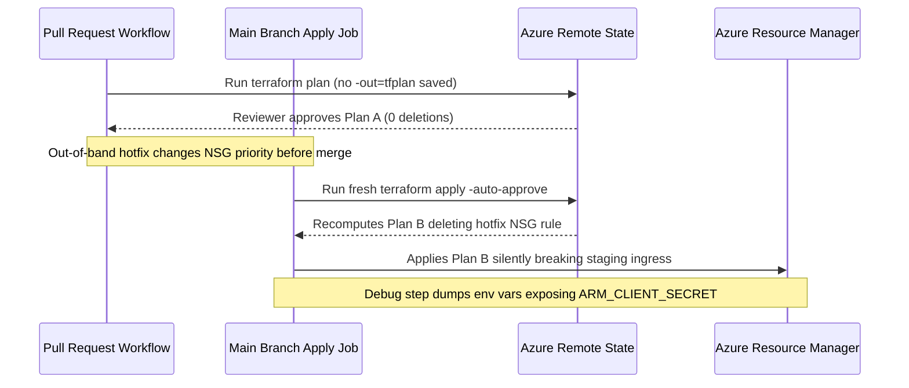

# Terraform in CI/CD & Testing

> **Prerequisites:** Completed Modules 00–06 (Terraform workflow, modules, `azurerm` remote state backend, and Azure infrastructure provisioning), plus familiarity with GitHub pull requests and basic shell scripting.  
> **Estimated Reading Time:** 35 minutes  
> **Target Audience:** Backend Engineers, DevOps & Platform Engineers, SREs.

> [!TIP]
> **The Golden Rule of Terraform CI/CD:** Never allow humans or PR branches to run `terraform apply` against shared environments—PRs must execute `fmt -check` -> `validate` -> `tflint`/`checkov` -> `terraform test` (`plan`) -> `terraform plan -out=tfplan` for review, and only a merge to `main` using secretless OIDC (`ARM_USE_OIDC=true`) should apply that exact saved `tfplan`.

---

## Why This Matters

Running `terraform apply` from your laptop is fine for learning, but it's exactly the un-auditable, "works on my machine" pattern IaC was supposed to kill. Real teams run Terraform from a **pipeline**: a push opens a PR, the pipeline runs `fmt`/`validate`/`plan` and posts the plan for review, and a merge runs `apply` with credentials no human holds. This module bridges toward track 10 (CI/CD and GitOps) by showing the pipeline shape and the quality gates — formatting, validation, linting, and policy checks — that belong in front of every apply.

---

## 1. Architectural Mental Model: Two-Phase PR/Merge Pipeline & Secretless OIDC Federation

A production Terraform delivery pipeline cleanly separates **untrusted PR validation** (read-only plan artifact generation + automated quality gates) from **trusted merge deployment** (exchanging a short-lived GitHub OIDC JWT for an Azure Entra ID token and applying the exact reviewed `tfplan`):

```mermaid
flowchart LR
    subgraph PRFlow["Pull Request Gate (Plan Only)"]
        Fmt["1. terraform fmt -check -recursive"]
        InitPR["2. terraform init (Remote State)"]
        Val["3. terraform validate"]
        Lint["4. tflint and checkov"]
        Test["5. terraform test (command = plan)"]
        Plan["6. terraform plan -out=tfplan"]
        Review["Human PR Approval on Plan Diff"]
        Fmt --> InitPR --> Val --> Lint --> Test --> Plan --> Review
    end

    subgraph MergeFlow["Merge to Main (OIDC Apply)"]
        OIDC["GitHub Actions JWT (id-token: write)"]
        Entra["Microsoft Entra ID Federated Exchange"]
        Apply["terraform apply tfplan (ARM_USE_OIDC=true)"]
        Azure["Azure Resource Manager + tfstate Blob"]
        OIDC -->|Exchanges Short-Lived Token| Entra
        Entra -->|Issues Scoped Access Token| Apply
        Apply -->|Applies Exact Plan| Azure
    end

    Review -->|Merge Approved PR| OIDC
```



### Core Concepts

#### Why Terraform belongs in a pipeline
The same reasons declarative IaC beat imperative `az` (module 00) compound when you automate them:

- **The reviewed plan is the applied plan.** With `plan -out=tfplan` → `apply tfplan` (module 01), the pipeline applies *exactly* what a reviewer saw in the PR — no drift between review and execution.
- **No human holds prod credentials.** The pipeline authenticates as a service principal (or, better, via OIDC), so applying to production doesn't require anyone to have standing admin rights on their laptop.
- **Every change is gated and logged.** `fmt`/`validate`/`lint`/`policy` checks run automatically; the run log is the audit trail.

#### The canonical pipeline stages
A Terraform pipeline is almost always these stages, in order:

1. **`terraform fmt -check`** — fails if any file isn't canonically formatted. Cheap, catches style drift.
2. **`terraform init`** — with the remote backend (module 05) and the committed lock file for reproducible provider versions.
3. **`terraform validate`** — syntax and internal-reference check (module 00).
4. **Lint / policy** — `tflint` for provider-specific best practices, `checkov` (or `tfsec`) for security/policy scanning of the *plan or config*.
5. **`terraform plan -out=tfplan`** — on a PR, this is posted for human review; nothing is applied.
6. **`terraform apply tfplan`** — only on merge to the main branch, applying the exact reviewed plan.

The split matters: **plan runs on the PR, apply runs on merge.** A reviewer approves the plan; the merge triggers the apply of that same plan.

#### Authenticating a pipeline to Azure
A pipeline has no `az login` session, so it uses non-interactive auth via the `ARM_*` environment variables the `azurerm` provider reads:

- **Service principal with a secret:** `ARM_CLIENT_ID`, `ARM_CLIENT_SECRET`, `ARM_TENANT_ID`, `ARM_SUBSCRIPTION_ID`. Simple, but the secret must be stored in the CI system and rotated.
- **OIDC / workload identity federation (preferred):** the pipeline gets a short-lived token from its CI provider, exchanged for an Azure token — **no stored secret at all**. Set `ARM_USE_OIDC=true` alongside `ARM_CLIENT_ID`/`ARM_TENANT_ID`/`ARM_SUBSCRIPTION_ID`. This is the same OIDC-federation idea track 7's CI module used for pushing to ACR, applied to Terraform. You'll master the mechanics in track 10; here, recognize that "no long-lived secret in CI" is the goal.

#### A GitHub Actions skeleton
Conceptually (you'll build the real thing in track 10), a plan-on-PR job looks like this — note it uses HashiCorp's `setup-terraform` action and authenticates via OIDC:

```yaml
name: terraform-plan
on: pull_request
permissions:
  id-token: write     # required for OIDC
  contents: read
jobs:
  plan:
    runs-on: ubuntu-latest
    env:
      ARM_USE_OIDC: "true"
      ARM_CLIENT_ID: ${{ secrets.AZURE_CLIENT_ID }}
      ARM_TENANT_ID: ${{ secrets.AZURE_TENANT_ID }}
      ARM_SUBSCRIPTION_ID: ${{ secrets.AZURE_SUBSCRIPTION_ID }}
    steps:
      - uses: actions/checkout@v4
      - uses: hashicorp/setup-terraform@v3
      - run: terraform fmt -check
      - run: terraform init
      - run: terraform validate
      - run: terraform plan -out=tfplan
```

The `apply` job is nearly identical but triggers `on: push` to `main` and runs `terraform apply -auto-approve tfplan` (applying the saved plan; `-auto-approve` is acceptable *here* precisely because a human already reviewed the plan on the PR).

#### `terraform validate` vs `fmt` vs lint vs policy
Four checks that people conflate but that catch different things:

- **`terraform fmt`** — *formatting only* (indentation, alignment). Says nothing about correctness.
- **`terraform validate`** — *internal consistency*: syntax, argument names, references resolve. Doesn't contact Azure, doesn't judge quality.
- **`tflint`** — *best-practice/lint*: deprecated syntax, invalid instance/VM types, provider-specific pitfalls `validate` won't catch.
- **`checkov` / `tfsec`** — *security & policy*: "this storage account allows public blob access," "this NSG rule opens 22 to the world." These scan for misconfigurations, not syntax.

You want all four, and they run cheaply before any apply.

#### A taste of `terraform test`
Terraform 1.6+ ships a native testing framework: `.tftest.hcl` files with `run` blocks that execute `plan` (or `apply`) against your config and assert on the results:

```hcl
# tests/network.tftest.hcl
run "vnet_has_expected_cidr" {
  command = plan

  assert {
    condition     = azurerm_virtual_network.hub.address_space[0] == "10.0.0.0/16"
    error_message = "Hub VNet CIDR must be 10.0.0.0/16"
  }
}
```

`terraform test` runs these. A `plan`-based test is fast and free (no resources created); an `apply`-based test creates real resources, asserts, then destroys them — powerful but billable, so use `plan` tests for most logic checks. This is the direction infrastructure testing is heading; you're seeing the shape, not mastering it, here.

---

## 2. Taxonomic Comparison: Pipeline Gates, Auth Patterns & Testing Modes

| Tool / Gate | Scope Analyzed | Contacts Azure API? | Catches What? | Typical Cost / Speed |
| :--- | :--- | :--- | :--- | :--- |
| `terraform fmt -check` | HCL whitespace & alignment | No | Unformatted HCL drift | Free (~100ms) |
| `terraform validate` | HCL syntax & variable/resource references | No | Typos (`adress_space`), missing required args, type mismatches | Free (~1s) |
| `tflint` | Provider schema & deprecation rules | Optional | Invalid Azure VM SKUs (`Standard_Fake`), deprecated attributes | Free (~2s) |
| `checkov` / `tfsec` | HCL & `plan.json` security posture | No | Open SSH (`*` -> `22`), unencrypted storage, missing TLS 1.2 | Free (~3–5s) |
| `terraform test` (`plan`) | HCL evaluation & expression outputs | Read-only refresh (or mocked) | Broken `for_each` counts, CIDR math errors, naming regressions | Free (~2–5s) |
| `terraform test` (`apply`) | Full ARM provisioning lifecycle | Yes (creates & destroys) | Actual cloud quota, RBAC propagation, CNI subnet compatibility | Billable (minutes) |

| CI Authentication Mode | Secret Storage in CI | Rotation Burden | Compromise Blast Radius |
| :--- | :--- | :--- | :--- |
| Service Principal + `ARM_CLIENT_SECRET` | Long-lived secret stored in CI secrets | High (manual/scheduled rotation outages) | Stolen secret works from any workstation until revoked |
| Workload Identity Federation (`ARM_USE_OIDC=true`) | Zero stored secret (client/tenant IDs only) | None (short-lived OIDC JWT tokens) | Bound strictly to repo + branch/environment subject claims in Entra ID |

---

## 3. Production War Story Post-Mortem: Unpinned Re-Plan & Over-Permissive SP Secret

- **Severity:** SEV-2 (Staging Network Disruption & Credential Rotation Emergency)
- **Detection Time:** 12 minutes (failed health checks on staging ingress + Azure Sign-In logs alert)
- **Resolution Time:** 3 hours 10 minutes (NSG rule restoration + full Service Principal secret rotation + workflow migration to OIDC)
- **Impact:** A merge-time pipeline ran `terraform apply -auto-approve` *without* a saved `tfplan` artifact, silently picking up an out-of-band rule change and dropping an active ingress NSG rule; concurrently, a misconfigured `pull_request_target` check exposed `ARM_CLIENT_SECRET` debug output in build logs, forcing immediate credential revocation.

### What Happened



### Root Cause Analysis

1. **No Plan-to-Apply Immutability (`tfplan` Omitted):** Because the merge job ran a fresh `apply -auto-approve` instead of `apply tfplan`, the executed change differed from the reviewed PR diff.
2. **Long-Lived `ARM_CLIENT_SECRET` Exposure:** Relying on a static secret meant a single leaked CI environment variable granted persistent `Contributor` access outside GitHub Actions.
3. **Missing Policy Gate (`checkov`):** No pre-merge security check failed on insecure `0.0.0.0/0` inbound NSG rules or unsafe workflow triggers.

### The Fix & Architectural Hardening

- Enforced `terraform plan -out=tfplan` on PR and exact `terraform apply tfplan` on merge (or gated re-plan with SHA state-serial verification when concurrent merges advance serial).
- Eliminated `ARM_CLIENT_SECRET` entirely by migrating to **Entra ID Federated Identity Credentials (`ARM_USE_OIDC=true`)** scoped solely to `repo:org/infra:environment:production` with GitHub Environment approval gates.
- Enabled mandatory `tflint` and `checkov` CI status checks that block merge on High/Critical Azure policy violations.

---

## 4. Multi-Language Production Implementation: Automated Plan-JSON Policy & Security Gate

CI/CD pipelines frequently convert saved binary plans (`terraform show -json tfplan > plan.json`) to enforce custom organizational guardrails—such as blocking NSGs that expose ports `22` or `3389` to `*` / `0.0.0.0/0` and requiring explicit tags before `apply tfplan` runs.

````carousel
```go
package main

import (
	"encoding/json"
	"fmt"
	"os"
)

type TFPlan struct {
	ResourceChanges []struct {
		Address string `json:"address"`
		Type    string `json:"type"`
		Change  struct {
			Actions []string       `json:"actions"`
			After   map[string]any `json:"after"`
		} `json:"change"`
	} `json:"resource_changes"`
}

func EvaluatePolicyGate(planBytes []byte) []string {
	var plan TFPlan
	if err := json.Unmarshal(planBytes, &plan); err != nil {
		return []string{fmt.Sprintf("invalid plan JSON: %v", err)}
	}

	var violations []string
	for _, rc := range plan.ResourceChanges {
		if rc.Type != "azurerm_network_security_group" || rc.Change.After == nil {
			continue
		}
		rules, _ := rc.Change.After["security_rule"].([]any)
		for _, item := range rules {
			rule, _ := item.(map[string]any)
			src, _ := rule["source_address_prefix"].(string)
			dstPort, _ := rule["destination_port_range"].(string)
			access, _ := rule["access"].(string)
			name, _ := rule["name"].(string)

			if access == "Allow" && (src == "*" || src == "0.0.0.0/0") && (dstPort == "22" || dstPort == "3389") {
				violations = append(violations, fmt.Sprintf("%s rule %q opens admin port %s to %s", rc.Address, name, dstPort, src))
			}
		}
	}
	return violations
}

func main() {
	data, err := os.ReadFile("plan.json")
	if err != nil {
		fmt.Fprintf(os.Stderr, "read plan.json: %v\n", err)
		os.Exit(1)
	}
	if issues := EvaluatePolicyGate(data); len(issues) > 0 {
		for _, issue := range issues {
			fmt.Fprintf(os.Stderr, "POLICY FAIL: %s\n", issue)
		}
		os.Exit(2)
	}
	fmt.Println("CI policy gate passed: 0 NSG admin-port exposures.")
}
```
<!-- slide -->
```typescript
import { readFileSync } from "node:fs";

interface SecurityRule {
  name?: string;
  access?: string;
  source_address_prefix?: string;
  destination_port_range?: string;
}

interface PlanChange {
  address: string;
  type: string;
  change: {
    actions: string[];
    after?: {
      security_rule?: SecurityRule[];
      tags?: Record<string, string>;
    };
  };
}

export function runCiPlanPolicyGate(planJsonPath: string): void {
  const plan = JSON.parse(readFileSync(planJsonPath, "utf-8")) as {
    resource_changes?: PlanChange[];
  };
  const failures: string[] = [];

  for (const rc of plan.resource_changes ?? []) {
    if (rc.change.actions.includes("no-op") || !rc.change.after) {
      continue;
    }

    if (rc.type === "azurerm_network_security_group") {
      for (const rule of rc.change.after.security_rule ?? []) {
        const publicSrc =
          rule.source_address_prefix === "*" || rule.source_address_prefix === "0.0.0.0/0";
        const adminPort =
          rule.destination_port_range === "22" || rule.destination_port_range === "3389";

        if (rule.access === "Allow" && publicSrc && adminPort) {
          failures.push(
            `${rc.address} (${rule.name ?? "unnamed"}) exposes port ${rule.destination_port_range} to internet`
          );
        }
      }
    }
  }

  if (failures.length > 0) {
    throw new Error(`Policy gate blocked apply:\n${failures.join("\n")}`);
  }
}
```
<!-- slide -->
```python
import json
import sys
from pathlib import Path

BLOCKED_PORTS = {"22", "3389"}
PUBLIC_CIDRS = {"*", "0.0.0.0/0", "Internet"}


def evaluate_plan_json(plan_path: Path) -> list[str]:
    """Simulate a lightweight Checkov-style CI gate over terraform show -json tfplan."""
    data = json.loads(plan_path.read_text(encoding="utf-8"))
    failures: list[str] = []

    for rc in data.get("resource_changes", []):
        if rc.get("type") != "azurerm_network_security_group":
            continue
        after = rc.get("change", {}).get("after") or {}
        for rule in after.get("security_rule", []):
            if (
                rule.get("access") == "Allow"
                and rule.get("direction") == "Inbound"
                and rule.get("source_address_prefix") in PUBLIC_CIDRS
                and str(rule.get("destination_port_range")) in BLOCKED_PORTS
            ):
                failures.append(
                    f"{rc['address']} rule '{rule.get('name')}' allows public inbound port {rule.get('destination_port_range')}"
                )
    return failures


if __name__ == "__main__":
    errors = evaluate_plan_json(Path(sys.argv[1] if len(sys.argv) > 1 else "plan.json"))
    if errors:
        print("\n".join(f"ERROR: {e}" for e in errors), file=sys.stderr)
        sys.exit(1)
    print("Plan JSON security checks passed.")
```
<!-- slide -->
```csharp
using System.Text.Json.Nodes;

namespace Platform.CiGates;

public static class TerraformPlanPolicyGate
{
    private static readonly HashSet<string> PublicSources = new(StringComparer.OrdinalIgnoreCase)
    {
        "*", "0.0.0.0/0", "Internet"
    };

    private static readonly HashSet<string> RestrictedAdminPorts = new() { "22", "3389" };

    public static IReadOnlyList<string> Evaluate(string planJsonPath)
    {
        var root = JsonNode.Parse(File.ReadAllText(planJsonPath));
        var changes = root?["resource_changes"]?.AsArray();
        var violations = new List<string>();

        if (changes is null)
        {
            return violations;
        }

        foreach (JsonNode? rc in changes)
        {
            if (rc?["type"]?.GetValue<string>() != "azurerm_network_security_group")
            {
                continue;
            }

            string addr = rc["address"]?.GetValue<string>() ?? "unknown";
            JsonArray? rules = rc["change"]?["after"]?["security_rule"]?.AsArray();
            if (rules is null) continue;

            foreach (JsonNode? rule in rules)
            {
                string access = rule?["access"]?.GetValue<string>() ?? "";
                string src = rule?["source_address_prefix"]?.GetValue<string>() ?? "";
                string port = rule?["destination_port_range"]?.GetValue<string>() ?? "";
                string name = rule?["name"]?.GetValue<string>() ?? "unnamed";

                if (access == "Allow" && PublicSources.Contains(src) && RestrictedAdminPorts.Contains(port))
                {
                    violations.Add($"{addr} rule '{name}' exposes port {port} to '{src}'.");
                }
            }
        }

        return violations;
    }
}
```
````

---

## 5. Command Reference & Flag Breakdowns

| Command | What it does | Example |
|---|---|---|
| `terraform fmt -check` | Fails (non-zero exit) if any file isn't formatted; changes nothing | `terraform fmt -check -recursive` |
| `terraform validate` | Checks config syntax and references | `terraform validate` |
| `terraform plan -out=tfplan` | Saves the plan for a later exact apply | `terraform plan -out=tfplan` |
| `terraform apply tfplan` | Applies the saved plan with no prompt | `terraform apply tfplan` |
| `terraform show -json tfplan` | Emits the saved plan as JSON (for policy tools to scan) | `terraform show -json tfplan > plan.json` |
| `terraform test` | Runs `.tftest.hcl` test files | `terraform test` |
| `tflint` | Lints for provider best-practices | `tflint --init && tflint` |
| `checkov -d .` | Scans config/plan for security/policy issues | `checkov -d .` |

Flag breakdown — `terraform fmt -check -recursive`:
- `-check` — exit non-zero if files would be reformatted, but don't rewrite them. This is the CI-appropriate form (fail the build; don't silently mutate).
- `-recursive` — also check subdirectories (so child modules are covered).

Flag breakdown — `terraform apply tfplan` (vs interactive apply):
- Passing a saved plan file makes apply skip re-computation and the confirmation prompt — it applies precisely that plan. Combined with `plan -out` on the PR, it guarantees the applied change equals the reviewed change.

---

## 6. Practical Hands-On Verification CLI Workflows

Mostly free — you'll run the local checks that a pipeline runs. A couple of optional steps install external tools; the plan/validate/fmt steps need only Terraform.

1. **Set up a small config to gate.** New directory with a resource group + VNet (reuse module 02's shape):
   ```bash
   mkdir -p ~/tf-labs/07-cicd && cd ~/tf-labs/07-cicd
   export ARM_SUBSCRIPTION_ID="$(az account show --query id -o tsv)"
   ```
   Create `main.tf` (provider skeleton + RG + a VNet), then `terraform init`.

2. **Run the pipeline's format gate.** Deliberately misformat `main.tf` (mangle indentation), then run the *check* form:
   ```bash
   terraform fmt -check -recursive
   ```
   **Expected Output (before fixing):**
   ```text
   main.tf
   Error: exit status 3
   ```
   > Verify: it exits non-zero and names the unformatted file — this is what fails a CI build. Fix it with `terraform fmt`, then rerun `terraform fmt -check` and confirm it now exits 0 (clean).

3. **Run the validate gate.** Introduce a typo'd argument (e.g. `adress_space`), run:
   ```bash
   terraform validate
   ```
   **Expected Output:**
   ```text
   Error: Unsupported argument

     on main.tf line 18, in resource "azurerm_virtual_network" "hub":
     18:   adress_space        = ["10.0.0.0/16"]

   An argument named "adress_space" is not expected here. Did you mean "address_space"?
   ```
   > Verify: it fails with the unexpected-argument error. Fix the typo and confirm `validate` reports success. This is CI stage 3.

4. **Produce and inspect a saved plan.** Generate the artifact a reviewer would approve:
   ```bash
   terraform plan -out=tfplan
   terraform show tfplan | head -40
   terraform show -json tfplan > plan.json
   ```
   **Expected Output:**
   ```text
   Saved the plan to: tfplan

   To perform exactly these actions, run the following command to apply:
       terraform apply "tfplan"
   ```
   > Verify: `tfplan` (binary) and `plan.json` exist. The JSON is what policy tools like `checkov` scan. Note: you'd never commit `tfplan` — add it to `.gitignore` (it may contain sensitive values).

5. **Apply the exact saved plan.** Prove plan→apply fidelity:
   ```bash
   terraform apply tfplan
   ```
   **Expected Output:**
   ```text
   Apply complete! Resources: 2 added, 0 changed, 0 destroyed.
   ```
   > Verify: it applies with **no confirmation prompt** and no re-computation — exactly the reviewed plan. This is why CI uses `-out` then `apply <file>`.

6. **Write and run a `terraform test`.** Create `tests/vnet.tftest.hcl`:
   ```hcl
   run "vnet_cidr_is_correct" {
     command = plan
     assert {
       condition     = azurerm_virtual_network.hub.address_space[0] == "10.0.0.0/16"
       error_message = "Hub VNet CIDR must be 10.0.0.0/16"
     }
   }
   ```
   (Adjust the resource local name to match yours.) Run:
   ```bash
   terraform test
   ```
   **Expected Output:**
   ```text
   tests/vnet.tftest.hcl... in progress
     run "vnet_cidr_is_correct"... pass
   tests/vnet.tftest.hcl... tearing down
   tests/vnet.tftest.hcl... pass

   Success! 1 passed, 0 failed.
   ```
   > Verify: it reports the test passed. Now break it — change the assert's expected CIDR to `10.99.0.0/16` and rerun; confirm the test *fails* with your error message. This `plan`-based test created nothing in Azure. Revert the assertion.

7. **Diagnose and fix: a policy check catches a real risk.** Add an NSG rule that opens SSH to the whole internet (a genuine misconfiguration):
   ```hcl
   security_rule {
     name                       = "allow-ssh-anywhere"
     priority                   = 100
     direction                  = "Inbound"
     access                     = "Allow"
     protocol                   = "Tcp"
     source_port_range          = "*"
     destination_port_range     = "22"
     source_address_prefix      = "*"     # <-- the problem: open to the world
     destination_address_prefix = "*"
   }
   ```
   (Attach it to an NSG resource.) If you have `checkov` installed (`pip install checkov`), run `checkov -d .`; otherwise reason it through.
   **Expected Output (when running `checkov -d .`):**
   ```text
   Check: CKV_AZURE_10: "Ensure that SSH access is restricted from the internet"
     FAILED for resource: azurerm_network_security_group.web
     File: /main.tf:25-40
   ```
   > Verify / reason: `checkov` flags a check like "Ensure NSG does not allow SSH (22) from the internet." **Fix** by scoping `source_address_prefix` to a specific admin CIDR (or a Bastion subnet) instead of `*` — the same track 5 NSG discipline, now enforced automatically by policy scanning rather than a reviewer's memory. This is the class of bug CI policy checks exist to stop before apply.

8. **Optional: run `tflint`.** If you install `tflint` (`brew`/download), run `tflint --init && tflint` in the directory.
   > Verify / reason: it surfaces provider best-practice issues (e.g. an invalid VM size, deprecated arguments) that `validate` passes over. Note *where* each of your four gates would catch a different bug.

9. **Sketch the pipeline (no apply).** In a `README` or comment in your repo, write the six pipeline stages in order and mark which run on **PR** (plan) versus **merge** (apply), and note that the pipeline would authenticate via `ARM_USE_OIDC=true` with no stored secret. You'll build this for real in track 10 — the goal here is that you can describe it from memory.

10. **Clean up.** Destroy the small stack and remove local plan artifacts:
    ```bash
    terraform destroy
    rm -f tfplan plan.json
    ```
    > Verify: `terraform destroy` removes the RG/VNet/NSG; confirm with `az group list -o table`. Nothing here was expensive, but the habit stands.

### Independent challenge
Without copying the exercises, take the module-04 `network` module (or your module-06 infra config) and add a **complete local "pre-merge gate" script** — a single shell script that runs, in order, `terraform fmt -check -recursive`, `terraform init`, `terraform validate`, a `terraform test` with at least one meaningful `plan`-based assertion about your network (e.g. that the number of subnets equals the length of your input list), and finally `terraform plan -out=tfplan` — and that **exits non-zero if any stage fails**, exactly as CI would. Deliberately introduce one failure of each kind (a format issue, a bad argument, a wrong CIDR the test catches) and confirm your script stops at the right stage each time. This integrates module 04 (modules), module 02 (`fmt`/`validate`), module 01 (`plan -out`), and this module's testing — and is the exact gate you'll lift into a real pipeline in track 10.

<details><summary>Stuck? One hint</summary>

In a shell script, `set -e` makes the script abort on the first command that returns non-zero — which is exactly the CI "fail fast" behavior you want, and which each Terraform sub-command already signals correctly (`fmt -check`, `validate`, and `test` all exit non-zero on failure). For the test's subnet-count assertion, `length(azurerm_subnet.this) == length(var.subnet_prefixes)` is the kind of condition that proves your `count`/`for_each` wiring is correct without creating anything.

</details>

---

## 7. Common Mistakes & Troubleshooting

- **Running `apply` on the PR instead of `plan`.** The PR should only *plan* (for review); apply belongs on merge. Applying on PR means unreviewed changes hit real infrastructure.
- **Re-planning at apply time instead of applying a saved plan.** If the merge job runs a fresh `plan`+`apply` rather than `apply tfplan`, the applied change can differ from what was reviewed (state or a dependency moved in between). Use `plan -out` → `apply <file>`.
- **Storing a long-lived SP secret in CI.** It's the thing most likely to leak. Prefer OIDC (`ARM_USE_OIDC=true`) with no stored secret; you'll set this up in track 10.
- **Treating `fmt`/`validate` as sufficient quality gates.** They catch formatting and syntax, not insecure or wasteful configuration. Add `tflint` and `checkov`/`tfsec` for the bugs that actually cost money or open security holes.
- **Committing `tfplan`/`plan.json`.** These can contain sensitive values and are ephemeral CI artifacts. `.gitignore` them.
- **Cost pitfall:** an `apply`-based `terraform test` creates *real* resources (then destroys them) — a test suite full of apply-tests against AKS-shaped resources bills every run. Keep most tests `command = plan` (free), and reserve apply-tests for the few things that genuinely need a live resource. A misconfigured CI that runs `apply` on every PR push, rather than only on merge, can also create/leak resources fast.

---

## 8. Operational Validation Checkpoints

<details><summary><strong>Checkpoint 1: Your PR workflow passes <code>terraform fmt -check -recursive</code> and <code>terraform validate</code>, yet <code>terraform apply</code> later fails because <code>vm_size = "Standard_NonExistent_v99"</code> is invalid. Which gate catches this before apply, and why did <code>validate</code> pass?</strong></summary>

**Answer:** `tflint` (configured with the `tflint-ruleset-azurerm` plugin) catches invalid VM SKUs, regions, and provider-specific enum errors offline. `terraform validate` only verifies that `vm_size` is a string matching the schema type—it does not maintain a catalog of valid Azure compute SKUs.

</details>

<details><summary><strong>Checkpoint 2: Two PRs (#41 and #42) both run <code>terraform plan -out=tfplan</code> against state serial 12. PR #41 merges and bumps remote state to serial 13. When PR #42 merges, why does <code>terraform apply tfplan</code> (saved from serial 12) refuse to run?</strong></summary>

**Answer:** Saved plan files embed the state lineage and serial (`12`) they were computed against. When PR #42 attempts `terraform apply tfplan` against state serial `13`, Terraform detects the saved plan is stale and fails immediately rather than blindly overwriting PR #41's changes—requiring a fresh PR rebase/re-plan against serial `13`.

</details>

<details><summary><strong>Checkpoint 3: A GitHub Actions job fails at <code>terraform init</code> with <code>AADSTS700213: No matching federated identity record found for presented assertion</code> while using <code>ARM_USE_OIDC=true</code>. Where is the misconfiguration?</strong></summary>

**Answer:** First confirm the workflow specifies `permissions: id-token: write`. If it does, the mismatch is in the Microsoft Entra ID App Registration's Federated Credential `subject` claim (e.g. Entra expects `repo:org/repo:environment:prod`, whereas the job ran without an `environment:` block or from a different branch such as `refs/heads/feature`).

</details>

---

## 9. Checkpoint Quiz

Write down your answer to each question before expanding it — checking without attempting first is the single easiest way to fool yourself into thinking you've learned this.

1. Why does running Terraform from a pipeline beat running it from your laptop — give two reasons tied to earlier modules.
2. List the canonical Terraform pipeline stages in order, and mark which run on a PR versus on merge.
3. What's the point of `plan -out=tfplan` followed by `apply tfplan` instead of just running `apply`?
4. How does a pipeline authenticate to Azure with no `az login`, and what's the preferred credential-less method?
5. Distinguish what `fmt`, `validate`, `tflint`, and `checkov` each catch.
6. What does a `command = plan` `terraform test` cost in Azure resources, and when would you use `command = apply` instead?
7. `-auto-approve` is dangerous on your laptop but acceptable in the CI apply job. Why is it acceptable there?
8. A `checkov` run fails on an NSG rule. What kind of problem is it likely catching that `terraform validate` would have passed?

<details><summary>Show answers</summary>

1. Any two: the reviewed plan is exactly the applied plan (auditability); no human holds prod credentials (the pipeline uses an SP/OIDC identity); every change is automatically gated and logged. These extend the reviewability/auditability advantages of declarative IaC from module 00.
2. `fmt -check` → `init` → `validate` → lint/policy (`tflint`/`checkov`) → `plan -out=tfplan` → `apply tfplan`. Everything through `plan` runs on the PR; `apply` runs only on merge to main.
3. It guarantees the change that gets applied is byte-for-byte the plan a reviewer approved — no re-computation that could differ from what was reviewed.
4. Via the `ARM_*` environment variables the provider reads (client id, tenant, subscription, and either a secret or OIDC). The preferred method is OIDC/workload identity federation (`ARM_USE_OIDC=true`) with no stored long-lived secret.
5. `fmt` = formatting only; `validate` = syntax/reference consistency (no Azure call, no quality judgment); `tflint` = provider best-practice/lint issues; `checkov`/`tfsec` = security/policy misconfigurations.
6. A `plan` test creates nothing (free) — it asserts against the planned result. Use `command = apply` only when an assertion genuinely needs a live, created resource; it bills because it creates (then destroys) real resources.
7. Because a human already reviewed and approved the exact plan on the PR, and the job applies that saved plan — the approval is the gate, so a second interactive prompt would be redundant.
8. A security/policy misconfiguration (e.g. an NSG rule opening SSH/22 to `*` / the whole internet). `validate` only checks that the config is syntactically well-formed, not that it's safe.

</details>

---

## Next
[08 — Capstone project](../08-capstone-project/README.md): combine everything — a multi-module config with remote state provisioning a VNet+NSG and AKS+ACR, variables and outputs used sensibly — then tear it all down and prove nothing's left.
