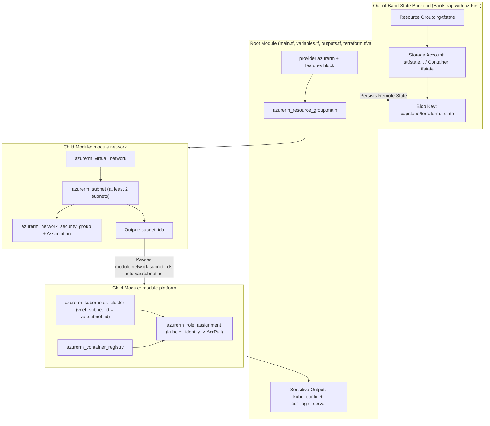
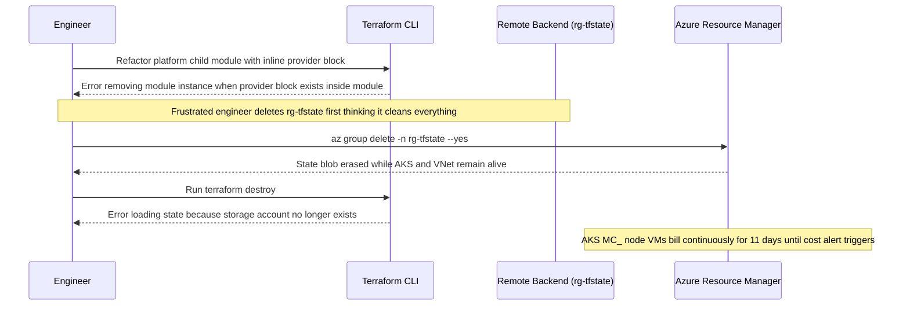

# Capstone Project

> **Prerequisites:** Completed Modules 00–07 (Terraform core workflow, variables/outputs, `data` sources, child modules, `azurerm` remote state, real AKS+ACR provisioning, and CI/CD quality gates).  
> **Estimated Reading Time:** 90 minutes (build, verify, and clean teardown)  
> **Target Audience:** Backend Engineers, Platform Engineers, Cloud Infrastructure Engineers.

> [!TIP]
> **The Golden Rule of Multi-Module Capstone Delivery:** Configure `provider "azurerm"` and `backend "azurerm"` strictly inside the root module (never in child modules), pass `module.network` subnet IDs dynamically into `module.platform` so Terraform builds the dependency graph automatically, and always run `terraform destroy` *before* deleting `rg-tfstate`—confirming `az aks list -o table` is empty afterward.

---

## Why This Matters

This is where the whole track converges. Everything you did across modules 00-07 in isolation — providers, state, variables, outputs, data sources, modules, remote state, and provisioning real networking and AKS+ACR — comes together into one coherent, multi-module Terraform configuration that stands up a complete environment and tears it back down with single commands. There is no new concept and no quiz here; the goal is to prove you can *compose* what you've learned into infrastructure a real team would recognize, and then destroy it cleanly and confirm nothing's left billing.

Treat this as a project, not a checklist of isolated exercises — the pieces depend on each other in the order you'd actually build them.

---

## 1. Architectural Mental Model: Root-to-Child Composition & Remote State Wiring

Your capstone separates **environment configuration & provider ownership** (root module), **state persistence** (out-of-band `rg-tfstate`), and **reusable infrastructure domains** (`modules/network` and `modules/platform`), linked strictly through input variables and module outputs:



---

## 2. Taxonomic Comparison: Module Ownership & Capstone Verification Gates

| Layer / Directory | Owns `provider "azurerm"`? | Owns `backend "azurerm"`? | Resources Created | State Prefix (`terraform state list`) |
| :--- | :--- | :--- | :--- | :--- |
| **Root Module (`./`)** | **Yes** (single source of auth) | **Yes** (points to `rg-tfstate`) | `azurerm_resource_group.main`, module calls, root `outputs` | `azurerm_resource_group.main` |
| **Child: `modules/network`** | **No** (`required_providers` only) | **No** | `azurerm_virtual_network`, `azurerm_subnet` (>=2), NSG, association | `module.network.*` |
| **Child: `modules/platform`** | **No** (`required_providers` only) | **No** | `azurerm_container_registry`, `azurerm_kubernetes_cluster`, `azurerm_role_assignment` | `module.platform.*` |

| Acceptance Gate | Verification Command | Required Healthy Signal |
| :--- | :--- | :--- |
| **Remote State Active** | `az storage blob list --account-name <sa> -c tfstate -o table` | Shows `capstone/terraform.tfstate` blob |
| **Dynamic Network Wiring** | `terraform state show module.platform.azurerm_kubernetes_cluster.aks` | `default_node_pool[0].vnet_subnet_id` matches `module.network` subnet |
| **AcrPull Least Privilege** | `az role assignment list --scope <acr-id> -o table` | `AcrPull` assigned to `kubelet_identity` object ID |
| **Zero-Billing Teardown** | `az aks list -o table && az group list -o table` | Both return empty for all capstone groups (`rg-tfstate` & workload RG) |

---

## 3. Production War Story Post-Mortem: The Child-Provider & Deleted-Backend Deadlock

- **Severity:** SEV-1 (Orphaned Billable AKS Clusters & Failed Emergency Teardown)
- **Detection Time:** 9 minutes (emergency `terraform destroy` errored mid-cleanup; cloud cost alert fired 11 days later)
- **Resolution Time:** 2 hours 15 minutes (manual Azure resource purge across `MC_*` node groups)
- **Impact:** A team placed a hardcoded `provider "azurerm"` block inside a child module and later ran `az group delete -n rg-tfstate` before running `terraform destroy`, leaving three `Standard_D4s_v3` AKS node pools running unmonitored for 11 days.

### What Happened



### Root Cause Analysis

1. **Provider Block Inside Child Module:** Placing `provider "azurerm"` inside `modules/platform` tightly coupled module teardown to a localized provider configuration, blocking clean module removal and refactoring.
2. **Inverted Teardown Order:** Deleting `rg-tfstate` *before* running `terraform destroy` blinded Terraform—the state file disappeared while every billable VM inside the workload RG and `MC_*` RG remained active in Azure.
3. **No Post-Destroy Subscription Sweep:** Nobody executed `az aks list -o table` or `az group list -o table` after cleanup to verify zero running compute.

### The Fix & Architectural Hardening

- Enforced a strict **Root-Only Provider Rule** (`tflint` / CI check rejecting `provider` blocks inside `modules/*`).
- Locked `rg-tfstate` with an Azure `CanNotDelete` resource lock (`az lock create --lock-type CanNotDelete`) until workload `terraform destroy` completes cleanly.
- Institutionalized the 3-step teardown checklist: `terraform destroy` -> `az group delete -n rg-tfstate` -> `az aks list -o table` (must be empty).

---

## 4. Multi-Language Production Implementation: Capstone Acceptance & Teardown Verifier

To prove every capstone invariant programmatically before tearing down—or to automate capstone grading in CI—engineers inspect `terraform show -json` state outputs alongside live Azure verification checks to confirm multi-module composition and clean zero-billing teardown.

````carousel
```go
package main

import (
	"encoding/json"
	"fmt"
	"os"
	"strings"
)

type StateShow struct {
	Values struct {
		Outputs    map[string]struct{ Value any `json:"value"` } `json:"outputs"`
		RootModule struct {
			ChildModules []struct {
				Address   string `json:"address"`
				Resources []struct {
					Type   string         `json:"type"`
					Values map[string]any `json:"values"`
				} `json:"resources"`
			} `json:"child_modules"`
		} `json:"root_module"`
	} `json:"values"`
}

func VerifyCapstoneState(stateJSON []byte) error {
	var st StateShow
	if err := json.Unmarshal(stateJSON, &st); err != nil {
		return fmt.Errorf("parse terraform show json: %w", err)
	}

	var subnetID string
	var aksVNetSubnetID string
	var hasAcrPull bool

	for _, mod := range st.Values.RootModule.ChildModules {
		for _, res := range mod.Resources {
			switch res.Type {
			case "azurerm_subnet":
				if strings.HasPrefix(mod.Address, "module.network") && subnetID == "" {
					subnetID, _ = res.Values["id"].(string)
				}
			case "azurerm_kubernetes_cluster":
				if pools, ok := res.Values["default_node_pool"].([]any); ok && len(pools) > 0 {
					pool, _ := pools[0].(map[string]any)
					aksVNetSubnetID, _ = pool["vnet_subnet_id"].(string)
				}
			case "azurerm_role_assignment":
				role, _ := res.Values["role_definition_name"].(string)
				if role == "AcrPull" {
					hasAcrPull = true
				}
			}
		}
	}

	if subnetID == "" || aksVNetSubnetID == "" || aksVNetSubnetID != subnetID {
		return fmt.Errorf("capstone wiring mismatch: network subnet=%q aks vnet_subnet_id=%q", subnetID, aksVNetSubnetID)
	}
	if !hasAcrPull {
		return fmt.Errorf("missing AcrPull azurerm_role_assignment in platform module")
	}
	if _, ok := st.Values.Outputs["kube_config"]; !ok {
		return fmt.Errorf("missing root output 'kube_config'")
	}
	return nil
}

func main() {
	data, err := os.ReadFile("state.json")
	if err != nil {
		fmt.Fprintf(os.Stderr, "Run 'terraform show -json > state.json' first: %v\n", err)
		os.Exit(1)
	}
	if err := VerifyCapstoneState(data); err != nil {
		fmt.Fprintf(os.Stderr, "Capstone verification failed: %v\n", err)
		os.Exit(1)
	}
	fmt.Println("Capstone contract verified: multi-module subnet wiring, AcrPull, and root kube_config present.")
}
```
<!-- slide -->
```typescript
import { readFileSync } from "node:fs";

interface TerraformResource {
  type: string;
  values: Record<string, unknown>;
}

interface ChildModule {
  address: string;
  resources?: TerraformResource[];
}

export function verifyCapstoneContract(stateJsonPath: string): void {
  const doc = JSON.parse(readFileSync(stateJsonPath, "utf-8")) as {
    values?: {
      outputs?: Record<string, { sensitive?: boolean }>;
      root_module?: { child_modules?: ChildModule[] };
    };
  };

  const modules = doc.values?.root_module?.child_modules ?? [];
  const networkSubnets = new Set<string>();
  let aksSubnetId = "";
  let acrPullFound = false;

  for (const mod of modules) {
    for (const res of mod.resources ?? []) {
      if (mod.address === "module.network" && res.type === "azurerm_subnet") {
        networkSubnets.add(String(res.values["id"] ?? ""));
      }
      if (mod.address === "module.platform" && res.type === "azurerm_kubernetes_cluster") {
        const pools = (res.values["default_node_pool"] as Array<Record<string, unknown>>) ?? [];
        aksSubnetId = String(pools[0]?.["vnet_subnet_id"] ?? "");
      }
      if (mod.address === "module.platform" && res.type === "azurerm_role_assignment") {
        if (res.values["role_definition_name"] === "AcrPull") {
          acrPullFound = true;
        }
      }
    }
  }

  if (networkSubnets.size < 2) {
    throw new Error(`Expected >= 2 subnets in module.network, found ${networkSubnets.size}`);
  }
  if (!aksSubnetId || !networkSubnets.has(aksSubnetId)) {
    throw new Error(`AKS vnet_subnet_id '${aksSubnetId}' is not wired from module.network`);
  }
  if (!acrPullFound) {
    throw new Error("AcrPull role assignment missing in module.platform");
  }
  if (!doc.values?.outputs?.["kube_config"]?.sensitive) {
    throw new Error("Root output 'kube_config' must exist and be marked sensitive=true");
  }
}
```
<!-- slide -->
```python
import json
import sys
from pathlib import Path


def verify_capstone_state(state_json_path: Path) -> None:
    """Validate multi-module wiring, AcrPull role assignment, and sensitive kube_config output."""
    doc = json.loads(state_json_path.read_text(encoding="utf-8"))
    values = doc.get("values", {})
    outputs = values.get("outputs", {})
    children = values.get("root_module", {}).get("child_modules", [])

    subnet_ids: set[str] = set()
    aks_subnet_id: str | None = None
    has_acr_pull = False

    for mod in children:
        addr = mod.get("address", "")
        for res in mod.get("resources", []):
            rtype = res.get("type")
            rvals = res.get("values", {})
            if addr == "module.network" and rtype == "azurerm_subnet":
                if rid := rvals.get("id"):
                    subnet_ids.add(rid)
            elif addr == "module.platform" and rtype == "azurerm_kubernetes_cluster":
                pools = rvals.get("default_node_pool", [])
                if pools:
                    aks_subnet_id = pools[0].get("vnet_subnet_id")
            elif addr == "module.platform" and rtype == "azurerm_role_assignment":
                if rvals.get("role_definition_name") == "AcrPull":
                    has_acr_pull = True

    assert len(subnet_ids) >= 2, f"Expected >=2 subnets in module.network, got {len(subnet_ids)}"
    assert aks_subnet_id in subnet_ids, f"AKS subnet '{aks_subnet_id}' not from module.network"
    assert has_acr_pull, "Missing AcrPull role assignment in module.platform"
    assert outputs.get("kube_config", {}).get("sensitive") is True, "kube_config output must be sensitive"
    print("Capstone state contract passed all checks.")


if __name__ == "__main__":
    verify_capstone_state(Path(sys.argv[1] if len(sys.argv) > 1 else "state.json"))
```
<!-- slide -->
```csharp
using System.Text.Json.Nodes;

namespace Platform.CapstoneVerifier;

public static class CapstoneStateContract
{
    public static void Verify(string stateJsonPath)
    {
        JsonNode? doc = JsonNode.Parse(File.ReadAllText(stateJsonPath));
        JsonObject? outputs = doc?["values"]?["outputs"]?.AsObject();
        JsonArray? childModules = doc?["values"]?["root_module"]?["child_modules"]?.AsArray();

        if (outputs is null || childModules is null)
        {
            throw new InvalidOperationException("State JSON missing outputs or child_modules.");
        }

        var networkSubnets = new HashSet<string>();
        string? aksSubnetId = null;
        bool hasAcrPull = false;

        foreach (JsonNode? mod in childModules)
        {
            string address = mod?["address"]?.GetValue<string>() ?? "";
            JsonArray? resources = mod?["resources"]?.AsArray();
            if (resources is null) continue;

            foreach (JsonNode? res in resources)
            {
                string type = res?["type"]?.GetValue<string>() ?? "";
                JsonNode? vals = res?["values"];

                if (address == "module.network" && type == "azurerm_subnet")
                {
                    string? id = vals?["id"]?.GetValue<string>();
                    if (!string.IsNullOrEmpty(id)) networkSubnets.Add(id);
                }
                else if (address == "module.platform" && type == "azurerm_kubernetes_cluster")
                {
                    aksSubnetId = vals?["default_node_pool"]?[0]?["vnet_subnet_id"]?.GetValue<string>();
                }
                else if (address == "module.platform" && type == "azurerm_role_assignment")
                {
                    if (vals?["role_definition_name"]?.GetValue<string>() == "AcrPull")
                    {
                        hasAcrPull = true;
                    }
                }
            }
        }

        if (networkSubnets.Count < 2)
            throw new InvalidOperationException("module.network must create at least 2 subnets.");
        if (aksSubnetId is null || !networkSubnets.Contains(aksSubnetId))
            throw new InvalidOperationException("AKS default_node_pool must reference a module.network subnet.");
        if (!hasAcrPull)
            throw new InvalidOperationException("module.platform must define an AcrPull role assignment.");
        if (outputs["kube_config"]?["sensitive"]?.GetValue<bool>() != true)
            throw new InvalidOperationException("Root output 'kube_config' must be marked sensitive.");
    }
}
```
````

---

## 5. The Project

Build a small but complete Azure environment **entirely in Terraform**, organized as a root module that calls at least two child modules, with its state in a remote Azure Storage backend. It reproduces — declaratively, and now integrated — the by-hand work of tracks 5 and 7.

Your configuration must provision:

1. **A remote-state backend** (module 05): an Azure Storage account + container, bootstrapped with `az`, holding this project's state under its own `key`. Local state is not acceptable for the capstone.
2. **A `network` module** (modules 04-06): a VNet with at least two subnets and an NSG with sensible rules, associated to the appropriate subnet — the track 5 stack, packaged as a reusable module with clear inputs and outputs (at minimum, it must output the subnet IDs the cluster needs).
3. **A `platform` (or `aks`) module** (modules 04-06): an ACR and an AKS cluster placed in the network module's subnet, with the AKS↔ACR `AcrPull` role assignment wired up — the track 7 stack, as a module.
4. **A root module** that: configures the provider and remote backend, calls both child modules, passes the network module's subnet output into the platform module (so the wiring is a real reference, not a hard-coded string), and is driven by **variables** (project name, environment, region, address space, node size/count, ACR name) with a committed `terraform.tfvars` for non-secret values.
5. **Sensible outputs** at the root: at least the resource group name, the ACR login server, and the cluster's kubeconfig (marked `sensitive`).

Then **use** it, **prove** it, and **destroy** it — see the acceptance checklist.

---

## 6. Practical Hands-On Verification CLI Workflows

Use these end-to-end verification workflows to validate each capstone milestone cleanly from backend bootstrap through final zero-billing proof:

1. **Bootstrap the remote state backend & initialize the root:**
   ```bash
   SUFFIX=$RANDOM
   az group create -n rg-tfstate -l eastus
   az storage account create -n "sttfstate${SUFFIX}" -g rg-tfstate -l eastus --sku Standard_LRS --min-tls-version TLS1_2
   az storage container create -n tfstate --account-name "sttfstate${SUFFIX}"
   terraform fmt -check -recursive && terraform init && terraform validate
   ```
   **Expected Output:**
   ```text
   Successfully configured the backend "azurerm"! Terraform will automatically
   use this backend unless the backend configuration changes.
   Success! The configuration is valid.
   ```

2. **Plan, apply incrementally, and verify multi-module state structure:**
   ```bash
   terraform plan -out=tfplan
   terraform apply tfplan
   terraform state list
   ```
   **Expected Output:**
   ```text
   azurerm_resource_group.main
   module.network.azurerm_network_security_group.this
   module.network.azurerm_subnet.this["aks"]
   module.network.azurerm_subnet.this["web"]
   module.network.azurerm_subnet_network_security_group_association.this
   module.network.azurerm_virtual_network.this
   module.platform.azurerm_container_registry.this
   module.platform.azurerm_kubernetes_cluster.this
   module.platform.azurerm_role_assignment.acr_pull
   ```

3. **Prove AKS readiness and secretless ACR pull end-to-end:**
   ```bash
   terraform output -raw kube_config > ~/.kube/capstone-aks
   KUBECONFIG=~/.kube/capstone-aks kubectl get nodes -o wide
   az role assignment list --scope "$(az acr show -n <acr-name> --query id -o tsv)" -o table
   az acr import -n <acr-name> --source mcr.microsoft.com/hello-world:latest --image hello-world:v1
   ```
   **Expected Output:**
   ```text
   NAME                                STATUS   ROLES    AGE   VERSION
   aks-system-12345678-vmss000000      Ready    <none>   4m    v1.30.x
   aks-system-12345678-vmss000001      Ready    <none>   4m    v1.30.x
   Principal                       Role     Scope
   <kubelet-identity-object-id>    AcrPull  /subscriptions/.../registries/<acr-name>
   ```

---

## 7. Acceptance Checklist

Work top to bottom; each item depends on the previous ones actually working, not just existing.

- [ ] A remote backend exists: an `az`-bootstrapped storage account + container, and your root config's `terraform { backend "azurerm" }` points at it with a project-specific `key`. `terraform init` succeeds against it and a state blob appears in the container.
- [ ] The configuration is genuinely **multi-module**: a root module calling a `network` child module and a `platform`/`aks` child module, each in its own directory with `variables.tf`/`main.tf`/`outputs.tf`. Neither child module configures a `provider` block (only the root does).
- [ ] The `network` module creates a VNet with ≥2 subnets and an NSG associated to a subnet, and **outputs** the subnet ID(s) the cluster uses. `terraform state list` shows these under `module.network.`.
- [ ] The `platform` module creates an ACR and an AKS cluster **placed in a subnet produced by the network module** — the subnet ID is passed in as a module input, referenced (not hard-coded).
- [ ] The AKS↔ACR attach is an explicit `azurerm_role_assignment` granting the cluster's **kubelet** identity `AcrPull` on the ACR. `az role assignment list --scope <acr-id>` confirms it.
- [ ] Everything is parameterized by **variables** with a `terraform.tfvars` for non-secret values; no environment-specific names, regions, or CIDRs are hard-coded inside resource blocks. Deploying a second environment would be a different `.tfvars`, not edited resource code.
- [ ] Root **outputs** expose at least the resource group name, the ACR login server, and a `sensitive` kubeconfig. `terraform output -raw kube_config` yields a working config: `kubectl get nodes` shows all nodes `Ready`.
- [ ] You **read the plan before applying** and it matched your expectation (you can state the `N to add` you predicted and got). No surprise destroy-and-recreate slipped through.
- [ ] An image pushed to the ACR is pullable by the cluster with no image pull secret (proving the AcrPull attach works end to end).
- [ ] `terraform destroy` tears the **entire** environment down in one command; afterward `az aks list -o table` is empty, the workload resource group and the AKS `MC_*` group are gone, and you've separately removed the state-backend storage group. `az group list -o table` shows nothing from this project remaining.
- [ ] You can explain, for every resource, what it corresponds to in the by-hand track 5/7 work and why it's ordered where it is in the dependency graph. If you can't explain a piece, that's a signal to go back and understand it, not to leave a copy-pasted block that happened to apply.

---

## 8. Hints

- **Bootstrap the backend first, separately.** The state storage account can't be created by the config that uses it (module 05's chicken-and-egg). Create it with `az` up front, note the exact account name and `key`, then write your backend block. Get `terraform init -migrate-state` (or a clean init against the empty backend) working *before* you add the expensive resources.
- **Build in dependency order, applying as you go.** Get the network module applying on its own first, then add the platform module, then the AcrPull wiring — don't write all three modules and debug a 20-resource plan in one shot. Each `apply` that works is a checkpoint you can build on.
- **Pass the subnet in as a reference, not a string.** The whole point of the multi-module design is that `module.platform` receives `module.network.subnet_ids[0]` (or similar) as an input — that reference is what makes Terraform order the network before the cluster. A hard-coded subnet ID would apply but defeats the exercise.
- **Read every plan's summary line.** This capstone creates an AKS cluster; a `count`/`for_each` slip on a node pool or subnet list can multiply billable resources. The `N to add` line is your last defense — predict it, then confirm the plan matches before typing `yes`.
- **Keep the cluster small and destroy promptly.** Two burstable nodes is plenty. This is real spend; don't leave it running while you write up your notes.
- **Reuse names and patterns you already validated** in modules 04-06 rather than inventing new configuration — the capstone is about integration, not fresh discovery.

---

## 9. Operational Validation Checkpoints

<details><summary><strong>Checkpoint 1: After wiring <code>module.network</code> and <code>module.platform</code>, running <code>terraform validate</code> fails with <code>Module not installed</code>. What command resolves child module references, and when must it be rerun?</strong></summary>

**Answer:** Run `terraform init` (or `terraform get`). Every time you add a new `module` block or change a module's `source`, Terraform must register the module directory inside `.terraform/modules/modules.json` before `validate`, `plan`, or `apply` can resolve it.

</details>

<details><summary><strong>Checkpoint 2: In your root module, you pass a hard-coded string <code>"/subscriptions/.../subnets/aks"</code> into <code>module.platform</code> instead of <code>module.network.subnet_ids["aks"]</code>. Why does <code>terraform apply</code> fail intermittently on a clean environment?</strong></summary>

**Answer:** Because a hard-coded string creates no graph edge between `module.network` and `module.platform`. Terraform executes both modules in parallel and asks Azure to build AKS inside a subnet that does not exist yet. Referencing `module.network.subnet_ids["aks"]` creates an implicit dependency edge so `module.network` completes before AKS creation starts.

</details>

<details><summary><strong>Checkpoint 3: You run <code>terraform destroy</code> and it reports <code>Destroy complete</code>, yet <code>az group list -o table</code> still shows <code>rg-tfstate</code>. Is something broken, and should you leave it?</strong></summary>

**Answer:** Nothing is broken—`rg-tfstate` was bootstrapped out-of-band by `az`, so it is intentionally outside Terraform's state graph (`terraform destroy` cannot and should not delete its own backend). Once `az aks list -o table` confirms the AKS cluster and its `MC_*` group are gone, explicitly delete the backend group with `az group delete -n rg-tfstate --yes --no-wait` so no orphaned storage lingers.

</details>

---

## 10. Final Cleanup

This is the end of the track's real-Azure-spend. Clean up deliberately.

1. Confirm what you're about to delete: `terraform state list` (everything Terraform manages) and `az resource list -g <your-workload-rg> -o table`.
2. Destroy the whole environment: `terraform destroy` — review the destroy plan, confirm it includes the AKS cluster, then `yes`.
3. Remove the state-backend storage separately — it's a persistent resource `terraform destroy` won't touch: `az group delete -n <your-tfstate-rg> --yes --no-wait`.
4. Final sweep across the subscription: `az aks list -o table` (empty) and `az group list -o table` (nothing from this project). An empty result from both is your signal you're no longer being billed for any of it.

```bash
terraform state list
terraform destroy
az group delete -n rg-tfstate --yes --no-wait
az aks list -o table && az group list -o table
```
**Expected Output:**
```text
Destroy complete! Resources: 9 destroyed.
(az aks list returns empty)
```

---

## 11. Before You Move On

Once everything is torn down, don't consider this finished yet. Wait a few days, then — with no notes, none of the earlier modules open, and none of the HCL in front of you — **rebuild the entire capstone from memory**: the bootstrapped remote backend, the two child modules with clean inputs and outputs, the root wiring the subnet from the network module into the AKS cluster, the AcrPull attach, sensible variables and outputs, a working `kubectl get nodes`, and a clean one-command destroy. Rebuilding the whole structure cold — and noticing exactly where you stall (Was it the backend bootstrap? The kubelet identity reference? The module output wiring?) — is the truest retention check there is. Tear it all down again afterward and confirm the subscription is clean.

---

## Next

You've now taken the infrastructure you built by hand in tracks 5 and 7 and made it reproducible, reviewable, and destroyable as code — the foundation every later platform-engineering track assumes. The immediate next step is **[10-cicd-and-gitops](../../10-cicd-and-gitops/README.md)**, which lifts the `terraform plan`/`apply` you've been running by hand into a real pipeline: a PR runs `fmt`/`validate`/`plan` and posts it for review, a merge runs `apply` of that exact plan with an OIDC-federated identity no human holds — exactly the pipeline shape you sketched in module 07, now built for real and paired with GitOps for the application layer on top of the AKS cluster this track taught you to provision.

[Back to track index](../README.md) · [Back to main curriculum](../../README.md)
