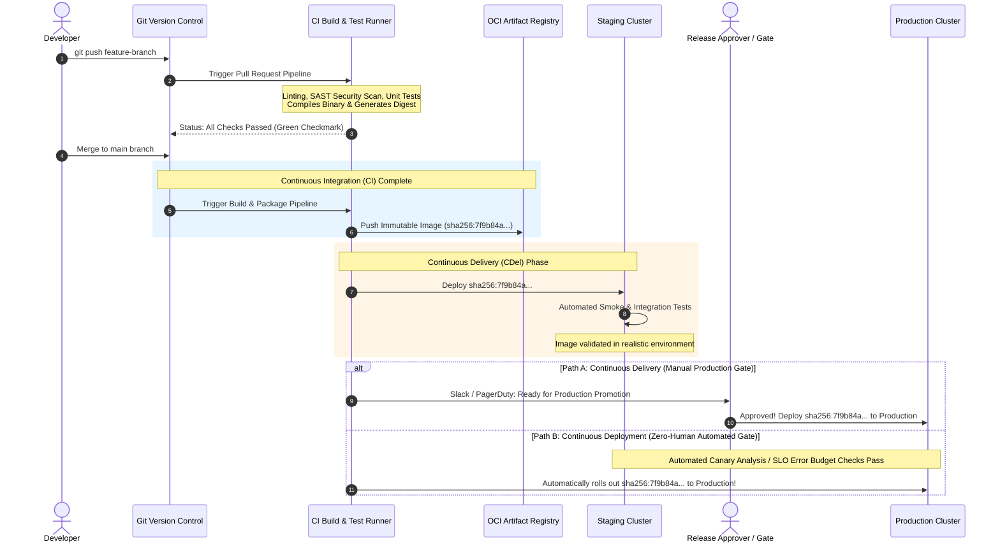
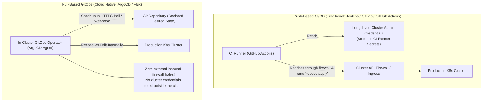
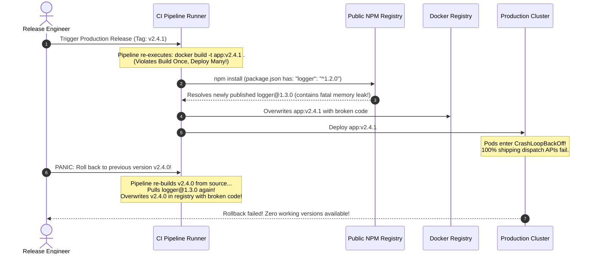

# 00 - CI/CD Concepts & Pipeline Anatomy

> **Prerequisites**: [01 - Linux (Bash Scripting)](../../01-linux/09-bash-scripting/README.md), [02 - Docker Containerization](../../02-docker/00-setup-docker-desktop-wsl2/README.md).  
> **Target Audience**: DevOps Engineers, Site Reliability Engineers, and Senior Software Developers building enterprise release engineering pipelines and automated delivery systems.  
> **Estimated Deep-Dive Time**: 40 minutes.

---

> [!TIP]
> **The Golden Rule of Delivery Pipelines**: **Build the immutable artifact once, test it thoroughly, and promote that exact same binary through every environment.** Never rebuild an image or binary between staging and production. If an image is rebuilt, you are deploying untested bits. Discard mutable tags like `latest`; pin deployments strictly to immutable cryptographic image digests (`sha256:...`).

---

## 1. Visual Mental Models: The Modern Delivery Spectrum

The acronym "CI/CD" combines three distinct evolutionary stages in modern software engineering: **Continuous Integration (CI)**, **Continuous Delivery (CD)**, and **Continuous Deployment (CD)**.

### Continuous Integration vs Continuous Delivery vs Continuous Deployment



---

### Push-Based Delivery vs Pull-Based GitOps Architecture

One of the most consequential architectural decisions in modern cloud-native systems is choosing between **Push-Based Pipelines** and **Pull-Based GitOps**:



---

## 2. Technical Comparison: The Delivery Triad & Pipeline Stages

### Delivery Paradigms Specification Matrix

| Metric / Dimension | Continuous Integration (CI) | Continuous Delivery (CDel) | Continuous Deployment (CDep) |
| :--- | :--- | :--- | :--- |
| **Terminal Boundary** | Artifact compilation & automated test verification | Staging deployment & release artifact ready in registry | Automated, zero-touch rollout to production users |
| **Production Gate** | Not applicable | **Manual Approval Gate** (One-click human sign-off) | **Automated Quality Gate** (Canary metrics & SLO error budgets) |
| **Deployment Cadence** | Multiple times per day per developer | Multiple times per week / on-demand | Dozens of automated production deploys per day |
| **Prerequisites** | Fast test suite (<10m), strict branch hygiene | Staging parity, rollback runbooks, blue/green capability | 99%+ test coverage, automated canary analysis, instant rollback |
| **Blast Radius Risk** | None (Code not yet running in production) | Low (Gated by human operational review) | High if tests lack depth; Low if automated rollbacks are mature |

---

### Standard Pipeline Stage Hierarchy

A production-grade delivery pipeline consists of an ordered sequence of stages operating on a strict **fail-fast** principle:

```
┌────────────────┐     ┌────────────────┐     ┌────────────────┐     ┌────────────────┐     ┌────────────────┐
│ 1. Lint & SAST │ ──► │ 2. Build & Test│ ──► │ 3. OCI Package │ ──► │ 4. Staging Integ│ ──► │ 5. Prod Deploy │
│ (10 - 30 sec)  │     │ (1 - 3 min)    │     │ (1 - 2 min)    │     │ (3 - 5 min)    │     │ (Canary / Ring)│
└────────────────┘     └────────────────┘     └────────────────┘     └────────────────┘     └────────────────┘
```

1. **Stage 1: Static Analysis & Security Scanning (SAST)**
   - Format verification (`gofmt`, `prettier`, `black`), linters (`golangci-lint`, `eslint`).
   - Secret scanning (`gitleaks`, `trufflehog`) to ensure credentials never land in Git history.
   - Static Application Security Testing (`semgrep`, `SonarQube`).
2. **Stage 2: Deterministic Compilation & Unit Testing**
   - Headless unit tests executed with `-race` detection and code coverage thresholds.
   - Fast mocking of external boundaries (databases, cloud queues).
3. **Stage 3: Containerization & Supply Chain Signing**
   - Multi-stage Docker builds generating minimal, distroless images.
   - Container vulnerability scanning (`trivy`, `grype`).
   - Cryptographic signing (`cosign`) and Software Bill of Materials generation (`syft` SBOM).
4. **Stage 4: Ephemeral / Staging Deployment & Integration Testing**
   - Deploying immutable image to preview environment or staging namespace.
   - Synthetic end-to-end integration suites and contract testing (`Pact`).
5. **Stage 5: Production Deployment & Observability Verification**
   - Progressive rollout (Canary, Blue/Green).
   - Automated health verification checking error rates and latency percentiles.

---

## 3. Production War Story: The Tag Mutation Production Rollback Disaster

### Incident Overview
A global logistics provider suffered a complete nationwide shipping dispatch outage during peak Monday morning operations. A hotfix was deployed to staging, thoroughly tested, and approved for production. 

However, during the production deployment step, the pipeline re-executed `docker build` instead of reusing the staging image. The new build pulled a newly released, broken minor version of an unpinned upstream NPM library. When the team attempted an emergency rollback to the previous release tag, the unpinned tag was also overwritten, leaving the engineering team with no functional production artifact. Total outage duration: 3 hours and 14 minutes.

### The Catastrophic Failure Sequence



### Root Cause Analysis
1. **Re-building Across Environments**: The pipeline violated the fundamental invariant of continuous delivery: **Build Once, Deploy Many**. Instead of taking the exact byte-for-byte container image tested in staging and pushing it to production, the pipeline re-ran the build step in the production job.
2. **Floating Dependency Versions**: The application specified caret dependencies (`^1.2.0`) without a locked `package-lock.json` in Docker cache. In the 45 minutes between the staging build and the production build, an upstream package maintainer pushed a broken minor release.
3. **Mutable Docker Tags**: Because the pipeline tagged images with human-readable semantic versions (`v2.4.1`) without pinning by cryptographic content digests (`sha256:...`), the failed rollback build permanently overwritten and corrupted the historical rollback artifact in the registry.

### The Remediation & Permanent Hardening Rules
1. **Cryptographic Digest Pinning**: All deployments must reference immutable SHA-256 digests:
   ```yaml
   image: myregistry.azurecr.io/shipping-api@sha256:7f9b84a921d034b7f5819e9f648347
   ```
2. **Promote Existing Artifacts Only**: Staging tests the image. The production job receives the verified image digest as an input parameter and performs an environment manifest update only.
3. **Strict Lockfile Enforcements**: Enforced `npm ci` (or `go mod download --readonly`, `poetry install --sync`) to guarantee deterministic dependency resolution.

---

## 4. Multi-Language Deterministic Release Artifact Checkers

To enforce the "Build Once, Deploy Many" invariant programmatically, delivery pipelines use pre-promotion verification scripts to ensure that the artifact about to be deployed to production matches the exact cryptographic hash certified in staging.

### Go Implementation (OCI Image Digest Verifier)

```go
// cmd/verify-artifact/main.go
package main

import (
	"crypto/sha256"
	"encoding/hex"
	"fmt"
	"io"
	"log"
	"os"
)

type ArtifactValidator struct {
	expectedHash string
}

func NewArtifactValidator(expectedSHA256 string) *ArtifactValidator {
	return &ArtifactValidator{expectedHash: expectedSHA256}
}

// VerifyFileHash verifies that a binary or packaged tarball matches certified hash
func (v *ArtifactValidator) VerifyFileHash(filePath string) error {
	file, err := os.Open(filePath)
	if err != nil {
		return fmt.Errorf("unable to open artifact file: %w", err)
	}
	defer file.Close()

	hasher := sha256.New()
	if _, err := io.Copy(hasher, file); err != nil {
		return fmt.Errorf("hash computation failed: %w", err)
	}

	computedHash := hex.EncodeToString(hasher.Sum(nil))
	if computedHash != v.expectedHash {
		return fmt.Errorf("INTEGRITY ERROR: Expected %s, but computed %s. Rejecting promotion!",
			v.expectedHash, computedHash)
	}

	log.Printf("Artifact %s certified! SHA256 [%s] matches staging audit record.",
		filePath, computedHash)
	return nil
}

func main() {
	if len(os.Args) < 3 {
		log.Fatalf("Usage: %s <file_path> <expected_sha256>", os.Args[0])
	}
	validator := NewArtifactValidator(os.Args[2])
	if err := validator.VerifyFileHash(os.Args[1]); err != nil {
		log.Fatal(err)
	}
}
```

---

### Node.js / TypeScript Implementation (Pipeline Quality Gate)

```typescript
// scripts/pipelineGate.ts
import fs from 'node:fs';
import crypto from 'node:crypto';

export interface PromotionMetadata {
  buildId: string;
  imageDigest: string;
  gitCommit: string;
  stagingTestsPassed: boolean;
  stagingSignedBy: string;
}

export function validatePromotionGate(metadataPath: string, targetDigest: string): boolean {
  if (!fs.existsSync(metadataPath)) {
    throw new Error(`Quality Gate Failure: Staging certification file [${metadataPath}] not found!`);
  }

  const raw = fs.readFileSync(metadataPath, 'utf8');
  const metadata: PromotionMetadata = JSON.parse(raw);

  // 1. Verify staging test status
  if (!metadata.stagingTestsPassed) {
    throw new Error(`Quality Gate Failure: Staging tests failed for build ${metadata.buildId}`);
  }

  // 2. Verify immutable image digest matches target deployment
  if (metadata.imageDigest !== targetDigest) {
    throw new Error(
      `CRITICAL TAMPER WARNING: Staging certified digest [${metadata.imageDigest}], but pipeline attempted to deploy [${targetDigest}]!`
    );
  }

  console.log(`✅ Quality Gate Passed: Build ${metadata.buildId} cleared for Production.`);
  return true;
}

// Execution entry point
const metadataFile = process.argv[2] || 'staging-audit.json';
const targetDigest = process.argv[3];
if (!targetDigest) {
  console.error('Usage: ts-node pipelineGate.ts <metadata.json> <target_digest>');
  process.exit(1);
}

try {
  validatePromotionGate(metadataFile, targetDigest);
} catch (err: any) {
  console.error(err.message);
  process.exit(1);
}
```

---

### Python Implementation (GitOps Manifest Updater)

```python
# scripts/promote_to_prod.py
import re
import sys
import ruamel.yaml

def promote_artifact(k8s_manifest_path: str, certified_digest: str) -> None:
    """
    Safely updates image digest in a GitOps deployment manifest
    preserving YAML comments and formatting.
    """
    yaml = ruamel.yaml.YAML()
    yaml.preserve_quotes = True

    with open(k8s_manifest_path, "r", encoding="utf-8") as f:
        doc = yaml.load(f)

    # Validate digest format (sha256:<64 hex chars>)
    digest_regex = r"^sha256:[a-f0-9]{64}$"
    if not re.match(digest_regex, certified_digest):
        raise ValueError(f"Invalid OCI digest format: {certified_digest}")

    # Update container image in deployment spec
    containers = doc["spec"]["template"]["spec"]["containers"]
    app_container = next(c for c in containers if c["name"] == "app")
    base_image = app_container["image"].split("@")[0].split(":")[0]
    
    # Form immutable digest reference
    app_container["image"] = f"{base_image}@{certified_digest}"

    with open(k8s_manifest_path, "w", encoding="utf-8") as f:
        yaml.dump(doc, f)

    print(f"Successfully promoted {base_image} to {certified_digest} in {k8s_manifest_path}")

if __name__ == "__main__":
    if len(sys.argv) < 3:
        print("Usage: python promote_to_prod.py <manifest.yaml> <sha256:digest>")
        sys.exit(1)
    promote_artifact(sys.argv[1], sys.argv[2])
```

---

## 5. Practical Hands-On Verification Laboratory

In this hands-on laboratory, you will construct a simulated pipeline directory tree, establish a deterministic build process that generates cryptographic artifact fingerprints, execute an automated staging gate, and promote an immutable digest into production manifests.

### Step 1: Scaffold Pipeline Architecture

Create the testing workspace:

```bash
mkdir -p /tmp/pipeline-lab/app
mkdir -p /tmp/pipeline-lab/gitops/staging
mkdir -p /tmp/pipeline-lab/gitops/prod
```

Create a sample application file (`/tmp/pipeline-lab/app/server.js`):

```javascript
console.log("Production App Version 1.0.0 Online");
```

---

### Step 2: Simulate Deterministic Build & Compute SHA-256 Digest

Generate an immutable cryptographic fingerprint of the application source:

```bash
# Calculate SHA-256 fingerprint
ARTIFACT_HASH=$(sha256sum /tmp/pipeline-lab/app/server.js | awk '{print $1}')
IMAGE_DIGEST="sha256:${ARTIFACT_HASH}"
echo "Built immutable artifact digest: ${IMAGE_DIGEST}"
```

Create the staging certification record (`/tmp/pipeline-lab/staging-audit.json`):

```json
{
  "buildId": "job-10492",
  "imageDigest": "sha256:PLACEHOLDER",
  "gitCommit": "a1b2c3d4",
  "stagingTestsPassed": true,
  "stagingSignedBy": "automated-ci-runner"
}
```

Update the placeholder with the computed hash:

```bash
sed -i "s/sha256:PLACEHOLDER/${IMAGE_DIGEST}/g" /tmp/pipeline-lab/staging-audit.json
cat /tmp/pipeline-lab/staging-audit.json
```

---

### Step 3: Define Staging & Production GitOps Manifests

Create `/tmp/pipeline-lab/gitops/staging/deployment.yaml`:

```yaml
apiVersion: apps/v1
kind: Deployment
metadata:
  name: order-service
  namespace: staging
spec:
  replicas: 1
  template:
    spec:
      containers:
        - name: app
          image: myregistry.io/order-service:staging
```

Create `/tmp/pipeline-lab/gitops/prod/deployment.yaml`:

```yaml
apiVersion: apps/v1
kind: Deployment
metadata:
  name: order-service
  namespace: production
spec:
  replicas: 5
  template:
    spec:
      containers:
        - name: app
          image: myregistry.io/order-service@sha256:0000000000000000000000000000000000000000000000000000000000000000
```

---

### Step 4: Execute Safe Promotion with Quality Gate

Run a promotion script that validates the staging certification before updating the production manifest:

```bash
# Verify promotion gate
CERTIFIED_DIGEST=$(grep -o '"imageDigest": "[^"]*' /tmp/pipeline-lab/staging-audit.json | grep -o '[^"]*$')
STAGING_STATUS=$(grep -o '"stagingTestsPassed": [^,]*' /tmp/pipeline-lab/staging-audit.json | awk '{print $2}')

if [ "$STAGING_STATUS" = "true" ]; then
  echo "Staging checks verified! Promoting ${CERTIFIED_DIGEST} to production..."
  sed -i "s|@sha256:[a-f0-9]*|@${CERTIFIED_DIGEST}|g" /tmp/pipeline-lab/gitops/prod/deployment.yaml
  echo "Production manifest successfully updated!"
else
  echo "Quality Gate FAILED: Staging tests did not pass. Halting deployment!"
  exit 1
fi
```

Verify the production manifest now references the verified digest:

```bash
grep "image:" /tmp/pipeline-lab/gitops/prod/deployment.yaml
```

*Expected Terminal Output:*
```text
          image: myregistry.io/order-service@sha256:...
```

The production manifest is now locked to the byte-for-byte artifact tested in staging.

---

## 6. Command Quick-Reference Cheat Sheet

| Command | Action / Objective | Example Scenario |
| :--- | :--- | :--- |
| `sha256sum <file>` | Generate cryptographic SHA-256 checksum | Verify artifact integrity across pipeline stages |
| `docker inspect --format='{{index .RepoDigests 0}}' <image>` | Retrieve immutable OCI registry digest | Pin deployment manifests to exact image digests |
| `cosign verify --key cosign.pub <image>` | Cryptographically verify container signature | Software supply chain security validation |
| `syft <image> -o spdx-json > sbom.json` | Generate Software Bill of Materials (SBOM) | Audit open-source licensing and vulnerabilities |
| `trivy image --severity HIGH,CRITICAL <image>` | Scan container for known CVE vulnerabilities | Gate pipeline failure prior to registry push |

---

## 7. Operational Validation Checkpoints

### Scenario 1: Flaky Integration Tests Paralysing Team Velocity
**Context:** A team has a test suite of 400 integration tests running on every pull request. One test fails intermittently (1 out of every 15 runs) due to an asynchronous timing condition. Because of the fail-fast rule, 25 developers have PRs blocked every week, leading to developers bypassing CI with `--no-verify`.

<details>
<summary>View Diagnostic Workflow & Resolution</summary>

**Root Cause:**  
Treating non-deterministic integration tests with the same gating priority as deterministic unit tests. Flaky tests erode team trust in CI, leading engineers to disable safety checks.

**Resolution Steps:**
1. **Quarantine Pattern**: Move flaky integration tests into a designated quarantine suite that runs asynchronously and alerts the test owner without blocking PR merges.
2. **Deterministic Test Isolation**: Refactor tests to replace arbitrary `time.Sleep()` calls with condition-polling mechanisms (e.g. `eventually()` with timeout).
3. **Flaky Test Retries**: As a temporary measure, configure the test runner to re-execute failed integration tests up to 2 times before failing the stage.
</details>

---

### Scenario 2: Pipeline Runner Credential Leakage via Build Scripts
**Context:** During an automated CI build, an npm dependency or build script prints environment variables to stdout for debugging (`env` or `print(os.environ)`). The job output exposes `AWS_SECRET_ACCESS_KEY` and `DOCKER_PASSWORD` in public or team-wide build logs.

<details>
<summary>View Diagnostic Workflow & Resolution</summary>

**Root Cause:**  
Secrets were injected globally as environment variables into all build stages, including untrusted third-party compilation scripts.

**Resolution Steps:**
1. **OIDC Identity Federation**: Eliminate static long-lived credentials. Use OpenID Connect (OIDC) between GitHub Actions and AWS/Azure/GCP so runners obtain short-lived (15-minute) tokens dynamically.
2. **Scoped Secret Injection**: Only inject sensitive credentials into the specific step that requires them (e.g. `docker login`), never at the global workflow or job level.
3. **Log Masking**: Ensure the CI engine's secret masking is active and configure automated scanning (e.g. GitHub Secret Scanning) to revoke exposed tokens immediately.
</details>

---

### Scenario 3: Secret Configuration Drift Between Staging and Production
**Context:** A microservice deploys cleanly to staging. In production, it crashes immediately on boot with `KeyError: REDIS_TLS_ENABLED`. The staging ConfigMap had this variable set, but the production ConfigMap was not updated.

<details>
<summary>View Diagnostic Workflow & Resolution</summary>

**Root Cause:**  
Configuration schemas were maintained manually and independently per environment rather than driven by a single parameterized schema (Helm `values.yaml` or Kustomize).

**Resolution Steps:**
1. Maintain a single base manifest with environment overlays in GitOps (Kustomize or Helm).
2. Use schema validation tools (e.g. `kube-linter`, `helm lint`, JSON Schema validation) in CI to verify that all required environment variables are defined across all environment overlays prior to merge.
3. The application must supply sensible defaults or fail early during bootstrap with descriptive validation messages.
</details>

---

## 8. Further Reading & Official Documentation

- [Google SRE Book: Release Engineering](https://sre.google/sre-book/release-engineering/)
- [Continuous Delivery: Reliable Software Releases (Jez Humble & David Farley)](https://continuousdelivery.com/)
- [Open Container Initiative (OCI) Image Specification](https://github.com/opencontainers/image-spec)
- [GitOps Principles (OpenGitOps Standard)](https://opengitops.net/)
- [Sigstore Cosign: Container Signing and Verification](https://docs.sigstore.dev/cosign/overview/)

---

## Next

Continue to [01 - GitHub Actions Deep Dive](../01-github-actions-deep-dive/README.md) to translate delivery pipeline concepts into production GitHub Actions workflows, jobs, matrix builds, and reusable actions.
