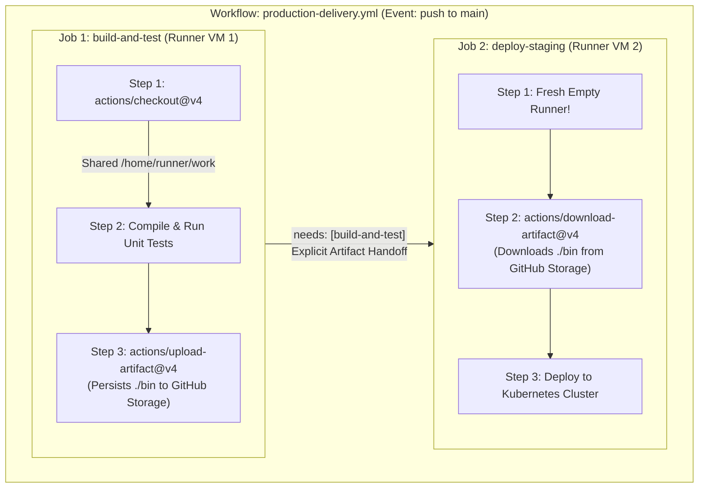
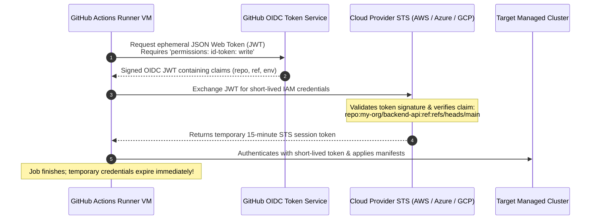
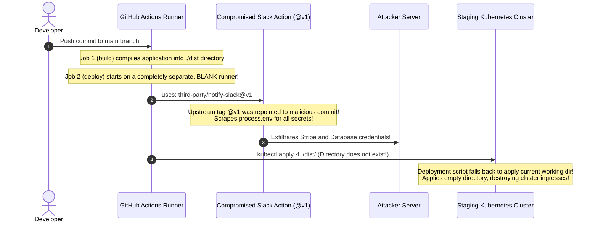

# 01 - GitHub Actions Deep Dive

> **Prerequisites**: [00 - CI/CD Concepts & Pipeline Anatomy](../00-cicd-concepts-and-pipeline-anatomy/README.md), [01 - Linux (Bash Scripting)](../../01-linux/09-bash-scripting/README.md).  
> **Target Audience**: DevOps Engineers, Platform Engineers, and Backend Systems Developers architecting declarative, secure, multi-job automation pipelines.  
> **Estimated Deep-Dive Time**: 40 minutes.

---

> [!TIP]
> **The Golden Rule of GitHub Actions Security**: **Always set top-level `permissions: {}` (read-none) by default, and pin third-party actions to full immutable commit SHAs.** Never use mutable tags like `@v4` for external community actions in production pipelines, as a compromised upstream release can exfiltrate your secrets. Pass state between jobs strictly via `actions/upload-artifact` or typed `job.outputs`—never assume filesystem persistence between jobs.

---

## 1. Visual Mental Models: The Workflow Hierarchy & Lifecycle

GitHub Actions organizes automation into a strict three-tier hierarchy: **Workflows** contain **Jobs**, and Jobs contain sequential **Steps**.

### Job Isolation vs Step Filesystem Sharing

A common point of confusion is assuming that jobs in the same workflow share disk storage. They do not. Every job executes on an isolated, ephemeral virtual machine runner:



---

### The OIDC Federated Identity Handshake (Zero-Static-Credentials)

Rather than storing long-lived, high-privilege cloud secrets (like AWS Access Keys or Azure Service Principal Passwords) in GitHub Secrets, modern pipelines use **OpenID Connect (OIDC)**:



---

## 2. Technical Comparison: Execution Contexts & Permissions

### GitHub Actions Contexts Specification Matrix

| Context | Scope & Description | Production Example Expression |
| :--- | :--- | :--- |
| **`github`** | Metadata about the triggering event, repository, and actor | `${{ github.sha }}`, `${{ github.event_name }}` |
| **`secrets`** | Encrypted repository, organization, or environment secrets | `${{ secrets.PROD_DATABASE_URL }}` |
| **`env`** | Variables defined at workflow, job, or step level | `${{ env.ENVIRONMENT_NAME }}` |
| **`matrix`** | Active parameters for the current matrix execution leg | `${{ matrix.node-version }}`, `${{ matrix.os }}` |
| **`needs`** | Outputs and completion statuses of dependency jobs | `${{ needs.build.outputs.image_digest }}` |
| **`steps`** | Status and outputs produced by earlier steps in the same job | `${{ steps.docker_build.outputs.digest }}` |
| **`runner`** | Information about the executing runner environment | `${{ runner.os }}`, `${{ runner.temp }}` |

---

### Least-Privilege `GITHUB_TOKEN` Permissions Matrix

By default, unconfigured workflows can inherit broad write permissions. Secure pipelines explicitly declare least-privilege permissions:

```yaml
# Enforce zero-trust default at the workflow root:
permissions: {}

jobs:
  build-and-test:
    runs-on: ubuntu-latest
    permissions:
      contents: read       # Required to clone repository code via actions/checkout
      packages: write      # Required to publish to GitHub Container Registry (ghcr.io)
      id-token: write      # Required for OIDC JWT cloud authentication
      pull-requests: write # Required if publishing test coverage comments to PR
```

---

### Composite Action vs Reusable Workflow

| Dimension | Composite Action (`action.yml`) | Reusable Workflow (`workflow_call`) |
| :--- | :--- | :--- |
| **Primary Scope** | Reusable **steps** packaged into a single reusable action | Reusable **job graph** invoked as an entire pipeline |
| **Execution Context** | Runs inside the calling job's existing runner VM | Executes on its own independently allocated runner VMs |
| **File Location** | `.github/actions/<action-name>/action.yml` | `.github/workflows/<workflow-name>.yml` |
| **Best Used For** | Repeating boilerplate steps (e.g. tool install + login) | Standardizing company-wide multi-stage CI/CD pipelines |

---

## 3. Production War Story: The Blank Runner Disaster & The Poisoned Action

### Incident Overview
A financial services platform suffered an emergency outage when a refactored release workflow deployed an empty directory to their staging cluster, wiping out all Ingress configurations. 

During the incident investigation, security analysts discovered that an unpinned community action (`uses: third-party/notify-slack@v1`) had been compromised via a supply-chain credential-stuffing attack on the maintainer's account. The compromised action extracted all environment variables—including production Stripe API keys—and transmitted them to an external command-and-control server.

### The Catastrophic Failure Sequence



### Root Cause Analysis
1. **Runner Isolation Ignorance**: The developer wrote `needs: [build]` and assumed the compiled `./dist` directory created in Job 1 would naturally exist in Job 2. Because Job 2 ran on a fresh VM, `./dist` was absent. The deployment script fell back to an unverified local path and executed `kubectl apply` against an empty folder.
2. **Mutable Action Tag Vulnerability**: The workflow pinned the Slack notification action using `@v1`. The attacker hijacked the open-source repository and moved the mutable git tag `@v1` to point to a malicious commit that injected an exfiltration payload.
3. **Over-Privileged Secret Injection**: Secrets were configured at the repository root and injected into all steps, allowing the malicious Slack action full read access to unrelated production payment tokens.

### The Remediation & Permanent Hardening Rules
1. **Mandatory Artifact Handoff**: Pass compiled binaries between jobs using verified `upload-artifact` and `download-artifact`:
   ```yaml
   - uses: actions/upload-artifact@v4
     with:
       name: release-dist
       path: ./dist
       retention-days: 1
   ```
2. **Full Commit SHA Pinning**: Pin all third-party actions to immutable 40-character commit hashes:
   ```yaml
   # ❌ NEVER USE MUTABLE TAGS:
   uses: actions/checkout@v4
   # ✅ PIN TO IMMUTABLE SHA:
   uses: actions/checkout@b4ffde65f46336ab88eb53be808477a3936bae11 # v4.1.1
   ```
3. **Step-Level Secret Scoping**: Pass secrets only into the exact shell step that executes the command, rather than binding them to the entire job.

---

## 4. Multi-Language Production Pipeline Implementations

Below are complete, enterprise-grade GitHub Actions pipeline configurations for **Go**, **Node.js/TypeScript**, and **Python**. Each includes matrix testing, dependency caching, static analysis, artifact upload, and safe multi-job handoffs.

### Go Production Pipeline (`.github/workflows/go-ci.yml`)

```yaml
name: Go Production Pipeline

on:
  push:
    branches: [main]
  pull_request:
    branches: [main]

permissions: {}

jobs:
  lint-and-test:
    name: Lint & Test (Go ${{ matrix.go-version }})
    runs-on: ubuntu-latest
    permissions:
      contents: read
    strategy:
      fail-fast: false
      matrix:
        go-version: ['1.22', '1.23']
    steps:
      - name: Checkout Code
        uses: actions/checkout@b4ffde65f46336ab88eb53be808477a3936bae11 # v4.1.1

      - name: Setup Go Runtime
        uses: actions/setup-go@0c52d547c9bc32b1aa3301fd7a9cb496313a4491 # v5.0.0
        with:
          go-version: ${{ matrix.go-version }}
          cache: true # Built-in go.sum caching

      - name: Run golangci-lint
        uses: golangci/golangci-lint-action@3a919529898de77ec3da873e3063ca4b10e7f5cc # v3.7.0
        with:
          version: latest

      - name: Run Tests with Race Detector
        run: go test -v -race -coverprofile=coverage.out ./...

  build-binary:
    name: Build & Package Binary
    needs: [lint-and-test]
    runs-on: ubuntu-latest
    permissions:
      contents: read
    outputs:
      binary_hash: ${{ steps.compute_hash.outputs.hash }}
    steps:
      - name: Checkout Code
        uses: actions/checkout@b4ffde65f46336ab88eb53be808477a3936bae11

      - name: Setup Go
        uses: actions/setup-go@0c52d547c9bc32b1aa3301fd7a9cb496313a4491
        with:
          go-version: '1.23'
          cache: true

      - name: Compile Deterministic Binary
        run: |
          CGO_ENABLED=0 GOOS=linux GOARCH=amd64 go build -trimpath -ldflags="-w -s" -o bin/server ./cmd/server

      - name: Compute Artifact Hash
        id: compute_hash
        run: |
          HASH=$(sha256sum bin/server | awk '{print $1}')
          echo "hash=$HASH" >> $GITHUB_OUTPUT

      - name: Upload Build Artifact
        uses: actions/upload-artifact@5d5d22a31266ced268874388b861e4b58bb5c2f3 # v4.3.1
        with:
          name: go-server-bin
          path: bin/server
          retention-days: 2

  deploy-staging:
    name: Deploy to Staging
    needs: [build-binary]
    if: github.ref == 'refs/heads/main'
    runs-on: ubuntu-latest
    environment: staging
    permissions:
      contents: read
      id-token: write # For cloud OIDC authentication
    steps:
      - name: Download Compiled Binary
        uses: actions/download-artifact@c850b08b165c4587730e67dddd9f29fb0748e7da # v4.1.4
        with:
          name: go-server-bin
          path: bin

      - name: Verify Artifact Integrity
        run: |
          COMPUTED=$(sha256sum bin/server | awk '{print $1}')
          EXPECTED="${{ needs.build-binary.outputs.binary_hash }}"
          if [ "$COMPUTED" != "$EXPECTED" ]; then
            echo "Security Error: Hash mismatch!"
            exit 1
          fi
          echo "Binary verified successfully!"
```

---

### Node.js / TypeScript Pipeline (`.github/workflows/node-ci.yml`)

```yaml
name: Node.js TypeScript Pipeline

on:
  push:
    branches: [main]
  pull_request:
    branches: [main]

permissions: {}

jobs:
  build-and-test:
    name: Build & Test (Node ${{ matrix.node-version }} on ${{ matrix.os }})
    runs-on: ${{ matrix.os }}
    permissions:
      contents: read
    strategy:
      fail-fast: false
      matrix:
        node-version: [18.x, 20.x]
        os: [ubuntu-latest]
    steps:
      - uses: actions/checkout@b4ffde65f46336ab88eb53be808477a3936bae11

      - name: Setup Node.js Runtime
        uses: actions/setup-node@60edb5dd545a775178f525247059d6428237b63f # v4.0.2
        with:
          node-version: ${{ matrix.node-version }}
          cache: 'npm'

      - name: Deterministic Install
        run: npm ci

      - name: Type Check & Lint
        run: |
          npm run typecheck
          npm run lint

      - name: Execute Test Suite
        run: npm test -- --ci --coverage

      - name: Compile TypeScript
        run: npm run build

      - name: Upload Dist Artifact
        if: matrix.node-version == '20.x'
        uses: actions/upload-artifact@5d5d22a31266ced268874388b861e4b58bb5c2f3
        with:
          name: dist-build
          path: dist/
          retention-days: 1
```

---

### Python Pipeline (`.github/workflows/python-ci.yml`)

```yaml
name: Python Production Pipeline

on:
  push:
    branches: [main]
  pull_request:
    branches: [main]

permissions: {}

jobs:
  quality-gate:
    name: Code Quality & Unit Tests
    runs-on: ubuntu-latest
    permissions:
      contents: read
    steps:
      - uses: actions/checkout@b4ffde65f46336ab88eb53be808477a3936bae11

      - name: Setup Python
        uses: actions/setup-python@0a5c61591373683505ea898e09a3ea4f39ef2b9c # v5.0.0
        with:
          python-version: '3.11'
          cache: 'pip'

      - name: Install Dependencies
        run: |
          python -m pip install --upgrade pip
          pip install ruff pytest pytest-cov

      - name: Run Ruff Linter & Formatter Check
        run: |
          ruff check .
          ruff format --check .

      - name: Run Pytest with Coverage Gate
        run: |
          pytest --cov=app --cov-report=xml --cov-fail-under=85
```

---

## 5. Practical Hands-On Verification Laboratory

In this laboratory, you will construct a modular Composite Action in `.github/actions/setup-pipeline/action.yml` and invoke it from a multi-job workflow that transfers state via typed job outputs and uploaded artifacts.

### Step 1: Create Composite Action Scaffold

Create `.github/actions/setup-pipeline/action.yml`:

```yaml
name: "Setup Custom Pipeline Environment"
description: "Configures system dependencies and caches runtime artifacts"
inputs:
  system-dependency:
    description: "Linux package to install"
    required: false
    default: "curl"
outputs:
  installed-version:
    description: "Version of installed dependency"
    value: ${{ steps.get_ver.outputs.version }}

runs:
  using: "composite"
  steps:
    - name: Install System Tool
      shell: bash
      run: |
        sudo apt-get update && sudo apt-get install -y ${{ inputs.system-dependency }}

    - name: Capture Installed Version
      id: get_ver
      shell: bash
      run: |
        VER=$(${{ inputs.system-dependency }} --version | head -n 1)
        echo "version=$VER" >> $GITHUB_OUTPUT
```

---

### Step 2: Write Multi-Job Workflow with Matrix & Typed Outputs

Create `.github/workflows/modular-pipeline.yml`:

```yaml
name: Modular Enterprise Pipeline

on:
  workflow_dispatch:
  push:
    branches: [main]

permissions: {}

jobs:
  compile:
    name: Compile & Fingerprint
    runs-on: ubuntu-latest
    permissions:
      contents: read
    outputs:
      build-hash: ${{ steps.hasher.outputs.hash }}
    steps:
      - uses: actions/checkout@b4ffde65f46336ab88eb53be808477a3936bae11

      - name: Invoke Local Composite Action
        id: setup
        uses: ./.github/actions/setup-pipeline
        with:
          system-dependency: jq

      - name: Generate Dummy Application Artifact
        run: |
          mkdir -p output
          echo "{\"version\": \"1.0.0\", \"timestamp\": \"$(date)\"}" > output/manifest.json

      - name: Compute Artifact Hash
        id: hasher
        run: |
          HASH=$(sha256sum output/manifest.json | awk '{print $1}')
          echo "hash=$HASH" >> $GITHUB_OUTPUT

      - name: Store Build Artifact
        uses: actions/upload-artifact@5d5d22a31266ced268874388b861e4b58bb5c2f3
        with:
          name: app-manifest
          path: output/manifest.json

  deploy-matrix:
    name: Deploy to Cluster (${{ matrix.target-env }})
    needs: [compile]
    runs-on: ubuntu-latest
    strategy:
      matrix:
        target-env: [dev, staging]
    steps:
      - name: Download Stored Artifact
        uses: actions/download-artifact@c850b08b165c4587730e67dddd9f29fb0748e7da
        with:
          name: app-manifest
          path: output

      - name: Verify Cryptographic Integrity
        run: |
          COMPUTED_HASH=$(sha256sum output/manifest.json | awk '{print $1}')
          EXPECTED_HASH="${{ needs.compile.outputs.build-hash }}"
          echo "Computed: $COMPUTED_HASH"
          echo "Expected: $EXPECTED_HASH"
          if [ "$COMPUTED_HASH" != "$EXPECTED_HASH" ]; then
            echo "Hash mismatch error!"
            exit 1
          fi
          echo "Successfully verified deployment payload for ${{ matrix.target-env }}"
```

---

## 6. Command Quick-Reference Cheat Sheet

| GitHub Actions Syntax / Primitive | Objective / Function | Example Usage |
| :--- | :--- | :--- |
| `permissions: {}` | Set zero default privileges on `GITHUB_TOKEN` | Root level of workflow YAML |
| `needs: [jobA, jobB]` | Enforce strict DAG dependency between jobs | Declare execution ordering |
| `echo "var=val" >> $GITHUB_OUTPUT` | Set typed output from a step for subsequent steps/jobs | `${{ steps.<id>.outputs.var }}` |
| `echo "KEY=VAL" >> $GITHUB_ENV` | Expose environment variable across subsequent steps | Available as `$KEY` in later steps |
| `actions/upload-artifact@v4` | Persist files beyond job boundary to GitHub storage | Carry build outputs to deploy jobs |
| `concurrency: group: ${{ github.ref }}` | Cancel obsolete in-flight PR builds automatically | Save billing minutes on rapid git pushes |

---

## 7. Operational Validation Checkpoints

### Scenario 1: Inter-Job Output Evaluates to Empty String
**Context:** Job `deploy` declares `needs: [build]`. Inside `deploy`, the step references `${{ needs.build.outputs.image_digest }}`. The value evaluates to an empty string, breaking the downstream deployment script.

<details>
<summary>View Diagnostic Workflow & Resolution</summary>

**Root Cause:**  
Job outputs require a two-tier declaration. Setting `echo "digest=xyz" >> $GITHUB_OUTPUT` inside a step is insufficient; the containing `build` job must explicitly map the step output to a job-level output under `jobs.build.outputs`.

**Resolution Steps:**
Ensure the job spec maps the step output:
```yaml
jobs:
  build:
    runs-on: ubuntu-latest
    outputs:
      image_digest: ${{ steps.step_build.outputs.digest }} # MUST BE DECLARED HERE!
    steps:
      - id: step_build
        run: echo "digest=sha256:abcd" >> $GITHUB_OUTPUT
```
</details>

---

### Scenario 2: OIDC Cloud Authentication Fails with `403 Subject Mismatch`
**Context:** You configure GitHub Actions to authenticate into AWS or Azure using OIDC. The step fails with `HttpError: Subject does not match the trust relationship condition`.

<details>
<summary>View Diagnostic Workflow & Resolution</summary>

**Root Cause:**  
The cloud trust policy specifies an exact claim string for `sub` (e.g. `repo:org/repo:environment:production`), but the workflow is running from a pull request branch (`refs/pull/42/merge`) or omitted the `environment:` declaration in the job YAML.

**Resolution Steps:**
1. If the IAM trust policy expects an environment claim, ensure the job declares:
   ```yaml
   jobs:
     deploy:
       environment: production # Injects matching environment claim into JWT
   ```
2. Verify that top-level permissions include `id-token: write`.
</details>

---

### Scenario 3: `actions/cache` Misses on Every Single CI Run
**Context:** You configure `actions/cache` for npm or Go packages using `key: ${{ runner.os }}-deps-${{ hashFiles('**/package-lock.json') }}`. Every pipeline run downloads dependencies from scratch, showing `Cache not found`.

<details>
<summary>View Diagnostic Workflow & Resolution</summary>

**Root Cause:**  
1. **Branch Scoping**: GitHub Actions cache branches restrict access. A feature branch can read caches created on the default (`main`) branch, but cannot read caches from other isolated sibling feature branches.
2. **Missing Restore Keys**: If `package-lock.json` changes slightly, a strict key misses completely.

**Resolution Steps:**
Add `restore-keys` so partial prefix matches can reuse the bulk of the cache:
```yaml
uses: actions/cache@v4
with:
  path: ~/.npm
  key: ${{ runner.os }}-node-${{ hashFiles('**/package-lock.json') }}
  restore-keys: |
    ${{ runner.os }}-node-
```
</details>

---

## 8. Further Reading & Official Documentation

- [GitHub Actions Documentation: Workflow Syntax](https://docs.github.com/en/actions/using-workflows/workflow-syntax-for-github-actions)
- [Security Hardening for GitHub Actions](https://docs.github.com/en/actions/security-guides/security-hardening-for-github-actions)
- [About Security Hardening with OpenID Connect (OIDC)](https://docs.github.com/en/actions/deployment/security-hardening-your-deployments/about-security-hardening-with-openid-connect)
- [Creating Composite Actions](https://docs.github.com/en/actions/creating-actions/creating-a-composite-action)
- [Using Environments for Deployment Protection Rules](https://docs.github.com/en/actions/deployment/targeting-different-environments/using-environments-for-deployment)

---

## Next

Continue to [02 - Building & Testing in CI](../02-building-and-testing-in-ci/README.md) to implement automated test suites, code coverage gates, dependency caching, and required PR merge checks.
