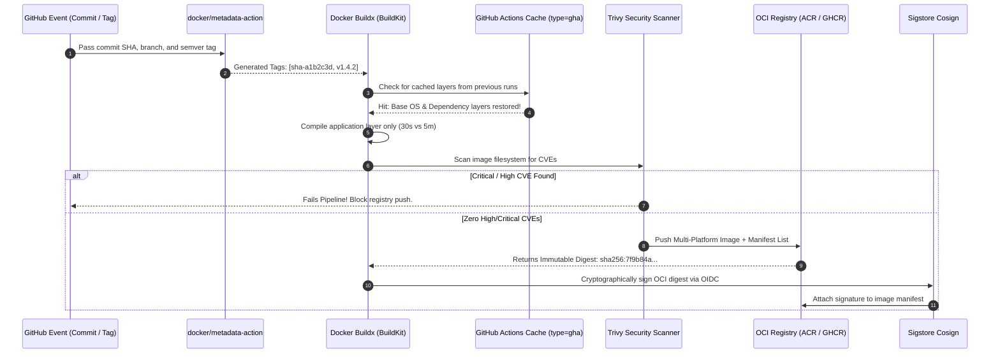
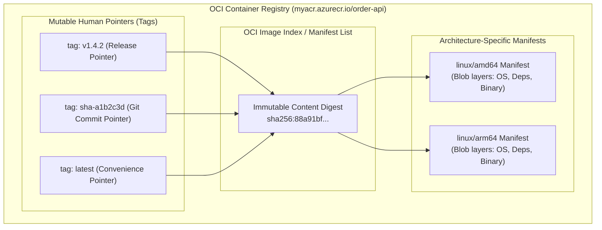
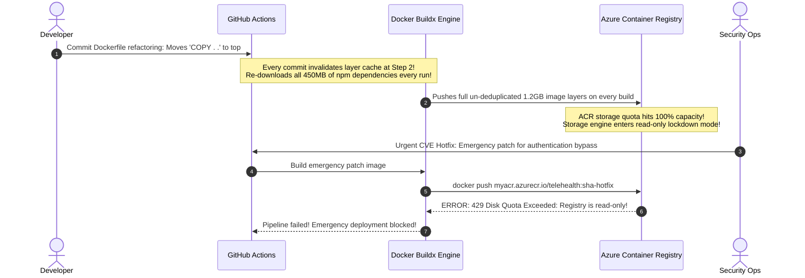

# 03 - Container Image Pipelines

> **Prerequisites**: [02 - Docker Containerization](../../02-docker/00-setup-docker-desktop-wsl2/README.md), [01 - GitHub Actions Deep Dive](../01-github-actions-deep-dive/README.md).  
> **Target Audience**: Platform Engineers, SREs, and Release Automation Architects building secure, optimized OCI container delivery pipelines with Buildx and registry caching.  
> **Estimated Deep-Dive Time**: 40 minutes.

---

> [!TIP]
> **The Golden Rule of Image Tagging**: **Tags are pointers; digests are cryptographic truth.** Never deploy mutable tags like `latest` in production. Always tag images with the short commit SHA (`${{ github.sha }}`) and semantic versions for traceability, but pass the immutable **OCI digest** (`@sha256:...`) to your deployment jobs. Use **Docker Buildx with `type=gha` layer caching** to cut CI build times from minutes to seconds.

---

## 1. Visual Mental Models: The Container Build & Security Pipeline

A production image pipeline does not merely invoke `docker build`. It standardizes metadata extraction, multi-architecture compilation, BuildKit layer caching, vulnerability scanning, and cryptographic artifact signing:



---

### Anatomy of an OCI Image: Tags vs Manifests vs Digests



---

## 2. Technical Comparison: Tagging Models & Buildx Cache Backends

### Container Tagging Strategies Matrix

| Strategy | Syntax Example | Immutability | Human Readability | Best Production Use Case |
| :--- | :--- | :--- | :--- | :--- |
| **Commit SHA** | `api:sha-a1b2c3d` | High (unless overwritten) | Poor (Requires Git lookup) | **Default internal CI/CD deploy target** |
| **Semantic Version** | `api:1.4.2` | High (Convention-based) | High (Communicates changes) | Public API releases, customer-facing artifacts |
| **Multi-Tagging** | `api:1.4.2` + `api:sha-a1b2c3d` | High | High | Dual tagging: release tags for humans, SHA for CI |
| **Immutable Digest** | `api@sha256:7f9b84...` | **Absolute (Cryptographic)** | None | **Zero-trust production deployments & security gates** |
| **`latest`** | `api:latest` | ❌ Zero (Mutates constantly) | Misleading | Local developer testing only; **NEVER in production** |

---

### Docker Buildx Cache Backends Specification

| Cache Backend | Syntax Configuration | Storage Location | Performance Characteristics |
| :--- | :--- | :--- | :--- |
| **GitHub Cache (`gha`)** | `cache-from: type=gha`<br/>`cache-to: type=gha,mode=max` | GitHub Actions Cache (10GB per repo) | Fastest for standard GitHub-hosted runners; zero registry bandwidth costs |
| **Registry Cache (`registry`)** | `cache-from: type=registry,ref=...:cache`<br/>`cache-to: type=registry,ref=...:cache,mode=max` | OCI Registry (ACR/GHCR) | Best for self-hosted runners or multi-repo shared builders; cross-cluster availability |
| **Local Cache (`local`)** | `cache-from: type=local,src=...`<br/>`cache-to: type=local,dest=...` | Host filesystem | Ideal for bare-metal CI servers with dedicated SSD storage |

---

## 3. Production War Story: The Silent Cache Invalidation & ACR Outage

### Incident Overview
A global healthcare platform operated an automated continuous deployment pipeline building a critical telehealth microservice. An engineer refactored the Dockerfile to "clean up" the syntax, inadvertently swapping the ordering of `COPY . .` and `RUN npm ci`. 

Because of the misordered layers, Docker BuildKit invalidated the entire layer cache on every single commit. Build durations surged from 45 seconds to 9 minutes. Simultaneously, thousands of untagged intermediary cache images filled the Azure Container Registry (ACR), exceeding the provisioned 100GB disk quota. When a critical Zero-Day security patch needed to be deployed, ACR rejected all pushes with `429 Disk Quota Exceeded`, leaving the platform vulnerable for over 4 hours.

### The Catastrophic Failure Sequence



### Root Cause Analysis
1. **Dockerfile Layer Invalidation**: In Docker, when a layer cache busts, every subsequent layer must be recomputed. Placing `COPY . .` before `RUN npm ci` caused any change to a README or comment to trigger a complete dependency re-download.
2. **Missing Buildx Cache Scoping**: The pipeline did not use BuildKit multi-stage target caching or GitHub Actions cache isolation, creating bloat.
3. **No Automated Registry Retention Policy**: ACR had no automated cleanup tasks (e.g. `acr purge`), allowing abandoned untagged manifests to consume production storage indefinitely.

### The Remediation & Permanent Layer Optimization
1. **Optimize Dockerfile Ordering**:
   ```dockerfile
   # 1. Copy dependencies first
   COPY package.json package-lock.json ./
   RUN npm ci
   # 2. Copy source code last
   COPY . .
   RUN npm run build
   ```
2. **Adopt `type=gha` Layer Caching with `mode=max`**: Cache all stages (including intermediate build stages) in GitHub's ephemeral cache rather than cluttering registry storage.
3. **Automated ACR Purge Task**: Configured an Azure ACR retention rule deleting untagged manifests older than 7 days:
   ```bash
   az acr task create \
     --registry myacr \
     --name purgeUntagged \
     --cmd "acr purge --filter '.*:.*' --untagged --ago 7d" \
     --schedule "0 2 * * *"
   ```

---

## 4. Multi-Language Production Image Pipelines

Below are production-ready GitHub Actions workflows for **Go**, **Node.js/TypeScript**, and **Python**. Each pipeline integrates `docker/metadata-action` for semantic tagging, `docker/build-push-action` with Buildx layer caching, and Trivy CVE scanning.

### Go Container Pipeline (`.github/workflows/docker-go.yml`)

```yaml
name: Build & Publish Go Container

on:
  push:
    branches: [main]
    tags: ['v*.*.*']

permissions: {}

env:
  REGISTRY: ghcr.io
  IMAGE_NAME: ${{ github.repository }}

jobs:
  build-and-push:
    name: Build & Scan OCI Image
    runs-on: ubuntu-latest
    permissions:
      contents: read
      packages: write
      security-events: write
    outputs:
      image_digest: ${{ steps.build_push.outputs.digest }}
    steps:
      - name: Checkout Code
        uses: actions/checkout@b4ffde65f46336ab88eb53be808477a3936bae11

      - name: Set up QEMU (Multi-Architecture)
        uses: docker/setup-qemu-action@68827325e0b33c7199eb31dd4e31fbe9023e06e3 # v3.0.0

      - name: Set up Docker Buildx
        uses: docker/setup-buildx-action@d70bba72b1f3ed2237583bb6c42978086055d046 # v3.1.0

      - name: Extract Docker Metadata
        id: meta
        uses: docker/metadata-action@8e5442c4ef9f78452d77bb8e2e604471b4028235 # v5.5.1
        with:
          images: ${{ env.REGISTRY }}/${{ env.IMAGE_NAME }}
          tags: |
            type=sha,format=short,prefix=sha-
            type=semver,pattern={{version}}
            type=semver,pattern={{major}}.{{minor}}

      - name: Log in to GitHub Container Registry
        uses: docker/login-action@e92390c5fb421da1463c202d546fed0ec5c39f20 # v3.0.0
        with:
          registry: ${{ env.REGISTRY }}
          username: ${{ github.actor }}
          password: ${{ secrets.GITHUB_TOKEN }}

      - name: Build and Push Docker Image
        id: build_push
        uses: docker/build-push-action@2cdde6103fc508318b64b186450689fc4feb4f46 # v5.1.0
        with:
          context: .
          platforms: linux/amd64,linux/arm64
          push: true
          tags: ${{ steps.meta.outputs.tags }}
          labels: ${{ steps.meta.outputs.labels }}
          cache-from: type=gha
          cache-to: type=gha,mode=max

      - name: Run Trivy Vulnerability Scanner
        uses: aquasecurity/trivy-action@master
        with:
          image-ref: ${{ env.REGISTRY }}/${{ env.IMAGE_NAME }}@${{ steps.build_push.outputs.digest }}
          format: 'sarif'
          output: 'trivy-results.sarif'
          severity: 'CRITICAL,HIGH'
          exit-code: '1' # Fails build on critical CVEs!
```

---

### Node.js / TypeScript Container Pipeline (`.github/workflows/docker-node.yml`)

```yaml
name: Build Node.js Container

on:
  push:
    branches: [main]

permissions: {}

env:
  REGISTRY: ghcr.io
  IMAGE_NAME: ${{ github.repository }}

jobs:
  build:
    name: Build & Push Node Image
    runs-on: ubuntu-latest
    permissions:
      contents: read
      packages: write
    outputs:
      digest: ${{ steps.build_push.outputs.digest }}
    steps:
      - uses: actions/checkout@b4ffde65f46336ab88eb53be808477a3936bae11

      - uses: docker/setup-buildx-action@d70bba72b1f3ed2237583bb6c42978086055d046

      - name: Docker Metadata
        id: meta
        uses: docker/metadata-action@8e5442c4ef9f78452d77bb8e2e604471b4028235
        with:
          images: ${{ env.REGISTRY }}/${{ env.IMAGE_NAME }}
          tags: |
            type=sha,prefix=sha-

      - uses: docker/login-action@e92390c5fb421da1463c202d546fed0ec5c39f20
        with:
          registry: ${{ env.REGISTRY }}
          username: ${{ github.actor }}
          password: ${{ secrets.GITHUB_TOKEN }}

      - name: Build & Push with Layer Cache
        id: build_push
        uses: docker/build-push-action@2cdde6103fc508318b64b186450689fc4feb4f46
        with:
          context: .
          push: true
          tags: ${{ steps.meta.outputs.tags }}
          cache-from: type=gha
          cache-to: type=gha,mode=max
```

---

### Python Container Pipeline (`.github/workflows/docker-python.yml`)

```yaml
name: Build Python Container

on:
  push:
    branches: [main]

permissions: {}

env:
  REGISTRY: ghcr.io
  IMAGE_NAME: ${{ github.repository }}

jobs:
  build:
    name: Build Python Distroless Image
    runs-on: ubuntu-latest
    permissions:
      contents: read
      packages: write
    outputs:
      digest: ${{ steps.build_push.outputs.digest }}
    steps:
      - uses: actions/checkout@b4ffde65f46336ab88eb53be808477a3936bae11

      - uses: docker/setup-buildx-action@d70bba72b1f3ed2237583bb6c42978086055d046

      - id: meta
        uses: docker/metadata-action@8e5442c4ef9f78452d77bb8e2e604471b4028235
        with:
          images: ${{ env.REGISTRY }}/${{ env.IMAGE_NAME }}
          tags: type=sha,prefix=sha-

      - uses: docker/login-action@e92390c5fb421da1463c202d546fed0ec5c39f20
        with:
          registry: ${{ env.REGISTRY }}
          username: ${{ github.actor }}
          password: ${{ secrets.GITHUB_TOKEN }}

      - id: build_push
        uses: docker/build-push-action@2cdde6103fc508318b64b186450689fc4feb4f46
        with:
          context: .
          push: true
          tags: ${{ steps.meta.outputs.tags }}
          cache-from: type=gha
          cache-to: type=gha,mode=max
```

---

## 5. Practical Hands-On Verification Laboratory

In this hands-on laboratory, you will configure a local Docker Buildx instance, compile a multi-stage Dockerfile, extract the immutable content digest, and verify layer cache efficiency.

### Step 1: Create Optimized Multi-Stage Dockerfile

Create a test workspace and Dockerfile:

```dockerfile
# /tmp/buildx-lab/Dockerfile
FROM golang:1.23-alpine AS builder
WORKDIR /src

# Layer 1: Cached dependencies
COPY go.mod ./
RUN echo "module testapp" > go.mod

# Layer 2: Cached application build
COPY main.go ./
RUN CGO_ENABLED=0 go build -ldflags="-w -s" -o /bin/app main.go

# Minimal Distroless Runtime
FROM gcr.io/distroless/static:nonroot
COPY --from=builder /bin/app /bin/app
USER 65532:65532
ENTRYPOINT ["/bin/app"]
```

Create `/tmp/buildx-lab/main.go`:

```go
package main
import "fmt"
func main() {
    fmt.Println("Production Distroless App Online")
}
```

---

### Step 2: Initialize Docker Buildx Multi-Architecture Builder

Initialize a dedicated Buildx builder with BuildKit features:

```bash
docker buildx create --name enterprise-builder --use --bootstrap
docker buildx inspect enterprise-builder
```

*Expected Terminal Output:*
```text
Name:          enterprise-builder
Driver:        docker-container
Status:        running
Platforms:     linux/amd64, linux/arm64, linux/riscv64, linux/ppc64le, linux/s390x, linux/386, linux/arm/v7, linux/arm/v6
```

---

### Step 3: Execute Cached Build & Extract Immutable Digest

Execute a local build using BuildKit:

```bash
docker buildx build \
  --file /tmp/buildx-lab/Dockerfile \
  --tag local-test:sha-1049 \
  --output type=docker \
  /tmp/buildx-lab
```

Inspect the immutable digest of the compiled image:

```bash
docker inspect --format='{{index .Id}}' local-test:sha-1049
```

*Expected Terminal Output:*
```text
sha256:4d8a1bf728...
```

Notice that running the build a second time takes **under 0.5 seconds** because all intermediate layers report `CACHED`!

---

## 6. Command Quick-Reference Cheat Sheet

| Command / Flag | Action / Objective | Example Scenario |
| :--- | :--- | :--- |
| `docker buildx build --push` | Build and push directly to registry without local Docker daemon bloat | Standard CI runner workflow |
| `cache-to: type=gha,mode=max` | Store all intermediate build stage layers in GitHub cache | Maximize layer reuse across builds |
| `trivy image --exit-code 1` | Halt pipeline if high/critical CVEs are detected | Automated supply chain security gate |
| `cosign sign --yes <digest>` | Cryptographically sign OCI digest using GitHub OIDC token | Verify provenance of production image |
| `docker/metadata-action` | Automatically generate semver, branch, and commit SHA tags | Standardize container tagging syntax |

---

## 7. Operational Validation Checkpoints

### Scenario 1: `denied: requested access to the resource is denied` During Push
**Context:** The `docker/build-push-action` finishes compiling the image but fails during the push stage with:
`ERROR: failed to solve: push access denied, repository does not exist or may require authorization: server message: insufficient_scope: authorization failed`

<details>
<summary>View Diagnostic Workflow & Resolution</summary>

**Root Cause:**  
1. When pushing to GitHub Packages (`ghcr.io`), the workflow lacks `packages: write` in the `permissions:` block.
2. When pushing to Azure Container Registry (ACR), the managed identity / service principal lacks the Azure RBAC role `AcrPush`.

**Resolution Steps:**
1. For GHCR, declare permissions explicitly:
   ```yaml
   permissions:
     packages: write
     contents: read
   ```
2. For ACR, grant the push role to your OIDC Service Principal:
   ```bash
   az role assignment create \
     --assignee <client-id> \
     --role AcrPush \
     --scope /subscriptions/<sub-id>/resourceGroups/<rg>/providers/Microsoft.ContainerRegistry/registries/<acr-name>
   ```
</details>

---

### Scenario 2: Multi-Architecture Build Times Out During ARM64 Emulation
**Context:** You configure `platforms: linux/amd64,linux/arm64`. The `amd64` compilation finishes in 40 seconds, but the `arm64` step runs for 35 minutes before hitting the GitHub Actions timeout limit.

<details>
<summary>View Diagnostic Workflow & Resolution</summary>

**Root Cause:**  
GitHub-hosted `ubuntu-latest` runners are x86_64 machines. Compiling ARM64 binaries via QEMU CPU instruction translation involves heavy emulation overhead, especially for CPU-intensive language compilers (Go, Rust, C++).

**Resolution Steps:**
1. Use native cross-compilation within the Dockerfile rather than full OS emulation:
   ```dockerfile
   FROM --platform=$BUILDPLATFORM golang:1.23 AS builder
   ARG TARGETARCH
   RUN GOARCH=$TARGETARCH go build -o /bin/app main.go
   ```
   `$BUILDPLATFORM` ensures the Go compiler runs natively at full speed on x86_64 while producing an ARM64 binary!
2. Or utilize GitHub-hosted native ARM64 runners (`runs-on: ubuntu-24.04-arm`).
</details>

---

### Scenario 3: Buildx Cache Misses on Every Commit Despite Zero Dependency Changes
**Context:** `actions/cache` is configured, but Docker BuildKit outputs zero `CACHED` steps on subsequent runs, re-running `npm install` on every single PR.

<details>
<summary>View Diagnostic Workflow & Resolution</summary>

**Root Cause:**  
The `cache-to` configuration omitted `mode=max`. By default, BuildKit only caches the *final* stage layers (`mode=min`). In multi-stage builds, intermediate stages (like the compilation stage where dependencies are installed) are discarded from the cache!

**Resolution Steps:**
Explicitly set `mode=max` in the build-push action:
```yaml
cache-to: type=gha,mode=max
```
This forces BuildKit to export layers for all intermediate multi-stage builds into the cache.
</details>

---

## 8. Further Reading & Official Documentation

- [Docker Buildx Official Documentation](https://docs.docker.com/build/architecture/)
- [GitHub Actions: docker/build-push-action](https://github.com/docker/build-push-action)
- [Aqua Security: Trivy Container Vulnerability Scanner](https://aquasecurity.github.io/trivy/)
- [Sigstore Cosign: Container Signing Documentation](https://docs.sigstore.dev/cosign/overview/)
- [Open Container Initiative (OCI) Image Format Specification](https://github.com/opencontainers/image-spec)

---

## Next

Continue to [04 - Continuous Deployment Strategies](../04-continuous-deployment-strategies/README.md) to safely deploy immutable container images to Kubernetes using Rolling Updates, Blue/Green switches, and Automated Rollbacks.
