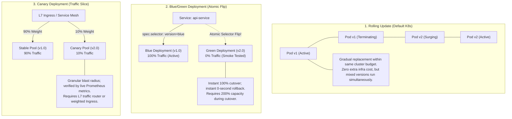
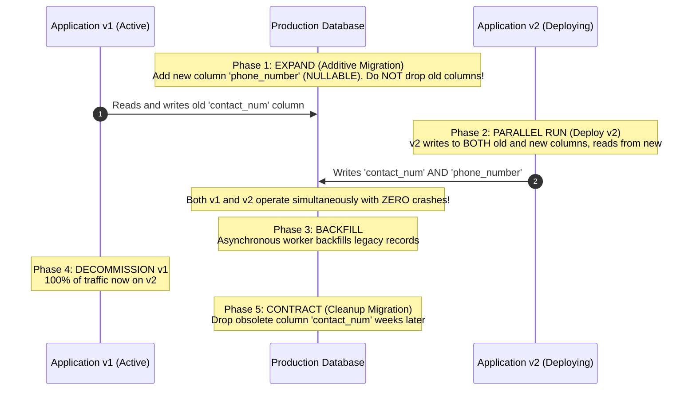
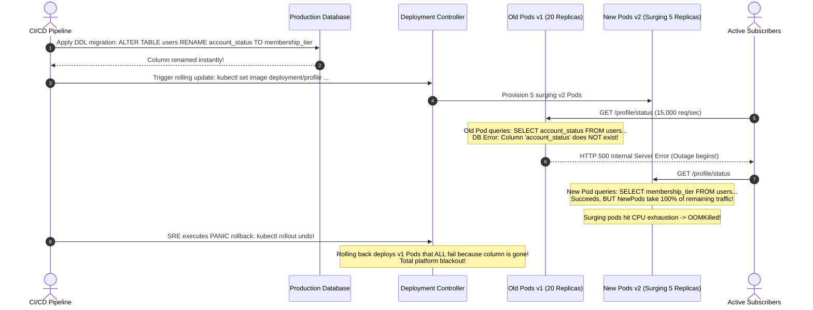

# 04 - Continuous Deployment Strategies

> **Prerequisites**: [03 - Kubernetes Deployments & ReplicaSets](../../03-kubernetes/03-deployments-and-replicasets/README.md), [04 - Services & Networking](../../03-kubernetes/04-services-and-networking/README.md), [03 - Container Image Pipelines](../03-container-image-pipelines/README.md).  
> **Target Audience**: SREs, Release Engineers, and Distributed Systems Architects designing zero-downtime, progressive rollout and instant-rollback release pipelines.  
> **Estimated Deep-Dive Time**: 40 minutes.

---

> [!TIP]
> **The Golden Rule of Deployment Safety**: **Application code can roll forward or backward instantly, but database state cannot.** Every deployment strategy (Rolling, Blue/Green, Canary) exposes your system to a mixed-version window where old and new code run concurrently against the same database. Always implement the **Expand and Contract (Parallel Run)** pattern: make database schemas backward- and forward-compatible before deploying code changes.

---

## 1. Visual Mental Models: The Three Deployment Paradigms

When shipping an updated container image to production, how that image replaces the running workload determines availability, cost, blast radius, and rollback speed.

### Strategy Comparison: Rolling vs Blue/Green vs Canary



---

### The Expand & Contract (Parallel Run) Database Pattern

In modern CI/CD, the database must remain compatible across both old and new application versions:



---

## 2. Technical Comparison: Deployment Strategies Specification

### Strategies Specification Matrix

| Metric / Dimension | Rolling Update | Blue/Green Deployment | Canary Deployment |
| :--- | :--- | :--- | :--- |
| **Infrastructure Overhead** | Low (0–25% extra surge pods) | **High (100% duplicate pods)** | Low (5–10% canary pods) |
| **Cutover Latency** | Minutes (Paced by readiness probes) | **Instantaneous (<1 second)** | Progressive (Hours / Days) |
| **Rollback Latency** | Minutes (`kubectl rollout undo`) | **Instantaneous (<1 second)** | Fast (<5 seconds; route shift) |
| **Mixed-Version Window** | Yes (Duration of the rollout) | **No (Atomic L4/L7 flip)** | Yes (Deliberately by design) |
| **Traffic Ratio Control** | Coarse (Tied to replica count) | All-or-Nothing (0% or 100%) | **Fine-grained (1%, 5%, 25%, 100%)** |
| **Best Used For** | General stateless microservices | Critical monoliths, high-risk migrations | High-throughput distributed platforms |

---

### Rolling Update Surge & Unavailability Formula

In Kubernetes `Deployment` manifests, the rollout velocity is governed by `maxSurge` and `maxUnavailable`:

```yaml
spec:
  replicas: 10
  strategy:
    type: RollingUpdate
    rollingUpdate:
      maxSurge: 25%         # Can create up to 3 extra pods (ceiling of 10 * 0.25)
      maxUnavailable: 0     # Strictly guarantees 10 pods remain active at all times!
```

- **`maxSurge: 25%`**: The deployment can provision 13 total Pods during the upgrade.
- **`maxUnavailable: 0`**: Kubernetes will **never** terminate an old Pod until a replacement Pod has booted, passed its `readinessProbe`, and completed `minReadySeconds`. This guarantees zero capacity degradation.

---

## 3. Production War Story: The Dropped Column & The Mixed-Version Death Loop

### Incident Overview
A tier-1 streaming entertainment platform deployed a microservice hotfix during a live sporting event. The developer modified the user profile service, renaming the database column `account_status` to `membership_tier`. 

The deployment pipeline executed a standard Kubernetes rolling update. Within 45 seconds of triggering the rollout, error rates exploded to 100% across all 40 production Pods. Upstream API gateways cascaded into connection timeouts, leaving 2.2 million concurrent streaming subscribers locked out.

### The Catastrophic Failure Sequence



### Root Cause Analysis
1. **Destructive DDL During Active Rollout**: The deployment renamed an active database column while old code was still running. In Kubernetes rolling updates, old pods remain active alongside new pods for minutes.
2. **Rollback Impossibility**: When the SRE executed `kubectl rollout undo`, Kubernetes rolled back the container images to v1, but the database schema remained in the v2 state. Every v1 Pod immediately crashed on boot.
3. **Missing Automated Schema Validation**: The CI/CD pipeline lacked static migration linters (e.g. `strong_migrations`) to detect and block destructive DDL operations.

### The Remediation & Permanent Rules
1. **Enforce Expand & Contract**:
   - Step 1: Add new column `membership_tier` as nullable.
   - Step 2: Deploy code writing to both `account_status` and `membership_tier`.
   - Step 3: Run asynchronous backfill script.
   - Step 4: Deploy code reading exclusively from `membership_tier`.
   - Step 5: Drop `account_status` 30 days later.
2. **Automated Migration Linters in CI**: Integrate linters that automatically fail PRs containing `RENAME COLUMN` or `DROP COLUMN` without prior backward-compatibility phases.

---

## 4. Multi-Language Backward-Compatible Persistence Patterns

During continuous deployment, application code must handle both missing and newly introduced fields seamlessly without throwing runtime exceptions.

### Go Implementation (Dual-Read / Dual-Write Adapter)

```go
// internal/repository/user_repository.go
package repository

import (
	"context"
	"database/sql"
	"fmt"
)

type UserProfile struct {
	ID             int64
	MembershipTier string
}

type ResilientUserRepo struct {
	db *sql.DB
}

func NewResilientUserRepo(db *sql.DB) *ResilientUserRepo {
	return &ResilientUserRepo{db: db}
}

// Save implements Dual-Write to support concurrent v1 and v2 deployments
func (r *ResilientUserRepo) Save(ctx context.Context, u *UserProfile) error {
	query := `
		INSERT INTO users (id, membership_tier, account_status)
		VALUES ($1, $2, $2)
		ON CONFLICT (id) DO UPDATE SET
			membership_tier = EXCLUDED.membership_tier,
			account_status = EXCLUDED.account_status;
	`
	_, err := r.db.ExecContext(ctx, query, u.ID, u.MembershipTier)
	return err
}

// GetByID implements Dual-Read with graceful fallback
func (r *ResilientUserRepo) GetByID(ctx context.Context, id int64) (*UserProfile, error) {
	var u UserProfile
	var tier sql.NullString
	var legacyStatus sql.NullString

	// Query both fields during transition phase
	query := `SELECT id, membership_tier, account_status FROM users WHERE id = $1`
	err := r.db.QueryRowContext(ctx, query, id).Scan(&u.ID, &tier, &legacyStatus)
	if err != nil {
		return nil, err
	}

	// Prefer new schema; fallback to legacy schema
	if tier.Valid && tier.String != "" {
		u.MembershipTier = tier.String
	} else if legacyStatus.Valid {
		u.MembershipTier = legacyStatus.String
	} else {
		u.MembershipTier = "FREE" // Default fallback
	}

	return &u, nil
}
```

---

### Node.js / TypeScript Implementation (Prisma / SQL Fallback)

```typescript
// src/services/userService.ts
import { PrismaClient } from '@prisma/client';

export class ResilientUserService {
  constructor(private readonly prisma: PrismaClient) {}

  async updateUserTier(userId: string, tier: string): Promise<void> {
    // Dual-write ensures both v1 and v2 pods observe updated state
    await this.prisma.$executeRaw`
      UPDATE users 
      SET 
        membership_tier = ${tier},
        account_status = ${tier}
      WHERE id = ${userId}
    `;
  }

  async getUserTier(userId: string): Promise<string> {
    const records = await this.prisma.$queryRaw<Array<{ membership_tier: string | null; account_status: string | null }>>`
      SELECT membership_tier, account_status FROM users WHERE id = ${userId} LIMIT 1
    `;

    if (!records.length) {
      throw new Error(`User [${userId}] not found`);
    }

    const user = records[0];
    // Backward-compatible field resolution
    return user.membership_tier || user.account_status || 'STANDARD';
  }
}
```

---

### Python Implementation (SQLAlchemy Dual-Layer Access)

```python
# services/user_service.py
from sqlalchemy import text
from sqlalchemy.ext.asyncio import AsyncSession
from typing import Optional

class ResilientUserService:
    def __init__(self, session: AsyncSession):
        self.session = session

    async def update_tier(self, user_id: int, tier: str) -> None:
        # Dual-write pattern
        stmt = text("""
            UPDATE users 
            SET membership_tier = :tier, account_status = :tier 
            WHERE id = :uid
        """)
        await self.session.execute(stmt, {"tier": tier, "uid": user_id})
        await self.session.commit()

    async def get_tier(self, user_id: int) -> str:
        # Dual-read pattern
        stmt = text("SELECT membership_tier, account_status FROM users WHERE id = :uid")
        result = await self.session.execute(stmt, {"uid": user_id})
        row = result.fetchone()
        if not row:
            raise ValueError(f"User {user_id} not found")
        
        # Resolve tier with fallback
        return row.membership_tier or row.account_status or "BASIC"
```

---

## 5. Practical Hands-On Verification Laboratory: Blue/Green Cutover

In this laboratory, you will deploy a live Blue deployment, provision a parallel Green deployment, verify Green with an internal smoke test, execute an atomic Service selector switch, and perform an instantaneous zero-downtime rollback.

### Step 1: Deploy Blue Deployment & Shared Service

Create `04-blue-green.yaml`:

```yaml
apiVersion: apps/v1
kind: Deployment
metadata:
  name: web-blue
  namespace: default
  labels:
    app: web-app
    version: blue
spec:
  replicas: 3
  selector:
    matchLabels:
      app: web-app
      version: blue
  template:
    metadata:
      labels:
        app: web-app
        version: blue
    spec:
      containers:
        - name: app
          image: hashicorp/http-echo:0.2.3
          args: ["-text=SERVING_FROM_BLUE_V1"]
          ports:
            - containerPort: 5678
---
apiVersion: v1
kind: Service
metadata:
  name: web-service
  namespace: default
spec:
  type: ClusterIP
  selector:
    app: web-app
    version: blue # Points strictly to BLUE initially!
  ports:
    - port: 80
      targetPort: 5678
```

Apply to cluster:

```bash
kubectl apply -f 04-blue-green.yaml
kubectl wait --for=condition=Ready pod -l app=web-app,version=blue --timeout=30s
```

Test traffic through the Service:

```bash
kubectl run test-curl --rm -it --image=curlimages/curl -- curl -s http://web-service
```

*Expected Output:*
```text
SERVING_FROM_BLUE_V1
```

---

### Step 2: Deploy Parallel Green Deployment

Create `04-green.yaml`:

```yaml
apiVersion: apps/v1
kind: Deployment
metadata:
  name: web-green
  namespace: default
  labels:
    app: web-app
    version: green
spec:
  replicas: 3
  selector:
    matchLabels:
      app: web-app
      version: green
  template:
    metadata:
      labels:
        app: web-app
        version: green
    spec:
      containers:
        - name: app
          image: hashicorp/http-echo:0.2.3
          args: ["-text=SERVING_FROM_GREEN_V2"]
          ports:
            - containerPort: 5678
```

Apply Green:

```bash
kubectl apply -f 04-green.yaml
kubectl wait --for=condition=Ready pod -l app=web-app,version=green --timeout=30s
```

Notice that public traffic to `http://web-service` is **still 100% on Blue** because the Service selector has not changed!

---

### Step 3: Atomic Cutover (Blue -> Green)

Repoint the Service selector to Green in a single atomic API transaction:

```bash
kubectl patch service web-service -p '{"spec":{"selector":{"version":"green"}}}'
```

Immediately query the Service:

```bash
kubectl run test-curl --rm -it --image=curlimages/curl -- curl -s http://web-service
```

*Expected Output:*
```text
SERVING_FROM_GREEN_V2
```

100% of user traffic transitioned to Green instantaneously with zero dropped packets.

---

### Step 4: Instant 0-Second Rollback (Green -> Blue)

Simulate a post-deployment defect on Green. Execute an instantaneous rollback by flipping the selector back:

```bash
kubectl patch service web-service -p '{"spec":{"selector":{"version":"blue"}}}'
```

Query the Service again:

```bash
kubectl run test-curl --rm -it --image=curlimages/curl -- curl -s http://web-service
```

*Expected Output:*
```text
SERVING_FROM_BLUE_V1
```

Because the Blue Pods were never terminated, the rollback executed in **under 150 milliseconds**.

---

## 6. Command Quick-Reference Cheat Sheet

| Command | Action / Objective | Example Scenario |
| :--- | :--- | :--- |
| `kubectl rollout status deploy/<name>` | Block CI pipeline until rollout finishes or fails | Prevent pipeline exit before deployment verifies |
| `kubectl rollout pause deploy/<name>` | Pause rolling update in-flight for manual inspection | Canary inspection step in manual pipelines |
| `kubectl rollout resume deploy/<name>` | Resume paused rollout to continue replacement | Continue rollout after canary approval |
| `kubectl rollout undo deploy/<name>` | Revert Deployment to immediately preceding ReplicaSet | Rapid rollback of failed container rollout |
| `kubectl patch svc <name> -p '...'` | Atomically repoint Service selector labels | Instant Blue/Green traffic cutover |

---

## 7. Operational Validation Checkpoints

### Scenario 1: `kubectl rollout undo` Fails with `no rollout history found`
**Context:** A newly rolled-out container image enters `CrashLoopBackOff`. An engineer runs `kubectl rollout undo deployment/order-api` to rollback, but Kubernetes returns:
`error: no rollout history found for deployment "order-api"`

<details>
<summary>View Diagnostic Workflow & Resolution</summary>

**Root Cause:**  
1. The Deployment manifest configured `revisionHistoryLimit: 0` or `1`, which instructed the controller to immediately delete obsolete ReplicaSet definitions upon rollout completion.
2. Or the deployment was managed by an imperative script that deleted and recreated the Deployment resource rather than updating `spec.template.spec.containers[0].image`.

**Resolution Steps:**
1. Always maintain `revisionHistoryLimit: 10` in all Deployment specs.
2. In GitOps pipelines, never rely on imperative `kubectl rollout undo`. Execute a Git revert commit (`git revert HEAD && git push`) so the desired state remains tracked in source control.
</details>

---

### Scenario 2: Rolling Update Stalls Indefinitely in `Pending`
**Context:** You trigger an update on a Deployment with 10 replicas and `maxSurge: 50%`, `maxUnavailable: 0`. The rollout starts, spins up 3 new Pods, and hangs indefinitely. `kubectl rollout status` never completes.

<details>
<summary>View Diagnostic Workflow & Resolution</summary>

**Root Cause:**  
Cluster node capacity exhaustion. With `maxSurge: 50%` and `maxUnavailable: 0`, Kubernetes attempts to create 5 new Pods while keeping all 10 old Pods alive (requiring resources for 15 total Pods). The worker nodes have insufficient CPU/memory to schedule the surge Pods, leaving them stuck in `Pending`.

**Diagnostic Commands:**
```bash
kubectl describe pod <pending-surge-pod>
# Output: 0/3 nodes available: insufficient cpu
```

**Resolution Steps:**
1. Configure `maxUnavailable: 25%` and `maxSurge: 25%` so Kubernetes terminates some old Pods to free up node capacity for new Pods.
2. Configure Cluster Autoscaler / Karpenter to provision additional worker nodes automatically when Pods enter `Pending`.
</details>

---

### Scenario 3: Long-Lived WebSocket & HTTP/2 Connections Dropped During Cutover
**Context:** You execute a Blue/Green cutover on a chat microservice. While new HTTP requests reach Green, existing WebSocket and streaming clients report sudden connection disconnects and data loss.

<details>
<summary>View Diagnostic Workflow & Resolution</summary>

**Root Cause:**  
When the Blue deployment was scaled down or terminated immediately following the cutover, active TCP connections were abruptly killed by `SIGKILL` because the application lacked a graceful drain handler.

**Resolution Steps:**
1. Retain the Blue deployment for at least 15–30 minutes following a cutover to allow active long-lived connections to drain naturally.
2. Configure `terminationGracePeriodSeconds: 120` and implement graceful shutdown signal handling (`SIGTERM`) in the application process.
</details>

---

## 8. Further Reading & Official Documentation

- [Kubernetes Deployments: Rolling Update Strategy](https://kubernetes.io/docs/concepts/workloads/controllers/deployment/#strategy)
- [Martin Fowler: BlueGreenDeployment](https://martinfowler.com/bliki/BlueGreenDeployment.html)
- [Evolutionary Database Design: Expand and Contract Pattern](https://martinfowler.com/bliki/ParallelRun.html)
- [Google Cloud: Deployment Strategies (Canary vs Blue-Green)](https://cloud.google.com/architecture/application-deployment-and-testing-strategies)
- [Argo Rollouts: Advanced Progressive Delivery](https://argoproj.github.io/argo-rollouts/)

---

## Next

Continue to [05 - GitOps & ArgoCD](../05-gitops-and-argocd/README.md) to replace push-based pipelines with pull-based declarative reconciliation, automated drift detection, and self-healing cluster state.
