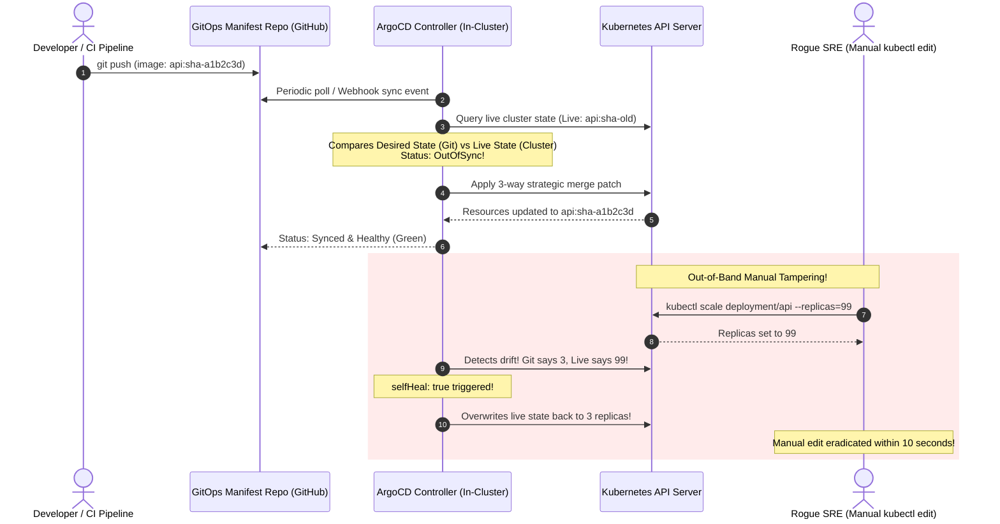
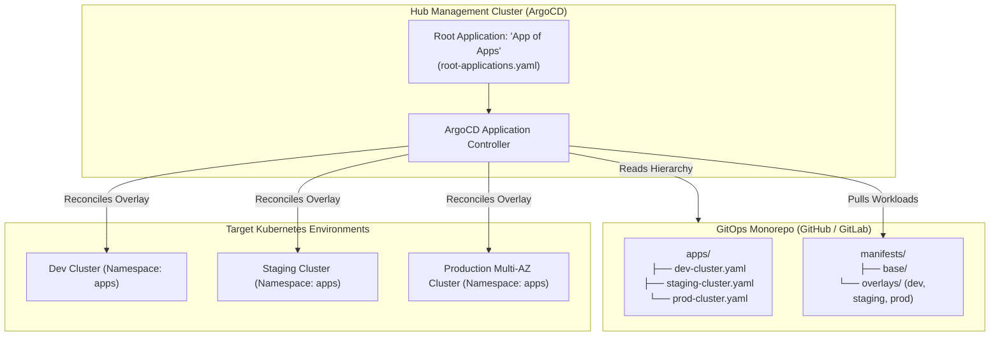
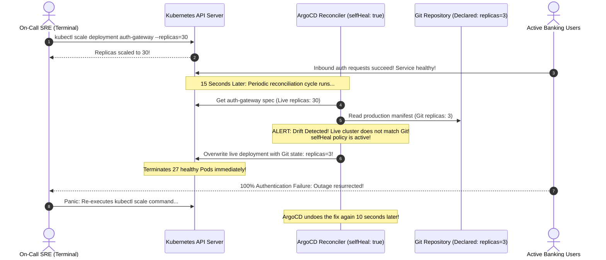

# 05 - GitOps & ArgoCD

> **Prerequisites**: [03 - Kubernetes Deployments & Services](../../03-kubernetes/03-deployments-and-replicasets/README.md), [00 - CI/CD Concepts](../00-cicd-concepts-and-pipeline-anatomy/README.md), [04 - Continuous Deployment Strategies](../04-continuous-deployment-strategies/README.md).  
> **Target Audience**: Cloud Architects, SREs, and Platform Engineers shifting from push-based pipelines to pull-based declarative reconciliation, self-healing clusters, and audited Git-driven operations.  
> **Estimated Deep-Dive Time**: 40 minutes.

---

> [!TIP]
> **The Golden Rule of GitOps**: **Git is the single, authoritative source of truth; the cluster is an active projection.** Never run manual `kubectl edit` or `kubectl apply` commands in a GitOps-managed cluster. If a manual mutation occurs, an active GitOps agent (ArgoCD) with **`selfHeal: true`** will overwrite it within seconds. Every change—scaling, configuration, image updates, and rollbacks—must be committed to Git.

---

## 1. Visual Mental Models: The Pull-Based GitOps Reconciliation Loop

Traditional push-based CI/CD requires external runners to hold cluster-admin credentials and punch firewall holes through the API server perimeter. **GitOps** reverses this relationship: an in-cluster operator pulls state continuously from Git and reconciles differences internally.

### The ArgoCD Reconciliation & Self-Healing Pipeline



---

### The "App of Apps" Multi-Cluster Topology



---

## 2. Technical Comparison: Push CI/CD vs Pull GitOps

### Architecture Specification Matrix

| Metric / Dimension | Traditional Push-Based CI/CD | Modern Pull-Based GitOps (ArgoCD) |
| :--- | :--- | :--- |
| **Cluster Firewall Exposure** | Requires inbound port 6443 open to the public internet/runner | **Zero inbound firewall holes** (Outbound HTTPS only) |
| **Credential Management** | High risk: Cluster-admin kubeconfigs stored in external CI | **Zero external credentials**; operator uses in-cluster ServiceAccounts |
| **Drift Detection & Correction**| Blind to manual changes; drift persists indefinitely | **Continuous drift detection; instant automated self-healing** |
| **Rollback Mechanism** | Imperative `kubectl rollout undo` or CI redeployment | **Declarative `git revert`**; exact state restored in seconds |
| **Compliance & Auditability** | Scattered across ephemeral CI console execution logs | **Immutable Git commit history** with verified PGP signatures |
| **Multi-Cluster Scalability** | Complex: CI must maintain individual connections to 50 clusters | Single hub operator manages 500+ edge clusters cleanly |

---

### The ArgoCD `Application` Custom Resource Specification

```yaml
apiVersion: argoproj.io/v1alpha1
kind: Application
metadata:
  name: order-service-prod
  namespace: argocd
  finalizers:
    - resources-finalizer.argocd.argoproj.io # Deletes cluster resources when Application is deleted
spec:
  project: default
  source:
    repoURL: 'https://github.com/my-org/gitops-manifests.git'
    targetRevision: main # Git branch, tag, or commit hash
    path: overlays/production # Path to Kustomize overlay or Helm chart
  destination:
    server: 'https://kubernetes.default.svc' # Target cluster API endpoint
    namespace: production
  syncPolicy:
    automated:
      prune: true     # Deletes resources in cluster that were removed from Git!
      selfHeal: true  # Reverts out-of-band manual cluster mutations!
    syncOptions:
      - CreateNamespace=true
      - PruneLast=true # Prunes obsolete resources after new ones are healthy
      - ApplyOutOfSyncOnly=true
    retry:
      limit: 5
      backoff:
        duration: 5s
        factor: 2
        maxDuration: 3m
```

---

## 3. Production War Story: The Out-of-Band Hotfix Annihilation Loop

### Incident Overview
A tier-1 fintech banking portal experienced sudden authentication timeouts during a major platform migration. At 01:15 AM, the on-call engineer identified that the `auth-gateway` Deployment was under-provisioned and failing under incoming traffic. 

The engineer executed an imperative hotfix via terminal:
`kubectl scale deployment/auth-gateway --replicas=30` and `kubectl set env deployment/auth-gateway DB_POOL_SIZE=50`.
The application immediately stabilized. However, 15 seconds later, the portal crashed again. The engineer repeated the command; within seconds, it crashed a third time. Total outage duration: 42 minutes before the team realized ArgoCD was actively undoing their manual changes.

### The Catastrophic Failure Sequence



### Root Cause Analysis
1. **The GitOps Disconnect**: The on-call engineer was operating under a traditional push-based mindset, attempting an imperative hotfix on the live cluster. 
2. **Aggressive Automated Self-Healing**: ArgoCD was configured with `automated: { selfHeal: true }`. ArgoCD performed its design contract perfectly: it treated the manual `kubectl scale` as unauthorized configuration drift and reverted the live cluster back to the declared Git state (`replicas: 3`).
3. **Missing HPA Dynamic Exemption**: The deployment had an HPA attached, but the Git manifest hardcoded `spec.replicas: 3` without an `ignoreDifferences` exemption in the ArgoCD Application spec.

### The Remediation & Permanent GitOps Operational Rules
1. **Fix Forward in Git Only**: In GitOps, the only legitimate way to apply a hotfix is a Git commit:
   ```bash
   git commit -am "hotfix(auth): increase replicas to 30 and pool to 50" && git push
   ```
2. **Configure `ignoreDifferences` for Dynamic Fields**: When an external controller (like HPA) owns replica counts, instruct ArgoCD to ignore `spec.replicas`:
   ```yaml
   spec:
     ignoreDifferences:
       - group: apps
         kind: Deployment
         jsonPointers:
           - /spec/replicas
   ```
3. **Emergency Maintenance Freeze**: If live emergency debugging is mandatory, engineers must toggle self-heal off first:
   ```bash
   argocd app set auth-gateway --self-heal=false
   ```

---

## 4. Multi-Language GitOps Automation Engines

In production CI/CD architectures, the application pipeline builds the Docker image, tests it, and then commits the new image tag into the GitOps manifests repository to trigger ArgoCD reconciliation.

### Go Implementation (GitOps Commit Automation)

```go
// cmd/gitops-promoter/main.go
package main

import (
	"context"
	"fmt"
	"log"
	"os"

	"github.com/google/go-github/v58/github"
	"golang.org/x/oauth2"
)

type GitOpsPromoter struct {
	client *github.Client
	owner  string
	repo   string
}

func NewGitOpsPromoter(token, owner, repo string) *GitOpsPromoter {
	ts := oauth2.StaticTokenSource(&oauth2.Token{AccessToken: token})
	tc := oauth2.NewClient(context.Background(), ts)
	return &GitOpsPromoter{
		client: github.NewClient(tc),
		owner:  owner,
		repo:   repo,
	}
}

// UpdateImageDigest updates the production manifest in Git to trigger ArgoCD
func (p *GitOpsPromoter) UpdateImageDigest(ctx context.Context, filePath, branch, newDigest, commitMsg string) error {
	// 1. Fetch current file content and SHA
	fileContent, _, _, err := p.client.Repositories.GetContents(ctx, p.owner, p.repo, filePath, &github.RepositoryContentGetOptions{Ref: branch})
	if err != nil {
		return fmt.Errorf("failed to fetch target manifest: %w", err)
	}

	content, err := fileContent.GetContent()
	if err != nil {
		return fmt.Errorf("failed to decode content: %w", err)
	}

	// 2. Perform string or YAML replacement of image digest
	updatedContent := updateDigestString(content, newDigest)

	// 3. Commit new content directly to GitOps branch
	opts := &github.RepositoryContentFileOptions{
		Message: github.String(commitMsg),
		Content: []byte(updatedContent),
		SHA:     fileContent.SHA,
		Branch:  github.String(branch),
	}

	_, _, err = p.client.Repositories.UpdateFile(ctx, p.owner, p.repo, filePath, opts)
	if err != nil {
		return fmt.Errorf("failed to commit manifest update: %w", err)
	}

	log.Printf("Successfully committed %s to %s/%s on branch %s. ArgoCD will reconcile.",
		newDigest, p.owner, p.repo, branch)
	return nil
}

func updateDigestString(raw, digest string) string {
	// Simple demonstration replacement; production uses yaml.Node parsing
	return fmt.Sprintf("# Automated GitOps Promotion\nimage: myacr.azurecr.io/api@%s\n", digest)
}
```

---

### Node.js / TypeScript Implementation (Octokit Promotion Script)

```typescript
// scripts/gitopsPromote.ts
import { Octokit } from '@octokit/rest';

export interface PromotionOptions {
  githubToken: string;
  gitopsRepoOwner: string;
  gitopsRepoName: string;
  manifestPath: string;
  targetBranch: string;
  newImageDigest: string;
}

export async function promoteToGitOps(opts: PromotionOptions): Promise<void> {
  const octokit = new Octokit({ auth: opts.githubToken });

  // 1. Get existing manifest file
  const { data: fileData } = await octokit.repos.getContent({
    owner: opts.gitopsRepoOwner,
    repo: opts.gitopsRepoName,
    path: opts.manifestPath,
    ref: opts.targetBranch,
  });

  if (!('content' in fileData) || !('sha' in fileData)) {
    throw new Error('Target manifest path is not a valid file');
  }

  const currentYaml = Buffer.from(fileData.content, 'base64').toString('utf8');

  // 2. Replace image reference with immutable digest
  const updatedYaml = currentYaml.replace(
    /image:\s*[\w\.\/\-\@\:]+/g,
    `image: myacr.azurecr.io/order-api@${opts.newImageDigest}`
  );

  // 3. Commit change to trigger ArgoCD pull reconciliation
  await octokit.repos.createOrUpdateFileContents({
    owner: opts.gitopsRepoOwner,
    repo: opts.gitopsRepoName,
    path: opts.manifestPath,
    message: `chore(gitops): promote order-api to ${opts.newImageDigest} [skip ci]`,
    content: Buffer.from(updatedYaml, 'utf8').toString('base64'),
    sha: fileData.sha,
    branch: opts.targetBranch,
  });

  console.log(`✅ GitOps Manifest Updated: ArgoCD reconciliation initiated on branch ${opts.targetBranch}.`);
}
```

---

### Python Implementation (ArgoCD REST API Sync Trigger)

```python
# scripts/argocd_sync.py
import requests
import sys
import time

class ArgoCDClient:
    def __init__(self, server_url: str, auth_token: str):
        self.server_url = server_url.rstrip("/")
        self.headers = {
            "Authorization": f"Bearer {auth_token}",
            "Content-Type": "application/json"
        }

    def trigger_sync(self, app_name: str, prune: bool = True) -> None:
        url = f"{self.server_url}/api/v1/applications/{app_name}/sync"
        payload = {
            "prune": prune,
            "strategy": {"hook": {}}
        }
        res = requests.post(url, headers=self.headers, json=payload, verify=False)
        if res.status_code != 200:
            raise RuntimeError(f"Sync failed with HTTP {res.status_code}: {res.text}")
        print(f"Triggered manual sync for ArgoCD application: {app_name}")

    def wait_for_healthy(self, app_name: str, timeout_sec: int = 180) -> None:
        url = f"{self.server_url}/api/v1/applications/{app_name}"
        deadline = time.time() + timeout_sec

        while time.time() < deadline:
            res = requests.get(url, headers=self.headers, verify=False)
            data = res.json()
            health = data.get("status", {}).get("health", {}).get("status")
            sync = data.get("status", {}).get("sync", {}).get("status")
            print(f"ArgoCD Status -> Sync: {sync}, Health: {health}")

            if sync == "Synced" and health == "Healthy":
                print("Application successfully synced and healthy!")
                return
            time.sleep(5)

        raise TimeoutError(f"Application {app_name} did not reach healthy state in {timeout_sec}s")
```

---

## 5. Practical Hands-On Verification Laboratory

In this hands-on laboratory, you will define a declarative ArgoCD `Application` resource, apply it to your cluster, simulate an out-of-band manual mutation via `kubectl`, and observe live self-healing.

### Step 1: Create Declarative ArgoCD Application

Save the following manifest as `order-api-argocd-app.yaml`:

```yaml
apiVersion: argoproj.io/v1alpha1
kind: Application
metadata:
  name: demo-guestbook
  namespace: argocd
spec:
  project: default
  source:
    repoURL: 'https://github.com/argoproj/argocd-example-apps.git'
    targetRevision: HEAD
    path: guestbook
  destination:
    server: 'https://kubernetes.default.svc'
    namespace: default
  syncPolicy:
    automated:
      prune: true
      selfHeal: true
    syncOptions:
      - CreateNamespace=true
```

Apply to the cluster:

```bash
kubectl apply -f order-api-argocd-app.yaml
```

*Expected Terminal Output:*
```text
application.argoproj.io/demo-guestbook created
```

---

### Step 2: Verify Initial Cluster Synchronization

Inspect application status using the `argocd` CLI or `kubectl`:

```bash
kubectl get application demo-guestbook -n argocd -o jsonpath='{.status.sync.status} - {.status.health.status}'
```

*Expected Terminal Output:*
```text
Synced - Healthy
```

Verify the underlying guestbook Pods are running in `default`:

```bash
kubectl get pods -l app=guestbook-ui
```

*Expected Terminal Output:*
```text
NAME                            READY   STATUS    RESTARTS   AGE
guestbook-ui-85985d774c-4x8w9   1/1     Running   0          25s
```

---

### Step 3: Trigger Out-of-Band Manual Mutation (Drift Injection)

Attempt to imperatively scale the deployment from 1 to 5 replicas:

```bash
kubectl scale deployment guestbook-ui --replicas=5
kubectl get deployment guestbook-ui
```

*Terminal Output Immediately After Command:*
```text
deployment.apps/guestbook-ui scaled
NAME           READY   UP-TO-DATE   AVAILABLE   AGE
guestbook-ui   1/5     5            1           1m
```

---

### Step 4: Watch Automated Self-Healing in Real Time

Wait 5–10 seconds and re-query the deployment:

```bash
kubectl get deployment guestbook-ui
```

*Expected Terminal Output:*
```text
NAME           READY   UP-TO-DATE   AVAILABLE   AGE
guestbook-ui   1/1     1            1           1m
```

Inspect the ArgoCD application event history:

```bash
kubectl describe application demo-guestbook -n argocd | grep -A 8 Events:
```

*Expected Event Output:*
```text
Events:
  Type     Reason               Age    From                   Message
  ----     ------               ----   ----                   -------
  Normal   OperationStarted     8s     argocd-application-controller  Initiating automated self-heal sync
  Normal   ResourceUpdated      7s     argocd-application-controller  Updated Deployment guestbook-ui: reconciled drift from Git
```

ArgoCD detected the unauthorized replica expansion and restored the declared single-replica count automatically.

---

## 6. Command Quick-Reference Cheat Sheet

| Command | Action / Objective | Example Scenario |
| :--- | :--- | :--- |
| `argocd app list` | List all GitOps applications & sync/health status | Global cluster fleet status review |
| `argocd app diff <app>` | Show colorized diff between live cluster and Git | Inspect drift before approving sync |
| `argocd app sync <app>` | Manually trigger reconciliation of OutOfSync app | Promote changes in manual-sync environments |
| `argocd app set <app> --self-heal=false` | Temporarily disable self-healing | Emergency break-glass incident debugging |
| `argocd app history <app>` | View deployment revisions and Git commit SHAs | Audit who deployed what commit |

---

## 7. Operational Validation Checkpoints

### Scenario 1: Infinite Sync Flapping Between ArgoCD and HPA
**Context:** An application configured with an HPA shows status `OutOfSync` constantly in ArgoCD. ArgoCD attempts to scale the deployment to 3 replicas (declared in Git), while HPA immediately scales it to 8 replicas (based on CPU load). The cluster thrashes continuously.

<details>
<summary>View Diagnostic Workflow & Resolution</summary>

**Root Cause:**  
Both ArgoCD and HPA believe they own the `spec.replicas` field. Because Git declares `replicas: 3`, ArgoCD continuously fights the HPA controller.

**Resolution Steps:**
1. In the Git manifest, omit `spec.replicas` entirely from the Deployment spec or manage it via an overlay.
2. Add an `ignoreDifferences` block to the ArgoCD `Application`:
   ```yaml
   spec:
     ignoreDifferences:
       - group: apps
         kind: Deployment
         jsonPointers:
           - /spec/replicas
   ```
ArgoCD will now ignore the live replica count and allow HPA to scale unhindered.
</details>

---

### Scenario 2: Deleting a Manifest from Git Leaves Orphaned Resources
**Context:** An engineer removes `redis-deployment.yaml` from the Git repository and merges to `main`. ArgoCD shows `Synced`, but running `kubectl get pods` shows the old Redis Pod still active in the cluster.

<details>
<summary>View Diagnostic Workflow & Resolution</summary>

**Root Cause:**  
The Application sync policy has `prune: false` (or omitted). By default, ArgoCD does not delete cluster resources when their manifests are removed from Git to prevent accidental data destruction.

**Resolution Steps:**
Enable automated pruning in the Application definition:
```yaml
spec:
  syncPolicy:
    automated:
      prune: true
```
</details>

---

### Scenario 3: Broken Webhook Causes ArgoCD to Take 3 Minutes to Detect Commits
**Context:** Developers push changes to GitHub, but ArgoCD does not begin reconciling for 3 minutes, slowing down testing cycles.

<details>
<summary>View Diagnostic Workflow & Resolution</summary>

**Root Cause:**  
ArgoCD's fallback polling interval is 3 minutes (`timeout.reconciliation: 180s`). For instantaneous sub-second reconciliation, ArgoCD must receive GitHub push webhooks.

**Resolution Steps:**
Configure a GitHub webhook in the repository settings pointing to `https://<argocd-server>/api/webhook` with event `push`. ArgoCD will trigger reconciliation within 500ms of `git push`.
</details>

---

## 8. Further Reading & Official Documentation

- [OpenGitOps Principles & Standards](https://opengitops.net/)
- [ArgoCD Official Architecture & Documentation](https://argo-cd.readthedocs.io/en/stable/core_concepts/)
- [The App of Apps Pattern in ArgoCD](https://argo-cd.readthedocs.io/en/stable/operator-manual/cluster-bootstrapping/)
- [Sync Options and Sync Waves in ArgoCD](https://argo-cd.readthedocs.io/en/stable/user-guide/sync-waves/)
- [Managing Secrets in GitOps with SealedSecrets](https://github.com/bitnami-labs/sealed-secrets)

---

## Next

Continue to [06 - Progressive Delivery: Canary & Blue/Green with Argo Rollouts](../06-progressive-delivery-canary-and-blue-green/README.md) to automate advanced metrics-driven canary analysis and automated rollbacks on Kubernetes.
