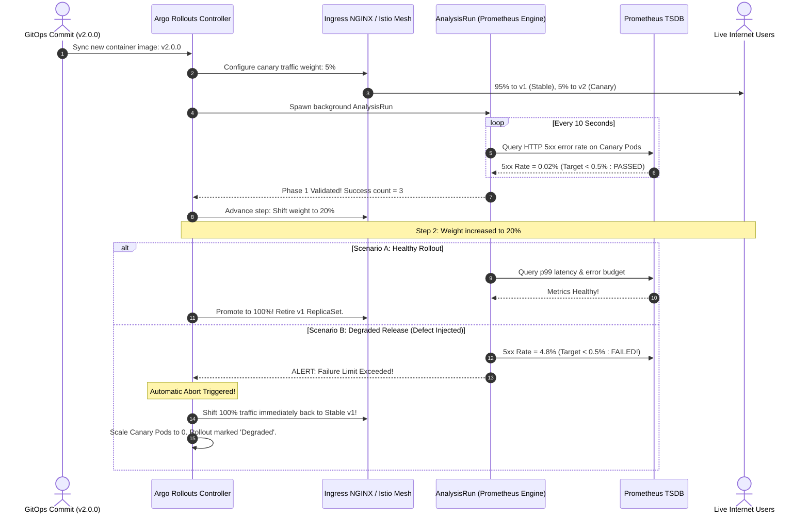
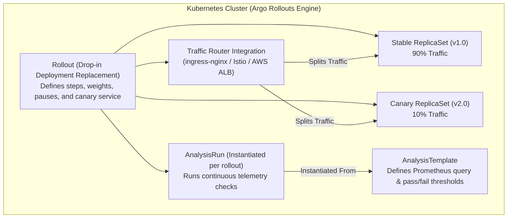
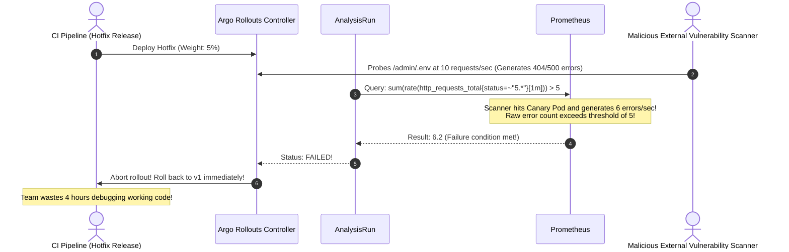

# 06 - Progressive Delivery: Canary & Blue/Green with Argo Rollouts

> **Prerequisites**: [04 - Continuous Deployment Strategies](../04-continuous-deployment-strategies/README.md), [05 - GitOps & ArgoCD](../05-gitops-and-argocd/README.md), [10 - Observability: Metrics & Logging](../../03-kubernetes/10-observability-logging-and-metrics/README.md).  
> **Target Audience**: SREs, Platform Architects, and Release Automation Leads building automated, metrics-governed canary releases and self-aborting rollouts.  
> **Estimated Deep-Dive Time**: 40 minutes.

---

> [!TIP]
> **The Golden Rule of Progressive Delivery**: **A canary rollout without automated metrics analysis is just a slow, delayed deployment.** Never rely on human vigilance to approve canary weight promotions. Couple your rollout steps directly with an **`AnalysisTemplate`** querying Prometheus for error rates and p99 latency. If telemetry breaches your error budget, the controller must **automatically abort and rollback** within seconds—before users notice.

---

## 1. Visual Mental Models: The Autonomous Canary Lifecycle

Progressive delivery takes the deployment strategies from module 04 and replaces human observation with machine-driven metric gates. **Argo Rollouts** provides a custom Kubernetes controller that replaces standard Deployments with intelligent `Rollout` resources.

### The Automated Canary Promotion & Self-Abort Pipeline



---

### Argo Rollouts Custom Resource Hierarchy



---

## 2. Technical Comparison: Traffic Providers & Analysis Templates

### Traffic Routing Providers Specification Matrix

| Traffic Provider | Implementation Layer | Granularity | Header/Cookie Routing | Production Infrastructure Cost |
| :--- | :--- | :--- | :--- | :--- |
| **Ingress NGINX** | Layer 7 Ingress Controller | 1% – 99% weights | Supported via `canary-by-header` | Low (Built on standard Ingress controller) |
| **Istio Service Mesh** | Layer 4 & Layer 7 (Envoy Sidecars) | Sub-percent (0.1%) | Advanced L7 regex matching | High (Requires service mesh control plane) |
| **AWS ALB / TargetGroup** | AWS Managed Load Balancer | Weighted Target Groups | Supported | Cloud infrastructure pricing |
| **Replica-Based (Faux)**| Pod Count Ratio | Coarse (e.g. 1 in 10 pods) | ❌ No | Zero (Plain Kubernetes services) |

---

### The `AnalysisTemplate` Prometheus Specification

An `AnalysisTemplate` defines how the rollout measures success:

```yaml
apiVersion: argoproj.io/v1alpha1
kind: AnalysisTemplate
metadata:
  name: http-error-rate-check
  namespace: production
spec:
  metrics:
    - name: success-rate
      interval: 15s           # Query frequency
      successCondition: result[0] >= 0.995 # Must achieve >= 99.5% success rate
      failureLimit: 2         # Abort rollout after 2 consecutive failures
      provider:
        prometheus:
          address: http://prometheus-k8s.monitoring:9090
          query: |
            sum(rate(http_requests_total{service="order-api", status!~"5.*"}[1m]))
            /
            sum(rate(http_requests_total{service="order-api"}[1m]))
```

---

## 3. Production War Story: The PromQL Blindspot & False-Positive Canary Abort

### Incident Overview
A major travel booking engine rolled out an automated canary deployment pipeline using Argo Rollouts and Prometheus. The team scheduled an urgent security hotfix to address a credit card validation bug.

However, each time the pipeline pushed the hotfix, the rollout reached 5% traffic and abruptly aborted, rolling back to the old version. Over 4 hours, the pipeline failed 14 consecutive times. The on-call engineers panicked, believing the security patch was fundamentally defective, delaying an urgent zero-day remediation.

### The Failure Sequence



### Root Cause Analysis
1. **Un-Normalized Absolute Error Queries**: The SRE authored the PromQL query as `sum(rate(5xx[1m])) > 5`. It counted absolute error count rather than an error ratio.
2. **Traffic Skew**: At 5% traffic, background vulnerability scrapers hitting random endpoints (like `/.env` or `/wp-login.php`) generated enough 500 errors to cross the static threshold of 5 errors, regardless of how healthy real user checkout traffic was.
3. **Missing Consecutive Failure Threshold**: `failureLimit` was set to 0. A single transient 1-second network hiccup caused an instant, unrecoverable rollout abortion.

### The Remediation & Permanent Policy
1. **Ratio-Based PromQL**: Replace absolute error counts with normalized percentage ratios scoped strictly to production API routes:
   ```sql
   (
     sum(rate(http_requests_total{service="order-api", status=~"5.*", route="/api/v1/.*"}[1m]))
     /
     sum(rate(http_requests_total{service="order-api", route="/api/v1/.*"}[1m]))
   ) * 100 > 1.0
   ```
2. **Consecutive Failure Windows**: Configure `failureLimit: 3` and `interval: 30s` to prevent transient network spikes from aborting releases.

---

## 4. Multi-Language Synthetic Telemetry Implementations

For Argo Rollouts to accurately evaluate canary health, backend services must expose granular HTTP status codes and latency histograms categorized by version and route.

### Go Implementation (Prometheus Metrics Instrumentation)

```go
// internal/telemetry/canary_metrics.go
package telemetry

import (
	"net/http"
	"strconv"
	"time"

	"github.com/prometheus/client_golang/prometheus"
	"github.com/prometheus/client_golang/prometheus/promhttp"
)

var (
	HttpRequestsTotal = prometheus.NewCounterVec(
		prometheus.CounterOpts{
			Name: "http_canary_requests_total",
			Help: "Total HTTP requests partitioned by version and status code",
		},
		[]string{"service", "version", "status_code", "path"},
	)

	HttpRequestDuration = prometheus.NewHistogramVec(
		prometheus.HistogramOpts{
			Name:    "http_canary_request_duration_seconds",
			Help:    "Latency distributions for SLO verification",
			Buckets: []float64{0.05, 0.1, 0.25, 0.5, 1.0, 2.5},
		},
		[]string{"service", "version", "path"},
	)
)

func init() {
	prometheus.MustRegister(HttpRequestsTotal)
	prometheus.MustRegister(HttpRequestDuration)
}

type responseRecorder struct {
	http.ResponseWriter
	statusCode int
}

func (rec *responseRecorder) WriteHeader(code int) {
	rec.statusCode = code
	rec.ResponseWriter.WriteHeader(code)
}

func CanaryInstrumentMiddleware(serviceName, version string, next http.Handler) http.Handler {
	return http.HandlerFunc(func(w http.ResponseWriter, r *http.Request) {
		start := time.Now()
		rec := &responseRecorder{ResponseWriter: w, statusCode: http.StatusOK}

		next.ServeHTTP(rec, r)

		duration := time.Since(start).Seconds()
		statusStr := strconv.Itoa(rec.statusCode)

		HttpRequestsTotal.WithLabelValues(serviceName, version, statusStr, r.URL.Path).Inc()
		HttpRequestDuration.WithLabelValues(serviceName, version, r.URL.Path).Observe(duration)
	})
}
```

---

### Node.js / TypeScript Implementation (Prom-Client)

```typescript
// src/telemetry/canaryMetrics.ts
import { Request, Response, NextFunction } from 'express';
import client from 'prom-client';

const appVersion = process.env.APP_VERSION || 'v1.0.0';
const serviceName = 'order-api';

export const httpRequestsTotal = new client.Counter({
  name: 'http_canary_requests_total',
  help: 'Total HTTP requests for progressive delivery analysis',
  labelNames: ['service', 'version', 'status_code', 'method'],
});

export const httpRequestDuration = new client.Histogram({
  name: 'http_canary_duration_seconds',
  help: 'Request latency for Argo Rollouts analysis',
  labelNames: ['service', 'version'],
  buckets: [0.05, 0.1, 0.2, 0.5, 1.0],
});

export function canaryMetricsMiddleware(req: Request, res: Response, next: NextFunction): void {
  const start = process.hrtime();

  res.on('finish', () => {
    const diff = process.hrtime(start);
    const durationInSeconds = diff[0] + diff[1] / 1e9;
    const statusCode = res.statusCode.toString();

    httpRequestsTotal.inc({
      service: serviceName,
      version: appVersion,
      status_code: statusCode,
      method: req.method,
    });

    httpRequestDuration.observe(
      { service: serviceName, version: appVersion },
      durationInSeconds
    );
  });

  next();
}
```

---

### Python Implementation (FastAPI / Prometheus Client)

```python
# telemetry/canary_metrics.py
import os
import time
from fastapi import FastAPI, Request
from starlette.middleware.base import BaseHTTPMiddleware
from prometheus_client import Counter, Histogram

APP_VERSION = os.getenv("APP_VERSION", "v1.0.0")
SERVICE_NAME = "order-api"

HTTP_REQUESTS = Counter(
    "http_canary_requests_total",
    "Total HTTP requests for Argo Rollouts",
    ["service", "version", "status_code"]
)

HTTP_DURATION = Histogram(
    "http_canary_duration_seconds",
    "Request latency distributions for progressive delivery",
    ["service", "version"],
    buckets=[0.05, 0.1, 0.25, 0.5, 1.0]
)

class CanaryMetricsMiddleware(BaseHTTPMiddleware):
    async def dispatch(self, request: Request, call_next):
        start_time = time.time()
        response = await call_next(request)
        duration = time.time() - start_time

        HTTP_REQUESTS.labels(
            service=SERVICE_NAME,
            version=APP_VERSION,
            status_code=str(response.status_code)
        ).inc()

        HTTP_DURATION.labels(
            service=SERVICE_NAME,
            version=APP_VERSION
        ).observe(duration)

        return response
```

---

## 5. Practical Hands-On Verification Laboratory

In this laboratory, you will deploy a complete `Rollout` resource using the NGINX Ingress traffic routing plugin, define an `AnalysisTemplate`, trigger a canary rollout, and observe automated progressive weight progression.

### Step 1: Deploy Ingress & Services for Argo Rollouts

Create `06-rollout-infra.yaml`:

```yaml
apiVersion: v1
kind: Service
metadata:
  name: rollouts-demo-stable
  namespace: default
spec:
  ports:
    - name: http
      port: 80
      targetPort: 8080
  selector:
    app: rollouts-demo
---
apiVersion: v1
kind: Service
metadata:
  name: rollouts-demo-canary
  namespace: default
spec:
  ports:
    - name: http
      port: 80
      targetPort: 8080
  selector:
    app: rollouts-demo
---
apiVersion: networking.k8s.io/v1
kind: Ingress
metadata:
  name: rollouts-demo-ingress
  namespace: default
spec:
  ingressClassName: nginx
  rules:
    - host: canary.local.test
      http:
        paths:
          - path: /
            pathType: Prefix
            backend:
              service:
                name: rollouts-demo-stable
                port:
                  number: 80
```

Apply to cluster:

```bash
kubectl apply -f 06-rollout-infra.yaml
```

---

### Step 2: Define the `Rollout` Specification

Create `06-rollout.yaml`:

```yaml
apiVersion: argoproj.io/v1alpha1
kind: Rollout
metadata:
  name: rollouts-demo
  namespace: default
spec:
  replicas: 5
  strategy:
    canary:
      stableService: rollouts-demo-stable
      canaryService: rollouts-demo-canary
      trafficRouting:
        nginx:
          stableIngress: rollouts-demo-ingress
      steps:
        - setWeight: 20
        - pause: {duration: 30s}
        - setWeight: 40
        - pause: {duration: 30s}
        - setWeight: 60
        - pause: {duration: 30s}
        - setWeight: 80
        - pause: {duration: 30s}
  selector:
    matchLabels:
      app: rollouts-demo
  template:
    metadata:
      labels:
        app: rollouts-demo
    spec:
      containers:
        - name: rollouts-demo
          image: argoproj/rollouts-demo:blue
          ports:
            - name: http
              containerPort: 8080
              protocol: TCP
          resources:
            requests:
              cpu: 50m
              memory: 32Mi
```

Apply to cluster:

```bash
kubectl apply -f 06-rollout.yaml
```

---

### Step 3: Trigger Progressive Canary Release

Trigger a rollout by updating the image to `:yellow`:

```bash
kubectl argo rollouts set image rollouts-demo rollouts-demo=argoproj/rollouts-demo:yellow
```

Watch the progressive step execution live:

```bash
kubectl argo rollouts get rollout rollouts-demo --watch
```

*Expected Terminal Progression Output:*
```text
NAME                                            KIND        STATUS     AGE  INFO
⟳ rollouts-demo                                 Rollout     PAUSED     2m   step: 1/8 (setWeight: 20%)
├── ⧼ Replicas ⧽
│   ├── 4/5 stable
│   └── 1/5 canary
├── ⧖ AnalysisRuns
│   └── [none]
├── ⧉ Service: rollouts-demo-stable (Active)
└── ⧉ Service: rollouts-demo-canary (20% Weight)

(After 30s pause completes)
⟳ rollouts-demo                                 Rollout     PAUSED     2m   step: 3/8 (setWeight: 40%)
(After all steps complete)
✔ rollouts-demo                                 Rollout     HEALTHY    4m   step: 8/8 (setWeight: 100%)
```

---

### Step 4: Simulate a Flawed Canary & Verify Automated Abort

Trigger an image update to `:red` and execute an immediate abort:

```bash
# Update to defective image
kubectl argo rollouts set image rollouts-demo rollouts-demo=argoproj/rollouts-demo:red

# Trigger simulated abort
kubectl argo rollouts abort rollouts-demo
kubectl argo rollouts get rollout rollouts-demo
```

*Expected Terminal Output:*
```text
STATUS: Degraded (RolloutAborted)
```

Argo Rollouts instantly routed 100% of user traffic back to `:yellow` and scaled the defective `:red` canary pods down to zero.

---

## 6. Command Quick-Reference Cheat Sheet

| Command | Action / Objective | Example Scenario |
| :--- | :--- | :--- |
| `kubectl argo rollouts get rollout <name> -w` | Stream live ASCII state machine visualization | Real-time observation of canary step progression |
| `kubectl argo rollouts promote <name>` | Manually promote paused rollout step | Pass manual QA gate |
| `kubectl argo rollouts abort <name>` | Immediately halt rollout and restore stable traffic | Emergency mitigation of failed canary |
| `kubectl argo rollouts retry <name>` | Retry a previously aborted rollout | Re-run canary after infrastructure fix |
| `kubectl argo rollouts undo <name>` | Revert Rollout specification to previous revision | Rollback to prior stable version |

---

## 7. Operational Validation Checkpoints

### Scenario 1: Rollout Stuck in `Paused` State Indefinitely
**Context:** You push a new image. The rollout reaches step 1 (`setWeight: 20`) and remains in `PAUSED` status for over 2 hours without progressing.

<details>
<summary>View Diagnostic Workflow & Resolution</summary>

**Root Cause:**  
The step configuration in the `Rollout` manifest used `pause: {}` without a `duration` key. An empty pause block tells Argo Rollouts to pause indefinitely until a human executes `kubectl argo rollouts promote`.

**Resolution Steps:**
1. If intended as an automated step, specify the duration: `pause: {duration: 60s}`.
2. If intended as a manual gate, promote via CLI:
   ```bash
   kubectl argo rollouts promote rollouts-demo
   ```
</details>

---

### Scenario 2: `AnalysisRun` Fails with `context deadline exceeded` Querying Prometheus
**Context:** The canary begins, but the `AnalysisRun` instantly fails with error:
`failed to query prometheus: Get "http://prometheus:9090/api/v1/query...": dial tcp: lookup prometheus on 10.96.0.10:53: no such host`

<details>
<summary>View Diagnostic Workflow & Resolution</summary>

**Root Cause:**  
CoreDNS namespace resolution failure. The `AnalysisTemplate` specified an unqualified service name (`http://prometheus:9090`) while Prometheus resides in another namespace (`monitoring`).

**Resolution Steps:**
Specify the Fully Qualified Domain Name (FQDN) in the `AnalysisTemplate`:
```yaml
address: http://prometheus-k8s.monitoring.svc.cluster.local:9090
```
</details>

---

### Scenario 3: NGINX Ingress Missing Canary Annotations
**Context:** Argo Rollouts logs `setWeight: 20%`, but all requests continue hitting the stable service; zero requests reach the canary pods.

<details>
<summary>View Diagnostic Workflow & Resolution</summary>

**Root Cause:**  
The Ingress controller does not support canary annotations, or the secondary canary Ingress object was not generated. In NGINX Ingress, Argo Rollouts automatically creates a child Ingress with `nginx.ingress.kubernetes.io/canary: "true"` and `nginx.ingress.kubernetes.io/canary-weight: "20"`.

**Diagnostic Commands:**
```bash
# Check if canary child ingress was generated:
kubectl get ingress
# Look for: <rollout-name>-<stable-ingress-name>-canary
```

**Resolution Steps:**
Ensure `ingress-nginx` is configured with permissions to create secondary Ingress resources and that `spec.strategy.canary.trafficRouting.nginx.stableIngress` points to a valid Ingress in the same namespace.
</details>

---

## 8. Further Reading & Official Documentation

- [Argo Rollouts Official Documentation](https://argoproj.github.io/argo-rollouts/)
- [Argo Rollouts: Architecture & Traffic Routing Plugins](https://argoproj.github.io/argo-rollouts/features/traffic-management/)
- [Analysis & Automated Metric-Gated Rollouts](https://argoproj.github.io/argo-rollouts/features/analysis/)
- [Istio Service Mesh Traffic Shifting for Canaries](https://istio.io/latest/docs/tasks/traffic-management/traffic-shifting/)
- [Flagger: Alternative Kubernetes Progressive Delivery Operator](https://flagger.app/)

---

## Next

Continue to [07 - Pipeline Security & Secrets Management](../07-pipeline-security-and-secrets/README.md) to eliminate long-lived credentials using OpenID Connect (OIDC), enforce environment approval gates, and secure production secrets.
