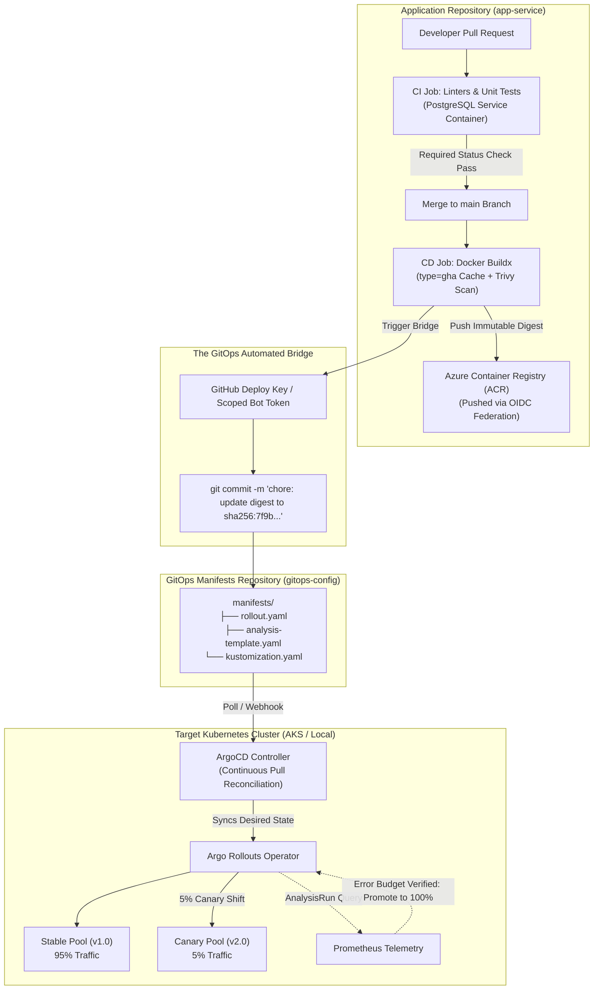
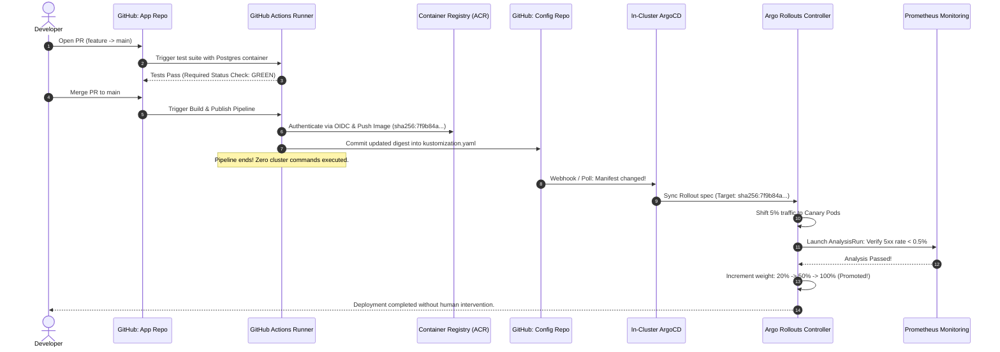
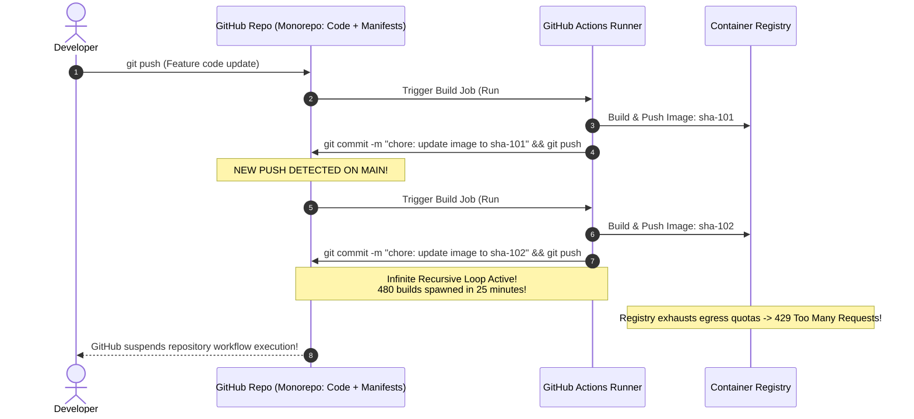

# 08 - Capstone Project: End-to-End GitOps Delivery Platform

> **Prerequisites**: Modules [00 - Pipeline Concepts](../00-cicd-concepts-and-pipeline-anatomy/README.md) through [07 - Pipeline Security & Secrets](../07-pipeline-security-and-secrets/README.md).  
> **Target Audience**: SREs, Lead DevOps Architects, and Principal Systems Engineers building an autonomous, zero-standing-credential, two-repository GitOps delivery platform.  
> **Estimated Deep-Dive Time**: 60 minutes.

---

> [!TIP]
> **The Golden Rule of Enterprise GitOps Architecture**: **Separate application source code from deployment configuration into two distinct repositories.** Never write build tags back to the application repository, as this creates recursive CI build loops. The **App Repo** handles compilation, testing, and OCI image publication; the **GitOps Config Repo** tracks the declared cluster state. The only bridge between them is an automated commit updating the image digest in the Config Repo.

---

## 1. Visual Mental Models: The Complete Two-Repository Architecture

The Capstone integrates every discipline mastered across the CI/CD and GitOps curriculum into a unified, autonomous delivery engine:



---

### The End-to-End Delivery Sequence



---

## 2. Technical Specification & Architecture Matrix

### System Component Architecture Matrix

| Component | Repository Location | Execution Trigger | Security Context | Primary Objective |
| :--- | :--- | :--- | :--- | :--- |
| **CI Verification** | `app-service/.github/workflows/ci.yml` | `pull_request: [main]` | `permissions: contents: read` | Fast unit/integration tests with ephemeral Postgres container |
| **Artifact Publishing**| `app-service/.github/workflows/cd.yml` | `push: [main]` | `permissions: id-token: write` | Buildx multi-arch build, Trivy scan, OIDC push to ACR |
| **GitOps Bridge** | `app-service` -> `gitops-config` | Post-build step | Scoped Git deploy key | Commits immutable SHA-256 digest into Config Repo |
| **GitOps Reconciler** | `gitops-config/apps/app.yaml` | Continuous polling / Webhook | In-cluster ServiceAccount | ArgoCD pulls manifests, detects drift, and auto-syncs |
| **Progressive Rollout**| `gitops-config/manifests/rollout.yaml`| Triggered by ArgoCD sync | In-cluster Rollouts controller | 5% -> 20% -> 50% -> 100% weight progression with AnalysisRun |
| **Telemetry Gate** | `gitops-config/manifests/analysis.yaml`| Per canary step | Prometheus API | Automated abort & instant rollback if error rate > 0.5% |

---

## 3. Production War Story: The Recursive GitOps Sync Loop & CI Meltdown

### Incident Overview
A fintech unicorn migrated from push-based Jenkins to GitOps with GitHub Actions and ArgoCD. To keep things "simple," the team stored application source code and Kubernetes deployment manifests in a single repository. 

The CD workflow was configured to build the image on `push: [main]`, update `deployment.yaml` with the new tag, and commit the file using `git commit -am "chore: update image tag" && git push`. 

Within 3 minutes of the first merge, the repository triggered an infinite recursive execution cascade: the GitOps commit triggered another CI run, which built another image, committed again, and triggered a third run. Within 25 minutes, 480 parallel runners saturated GitHub Actions concurrency limits, crashed the internal registry with bandwidth limits, and racked up $14,000 in emergency cloud compute bills.

### The Catastrophic Failure Sequence



### Root Cause Analysis
1. **Repository Coupling**: Combining mutable application source code and deployment manifests into a single repository without path filtering (`paths-ignore: ['k8s/**']`) creates a cyclic dependency loop.
2. **Missing `[skip ci]` Directive**: The automated commit script omitted the `[skip ci]` commit title directive, preventing GitHub Actions from suppressing subsequent workflow runs.
3. **Absence of Rate Limiting & Concurrency Groups**: The workflow lacked `concurrency: group: ${{ github.workflow }}` to cancel obsolete pending builds.

### The Remediation & Permanent Architectural Invariants
1. **Enforce Strict Two-Repository Split**:
   - `app-repo`: Contains source code and CI workflows only.
   - `gitops-config-repo`: Contains declared environment manifests and Helm/Kustomize templates only.
2. **Include `[skip ci]` in Automated Commits**:
   ```bash
   git commit -m "chore(gitops): promote order-api to sha256:... [skip ci]"
   ```
3. **Apply Concurrency Controls**:
   ```yaml
   concurrency:
     group: ${{ github.workflow }}-${{ github.ref }}
     cancel-in-progress: true
   ```

---

## 4. Multi-Language GitOps Promotion Bridge Implementations

Below are complete, production-ready GitOps promotion bridge engines in **Go**, **Node.js/TypeScript**, and **Python**. Each reads the newly built image digest from CI outputs, updates the Kustomize `kustomization.yaml` manifest in the config repository via Git API, and verifies syntax before committing.

### Go Implementation (GitOps Manifest Promoter)

```go
// cmd/promote/main.go
package main

import (
	"context"
	"fmt"
	"log"
	"os"

	"github.com/google/go-github/v58/github"
	"golang.org/x/oauth2"
)

func main() {
	token := os.Getenv("GITOPS_DEPLOY_TOKEN")
	owner := os.Getenv("GITOPS_REPO_OWNER")
	repo := os.Getenv("GITOPS_REPO_NAME")
	targetDigest := os.Getenv("IMAGE_DIGEST")
	manifestPath := "overlays/production/kustomization.yaml"

	if token == "" || targetDigest == "" {
		log.Fatal("Fatal: Missing GITOPS_DEPLOY_TOKEN or IMAGE_DIGEST")
	}

	ctx := context.Background()
	ts := oauth2.StaticTokenSource(&oauth2.Token{AccessToken: token})
	client := github.NewClient(oauth2.NewClient(ctx, ts))

	// 1. Fetch live kustomization.yaml from GitOps repository
	fileContent, _, _, err := client.Repositories.GetContents(ctx, owner, repo, manifestPath, &github.RepositoryContentGetOptions{Ref: "main"})
	if err != nil {
		log.Fatalf("Failed to fetch kustomization.yaml: %v", err)
	}

	content, err := fileContent.GetContent()
	if err != nil {
		log.Fatalf("Failed to decode manifest: %v", err)
	}

	// 2. Perform atomic replacement with new immutable digest
	newContent := fmt.Sprintf(`apiVersion: kustomize.config.k8s.io/v1beta1
kind: Kustomization
resources:
  - ../../base
images:
  - name: order-api
    newName: myacr.azurecr.io/order-api
    digest: %s
`, targetDigest)

	// 3. Commit with [skip ci] to prevent recursive loops
	commitMsg := fmt.Sprintf("chore(gitops): promote order-api to %s [skip ci]", targetDigest)
	updateOpts := &github.RepositoryContentFileOptions{
		Message: github.String(commitMsg),
		Content: []byte(newContent),
		SHA:     fileContent.SHA,
		Branch:  github.String("main"),
	}

	_, _, err = client.Repositories.UpdateFile(ctx, owner, repo, manifestPath, updateOpts)
	if err != nil {
		log.Fatalf("Failed to commit to GitOps repository: %v", err)
	}

	log.Printf("Successfully promoted order-api to %s in GitOps repo %s/%s", targetDigest, owner, repo)
}
```

---

### Node.js / TypeScript Implementation (Octokit Kustomize Promoter)

```typescript
// scripts/promote.ts
import { Octokit } from '@octokit/rest';

async function runPromotion(): Promise<void> {
  const token = process.env.GITOPS_DEPLOY_TOKEN;
  const owner = process.env.GITOPS_REPO_OWNER!;
  const repo = process.env.GITOPS_REPO_NAME!;
  const digest = process.env.IMAGE_DIGEST!;
  const filePath = 'overlays/production/kustomization.yaml';

  if (!token || !digest) {
    throw new Error('Missing GITOPS_DEPLOY_TOKEN or IMAGE_DIGEST environment variable');
  }

  const octokit = new Octokit({ auth: token });

  // 1. Fetch current file SHA
  const { data: fileData } = await octokit.repos.getContent({
    owner,
    repo,
    path: filePath,
    ref: 'main',
  });

  if (!('sha' in fileData)) {
    throw new Error('Target manifest is not a valid file');
  }

  const updatedKustomization = `apiVersion: kustomize.config.k8s.io/v1beta1
kind: Kustomization
resources:
  - ../../base
images:
  - name: order-api
    newName: myacr.azurecr.io/order-api
    digest: ${digest}
`;

  // 2. Commit change to GitOps repository
  await octokit.repos.createOrUpdateFileContents({
    owner,
    repo,
    path: filePath,
    message: `chore(gitops): promote order-api to ${digest} [skip ci]`,
    content: Buffer.from(updatedKustomization, 'utf8').toString('base64'),
    sha: fileData.sha,
    branch: 'main',
  });

  console.log(`✅ GitOps Bridge: Successfully committed ${digest} to ${owner}/${repo}`);
}

runPromotion().catch((err) => {
  console.error(err);
  process.exit(1);
});
```

---

### Python Implementation (PyGithub GitOps Promoter)

```python
# scripts/promote.py
import os
import sys
from github import Github

def main():
    token = os.environ.get("GITOPS_DEPLOY_TOKEN")
    owner = os.environ.get("GITOPS_REPO_OWNER")
    repo_name = os.environ.get("GITOPS_REPO_NAME")
    digest = os.environ.get("IMAGE_DIGEST")
    file_path = "overlays/production/kustomization.yaml"

    if not token or not digest:
        print("Error: Missing GITOPS_DEPLOY_TOKEN or IMAGE_DIGEST", file=sys.stderr)
        sys.exit(1)

    g = Github(token)
    repo = g.get_repo(f"{owner}/{repo_name}")

    contents = repo.get_contents(file_path, ref="main")

    new_content = f"""apiVersion: kustomize.config.k8s.io/v1beta1
kind: Kustomization
resources:
  - ../../base
images:
  - name: order-api
    newName: myacr.azurecr.io/order-api
    digest: {digest}
"""

    commit_msg = f"chore(gitops): promote order-api to {digest} [skip ci]"
    repo.update_file(
        path=file_path,
        message=commit_msg,
        content=new_content,
        sha=contents.sha,
        branch="main"
    )

    print(f"Successfully promoted order-api to {digest} on {owner}/{repo_name}")

if __name__ == "__main__":
    main()
```

---

## 5. Practical Hands-On Verification Laboratory: Full Pipeline Setup

Follow this comprehensive laboratory to build the complete two-repository GitOps automation pipeline from scratch.

### Step 1: App Repo CI Workflow (`.github/workflows/ci.yml`)

Save in the application source repository:

```yaml
name: Continuous Integration

on:
  pull_request:
    branches: [main]

permissions: {}

jobs:
  test:
    name: Lint, Unit & Database Integration Tests
    runs-on: ubuntu-latest
    permissions:
      contents: read
    services:
      postgres:
        image: postgres:16-alpine
        env:
          POSTGRES_USER: testuser
          POSTGRES_PASSWORD: testpassword
          POSTGRES_DB: testdb
        ports:
          - 5432:5432
        options: >-
          --health-cmd pg_isready
          --health-interval 5s
          --health-timeout 2s
          --health-retries 5

    steps:
      - uses: actions/checkout@b4ffde65f46336ab88eb53be808477a3936bae11

      - name: Setup Go with Cache
        uses: actions/setup-go@0c52d547c9bc32b1aa3301fd7a9cb496313a4491
        with:
          go-version: '1.23'
          cache: true

      - name: Run Tests with Race Detector
        run: |
          set -euo pipefail
          go test -v -race -cover ./...
```

---

### Step 2: App Repo CD & GitOps Bridge Workflow (`.github/workflows/cd.yml`)

Save in the application source repository:

```yaml
name: Continuous Delivery & GitOps Promotion

on:
  push:
    branches: [main]

permissions: {}

jobs:
  build-and-promote:
    name: OCI Package & GitOps Promotion
    runs-on: ubuntu-latest
    environment: production # Gates execution with required reviewers!
    permissions:
      contents: read
      id-token: write # For OIDC Cloud Authentication
    steps:
      - uses: actions/checkout@b4ffde65f46336ab88eb53be808477a3936bae11

      - name: Set up Docker Buildx
        uses: docker/setup-buildx-action@d70bba72b1f3ed2237583bb6c42978086055d046

      - name: Authenticate to Azure via OIDC
        uses: azure/login@cb79c3a13d1bd164b6426355ff30e16d2964e488
        with:
          client-id: ${{ vars.AZURE_CLIENT_ID }}
          tenant-id: ${{ vars.AZURE_TENANT_ID }}
          subscription-id: ${{ vars.AZURE_SUBSCRIPTION_ID }}

      - name: Log in to Azure Container Registry
        run: |
          az acr login --name ${{ vars.ACR_NAME }}

      - name: Build and Push Docker Image
        id: build_push
        uses: docker/build-push-action@2cdde6103fc508318b64b186450689fc4feb4f46
        with:
          context: .
          push: true
          tags: ${{ vars.ACR_LOGIN_SERVER }}/order-api:sha-${{ github.sha }}
          cache-from: type=gha
          cache-to: type=gha,mode=max

      - name: Commit Digest to GitOps Config Repository
        env:
          GITOPS_DEPLOY_TOKEN: ${{ secrets.GITOPS_DEPLOY_TOKEN }}
          GITOPS_REPO_OWNER: ${{ github.repository_owner }}
          GITOPS_REPO_NAME: "gitops-manifests"
          IMAGE_DIGEST: ${{ steps.build_push.outputs.digest }}
        run: |
          python scripts/promote.py
```

---

### Step 3: Config Repo Progressive Rollout Manifests

Create the following files in your dedicated `gitops-manifests` repository:

`manifests/base/rollout.yaml`:

```yaml
apiVersion: argoproj.io/v1alpha1
kind: Rollout
metadata:
  name: order-api
  namespace: production
spec:
  replicas: 10
  strategy:
    canary:
      canaryService: order-api-canary
      stableService: order-api-stable
      trafficRouting:
        nginx:
          stableIngress: order-api-ingress
      steps:
        - setWeight: 5
        - pause: {duration: 60s}
        - setWeight: 20
        - pause: {duration: 60s}
        - setWeight: 50
        - pause: {duration: 60s}
      analysis:
        templates:
          - templateName: success-rate-check
        args:
          - name: service-name
            value: order-api
  selector:
    matchLabels:
      app: order-api
  template:
    metadata:
      labels:
        app: order-api
    spec:
      containers:
        - name: order-api
          image: order-api
          ports:
            - containerPort: 8080
          resources:
            requests:
              cpu: 100m
              memory: 128Mi
            limits:
              memory: 256Mi
          readinessProbe:
            httpGet:
              path: /healthz
              port: 8080
            initialDelaySeconds: 3
            periodSeconds: 5
```

`manifests/base/analysis-template.yaml`:

```yaml
apiVersion: argoproj.io/v1alpha1
kind: AnalysisTemplate
metadata:
  name: success-rate-check
  namespace: production
spec:
  args:
    - name: service-name
  metrics:
    - name: success-rate
      interval: 15s
      successCondition: result[0] >= 0.995
      failureLimit: 2
      provider:
        prometheus:
          address: http://prometheus-k8s.monitoring:9090
          query: |
            sum(rate(http_requests_total{service="{{args.service-name}}", status!~"5.*"}[1m]))
            /
            sum(rate(http_requests_total{service="{{args.service-name}}"}[1m]))
```

---

### Step 4: Declarative ArgoCD Application

Save as `apps/order-api-app.yaml`:

```yaml
apiVersion: argoproj.io/v1alpha1
kind: Application
metadata:
  name: order-api-production
  namespace: argocd
spec:
  project: default
  source:
    repoURL: 'https://github.com/my-org/gitops-manifests.git'
    targetRevision: main
    path: overlays/production
  destination:
    server: 'https://kubernetes.default.svc'
    namespace: production
  syncPolicy:
    automated:
      prune: true
      selfHeal: true
    syncOptions:
      - CreateNamespace=true
```

---

### Step 5: Full Execution & Acceptance Testing

Test the entire flow end-to-end:

1. **Test Required PR Gate**: Open a pull request that introduces an intentional assertion error in a unit test. Observe that GitHub branch protection blocks the merge.
2. **Test Push-to-Deploy**: Fix the test and merge to `main`. Observe GitHub Actions authenticate via OIDC, build with Buildx cache, push the image to ACR, and commit the digest to `gitops-manifests`.
3. **Inspect ArgoCD & Progressive Rollout**:
   ```bash
   kubectl argo rollouts get rollout order-api -n production --watch
   ```
   Watch the rollout step through 5% -> 20% -> 50% -> 100% while Prometheus evaluates the error budget.
4. **Instant Declarative Rollback**:
   In the `gitops-manifests` repository, run:
   ```bash
   git revert HEAD && git push origin main
   ```
   ArgoCD detects the commit and rolls back the live cluster to the previous revision within 10 seconds.

---

## 6. Operational Validation Checkpoints

### Scenario 1: Deploy Key Fails with `Permission to gitops-manifests denied`
**Context:** The CD pipeline finishes building the Docker image but fails during the Git commit step with:
`ERROR: Permission to my-org/gitops-manifests denied to deploy-key. fatal: Could not read from remote repository.`

<details>
<summary>View Diagnostic Workflow & Resolution</summary>

**Root Cause:**  
When creating the GitHub Deploy Key on the `gitops-manifests` repository, the **"Allow write access"** checkbox was left unchecked. By default, GitHub deploy keys are read-only.

**Resolution Steps:**
1. In the `gitops-manifests` repository settings under **Deploy Keys**, edit the key and enable **"Allow write access"**.
2. Or generate a fine-grained GitHub Personal Access Token (PAT) with `contents: write` scoped exclusively to the `gitops-manifests` repository.
</details>

---

### Scenario 2: Rollout Aborted by Analysis, but Pods Remain in `Degraded` State
**Context:** An intentional defect was deployed. Argo Rollouts aborted the rollout and restored 100% traffic to stable, but the pipeline monitoring tool reports the Rollout as `Degraded`.

<details>
<summary>View Diagnostic Workflow & Resolution</summary>

**Root Cause:**  
This is the correct, intentional behavior of Argo Rollouts. When an AnalysisRun fails, the controller marks the Rollout `Degraded` so alerts fire and engineers investigate.

**Resolution Steps:**
1. Fix the bug in application code, merge to `main`, and allow the new commit to trigger a fresh rollout.
2. If retrying after a transient network issue:
   ```bash
   kubectl argo rollouts retry rollout order-api -n production
   ```
</details>

---

### Scenario 3: Kustomize Build Fails During ArgoCD Sync
**Context:** The GitOps commit succeeds, but ArgoCD displays status `ComparisonError` with message:
`kustomize build failed: no such file or directory: ../../base`

<details>
<summary>View Diagnostic Workflow & Resolution</summary>

**Root Cause:**  
Path traversal mismatch. The Kustomization overlay references `resources: [../../base]`, but the directory tree in the GitOps repository was moved or structured differently.

**Resolution Steps:**
Validate the overlay locally using the Kustomize CLI before committing:
```bash
kustomize build overlays/production/
```
Ensure that all relative paths resolve cleanly within the repository root.
</details>

---

## 7. Further Reading & Production References

- [OpenGitOps Standards & Best Practices](https://opengitops.net/)
- [Argo Rollouts Architectural Overview](https://argoproj.github.io/argo-rollouts/)
- [GitHub Actions Security Best Practices](https://docs.github.com/en/actions/security-guides/security-hardening-for-github-actions)
- [The Twelve-Factor App: Config & Disposability](https://12factor.net/)
- [Google Cloud: Modern Architecture with GitOps](https://cloud.google.com/architecture/gitops-continuous-delivery-with-cloud-build)

---

## Next

Congratulations! You have completed the entire **10 - CI/CD & GitOps** track. Continue your journey to [11 - Security Deep Dive](../../11-security-deep-dive/README.md) and [12 - Observability Deep Dive](../../12-observability-deep-dive/README.md).

[Back to the track index](../README.md)
