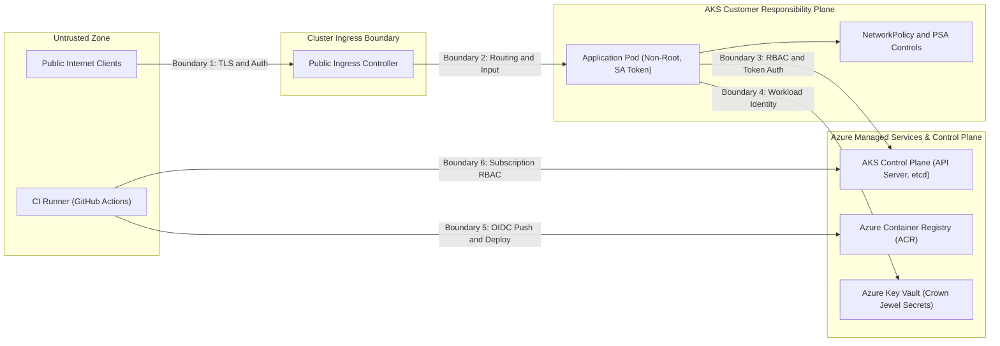
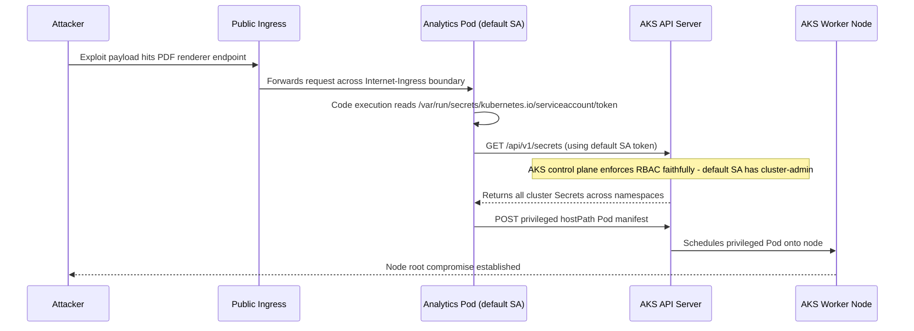

# Security Mental Model and Threat Modeling

> **Prerequisites:** Familiarity with container image hardening (`02/09`), Kubernetes RBAC and NetworkPolicy (`03/11`), and AKS AAD-RBAC / Key Vault basics (`07/07`).  
> **Estimated Reading Time:** 35 minutes  
> **Target Audience:** Backend Engineers, DevOps Engineers, Cloud Security Practitioners, Platform Engineers.

> [!TIP]
> **The Golden Rule of Cloud-Native Threat Modeling:** Never mistake "managed by Azure" for "secured by default"—if you can break or misconfigure a control with `kubectl apply` or an `az` command, it sits strictly on your side of the shared-responsibility boundary, and you must model threats backward from crown-jewel assets across every trust boundary.

---

## Why This Matters

Every earlier security lesson handed you a *fix* — run non-root, scope an RBAC role, lock down a NetworkPolicy — without a framework for deciding *which* fixes matter for *your* system. That's backwards, and it's how teams end up hardening the wrong things while the real hole stays open. This module gives you the thinking tools that come before any tool: how to enumerate what an attacker could do (threat modeling), how to reason about your attack surface and trust boundaries, and — critically for everything you've built on Azure — exactly where the cloud provider's responsibility ends and yours begins. Get this wrong and you'll assume "it's on AKS, so Azure secures it," which is false in specific, exploitable ways.

---

## 1. Architectural Mental Model: Attack Surface, Trust Boundaries & Shared Responsibility

Your **attack surface** is the sum of all points where an attacker can interact with your system: exposed ports, the Kubernetes API server, a public Ingress, a container registry, the CI pipeline, and every secret or token. A **trust boundary** is any line where data or control crosses from one level of trust to another. Threats cluster at trust boundaries because that is where an attacker tries to get a trusted component to act on untrusted input.



### Core Concepts

#### Security Is a Property of a System, Not a Checklist
The Docker module (`02/09`) gave you a checklist: non-root, minimal image, secrets at runtime. Checklists are useful but dangerous on their own — they tell you what to do, never what you missed. A real security posture starts from a different question: *what does an attacker want, and what paths could they take to get it?* You work backward from the asset (customer data, a signing key, `cluster-admin`) to the paths, and only then reach for controls. The controls you already know are the *answers*; this module is about asking the *questions* well enough that you pick the right answers.

#### STRIDE: A Vocabulary for "What Could Go Wrong"
STRIDE is a mnemonic for six categories of threat. You don't need it to be exhaustive — you need it to stop you forgetting a whole class of problem:

- **S**poofing — pretending to be someone or something you're not (a Pod using a stolen ServiceAccount token; a forged JWT). *Counter:* authentication — Azure AD-integrated RBAC (`07/07`), workload identity.
- **T**ampering — modifying data or code in transit or at rest (altering an image after it's built; changing a ConfigMap). *Counter:* integrity — image signing (previewed in module 01), TLS, read-only root filesystems (module 03).
- **R**epudiation — doing something and being able to deny it (no audit trail of who deleted a Secret). *Counter:* logging and audit — Kubernetes audit logs, Azure Activity Log (module 07).
- **I**nformation disclosure — leaking data you shouldn't (a secret in a container layer from `02/09`; an over-broad `list secrets` RBAC grant). *Counter:* confidentiality — encryption, least-privilege RBAC (`03/11`), Key Vault (module 02).
- **D**enial of service — making a system unavailable (a Pod with no resource limits exhausting a node). *Counter:* availability — quotas, limits, rate limiting.
- **E**levation of privilege — gaining rights you weren't granted (a container escape from a privileged Pod; a `hostPath` mount reaching the node). *Counter:* least privilege and isolation — Pod Security Admission (module 03), dropping capabilities, non-root.

Notice every control you've learned maps onto one of these six. STRIDE is the index; the rest of this track is the content.

#### Attack Surface, Trust Boundaries, and Data Flow
Every minimal-image and non-root lesson from `02/09` was, in this language, *attack-surface reduction* — fewer binaries in the image means fewer things an attacker who lands code execution can use (recall the distroless argument: no shell means many post-exploitation techniques simply don't work). Drawing your system as a **data-flow diagram** and marking every trust-boundary crossing (`internet -> Ingress`, `Pod -> API server`, `cluster -> Key Vault`, `CI -> Azure subscription`) is the single most useful threat-modeling exercise — you walk each crossing and ask the six STRIDE questions about it.

#### The Shared-Responsibility Model: What Azure Secures vs. What You Own
In any managed cloud service, security is *split* between provider and customer, and the split moves depending on how managed the service is. **The more the platform manages, the more it secures — but never all of it.**

- **IaaS (a bare VM in Azure):** Azure secures the physical datacenter, the hypervisor, and the network fabric. *You* own the guest OS, patching, every application, firewall rules, and identity.
- **AKS (managed Kubernetes):** Azure secures and patches the **control plane** (the API server, etcd, scheduler) and the physical/hypervisor layers. *You* still own: what runs in your Pods, node OS patching cadence (you trigger node image upgrades), RBAC design, NetworkPolicy, admission control, secrets, and workload identity. Azure running the API server does *not* stop you deploying a privileged root container that mounts the host filesystem.
- **Azure Container Apps (ACA, track 06):** Azure manages even more — the cluster, the node pools, the ingress plumbing. You still own your image's contents, app code, secrets/identity configuration, and ingress/auth settings.

A useful rule of thumb: if you can break it with a `kubectl apply` or an `az` command, it's your responsibility, not Azure's.

#### Defense in Depth and Assume-Breach
Two mindsets tie the track together. **Defense in depth** means no single control is trusted to be sufficient — you layer them so that one failure doesn't equal a breach (non-root *and* dropped capabilities *and* NetworkPolicy *and* admission control). **Assume breach** means you design as if an attacker *will* get a foothold and ask "then what?" — driving network segmentation (module 06) and incident response (module 07).

#### Threats Are Prioritized by Risk, Not by Scariness
You cannot fix everything, so you rank with **risk ≈ likelihood × impact**. A critical CVE in a package your app never calls, on an internal-only Pod with no network egress, is lower risk than a medium CVE in your public-facing Ingress controller. Severity is an input to risk, not risk itself.

---

## 2. Taxonomic Comparison: STRIDE Controls & Cloud Responsibility Split

### STRIDE Threat Matrix Across Kubernetes Trust Boundaries

| STRIDE Letter | Security Property | Concrete Cloud-Native Threat | Primary Countermeasures & Modules |
| :--- | :--- | :--- | :--- |
| **S**poofing | Authentication | Forged JWT or stolen ServiceAccount token used to impersonate workload | Azure AD RBAC (`07/07`), OIDC Workload Identity (`02`) |
| **T**ampering | Integrity | Modified container image pulled from registry; mutable container filesystem | Image signing (`01`/`18`), TLS, `readOnlyRootFilesystem` (`03`) |
| **R**epudiation | Non-repudiation | Attacker deletes Kubernetes `Secret` or edits RBAC with no trace | Kubernetes API Audit Logs, Azure Activity Log (`07`) |
| **I**nformation Disclosure | Confidentiality | Secret baked into image layer; `list secrets` granted to default SA | Runtime secret mounts (`02`), least-privilege RBAC (`03/11`) |
| **D**enial of Service | Availability | Unbounded Pod consumes all node CPU/RAM; unthrottled public Ingress | ResourceRequests/Limits, LimitRanges, Ingress rate limiting |
| **E**levation of Privilege | Authorization | `privileged: true` or `hostPath: /` mount enables container escape to node | Pod Security Admission `restricted`, drop `ALL` caps (`03`), Gatekeeper (`04`) |

### Shared-Responsibility Split by Azure Compute Tier

| Layer / Control | Bare Azure VM (IaaS) | AKS (Managed K8s) | Azure Container Apps (ACA) |
| :--- | :--- | :--- | :--- |
| **Physical Datacenter & Hypervisor** | Azure | Azure | Azure |
| **Kubernetes Control Plane (`apiserver`, `etcd`)** | N/A (or You if self-managed) | Azure | Azure |
| **Node OS Image Patching & Upgrades** | You | Shared (Azure builds image; You trigger upgrade) | Azure |
| **Container Image Contents & Base Hygiene** | You | You | You |
| **Pod `securityContext` & Admission Policy** | N/A | You (PSA / Gatekeeper / Azure Policy) | Platform defaults + Your config |
| **RBAC, Workload Identity & Secret Lifecycle** | You | You | You |

---

## 3. Production War Story Post-Mortem: The "Managed Cluster" Blind Spot

**Severity:** SEV-1  
**Detection Time:** 42 minutes (via egress anomaly alert on a database subnet)  
**Resolution Time:** 2 hours 15 minutes  
**Impact:** Compromised public web Pod pivoted via an over-privileged `default` ServiceAccount to read 14 namespace secrets and deploy privileged crypto-mining Pods across 3 worker nodes.

### What Happened

A team migrated an internal reporting tool onto AKS and assumed "managed Kubernetes means Azure handles cluster security." During early debugging, an engineer bound the `default` ServiceAccount in the `analytics` namespace to `cluster-admin` and left it there. Weeks later, an unauthenticated path-traversal bug in a third-party PDF renderer exposed the Pod.



### Root Cause Analysis

1. **Shared-Responsibility Confusion:** Azure patched and protected the API server (`etcd` and control plane), so the team wrongly assumed workload-level defaults were locked down.
2. **Default ServiceAccount Over-Privilege:** Because `analytics` Pods did not specify `serviceAccountName`, every Pod mounted the `default` ServiceAccount token—which still held `cluster-admin`.
3. **Missing Defense-in-Depth Layers:** No Pod Security Admission (`restricted`) blocked the `privileged: true` Pod creation, and no NetworkPolicy restricted Pod-to-API or lateral egress.

### The Fix & Architectural Hardening

- Immediately deleted the `ClusterRoleBinding` tying `analytics:default` to `cluster-admin`, rotated all exposed Key Vault and Kubernetes Secrets, and cordoned/reimaged affected nodes.
- Added `automountServiceAccountToken: false` to all non-API Pods and ran `kubectl auth can-i --list --as=system:serviceaccount:<ns>:default` in CI to fail builds if `default` gains permissions.
- Enforced Pod Security Admission (`enforce=restricted`) and added explicit NetworkPolicies following the **assume-breach** principle.

---

## 4. Multi-Language Production Implementation: Contextual Risk & Trust-Boundary Evaluator

Because threat modeling prioritizes risk by `likelihood × impact × reachability` rather than raw vulnerability severity alone, production security gates model context explicitly. The following four implementations compute contextual risk scores and map findings to STRIDE categories and trust boundaries.

````carousel
```go
package main

import (
	"fmt"
	"sort"
)

type StrideCategory string

const (
	Spoofing              StrideCategory = "Spoofing"
	Tampering             StrideCategory = "Tampering"
	Repudiation           StrideCategory = "Repudiation"
	InformationDisclosure StrideCategory = "InformationDisclosure"
	DenialOfService       StrideCategory = "DenialOfService"
	ElevationOfPrivilege  StrideCategory = "ElevationOfPrivilege"
)

type ThreatFinding struct {
	ID              string
	Title           string
	Boundary        string
	Category        StrideCategory
	BaseSeverity    float64 // 1.0 - 10.0
	PublicReachable bool
	HasMitigation   bool
}

func (f ThreatFinding) ContextualRiskScore() float64 {
	likelihood := 0.35
	if f.PublicReachable {
		likelihood = 0.90
	}
	if f.HasMitigation {
		likelihood *= 0.25
	}
	return f.BaseSeverity * likelihood
}

func PrioritizeFindings(findings []ThreatFinding) []ThreatFinding {
	ranked := make([]ThreatFinding, len(findings))
	copy(ranked, findings)
	sort.Slice(ranked, func(i, j int) bool {
		return ranked[i].ContextualRiskScore() > ranked[j].ContextualRiskScore()
	})
	return ranked
}

func main() {
	findings := []ThreatFinding{
		{ID: "FIND-1", Title: "Critical CVE in uncalled internal lib", Boundary: "Internal Pod", Category: Tampering, BaseSeverity: 9.8, PublicReachable: false, HasMitigation: true},
		{ID: "FIND-2", Title: "Medium CVE in public Ingress", Boundary: "Internet -> Ingress", Category: Spoofing, BaseSeverity: 6.5, PublicReachable: true, HasMitigation: false},
		{ID: "FIND-3", Title: "Public Pod SA has list secrets", Boundary: "Pod -> API Server", Category: InformationDisclosure, BaseSeverity: 9.0, PublicReachable: true, HasMitigation: false},
	}

	for _, f := range PrioritizeFindings(findings) {
		fmt.Printf("[%s] Risk=%.2f (%s) Boundary=%s | %s\n", f.ID, f.ContextualRiskScore(), f.Category, f.Boundary, f.Title)
	}
}
```
<!-- slide -->
```typescript
type StrideCategory =
  | "Spoofing"
  | "Tampering"
  | "Repudiation"
  | "InformationDisclosure"
  | "DenialOfService"
  | "ElevationOfPrivilege";

interface ThreatFinding {
  readonly id: string;
  readonly title: string;
  readonly boundary: string;
  readonly category: StrideCategory;
  readonly baseSeverity: number; // 1.0 - 10.0
  readonly publicReachable: boolean;
  readonly hasMitigation: boolean;
}

export function computeContextualRisk(finding: ThreatFinding): number {
  let likelihood = finding.publicReachable ? 0.9 : 0.35;
  if (finding.hasMitigation) {
    likelihood *= 0.25;
  }
  return Number((finding.baseSeverity * likelihood).toFixed(2));
}

export function prioritizeThreats(findings: readonly ThreatFinding[]) {
  return [...findings]
    .map((f) => ({ ...f, riskScore: computeContextualRisk(f) }))
    .sort((a, b) => b.riskScore - a.riskScore);
}

const findings: ThreatFinding[] = [
  { id: "FIND-1", title: "Critical CVE in internal pod", boundary: "Internal Pod", category: "Tampering", baseSeverity: 9.8, publicReachable: false, hasMitigation: true },
  { id: "FIND-2", title: "Medium CVE in public Ingress", boundary: "Internet -> Ingress", category: "Spoofing", baseSeverity: 6.5, publicReachable: true, hasMitigation: false },
  { id: "FIND-3", title: "Public Pod SA has list secrets", boundary: "Pod -> API Server", category: "InformationDisclosure", baseSeverity: 9.0, publicReachable: true, hasMitigation: false },
];

for (const item of prioritizeThreats(findings)) {
  console.log(`[${item.id}] Risk=${item.riskScore} (${item.category}) Boundary=${item.boundary} | ${item.title}`);
}
```
<!-- slide -->
```python
from dataclasses import dataclass
from enum import Enum
from typing import List


class StrideCategory(str, Enum):
    SPOOFING = "Spoofing"
    TAMPERING = "Tampering"
    REPUDIATION = "Repudiation"
    INFORMATION_DISCLOSURE = "InformationDisclosure"
    DENIAL_OF_SERVICE = "DenialOfService"
    ELEVATION_OF_PRIVILEGE = "ElevationOfPrivilege"


@dataclass(frozen=True)
class ThreatFinding:
    id: str
    title: str
    boundary: str
    category: StrideCategory
    base_severity: float  # 1.0 - 10.0
    public_reachable: bool
    has_mitigation: bool

    def contextual_risk_score(self) -> float:
        likelihood = 0.90 if self.public_reachable else 0.35
        if self.has_mitigation:
            likelihood *= 0.25
        return round(self.base_severity * likelihood, 2)


def prioritize_threats(findings: List[ThreatFinding]) -> List[ThreatFinding]:
    return sorted(findings, key=lambda f: f.contextual_risk_score(), reverse=True)


if __name__ == "__main__":
    sample = [
        ThreatFinding("FIND-1", "Critical CVE in internal pod", "Internal Pod", StrideCategory.TAMPERING, 9.8, False, True),
        ThreatFinding("FIND-2", "Medium CVE in public Ingress", "Internet -> Ingress", StrideCategory.SPOOFING, 6.5, True, False),
        ThreatFinding("FIND-3", "Public Pod SA has list secrets", "Pod -> API Server", StrideCategory.INFORMATION_DISCLOSURE, 9.0, True, False),
    ]
    for f in prioritize_threats(sample):
        print(f"[{f.id}] Risk={f.contextual_risk_score():.2f} ({f.category.value}) Boundary={f.boundary} | {f.title}")
```
<!-- slide -->
```csharp
using System;
using System.Collections.Generic;
using System.Linq;

public enum StrideCategory
{
    Spoofing,
    Tampering,
    Repudiation,
    InformationDisclosure,
    DenialOfService,
    ElevationOfPrivilege
}

public sealed record ThreatFinding(
    string Id,
    string Title,
    string Boundary,
    StrideCategory Category,
    double BaseSeverity,
    bool PublicReachable,
    bool HasMitigation)
{
    public double ContextualRiskScore()
    {
        double likelihood = PublicReachable ? 0.90 : 0.35;
        if (HasMitigation) likelihood *= 0.25;
        return Math.Round(BaseSeverity * likelihood, 2);
    }
}

public static class ThreatPrioritizer
{
    public static IReadOnlyList<ThreatFinding> Rank(IEnumerable<ThreatFinding> findings) =>
        findings.OrderByDescending(f => f.ContextualRiskScore()).ToList();

    public static void Main()
    {
        var findings = new[]
        {
            new ThreatFinding("FIND-1", "Critical CVE in internal pod", "Internal Pod", StrideCategory.Tampering, 9.8, false, true),
            new ThreatFinding("FIND-2", "Medium CVE in public Ingress", "Internet -> Ingress", StrideCategory.Spoofing, 6.5, true, false),
            new ThreatFinding("FIND-3", "Public Pod SA has list secrets", "Pod -> API Server", StrideCategory.InformationDisclosure, 9.0, true, false),
        };

        foreach (var f in Rank(findings))
        {
            Console.WriteLine($"[{f.Id}] Risk={f.ContextualRiskScore():F2} ({f.Category}) Boundary={f.Boundary} | {f.Title}");
        }
    }
}
```
````

---

## 5. Practical Hands-On Verification CLI Workflows

### Command Reference & Flag Breakdowns

Threat modeling is mostly a thinking-and-diagramming activity, but a few commands help you *inspect* the surface you're modeling. Real enforcement tooling arrives in later modules.

| Command | What it does | Example |
| :--- | :--- | :--- |
| `kubectl auth can-i --list --as=<subject>` | Enumerates everything a subject is allowed to do — a fast attack-surface read of one identity | `kubectl auth can-i --list --as=system:serviceaccount:default:default` |
| `kubectl get pods -A -o jsonpath=...` | Scriptable inventory of what's running (privileged? hostNetwork?) — surface enumeration | see exercise 4 |
| `az account show` | Shows the subscription/tenant you're operating in — knowing your blast radius | `az account show --output table` |
| `az role assignment list --all` | Lists who has what Azure role — the identity attack surface at the cloud layer | `az role assignment list --all --output table` |
| `docker scout quickview <image>` | (From 02/09) a quick vulnerability read of an image's surface | `docker scout quickview myapp:latest` |

**Flag breakdown for `kubectl auth can-i --list --as=system:serviceaccount:default:default`:**
- `auth can-i` — the RBAC query subcommand (from `03/11`).
- `--list` — instead of checking one verb/resource, dumps *all* verbs and resources the subject can access; the fastest way to see how much power an identity really has.
- `--as=system:serviceaccount:default:default` — impersonates the *default* ServiceAccount in the *default* namespace. Every Pod that doesn't name a ServiceAccount runs as this one, so it's a common first target — checking it tells you what a compromised generic Pod could reach.

**Flag breakdown for `az role assignment list --all --output table`:**
- `role assignment list` — lists Azure RBAC role assignments (`who -> what role -> over what scope`).
- `--all` — includes assignments inherited from higher scopes (management group, subscription), not just the current one, so you see the *full* identity picture rather than a partial view.
- `--output table` — human-readable columns instead of JSON.

### Hands-On Exercises

These are analytical exercises with real inspection commands — the "tool" in this module is your own reasoning. Work them in writing, not just in your head.

1. **(Paper/whiteboard) Draw a data-flow diagram** for the AKS app you built in track 07: `internet -> Ingress -> Service -> Pod -> Key Vault`, plus `CI -> ACR -> cluster`, plus `user -> Azure AD -> API server`. Draw a dashed line at every trust boundary (`internet/Ingress`, `Pod/API server`, `cluster/Key Vault`, `CI/subscription`). You should find at least five crossings. Keep this diagram — later modules harden specific crossings on it.

2. **(Paper) Run STRIDE against one crossing.** Take the `internet -> Ingress` boundary and write one concrete threat for each of the six STRIDE letters (e.g. Spoofing: a client presenting a forged auth token; DoS: a flood of requests with no rate limit). For each, note which control (and which earlier module) counters it. If you can't name a control for a letter, that's a real gap to remember.

3. **(WSL2) Enumerate the default ServiceAccount's power.** On your kind cluster from track 03:

```bash
kubectl auth can-i --list --as=system:serviceaccount:default:default
```

**Expected Output:**
```text
Resources                                       Non-Resource URLs   Resource Names   Verbs
selfsubjectreviews.authentication.k8s.io        []                  []               [create]
selfsubjectaccessreviews.authorization.k8s.io   []                  []               [create]
selfsubjectrulesreviews.authorization.k8s.io    []                  []               [create]
```

Expect a short list (mostly `selfsubjectreviews`/`selfsubjectrulesreviews` — near-zero real power on a well-configured cluster). Now imagine that ServiceAccount were bound to `cluster-admin`. Write one sentence on why "a compromised generic Pod" becomes catastrophic in that case — this is the elevation-of-privilege path you'll block in modules 03–04.

4. **(WSL2) Inventory your real attack surface.** Find every Pod that runs privileged or uses host namespaces — these are your highest-value targets:

```bash
kubectl get pods -A -o jsonpath='{range .items[*]}{.metadata.namespace}{"\t"}{.metadata.name}{"\t"}{.spec.hostNetwork}{"\t"}{range .spec.containers[*]}{.securityContext.privileged}{" "}{end}{"\n"}{end}'
```

**Expected Output:**
```text
kube-system     coredns-76f75df574-4m9p8     <none>   <none>
kube-system     kindnet-9v2kx                true     <none>
kube-system     kube-proxy-x8t4l             true     true
default         myapp-web-6d99c7f864-z42k1   <none>   <none>
```

Expect mostly `<none>`/`false`. Any `true` is a Pod that, if compromised, is close to owning the node. Note which they are (often CNI/monitoring system Pods) — knowing *why* each one legitimately needs that power is part of threat modeling, not a reason to panic.

5. **(Azure) Map the shared-responsibility line for AKS.** For each of these, write "Azure" or "You": patching the API server; patching the node OS; deciding a Pod runs as root; encrypting etcd; writing a NetworkPolicy; rotating a Key Vault secret; physical datacenter security. Then check your answers against the Concepts section. The pattern to internalize: control plane and infrastructure = Azure; workloads, config, and identity = you.

6. **(Azure) See your cloud identity surface.**

```bash
az role assignment list --all --output table
```

**Expected Output:**
```text
Principal                               Role          Scope
--------------------------------------  ------------  ------------------------------------
sp-ci-legacy-deployer                   Contributor   /subscriptions/00000000-...
platform-admin@contoso.com              Owner         /subscriptions/00000000-...
aks-learn-agentpool                     Reader        /subscriptions/00000000-.../rg-aks-learn
```

Note how many identities have `Owner` or `Contributor` at subscription scope. Each is a full-subscription blast radius if compromised. Write down whether any *service principal* (not a person) has broad rights — those are common long-lived-secret liabilities you'll revisit in module 02.

7. **(Paper) Prioritize by risk, not scariness.** Given three findings — (a) a critical CVE in a library your app imports on an internal-only Pod with no egress, (b) a medium CVE in your public Ingress controller, (c) a ServiceAccount with `list secrets` cluster-wide bound to a public-facing Pod — rank them by `likelihood × impact` and justify the order in one sentence each. There's no single right answer; the *reasoning* is the skill.

8. **(Paper) Assume breach.** Pick the scenario "an attacker has code execution inside one of your application Pods." List, in order, the next five things they'd try (read the SA token? scan the Pod network? reach the metadata endpoint? read mounted secrets? call the API server?). Each item you list is something a later module will teach you to block — keep the list.

### Independent Challenge

No framework template given — build it yourself using this module plus what you know from `02/09` (image hardening), `03/11` (RBAC and NetworkPolicy), and `07/07` (AAD-RBAC and Key Vault). Produce a one-page threat model for a realistic system: a public-facing web app running on AKS, pulling images from ACR, reading a database password from Key Vault via the CSI driver, deployed by a CI pipeline. Draw the data-flow diagram, mark every trust boundary, and for the two boundaries you judge highest-risk, enumerate STRIDE threats and name the specific control (and the earlier module that taught it) that counters each. Finish with an explicit shared-responsibility table for this system: three things Azure secures for you and three things that remain yours. The deliverable is the reasoning, not a tool output — you should be able to hand this page to a teammate and have them understand where the real risks are.

<details>
<summary>Stuck? One hint</summary>

Start from the assets and work outward: the database password and `cluster-admin` are your crown jewels. Trace every path that reaches them (a public request, a Pod's SA token, the CI credential, the Key Vault access policy), and you'll find your trust boundaries are exactly those paths. For the shared-responsibility table, use the "can I break it with `kubectl apply` or `az`?" test — if yes, it's yours.

</details>

---

## 6. Common Mistakes & Troubleshooting

- **Treating "managed" as "secured."** AKS securing the control plane says nothing about your workloads; you can still deploy a root, privileged, host-mounting Pod on a perfectly patched managed cluster. The provider secures what it *operates*, not what you *configure*.
- **Threat-modeling the whole system at once and giving up.** Model one trust boundary at a time. Six STRIDE questions against one crossing is a 15-minute exercise; the whole system at once is paralysis.
- **Confusing a severity score with risk.** A critical CVE on an unreachable internal Pod can be lower risk than a medium one on your public edge. Severity is an input; risk is `likelihood × impact` in *your* context.
- **Reaching for a control before naming the threat.** "We should add Gatekeeper" is not a plan until you can say which threat it counters. Controls without a named threat are how effort gets spent in the wrong place.
- **Forgetting the default ServiceAccount.** Every Pod that doesn't name one gets `default`; if that's ever over-privileged, *every* generic Pod silently inherits the power. It's an easy blind spot in surface enumeration.
- **Assuming defense-in-depth layers are redundant, so skipping some.** They aren't redundant — each exists to catch the failure of another. "Non-root makes admission control unnecessary" is exactly the reasoning that leads to a single-point-of-failure posture.

---

## 7. Operational Validation Checkpoints

<details>
<summary><strong>Checkpoint 1: A teammate claims "AKS encrypts etcd and patches the control plane, so we don't need Pod Security Admission or NetworkPolicies." What is flawed in this reasoning?</strong></summary>

They are confusing Azure's control-plane responsibility with the customer's workload/configuration responsibility. While Azure secures the managed control plane (`apiserver`, `etcd`, scheduler) and hypervisor, Azure does not prevent you from deploying a `privileged: true` Pod with `hostPath: /` or leaving Pod-to-Pod traffic wide open. Because both settings can be misconfigured via `kubectl apply`, they are strictly your responsibility under the shared-responsibility model.

</details>

<details>
<summary><strong>Checkpoint 2: Your scanner reports two issues: (A) CVSS 9.8 Critical CVE in an offline batch job library behind strict NetworkPolicy egress deny, and (B) CVSS 5.9 Medium auth-bypass CVE on a public-facing Ingress controller. Which do you patch first and why?</strong></summary>

Patch **(B)** first. Threat prioritization uses `risk ≈ likelihood × impact` rather than raw CVSS scariness. Issue (B) sits directly on the `Internet -> Ingress` untrusted boundary with high likelihood of exploitation and broad impact, whereas issue (A) is isolated behind internal trust boundaries with near-zero reachability.

</details>

<details>
<summary><strong>Checkpoint 3: You run `kubectl auth can-i --list --as=system:serviceaccount:default:default` and observe `secrets [get list watch]`. Which STRIDE categories does this expose under an assume-breach scenario?</strong></summary>

It directly enables **Information Disclosure** (any compromised generic Pod in `default` that fails to declare a custom `serviceAccountName` can read every secret in the namespace) and **Spoofing / Elevation of Privilege** (if any stolen secret contains downstream database or API credentials, the attacker pivots laterally into higher-trust zones).

</details>

### Self-Test Checkpoint Quiz

Write down your answer to each question before expanding it — checking without attempting first is the single easiest way to fool yourself into thinking you've learned this.

<details>
<summary>Show questions</summary>

1. What does each letter of STRIDE stand for, and name one control (from any earlier module) that counters each?
2. What is a trust boundary, and why do threats cluster at them?
3. On AKS, name two things Azure secures for you and three things that remain your responsibility.
4. Why is a critical-severity CVE not automatically higher risk than a medium-severity one?
5. What is the "assume breach" mindset, and how does it change how you design a system versus assuming your perimeter holds?
6. What's the quick test for deciding whether something on AKS is Azure's responsibility or yours?
7. Why is the default ServiceAccount a specific thing to check when enumerating attack surface?

</details>

<details>
<summary>Show answers</summary>

1. **S**poofing (counter: authentication — AAD-RBAC, workload identity); **T**ampering (integrity — image signing, TLS, read-only root FS); **R**epudiation (audit logging — Kubernetes/Azure audit logs); **I**nformation disclosure (confidentiality — least-privilege RBAC, Key Vault, no secrets in layers); **D**enial of service (availability — resource limits/quotas, rate limiting); **E**levation of privilege (least privilege/isolation — Pod Security Admission, dropped capabilities, non-root).
2. A trust boundary is any line where data or control crosses between different levels of trust (`internet->Ingress`, `Pod->API server`, `cluster->Key Vault`, `CI->subscription`). Threats cluster there because that's where an attacker tries to get a trusted component to act on untrusted input — it's where authentication, validation, and authorization decisions happen.
3. Azure secures: the control plane (API server, etcd, scheduler), the hypervisor, and the physical datacenter/network fabric. You own: what runs in Pods (including whether they're privileged/root), node OS patch cadence, RBAC/NetworkPolicy/admission design, secrets, and workload identity configuration.
4. Because `risk ≈ likelihood × impact` in your specific context. A critical CVE in a code path your app never executes, on an internal Pod with no network egress, has low likelihood of exploitation and limited impact; a medium CVE on a public-facing component may be far more reachable. Severity is one input to risk, not risk itself.
5. Assume breach means designing as if an attacker *will* get a foothold and asking "then what?" — it drives segmentation, least privilege, and incident-response planning. It differs from perimeter thinking by not trusting any single boundary to hold, so a breach of one layer is contained rather than total.
6. If you can break/misconfigure it with a `kubectl apply` or an `az` command, it's your responsibility; if it's a layer Azure operates and you can't touch (the API server internals, the hypervisor), it's Azure's.
7. Every Pod that doesn't explicitly name a ServiceAccount runs as `default`. If that account is ever over-privileged, every generic Pod silently inherits that power — making it a common, easily-overlooked elevation-of-privilege path worth checking first.

</details>

---

## Next

Continue to [01-image-scanning-and-supply-chain-basics](../01-image-scanning-and-supply-chain-basics/README.md) to start *finding* the problems your threat model says matter — beginning with what's actually inside your images.
