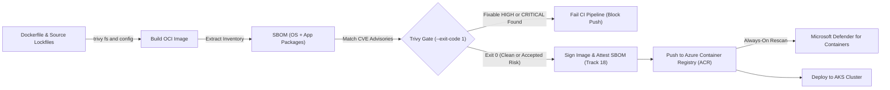
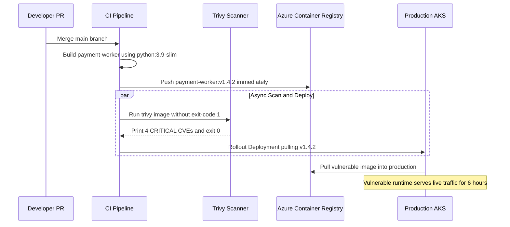

# Image Scanning and Supply-Chain Basics

> **Prerequisites:** Container image hardening fundamentals (`02/09`), CI pipeline concepts (Track 10), and Threat Modeling / STRIDE basics (`Module 00`).  
> **Estimated Reading Time:** 35 minutes  
> **Target Audience:** Backend Engineers, DevOps Engineers, Platform Engineers, AppSec Engineers.

> [!TIP]
> **The Golden Rule of Image Scanning & Supply-Chain Gates:** Always place an automated, blocking vulnerability scan (`--exit-code 1`) strictly *between* image build and registry push—never after push—and pair minimal pinned base images with `--ignore-unfixed` so your gate remains both strict and achievable.

---

## Why This Matters

Module 00's threat model flagged the image and the pipeline that builds it as trust boundaries: everything an attacker can smuggle into a running container usually rides in through the image. Docker module `02/09` introduced `docker scout` as a one-off developer convenience. That's not enough for a real system — scanning has to happen *automatically, in CI, before an image is ever pushed or deployed*, so a vulnerable image is stopped at the door rather than discovered in production. This module makes scanning a gate, not a suggestion, and previews the deeper supply-chain topic (signing and SBOMs) that track 18 owns in full.

---

## 1. Architectural Mental Model: Shift-Left CI Gate, SBOM Inventory & Continuous Registry Backstop

Every scanner works in two stages: first extracting a **Software Bill of Materials (SBOM)** ("what is inside the box") and then matching those package versions against known **CVE** databases ("which of those components have known vulnerabilities"). Placing that check between `docker build` and `docker push` prevents unpatched artifacts from ever entering your registry.



### Core Concepts

#### What a Scanner Actually Does (and the SBOM Underneath It)
Recall from `02/09` that a scanner compares the packages installed in an image against databases of known CVEs. Under the hood, every scanner first builds a **Software Bill of Materials (SBOM)** — a complete inventory of every OS package and language dependency in the image, with versions — and *then* cross-references that inventory against vulnerability feeds. The SBOM is the "what's in the box" list; the scan is "which of those things has a known problem." `docker scout` did both invisibly; **Trivy** (the tool this module uses) exposes them as separate ideas, which matters because the SBOM is independently useful (module 18 goes deep on generating and *attesting* to SBOMs — here you just meet the concept).

#### Trivy: An Open-Source Scanner You Run Anywhere
Trivy is a widely-used, single-binary scanner that works on images, filesystems, IaC files, and running clusters. Its key properties:

- It scans **OS packages *and* language dependencies** (npm, pip, Go modules, etc.), catching application-layer CVEs that OS-only scanners miss.
- It's **CI-friendly**: an `--exit-code` flag makes it *fail the build* when it finds vulnerabilities at or above a severity you choose — this is what turns scanning from a report into a gate.
- It runs locally with no account, so you can practice for real on this machine, unlike a paid cloud scanner.

#### Microsoft Defender for Containers: The Azure-Native Option
Trivy is the tool you *run*; **Microsoft Defender for Containers** (part of Defender for Cloud) is a *managed* alternative that Azure runs *for* you. Once enabled on a subscription, it automatically scans images in ACR on push (and periodically re-scans), assesses your AKS clusters for misconfigurations, and surfaces runtime threat alerts — all reported into Defender for Cloud (which you'll meet again in module 07 for incident signals). The trade-off is the familiar one from module 00's shared-responsibility model: Trivy gives you control and runs free/local but you must wire it into your own pipeline; Defender is a paid plan but integrates scanning, posture, and runtime detection into the platform with no pipeline work. Real teams often use both — Trivy as the CI gate, Defender as the always-on registry/runtime backstop.

#### Scan in CI, Before Push — Shift Left
The whole point is *timing*. A vulnerability caught on a developer's laptop or in a CI job costs minutes to fix; the same vulnerability caught in production is an incident. "Shift left" means moving the check as early as possible. The canonical pipeline order (building on your CI knowledge from track 10):

1. Build the image.
2. **Scan it with Trivy, failing the job on high/critical findings.**
3. Only if the scan passes, push to ACR.
4. Deploy.

The scan sits *between* build and push, so a failing image never reaches the registry. This is the same gate logic as a failing test blocking a merge — security findings are just another quality gate.

#### Base-Image Hygiene Is the Highest-Leverage Fix
`02/09` showed slimmer base images have fewer CVEs simply by shipping fewer packages. Supply-chain hygiene extends that into ongoing discipline:

- **Pin to specific, current base-image tags**, not `latest` — `latest` is a moving target you can't reason about, and it silently changes what you ship.
- **Rebuild regularly** so patched base images flow into your image; a CVE fixed upstream doesn't help you until you rebuild.
- **Prefer minimal/distroless bases** so most of the OS-package attack surface (and therefore most OS CVEs) simply isn't present to be flagged.
- Most scanner findings are in the **base image, not your code** — choosing a better base is often the single biggest reduction in your report.

#### A Light Preview of Signing and Provenance (Track 18 Owns This)
Scanning answers "is what's in the image safe?" It does *not* answer "is this the image I actually built, unmodified?" — that's **integrity/provenance**, STRIDE's Tampering category from module 00. The supply-chain answer is **signing**: after building, you cryptographically sign the image (e.g. with Cosign), and admission control later *refuses to run any image that isn't validly signed*, so an attacker who swaps in a tampered image is blocked even if it would pass a scan. Paired with a signed, attested SBOM, this proves both *what's* in the image and *that it came from your pipeline*. **That's all you need here** — module 18 covers generating signatures/SBOMs, keyless signing, and admission-time verification in depth. In this track, just hold the mental model: scanning = "is it safe," signing = "is it authentic."

---

## 2. Taxonomic Comparison: Scanners, Gate Semantics & Supply-Chain Controls

### Scanning vs. Managed Posture vs. Signing

| Capability / Tool | Core Question Answered | Execution Phase | Shared-Responsibility Owner | Primary Limitation |
| :--- | :--- | :--- | :--- | :--- |
| **Trivy (CI Gate)** | Does this artifact contain known OS/app CVEs or IaC misconfigs? | Pre-push in CI (`build -> scan -> push`) | You (pipeline wiring & policy tuning) | Only checks *known* CVEs; does not prove image authenticity |
| **Microsoft Defender for Containers** | Are pushed ACR images or running AKS Pods exposed to new CVEs/threats? | Post-push (ACR) + continuous runtime | Azure (managed scanner, feeds & runtime sensor; paid plan) | Post-push detection is reactive; bills per resource |
| **Image Signing (Cosign / Track 18)** | Was this exact digest built by our trusted pipeline and unmodified? | Post-scan sign + admission-time verify | You (signing keys/OIDC + admission verification) | Proves authenticity (Tampering), not absence of CVEs |

### Trivy Scan Targets & Gate Flags

| Target / Flag | Scope Inspected | Failure / Output Behavior | Typical CI Usage |
| :--- | :--- | :--- | :--- |
| `trivy image` | OS packages (`dpkg`, `apk`) + language deps (`pip`, `npm`, `go`) | Prints CVE table; exits `0` unless `--exit-code` is set | Main pre-push OCI container gate |
| `trivy fs` | Source lockfiles, filesystem trees, hardcoded secrets | Catches vulnerable dependencies before Docker build | Early PR check |
| `trivy config` | Dockerfiles, Kubernetes manifests, Terraform | Flags misconfigurations (`USER root`, privileged Pods) | Linting/security check on PR |
| `--exit-code 1` | Any matching finding after filters | Returns status `1` to fail CI job | Mandatory to turn report into blocking gate |
| `--ignore-unfixed` | Excludes CVEs lacking an upstream patch | Prevents unwinnable builds; requires risk tracking | Keeps CI gate actionable for developers |
| `--format cyclonedx` | Package inventory only | Outputs CycloneDX SBOM JSON without failing build | Archived / attested artifact in Track 18 |

---

## 3. Production War Story Post-Mortem: The Post-Push Scan Bypass

**Severity:** SEV-2  
**Detection Time:** 6 hours (discovered during daily security posture review)  
**Resolution Time:** 3 hours 40 minutes  
**Impact:** An image carrying 4 fixable `CRITICAL` CVEs (including an actively exploited `libwebp` / `openssl` parser flaw) was deployed to production payment workers because CI scanned *after* pushing to ACR.

### What Happened

To "speed up CI builds," an engineer reordered the pipeline so `docker push` ran immediately after `docker build`, launching an asynchronous Trivy job in parallel with the deployment stage. Trivy did not specify `--exit-code 1`, so it logged a massive table of `CRITICAL` CVEs and exited `0`.



### Root Cause Analysis

1. **Scan Placed After Push:** Publishing the image to ACR before gating made the vulnerable artifact immediately pullable by the cluster.
2. **Report-Only Exit Code:** Running `trivy image` without `--exit-code 1` meant findings appeared in logs but never halted deployment.
3. **Stale Base Tag:** `Dockerfile` pinned an outdated `python:3.9-slim` tag containing unpatched Debian OS libraries.

### The Fix & Architectural Hardening

- Moved `trivy image --exit-code 1 --severity HIGH,CRITICAL --ignore-unfixed` strictly *between* `docker build` and `docker push`.
- Upgraded the base image to a current pinned minimal digest (`python:3.12-slim` / distroless), cutting `CRITICAL`/`HIGH` findings by over 90% with zero application code changes.
- Enabled **Microsoft Defender for Containers** on ACR as a continuous post-push rescan backstop for newly published CVEs discovered *after* build time.

---

## 4. Multi-Language Production Implementation: SBOM & CVE Policy Gate Evaluator

Production CI pipelines often enforce custom policy gates over Trivy JSON or CycloneDX SBOM outputs—failing builds when fixable `CRITICAL` or `HIGH` CVEs exceed policy thresholds while ignoring explicitly tracked, non-expired exemptions.

````carousel
```go
package main

import (
	"fmt"
	"os"
	"strings"
)

type Vulnerability struct {
	CVEID        string
	PackageName  string
	Severity     string // CRITICAL, HIGH, MEDIUM, LOW
	FixedVersion string
}

type GatePolicy struct {
	BlockSeverities map[string]bool
	IgnoreUnfixed   bool
	AllowlistCVEs   map[string]bool
}

func EvaluateScanGate(vulns []Vulnerability, policy GatePolicy) (bool, []Vulnerability) {
	var blocking []Vulnerability
	for _, v := range vulns {
		sev := strings.ToUpper(v.Severity)
		if !policy.BlockSeverities[sev] {
			continue
		}
		if policy.IgnoreUnfixed && strings.TrimSpace(v.FixedVersion) == "" {
			continue
		}
		if policy.AllowlistCVEs[v.CVEID] {
			continue
		}
		blocking = append(blocking, v)
	}
	return len(blocking) == 0, blocking
}

func main() {
	findings := []Vulnerability{
		{CVEID: "CVE-2024-0001", PackageName: "openssl", Severity: "CRITICAL", FixedVersion: "3.0.13-1"},
		{CVEID: "CVE-2023-9999", PackageName: "zlib1g", Severity: "HIGH", FixedVersion: ""}, // unfixed upstream
	}
	policy := GatePolicy{
		BlockSeverities: map[string]bool{"CRITICAL": true, "HIGH": true},
		IgnoreUnfixed:   true,
		AllowlistCVEs:   map[string]bool{},
	}

	passed, blocked := EvaluateScanGate(findings, policy)
	if !passed {
		fmt.Printf("GATE FAILED: %d blocking CVEs found\n", len(blocked))
		for _, b := range blocked {
			fmt.Printf(" - %s (%s) in %s -> fix: %s\n", b.CVEID, b.Severity, b.PackageName, b.FixedVersion)
		}
		os.Exit(1)
	}
	fmt.Println("GATE PASSED: safe to push to ACR")
}
```
<!-- slide -->
```typescript
interface Vulnerability {
  readonly cveId: string;
  readonly packageName: string;
  readonly severity: "CRITICAL" | "HIGH" | "MEDIUM" | "LOW";
  readonly fixedVersion?: string;
}

interface GatePolicy {
  readonly blockSeverities: ReadonlySet<Vulnerability["severity"]>;
  readonly ignoreUnfixed: boolean;
  readonly allowlistCves: ReadonlySet<string>;
}

export function evaluateScanGate(
  vulns: readonly Vulnerability[],
  policy: GatePolicy
): { passed: boolean; blocking: Vulnerability[] } {
  const blocking = vulns.filter((v) => {
    if (!policy.blockSeverities.has(v.severity)) return false;
    if (policy.ignoreUnfixed && !v.fixedVersion?.trim()) return false;
    if (policy.allowlistCves.has(v.cveId)) return false;
    return true;
  });

  return { passed: blocking.length === 0, blocking };
}

const sampleVulns: Vulnerability[] = [
  { cveId: "CVE-2024-0001", packageName: "openssl", severity: "CRITICAL", fixedVersion: "3.0.13-1" },
  { cveId: "CVE-2023-9999", packageName: "zlib1g", severity: "HIGH" },
];

const result = evaluateScanGate(sampleVulns, {
  blockSeverities: new Set(["CRITICAL", "HIGH"]),
  ignoreUnfixed: true,
  allowlistCves: new Set(),
});

if (!result.passed) {
  console.error(`GATE FAILED: ${result.blocking.length} blocking CVEs`);
  process.exitCode = 1;
} else {
  console.log("GATE PASSED: safe to push to ACR");
}
```
<!-- slide -->
```python
from dataclasses import dataclass
from typing import FrozenSet, List, Optional, Tuple
import sys


@dataclass(frozen=True)
class Vulnerability:
    cve_id: str
    package_name: str
    severity: str
    fixed_version: Optional[str] = None


@dataclass(frozen=True)
class GatePolicy:
    block_severities: FrozenSet[str] = frozenset({"CRITICAL", "HIGH"})
    ignore_unfixed: bool = True
    allowlist_cves: FrozenSet[str] = frozenset()


def evaluate_scan_gate(
    vulns: List[Vulnerability], policy: GatePolicy
) -> Tuple[bool, List[Vulnerability]]:
    blocking: List[Vulnerability] = []
    for v in vulns:
        if v.severity.upper() not in policy.block_severities:
            continue
        if policy.ignore_unfixed and not (v.fixed_version and v.fixed_version.strip()):
            continue
        if v.cve_id in policy.allowlist_cves:
            continue
        blocking.append(v)
    return (len(blocking) == 0, blocking)


if __name__ == "__main__":
    findings = [
        Vulnerability("CVE-2024-0001", "openssl", "CRITICAL", "3.0.13-1"),
        Vulnerability("CVE-2023-9999", "zlib1g", "HIGH", None),
    ]
    passed, blocked = evaluate_scan_gate(findings, GatePolicy())
    if not passed:
        print(f"GATE FAILED: {len(blocked)} blocking CVEs found")
        sys.exit(1)
    print("GATE PASSED: safe to push to ACR")
```
<!-- slide -->
```csharp
using System;
using System.Collections.Generic;
using System.Linq;

public sealed record Vulnerability(
    string CveId,
    string PackageName,
    string Severity,
    string? FixedVersion);

public sealed record GatePolicy(
    IReadOnlySet<string> BlockSeverities,
    bool IgnoreUnfixed,
    IReadOnlySet<string> AllowlistCves);

public static class ScanGateEvaluator
{
    public static (bool Passed, IReadOnlyList<Vulnerability> Blocking) Evaluate(
        IEnumerable<Vulnerability> vulns,
        GatePolicy policy)
    {
        var blocking = vulns.Where(v =>
            policy.BlockSeverities.Contains(v.Severity.ToUpperInvariant()) &&
            !(policy.IgnoreUnfixed && string.IsNullOrWhiteSpace(v.FixedVersion)) &&
            !policy.AllowlistCves.Contains(v.CveId)).ToList();

        return (blocking.Count == 0, blocking);
    }

    public static int Main()
    {
        var findings = new[]
        {
            new Vulnerability("CVE-2024-0001", "openssl", "CRITICAL", "3.0.13-1"),
            new Vulnerability("CVE-2023-9999", "zlib1g", "HIGH", null),
        };
        var policy = new GatePolicy(
            new HashSet<string> { "CRITICAL", "HIGH" },
            IgnoreUnfixed: true,
            new HashSet<string>());

        var (passed, blocked) = Evaluate(findings, policy);
        if (!passed)
        {
            Console.Error.WriteLine($"GATE FAILED: {blocked.Count} blocking CVEs found");
            return 1;
        }
        Console.WriteLine("GATE PASSED: safe to push to ACR");
        return 0;
    }
}
```
````

---

## 5. Practical Hands-On Verification CLI Workflows

### Command Reference & Flag Breakdowns

| Command | What it does | Example |
| :--- | :--- | :--- |
| `trivy image <image>` | Scans an image for OS + language CVEs | `trivy image myapp:latest` |
| `trivy image --severity HIGH,CRITICAL <image>` | Reports only findings at the given severities | `trivy image --severity HIGH,CRITICAL myapp:latest` |
| `trivy image --exit-code 1 --severity CRITICAL <image>` | Exits non-zero if any CRITICAL is found — the CI gate | `trivy image --exit-code 1 --severity CRITICAL myapp:latest` |
| `trivy image --ignore-unfixed <image>` | Hides CVEs that have no fix available yet | `trivy image --ignore-unfixed myapp:latest` |
| `trivy image --format sbom --output sbom.json <image>` | Emits the SBOM (inventory) rather than the CVE report | `trivy image --format cyclonedx --output sbom.json myapp:latest` |
| `trivy fs <path>` | Scans a filesystem/source tree (e.g. lockfiles) instead of an image | `trivy fs .` |
| `trivy config <path>` | Scans IaC (Dockerfile, Kubernetes YAML, Terraform) for misconfigurations | `trivy config .` |
| `az security pricing create -n Containers --tier Standard` | Enables the Defender for Containers plan on the subscription | see exercise 8 |
| `az acr repository show-tags -n <registry> --repository <repo>` | Lists tags in ACR (to point Defender/Trivy at real pushed images) | `az acr repository show-tags -n myreg --repository myapp` |

**Flag breakdown for `trivy image --exit-code 1 --severity CRITICAL --ignore-unfixed myapp:latest`:**
- `image` — scan mode: an OCI/Docker image (vs. `fs`, `config`, `k8s`).
- `--exit-code 1` — return exit status `1` (a CI failure) if *any* finding matches the filters below; without this, Trivy always exits `0` and merely prints a report, which CI would treat as success.
- `--severity CRITICAL` — only CRITICAL findings count toward that exit code (and the report). You'd typically use `HIGH,CRITICAL` in practice; CRITICAL-only is a gentler starting gate.
- `--ignore-unfixed` — excludes CVEs that have no upstream fix yet, so the gate blocks only on things you can *actually* remediate by rebuilding — avoiding a build that can never pass because of an unpatchable base CVE.

**Flag breakdown for `az security pricing create -n Containers --tier Standard`:**
- `security pricing create` — sets the Defender for Cloud plan for one resource type.
- `-n Containers` — the plan name; `Containers` is Defender for Containers (image scanning + AKS posture + runtime threat detection).
- `--tier Standard` — the paid tier that actually turns protection on (`Free` is effectively off). **This bills** — disable it after the lab with `--tier Free`.

### Hands-On Exercises

Trivy exercises run locally and for real. The Defender exercise touches a paid Azure plan — it's optional/observational and includes teardown.

1. **(WSL2) Install Trivy.**

```bash
sudo apt-get install -y wget apt-transport-https gnupg
wget -qO - https://aquasecurity.github.io/trivy-repo/deb/public.key | gpg --dearmor | sudo tee /usr/share/keyrings/trivy.gpg > /dev/null
echo "deb [signed-by=/usr/share/keyrings/trivy.gpg] https://aquasecurity.github.io/trivy-repo/deb generic main" | sudo tee /etc/apt/sources.list.d/trivy.list
sudo apt-get update && sudo apt-get install -y trivy
trivy --version
```

**Expected Output:**
```text
Version: 0.50.x
Vulnerability DB:
  Version: 2
```

Expect a version string. (If the apt repo gives you trouble, the `install.sh` from Trivy's docs or a `brew install trivy` in WSL both work.)

2. **(WSL2) Scan a deliberately old, vulnerable image.**

```bash
trivy image python:3.9-slim
```

**Expected Output:**
```text
python:3.9-slim (debian 12.x)
Total: 78 (UNKNOWN: 0, LOW: 48, MEDIUM: 21, HIGH: 7, CRITICAL: 2)
┌──────────────┬────────────────┬──────────┬───────────────────┬───────────────┬──────────────┐
│   Library    │ Vulnerability  │ Severity │ Installed Version │ Fixed Version │    Title     │
└──────────────┴────────────────┴──────────┴───────────────────┴───────────────┴──────────────┘
```

Expect a table grouped by target (the OS layer, then any language packages), each row a CVE with severity, installed version, and fixed version. Read the shape: note how many are `CRITICAL`/`HIGH` and how many already have a fixed version available.

3. **(WSL2) Compare base images — hygiene made visible.**

```bash
trivy image --severity HIGH,CRITICAL python:3.9-slim
trivy image --severity HIGH,CRITICAL python:3.12-slim
```

Expect the older `3.9` base to carry more high/critical findings than the current `3.12`. This is the base-image-hygiene lesson from Concepts as a number: *just updating the base tag* removed vulnerabilities, no code change.

4. **(WSL2) Filter to what you can actually fix.**

```bash
trivy image --severity HIGH,CRITICAL --ignore-unfixed python:3.9-slim
```

Expect a shorter list than exercise 3 — the ones removed are CVEs with no available fix. Note the trade-off: `--ignore-unfixed` keeps your gate actionable, but you're accepting (and should track) the unfixable ones.

5. **(WSL2) Turn scanning into a CI gate locally.** Simulate the pipeline check on your own machine:

```bash
trivy image --exit-code 1 --severity CRITICAL --ignore-unfixed python:3.9-slim
echo "exit code was: $?"
```

**Expected Output:**
```text
exit code was: 1
```

Expect a non-zero exit code if any fixable CRITICAL exists (this is what would fail a CI job). Now run the same against a current base:

```bash
trivy image --exit-code 1 --severity CRITICAL --ignore-unfixed python:3.12-slim
echo "exit code was: $?"
```

**Expected Output:**
```text
exit code was: 0
```

The pass/fail difference *is* the gate — a real pipeline would push only when exit code is `0`.

6. **(WSL2) Generate an SBOM and read it.**

```bash
trivy image --format cyclonedx --output sbom.json python:3.12-slim
grep -o '"name":"[^"]*"' sbom.json | head -20
```

**Expected Output:**
```text
"name":"python:3.12-slim"
"name":"adduser"
"name":"apt"
"name":"base-files"
...
```

Expect a JSON inventory of components. This is the "what's in the box" list that scanning runs against — and the artifact module 18 will teach you to *sign and attest to*. You're only generating it here.

7. **(WSL2) Scan your own Dockerfile for misconfigurations.** Reuse a Dockerfile from the Docker track (or write a small one that runs as root), then:

```bash
trivy config .
```

**Expected Output:**
```text
Dockerfile (dockerfile)
Tests: 27 (SUCCESSES: 25, FAILURES: 2)
HIGH: Specify at least 1 USER command in Dockerfile with non-root user as argument (DS002)
```

Expect findings like "image runs as root" or "no `USER` instruction" — Trivy checking the *configuration* (a different axis from CVEs), catching exactly the `02/09` hardening lessons as automated warnings.

8. **(Azure, optional/observational) Enable Defender for Containers, then disable it.** This is a paid plan — do this only to *see* it, and turn it off immediately after:

```bash
az security pricing show -n Containers --query pricingTier -o tsv   # baseline
az security pricing create -n Containers --tier Standard
az security pricing show -n Containers --query pricingTier -o tsv   # now Standard
```

In the portal, Defender for Cloud -> Recommendations will (after images are pushed and scanned) show container image findings similar to Trivy's, but assessed automatically on ACR push. **Teardown — do not skip:**

```bash
az security pricing create -n Containers --tier Free
az security pricing show -n Containers --query pricingTier -o tsv   # back to Free
```

Expect the tier to read `Free` again. (Compare the experience: Trivy was free and instant but you wired it in yourself; Defender was managed and automatic but billable — the shared-responsibility trade-off from module 00, applied to scanning.)

9. **Diagnose and fix: a build that can never pass its own gate.** A teammate set a CI gate at `--severity HIGH,CRITICAL` with no `--ignore-unfixed`, and the build now fails forever because the chosen base image has an unfixable HIGH CVE. Reproduce the failure:

```bash
trivy image --exit-code 1 --severity HIGH,CRITICAL python:3.9-slim; echo "exit: $?"
```

Diagnose: rerun with `--ignore-unfixed` and compare — if the *only* thing blocking is unfixable, the gate is unsatisfiable by rebuilding. There are two legitimate fixes: (a) switch to a base image where the CVE *is* fixed (`python:3.12-slim`), or (b) add `--ignore-unfixed` so the gate blocks only on remediable findings, while separately tracking the accepted risk. Verify fix (a):

```bash
trivy image --exit-code 1 --severity HIGH,CRITICAL python:3.12-slim; echo "exit: $?"
```

**Expected Output:**
```text
exit: 0
```

Expect exit `0`. The lesson: a gate that can't be satisfied by any action the developer can take gets disabled by frustrated teams — a good gate must be *achievable*, which is why base-image choice and `--ignore-unfixed` matter together.

10. **(WSL2) Clean up.**

```bash
rm -f sbom.json
docker rmi python:3.9-slim 2>/dev/null; true
```

(Confirm you ran the Defender teardown in exercise 8 if you did that one.)

### Independent Challenge

No commands given — build it yourself using this module plus your CI knowledge from track 10 and the hardening from `02/09`. Take a small app image that currently runs as root on an outdated base, and produce a *repeatable gate*: write (in prose or as a real workflow file) the ordered CI steps that build, scan, and only-then-push the image, choosing a severity threshold you can justify and deciding explicitly how you handle unfixable CVEs. Prove the gate works by showing the same pipeline *failing* on the bad image and *passing* after you harden it (newer minimal base, non-root). Then, in two or three sentences, describe what signing would add on top of your scan gate that scanning alone can never provide — naming the STRIDE category from module 00 it addresses and which later track owns the full topic.

<details>
<summary>Stuck? One hint</summary>

The gate is `trivy image --exit-code 1 --severity <your-threshold> --ignore-unfixed` placed *between* the build step and the push step, so a non-zero exit stops the pipeline before the image reaches ACR. For the last part: scanning proves the contents are (currently) free of *known* CVEs; signing proves the image is the authentic, unmodified artifact your pipeline produced — that's Tampering/integrity, owned in depth by track 18.

</details>

---

## 6. Common Mistakes & Troubleshooting

- **Scanning only on a laptop, never in CI.** A manual scan you sometimes remember to run is not a control. The gate has to be automatic and *blocking* (`--exit-code`), or vulnerable images will slip through the times you forget.
- **Putting the scan after the push.** If the scan runs after the image is already in ACR, a bad image is already available to be pulled. Scan *between* build and push so a failing image never gets published.
- **Setting an unsatisfiable gate.** A threshold that blocks on unfixable CVEs (exercise 9) can't be passed by any developer action, so teams disable it. Combine a sensible severity with `--ignore-unfixed`, and track accepted unfixables separately.
- **Blaming your code for base-image CVEs.** Most findings live in the base image's OS packages, not your app. Reach for a newer/minimal base *before* auditing your own dependencies — it usually clears most of the report.
- **Trusting a clean scan as "secure."** As `02/09` warned, scanning finds *known, published* CVEs only — nothing about your own logic bugs, zero-days, or whether the image was tampered with after building (that's signing's job).
- **Confusing scanning with signing.** They answer different questions — "is it safe?" vs. "is it authentic?" A validly signed image can still be vulnerable; a freshly-scanned image can still be a tampered impostor. You need both.
- **Leaving the Defender plan on Standard after a lab.** It bills per resource. If you enabled it to look around, set it back to `Free`.

---

## 7. Operational Validation Checkpoints

<details>
<summary><strong>Checkpoint 1: Your CI pipeline runs `trivy image --severity HIGH,CRITICAL myapp:1.0` and reports 3 CRITICAL CVEs, yet the pipeline pushes the image to ACR anyway. Why?</strong></summary>

Without `--exit-code 1`, Trivy prints the vulnerability report and exits with status `0`. CI runners only fail steps on non-zero exit codes, so the pipeline treated the scan as passing and proceeded to push.

</details>

<details>
<summary><strong>Checkpoint 2: A PR fails the Trivy gate on a CRITICAL CVE in an OS package whose `Fixed Version` column is blank (`unfixed`). Should you disable the CI scanner?</strong></summary>

No. First evaluate whether switching to a newer or minimal/distroless base image removes the affected package entirely. If no upstream patch exists anywhere, enable `--ignore-unfixed` so the gate remains achievable for developers while separately logging the unfixed CVE for risk acceptance and periodic monitoring.

</details>

<details>
<summary><strong>Checkpoint 3: An attacker gains write credentials to ACR and replaces `myapp:v1.2.0` with a malicious image containing zero known CVEs. Will Trivy or Defender CVE scanning block it?</strong></summary>

No. Vulnerability scanning only checks whether packaged components match *known* CVEs—an attacker's custom backdoor binary has no CVE entry. Blocking tampered artifacts requires **image signing** (e.g., Cosign) paired with admission-time verification (Module 04 / Track 18), addressing STRIDE's **Tampering** category.

</details>

### Self-Test Checkpoint Quiz

Write down your answer to each question before expanding it — checking without attempting first is the single easiest way to fool yourself into thinking you've learned this.

<details>
<summary>Show questions</summary>

1. What is an SBOM, and how does it relate to what a vulnerability scan does?
2. Where in a CI pipeline should the image scan run, and what flag makes it actually block a bad image?
3. What's the difference between running Trivy yourself and enabling Defender for Containers, in shared-responsibility terms?
4. Why does `--ignore-unfixed` make a CI gate more sustainable, and what's the trade-off?
5. Why is choosing a newer/minimal base image often the single biggest reduction in a scan report?
6. What question does image *signing* answer that image *scanning* never can, and which STRIDE category (module 00) does it address?
7. A scan comes back completely clean. Name two distinct classes of risk that still tells you nothing about.

</details>

<details>
<summary>Show answers</summary>

1. An SBOM (Software Bill of Materials) is a complete inventory of every OS package and language dependency in an image, with versions. A scanner builds the SBOM first, then cross-references that inventory against known-CVE databases — the SBOM is "what's in the box," the scan is "which of those have known problems."
2. Between the build step and the push step, so a failing image never reaches the registry. `--exit-code 1` (with a `--severity` filter) makes Trivy return a non-zero status that fails the CI job, turning a report into a gate.
3. Running Trivy yourself is free and fully under your control, but you must wire it into your own pipeline (your responsibility). Defender for Containers is a managed, paid Azure plan that scans ACR images on push and assesses clusters automatically with no pipeline work — more of the job shifts to the platform, at a cost.
4. It excludes CVEs with no available upstream fix, so the gate blocks only on things a developer can actually remediate by rebuilding — keeping the gate achievable so teams don't disable it. The trade-off is that you're accepting (and should separately track) the unfixable vulnerabilities rather than being blocked on them.
5. Because most findings live in the base image's OS packages rather than your application code, and a newer or minimal/distroless base ships fewer (and more-patched) packages — so swapping the base can clear the bulk of the report with no code change.
6. Signing answers "is this the authentic, unmodified image my pipeline produced?" — integrity/provenance — which scanning (which only inspects contents for known CVEs) cannot. It addresses STRIDE's **Tampering** category. Track 18 owns the full signing/SBOM-attestation topic.
7. Among others: vulnerabilities in your own application logic (not published CVEs), unpublished/zero-day vulnerabilities, and whether the image was tampered with after being built (integrity). A clean scan only means no *known, published* CVEs in the *packages it inventoried*.

</details>

---

## Next

Continue to [02-secrets-management-in-depth](../02-secrets-management-in-depth/README.md) — now that you can trust *what's in* an image, tackle the secrets it needs at runtime without baking, leaking, or long-lived-credential liabilities.
