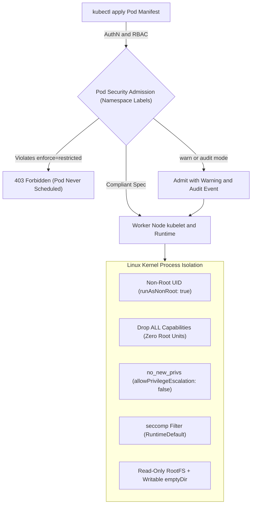
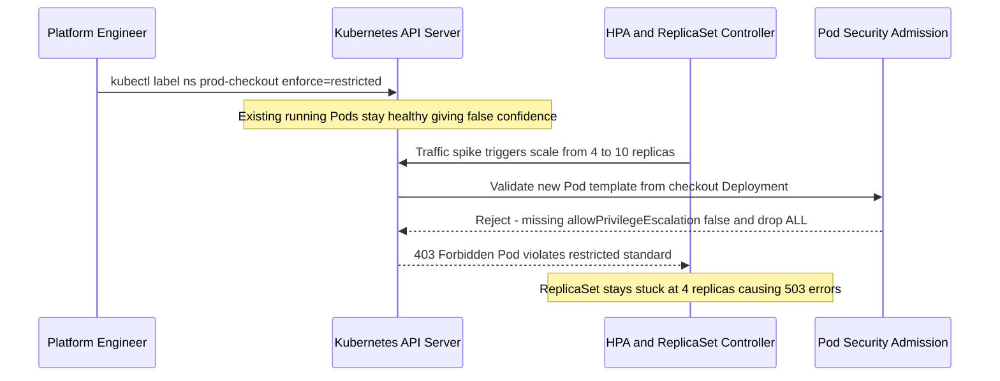

# Pod Security and Admission Control

> **Prerequisites:** Container non-root image building (`02/09`), Kubernetes RBAC and Pod manifests (`03/11`), and Threat Modeling / STRIDE fundamentals (`Module 00`).  
> **Estimated Reading Time:** 40 minutes  
> **Target Audience:** Backend Engineers, Kubernetes Operators, DevOps Engineers, Platform Security Engineers.

> [!TIP]
> **The Golden Rule of Pod Security & Admission Control:** Never treat a non-root container image as sufficient—enforce runtime isolation at the namespace admission gate via Pod Security Admission (`restricted`) after previewing blast radius with `warn`/`audit` and `--dry-run=server`, and fix write failures by mounting narrow `emptyDir` volumes rather than disabling `readOnlyRootFilesystem`.

---

## Why This Matters

`02/09` taught you to build a non-root, minimal image. But *building* an image that could run non-root doesn't stop someone from deploying it *with* root privileges, or with a `hostPath` mount that reaches the node's filesystem, or with `privileged: true` that effectively hands over the host. The image is one control; the *runtime security context* the cluster allows is another — and until now nothing in this curriculum enforced the second. This module closes that gap two ways: the per-Pod `securityContext` (what a Pod declares about itself) and **Pod Security Admission** (what the cluster *refuses to admit* in the first place). This is your first admission-control layer, and it sets up the policy-as-code depth of module 04.

---

## 1. Architectural Mental Model: Admission Gate, Namespace Labels & Kernel Isolation

Pod security spans two checkpoints: **Admission Control** in the Kubernetes API server (deciding whether a Pod manifest is even persisted into `etcd`) and **Kernel Enforcement** on the worker node (constraining the running Linux process via UID, capabilities, seccomp syscall filters, and read-only mounts).



### Core Concepts

#### `securityContext`: What a Pod Declares About How It Runs
`03/11` scoped *API* permissions with RBAC. `securityContext` is different — it constrains the *Linux process* the container runs as, at the kernel level. Set at the Pod or container level, the fields that matter most for hardening:

- `runAsNonRoot: true` — refuse to start if the image would run as UID 0, enforcing `02/09`'s non-root lesson at *runtime* even if someone forgot the `USER` line in the Dockerfile.
- `runAsUser: <uid>` / `runAsGroup: <gid>` — pin the exact UID/GID.
- `allowPrivilegeEscalation: false` — block a process from gaining more privileges than its parent (e.g. via setuid binaries) — closes a common escalation path (STRIDE's E, module 00).
- `readOnlyRootFilesystem: true` — mount the container's root filesystem read-only, so an attacker who lands code execution can't write a tool, a web-shell, or a cron job into it. Anything the app legitimately writes must go to an explicitly-mounted `emptyDir`/volume.
- `capabilities.drop: ["ALL"]` — drop all Linux capabilities and add back only the few (if any) the app truly needs. (More on capabilities next.)
- `seccompProfile.type: RuntimeDefault` — apply a syscall filter (more below).

The key mental shift: a hardened *image* and a hardened *`securityContext`* are two independent layers (defense in depth, module 00). You want both.

#### Linux Capabilities: Root's Powers, Split Into Pieces
Traditional Linux is all-or-nothing: root (UID 0) can do everything, everyone else is restricted. **Capabilities** break root's power into ~40 distinct units (`CAP_NET_BIND_SERVICE` to bind ports below 1024, `CAP_SYS_ADMIN` the famously-broad "almost-root", `CAP_CHOWN`, etc.). By default Docker/Kubernetes grant a container a subset of these — more than most apps need. Best practice is `drop: ["ALL"]` and then `add` back only the specific capability the app requires (very often *none*). A web server that binds port 8080 needs zero capabilities; one binding port 80 needs only `NET_BIND_SERVICE` — never the full default set. Fewer capabilities = smaller elevation-of-privilege surface.

#### seccomp: Filtering Which Syscalls a Container May Make
Every interaction between a program and the kernel is a **syscall**. **seccomp** (secure computing mode) installs a filter that restricts *which* syscalls a container can make, blocking the exotic ones that exploits rely on while allowing the normal ones apps use. `seccompProfile.type: RuntimeDefault` applies the container runtime's curated default profile — a large risk reduction for almost no effort, yet it's *off* unless you ask for it. This is kernel-level attack-surface reduction, the same philosophy as minimal images (`02/09`) applied to the syscall interface instead of installed packages.

#### The Dangerous Knobs: `privileged`, Host Namespaces, `hostPath`
Some Pod settings effectively dissolve the container boundary and should be treated as near-equivalent to giving away the node:

- `privileged: true` — disables most isolation; the container gets nearly full access to the host kernel and devices. A privileged container escape *is* a node compromise.
- `hostNetwork: true` / `hostPID: true` / `hostIPC: true` — share the node's network/process/IPC namespaces, so the container can see and interfere with the host and other Pods.
- `hostPath` volumes — mount a path from the *node's* filesystem into the Pod; mounting `/` or `/var/run/docker.sock` is a classic escape-to-node path.

These exist for legitimate infra Pods (CNI, monitoring — recall your module-00 surface inventory found them). The point of admission control is to ensure *only* those blessed workloads get them, never a random app Deployment.

#### Pod Security Admission (PSA) and the Three Standards
Enforcing all of the above by hand on every Pod doesn't scale. **Pod Security Admission** is a built-in Kubernetes admission controller (GA since 1.25) that enforces the **Pod Security Standards** — three predefined profiles — at the *namespace* level:

- **privileged** — no restrictions (for trusted infra workloads).
- **baseline** — blocks the most dangerous, obviously-bad settings (`privileged`, host namespaces, most `hostPath`) while staying broadly compatible with common apps.
- **restricted** — the hardened profile: requires `runAsNonRoot`, `allowPrivilegeEscalation: false`, `capabilities.drop: ["ALL"]`, a seccomp profile, and more — essentially the full `securityContext` hardening above.

You opt a namespace into a Standard with labels, and PSA acts in one of three **modes** per Standard:

- `enforce` — reject Pods that violate the Standard (hard block).
- `audit` — allow them but record a violation in the audit log.
- `warn` — allow them but return a `Warning` to the user who applied them.

You can set different Standards for different modes on the same namespace — a common rollout pattern is `warn`/`audit` at `restricted` first (to see what *would* break) while still `enforce`ing `baseline`, then tightening `enforce` to `restricted` once you've fixed the violations. This graduated approach is the same audit-then-enforce idea you'll see again in Gatekeeper (module 04) and Azure Policy (module 05).

#### PSA vs. the Old PodSecurityPolicy, and Where Gatekeeper Fits
If you read older material: **PodSecurityPolicy (PSP)** was the previous mechanism and is **removed** (gone in 1.25+). PSA replaced it. PSA is simple and built-in but *rigid* — you get exactly the three Standards, no custom rules. When you need a rule PSA doesn't express ("images must come from *our* ACR", "every Pod must have a `team` label"), you reach for a general policy engine — **OPA/Gatekeeper** (module 04) or Azure Policy's Gatekeeper-based AKS add-on (module 05). PSA handles the common Pod-hardening baseline cheaply; Gatekeeper handles everything custom. Use PSA for what it covers and Gatekeeper for the rest — they layer.

---

## 2. Taxonomic Comparison: PSA Standards, Modes & Kernel Controls

### Pod Security Standards Comparison

| Control / Setting | `privileged` | `baseline` | `restricted` |
| :--- | :--- | :--- | :--- |
| **`privileged: true`** | Allowed | Forbidden | Forbidden |
| **Host Namespaces (`hostNetwork`, `hostPID`, `hostIPC`)** | Allowed | Forbidden | Forbidden |
| **`hostPath` Volumes** | Allowed | Forbidden | Forbidden |
| **`runAsNonRoot: true`** | Optional | Optional | **Required** (cannot be UID 0) |
| **`allowPrivilegeEscalation: false`** | Optional | Optional | **Required** |
| **Linux Capabilities** | Unrestricted | Only safe subset allowed | Must `drop: ["ALL"]` (may add `NET_BIND_SERVICE` only) |
| **`seccompProfile.type`** | Unconfined allowed | `RuntimeDefault` / `Localhost` / unset | **Required** (`RuntimeDefault` or `Localhost`) |

### PSA Enforcement Modes & Safe Rollout Matrix

| PSA Mode Label | Admission Outcome on Violation | Visibility Channel | Recommended Rollout Stage |
| :--- | :--- | :--- | :--- |
| `pod-security.kubernetes.io/warn=<level>` | Admitted | Returns `Warning:` header to `kubectl` / CI client | Stage 1: Safe discovery without breaking workloads |
| `pod-security.kubernetes.io/audit=<level>` | Admitted | Emits audit annotation in Kubernetes API audit logs | Stage 1–2: Fleet-wide compliance telemetry |
| `pod-security.kubernetes.io/enforce=<level>` | **Rejected** (HTTP 403) | Rejection error detailing violated policy rule | Stage 3: Applied after `--dry-run=server` passes clean |

---

## 3. Production War Story Post-Mortem: The Unannounced `enforce=restricted` Scale-Out Outage

**Severity:** SEV-1  
**Detection Time:** 18 minutes (HPA failed to scale checkout pods during flash traffic, triggering 503 latency alerts)  
**Resolution Time:** 45 minutes  
**Impact:** `checkout-api` failed to create new Pods during peak load because an untested `enforce=restricted` namespace label rejected the ReplicaSet's Pod template.

### What Happened

To satisfy an upcoming compliance audit, a platform engineer labeled the live `prod-checkout` namespace directly with `pod-security.kubernetes.io/enforce=restricted` without running `--dry-run=server` or staging `warn`/`audit` modes first. Existing running Pods stayed alive—giving false confidence that "nothing broke." Two hours later, an HPA autoscaling event attempted to launch 6 new Pods, and the API server rejected every single Pod creation from the ReplicaSet controller.



### Root Cause Analysis

1. **Skipped Audit-Before-Enforce Rollout:** PSA does not retroactively evict already-running Pods, so flipping straight to `enforce=restricted` hides broken Deployment templates until the next rollout or HPA scale event.
2. **Missing `--dry-run=server` Verification:** Checking server dry-run or enabling `warn=restricted` first would have immediately listed every existing workload violating the `restricted` standard.
3. **Unwritten App Writable-Volume Pattern:** One sidecar also lacked `readOnlyRootFilesystem: true` handling for `/tmp`.

### The Fix & Architectural Hardening

- Temporarily moved `enforce` back to `baseline` while keeping `warn=restricted` and `audit=restricted` active to restore autoscaling immediately.
- Added `runAsNonRoot: true`, `runAsUser: 10001`, `seccompProfile: {type: RuntimeDefault}`, `allowPrivilegeEscalation: false`, `capabilities: {drop: ["ALL"]}`, and `readOnlyRootFilesystem: true` with an `emptyDir` mounted at `/tmp` to all Deployments.
- Re-verified with `kubectl label --dry-run=server --overwrite ns prod-checkout pod-security.kubernetes.io/enforce=restricted` before promoting `enforce=restricted` into GitOps.

---

## 4. Multi-Language Production Implementation: Pod `securityContext` & PSA `restricted` Validator

Before deploying manifests in CI/CD or custom admission pipelines, verifying Pod specs against the `restricted` Pod Security Standard catches violations deterministically prior to cluster apply.

````carousel
```go
package main

import (
	"fmt"
	"strings"
)

type SeccompProfile struct {
	Type string
}

type Capabilities struct {
	Drop []string
	Add  []string
}

type ContainerSecurityContext struct {
	Privileged               bool
	RunAsNonRoot             *bool
	AllowPrivilegeEscalation *bool
	ReadOnlyRootFilesystem   bool
	Capabilities             Capabilities
	SeccompProfile           *SeccompProfile
}

type PodSpec struct {
	Name        string
	HostNetwork bool
	HostPID     bool
	HostIPC     bool
	HasHostPath bool
	RunAsNonRoot *bool
	Seccomp     *SeccompProfile
	Containers  []ContainerSecurityContext
}

func ValidateRestricted(pod PodSpec) []string {
	var violations []string
	if pod.HostNetwork || pod.HostPID || pod.HostIPC {
		violations = append(violations, "host namespaces (hostNetwork/hostPID/hostIPC) are forbidden")
	}
	if pod.HasHostPath {
		violations = append(violations, "hostPath volumes are forbidden under restricted")
	}
	for idx, c := range pod.Containers {
		if c.Privileged {
			violations = append(violations, fmt.Sprintf("container[%d]: privileged=true is forbidden", idx))
		}
		nonRoot := (c.RunAsNonRoot != nil && *c.RunAsNonRoot) || (pod.RunAsNonRoot != nil && *pod.RunAsNonRoot)
		if !nonRoot {
			violations = append(violations, fmt.Sprintf("container[%d]: runAsNonRoot must be true", idx))
		}
		if c.AllowPrivilegeEscalation == nil || *c.AllowPrivilegeEscalation {
			violations = append(violations, fmt.Sprintf("container[%d]: allowPrivilegeEscalation must be false", idx))
		}
		droppedAll := false
		for _, d := range c.Capabilities.Drop {
			if strings.EqualFold(d, "ALL") {
				droppedAll = true
			}
		}
		if !droppedAll {
			violations = append(violations, fmt.Sprintf("container[%d]: capabilities.drop must include ALL", idx))
		}
		sec := c.SeccompProfile
		if sec == nil {
			sec = pod.Seccomp
		}
		if sec == nil || (sec.Type != "RuntimeDefault" && sec.Type != "Localhost") {
			violations = append(violations, fmt.Sprintf("container[%d]: seccompProfile must be RuntimeDefault or Localhost", idx))
		}
	}
	return violations
}

func main() {
	t, f := true, false
	pod := PodSpec{
		Name:         "hardened-pod",
		RunAsNonRoot: &t,
		Seccomp:      &SeccompProfile{Type: "RuntimeDefault"},
		Containers: []ContainerSecurityContext{
			{AllowPrivilegeEscalation: &f, Capabilities: Capabilities{Drop: []string{"ALL"}}, ReadOnlyRootFilesystem: true},
		},
	}
	fmt.Println("Violations:", ValidateRestricted(pod))
}
```
<!-- slide -->
```typescript
interface SecurityContext {
  privileged?: boolean;
  runAsNonRoot?: boolean;
  allowPrivilegeEscalation?: boolean;
  readOnlyRootFilesystem?: boolean;
  capabilities?: { drop?: string[]; add?: string[] };
  seccompProfile?: { type: "RuntimeDefault" | "Localhost" | "Unconfined" };
}

interface PodSpec {
  hostNetwork?: boolean;
  hostPID?: boolean;
  hostIPC?: boolean;
  volumes?: Array<{ hostPath?: unknown }>;
  securityContext?: Pick<SecurityContext, "runAsNonRoot" | "seccompProfile">;
  containers: Array<{ name: string; securityContext?: SecurityContext }>;
}

export function validatePsaRestricted(pod: PodSpec): string[] {
  const errors: string[] = [];

  if (pod.hostNetwork || pod.hostPID || pod.hostIPC) {
    errors.push("Host namespaces (hostNetwork/hostPID/hostIPC) are disallowed");
  }
  if (pod.volumes?.some((v) => v.hostPath !== undefined)) {
    errors.push("hostPath volumes are disallowed under restricted standard");
  }

  for (const c of pod.containers) {
    const sc = c.securityContext ?? {};
    if (sc.privileged) {
      errors.push(`${c.name}: privileged=true is forbidden`);
    }
    if (!(sc.runAsNonRoot ?? pod.securityContext?.runAsNonRoot)) {
      errors.push(`${c.name}: runAsNonRoot=true is required`);
    }
    if (sc.allowPrivilegeEscalation !== false) {
      errors.push(`${c.name}: allowPrivilegeEscalation=false is required`);
    }
    if (!sc.capabilities?.drop?.some((cap) => cap.toUpperCase() === "ALL")) {
      errors.push(`${c.name}: capabilities.drop must contain ALL`);
    }
    const seccomp = sc.seccompProfile ?? pod.securityContext?.seccompProfile;
    if (!seccomp || (seccomp.type !== "RuntimeDefault" && seccomp.type !== "Localhost")) {
      errors.push(`${c.name}: seccompProfile must be RuntimeDefault or Localhost`);
    }
  }

  return errors;
}
```
<!-- slide -->
```python
from dataclasses import dataclass, field
from typing import List, Optional


@dataclass(frozen=True)
class ContainerSpec:
    name: str
    privileged: bool = False
    run_as_non_root: Optional[bool] = None
    allow_privilege_escalation: Optional[bool] = None
    capabilities_drop: List[str] = field(default_factory=list)
    capabilities_add: List[str] = field(default_factory=list)
    seccomp_type: Optional[str] = None


@dataclass(frozen=True)
class PodSpec:
    host_network: bool = False
    host_pid: bool = False
    host_ipc: bool = False
    has_host_path: bool = False
    pod_run_as_non_root: Optional[bool] = None
    pod_seccomp_type: Optional[str] = None
    containers: List[ContainerSpec] = field(default_factory=list)


def validate_psa_restricted(pod: PodSpec) -> List[str]:
    violations: List[str] = []
    if pod.host_network or pod.host_pid or pod.host_ipc:
        violations.append("Host namespaces are forbidden")
    if pod.has_host_path:
        violations.append("hostPath volumes are forbidden")

    for c in pod.containers:
        if c.privileged:
            violations.append(f"{c.name}: privileged=true is forbidden")
        if not (c.run_as_non_root if c.run_as_non_root is not None else pod.pod_run_as_non_root):
            violations.append(f"{c.name}: runAsNonRoot must be true")
        if c.allow_privilege_escalation is not False:
            violations.append(f"{c.name}: allowPrivilegeEscalation must be false")
        if "ALL" not in {cap.upper() for cap in c.capabilities_drop}:
            violations.append(f"{c.name}: capabilities.drop must include ALL")
        for added in c.capabilities_add:
            if added.upper() != "NET_BIND_SERVICE":
                violations.append(f"{c.name}: capability {added} forbidden in restricted")
        seccomp = c.seccomp_type or pod.pod_seccomp_type
        if seccomp not in {"RuntimeDefault", "Localhost"}:
            violations.append(f"{c.name}: seccompProfile must be RuntimeDefault or Localhost")
    return violations
```
<!-- slide -->
```csharp
using System;
using System.Collections.Generic;
using System.Linq;

public sealed record ContainerSecurity(
    string Name,
    bool Privileged,
    bool? RunAsNonRoot,
    bool? AllowPrivilegeEscalation,
    IReadOnlyList<string> CapabilitiesDrop,
    IReadOnlyList<string> CapabilitiesAdd,
    string? SeccompType);

public sealed record PodSecuritySpec(
    bool HostNetwork,
    bool HostPid,
    bool HostIpc,
    bool HasHostPath,
    bool? PodRunAsNonRoot,
    string? PodSeccompType,
    IReadOnlyList<ContainerSecurity> Containers);

public static class PsaRestrictedValidator
{
    public static IReadOnlyList<string> Validate(PodSecuritySpec pod)
    {
        var errors = new List<string>();
        if (pod.HostNetwork || pod.HostPid || pod.HostIpc)
            errors.Add("Host namespaces (hostNetwork/hostPID/hostIPC) are forbidden");
        if (pod.HasHostPath)
            errors.Add("hostPath volumes are forbidden under restricted");

        foreach (var c in pod.Containers)
        {
            if (c.Privileged)
                errors.Add($"{c.Name}: privileged=true is forbidden");
            if (!((c.RunAsNonRoot ?? pod.PodRunAsNonRoot) == true))
                errors.Add($"{c.Name}: runAsNonRoot must be true");
            if (c.AllowPrivilegeEscalation != false)
                errors.Add($"{c.Name}: allowPrivilegeEscalation must be false");
            if (!c.CapabilitiesDrop.Any(d => d.Equals("ALL", StringComparison.OrdinalIgnoreCase)))
                errors.Add($"{c.Name}: capabilities.drop must contain ALL");
            foreach (var add in c.CapabilitiesAdd.Where(a => !a.Equals("NET_BIND_SERVICE", StringComparison.OrdinalIgnoreCase)))
                errors.Add($"{c.Name}: capability {add} is disallowed under restricted");

            var seccomp = c.SeccompType ?? pod.PodSeccompType;
            if (seccomp is not ("RuntimeDefault" or "Localhost"))
                errors.Add($"{c.Name}: seccompProfile must be RuntimeDefault or Localhost");
        }
        return errors;
    }
}
```
````

---

## 5. Practical Hands-On Verification CLI Workflows

### Command Reference & Flag Breakdowns

| Command / field | What it does | Example |
| :--- | :--- | :--- |
| `kubectl label ns <ns> pod-security.kubernetes.io/enforce=<level>` | Sets the PSA *enforce* Standard on a namespace | `kubectl label ns prod pod-security.kubernetes.io/enforce=restricted` |
| `pod-security.kubernetes.io/warn=<level>` | Sets the *warn* Standard (returns warnings, doesn't block) | `kubectl label ns prod pod-security.kubernetes.io/warn=restricted` |
| `pod-security.kubernetes.io/audit=<level>` | Sets the *audit* Standard (records violations) | `kubectl label ns prod pod-security.kubernetes.io/audit=restricted` |
| `pod-security.kubernetes.io/enforce-version=<v>` | Pins which version of the Standard to enforce | `...enforce-version=v1.29` |
| `securityContext.runAsNonRoot: true` | Refuses to start a container that would run as root | see exercise 3 |
| `securityContext.allowPrivilegeEscalation: false` | Blocks privilege escalation within the container | see exercise 3 |
| `securityContext.readOnlyRootFilesystem: true` | Makes the container root FS read-only | see exercise 5 |
| `securityContext.capabilities.drop: ["ALL"]` | Drops all Linux capabilities | see exercise 3 |
| `securityContext.seccompProfile.type: RuntimeDefault` | Applies the runtime's default syscall filter | see exercise 3 |
| `kubectl label ns <ns> ... --dry-run=server` | Previews whether existing Pods would violate a Standard before enforcing | see exercise 7 |

**Flag breakdown for `kubectl label ns prod pod-security.kubernetes.io/enforce=restricted pod-security.kubernetes.io/warn=restricted`:**
- `label ns prod` — applies labels to the `prod` namespace (PSA is configured entirely through namespace labels).
- `pod-security.kubernetes.io/enforce=restricted` — any Pod created in `prod` that violates the `restricted` Standard is *rejected* at admission.
- `pod-security.kubernetes.io/warn=restricted` — additionally return a warning to whoever applies a violating Pod; harmless to set alongside `enforce` and useful because the warning explains *which* rule failed.

**Flag breakdown for the hardened container `securityContext`:**
- `runAsNonRoot: true` — kubelet refuses to start the container if its effective user is UID 0.
- `allowPrivilegeEscalation: false` — sets `no_new_privs`, so no child process can gain privileges beyond the container's (blocks setuid escalation).
- `capabilities: { drop: ["ALL"] }` — start from *zero* Linux capabilities; add back only specific ones the app proves it needs.
- `seccompProfile: { type: RuntimeDefault }` — enable syscall filtering using the runtime's default allowlist.
- `readOnlyRootFilesystem: true` — the container can't write to its own root FS; pair with an `emptyDir` mounted at any path the app must write to.

### Hands-On Exercises

All run on your local kind cluster from track 03 — PSA is built in, no add-on needed. No Azure cost here.

1. **(WSL2) Create test namespaces at two Standards.**

```bash
kubectl create namespace psa-baseline
kubectl create namespace psa-restricted
kubectl label ns psa-baseline pod-security.kubernetes.io/enforce=baseline
kubectl label ns psa-restricted pod-security.kubernetes.io/enforce=restricted pod-security.kubernetes.io/warn=restricted
kubectl get ns --show-labels | grep psa-
```

**Expected Output:**
```text
psa-baseline     Active   4s   kubernetes.io/metadata.name=psa-baseline,pod-security.kubernetes.io/enforce=baseline
psa-restricted   Active   4s   kubernetes.io/metadata.name=psa-restricted,pod-security.kubernetes.io/enforce=restricted,pod-security.kubernetes.io/warn=restricted
```

Expect both namespaces labeled with their enforce Standard.

2. **(WSL2) Watch `baseline` block a privileged Pod.**

```bash
kubectl apply -n psa-baseline -f - <<'EOF'
apiVersion: v1
kind: Pod
metadata: {name: bad-privileged}
spec:
  containers:
    - name: c
      image: busybox:1.36
      command: ["sleep","3600"]
      securityContext: {privileged: true}
EOF
```

**Expected Output:**
```text
Error from server (Forbidden): error when creating "STDIN": pods "bad-privileged" is forbidden: violates PodSecurity "baseline:latest": privileged (container "c" must not set securityContext.privileged=true)
```

Expect the API server to *reject* it with a Pod Security violation naming `privileged`. The dangerous knob from Concepts is blocked at admission, not at runtime — it never gets scheduled.

3. **(WSL2) Watch `restricted` block an ordinary-looking Pod.** A plain Pod that's fine under `baseline` fails `restricted`:

```bash
kubectl apply -n psa-restricted -f - <<'EOF'
apiVersion: v1
kind: Pod
metadata: {name: plain-pod}
spec:
  containers:
    - name: c
      image: busybox:1.36
      command: ["sleep","3600"]
EOF
```

**Expected Output:**
```text
Error from server (Forbidden): error when creating "STDIN": pods "plain-pod" is forbidden: violates PodSecurity "restricted:latest": allowPrivilegeEscalation != false, unrestricted capabilities, runAsNonRoot != true, seccompProfile
```

Expect rejection listing multiple violations: missing `runAsNonRoot`, missing `allowPrivilegeEscalation: false`, capabilities not dropped, no seccomp profile. `restricted` demands the full hardening — a bare Pod doesn't qualify.

4. **(WSL2) Make it pass `restricted` with a proper `securityContext`.**

```bash
kubectl apply -n psa-restricted -f - <<'EOF'
apiVersion: v1
kind: Pod
metadata: {name: hardened-pod}
spec:
  securityContext:
    runAsNonRoot: true
    runAsUser: 1000
    seccompProfile: {type: RuntimeDefault}
  containers:
    - name: c
      image: busybox:1.36
      command: ["sleep","3600"]
      securityContext:
        allowPrivilegeEscalation: false
        capabilities: {drop: ["ALL"]}
        readOnlyRootFilesystem: true
EOF
kubectl get pod hardened-pod -n psa-restricted
```

**Expected Output:**
```text
pod/hardened-pod created
NAME           READY   STATUS    RESTARTS   AGE
hardened-pod   1/1     Running   0          5s
```

Expect it to be admitted and reach `Running`. This is the exact `securityContext` shape the `restricted` Standard requires — memorize its shape; you'll write it constantly.

5. **Diagnose and fix: read-only root filesystem breaks a legitimate app.** Deploy an app that writes to disk under `readOnlyRootFilesystem: true`:

```bash
kubectl apply -n psa-restricted -f - <<'EOF'
apiVersion: v1
kind: Pod
metadata: {name: writer}
spec:
  securityContext: {runAsNonRoot: true, runAsUser: 1000, seccompProfile: {type: RuntimeDefault}}
  containers:
    - name: c
      image: busybox:1.36
      command: ["sh","-c","echo data > /var/cache/out.txt && sleep 3600"]
      securityContext:
        allowPrivilegeEscalation: false
        capabilities: {drop: ["ALL"]}
        readOnlyRootFilesystem: true
EOF
kubectl logs writer -n psa-restricted
```

**Expected Output:**
```text
sh: can't create /var/cache/out.txt: Read-only file system
```

Expect a `Read-only file system` error — the app legitimately needs to write, but the root FS is locked. Diagnose: the fix is *not* to remove the hardening but to give the app a writable volume where it needs one:

```bash
kubectl delete pod writer -n psa-restricted
kubectl apply -n psa-restricted -f - <<'EOF'
apiVersion: v1
kind: Pod
metadata: {name: writer}
spec:
  securityContext: {runAsNonRoot: true, runAsUser: 1000, seccompProfile: {type: RuntimeDefault}}
  containers:
    - name: c
      image: busybox:1.36
      command: ["sh","-c","echo data > /var/cache/out.txt && sleep 3600"]
      securityContext:
        allowPrivilegeEscalation: false
        capabilities: {drop: ["ALL"]}
        readOnlyRootFilesystem: true
      volumeMounts: [{name: cache, mountPath: /var/cache}]
  volumes: [{name: cache, emptyDir: {}}]
EOF
kubectl logs writer -n psa-restricted; kubectl get pod writer -n psa-restricted
```

Expect no error and `Running`. The lesson: read-only root FS plus explicit writable mounts is the pattern — you keep the hardening *and* let the app write where it must.

6. **(WSL2) Prove capability dropping actually restricts the container.** Compare a default Pod against one with `NET_RAW` dropped by trying to ping (ping needs `CAP_NET_RAW`):

```bash
kubectl run cap-test --image=busybox:1.36 --restart=Never -n psa-baseline -- sh -c "ping -c1 127.0.0.1; sleep 3600"
kubectl logs cap-test -n psa-baseline
```

Then a version with capabilities dropped:

```bash
kubectl apply -n psa-baseline -f - <<'EOF'
apiVersion: v1
kind: Pod
metadata: {name: cap-test-dropped}
spec:
  containers:
    - name: c
      image: busybox:1.36
      command: ["sh","-c","ping -c1 127.0.0.1; sleep 3600"]
      securityContext: {capabilities: {drop: ["ALL"]}}
EOF
kubectl logs cap-test-dropped -n psa-baseline
```

**Expected Output:**
```text
ping: permission denied (are you root?)
```

Expect the first to ping successfully and the second to fail with an operation-not-permitted error — visible proof that dropping capabilities removed a real kernel power.

7. **(WSL2) Preview impact before enforcing — the safe rollout.** Before flipping an existing namespace to `restricted`, see what would break using `warn`/`dry-run`:

```bash
kubectl label --dry-run=server --overwrite ns psa-baseline pod-security.kubernetes.io/enforce=restricted
```

**Expected Output:**
```text
Warning: existing pods in namespace "psa-baseline" violate the new PodSecurity enforce level "restricted:latest"
Warning: cap-test (and 1 other pod): allowPrivilegeEscalation != false, unrestricted capabilities, runAsNonRoot != true, seccompProfile
namespace/psa-baseline labeled (server dry run)
```

Expect warnings listing existing Pods in `psa-baseline` that *would* be rejected under `restricted` — without actually enforcing it. This is the audit-then-enforce discipline: measure blast radius before you tighten.

8. **(WSL2) Clean up.**

```bash
kubectl delete namespace psa-baseline psa-restricted
```

### Independent Challenge

No YAML given — build it yourself using this module plus `02/09` (non-root images) and module 00 (defense in depth). Take a small web app image and deploy it into a namespace enforcing the `restricted` Pod Security Standard, such that the Pod is *admitted and runs correctly* while satisfying every `restricted` requirement — non-root, no privilege escalation, all capabilities dropped (add back only what it genuinely needs, if anything), seccomp `RuntimeDefault`, and a read-only root filesystem with writable volumes only where the app actually writes. Then deliberately introduce a violation (e.g. flip on `privileged` or remove `runAsNonRoot`), observe the exact admission error, and explain which STRIDE category (module 00) that blocked setting would have exposed. Finally, describe in two sentences why enforcing this at the *namespace admission* layer is stronger than merely building a non-root image — i.e., what admission control catches that image hardening alone cannot.

<details>
<summary>Stuck? One hint</summary>

Start from the passing `hardened-pod` spec in exercise 4, add your app image and a `readOnlyRootFilesystem: true` plus an `emptyDir` for its writable path (exercise 5's pattern). The reason admission beats image hardening: a non-root *image* can still be deployed *as root* or *privileged* by someone overriding the `securityContext` — namespace-level `enforce=restricted` refuses that Pod regardless of what the image intended, so it catches misconfiguration at deploy time, not just at build time.

</details>

---

## 6. Common Mistakes & Troubleshooting

- **Assuming a non-root image can't be run privileged.** The image says how it *would* run by default; a Pod spec can still request `privileged: true`, root, or host namespaces. Only admission control (`securityContext` + PSA/enforce) actually prevents that at deploy time.
- **Flipping a live namespace straight to `enforce=restricted`.** You'll reject existing workloads that don't yet meet it, causing an outage. Use `warn`/`audit`/`--dry-run=server` first to measure the blast radius, fix the workloads, then enforce.
- **Removing hardening to fix a write error.** A `readOnlyRootFilesystem` failure means add a writable `emptyDir`/volume at the path the app needs — not turn the root FS writable again. Keep the control; carve out the exception narrowly.
- **`drop: ["ALL"]` then wondering why the app broke.** Some apps need one specific capability (e.g. `NET_BIND_SERVICE` for port 80). Drop all, then `add` back the *minimum* — don't restore the whole default set.
- **Forgetting seccomp is off by default.** `RuntimeDefault` is a large, near-free win, but you must set it explicitly; a Pod with no `seccompProfile` runs `Unconfined` and fails `restricted`.
- **Expecting PSA to enforce custom rules.** PSA only knows the three fixed Standards. "Images must come from our ACR" or "every Pod needs a `team` label" require Gatekeeper (module 04) or Azure Policy (module 05) — PSA can't express them.
- **Labeling the wrong namespace / typo in the label key.** PSA is silent if the label key is misspelled — `pod-security.kubernetes.io/enforce` must be exact, or the Standard simply isn't applied and nothing is blocked.

---

## 7. Operational Validation Checkpoints

<details>
<summary><strong>Checkpoint 1: Your Dockerfile specifies `USER 10001`, so your team omits `runAsNonRoot: true` and PSA namespace labels. Why is this a gap under defense in depth?</strong></summary>

`USER 10001` in a Dockerfile is merely a build-time default. Anyone deploying a Pod manifest can override `securityContext.runAsUser: 0` or `privileged: true` at deploy time. Only Pod Security Admission (`enforce=restricted`) + `runAsNonRoot: true` guarantees the API server rejects root or privileged overrides before scheduling.

</details>

<details>
<summary><strong>Checkpoint 2: A web app container running under `restricted` binds port 80 and fails with `permission denied` after setting `capabilities.drop: ["ALL"]`. What are the two cleanest ways to fix this without weakening security?</strong></summary>

Either (a) configure the web server to listen on an unprivileged port (`>= 1024`, such as `8080`) and target it with a Kubernetes `Service` listening on port `80`, requiring **zero** capabilities; or (b) keep `drop: ["ALL"]` and add back strictly `add: ["NET_BIND_SERVICE"]` (the only added capability permitted by the `restricted` Pod Security Standard).

</details>

<details>
<summary><strong>Checkpoint 3: You label an active namespace `pod-security.kubernetes.io/enforce=restricted` and notice zero errors immediately. Does that guarantee every Deployment in that namespace is compliant?</strong></summary>

No. PSA evaluates new Pod creation/updates at admission time and does not evict already-running Pods. Non-compliant Deployments only fail later when a Pod restarts, scales up, or rolls out. Always run `kubectl label --dry-run=server --overwrite ns <ns> pod-security.kubernetes.io/enforce=restricted` (and monitor `warn`/`audit`) to catch existing violations immediately.

</details>

### Self-Test Checkpoint Quiz

Write down your answer to each question before expanding it — checking without attempting first is the single easiest way to fool yourself into thinking you've learned this.

<details>
<summary>Show questions</summary>

1. What's the difference between what a hardened *image* (`02/09`) protects and what a Pod `securityContext` protects?
2. What are the three Pod Security Standards, and what does each roughly allow or block?
3. What do PSA's three modes — `enforce`, `audit`, `warn` — each do, and why would you set more than one?
4. Why is `capabilities.drop: ["ALL"]` preferred over leaving the default capability set, and what do you do if the app needs one?
5. What does `seccompProfile.type: RuntimeDefault` do, and why does it matter that it's off by default?
6. An app fails with "read-only file system" under `restricted`. What's the correct fix, and what's the *wrong* fix?
7. When do you need Gatekeeper/Azure Policy instead of PSA?
8. Why is flipping a live namespace directly to `enforce=restricted` risky, and what's the safe rollout?

</details>

<details>
<summary>Show answers</summary>

1. A hardened image controls what's *inside* the container and how it would run by default (non-root user, minimal packages). A `securityContext` controls how the cluster actually *runs* that container as a Linux process (non-root enforced at runtime, capabilities, privilege escalation, seccomp, read-only FS) — and can be enforced even if the image or Pod author got it wrong. They're independent defense-in-depth layers.
2. `privileged` (no restrictions, for trusted infra); `baseline` (blocks the most dangerous settings like `privileged` and host namespaces while staying broadly compatible); `restricted` (the hardened profile requiring `runAsNonRoot`, no privilege escalation, all capabilities dropped, a seccomp profile, etc.).
3. `enforce` rejects violating Pods; `audit` allows them but records a violation in the audit log; `warn` allows them but returns a warning to the applier. You set more than one to roll out safely — e.g. `enforce=baseline` now while `warn`/`audit` at `restricted` to see what *would* break before tightening `enforce` to `restricted`.
4. The default capability set grants more root powers than most apps need, enlarging the elevation-of-privilege surface. Dropping all and adding back only the specific capability required (often none) is least privilege at the kernel level. If the app needs one (e.g. `NET_BIND_SERVICE` for port 80), `add` just that one back.
5. It applies the container runtime's default syscall allowlist, blocking exotic syscalls exploits rely on while allowing normal ones. It matters that it's off by default because a Pod with no `seccompProfile` runs `Unconfined` — you get this large, nearly-free hardening only if you set it explicitly (and `restricted` requires it).
6. Correct fix: add a writable volume (e.g. an `emptyDir`) mounted at the path the app writes to, keeping `readOnlyRootFilesystem: true`. Wrong fix: removing `readOnlyRootFilesystem` (or the hardening generally) to make the error go away — that discards a real control instead of carving a narrow exception.
7. When you need a rule PSA can't express — anything beyond the three fixed Standards, e.g. "images must come from our ACR", "every Pod must carry a `team` label", "no `latest` tags". Those custom rules need a general policy engine: OPA/Gatekeeper (module 04) or Azure Policy's AKS add-on (module 05).
8. Existing Pods that don't meet `restricted` are immediately rejected on any recreation/rollout, which can cause an outage. The safe rollout is to first apply `warn`/`audit=restricted` (or use `--dry-run=server`) to enumerate what would break, fix those workloads, then set `enforce=restricted`.

</details>

---

## Next

Continue to [04-policy-as-code-opa-gatekeeper](../04-policy-as-code-opa-gatekeeper/README.md) — PSA gave you three fixed profiles; now write your *own* admission rules to block the misconfigurations PSA can't express.
