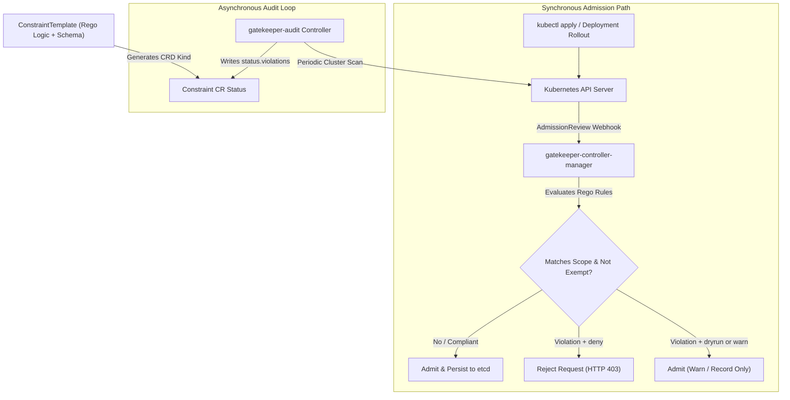
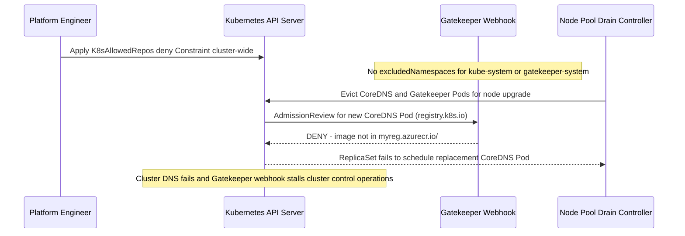

# Policy as Code: OPA/Gatekeeper

> **Prerequisites:** Kubernetes admission control and Pod Security Admission (`Module 03`), RBAC `Role`/`RoleBinding` separation (`03/11`), and container registry hygiene (`02/09`, `Module 01`).  
> **Estimated Reading Time:** 45 minutes  
> **Target Audience:** Platform Engineers, Kubernetes Administrators, DevOps Engineers, Security Engineers.

> [!TIP]
> **The Golden Rule of Policy as Code with Gatekeeper:** Always deploy new Constraints in `enforcementAction: dryrun` first, explicitly exclude critical infrastructure namespaces like `kube-system` and `gatekeeper-system`, test that known-bad Pods are *actually rejected* (preventing silent fail-open Rego bugs), and grant narrow label-based exemptions rather than deleting policies.

---

## Why This Matters

Module 03 ended on a hard limit: Pod Security Admission enforces exactly three fixed Standards and can't express a rule like "images must come from *our* ACR" or "every Pod must carry a `team` label." Real organizations have dozens of such rules, and writing them into a wiki that humans are supposed to remember is how they get ignored. **Policy as code** means those rules live as version-controlled, automatically-enforced admission logic — the same shift from "please remember to" to "the system won't let you" that PSA made, but for *arbitrary* rules you define. OPA/Gatekeeper is the de-facto Kubernetes tool for this, and it's also the engine underneath Azure Policy for AKS (module 05), so learning it here pays off twice.

---

## 1. Architectural Mental Model: Admission Webhook, Template/Constraint Split & Audit Loop

Gatekeeper operates through two coordinated loops inside `gatekeeper-system`: a synchronous **validating admission webhook** that intercepts API create/update requests in real time, and an asynchronous **audit controller** that continuously evaluates already-running cluster objects and populates `status.violations`.



### Core Concepts

#### The Admission-Controller Idea, Generalized
Module 03 introduced admission control via PSA — the API server consulting a controller before persisting an object. **Gatekeeper** is a *validating admission webhook*: the API server sends every create/update to Gatekeeper, which evaluates your policies and returns admit-or-reject. Where PSA has three built-in profiles, Gatekeeper runs *your* logic. It's built on **OPA (Open Policy Agent)**, a general-purpose policy engine, and its rules are written in a language called **Rego**. You rarely need deep Rego for common cases — Gatekeeper's `ConstraintTemplate`/`Constraint` split (below) lets you reuse parameterized templates — but knowing Rego sits underneath demystifies what's happening.

#### `ConstraintTemplate` vs. `Constraint`: The Reusable-Rule Split
Gatekeeper deliberately separates *the rule's logic* from *the rule's application*, mirroring the `Role`/`RoleBinding` split you already know from `03/11`:

- A **ConstraintTemplate** defines the *logic* (in Rego) and a *schema* of parameters — e.g. "reject any Pod using a container image whose registry isn't in an allowed list," with `allowedRegistries` as a parameter. It's a reusable definition; on its own it enforces nothing (inert until used — exactly like a `Role` with no binding, or an Ingress with no controller).
- A **Constraint** is an *instance* of a template that turns it on: it picks the template, supplies the parameter values (`allowedRegistries: ["myreg.azurecr.io"]`), and scopes *which* resources it applies to (via `match` on kinds/namespaces). This is what actually enforces.

So one `ConstraintTemplate` ("allowed registries") can back many `Constraint`s (a strict one for `prod`, a lax one for `dev`) — write the logic once, apply it many ways. This is the whole reason Gatekeeper scales where hand-written webhooks don't.

#### Enforcement Actions: `deny`, `dryrun`, `warn` — Audit Before You Block
Just like PSA's `enforce`/`audit`/`warn`, a Constraint has an `enforcementAction`:

- `deny` (default) — reject violating resources at admission (hard block).
- `dryrun` — *don't* block; only record violations in the Constraint's `status` (visible via `kubectl get <constraint> -o yaml`). This is how you measure "what would this policy break?" against a live cluster *before* turning it on.
- `warn` — allow but return a warning to the applier.

The disciplined rollout is identical to module 03's: deploy a new policy as `dryrun`, look at the audit results to find legitimate workloads it would wrongly block, adjust the policy or add exemptions, *then* switch to `deny`. Shipping a `deny` policy straight to prod without a `dryrun` pass is how you cause an outage with a security control — the irony every platform team learns once.

#### Audit Mode: Continuous Evaluation of *Existing* Objects
Admission only checks objects *as they're created or updated*. But a policy you add today should also tell you about the violating objects *already* in the cluster. Gatekeeper's **audit** runs periodically, evaluates all existing resources against every Constraint, and writes violations into each Constraint's `status.violations`. So `dryrun` + audit together answer "how bad is it right now?" without blocking anything — essential for adopting policy on a cluster that's already running real workloads.

#### Exemptions: When a Legitimate Workload Must Break the Rule
Real clusters always have a legitimate exception — the monitoring agent that genuinely needs `hostPath`, the ingress controller that genuinely needs a privileged port. Blanket policies that can't be exempted get disabled. The right pattern is a *narrow, explicit, auditable* exemption rather than turning the policy off. In Gatekeeper you scope exemptions through the Constraint's `match` block:

- `match.namespaces` / `excludedNamespaces` — apply to (or skip) specific namespaces (commonly exclude `kube-system` and other infra namespaces).
- `match.labelSelector` — apply only to resources with (or without) a label, so you can exempt a specific workload by labeling it explicitly.

The key security principle: an exemption should be *specific and visible in the policy*, so it's reviewable, not a global "off switch." This module's diagnose-and-fix exercise is exactly this scenario.

#### Where Gatekeeper Fits with PSA and Azure Policy
Layering, not replacing: **PSA** cheaply enforces the common Pod-hardening baseline (module 03). **Gatekeeper** enforces your *custom* rules PSA can't express. **Azure Policy for AKS** (module 05) is Gatekeeper *managed by Azure* — Azure installs the Gatekeeper add-on and ships a library of built-in ConstraintTemplates you assign as Azure policies, giving you the same enforcement plus central Azure-side reporting across many clusters. So the Rego/Constraint concepts here are the exact foundation module 05 builds on; you're learning the engine before you learn its managed wrapper.

---

## 2. Taxonomic Comparison: Policy Engines, Enforcement Actions & Scoping

### PSA vs. Self-Managed OPA/Gatekeeper vs. Azure Policy for AKS

| Dimension | Pod Security Admission (Module 03) | OPA / Gatekeeper (Module 04) | Azure Policy for AKS (Module 05) |
| :--- | :--- | :--- | :--- |
| **Rule Expressiveness** | Fixed 3 Standards (`privileged`, `baseline`, `restricted`) | Arbitrary custom logic in Rego + parameterized CRDs | Built-in Azure ConstraintTemplates powered by Gatekeeper |
| **Setup & Ownership** | Built into Kubernetes API server (labels only) | You install/upgrade webhook & write/maintain Rego | Azure-managed add-on + central Azure compliance portal |
| **Existing Workload Audit** | `--dry-run=server` & API audit annotations | Continuous `gatekeeper-audit` populating `status.violations` | Fleet-wide compliance posture across subscriptions |
| **Best Role in Stack** | Baseline kernel isolation (`non-root`, `seccomp`, `caps`) | Org-specific rules (`ACR-only`, `team` label, no `:latest`) | Multi-cluster governance & cloud control-plane guardrails |

### Gatekeeper Enforcement Actions & Exemption Scopes

| Mechanism | Behavior on Violation | Operational Use Case |
| :--- | :--- | :--- |
| **`enforcementAction: dryrun`** | Admits object; records mismatch in `status.violations` | Mandatory Stage 1 rollout to measure cluster blast radius |
| **`enforcementAction: warn`** | Admits object; returns warning string to `kubectl`/CI | Stage 2 developer feedback before hard blocking |
| **`enforcementAction: deny`** | Rejects admission request (HTTP 403) | Final enforcement after audit violations are remediated/exempted |
| **`match.excludedNamespaces`** | Skips listed namespaces entirely | Protecting `kube-system`, `gatekeeper-system`, CNI/monitoring |
| **`match.labelSelector`** | Evaluates only objects matching expression (e.g. `DoesNotExist`) | Surgical, auditable exemption for a single approved workload |

---

## 3. Production War Story Post-Mortem: The Self-Inflicted `kube-system` Lockout

**Severity:** SEV-1  
**Detection Time:** 12 minutes (DNS lookups and webhook calls timed out across worker nodes during a routine node upgrade)  
**Resolution Time:** 55 minutes  
**Impact:** A cluster-wide `K8sAllowedRepos` Constraint in `deny` mode lacked `excludedNamespaces: ["kube-system", "gatekeeper-system"]`, blocking CoreDNS and Gatekeeper webhook Pods from recreating during node drain.

### What Happened

An engineer wrote a `K8sAllowedRepos` Constraint enforcing `repos: ["myreg.azurecr.io/"]` across all `Pod` resources cluster-wide with `enforcementAction: deny`—skipping `dryrun` and omitting `excludedNamespaces`. Immediately after, a node pool upgrade drained a worker node. When Kubernetes tried to reschedule `coredns` (`registry.k8s.io/coredns/...`) and `gatekeeper-controller-manager` (`openpolicyagent/gatekeeper`), Gatekeeper's own webhook blocked them because their images came from upstream registries, not `myreg.azurecr.io/`.



### Root Cause Analysis

1. **Missing Infrastructure Namespace Exclusions:** System namespaces (`kube-system`, `gatekeeper-system`, CNI namespaces) run upstream vendor images that cannot be blindly constrained by app-tier policies.
2. **Skipped `dryrun` + Audit Measurement:** Deploying straight to `deny` hid dozens of legitimate cluster-infra Pods that violated the rule.
3. **No Validated Known-Bad / Known-Good Test Gate:** The policy was applied directly to production without verifying exemption scopes in a staging kind/AKS cluster.

### The Fix & Architectural Hardening

- Deleted the broken Constraint (`kubectl delete K8sAllowedRepos only-acr`) to unblock CoreDNS scheduling and restore cluster DNS immediately.
- Re-deployed with `enforcementAction: dryrun`, `excludedNamespaces: ["kube-system", "gatekeeper-system"]`, and a narrow `labelSelector` (`registry-exempt` `DoesNotExist`) for approved platform ingress controllers.
- Added automated CI validation that tests every new `ConstraintTemplate` + `Constraint` against both a **compliant Pod** (must admit) and a **known-bad Pod** (must reject, proving Rego does not fail open).

---

## 4. Multi-Language Production Implementation: Gatekeeper Constraint Evaluator Simulator

In CI pipelines or admission unit-test suites, modeling Gatekeeper's exact evaluation pipeline—namespace scope matching, `labelSelector` exemptions (`DoesNotExist`), Rego-style violation predicates, and `deny`/`dryrun`/`warn` outcomes—catches fail-open policy bugs before cluster deployment.

````carousel
```go
package main

import (
	"fmt"
	"strings"
)

type EnforcementAction string

const (
	ActionDeny   EnforcementAction = "deny"
	ActionDryrun EnforcementAction = "dryrun"
	ActionWarn   EnforcementAction = "warn"
)

type PodManifest struct {
	Name       string
	Namespace  string
	Labels     map[string]string
	Containers []string // image strings
}

type AllowedReposConstraint struct {
	Action             EnforcementAction
	IncludedNamespaces map[string]bool
	ExcludedNamespaces map[string]bool
	ExemptLabelKey     string
	AllowedPrefixes    []string
}

func (c AllowedReposConstraint) Evaluate(pod PodManifest) (admitted bool, violations []string) {
	if c.ExcludedNamespaces[pod.Namespace] {
		return true, nil
	}
	if len(c.IncludedNamespaces) > 0 && !c.IncludedNamespaces[pod.Namespace] {
		return true, nil
	}
	if c.ExemptLabelKey != "" {
		if _, exempt := pod.Labels[c.ExemptLabelKey]; exempt {
			return true, nil
		}
	}

	for _, img := range pod.Containers {
		ok := false
		for _, prefix := range c.AllowedPrefixes {
			if strings.HasPrefix(img, prefix) {
				ok = true
				break
			}
		}
		if !ok {
			violations = append(violations, fmt.Sprintf("image %s is not from an allowed registry", img))
		}
	}

	if len(violations) > 0 && c.Action == ActionDeny {
		return false, violations
	}
	return true, violations
}

func main() {
	policy := AllowedReposConstraint{
		Action:             ActionDeny,
		IncludedNamespaces: map[string]bool{"policy-lab": true},
		ExcludedNamespaces: map[string]bool{"kube-system": true, "gatekeeper-system": true},
		ExemptLabelKey:     "registry-exempt",
		AllowedPrefixes:    []string{"myreg.azurecr.io/"},
	}

	exemptPod := PodManifest{Name: "legit-ingress", Namespace: "policy-lab", Labels: map[string]string{"registry-exempt": "true"}, Containers: []string{"registry.k8s.io/ingress-nginx/controller:v1.11.0"}}
	badPod := PodManifest{Name: "still-blocked", Namespace: "policy-lab", Labels: map[string]string{"team": "data"}, Containers: []string{"docker.io/library/redis:7"}}

	fmt.Println("Exempt admitted:", func() bool { ok, _ := policy.Evaluate(exemptPod); return ok }())
	ok, errs := policy.Evaluate(badPod)
	fmt.Println("Bad admitted:", ok, "Violations:", errs)
}
```
<!-- slide -->
```typescript
type EnforcementAction = "deny" | "dryrun" | "warn";

interface PodManifest {
  readonly name: string;
  readonly namespace: string;
  readonly labels: Readonly<Record<string, string>>;
  readonly images: readonly string[];
}

interface AllowedReposConstraint {
  readonly action: EnforcementAction;
  readonly includedNamespaces: ReadonlySet<string>;
  readonly excludedNamespaces: ReadonlySet<string>;
  readonly exemptLabelKey?: string;
  readonly allowedPrefixes: readonly string[];
}

export function evaluateAllowedRepos(
  constraint: AllowedReposConstraint,
  pod: PodManifest
): { admitted: boolean; violations: string[] } {
  if (constraint.excludedNamespaces.has(pod.namespace)) {
    return { admitted: true, violations: [] };
  }
  if (constraint.includedNamespaces.size > 0 && !constraint.includedNamespaces.has(pod.namespace)) {
    return { admitted: true, violations: [] };
  }
  if (constraint.exemptLabelKey && pod.labels[constraint.exemptLabelKey] !== undefined) {
    return { admitted: true, violations: [] };
  }

  const violations: string[] = [];
  for (const image of pod.images) {
    if (!constraint.allowedPrefixes.some((prefix) => image.startsWith(prefix))) {
      violations.push(`image ${image} is not from an allowed registry`);
    }
  }

  const admitted = !(violations.length > 0 && constraint.action === "deny");
  return { admitted, violations };
}
```
<!-- slide -->
```python
from dataclasses import dataclass, field
from typing import Dict, FrozenSet, List, Optional, Tuple


@dataclass(frozen=True)
class PodManifest:
    name: str
    namespace: str
    labels: Dict[str, str]
    images: List[str]


@dataclass(frozen=True)
class AllowedReposConstraint:
    action: str  # "deny" | "dryrun" | "warn"
    allowed_prefixes: List[str]
    included_namespaces: FrozenSet[str] = field(default_factory=frozenset)
    excluded_namespaces: FrozenSet[str] = field(default_factory=lambda: frozenset({"kube-system", "gatekeeper-system"}))
    exempt_label_key: Optional[str] = "registry-exempt"

    def evaluate(self, pod: PodManifest) -> Tuple[bool, List[str]]:
        if pod.namespace in self.excluded_namespaces:
            return True, []
        if self.included_namespaces and pod.namespace not in self.included_namespaces:
            return True, []
        if self.exempt_label_key and self.exempt_label_key in pod.labels:
            return True, []

        violations: List[str] = []
        for img in pod.images:
            if not any(img.startswith(prefix) for prefix in self.allowed_prefixes):
                violations.append(f"image {img} is not from an allowed registry")

        admitted = not (violations and self.action == "deny")
        return admitted, violations
```
<!-- slide -->
```csharp
using System;
using System.Collections.Generic;
using System.Linq;

public enum EnforcementAction { Deny, Dryrun, Warn }

public sealed record PodManifest(
    string Name,
    string Namespace,
    IReadOnlyDictionary<string, string> Labels,
    IReadOnlyList<string> Images);

public sealed record AllowedReposConstraint(
    EnforcementAction Action,
    IReadOnlyList<string> AllowedPrefixes,
    IReadOnlySet<string> IncludedNamespaces,
    IReadOnlySet<string> ExcludedNamespaces,
    string? ExemptLabelKey = "registry-exempt")
{
    public (bool Admitted, IReadOnlyList<string> Violations) Evaluate(PodManifest pod)
    {
        if (ExcludedNamespaces.Contains(pod.Namespace))
            return (true, Array.Empty<string>());
        if (IncludedNamespaces.Count > 0 && !IncludedNamespaces.Contains(pod.Namespace))
            return (true, Array.Empty<string>());
        if (!string.IsNullOrEmpty(ExemptLabelKey) && pod.Labels.ContainsKey(ExemptLabelKey))
            return (true, Array.Empty<string>());

        var violations = pod.Images
            .Where(img => !AllowedPrefixes.Any(prefix => img.StartsWith(prefix, StringComparison.Ordinal)))
            .Select(img => $"image {img} is not from an allowed registry")
            .ToList();

        bool admitted = !(violations.Count > 0 && Action == EnforcementAction.Deny);
        return (admitted, violations);
    }
}
```
````

---

## 5. Practical Hands-On Verification CLI Workflows

### Command Reference & Flag Breakdowns

| Command | What it does | Example |
| :--- | :--- | :--- |
| `kubectl apply -f gatekeeper.yaml` | Installs Gatekeeper (CRDs + controller) into the cluster | see exercise 1 |
| `kubectl get constrainttemplates` | Lists installed policy *templates* (the reusable logic) | `kubectl get constrainttemplates` |
| `kubectl get constraints` | Lists all Constraint instances across every template kind | `kubectl get constraints` |
| `kubectl get <ConstraintKind> <name> -o yaml` | Shows a Constraint's config *and* its audit `status.violations` | `kubectl get K8sAllowedRepos repo-is-acr -o yaml` |
| `kubectl describe <ConstraintKind> <name>` | Human-readable view including current violations | `kubectl describe K8sRequiredLabels must-have-team` |
| `enforcementAction: dryrun` | Makes a Constraint report-only (audit) instead of blocking | see exercise 5 |
| `spec.match.kinds` / `match.namespaces` / `match.excludedNamespaces` | Scopes which resources a Constraint applies to (and exemptions) | see exercise 6 |
| `spec.parameters` | Supplies the template's parameter values (allowed repos, required labels) | see exercise 3 |

**Flag breakdown for a `Constraint`'s key fields (from exercise 3/6):**
- `apiVersion: constraints.gatekeeper.sh/v1beta1` + `kind: K8sAllowedRepos` — the Constraint's kind is *the name declared by its ConstraintTemplate*, not a generic `Constraint` — installing a template creates a new CRD kind.
- `spec.enforcementAction: deny` — reject violations at admission (`dryrun` = report only, `warn` = allow with warning).
- `spec.match.kinds: [{apiGroups: [""], kinds: ["Pod"]}]` — evaluate this Constraint only against `Pod` objects.
- `spec.match.namespaces` / `excludedNamespaces` — restrict enforcement to (or exempt) named namespaces; excluding `kube-system` is standard so you don't block cluster infra.
- `spec.match.labelSelector` — further narrow by label, the mechanism for exempting a specifically-labeled workload.
- `spec.parameters` — the values the template's Rego reads (e.g. `repos: ["myreg.azurecr.io/"]`).

### Hands-On Exercises

All on your local kind cluster from track 03 — no Azure cost. Gatekeeper installs as a set of Pods.

1. **(WSL2) Install Gatekeeper.**

```bash
kubectl apply -f https://raw.githubusercontent.com/open-policy-agent/gatekeeper/v3.16.0/deploy/gatekeeper.yaml
kubectl get pods -n gatekeeper-system
```

**Expected Output:**
```text
NAME                                             READY   STATUS    RESTARTS   AGE
gatekeeper-audit-5d8f4c89b6-2xk9p                1/1     Running   0          40s
gatekeeper-controller-manager-6c99d95664-7l2mn   1/1     Running   0          40s
```

Expect the `gatekeeper-controller-manager` and `gatekeeper-audit` Pods to reach `Running`. This installs the CRDs (`ConstraintTemplate`, plus the machinery to create Constraint kinds) and the admission webhook.

2. **(WSL2) Create a namespace and a policy-free baseline.**

```bash
kubectl create namespace policy-lab
kubectl run pre-policy --image=nginx:latest -n policy-lab
kubectl get pod pre-policy -n policy-lab
```

Expect it to run — `nginx:latest` from Docker Hub, no policy yet. You'll block exactly this kind of "not from our registry / uses `latest`" image next.

3. **(WSL2) Write a ConstraintTemplate that requires a `team` label.** This is a rule PSA cannot express:

```bash
kubectl apply -f - <<'EOF'
apiVersion: templates.gatekeeper.sh/v1
kind: ConstraintTemplate
metadata:
  name: k8srequiredlabels
spec:
  crd:
    spec:
      names: {kind: K8sRequiredLabels}
      validation:
        openAPIV3Schema:
          type: object
          properties:
            labels: {type: array, items: {type: string}}
  targets:
    - target: admission.k8s.gatekeeper.sh
      rego: |
        package k8srequiredlabels
        violation[{"msg": msg}] {
          required := input.parameters.labels
          provided := input.review.object.metadata.labels
          missing := required[_]
          not provided[missing]
          msg := sprintf("missing required label: %v", [missing])
        }
EOF
kubectl get constrainttemplates
```

Expect `k8srequiredlabels` listed. Note it enforces *nothing* yet — it's the reusable logic, inert until a Constraint uses it (the Role-without-binding pattern).

4. **(WSL2) Create the Constraint that turns the rule on.**

```bash
kubectl apply -f - <<'EOF'
apiVersion: constraints.gatekeeper.sh/v1beta1
kind: K8sRequiredLabels
metadata:
  name: pods-must-have-team
spec:
  enforcementAction: deny
  match:
    kinds: [{apiGroups: [""], kinds: ["Pod"]}]
    namespaces: ["policy-lab"]
  parameters:
    labels: ["team"]
EOF
```

Now test both paths:

```bash
kubectl run no-label --image=nginx:latest -n policy-lab
kubectl run with-label --image=nginx:latest -n policy-lab --labels team=payments
```

**Expected Output:**
```text
Error from server (Forbidden): admission webhook "validation.gatekeeper.sh" denied the request: [pods-must-have-team] missing required label: team
pod/with-label created
```

Expect `no-label` to be *rejected* with `missing required label: team`, and `with-label` to succeed. You just enforced a rule PSA has no concept of.

5. **(WSL2) See dryrun/audit mode measure impact without blocking.** Switch the Constraint to `dryrun` and check what it *would* flag among existing Pods:

```bash
kubectl patch K8sRequiredLabels pods-must-have-team --type merge -p '{"spec":{"enforcementAction":"dryrun"}}'
kubectl run would-fail --image=nginx:latest -n policy-lab   # succeeds now, under dryrun
sleep 60   # let the audit loop run
kubectl get K8sRequiredLabels pods-must-have-team -o jsonpath='{.status.violations}' | head
```

Expect `would-fail` (and `pre-policy` from exercise 2) to be *admitted* but *listed in `status.violations`*. This is the pre-enforcement measurement: you can see everything the policy would block, on a running cluster, without blocking anything.

6. **Diagnose and fix: a policy blocking a legitimate deployment, resolved with a targeted exemption.** Write an allowed-registry policy in `deny` mode:

```bash
kubectl apply -f - <<'EOF'
apiVersion: templates.gatekeeper.sh/v1
kind: ConstraintTemplate
metadata: {name: k8sallowedrepos}
spec:
  crd:
    spec:
      names: {kind: K8sAllowedRepos}
      validation:
        openAPIV3Schema:
          type: object
          properties:
            repos: {type: array, items: {type: string}}
  targets:
    - target: admission.k8s.gatekeeper.sh
      rego: |
        package k8sallowedrepos
        violation[{"msg": msg}] {
          container := input.review.object.spec.containers[_]
          satisfied := [good | repo := input.parameters.repos[_]; good := startswith(container.image, repo)]
          not any(satisfied)
          msg := sprintf("image %v is not from an allowed registry", [container.image])
        }
EOF
kubectl apply -f - <<'EOF'
apiVersion: constraints.gatekeeper.sh/v1beta1
kind: K8sAllowedRepos
metadata: {name: only-acr}
spec:
  enforcementAction: deny
  match:
    kinds: [{apiGroups: [""], kinds: ["Pod"]}]
    namespaces: ["policy-lab"]
  parameters:
    repos: ["myreg.azurecr.io/"]
EOF
```

Now a *legitimate* need arises: you must run the official `ingress-nginx` controller image (from `registry.k8s.io`, not your ACR) in this namespace. Reproduce the block:

```bash
kubectl run legit-ingress --image=registry.k8s.io/ingress-nginx/controller:v1.11.0 -n policy-lab --labels team=platform
```

**Expected Output:**
```text
Error from server (Forbidden): admission webhook "validation.gatekeeper.sh" denied the request: [only-acr] image registry.k8s.io/ingress-nginx/controller:v1.11.0 is not from an allowed registry
```

Expect rejection: `image ... is not from an allowed registry`. **Wrong fix:** delete the policy (removes protection for everything). **Right fix:** a narrow, explicit exemption — label the legitimate workload and exclude that label from the Constraint's `match`:

```bash
kubectl patch K8sAllowedRepos only-acr --type merge -p '{"spec":{"match":{"labelSelector":{"matchExpressions":[{"key":"registry-exempt","operator":"DoesNotExist"}]}}}}'
kubectl run legit-ingress --image=registry.k8s.io/ingress-nginx/controller:v1.11.0 -n policy-lab --labels team=platform,registry-exempt=true
```

Expect the exempted Pod (carrying `registry-exempt=true`) to be admitted, while any *un*labeled off-registry Pod is still blocked:

```bash
kubectl run still-blocked --image=docker.io/library/redis:7 -n policy-lab --labels team=data
```

Expect `still-blocked` rejected. The policy stayed on; only a specific, labeled, reviewable workload was let through — exemption, not off-switch.

7. **(WSL2) Confirm the audit view of remaining violations.**

```bash
kubectl get K8sAllowedRepos only-acr -o jsonpath='{.status.violations}' | head
```

Expect any still-non-compliant existing Pods listed — Gatekeeper's audit continuously reporting drift, not just blocking new creates.

8. **(WSL2) Clean up.**

```bash
kubectl delete namespace policy-lab
kubectl delete K8sRequiredLabels pods-must-have-team 2>/dev/null; true
kubectl delete K8sAllowedRepos only-acr 2>/dev/null; true
kubectl delete constrainttemplate k8srequiredlabels k8sallowedrepos
# Optional: remove Gatekeeper entirely
# kubectl delete -f https://raw.githubusercontent.com/open-policy-agent/gatekeeper/v3.16.0/deploy/gatekeeper.yaml
```

### Independent Challenge

No full policy given — build it yourself using this module plus `02/09` (why `latest` and unknown registries are risks) and module 03 (audit-before-enforce discipline). On your Gatekeeper-enabled cluster, author a policy that blocks container images using the `:latest` tag (or no tag) in a target namespace — a real misconfiguration, since `latest` is a moving target you can't reason about or roll back. Roll it out the disciplined way: deploy it in `dryrun` first, use the audit `status.violations` to enumerate every existing Pod it would break, then switch to `deny` and prove a `:latest` Pod is rejected while a pinned-tag Pod is admitted. Finally, introduce one legitimate workload that *must* use `latest` (pretend it's a vendor image with no pinned tag) and grant it a narrow, labeled exemption rather than weakening the policy — proving the exemption works while an unlabeled `:latest` Pod is still blocked.

<details>
<summary>Stuck? One hint</summary>

The Rego check is roughly: for each container, `endswith(container.image, ":latest")` OR the image contains no `:` at all (untagged defaults to `latest`) -> violation. Structure it as a `ConstraintTemplate` (the logic) plus a `Constraint` (matching `Pod` in your namespace, `enforcementAction: dryrun` first). For the exemption, reuse exercise 6's pattern: a `labelSelector` with `operator: DoesNotExist` on an exemption label, and put that label only on the one blessed workload.

</details>

---

## 6. Common Mistakes & Troubleshooting

- **Creating a ConstraintTemplate and expecting enforcement.** The template is inert logic — nothing happens until you create a Constraint *instance* of it (the Role-without-binding trap from `03/11`, again).
- **Shipping a `deny` policy straight to prod.** Without a `dryrun`/audit pass you can't see which legitimate workloads it breaks — and a security control causing an outage is how policy-as-code gets a bad reputation. Always `dryrun` first.
- **Disabling a whole policy to unblock one workload.** That removes protection for everything. Use a narrow, labeled, reviewable exemption via `match` instead — specific and visible in the policy.
- **Forgetting to exclude infra namespaces.** A cluster-wide `deny` policy that also selects `kube-system`/`gatekeeper-system` can block the very system Pods that keep the cluster (and Gatekeeper) running. Exclude infra namespaces explicitly.
- **Expecting audit results instantly.** Gatekeeper's audit runs on an interval (tens of seconds by default); `status.violations` populates after the next cycle, not the moment you apply the Constraint.
- **Assuming Gatekeeper replaces PSA.** They layer: PSA for the cheap built-in Pod-hardening baseline, Gatekeeper for custom rules PSA can't express. Most clusters run both.
- **Rego typos failing open, not closed.** A broken Rego rule may evaluate to "no violation" and silently admit everything — always *test that a known-bad object is actually rejected*, not just that a good one passes.

---

## 7. Operational Validation Checkpoints

<details>
<summary><strong>Checkpoint 1: You apply a new `K8sNoLatestTag` ConstraintTemplate and verify `kubectl get constrainttemplates` shows it Ready, yet `kubectl run bad --image=nginx:latest` is still admitted. Why?</strong></summary>

A `ConstraintTemplate` only defines reusable Rego logic and creates a CRD schema—it does not enforce anything on its own. You must apply a corresponding `Constraint` instance (e.g., `kind: K8sNoLatestTag`) specifying `enforcementAction: deny` and `spec.match` targets before admission requests are evaluated.

</details>

<details>
<summary><strong>Checkpoint 2: After deploying an untested Rego Constraint, you test a valid Pod and confirm it is admitted. Why is your policy still unsafe for production?</strong></summary>

Testing only a compliant Pod cannot detect **fail-open** Rego logic bugs (such as referencing a misspelled JSON field like `input.review.object.spec.container` instead of `containers`). Always test both a known-good Pod (must succeed) and a known-bad Pod (must be explicitly rejected with your violation message).

</details>

<details>
<summary><strong>Checkpoint 3: A vendor sidecar image must pull from `docker.io/vendor/agent:1.2` in a namespace enforcing `K8sAllowedRepos` (`myreg.azurecr.io/`). How do you unblock it safely?</strong></summary>

Do not delete the `Constraint` or add `docker.io/` globally. Instead, configure `spec.match.labelSelector.matchExpressions` with an explicit exemption key (e.g., `registry-exempt` `DoesNotExist`) on the Constraint and apply `registry-exempt: "true"` strictly to that vendor workload—keeping all other Pods locked to `myreg.azurecr.io/`.

</details>

### Self-Test Checkpoint Quiz

Write down your answer to each question before expanding it — checking without attempting first is the single easiest way to fool yourself into thinking you've learned this.

<details>
<summary>Show questions</summary>

1. What does Gatekeeper add that Pod Security Admission (module 03) cannot do?
2. What's the relationship between a ConstraintTemplate and a Constraint, and which one actually enforces anything?
3. What does `enforcementAction: dryrun` do, and why is it the right first step for any new policy?
4. What does Gatekeeper's audit provide beyond admission-time checks?
5. A legitimate workload must violate a policy. What's the right way to let it through, and what's the wrong way?
6. Why should a cluster-wide `deny` Constraint usually exclude `kube-system`?
7. How does Gatekeeper relate to Azure Policy for AKS (a preview of module 05)?
8. Why is "the good Pod was admitted" an insufficient test of a new policy?

</details>

<details>
<summary>Show answers</summary>

1. Custom, arbitrary admission rules PSA has no concept of — e.g. "images must come from our ACR", "every Pod must have a `team` label", "no `:latest` tags". PSA only enforces its three fixed Pod Security Standards; Gatekeeper runs your own Rego logic.
2. A ConstraintTemplate defines the reusable rule logic (in Rego) plus a parameter schema and declares a new Constraint *kind*; a Constraint is an instance of that template that supplies parameter values and a `match` scope. Only the Constraint enforces — the template alone is inert (like a Role with no RoleBinding).
3. `dryrun` makes the Constraint report-only: it records what it *would* block in `status.violations` without rejecting anything. It's the right first step because it measures the policy's real blast radius against live workloads, so you can fix or exempt legitimate breakages before switching to `deny`.
4. Audit periodically re-evaluates *existing* resources (not just newly created/updated ones) against every Constraint and writes matches into `status.violations` — so it surfaces already-running non-compliant objects and ongoing drift, which admission-time checks alone would never catch.
5. Right: a narrow, explicit exemption scoped in the Constraint's `match` (e.g. an exemption label the workload carries, or an excluded namespace) so it's specific, reviewable, and leaves the policy protecting everything else. Wrong: deleting or disabling the whole policy, which removes protection for all workloads to accommodate one.
6. Because a cluster-wide `deny` that also selects `kube-system` can reject the system Pods that keep the cluster (and Gatekeeper itself) running, potentially breaking the cluster. Infra namespaces host workloads that legitimately need powers your policy forbids, so they're normally excluded.
7. Azure Policy for AKS *is* Gatekeeper managed by Azure — Azure installs the Gatekeeper add-on and provides a library of built-in ConstraintTemplates you assign as Azure policies, adding central Azure-side reporting across clusters. The Rego/Constraint concepts here are exactly what module 05 builds on.
8. Because a broken or too-narrow Rego rule can fail *open* — evaluate to "no violation" and admit everything, including bad objects. You must verify a known-bad object is actually *rejected*; only testing that a good object passes can hide a policy that isn't really enforcing anything.

</details>

---

## Next

Continue to [05-azure-policy-and-governance-guardrails](../05-azure-policy-and-governance-guardrails/README.md) — take the admission-control idea up to the Azure control plane, enforcing guardrails across whole subscriptions, not just one cluster.
