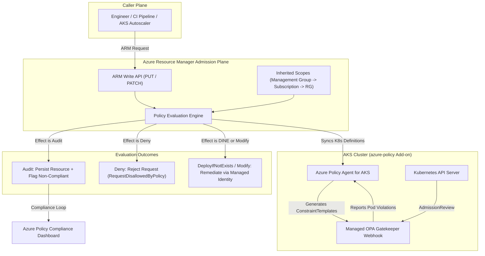
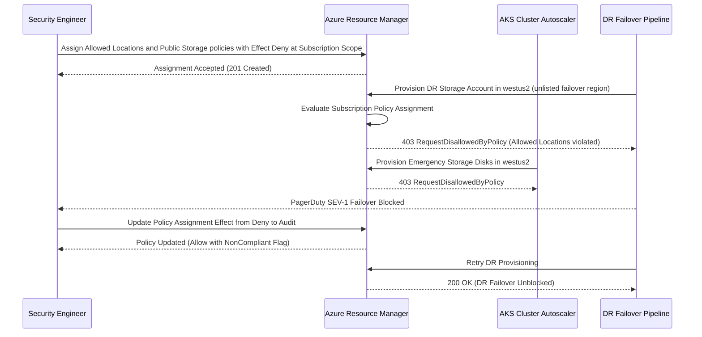

# Azure Policy and Governance Guardrails

> **Prerequisites:** Module 04 (OPA Gatekeeper & Admission Control), Module 00 (Shared Responsibility & Threat Modeling), Azure CLI authenticated to a target subscription, and an AKS cluster (`rg-aks-learn` / `aks-learn` from Track 07).  
> **Estimated Reading Time:** 35 minutes  
> **Target Audience:** Backend Engineers, Cloud Platform Engineers, DevSecOps Engineers, Kubernetes Operators.

> [!TIP]
> **The Golden Rule of Azure Policy & Cloud Governance:** Always roll out new guardrails in `Audit` mode before flipping to `Deny`, never expect `Deny` to delete pre-existing non-compliant resources, grant explicit RBAC permissions to `DeployIfNotExists` managed identities, and combine Azure Policy with in-cluster Gatekeeper (or bridge them via the `azure-policy` AKS add-on) because each protects a distinct trust boundary.

---

## Why This Matters

Gatekeeper (module 04) enforced rules *inside one cluster*. But your risks don't stop at the cluster boundary — an unencrypted storage account, a public IP on a database, a VM with no disk encryption, or a resource deployed in a non-approved region are all misconfigurations at the *Azure control plane*, below Kubernetes entirely. **Azure Policy** is admission control for Azure itself: it evaluates and can *block* or *auto-remediate* resource configurations across whole subscriptions, using the exact same audit-then-enforce discipline you just learned. Its AKS integration is literally Gatekeeper under the hood — so this module is both a new layer (the cloud control plane) and a managed wrapper around a tool you already understand. This is a light preview of governance-at-scale; track 17 owns the multi-subscription, landing-zone architecture.

---

## 1. Architectural Mental Model: Cloud Admission Control & Managed Gatekeeper

When any user, CI pipeline, or Kubernetes controller creates or updates an Azure resource, Azure Resource Manager (ARM) intercepts the request and evaluates all policy assignments scoped to that resource's hierarchy (Management Group, Subscription, Resource Group) before persisting state. For AKS clusters with the `azure-policy` add-on enabled, Azure Policy also syncs Kubernetes-scoped definitions down to an in-cluster Gatekeeper engine:



### Core Concepts

#### Azure Policy Is Admission Control for the Cloud Control Plane
Every concept from module 04 maps almost one-to-one onto Azure. When you create or update an Azure resource, Resource Manager checks it against every policy assigned to its scope *before* persisting it — the same admission model, just at the Azure API instead of the Kubernetes API. You already understand the mental model; this is applying it one layer down (or up, depending on how you look at it).

#### Built-In Definitions vs. Custom
Azure ships hundreds of **built-in policy definitions** for common governance needs — "Storage accounts should prevent public access", "Allowed locations", "AKS clusters should not allow privileged containers". You mostly *assign* built-ins rather than write your own; writing a custom definition (JSON with a `policyRule` of `if`/`then`) is possible but rarely needed early. This is a deliberate contrast with Gatekeeper, where you wrote the Rego yourself — Azure's library means governance is often assembly, not authoring.

#### Effects: `Audit`, `Deny`, `DeployIfNotExists`, and Friends
A policy's **effect** is what it does when a resource matches its condition — the Azure analog of Gatekeeper's enforcement action, but richer:

- **`Audit`** — allow the resource but mark it *non-compliant* for reporting. The observe-only mode; the Azure equivalent of `dryrun`. Always start here.
- **`Deny`** — reject the create/update outright (the hard guardrail). The Azure equivalent of Gatekeeper `deny`.
- **`DeployIfNotExists` (`DINE`)** — the effect with no Gatekeeper equivalent: if a required related resource or config is missing, Azure *automatically deploys* it (for example, "if a subnet has no NSG, deploy one" or "enable diagnostic settings if absent"). This is *remediation*, not just prevention — Azure fixes drift for you. DINE assignments run under a managed identity you grant permissions to, since they *write* resources.
- **`AuditIfNotExists`**, **`Modify`**, **`Disabled`** — audit a related resource, alter a property on write, and turn a policy off respectively.

The effect you choose determines whether a policy *reports*, *blocks*, or *fixes* — making it the single most important field on any assignment.

#### Assignments, Scope, and the Compliance Loop
A **policy assignment** applies a definition (or initiative) to a **scope**: a management group, a subscription, or a resource group. Scope determines blast radius — assign at subscription level and every resource group inherits it (the same inheritance you saw with `az role assignment list --all` in module 00). After assignment, Azure runs a **compliance evaluation** (on a schedule, and on resource changes) and reports each resource as `Compliant` or `NonCompliant` — your cloud-wide "what's the state right now" view, exactly like Gatekeeper's audit. Note the timing: a new assignment can take up to ~30 minutes to show initial compliance results, and `Deny` only applies to *future* create/update operations — it never deletes existing non-compliant resources, only reports them.

#### Initiatives (Policy Sets): Bundling Policies into a Standard
Enforcing a security standard usually means *many* related policies. An **initiative** (also called a **policy set**) bundles a group of definitions under one assignable unit with shared parameters — assign the whole thing once instead of dozens of policies individually. Azure ships large built-in initiatives (such as the Azure Security Benchmark / Microsoft Cloud Security Benchmark, CIS, and regulatory compliance sets). This is the building block track 17 scales up to management-group-wide governance; here you meet the concept and inspect one.

#### Azure Policy for AKS = Managed Gatekeeper
This is the payoff for module 04. Azure Policy has an **AKS add-on** that installs Gatekeeper into your cluster and translates a set of built-in Azure policy definitions into Gatekeeper `ConstraintTemplate` and `Constraint` objects automatically. Policies like "Kubernetes cluster should not allow privileged containers" or "should not allow the `:latest` image tag" are enforced *by Gatekeeper in the cluster*, while *managed and reported through Azure Policy* — giving you one compliance dashboard across many clusters instead of operating raw Gatekeeper on each. Everything you learned in module 04 about audit-before-deny and narrow exemptions still applies; Azure just wraps it. This is the shared-responsibility trade-off (module 00) again: less to operate, at the cost of Azure's opinionated built-in set.

---

## 2. Taxonomic Comparison: Gatekeeper Mapping, Effects & Scope

### Gatekeeper vs. Azure Policy Concept Mapping

| Gatekeeper (Module 04) | Azure Policy (Module 05) | Operational Difference |
| :--- | :--- | :--- |
| **`ConstraintTemplate`** (reusable Rego logic) | **Policy Definition** | Gatekeeper requires authoring Rego; Azure Policy favors assigning hundreds of built-ins |
| **`Constraint`** (instance + scope) | **Policy Assignment** | Azure assignments bind to Management Group, Subscription, or Resource Group scopes |
| **`enforcementAction: deny` / `dryrun`** | **Policy Effect:** `Deny` / `Audit` | Azure adds `Modify` and `DeployIfNotExists` for automated drift remediation |
| **`match`** (which K8s resources) | **Assignment Scope + Parameters** | ARM scope inheritance flows downward automatically unless explicitly excluded |
| **Audit `status.violations`** | **Compliance Results (`NonCompliant`)** | Azure Policy compliance evaluation runs periodically (up to ~30 min initial delay) |

### Policy Effects Behavior Matrix

| Effect | Blocks Bad Write? | Alters or Deploys Resources? | Cleans Up Pre-Existing Drift? | Requires Managed Identity? | Primary Use Case |
| :--- | :--- | :--- | :--- | :--- | :--- |
| **`Audit`** | No | No | No (reports `NonCompliant`) | No | Safe initial rollout and blast-radius measurement |
| **`Deny`** | Yes (`RequestDisallowed`) | No | No (only stops future writes) | No | Hard guardrails (public blob access, disallowed regions) |
| **`Modify`** | No | Yes (mutates properties on write + remediation) | Yes (via remediation task) | Yes | Enforcing mandatory cost-center or owner tags |
| **`DeployIfNotExists`** | No | Yes (deploys child/related resources) | Yes (via remediation task) | Yes | Auto-attaching NSGs, diagnostic settings, backup policies |
| **`AuditIfNotExists`** | No | No | No (reports missing companion resource) | No | Auditing missing diagnostic logs or Defender configs |
| **`Disabled`** | No | No | No | No | Temporarily suspending an assignment without deleting it |

---

## 3. Command Reference & Flag Breakdown

| Command | What it does | Example |
| :--- | :--- | :--- |
| `az policy definition list --query "[?policyType=='BuiltIn']"` | Lists built-in policy definitions | `az policy definition list --query "[?policyType=='BuiltIn'].displayName" -o tsv` |
| `az policy assignment create` | Assigns a definition/initiative to a scope with an effect/params | See flag breakdown below |
| `az policy assignment list` | Lists assignments at/under a scope | `az policy assignment list --scope /subscriptions/<sub> -o table` |
| `az policy state list` | Shows compliance state of resources against assignments | `az policy state list --filter "complianceState eq 'NonCompliant'" -o table` |
| `az policy state summarize` | Summarizes compliance counts for a scope | `az policy state summarize --subscription <sub>` |
| `az policy set-definition list` | Lists initiatives (policy sets) | `az policy set-definition list --query "[?policyType=='BuiltIn'].displayName" -o tsv` |
| `az policy remediation create` | Triggers remediation for a `DeployIfNotExists`/`Modify` assignment | `az policy remediation create --name fix --policy-assignment <id>` |
| `az aks enable-addons -a azure-policy` | Installs the Azure Policy (Gatekeeper) add-on on AKS | `az aks enable-addons -g rg-aks-learn -n aks-learn -a azure-policy` |

### Flag Breakdown: `az policy assignment create`

For `az policy assignment create --name deny-public-blob --policy <definition-id> --scope /subscriptions/<sub>/resourceGroups/rg-sec-lab --params '{"effect":{"value":"Audit"}}'`:

- **`--name deny-public-blob`** — a unique name for this assignment (how you find, update, or delete it later).
- **`--policy <definition-id>`** — the definition (built-in or custom) being assigned; for an initiative you use `--policy-set-definition` instead.
- **`--scope .../resourceGroups/rg-sec-lab`** — the blast radius; scoping to one resource group keeps a lab contained rather than hitting the whole subscription.
- **`--params '{"effect":{"value":"Audit"}}'`** — overrides the definition's `effect` parameter to `Audit` (report-only) for a safe first pass; you promote it to `Deny` after reviewing compliance. Not every definition exposes `effect` as a parameter — some hardcode it.

### Flag Breakdown: `az aks enable-addons`

For `az aks enable-addons -g rg-aks-learn -n aks-learn -a azure-policy`:

- **`enable-addons -a azure-policy`** — installs the Azure Policy add-on, which deploys Gatekeeper into the cluster and syncs Azure-managed policies down as Constraints.
- After enabling this add-on, AKS-scoped built-in policies you assign are enforced *by Gatekeeper* in-cluster while reported *in Azure Policy compliance* — the managed-Gatekeeper model.

---

## 4. Production War Story Post-Mortem: Unmeasured Subscription-Wide `Deny` Halts Regional Failover

- **Severity:** SEV-1
- **Detection Time:** 4 minutes (automated DR drill pipeline and AKS node autoscaler failures)
- **Resolution Time:** 38 minutes
- **Impact:** Disaster-recovery storage provisioning and emergency AKS node-pool scale-out in `westus2` failed during a failover test; 14 production deployments stalled until the policy assignment was reverted to `Audit`.

### What Happened



### Root Cause Analysis

1. **Skipped Audit-First Discipline:** A security engineer applied an `Allowed locations` policy directly with `effect: Deny` at the subscription root without running an `Audit` phase to discover legitimate secondary DR regions (`westus2`) used by AKS and backup pipelines.
2. **Overly Broad Blast Radius:** Applying an untested `Deny` directly at subscription scope blocked every resource group underneath immediately, bypassing staging validation.
3. **Hidden Existing Drift:** Several legacy storage accounts already in `westus2` were unaffected (giving false confidence right after assignment), while all *new* DR resources failed at write time.

### The Fix & Architectural Hardening

- **Mandatory Audit Window:** All new Azure Policy definitions and initiatives deploy in `Audit` mode for a minimum 7-day observation window at a canary resource group before promotion to `Deny`.
- **Policy-as-Code Promotion Pipeline:** Parameterized assignments in Bicep/Terraform enforce a code-reviewed parameter file listing approved primary **and** paired DR regions (`eastus`, `westus2`) alongside documented RG exemptions.
- **Automated Pre-Flight Check:** CI deployment pipelines query `az policy state list` after canary deployment to measure non-compliance counts before enforcement flips to `Deny`.

---

## 5. Multi-Language Production Implementation: Policy Compliance Auditor & Remediation Gate

Production platforms regularly verify Azure Policy compliance states programmatically inside release gates and governance bots before promoting assignments from `Audit` to `Deny` or triggering `DeployIfNotExists` remediation tasks.

````carousel
```go
package governance

import (
	"context"
	"fmt"

	"github.com/Azure/azure-sdk-for-go/sdk/azidentity"
	"github.com/Azure/azure-sdk-for-go/sdk/resourcemanager/policyinsights/armpolicyinsights"
)

type ComplianceViolation struct {
	ResourceID   string
	PolicyName   string
	PolicyAction string
}

// AuditResourceGroupCompliance inspects Azure Policy state within a resource group scope
// before promoting an assignment from Audit to Deny.
func AuditResourceGroupCompliance(ctx context.Context, subscriptionID, resourceGroup string) ([]ComplianceViolation, error) {
	cred, err := azidentity.NewDefaultAzureCredential(nil)
	if err != nil {
		return nil, fmt.Errorf("failed to initialize azure credential: %w", err)
	}

	clientFactory, err := armpolicyinsights.NewClientFactory(subscriptionID, cred, nil)
	if err != nil {
		return nil, fmt.Errorf("failed to create policy insights factory: %w", err)
	}

	filter := "ComplianceState eq 'NonCompliant'"
	pager := clientFactory.NewPolicyStatesClient().NewListQueryResultsForResourceGroupPager(
		armpolicyinsights.PolicyStatesResourceDefault,
		subscriptionID,
		resourceGroup,
		&armpolicyinsights.PolicyStatesClientListQueryResultsForResourceGroupOptions{
			Filter: &filter,
		},
	)

	var violations []ComplianceViolation
	for pager.More() {
		page, err := pager.NextPage(ctx)
		if err != nil {
			return nil, fmt.Errorf("querying policy states failed: %w", err)
		}
		for _, state := range page.Value {
			if state.ResourceID == nil || state.PolicyAssignmentName == nil {
				continue
			}
			action := "unknown"
			if state.PolicyDefinitionAction != nil {
				action = *state.PolicyDefinitionAction
			}
			violations = append(violations, ComplianceViolation{
				ResourceID:   *state.ResourceID,
				PolicyName:   *state.PolicyAssignmentName,
				PolicyAction: action,
			})
		}
	}
	return violations, nil
}
```
<!-- slide -->
```typescript
import { DefaultAzureCredential } from "@azure/identity";
import { PolicyInsightsClient } from "@azure/arm-policyinsights";

export interface PolicyDriftItem {
  resourceId: string;
  assignmentName: string;
  effect: string;
  isBlocking: boolean;
}

/**
 * Evaluates NonCompliant Azure Policy states in a resource group and verifies
 * whether an Audit-mode guardrail has zero drift prior to Deny promotion.
 */
export async function checkAuditReadiness(
  subscriptionId: string,
  resourceGroupName: string,
  targetAssignment: string
): Promise<{ readyForDeny: boolean; drift: PolicyDriftItem[] }> {
  const credential = new DefaultAzureCredential();
  const client = new PolicyInsightsClient(credential, subscriptionId);

  const drift: PolicyDriftItem[] = [];
  const results = client.policyStates.listQueryResultsForResourceGroup(
    "latest",
    subscriptionId,
    resourceGroupName,
    { queryOptions: { filter: "ComplianceState eq 'NonCompliant'" } }
  );

  for await (const state of results) {
    if (!state.resourceId || !state.policyAssignmentName) continue;
    if (state.policyAssignmentName !== targetAssignment) continue;

    const effect = state.policyDefinitionAction ?? "audit";
    drift.push({
      resourceId: state.resourceId,
      assignmentName: state.policyAssignmentName,
      effect,
      isBlocking: effect.toLowerCase() === "deny",
    });
  }

  return {
    readyForDeny: drift.length === 0,
    drift,
  };
}
```
<!-- slide -->
```python
from dataclasses import dataclass
from typing import List
from azure.identity import DefaultAzureCredential
from azure.mgmt.policyinsights import PolicyInsightsClient
from azure.mgmt.policyinsights.models import QueryOptions


@dataclass(frozen=True)
class PolicyViolation:
    resource_id: str
    assignment_name: str
    effect: str


def evaluate_rg_compliance(
    subscription_id: str, resource_group: str
) -> List[PolicyViolation]:
    """Queries Azure Policy Insights for NonCompliant resources in a resource group."""
    credential = DefaultAzureCredential()
    client = PolicyInsightsClient(credential)

    query_opts = QueryOptions(filter="ComplianceState eq 'NonCompliant'")
    states = client.policy_states.list_query_results_for_resource_group(
        policy_states_resource="latest",
        subscription_id=subscription_id,
        resource_group_name=resource_group,
        query_options=query_opts,
    )

    violations: List[PolicyViolation] = []
    for state in states:
        if not state.resource_id or not state.policy_assignment_name:
            continue
        violations.append(
            PolicyViolation(
                resource_id=state.resource_id,
                assignment_name=state.policy_assignment_name,
                effect=(state.policy_definition_action or "audit").lower(),
            )
        )
    return violations
```
<!-- slide -->
```csharp
using System;
using System.Collections.Generic;
using System.Threading;
using System.Threading.Tasks;
using Azure.Core;
using Azure.Identity;
using Azure.ResourceManager;
using Azure.ResourceManager.PolicyInsights;
using Azure.ResourceManager.PolicyInsights.Models;

namespace GovernanceGuardrails
{
    public sealed record PolicyViolationRecord(
        string ResourceId,
        string AssignmentName,
        string Effect
    );

    public static class PolicyComplianceAuditor
    {
        /// <summary>
        /// Lists all non-compliant Azure resources inside a resource group scope
        /// to validate Audit-to-Deny promotion readiness.
        /// </summary>
        public static async Task<IReadOnlyList<PolicyViolationRecord>> GetViolationsAsync(
            string subscriptionId,
            string resourceGroupName,
            CancellationToken ct = default)
        {
            var armClient = new ArmClient(new DefaultAzureCredential());
            var rgId = new ResourceIdentifier(
                $"/subscriptions/{subscriptionId}/resourceGroups/{resourceGroupName}");

            var options = new PolicyQuerySettings
            {
                Filter = "ComplianceState eq 'NonCompliant'"
            };

            var violations = new List<PolicyViolationRecord>();
            await foreach (PolicyState state in armClient.GetPolicyStatesForResourceGroupAsync(
                PolicyStatesResourceType.Latest, rgId, options, ct))
            {
                if (string.IsNullOrEmpty(state.ResourceId) ||
                    string.IsNullOrEmpty(state.PolicyAssignmentName))
                {
                    continue;
                }

                violations.Add(new PolicyViolationRecord(
                    state.ResourceId,
                    state.PolicyAssignmentName,
                    state.PolicyDefinitionAction ?? "audit"));
            }

            return violations;
        }
    }
}
```
````

---

## 6. Practical Hands-On Verification CLI Workflows

These exercises use real Azure. Policy *assignments* are free; the AKS add-on runs Gatekeeper Pods on your existing cluster (small cost while the cluster runs). Scope everything to a throwaway resource group and clean up when done. Reuse `rg-aks-learn` / `aks-learn` from track 07 where noted.

### 1. (Azure) Create a Lab Resource Group and Browse Built-Ins

```bash
az group create --name rg-sec-lab --location eastus
az policy definition list \
  --query "[?policyType=='BuiltIn' && contains(displayName,'Storage account')].{name:name, display:displayName}" \
  -o table | head
```

**Expected Output:**
```text
Name                                  Display
------------------------------------  ------------------------------------------------------------
...                                   Storage account public access should be disallowed
...                                   Storage accounts should restrict network access using virtual network rules
```

You see a catalog of built-in storage policies — governance guardrails you can assign immediately without authoring custom JSON or Rego.

### 2. (Azure) Assign a Policy in `Audit` Mode First

Find the "Storage account public access should be disallowed" built-in and assign it as `Audit`:

```bash
DEF=$(az policy definition list \
  --query "[?policyType=='BuiltIn' && displayName=='Storage account public access should be disallowed'].name" \
  -o tsv)

az policy assignment create --name audit-public-blob \
  --policy "$DEF" \
  --scope $(az group show -n rg-sec-lab --query id -o tsv) \
  --params '{"effect":{"value":"Audit"}}'
```

*(If that exact display name isn't found in your tenant region, pick any storage built-in with an `effect` parameter and adapt.)*

**Expected Output:**
```text
{
  "displayName": null,
  "enforcementMode": "Default",
  "id": "/subscriptions/<sub-id>/resourceGroups/rg-sec-lab/providers/Microsoft.Authorization/policyAssignments/audit-public-blob",
  "name": "audit-public-blob",
  "parameters": {
    "effect": {
      "value": "Audit"
    }
  }
}
```

Audit-first is the module-04 discipline applied to Azure.

### 3. (Azure) Create a Non-Compliant Resource and Observe Reporting

```bash
az storage account create --name secpubtest$RANDOM \
  --resource-group rg-sec-lab \
  --allow-blob-public-access true \
  --sku Standard_LRS 2>/dev/null || echo "created (or name taken; retry)"

# Compliance evaluation is not instant — wait, then check:
az policy state summarize --resource-group rg-sec-lab -o table
```

**Expected Output:** (after the evaluation delay, up to ~30 min)
```text
PolicyAssignmentName    ComplianceState    Count
----------------------  -----------------  -------
audit-public-blob       NonCompliant       1
```

Expect the storage account to be **allowed** on write and reported as **Non-compliant** — the difference between `Audit` and `Deny` made concrete.

### 4. (Azure) Promote the Same Policy to `Deny` and Prove It Blocks

Update the assignment's effect to `Deny` and test creating a new public storage account:

```bash
az policy assignment update --name audit-public-blob \
  --scope $(az group show -n rg-sec-lab --query id -o tsv) \
  --params '{"effect":{"value":"Deny"}}'

# Allow a few minutes for the effect change to propagate, then test:
az storage account create --name secdeny$RANDOM \
  --resource-group rg-sec-lab \
  --allow-blob-public-access true \
  --sku Standard_LRS
```

**Expected Output:**
```text
ERROR: (RequestDisallowedByPolicy) Resource 'secdeny...' was disallowed by policy.
Policy identifiers: '[{"policyAssignment":{"name":"audit-public-blob",...}}]'
```

Notice that `Deny` **blocked the new create**, yet it did *not* delete the pre-existing `secpubtest...` account from Exercise 3 — `Deny` only blocks *future* creates/updates; existing drift stays reported until remediated.

### 5. (Azure) Explore an Initiative (Policy Set)

```bash
az policy set-definition list \
  --query "[?policyType=='BuiltIn'].displayName" \
  -o tsv | grep -i benchmark | head
```

**Expected Output:**
```text
Microsoft cloud security benchmark
```

Do not assign the full benchmark initiative to a real subscription in a lab (it spans hundreds of policies); observe how security standards ship as initiatives — the assignable unit track 17 scales up.

### 6. (Azure / AKS) Enable Azure Policy for AKS (Managed Gatekeeper)

On your track-07 cluster:

```bash
az aks enable-addons -g rg-aks-learn -n aks-learn -a azure-policy
kubectl get pods -n gatekeeper-system
kubectl get constrainttemplates | head
```

**Expected Output:**
```text
NAME                                            READY   STATUS    RESTARTS   AGE
gatekeeper-audit-...                            1/1     Running   0          2m
gatekeeper-controller-manager-...               1/1     Running   0          2m

NAME                                                AGE
k8sazurev1blockhostfilesystem                       2m
k8sazurev2noprivilegeescalation                     2m
k8sazurev3allowedcapabilities                       2m
```

Azure installed and populated Gatekeeper *for* you. Compare directly to module 04, where you installed and wrote Rego templates by hand: same engine, managed wrapper.

### 7. Diagnose and Fix: An Assignment That "Isn't Working"

You assign an AKS-scoped built-in (e.g., "Kubernetes cluster should not allow privileged containers") in `Audit` mode and observe it reports nothing even though a privileged Pod exists. Two common causes to inspect:
- **(a)** Compliance hasn't evaluated yet — Azure Policy for AKS syncs and evaluates on an interval, so wait and re-check `az policy state list`.
- **(b)** The assignment's scope doesn't actually cover the cluster's resource group.

Diagnose by confirming scope and state directly against the AKS resource ID:

```bash
az policy assignment list --scope $(az aks show -g rg-aks-learn -n aks-learn --query id -o tsv) -o table
az policy state list --resource $(az aks show -g rg-aks-learn -n aks-learn --query id -o tsv) -o table
```

Fix by assigning at the correct scope (the cluster's resource group or subscription) and waiting for the sync/evaluation cycle. The lesson mirrors module 04's "audit results aren't instant" — Azure's cycle is *longer* (minutes to tens of minutes), and "no results yet" is usually timing or scope, not a broken policy.

### 8. (Azure) Clean Up

```bash
az policy assignment delete --name audit-public-blob --scope $(az group show -n rg-sec-lab --query id -o tsv) 2>/dev/null; true
az group delete --name rg-sec-lab --yes --no-wait
# Optionally remove the AKS add-on if you don't want managed Gatekeeper running:
# az aks disable-addons -g rg-aks-learn -n aks-learn -a azure-policy
```

Expect the lab RG (and its non-compliant storage account) to be deleted.

### Independent Challenge

No commands given — build it yourself using this module plus module 04 (audit-then-enforce, exemptions) and module 00 (shared responsibility, risk). Choose one real, defensible governance guardrail for an Azure environment — for example "all resources must be deployed only in approved regions", "storage accounts must not allow public access", or "AKS clusters must not run privileged containers" — and take it from idea to enforced control the disciplined way. Assign the appropriate built-in definition scoped to a lab resource group in `Audit`, create a violating resource, and confirm it's reported `NonCompliant`. Then promote the effect to `Deny`, prove a new violation is blocked, and articulate why the previously-created non-compliant resource is still *reported but not removed*. Finally, explain in two or three sentences how this Azure-control-plane guardrail complements — rather than duplicates — the in-cluster Gatekeeper policy you wrote in module 04, referring to which layer of your module-00 data-flow diagram each one protects.

<details>
<summary>Stuck? One hint</summary>

Find the built-in with `az policy definition list`, assign it with `--params '{"effect":{"value":"Audit"}}'` scoped to your lab RG, then `az policy assignment update` the effect to `Deny`. The complement point: Gatekeeper (04) guards *what gets deployed inside a cluster* (the Kubernetes API boundary); Azure Policy guards *what Azure resources exist at all* (the cloud control-plane boundary) — e.g. Gatekeeper can't stop someone creating a public storage account, and Azure Policy can't stop a privileged Pod unless the AKS add-on bridges them. Different trust boundaries, layered defense.

</details>

---

## 7. Common Mistakes & Troubleshooting

- **Assigning `Deny` first and causing failed deployments.** Start every guardrail in `Audit`, review compliance, then promote to `Deny` — the same audit-then-enforce rule as Gatekeeper. A `Deny` you didn't measure can break legitimate provisioning across a whole scope.
- **Expecting `Deny` to clean up existing resources.** It only blocks *new/updated* resources; pre-existing non-compliant ones are *reported*, not deleted. Remediating existing drift needs `DeployIfNotExists`/`Modify` with a remediation task, or manual fixes.
- **Panicking when compliance shows nothing immediately.** Evaluation runs on a schedule (and can take up to ~30 minutes for a new assignment) — "no results yet" is usually timing, not a broken policy. Trigger/await evaluation before concluding.
- **Wrong scope.** A policy assigned to the wrong resource group or subscription simply doesn't see the resources you expect. Confirm the assignment scope actually contains the target resource.
- **Forgetting DINE needs a managed identity with permissions.** A `DeployIfNotExists` assignment *writes* resources, so it runs as a managed identity that must be granted the right role, or remediation silently fails.
- **Assuming the AKS add-on enforces everything instantly.** It's Gatekeeper underneath with an Azure sync loop — Constraints and compliance take a cycle to propagate, and audit-before-deny still applies.
- **Treating Azure Policy and Gatekeeper as interchangeable.** They guard different boundaries (cloud control plane vs. Kubernetes API). You generally want both; neither sees what the other governs unless the AKS add-on bridges them.

---

## 8. Operational Validation Checkpoints

<details>
<summary><strong>Checkpoint 1: Post-Deny Storage Drift Mystery</strong></summary>

**Scenario:** Your team promoted the "Storage account public access should be disallowed" policy from `Audit` to `Deny` at the subscription level on Monday. On Wednesday, an auditor flags a production storage account in `rg-payments` with `allowBlobPublicAccess: true`, and your teammate insists Azure Policy is broken. How do you explain and resolve this?

**Diagnosis & Remediation:** `Deny` only prevents *new* creations or *updates* that fail policy evaluation — it never deletes or modifies pre-existing non-compliant resources. Check the storage account's creation timestamp (`az storage account show` / Activity Log) against Monday's promotion time, and verify `az policy assignment list --scope <storage-id>` confirms no RG exclusion exists. Remediate the legacy account explicitly (via `Modify` remediation task or manual/IaC configuration change to `allowBlobPublicAccess: false`).

</details>

<details>
<summary><strong>Checkpoint 2: Silent `DeployIfNotExists` Remediation Failure</strong></summary>

**Scenario:** You assigned a built-in `DeployIfNotExists` policy requiring Diagnostic Settings on all Key Vaults, and triggered `az policy remediation create`, yet none of your existing Key Vaults receive diagnostic settings and the remediation task shows `Failed` with `AuthorizationFailed`. What happened?

**Diagnosis & Remediation:** Unlike `Audit` and `Deny`, `DeployIfNotExists` and `Modify` policies actively create or mutate Azure resources via an assigned Managed Identity. When assigning via CLI/IaC without granting the assignment's managed identity the required RBAC role (e.g., `Monitoring Contributor` + `Key Vault Contributor` or the role defined inside `policyRule.then.details.roleDefinitionIds`), Azure Resource Manager rejects the remediation write. Assign the required RBAC role to the policy assignment's principal ID at the target scope and re-run `az policy remediation create`.

</details>

<details>
<summary><strong>Checkpoint 3: Unreported Privileged Pods on AKS</strong></summary>

**Scenario:** You assigned "Kubernetes cluster should not allow privileged containers" in `Audit` mode to `rg-aks-learn` and immediately deployed a privileged debug Pod into `aks-learn`. Five minutes later, `az policy state list` shows zero `NonCompliant` results. Why?

**Diagnosis & Remediation:** First verify the `azure-policy` add-on is actually installed and its Gatekeeper pods are healthy (`az aks show -g rg-aks-learn -n aks-learn --query addonProfiles.azurepolicy` and `kubectl get pods -n gatekeeper-system`). Without the add-on, Azure Policy cannot inspect Kubernetes API objects. Second, even with the add-on enabled, the Azure Policy for AKS agent syncs assignments and reports compliance back on a multi-minute interval (typically 15–30 minutes for initial evaluation), so verify synced constraints via `kubectl get constraints` and allow the evaluation cycle to complete before debugging scope.

</details>

---

## 9. Checkpoint Quiz & Cumulative Review

Write down your answer to each question before expanding it — checking without attempting first is the single easiest way to fool yourself into thinking you've learned this.

### Checkpoint Quiz

<details>
<summary>Show questions</summary>

1. Map Azure Policy's concepts onto Gatekeeper's: what's the Azure equivalent of a ConstraintTemplate, a Constraint, and `enforcementAction: dryrun`?
2. What do the effects `Audit`, `Deny`, and `DeployIfNotExists` each do, and which has no Gatekeeper equivalent?
3. Does a `Deny` policy remove existing non-compliant resources? Explain.
4. What is an initiative (policy set), and why use one?
5. What does the Azure Policy AKS add-on actually install and do, and how does it relate to module 04?
6. Your new assignment shows no compliance results and blocks nothing. Give the two most likely explanations and how you'd check each.
7. Why do you generally want *both* Azure Policy and in-cluster Gatekeeper rather than picking one?

</details>

<details>
<summary>Show answers</summary>

1. ConstraintTemplate → policy **definition** (reusable logic); Constraint → policy **assignment** (definition applied to a scope with parameters); `dryrun` → the **Audit** effect (report-only, no blocking).
2. `Audit` allows the resource but marks it non-compliant for reporting; `Deny` rejects the create/update outright; `DeployIfNotExists` automatically deploys a missing required resource/config (remediation). `DeployIfNotExists` has no Gatekeeper equivalent — Gatekeeper can block or warn but doesn't deploy fixes.
3. No. `Deny` only blocks new or updated resources at write time; resources that already exist and violate the policy are reported as non-compliant but not deleted. Removing/fixing existing drift requires remediation (DINE/Modify) or manual action.
4. An initiative bundles many policy definitions into one assignable unit with shared parameters, so you can assign a whole security standard (e.g. the Microsoft Cloud Security Benchmark) at once instead of dozens of individual policies. It's the building block for governance at scale (track 17).
5. It installs Gatekeeper into the AKS cluster and syncs a set of Azure-managed built-in policy definitions down as Gatekeeper ConstraintTemplates/Constraints, enforcing them in-cluster while reporting compliance through Azure Policy. It's the managed wrapper around exactly the Gatekeeper engine you installed and configured by hand in module 04.
6. (a) Compliance simply hasn't evaluated yet — Azure Policy evaluates on a schedule (up to ~30 min for a new assignment); check again later or trigger evaluation with `az policy state list`. (b) The assignment's scope doesn't cover the target resource — verify with `az policy assignment list --scope <resource-id>` that the assignment actually applies to that resource's scope.
7. They guard different trust boundaries: Azure Policy governs which *Azure resources* can exist/how they're configured (the cloud control plane, e.g. public storage, allowed regions), while in-cluster Gatekeeper governs what *Kubernetes objects* can be admitted (the K8s API, e.g. privileged Pods). Neither sees the other's domain unless the AKS add-on bridges them, so defense in depth wants both.

</details>

### Cumulative Review (Modules 00–05)

Closed-book. Don't reopen earlier modules while attempting these — the point is to find out what actually stuck. These mix modules 00–05 of this track with the baseline from tracks 02/03/07.

1. You now have four admission/enforcement layers: image scanning gate (module 01), Pod Security Admission (03), Gatekeeper (04), and Azure Policy (05). For each, state *where* in the request path it acts and *one* thing it catches that the others cannot.
2. Trace a single misconfiguration — "someone deploys a privileged container built from an unscanned `:latest` image into a prod namespace" — and name, in order, every control across modules 01–05 that could stop it and at which stage each would fire.
3. Explain the audit-then-enforce pattern and show it appearing in three different tools across this track, naming the specific "audit" and "enforce" settings in each.
4. A legitimate infra workload must run privileged and pull from a non-ACR registry. Describe how you'd grant a *narrow, reviewable* exception at *both* the Gatekeeper layer (04) and the Pod Security Admission layer (03) without disabling either control cluster-wide.
5. Using module 00's shared-responsibility model, classify each as "Azure secures it" or "you secure it": the AKS control plane is patched; a Pod runs privileged; a storage account allows public blobs; the Gatekeeper add-on is installed. Then say which single tool from this track most directly governs each *you*-owned item.
6. Compare how a rule is *authored* in Gatekeeper (04) versus Azure Policy (05) — where you write logic yourself versus assemble built-ins — and explain the shared-responsibility trade-off that difference represents.
7. A secret leaked into a CI log (module 02) and, separately, a `:latest`-tagged image reached prod (modules 01/04). Both are "a rule wasn't enforced." Describe the *specific* preventive control from this track for each and why a wiki policy would have failed where policy-as-code succeeds.
8. Your Azure Policy `Deny` for "no public storage" is active, yet a public storage account still exists. Give two distinct, correct explanations and how you'd tell them apart.
9. Explain why enforcing `restricted` Pod Security (03) plus a Gatekeeper allowed-registry policy (04) plus a scanned image (01) is genuinely defense-in-depth (module 00) rather than three redundant checks — describe a failure of any one that the other two would still catch something from.
10. You want one compliance dashboard across three AKS clusters instead of running raw Gatekeeper on each. Which module-05 capability gives you that, what does it install, and what module-04 knowledge still applies to operating it safely?

<details>
<summary>Show answers</summary>

1. Image scanning gate (01): acts in *CI, before push* — catches known CVEs in image contents, which no admission controller inspects. PSA (03): acts at *K8s admission* — catches dangerous Pod `securityContext`/host settings via three fixed Standards, cheaply and built-in. Gatekeeper (04): acts at *K8s admission* — catches arbitrary custom rules (registry, labels, `latest`) PSA can't express. Azure Policy (05): acts at the *Azure control plane* — catches non-Kubernetes resource misconfig (public storage, region, disk encryption) no in-cluster tool sees.
2. In CI: the Trivy gate (01) blocks the unscanned/vulnerable image before push. At K8s admission: PSA `enforce=restricted` (03) rejects the privileged container; a Gatekeeper `no-latest` and `allowed-repos` Constraint (04) rejects the `:latest`/unknown-registry image; if Azure Policy's AKS add-on is on (05), the equivalent Azure-managed Constraint fires and reports compliance too. Earliest wins — ideally CI stops it before it ever reaches the cluster.
3. Audit-then-enforce: deploy a control in report-only mode first to measure what it would break, fix/exempt, then switch to blocking. PSA: `warn`/`audit` Standards → `enforce`. Gatekeeper: `enforcementAction: dryrun` (+ audit `status.violations`) → `deny`. Azure Policy: `Audit` effect → `Deny` effect.
4. Gatekeeper: label the workload with an exemption label and scope the Constraint's `match.labelSelector` to skip it (or exclude its namespace), leaving the policy enforcing for everything else. PSA: put that infra workload in a namespace labeled `enforce=privileged` (or `baseline`) while keeping app namespaces at `restricted` — the exception is namespace-scoped and visible, not a global disable.
5. Azure secures: the control plane is patched. You secure: a Pod running privileged (→ PSA/Gatekeeper, modules 03/04), a public-blob storage account (→ Azure Policy, module 05), whether the Gatekeeper add-on is installed (→ Azure Policy AKS add-on / your config, module 05). Control-plane patching is Azure's; every configurable item is yours.
6. In Gatekeeper you author the rule logic yourself in Rego (a ConstraintTemplate), giving full control at the cost of writing/testing it. In Azure Policy you mostly *assign built-in definitions* from a large library, giving less authoring effort at the cost of Azure's opinionated set. It's the shared-responsibility trade-off: more managed = less to author/operate but less bespoke control.
7. Leaked CI secret → OIDC/workload-identity federation so no long-lived secret is stored to leak (module 02). `:latest` to prod → a Gatekeeper (or Azure Policy AKS) Constraint blocking `:latest` at admission (modules 04/05), plus a scan gate (01). A wiki policy relies on humans remembering; policy-as-code makes the system refuse the bad action automatically, so it can't be forgotten.
8. (a) The account was created *before* the `Deny` assignment took effect — `Deny` only blocks new/updated resources, so pre-existing ones persist as non-compliant. (b) The account's resource group/subscription is *outside* the assignment's scope. Tell them apart by checking the account's creation time versus the assignment time, and by confirming the assignment scope covers the account (`az policy assignment list --scope <account-id>`).
9. Each catches a different failure: a scanned image (01) can still be deployed privileged — PSA (03) catches that; a hardened Pod can still pull a tampered image from a bad registry — Gatekeeper's allowed-repos (04) catches that; a correctly-sourced, non-privileged image can still contain a known CVE — the scan (01) catches that. Remove any one layer and the other two still block the failures in their domain, so they're complementary, not redundant.
10. Azure Policy for AKS (the `azure-policy` add-on) gives the single cross-cluster compliance dashboard; it installs Gatekeeper into each cluster and syncs Azure-managed Constraints down. All of module 04 still applies: audit/dryrun before deny, narrow exemptions instead of disabling, exclude infra namespaces, and verify a known-bad object is actually rejected — Azure just manages and reports the same engine.

</details>

---

## Next

Continue to [06-network-security-in-depth](../06-network-security-in-depth/README.md) — you've governed *what runs*; now defend *how it talks*, layering NSGs, firewall, NetworkPolicy, and mesh mTLS into real defense in depth.
