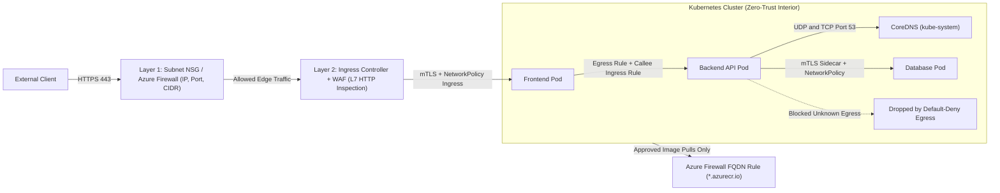
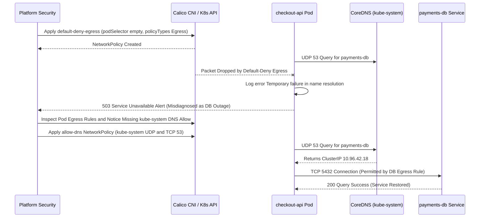

# Network Security in Depth

> **Prerequisites:** Module 00 (Assume Breach, STRIDE & Defense in Depth), Track 05 (Azure VNets, NSGs & Azure Firewall), Track 03/11 (Kubernetes NetworkPolicy Ingress Basics & Calico), and a NetworkPolicy-enforcing local `kind` cluster (or AKS with Azure CNI + Network Policy).  
> **Estimated Reading Time:** 35 minutes  
> **Target Audience:** Backend Engineers, Platform Engineers, Kubernetes Operators, Security Engineers.

> [!TIP]
> **The Golden Rule of Zero-Trust Network Defense:** Treat every internal network boundary as already hostile: enforce default-deny for both `Ingress` and `Egress`, always carve out CoreDNS (`UDP`/`TCP` port 53 in `kube-system`) first so DNS resolution does not silently break, pair caller `Egress` rules with callee `Ingress` rules under dual default-deny, and combine subnet NSGs/Azure Firewall with Pod NetworkPolicies and mTLS because no single layer sees everything.

---

## Why This Matters

You've met the network-security pieces separately and never as a *stack*: NSGs and Azure Firewall in track 05, Kubernetes NetworkPolicy in 03/11, TLS in the networking-fundamentals track. Each was taught in isolation, as if it were *the* control. It isn't — real network security is **defense in depth**, where a request crossing from the internet to your database passes through several independent filters, and no single one is trusted to be sufficient (module 00's core mindset, applied to the wire). This module assembles those layers into one coherent model, adds the crucial *egress* dimension most people forget, and previews service-mesh mTLS — the identity-based, in-cluster encryption layer that track 13 owns in full.

---

## 1. Architectural Mental Model: Layered Network Perimeter & Zero-Trust Packet Path

A single user request traversing an external edge into a Pod's downstream database call crosses four distinct network control planes, while any unauthorized outbound C2 or exfiltration attempt hits both in-cluster Pod egress policy and node-level Azure Firewall inspection:



### Core Concepts

#### Defense in Depth on the Network: The Layered Path
Trace one request from an external user to a Pod's database call, and count the independent filters it passes through on Azure/AKS:

1. **Azure Firewall / NSGs at the perimeter and subnet** (track 05) — control what traffic can even enter (or leave) the VNet and subnets. Coarse, IP/port/CIDR-based, *below* Kubernetes.
2. **Ingress + WAF** — the L7 entry point; a Web Application Firewall (such as on Application Gateway, track 05) inspects HTTP for application-layer attacks.
3. **Kubernetes NetworkPolicy** (03/11) — controls which Pods may talk to which *inside* the cluster, by label. Fine-grained and Kubernetes-native.
4. **Service mesh mTLS** (preview below, track 13) — mutual-TLS encryption and cryptographic *identity* between Pods, so even intra-cluster traffic is authenticated and encrypted.

The point: an attacker who defeats one layer still faces the next. A permissive NSG rule doesn't expose a Pod that NetworkPolicy still isolates; a NetworkPolicy gap doesn't expose plaintext traffic the mesh still encrypts. You *layer* because any single control will eventually have a hole.

#### Ingress vs. Egress — And Why Egress Is the One People Forget
Track 03/11 focused on *ingress* NetworkPolicy (who can reach a Pod). The under-appreciated half is **egress** (where a Pod can *connect out to*). Assume breach (module 00): if an attacker gets code execution in a Pod, the first thing they do is call *out* — to a command-and-control server, to exfiltrate data, or to download a second-stage payload. **Default-open egress means a compromised Pod can talk to the entire internet.** Locking egress down to only the destinations a workload legitimately needs (its database, a specific API, DNS) turns "attacker phones home freely" into "attacker's outbound connection is blocked" — and, as a bonus, a *blocked* unexpected egress attempt is a high-signal alert (module 07). This is the single highest-value network hardening most teams skip.

#### NetworkPolicy Egress and the Default-Deny Pattern
Recall from 03/11 that once *any* policy selects a Pod for a direction, that direction becomes deny-by-default for that Pod. The strongest posture applies a **default-deny-egress** policy to a namespace (select all Pods, allow nothing), then adds narrow allow rules for exactly what's needed. Two practical wrinkles:

- **DNS must be explicitly allowed.** A default-deny-egress policy blocks the Pod's DNS lookups to CoreDNS (`UDP`/`TCP` 53 in `kube-system`), so *everything* breaks with confusing "name resolution failed" errors until you add a DNS allow rule. This is the #1 gotcha and this module's diagnose-and-fix exercise.
- **NetworkPolicy needs an enforcing CNI** (03/11) — Calico on kind, or Azure CNI with network policy on AKS. Without it, egress policies are silently inert, exactly like ingress ones.

#### Where NSGs/Firewall and NetworkPolicy Divide the Work
They operate at different layers and aren't interchangeable:

- **NSGs / Azure Firewall** (track 05) filter at the *VNet/subnet/node* level — IP ranges, ports, and FQDN rules (Firewall). They govern traffic in and out of the *cluster's nodes and subnets*, and are the right place for cluster-wide egress control to the internet (e.g., Azure Firewall's FQDN allowlist so nodes can only reach approved domains).
- **NetworkPolicy** filters at the *Pod* level, by Kubernetes label, *inside* the cluster — something NSGs can't see, because to the VNet all Pods on a node may share the node's networking.

So a common real design: Azure Firewall restricts what the *cluster* can reach on the internet (coarse, node-level egress), while NetworkPolicy restricts what *each Pod* can reach in-cluster and which Pods can reach it (fine, pod-level). Both, not either — defense in depth across two layers that see different things.

#### Service Mesh mTLS — A Preview (Track 13 Owns This)
NetworkPolicy answers "*may* Pod A connect to Pod B?" by label. It does **not** answer "is the traffic *encrypted*?" or "is B *sure* it's really A and not something that stole A's IP?" That's **mutual TLS (mTLS)**, and a **service mesh** (Istio/Linkerd, track 13) provides it transparently: it injects a sidecar proxy next to each Pod that automatically encrypts all Pod-to-Pod traffic and authenticates both ends with cryptographic *workload identities* (not just IPs/labels). In the STRIDE terms of module 00: mTLS counters **Spoofing** (an attacker can't impersonate a workload without its cert) and **Information disclosure / Tampering** (traffic is encrypted and integrity-protected in transit, even inside the cluster). NetworkPolicy and mTLS are complementary — policy decides *if* a connection is allowed, mTLS secures and authenticates it *when* it happens. Track 13 covers installing a mesh, mTLS modes (permissive vs. strict), authorization policies, and sidecar observability.

#### Zero Trust: The Mindset These Layers Implement
All of the above is the network face of **zero trust**: never trust traffic just because it's "inside" the network. The old model trusted anything past the perimeter firewall; zero trust assumes the internal network is *already hostile* (assume breach) and therefore authenticates and authorizes *every* connection, segments aggressively (NetworkPolicy), controls egress, and encrypts internal traffic (mTLS). You don't need a product called "zero trust"; you need these layers configured so that a foothold in one Pod doesn't grant free movement to everything else.

---

## 2. Taxonomic Comparison: Network Controls Across the Stack

### Layer Capabilities & Trust Boundaries

| Control Layer | Enforcing Scope | Filtering Primitives | Sees Same-Node Pod Traffic? | Encrypts & Authenticates Workload Identity? | Primary STRIDE Mitigation |
| :--- | :--- | :--- | :--- | :--- | :--- |
| **Azure Firewall / NSG** | VNet / Subnet / Node NIC | IP, CIDR, Port, Protocol, FQDN (Firewall) | No | No | Network perimeter isolation, coarse internet egress control |
| **Ingress + WAF** | L7 Edge HTTP Entrypoint | Host, Path, HTTP Headers, OWASP Signatures | No | Edge TLS only | Tampering, Injection, Edge DDoS / L7 exploits |
| **Kubernetes NetworkPolicy** | Individual Pods (via CNI) | Pod Labels, Namespace Labels, CIDR, Port | Yes (Calico / Azure CNI) | No (plaintext, IP/label based) | Lateral movement, C2 phone-home, tier skipping |
| **Service Mesh mTLS** | Sidecar Proxy per Pod | SPIFFE / X.509 Workload Identity | Yes | Yes (mutual TLS 1.3) | Spoofing, Information Disclosure, Tampering |

### NetworkPolicy Default-Deny Posture Matrix

| Posture | `policyTypes` | Impact on Legitimate Traffic | Required Carve-Outs for Working Apps |
| :--- | :--- | :--- | :--- |
| **Default-Deny Ingress** | `[Ingress]` | Blocks all inbound traffic to Pods | Caller-to-callee `ingress.from` rules + Ingress controller entry |
| **Default-Deny Egress** | `[Egress]` | Blocks all outbound traffic including DNS | CoreDNS `UDP`/`TCP` 53 to `kube-system` + explicit external/DB targets |
| **Zero-Trust Dual Deny** | `[Ingress, Egress]` | Denies both directions completely | CoreDNS + **both** caller `egress` allow AND callee `ingress` allow |

---

## 3. Command Reference & Flag Breakdown

| Command / Field | What it does | Example |
| :--- | :--- | :--- |
| `NetworkPolicy spec.policyTypes: [Egress]` | Makes a policy govern outbound traffic (the half 03/11 skipped) | See exercise 3 |
| `spec.egress[].to.ipBlock.cidr` | Allows egress to an IP/CIDR range | `ipBlock: {cidr: 10.0.0.0/16}` |
| `spec.egress[].to.namespaceSelector` | Allows egress to Pods in matching namespaces (e.g., DNS to `kube-system`) | See exercise 4 |
| `spec.egress[].ports` | Restricts allowed egress to specific ports/protocols (e.g., UDP 53) | `ports: [{protocol: UDP, port: 53}]` |
| `az network nsg rule create` | Adds an NSG rule at the subnet/NIC level (track 05) | `az network nsg rule create -g rg --nsg-name nsg1 -n deny-out --direction Outbound --access Deny --priority 4096` |
| `az network firewall application-rule create` | Azure Firewall FQDN egress rule (allow only named domains) | See exercise 7 |
| `az aks create --network-policy azure` (or `calico`) | Enables a NetworkPolicy-enforcing CNI on AKS | `az aks create ... --network-plugin azure --network-policy calico` |
| `kubectl exec ... -- wget/nslookup` | Tests actual connectivity/DNS from inside a Pod | See exercises |

### Flag Breakdown: Default-Deny-Egress + DNS-Allow NetworkPolicy

For the default-deny-egress and CoreDNS carve-out policies (exercises 3–4):

- **`podSelector: {}`** — an *empty* selector matches **every** Pod in the namespace, so the policy applies namespace-wide.
- **`policyTypes: [Egress]`** — this policy governs outbound traffic only; combined with an empty `egress:` list it denies *all* egress from every Pod in the namespace.
- **`egress[].to.namespaceSelector`** matching `kube-system` + **`ports: [{protocol: UDP, port: 53}, {protocol: TCP, port: 53}]`** — the minimal carve-out that re-permits DNS lookups to CoreDNS, without which every name resolution fails.

### Flag Breakdown: `az network firewall application-rule create`

For `az network firewall application-rule create ... --target-fqdns "*.azurecr.io" "mcr.microsoft.com" --protocols Http=80 Https=443`:

- **`application-rule create`** — an L7 (FQDN-based) egress allow rule on Azure Firewall, so cluster nodes can reach only named domains.
- **`--target-fqdns "*.azurecr.io" "mcr.microsoft.com"`** — the allowlist; nodes can pull images from ACR/MCR but not arbitrary internet hosts.
- **`--protocols Http=80 Https=443`** — the ports/protocols the rule permits. This is cluster-wide (node-level) egress control, complementing per-Pod NetworkPolicy.

---

## 4. Production War Story Post-Mortem: Silent CoreDNS Blackhole After Enabling Default-Deny Egress

- **Severity:** SEV-1
- **Detection Time:** 2 minutes (synthetic checkout monitors and 503 error spike)
- **Resolution Time:** 22 minutes
- **Impact:** 100% of `checkout-api` requests in the `payments` namespace failed immediately after rollout because Pods could neither resolve `payments-db.database.svc.cluster.local` nor external payment gateway FQDNs.

### What Happened



### Root Cause Analysis

1. **Missing CoreDNS Egress Carve-Out:** Once `default-deny-egress` selected every Pod in `payments`, Kubernetes switched outbound traffic for the entire namespace to deny-by-default — silently blocking UDP/TCP port 53 to CoreDNS in `kube-system`.
2. **Misleading Application Logs:** The application logged `could not connect to database: name resolution failed`, causing on-call engineers to spend 14 minutes inspecting healthy PostgreSQL instances instead of testing DNS directly from inside the Pod.
3. **Lack of Negative/Smoke Testing in Staging:** The policy manifest was merged without running an automated `nslookup` + allowed-target + blocked-internet smoke test in a policy-enforcing staging cluster.

### The Fix & Architectural Hardening

- **Standardized Base Namespace Chart:** Every production namespace template now bundles `default-deny-ingress`, `default-deny-egress`, and `allow-dns-to-kube-system` together as an atomic baseline unit.
- **Automated Dual-Direction CI Linting:** Policy CI checks reject any `default-deny-egress` manifest without a companion `kube-system` UDP/TCP 53 allow rule and verify both caller `egress` and callee `ingress` policies exist.
- **Blocked-Egress Telemetry Alert:** Calico/Azure CNI dropped-egress logs feed Azure Monitor KQL alerts (module 07) to distinguish legitimate missing rules during deploy windows from sudden runtime C2 attempts.

---

## 5. Multi-Language Production Implementation: Zero-Trust Egress Auditor & Probe

Teams enforce zero-trust networking reliably by pairing static NetworkPolicy manifest validation (ensuring CoreDNS port 53 is carved out and wildcards aren't left open) with bounded runtime egress verification probes.

````carousel
```go
package netsec

import (
	"context"
	"fmt"
	"net"
	"time"

	networkingv1 "k8s.io/api/networking/v1"
	metav1 "k8s.io/apimachinery/pkg/apis/meta/v1"
	"k8s.io/client-go/kubernetes"
)

type EgressAuditReport struct {
	Namespace        string
	HasDefaultDeny   bool
	HasCoreDNSAllow  bool
	WildcardRules    []string
}

// AuditNamespaceEgress validates that a namespace enforces default-deny egress
// with a CoreDNS port 53 carve-out and no unrestricted 0.0.0.0/0 egress rules.
func AuditNamespaceEgress(ctx context.Context, cs kubernetes.Interface, ns string) (*EgressAuditReport, error) {
	policies, err := cs.NetworkingV1().NetworkPolicies(ns).List(ctx, metav1.ListOptions{})
	if err != nil {
		return nil, fmt.Errorf("failed listing network policies in %s: %w", ns, err)
	}

	report := &EgressAuditReport{Namespace: ns}
	for _, pol := range policies.Items {
		isAllPods := len(pol.Spec.PodSelector.MatchLabels) == 0 && len(pol.Spec.PodSelector.MatchExpressions) == 0
		governsEgress := false
		for _, pt := range pol.Spec.PolicyTypes {
			if pt == networkingv1.PolicyTypeEgress {
				governsEgress = true
			}
		}
		if !governsEgress {
			continue
		}
		if isAllPods && len(pol.Spec.Egress) == 0 {
			report.HasDefaultDeny = true
		}
		for _, rule := range pol.Spec.Egress {
			for _, p := range rule.Ports {
				if p.Port != nil && p.Port.IntVal == 53 {
					report.HasCoreDNSAllow = true
				}
			}
			for _, peer := range rule.To {
				if peer.IPBlock != nil && peer.IPBlock.CIDR == "0.0.0.0/0" {
					report.WildcardRules = append(report.WildcardRules, pol.Name)
				}
			}
		}
	}
	return report, nil
}

// VerifyEgressBlocked attempts a bounded TCP dial to ensure forbidden external egress fails closed.
func VerifyEgressBlocked(ctx context.Context, targetAddr string, timeout time.Duration) error {
	dialer := net.Dialer{Timeout: timeout}
	conn, err := dialer.DialContext(ctx, "tcp", targetAddr)
	if err == nil {
		conn.Close()
		return fmt.Errorf("security violation: egress to %s succeeded unexpectedly", targetAddr)
	}
	return nil
}
```
<!-- slide -->
```typescript
import * as k8s from "@kubernetes/client-node";

export interface NamespaceZeroTrustStatus {
  namespace: string;
  hasDefaultDenyIngress: boolean;
  hasDefaultDenyEgress: boolean;
  hasDnsCarveOut: boolean;
  issues: string[];
}

/**
 * Inspects all NetworkPolicies in a namespace to confirm zero-trust dual default-deny
 * plus an explicit kube-system UDP/TCP port 53 CoreDNS egress rule.
 */
export async function auditZeroTrustNamespace(
  api: k8s.NetworkingV1Api,
  namespace: string
): Promise<NamespaceZeroTrustStatus> {
  const { items } = await api.listNamespacedNetworkPolicy({ namespace });
  const status: NamespaceZeroTrustStatus = {
    namespace,
    hasDefaultDenyIngress: false,
    hasDefaultDenyEgress: false,
    hasDnsCarveOut: false,
    issues: [],
  };

  for (const pol of items) {
    const spec = pol.spec;
    if (!spec) continue;

    const selectsAllPods =
      !spec.podSelector?.matchLabels && !spec.podSelector?.matchExpressions;
    const types = spec.policyTypes ?? [];

    if (selectsAllPods && types.includes("Ingress") && (!spec.ingress || spec.ingress.length === 0)) {
      status.hasDefaultDenyIngress = true;
    }
    if (selectsAllPods && types.includes("Egress") && (!spec.egress || spec.egress.length === 0)) {
      status.hasDefaultDenyEgress = true;
    }

    for (const egressRule of spec.egress ?? []) {
      const hasPort53 = (egressRule.ports ?? []).some((p) => p.port === 53);
      const targetsKubeSystem = (egressRule.to ?? []).some(
        (peer) =>
          peer.namespaceSelector?.matchLabels?.["kubernetes.io/metadata.name"] ===
          "kube-system"
      );
      if (hasPort53 && targetsKubeSystem) {
        status.hasDnsCarveOut = true;
      }
    }
  }

  if (!status.hasDefaultDenyEgress) status.issues.push("Missing default-deny-egress policy");
  if (status.hasDefaultDenyEgress && !status.hasDnsCarveOut) {
    status.issues.push("CRITICAL: default-deny-egress active without CoreDNS port 53 carve-out");
  }
  return status;
}
```
<!-- slide -->
```python
from dataclasses import dataclass, field
from typing import List
import socket
from kubernetes import client


@dataclass
class EgressPostureReport:
    namespace: str
    default_deny_egress: bool = False
    dns_allowed: bool = False
    findings: List[str] = field(default_factory=list)


def inspect_namespace_egress(
    net_api: client.NetworkingV1Api, namespace: str
) -> EgressPostureReport:
    """Validates NetworkPolicy egress isolation and CoreDNS port 53 allowance."""
    policies = net_api.list_namespaced_network_policy(namespace=namespace).items
    report = EgressPostureReport(namespace=namespace)

    for pol in policies:
        spec = pol.spec
        types = spec.policy_types or []
        empty_selector = not (
            spec.pod_selector.match_labels or spec.pod_selector.match_expressions
        )

        if empty_selector and "Egress" in types and not spec.egress:
            report.default_deny_egress = True

        for rule in spec.egress or []:
            ports = {p.port for p in (rule.ports or [])}
            to_kube_system = any(
                peer.namespace_selector
                and (peer.namespace_selector.match_labels or {}).get(
                    "kubernetes.io/metadata.name"
                )
                == "kube-system"
                for peer in (rule.to or [])
            )
            if 53 in ports and to_kube_system:
                report.dns_allowed = True

    if report.default_deny_egress and not report.dns_allowed:
        report.findings.append("DNS resolution will fail: missing kube-system port 53 egress rule")
    if not report.default_deny_egress:
        report.findings.append("Unrestricted egress: missing namespace default-deny-egress policy")
    return report


def assert_egress_denied(host: str, port: int, timeout_sec: float = 2.0) -> bool:
    """Probes an unauthorized destination; returns True if the connection is blocked."""
    try:
        with socket.create_connection((host, port), timeout=timeout_sec):
            return False
    except (OSError, TimeoutError):
        return True
```
<!-- slide -->
```csharp
using System;
using System.Collections.Generic;
using System.Linq;
using System.Net.Sockets;
using System.Threading;
using System.Threading.Tasks;
using k8s;
using k8s.Models;

namespace NetworkSecurityInDepth
{
    public sealed record EgressValidationResult(
        string Namespace,
        bool HasDefaultDenyEgress,
        bool HasCoreDnsCarveOut,
        IReadOnlyList<string> Warnings
    );

    public static class NetworkPolicyEgressAuditor
    {
        /// <summary>
        /// Checks whether a Kubernetes namespace defines both default-deny egress
        /// and a scoped UDP/TCP port 53 CoreDNS egress allowance.
        /// </summary>
        public static async Task<EgressValidationResult> ValidateNamespaceAsync(
            IKubernetes client,
            string ns,
            CancellationToken ct = default)
        {
            V1NetworkPolicyList list = await client.NetworkingV1
                .ListNamespacedNetworkPolicyAsync(ns, cancellationToken: ct);

            bool hasDefaultDeny = false;
            bool hasDnsAllow = false;
            var warnings = new List<string>();

            foreach (V1NetworkPolicy pol in list.Items)
            {
                V1NetworkPolicySpec spec = pol.Spec;
                if (spec?.PolicyTypes == null || !spec.PolicyTypes.Contains("Egress"))
                    continue;

                bool allPods = (spec.PodSelector?.MatchLabels == null || spec.PodSelector.MatchLabels.Count == 0)
                    && (spec.PodSelector?.MatchExpressions == null || spec.PodSelector.MatchExpressions.Count == 0);

                if (allPods && (spec.Egress == null || spec.Egress.Count == 0))
                    hasDefaultDeny = true;

                if (spec.Egress == null) continue;
                foreach (V1NetworkPolicyEgressRule rule in spec.Egress)
                {
                    bool port53 = rule.Ports?.Any(p => p.Port?.Value == "53") == true;
                    bool toKubeSys = rule.To?.Any(t =>
                        t.NamespaceSelector?.MatchLabels != null &&
                        t.NamespaceSelector.MatchLabels.TryGetValue("kubernetes.io/metadata.name", out var val) &&
                        val == "kube-system") == true;

                    if (port53 && toKubeSys)
                        hasDnsAllow = true;
                }
            }

            if (hasDefaultDeny && !hasDnsAllow)
                warnings.Add("Default-deny egress is active without CoreDNS port 53 allow rule.");
            if (!hasDefaultDeny)
                warnings.Add("Namespace lacks a default-deny-egress policy.");

            return new EgressValidationResult(ns, hasDefaultDeny, hasDnsAllow, warnings);
        }

        public static async Task<bool> IsExternalEgressBlockedAsync(string host, int port, int timeoutMs = 2000)
        {
            using var tcp = new TcpClient();
            using var cts = new CancellationTokenSource(timeoutMs);
            try
            {
                await tcp.ConnectAsync(host, port, cts.Token);
                return false;
            }
            catch (Exception)
            {
                return true;
            }
        }
    }
}
```
````

---

## 6. Practical Hands-On Verification CLI Workflows

Exercises 1–6 run on a Calico-enabled `kind` cluster (the setup from 03/11 — recreate it if needed). Exercise 7 is Azure and optional/observational. No Azure cost unless you create an Azure Firewall in Exercise 7.

### 1. (WSL2) Recreate a NetworkPolicy-Enforcing Cluster and Prove Default-Open Egress

```bash
kubectl create namespace netsec 2>/dev/null; true
kubectl run client --image=busybox:1.36 -n netsec --restart=Never -- sh -c "sleep 3600"
kubectl wait --for=condition=Ready pod/client -n netsec --timeout=60s
kubectl exec client -n netsec -- wget -qO- --timeout=4 http://example.com | head -1
```

**Expected Output:**
```text
<!doctype html>
```

The `wget` succeeds, proving egress is *wide open* by default: this Pod can reach the entire internet.

### 2. (WSL2) Confirm DNS Works Before You Break It

```bash
kubectl exec client -n netsec -- nslookup example.com | head
```

**Expected Output:**
```text
Server:    10.96.0.10
Address 1: 10.96.0.10 kube-dns.kube-system.svc.cluster.local

Name:      example.com
Address 1: 93.184.215.14
```

Remember this works — the next step breaks it on purpose.

### 3. (WSL2) Apply `default-deny-egress` and Watch Everything Break

```bash
kubectl apply -n netsec -f - <<'EOF'
apiVersion: networking.k8s.io/v1
kind: NetworkPolicy
metadata: {name: default-deny-egress}
spec:
  podSelector: {}
  policyTypes: [Egress]
EOF
kubectl exec client -n netsec -- wget -qO- --timeout=4 http://example.com | head -1
```

**Expected Output:**
```text
wget: bad address 'example.com'
command terminated with exit code 1
```

The empty `podSelector` + `Egress` with no allow rules denies all outbound traffic from every Pod — the assume-breach posture, currently *too* strict for even legitimate use.

### 4. Diagnose and Fix: "Name Resolution Failed" After Locking Egress

The failure in Exercise 3 is confusingly a *DNS* failure first. Diagnose:

```bash
kubectl exec client -n netsec -- nslookup example.com 2>&1 | head
```

**Expected Output:**
```text
;; connection timed out; no servers could be reached
```

`default-deny-egress` blocked the Pod's lookups to CoreDNS in `kube-system`. Fix by allowing DNS (the #1 egress gotcha):

```bash
kubectl apply -n netsec -f - <<'EOF'
apiVersion: networking.k8s.io/v1
kind: NetworkPolicy
metadata: {name: allow-dns}
spec:
  podSelector: {}
  policyTypes: [Egress]
  egress:
    - to:
        - namespaceSelector:
            matchLabels: {kubernetes.io/metadata.name: kube-system}
      ports:
        - {protocol: UDP, port: 53}
        - {protocol: TCP, port: 53}
EOF
kubectl exec client -n netsec -- nslookup example.com 2>&1 | head
```

**Expected Output:**
```text
Server:    10.96.0.10
Address 1: 10.96.0.10 kube-dns.kube-system.svc.cluster.local

Name:      example.com
Address 1: 93.184.215.14
```

DNS resolves again! Note that HTTP to `example.com` *still* fails (egress to external IPs isn't allowed) — DNS resolving while the TCP connection times out is the tell that DNS is fixed while the app egress rule is still enforced.

### 5. (WSL2) Allow Exactly One Legitimate Egress Destination

Deploy an in-cluster "database" and permit the client to reach *only* it:

```bash
kubectl run db --image=hashicorp/http-echo:1.0 -n netsec --labels app=db --port=5678 -- -text="db-ok" -listen=:5678
kubectl expose pod db -n netsec --port=80 --target-port=5678
kubectl apply -n netsec -f - <<'EOF'
apiVersion: networking.k8s.io/v1
kind: NetworkPolicy
metadata: {name: allow-client-to-db}
spec:
  podSelector:
    matchLabels: {run: client}
  policyTypes: [Egress]
  egress:
    - to: [{podSelector: {matchLabels: {app: db}}}]
      ports: [{port: 5678}]
EOF
kubectl exec client -n netsec -- wget -qO- --timeout=4 http://db | head -1
kubectl exec client -n netsec -- wget -qO- --timeout=4 http://example.com | head -1
```

**Expected Output:**
```text
db-ok
wget: download timed out
```

Expect `db-ok` from the first command and a *timeout* from the second — the client can reach its database, resolve DNS, and reach nothing else outbound. This is least-privilege egress: assume-breach containment made real.

### 6. (WSL2) Observe the Security Payoff of Blocked Egress & Clean Up

The failed `http://example.com` attempt in Exercise 5 is what a *compromised* Pod trying to phone home looks like — blocked at the wire. Note that a blocked unexpected egress is a high-signal event you'd alert on (module 07). Clean up:

```bash
kubectl delete namespace netsec
```

### 7. (Azure, Optional) Cluster-Level Egress with Azure Firewall FQDN Rules

*Conceptually/observationally* (a full firewall + UDR setup is a track-05 exercise): review how you force AKS node egress through Azure Firewall and allow only image registries. The rule shape:

```bash
az network firewall application-rule create \
  --firewall-name fw-aks --collection-name aks-egress -g rg-net \
  --name allow-registries --action Allow --priority 100 \
  --target-fqdns "*.azurecr.io" "mcr.microsoft.com" "*.blob.core.windows.net" \
  --source-addresses "10.0.0.0/16" --protocols Https=443
```

Notice how this is *node-level* (subnet CIDR source), coarse, and internet-facing — complementary to the *pod-level* NetworkPolicy egress from exercises 3–5. Together they form the two-layer egress model. *(Don't leave a billed Azure Firewall running — tear down if you created one.)*

### 8. (WSL2 / Paper) Draw the Layered Path

On your module-00 data-flow diagram, annotate each network control (Firewall/NSG → WAF/Ingress → NetworkPolicy → mesh mTLS) at the point in the path it acts. For each, write one sentence on what an attacker who *defeated only that layer* would still be stopped by. This makes defense in depth explicit.

### Independent Challenge

No YAML given — build it yourself using this module plus 03/11 (NetworkPolicy ingress, Calico) and module 00 (assume-breach, defense in depth). On a NetworkPolicy-enforcing cluster, deploy a three-tier app (frontend → backend → "database") and impose a *zero-trust* network posture: default-deny both ingress and egress in the namespace, then add only the minimum rules so that the frontend can reach the backend, the backend can reach the database, DNS works for all of them, and *nothing* can reach the internet or skip a tier (the frontend must not reach the database directly). Prove each intended path works and at least two unintended paths are blocked (frontend→database, and any Pod→internet). Then, in two or three sentences, describe what service-mesh mTLS would add on top of this policy that NetworkPolicy alone cannot provide, naming the STRIDE categories (module 00) it addresses and which track owns it.

<details>
<summary>Stuck? One hint</summary>

Start with two namespace-wide default-deny policies (`podSelector: {}`, one `policyTypes: [Ingress]`, one `[Egress]`), add the DNS-to-kube-system egress allow (exercise 4), then add tier-to-tier rules pairing an *egress* allow on the caller with an *ingress* allow on the callee (both directions must permit it once both are default-denied). For the mTLS part: NetworkPolicy allows/denies by IP/label but leaves traffic unencrypted and unauthenticated — mTLS (Spoofing, Tampering, Information disclosure; track 13) encrypts it and proves each end's cryptographic identity, so a Pod that stole another's IP still can't present its cert.

</details>

---

## 7. Common Mistakes & Troubleshooting

- **Forgetting to allow DNS after `default-deny-egress`.** Every name lookup fails and errors look like unrelated app bugs ("host not found"). Always add the `UDP`/`TCP` 53 egress allow to `kube-system` first — it's the #1 gotcha.
- **Only writing ingress policies.** Ingress-only leaves a compromised Pod free to phone home and exfiltrate. Egress control is the assume-breach half most teams skip and the higher-value one for containment.
- **Applying egress policy with a non-enforcing CNI.** Like ingress (03/11), egress policy is silently inert without a policy-enforcing CNI (Calico / Azure CNI with network policy) — confirm enforcement before trusting it.
- **Expecting NetworkPolicy to encrypt or authenticate traffic.** It only allows/denies by IP/label; traffic is still plaintext and unauthenticated. Encryption/identity is mTLS (a mesh, track 13) — a different, complementary layer.
- **Thinking NSGs can filter Pod-to-Pod traffic.** NSGs operate at the subnet/node level and often can't see traffic between Pods on the same node. Pod-level control needs NetworkPolicy; use NSGs/Firewall for node/subnet and internet egress.
- **Pairing only one direction after default-deny-both.** Once both directions are denied, a working connection needs an *egress* allow on the caller *and* an *ingress* allow on the callee — forgetting one silently blocks the path.
- **Treating "inside the cluster" as trusted.** Zero trust assumes the internal network is already hostile; a flat, unsegmented cluster lets one compromised Pod reach everything. Segment and control egress even internally.

---

## 8. Operational Validation Checkpoints

<details>
<summary><strong>Checkpoint 1: Tier-to-Tier Blocked Traffic Under Dual Default-Deny</strong></summary>

**Scenario:** You applied both `default-deny-ingress` and `default-deny-egress` in `prod-shop`, plus the `kube-system` DNS rule and an `Ingress` policy on `orders-api` allowing `from: frontend`. Yet `frontend` connections to `orders-api` still time out even though `nslookup orders-api` succeeds. What is missing?

**Diagnosis & Remediation:** When both `Ingress` and `Egress` are default-denied in a namespace, every Pod-to-Pod connection requires *two* explicit permissions: an `Ingress` rule on the receiver (`orders-api` allowing from `frontend`) **and** a matching `Egress` rule on the caller (`frontend` allowing outbound traffic to `orders-api` on the target `containerPort`, not just the Service port). Add the matching `Egress` policy selecting `frontend` pods targeting `orders-api`.

</details>

<details>
<summary><strong>Checkpoint 2: Silently Ignored NetworkPolicy on Local Kind Cluster</strong></summary>

**Scenario:** A developer applies `default-deny-egress` in a fresh default `kind` cluster without testing the negative path, then opens a PR claiming egress lockdown works because the app still passes integration tests. During your review, you run `kubectl exec client -- wget -qO- http://example.com` and get HTML back. Why?

**Diagnosis & Remediation:** Default `kind` uses `kindnetd`, which does not enforce Kubernetes `NetworkPolicy` objects — policies are accepted by the API server and stored in etcd, yet silently ignored on the wire. Always verify negative-path enforcement against a policy-enforcing CNI (such as Calico on `kind` or Azure CNI Network Policy / Cilium on AKS) by confirming an unauthorized probe actually times out.

</details>

<details>
<summary><strong>Checkpoint 3: Spoofed Traffic Inside an Isolated Namespace</strong></summary>

**Scenario:** Your `payments` namespace has strict dual default-deny NetworkPolicies allowing `checkout` to talk to `ledger` over port 8080. During a threat-modeling review, someone points out that if an attacker compromises a co-located host network namespace or sniffs node traffic, `NetworkPolicy` alone won't stop them from reading payment payloads or impersonating `checkout`. Which missing layer resolves this?

**Diagnosis & Remediation:** NetworkPolicy operates purely on L3/L4 packet headers (Pod IPs derived from labels) and transmits traffic unencrypted without verifying cryptographic workload identity. Layering **service-mesh mTLS** (Track 13, e.g., Istio or Linkerd) forces sidecar-to-sidecar TLS 1.3 encryption and mutual X.509/SPIFFE identity verification, directly mitigating STRIDE's **Information Disclosure**, **Tampering**, and **Spoofing** threats inside the cluster.

</details>

---

## 9. Checkpoint Quiz

Write down your answer to each question before expanding it — checking without attempting first is the single easiest way to fool yourself into thinking you've learned this.

<details>
<summary>Show questions</summary>

1. Name the network defense-in-depth layers a request can pass through from the internet to a Pod's database call, and what each filters on.
2. Why is egress control (vs. ingress) especially important under an assume-breach mindset?
3. After applying a default-deny-egress policy, why does *DNS* break, and how do you fix it?
4. How do NSGs/Azure Firewall and Kubernetes NetworkPolicy divide the work — what can each see that the other can't?
5. What does service-mesh mTLS add that NetworkPolicy cannot, and which STRIDE categories does it address?
6. Once a namespace is default-deny for *both* ingress and egress, what two rules must exist for Pod A to reach Pod B?
7. What does "zero trust" mean on the network, and which controls from this track implement it?

</details>

<details>
<summary>Show answers</summary>

1. Azure Firewall/NSGs at the perimeter/subnet (IP/port/CIDR, and FQDN for Firewall, at node/subnet level); Ingress + WAF (L7 HTTP inspection at the entry point); Kubernetes NetworkPolicy (pod-to-pod by label, inside the cluster); service-mesh mTLS (encryption + workload identity between Pods). Each is independent, so defeating one still leaves the others.
2. Because a compromised Pod's first moves are usually *outbound* — phoning home to a C2 server, exfiltrating data, pulling a second-stage payload. Default-open egress lets it reach the whole internet; locking egress to only needed destinations contains the breach and turns unexpected outbound attempts into high-signal alerts.
3. A default-deny-egress policy also blocks the Pod's DNS lookups to CoreDNS in `kube-system`, so name resolution fails and everything looks broken. Fix by adding an egress allow rule to the `kube-system` namespace on UDP/TCP port 53 before (or alongside) any other egress rules.
4. NSGs/Azure Firewall filter at the subnet/node level (IP ranges, ports, and FQDNs for Firewall) and govern node/subnet and internet traffic, but often can't see Pod-to-Pod traffic on the same node. NetworkPolicy filters at the Pod level by Kubernetes label inside the cluster — something NSGs can't see. Use both: Firewall for coarse node/internet egress, NetworkPolicy for fine pod-level control.
5. mTLS encrypts Pod-to-Pod traffic and authenticates both ends with cryptographic workload identities, which NetworkPolicy (which only allows/denies by IP/label, leaving traffic plaintext and unauthenticated) can't do. It addresses Spoofing (can't impersonate a workload without its cert) and Tampering/Information disclosure (traffic is encrypted and integrity-protected). A service mesh provides it; track 13 owns it.
6. An *egress* allow rule on Pod A permitting the connection to B, *and* an *ingress* allow rule on Pod B permitting the connection from A. Once both directions are default-denied, both halves must explicitly permit the path or it's blocked.
7. Zero trust means never trusting traffic just because it's "inside" the network — assume the internal network is already hostile and authenticate/authorize every connection. This track implements it via aggressive segmentation and egress control (NetworkPolicy), node/internet egress restriction (NSG/Firewall), and encrypted, identity-authenticated internal traffic (mesh mTLS).

</details>

---

## Next

Continue to [07-incident-response-and-security-monitoring](../07-incident-response-and-security-monitoring/README.md) — you've built the defenses; now learn what to *do* when one of them is breached anyway, and where the signals that tell you live.
