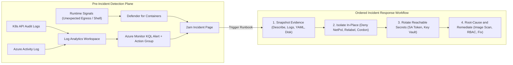
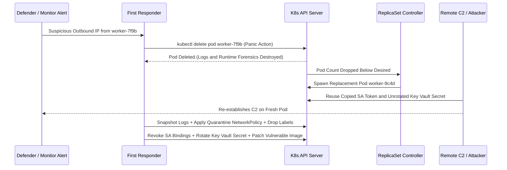

# Incident Response and Security Monitoring

> **Prerequisites:** Module 00 (Assume Breach & Repudiation), Module 01 (Defender for Containers Image Scanning), Module 02 (Secret Rotation), Module 06 (NetworkPolicy Isolation), and a local `kind` cluster with an enforcing CNI (plus optional AKS + Log Analytics workspace from Track 07).  
> **Estimated Reading Time:** 35 minutes  
> **Target Audience:** Backend Engineers, Site Reliability Engineers (SREs), Platform Engineers, Incident Commanders.

> [!TIP]
> **The Golden Rule of Kubernetes Incident Response:** Never delete a compromised Pod first and never rotate credentials before severing network access — execute the strict sequence: **Snapshot** volatile state (logs, describe, YAML, node disk) first, **Isolate** in-place (default-deny `NetworkPolicy`, drop Service labels, `kubectl cordon`), **Rotate** every reachable credential (SA tokens, mounted Secrets, Key Vault values), and only then **Root-Cause** and remediate.

---

## Why This Matters

Every module so far built a *defense*. This one assumes a defense failed — because module 00's assume-breach mindset says one eventually will — and asks the question none of the others did: *what do you actually do when a container or cluster is compromised?* Panic, in the wrong order, makes incidents worse: people delete the evidence they needed, tip off the attacker, or rotate credentials the attacker already used without checking what else was touched. This module gives you an ordered response, and shows you where the *signals* that detect an incident in the first place actually live on Azure — Defender for Cloud, Azure Monitor, and audit logs. It's the capstone's runbook requirement, and it bridges directly into the observability track.

---

## 1. Architectural Mental Model: Pre-Incident Signals & Ordered Containment Sequence

Effective incident response splits into two connected phases: **instrumentation before the breach** (so signals exist to page an operator) and **deterministic ordered execution during the breach** (preserving volatile forensics before isolation and credential rotation):



### Core Concepts

#### Detection Comes Before Response — You Can't Respond to What You Can't See
Recall module 00's **Repudiation** category: without logging, an attacker acts and you can't even tell. Response is impossible without detection, and detection lives in signals you must have turned on *before* the incident:

- **Kubernetes audit logs** — every request to the API server (who did what, when). The record that answers "who deleted that Secret or created that privileged Pod." On AKS these flow to a Log Analytics workspace via diagnostic settings (the same workspace as Container Insights, track 07/06).
- **Azure Activity Log** — control-plane operations on Azure resources (who changed an NSG, deleted a Key Vault, altered a role assignment).
- **Container/runtime signals** — a Pod suddenly making outbound connections to an unknown IP, a shell spawned in a container, a crypto-miner's CPU pattern.
- **Defender for Cloud alerts** — Azure correlating the above into named threats.

The theme from track 07/06 returns: signals you didn't collect *before* the incident aren't available *during* it. This is why the next track (observability) pairs directly with security — you can only respond to what you instrumented.

#### Microsoft Defender for Cloud and Defender for Containers
You met **Defender for Containers** in module 01 as an image scanner. Its other half is **runtime threat detection**: once enabled, it watches cluster and container behavior and raises **security alerts** in **Defender for Cloud** for things like a container running a suspicious binary, a connection to a known-malicious IP, or a possible container escape. Defender for Cloud is the central place those alerts (plus posture recommendations from module 05) surface. In the shared-responsibility model (module 00), Defender is Azure *helping you detect* — but acting on the alert is still yours. It's a paid plan (bill-aware, as in module 01), and it's the closest thing to an out-of-the-box "something is wrong right now" signal for AKS.

#### Azure Monitor Alerts — Turning a Signal into a Page
Detection you have to remember to go *look* at isn't detection. **Azure Monitor alerts** fire automatically on a condition — a metric threshold (CPU pegged, an unusual count of failed auth events) or a **log-query (KQL) alert** against the Log Analytics workspace (e.g., "a Pod made egress to an IP outside our allowlist", building on the blocked-egress signal from module 06). An alert rule has a condition and an **action group** (who gets emailed/paged/webhooked). This is how a blocked-egress event or a suspicious audit-log entry becomes a human getting notified at 2am instead of a log line nobody reads.

#### The Incident-Response Order: Snapshot, Isolate, Rotate, Root-Cause
When a specific container/Pod is suspected compromised, the *order* matters as much as the actions. Notice how **capturing volatile state** and **isolating without killing** strictly precede credential rotation or Pod deletion:

1. **Snapshot (Preserve volatile evidence before state changes)** — Capture what you'll lose the moment a Pod dies or restarts: the running Pod's `describe`, logs, full YAML manifest, relevant audit-log entries, and (for deeper host forensics) an Azure managed disk snapshot of the node. Deleting first destroys the evidence — the Repudiation problem, self-inflicted.
2. **Isolate (Contain before you clean)** — Cut the compromised workload off so it can't spread or exfiltrate, *without* killing it. In Kubernetes: apply a **default-deny `NetworkPolicy`** (module 06) targeting the Pod, **remove the Pod from Service endpoints** by mutating its labels (so live traffic stops routing to it), and **`kubectl cordon` the node** so no new workloads schedule beside it. (Some teams apply network isolation and capture volatile snapshots back-to-back within seconds — the key invariant is that *both* happen before rotation or Pod deletion.)
3. **Rotate (Assume everything it could touch is compromised)** — Any credential the workload had access to (its ServiceAccount token, mounted Secrets, Key Vault access, cloud managed identity permissions) must be treated as leaked and rotated (module 02's rotate-on-exposure reflex), and old bindings revoked. Assume the attacker already exfiltrated them.
4. **Root-cause and Remediate** — Only now, with the threat contained and evidence preserved, investigate: the entry vector (vulnerable image? leaked secret? over-broad RBAC grant?), the blast radius (using your module-00 threat model), and the permanent fix before deleting the quarantined Pod.

The most common mistakes are doing these *out of order*: deleting the Pod first (destroys evidence), or rotating credentials before isolating (the attacker, still connected, just grabs or abuses access again).

#### Containment on Kubernetes Specifically
The controls you've built are also your response tools:

- **`NetworkPolicy`** (module 06): a default-deny policy targeting the compromised Pod's labels instantly cuts its ingress *and* egress — the fastest software isolation.
- **Cordon/drain** (`kubectl cordon` / `drain`): stop scheduling new work on a suspect node; drain moves legitimate workloads off so you can snapshot/analyze it.
- **RBAC/token revocation**: delete the Pod's ServiceAccount bindings or the ServiceAccount itself so its token stops working.
- **Labels**: changing a Pod's labels drops it out of its Service's endpoints (03/11) — traffic stops routing to it while the Pod stays alive for forensics.

#### The Runbook: Decide the Response Before the Incident
You do not want to be inventing the steps above at 2am. A **runbook** is a written, scenario-specific response plan agreed in advance: for a given scenario ("a container starts connecting to an unknown external IP"), the exact ordered steps, who's responsible, which commands, and how you'll know it's contained. Writing runbooks *before* incidents is what separates teams that recover calmly from teams that make it worse. The capstone requires you to write one for a realistic scenario — this module is where you learn its shape.

---

## 2. Taxonomic Comparison: Telemetry Signals & Containment Order

### Detection Signals Across the Stack

| Signal Source | Layer Monitored | Forensics Question Answered | Requires Pre-Incident Setup? |
| :--- | :--- | :--- | :--- |
| **Kubernetes Audit Logs** | K8s API Server | Who created/deleted a privileged Pod or read a Secret? | Yes (AKS Diagnostic Settings → Log Analytics) |
| **Azure Activity Log** | Azure Control Plane | Who modified an NSG, Role Assignment, or Key Vault? | Built-in (90d default; stream to LAW for retention) |
| **Container / Runtime Logs** | Pod Stdout + Kernel Events | What binary ran, or what outbound IP was dialed? | Yes (Container Insights / runtime sensors) |
| **Defender for Containers** | Nodes, API, Containers | Named active threats (reverse shell, C2 IP, escape) | Yes (Paid tier plan enabled on subscription) |
| **Azure Monitor KQL Alerts** | Log Analytics Queries | Automated paging via Action Group on anomaly thresholds | Yes (Scheduled query rule + Action Group) |

### Ordered IR Steps vs. Anti-Patterns

| Step | Correct Action | What It Protects | Failure Mode If Out of Order |
| :--- | :--- | :--- | :--- |
| **1. Snapshot** | `describe`, `logs`, `get -o yaml`, `az snapshot create` | Volatile memory/logs/manifest forensics | Deleting first erases entry-vector evidence |
| **2. Isolate** | Default-deny `NetworkPolicy`, label change, `cordon` | Stops lateral spread, C2 exfiltration, and live user routing | Rotating before isolating leaves attacker connected |
| **3. Rotate** | Revoke SA bindings, rotate mounted Secrets & Key Vault | Invalidates leaked tokens and API keys | Rotating only the "obvious" secret misses lateral paths |
| **4. Root-Cause** | Scan image, audit RBAC/blast radius, patch, then delete Pod | Prevents repeat compromise by patching root entry point | Re-deploying vulnerable image re-opens the breach |

---

## 3. Command Reference & Flag Breakdown

| Command | What it does | Example |
| :--- | :--- | :--- |
| `kubectl cordon <node>` | Marks a node unschedulable — stops placing new Pods on a suspect node | `kubectl cordon aks-nodepool1-xxxxx` |
| `kubectl drain <node> --ignore-daemonsets` | Evicts legitimate Pods off a node for isolation/analysis | `kubectl drain aks-... --ignore-daemonsets --delete-emptydir-data` |
| `kubectl label pod <p> quarantine=true --overwrite` | Re-labels a Pod to drop it from Service endpoints / target it with a deny policy | `kubectl label pod bad-pod app- quarantine=true --overwrite` |
| `kubectl apply -f deny-all.yaml` | Applies a default-deny NetworkPolicy to isolate a Pod (module 06) | See exercise 3 |
| `kubectl logs <pod> --previous` / `kubectl describe pod` | Captures evidence from a (possibly crashed) container | `kubectl logs bad-pod --previous` |
| `az snapshot create` | Snapshots a node's disk for forensic preservation | `az snapshot create -g <node-rg> -n ir-snap --source <disk-id>` |
| `az monitor activity-log list` | Reads Azure control-plane audit events | `az monitor activity-log list --offset 2h -o table` |
| `az monitor scheduled-query create` | Creates a KQL log-alert rule (e.g., unexpected egress) | See flag breakdown below |
| `az security alert list` | Lists Defender for Cloud security alerts | `az security alert list -o table` |

### Flag Breakdown: `kubectl drain`

For `kubectl drain aks-nodepool1-xxxxx --ignore-daemonsets --delete-emptydir-data`:

- **`drain <node>`** — cordons the node *and* evicts its Pods, so you can isolate and analyze it without legitimate workloads still running on it.
- **`--ignore-daemonsets`** — DaemonSet Pods (CNI, monitoring) cannot be evicted normally; this lets drain proceed instead of erroring on them.
- **`--delete-emptydir-data`** — allows eviction of Pods using `emptyDir` volumes (whose data is ephemeral anyway); without it, drain refuses to evict them.

### Flag Breakdown: `az monitor scheduled-query create`

For `az monitor scheduled-query create --name unexpected-egress --scopes <workspace-id> --condition "count > 0" --condition-query <KQL> --action-groups <ag-id>`:

- **`scheduled-query create`** — a log-based (KQL) alert rule that runs on a schedule against Log Analytics.
- **`--scopes <workspace-id>`** — the Log Analytics workspace the query runs against (the one collecting AKS logs, track 07/06).
- **`--condition "count > 0"` + `--condition-query <KQL>`** — fires when the query returns any rows (e.g., egress to an IP outside the allowlist).
- **`--action-groups <ag-id>`** — who/what gets notified (email/SMS/webhook/automation) when it fires — turning a log line into a page.

---

## 4. Production War Story Post-Mortem: Premature `kubectl delete pod` Erases Forensics & Enables Re-Entry

- **Severity:** SEV-1
- **Detection Time:** 11 minutes (Defender for Containers alert on suspicious outbound crypto-pool connection)
- **Resolution Time:** 4 hours 15 minutes
- **Impact:** Attackers used a stolen ServiceAccount token and unrotated Key Vault connection string to re-compromise a newly spawned ReplicaSet Pod, while the deleted Pod's container logs and `/tmp` payload artifacts were permanently lost.

### What Happened



### Root Cause Analysis

1. **Inverted Response Order:** Running `kubectl delete pod` immediately destroyed volatile container logs and running process state (creating a self-inflicted Repudiation gap) while prompting the ReplicaSet controller to immediately schedule an identical vulnerable Pod.
2. **Skipped Isolation Before Rotation:** Even after noticing the issue, credentials accessible to the Pod were not inventoried or revoked until after the replacement Pod was already serving traffic.
3. **Missing Pre-Agreed Runbook:** No scenario-specific runbook existed for anomalous egress alerts, leaving responders to improvise destructive commands under pressure.

### The Fix & Architectural Hardening

- **Pre-Baked Quarantine NetworkPolicy & Runbook:** Every cluster ships a ready-to-target `quarantine=true` default-deny `Ingress,Egress` NetworkPolicy template plus a scripted forensic collector that snapshots logs/YAML before applying labels.
- **Ordered IR Drill Automation:** Automated IR helper scripts enforce the exact state machine (`Snapshot -> Isolate -> Inventory Secrets -> Rotate`), prohibiting Pod deletion until an incident commander signs off on root-cause capture.
- **Mandatory Ephemeral SA Tokens & Narrow Key Vault Scope:** Pods disable `automountServiceAccountToken` when unused and rely on scoped Workload Identities rather than broad cluster-wide Key Vault policies.

---

## 5. Multi-Language Production Implementation: Ordered Forensic Collector & Quarantine Orchestrator

Automated incident-response tooling guarantees responders follow the exact `Snapshot -> Isolate -> Credential Inventory` order under 2am pressure without accidentally destroying live forensic evidence.

````carousel
```go
package ir

import (
	"context"
	"encoding/json"
	"fmt"
	"io"

	networkingv1 "k8s.io/api/networking/v1"
	metav1 "k8s.io/apimachinery/pkg/apis/meta/v1"
	"k8s.io/apimachinery/pkg/types"
	"k8s.io/client-go/kubernetes"
	corev1 "k8s.io/api/core/v1"
)

type ForensicBundle struct {
	PodName        string   `json:"pod_name"`
	Namespace      string   `json:"namespace"`
	ServiceAccount string   `json:"service_account"`
	SecretVolumes  []string `json:"secret_volumes"`
	Logs           string   `json:"logs"`
}

// ContainSuspectPod executes Step 1 (Snapshot) and Step 2 (Isolate) in strict order
// without deleting the Pod or losing volatile state.
func ContainSuspectPod(ctx context.Context, cs kubernetes.Interface, ns, podName string) (*ForensicBundle, error) {
	pod, err := cs.CoreV1().Pods(ns).Get(ctx, podName, metav1.GetOptions{})
	if err != nil {
		return nil, fmt.Errorf("snapshot failed fetching pod: %w", err)
	}

	logStream, err := cs.CoreV1().Pods(ns).GetLogs(podName, &corev1.PodLogOptions{}).Stream(ctx)
	var logsBytes []byte
	if err == nil {
		defer logStream.Close()
		logsBytes, _ = io.ReadAll(io.LimitReader(logStream, 1<<20))
	}

	var secrets []string
	for _, v := range pod.Spec.Volumes {
		if v.Secret != nil {
			secrets = append(secrets, v.Secret.SecretName)
		}
	}

	bundle := &ForensicBundle{
		PodName:        pod.Name,
		Namespace:      pod.Namespace,
		ServiceAccount: pod.Spec.ServiceAccountName,
		SecretVolumes:  secrets,
		Logs:           string(logsBytes),
	}

	// Step 2a: Apply default-deny Ingress+Egress NetworkPolicy targeting quarantine=true
	quarantinePol := &networkingv1.NetworkPolicy{
		ObjectMeta: metav1.ObjectMeta{Name: fmt.Sprintf("quarantine-%s", podName)},
		Spec: networkingv1.NetworkPolicySpec{
			PodSelector: metav1.LabelSelector{MatchLabels: map[string]string{"quarantine": "true"}},
			PolicyTypes: []networkingv1.PolicyType{networkingv1.PolicyTypeIngress, networkingv1.PolicyTypeEgress},
		},
	}
	_, _ = cs.NetworkingV1().NetworkPolicies(ns).Create(ctx, quarantinePol, metav1.CreateOptions{})

	// Step 2b: Label pod out of Service endpoints and into quarantine policy
	patchPayload, _ := json.Marshal(map[string]any{
		"metadata": map[string]any{
			"labels": map[string]any{"app": nil, "quarantine": "true"},
		},
	})
	if _, err := cs.CoreV1().Pods(ns).Patch(ctx, podName, types.MergePatchType, patchPayload, metav1.PatchOptions{}); err != nil {
		return bundle, fmt.Errorf("failed quarantining pod labels: %w", err)
	}
	return bundle, nil
}
```
<!-- slide -->
```typescript
import * as k8s from "@kubernetes/client-node";

export interface IncidentEvidenceBundle {
  podYaml: k8s.V1Pod;
  logs: string;
  rotationTargets: {
    serviceAccount: string;
    mountedSecrets: string[];
  };
}

/**
 * Preserves Pod manifest/logs BEFORE isolating it via NetworkPolicy and label quarantine.
 * Returns the exact credential rotation checklist derived from the Pod spec.
 */
export async function snapshotAndIsolatePod(
  coreApi: k8s.CoreV1Api,
  netApi: k8s.NetworkingV1Api,
  namespace: string,
  podName: string
): Promise<IncidentEvidenceBundle> {
  // 1. Snapshot volatile state first
  const pod = await coreApi.readNamespacedPod({ name: podName, namespace });
  const logs = await coreApi
    .readNamespacedPodLog({ name: podName, namespace, tailLines: 500 })
    .catch(() => "<logs-unavailable>");

  const mountedSecrets = (pod.spec?.volumes ?? [])
    .filter((v) => v.secret?.secretName)
    .map((v) => v.secret!.secretName!);

  // 2. Isolate in-place: default-deny Ingress & Egress NetworkPolicy
  const policy: k8s.V1NetworkPolicy = {
    apiVersion: "networking.k8s.io/v1",
    kind: "NetworkPolicy",
    metadata: { name: `quarantine-${podName}` },
    spec: {
      podSelector: { matchLabels: { quarantine: podName } },
      policyTypes: ["Ingress", "Egress"],
    },
  };
  await netApi.createNamespacedNetworkPolicy({ namespace, body: policy }).catch(() => undefined);

  // 3. Drop from Service endpoints while keeping Pod alive for forensics
  await coreApi.patchNamespacedPod({
    name: podName,
    namespace,
    body: { metadata: { labels: { app: null, role: null, quarantine: podName } } },
  });

  return {
    podYaml: pod,
    logs,
    rotationTargets: {
      serviceAccount: pod.spec?.serviceAccountName ?? "default",
      mountedSecrets,
    },
  };
}
```
<!-- slide -->
```python
from dataclasses import dataclass
from typing import List
from kubernetes import client


@dataclass
class RotationChecklist:
    pod_name: str
    service_account: str
    secret_volumes: List[str]
    env_secret_refs: List[str]
    logs_snapshot: str


def quarantine_pod_in_order(
    core_api: client.CoreV1Api,
    net_api: client.NetworkingV1Api,
    namespace: str,
    pod_name: str,
) -> RotationChecklist:
    """Executes Snapshot -> Isolate -> Build Credential Rotation Checklist without deleting the Pod."""
    # Step 1: Snapshot manifest & volatile container logs BEFORE touching network/labels
    pod = core_api.read_namespaced_pod(name=pod_name, namespace=namespace)
    try:
        logs = core_api.read_namespaced_pod_log(name=pod_name, namespace=namespace, tail_lines=500)
    except Exception:
        logs = ""

    secret_vols = [v.secret.secret_name for v in (pod.spec.volumes or []) if v.secret]
    env_secrets = [
        e.value_from.secret_key_ref.name
        for c in (pod.spec.containers or [])
        for e in (c.env or [])
        if e.value_from and e.value_from.secret_key_ref
    ]

    # Step 2: Apply default-deny Ingress & Egress NetworkPolicy and quarantine labels
    deny_pol = client.V1NetworkPolicy(
        metadata=client.V1ObjectMeta(name=f"quarantine-{pod_name}"),
        spec=client.V1NetworkPolicySpec(
            pod_selector=client.V1LabelSelector(match_labels={"quarantine": pod_name}),
            policy_types=["Ingress", "Egress"],
        ),
    )
    net_api.create_namespaced_network_policy(namespace=namespace, body=deny_pol)

    core_api.patch_namespaced_pod(
        name=pod_name,
        namespace=namespace,
        body={"metadata": {"labels": {"app": None, "quarantine": pod_name}}},
    )

    return RotationChecklist(
        pod_name=pod_name,
        service_account=pod.spec.service_account_name or "default",
        secret_volumes=secret_vols,
        env_secret_refs=list(set(env_secrets)),
        logs_snapshot=logs,
    )
```
<!-- slide -->
```csharp
using System;
using System.Collections.Generic;
using System.Linq;
using System.Threading;
using System.Threading.Tasks;
using k8s;
using k8s.Models;

namespace IncidentResponse
{
    public sealed record EvidenceAndRotationPlan(
        string PodName,
        string ServiceAccount,
        IReadOnlyList<string> ReachableSecrets,
        string CapturedLogs
    );

    public static class KubernetesResponder
    {
        /// <summary>
        /// Enforces Snapshot -> NetworkPolicy Isolate -> Service Detach -> Rotation Inventory.
        /// Never deletes the Pod prior to evidence capture and containment.
        /// </summary>
        public static async Task<EvidenceAndRotationPlan> SnapshotAndQuarantineAsync(
            IKubernetes client,
            string ns,
            string podName,
            CancellationToken ct = default)
        {
            V1Pod pod = await client.CoreV1.ReadNamespacedPodAsync(podName, ns, cancellationToken: ct);
            string logs = string.Empty;
            using (var stream = await client.CoreV1.ReadNamespacedPodLogAsync(
                podName, ns, tailLines: 500, cancellationToken: ct))
            using (var reader = new System.IO.StreamReader(stream))
            {
                logs = await reader.ReadToEndAsync(ct);
            }

            var secrets = (pod.Spec?.Volumes ?? Array.Empty<V1Volume>())
                .Where(v => v.Secret != null)
                .Select(v => v.Secret.SecretName)
                .Distinct()
                .ToList();

            var denyPolicy = new V1NetworkPolicy
            {
                Metadata = new V1ObjectMeta { Name = $"quarantine-{podName}" },
                Spec = new V1NetworkPolicySpec
                {
                    PodSelector = new V1LabelSelector
                    {
                        MatchLabels = new Dictionary<string, string> { ["quarantine"] = podName }
                    },
                    PolicyTypes = new List<string> { "Ingress", "Egress" }
                }
            };

            await client.NetworkingV1.CreateNamespacedNetworkPolicyAsync(denyPolicy, ns, cancellationToken: ct);

            var patchJson = $"{{\"metadata\":{{\"labels\":{{\"app\":null,\"quarantine\":\"{podName}\"}}}}}}";
            await client.CoreV1.PatchNamespacedPodAsync(
                new V1Patch(patchJson, V1Patch.PatchType.MergePatch),
                podName,
                ns,
                cancellationToken: ct);

            return new EvidenceAndRotationPlan(
                podName,
                pod.Spec?.ServiceAccountName ?? "default",
                secrets,
                logs);
        }
    }
}
```
````

---

## 6. Practical Hands-On Verification CLI Workflows

Exercises 1–6 run locally on `kind` (no cost) and rehearse the response reflex. Exercise 7 touches Azure Monitor/Defender and is optional/observational with teardown verification.

### 1. (WSL2) Set the Scene — A "Compromised" Pod Making Outbound Connections

```bash
kubectl create namespace ir-lab
kubectl run suspect --image=busybox:1.36 -n ir-lab --labels app=web,role=frontend --restart=Never -- sh -c \
  "while true; do wget -qO- --timeout=3 http://example.com >/dev/null 2>&1; sleep 5; done"
kubectl wait --for=condition=Ready pod/suspect -n ir-lab --timeout=60s
kubectl exec suspect -n ir-lab -- wget -qO- --timeout=3 http://example.com | head -1
```

**Expected Output:**
```text
<!doctype html>
```

Outbound succeeds — this stands in for a container "phoning home" to an unknown IP. Do *not* delete it; you are going to respond in the proper order.

### 2. (WSL2) Step 0: Capture Evidence FIRST (Snapshot Volatile State)

Before touching anything, preserve what you lose if the Pod dies:

```bash
kubectl describe pod suspect -n ir-lab > ir-suspect-describe.txt
kubectl logs suspect -n ir-lab --tail=100 > ir-suspect-logs.txt 2>&1
kubectl get pod suspect -n ir-lab -o yaml > ir-suspect-manifest.yaml
ls -lh ir-suspect-*
```

**Expected Output:**
```text
-rw-r--r-- 1 user user 2.1K ... ir-suspect-describe.txt
-rw-r--r-- 1 user user  120 ... ir-suspect-logs.txt
-rw-r--r-- 1 user user 3.4K ... ir-suspect-manifest.yaml
```

You captured three pre-response evidence artifacts before isolation altered anything. *(In a real AKS incident, also snapshot the node OS disk with `az snapshot create`.)*

### 3. (WSL2) Step 1: Isolate In-Place with a Default-Deny NetworkPolicy (Module 06)

Cut the Pod off without killing it (requires a policy-enforcing CNI from 03/11/module 06):

```bash
kubectl apply -n ir-lab -f - <<'EOF'
apiVersion: networking.k8s.io/v1
kind: NetworkPolicy
metadata: {name: quarantine-suspect}
spec:
  podSelector: {matchLabels: {app: web}}
  policyTypes: [Ingress, Egress]
EOF
kubectl exec suspect -n ir-lab -- wget -qO- --timeout=3 http://example.com | head -1 || echo "EGRESS BLOCKED (contained)"
```

**Expected Output:**
```text
wget: download timed out
EGRESS BLOCKED (contained)
```

Outbound fails immediately while the Pod remains alive for forensics — containment before cleanup.

### 4. (WSL2) Step 1b: Drop from Service Routing via Labels, and Cordon-Simulate

Change the label a Service selects on so traffic stops routing to the Pod (03/11), while keeping the Pod alive:

```bash
kubectl label pod suspect -n ir-lab app=quarantined role- --overwrite
kubectl get pod suspect -n ir-lab --show-labels
```

**Expected Output:**
```text
NAME      READY   STATUS    RESTARTS   AGE   LABELS
suspect   1/1     Running   0          2m    app=quarantined
```

Any Service selecting `app=web` immediately drops `suspect` from its `Endpoints` slice. *(Update your quarantine `NetworkPolicy` selector or keep it matching `quarantine=true` so isolation persists after relabeling! On a real AKS node you would also run `kubectl cordon <node>` to stop new Pods from scheduling alongside it.)*

### 5. (WSL2) Step 2: Rotate What It Could Touch

Treat the Pod's ServiceAccount token, mounted Secrets, and reachable Key Vault secrets as compromised:

```bash
# In a real incident: rotate every mounted secret + Key Vault value it could read (module 02),
# revoke its ServiceAccount token, and remove its RBAC bindings.
echo "Rotate: any mounted secret -> new value in Key Vault (module 02)"
echo "Revoke: delete the Pod's ServiceAccount / bindings so its token stops working (03/11)"
```

Write down which specific credentials *this* Pod could reach — its ServiceAccount token, any mounted Secret, any Key Vault secret its identity could read — using your module-00 threat-model habit. That list *is* your rotation checklist.

### 6. (WSL2) Step 3: Root-Cause from the Evidence, Then Only Now Delete

Review the captured files to reason about entry vector and blast radius:

```bash
grep -iE "image|serviceaccount|securityContext|volume" ir-suspect-manifest.yaml | head
```

**Expected Output:**
```text
  serviceAccount: default
  serviceAccountName: default
    image: busybox:1.36
  - name: kube-api-access-...
```

Ask: what image/tag was running (scan it — module 01)? What identity did it hold (blast radius — module 00)? Only *after* evidence is preserved, network is isolated, and reachable secrets are rotated, tear down:

```bash
kubectl delete namespace ir-lab
rm -f ir-suspect-*.txt ir-suspect-manifest.yaml
```

The exact order you just practiced — snapshot → isolate → rotate → root-cause → remediate — is the entire operational discipline.

### 7. (Azure, Optional / Observational) Wire an Alert and View Defender Alerts

Inspect Defender for Cloud alerts and verify how an Azure Monitor KQL log-alert maps to your Log Analytics workspace:

```bash
az security alert list -o table 2>/dev/null | head    # existing Defender for Cloud alerts, if any
# A log-alert rule (shape) for unexpected egress queries ContainerLogV2 / network tables
# and notifies an action group; create with: az monitor scheduled-query create ...
```

Observe where signals surface in the portal (Defender for Cloud → Security alerts; Azure Monitor → Alerts). If you enabled a Defender plan in module 01, confirm it's back on `Free` when done:

```bash
az security pricing show -n Containers --query pricingTier -o tsv
```

### 8. (Paper) Write a Runbook for a Specific Scenario

For *"a container in the cluster starts making outbound connections to an unknown external IP,"* write the ordered steps (detect → snapshot → isolate → rotate → root-cause → remediate), the exact commands at each step, who's responsible, and the "how do we know it's contained?" check. Keep it — this is precisely the capstone deliverable, and doing it now is deliberate practice.

### Independent Challenge

No commands given — build it yourself using this module plus module 06 (NetworkPolicy isolation), module 02 (rotate-on-exposure), module 01 (scan the image to find the vector), and module 00 (blast-radius reasoning). Take a running Pod on your cluster and run a *full* incident-response drill against the scenario *"this container is suspected compromised and is making unexpected outbound connections."* Without deleting the Pod first, preserve its evidence, isolate it at the network level so it can neither be reached nor reach out, identify and (conceptually) rotate every credential it could have touched, and reason from the captured manifest/image about how an attacker could have gotten in and how far they could have moved. Produce a short written runbook capturing the ordered steps you took and the exact command for each, and end with the single detection signal you'd add so that *next* time this fires automatically instead of being noticed by luck.

<details>
<summary>Stuck? One hint</summary>

The order is the graded part: capture (`kubectl describe`/`logs`/`get -o yaml`, plus a node disk snapshot in real life) *before* you change anything, then isolate with a default-deny `Ingress,Egress` NetworkPolicy targeting the Pod's labels (module 06) and relabel it out of Service endpoints, then build the rotation checklist from what the Pod's ServiceAccount/mounts/Key-Vault identity could reach (modules 00/02), then root-cause the image (scan it, module 01) and identity. The detection signal to add is a KQL Azure Monitor alert on egress to non-allowlisted IPs wired to an action group.

</details>

---

## 7. Common Mistakes & Troubleshooting

- **Deleting the compromised Pod first.** It feels decisive but destroys the logs, manifest, and forensic state you need for root-cause — the self-inflicted Repudiation problem. Capture evidence *before* any destructive action.
- **Rotating credentials before isolating.** If the attacker is still connected when you rotate, they may simply re-establish access or grab the new credentials. Isolate (cut network) first, then rotate.
- **Isolating by killing the Pod instead of cutting its network.** A default-deny NetworkPolicy (or relabeling it out of endpoints) contains it while keeping it alive for analysis; deleting it loses the live state.
- **Rotating only the "obvious" secret.** Rotate *everything the workload could reach* — its SA token, every mounted Secret, any Key Vault value its identity could read. Use your threat model (module 00) to build the full list, not just the one credential you first thought of.
- **Having no signals turned on.** You can't investigate audit events you never collected. Enable AKS diagnostic/audit logging and (optionally) Defender *before* an incident — during one is too late.
- **A detection nobody looks at.** A dashboard is not an alert. Wire high-signal events (blocked/unexpected egress, privileged-Pod creation, mass Secret reads) to an Azure Monitor action group so a human is actually notified.
- **No runbook.** Inventing the response order live, under stress, is how steps get done backwards. Write scenario-specific runbooks in advance.

---

## 8. Operational Validation Checkpoints

<details>
<summary><strong>Checkpoint 1: Relabeling Pod Accidentally Breaks Quarantine NetworkPolicy</strong></summary>

**Scenario:** Your responder applies a quarantine `NetworkPolicy` with `podSelector: {matchLabels: {app: web}}`, verifies outbound traffic stops, and then runs `kubectl label pod suspect app=quarantined --overwrite` to remove it from the `web` Service. Seconds later, outbound C2 traffic resumes. Why?

**Diagnosis & Remediation:** Removing `app=web` from the Pod caused both the `Service` selector **and** the `quarantine` `NetworkPolicy` selector (`app: web`) to stop matching the Pod, lifting its network isolation! Always target quarantine policies on a dedicated immutable label (e.g., `quarantine: "true"`) and add `quarantine=true` *before* or atomically alongside stripping `app=web`.

</details>

<details>
<summary><strong>Checkpoint 2: ReplicaSet Respawns Identical Vulnerable Pod During Incident</strong></summary>

**Scenario:** You isolated a compromised Pod belonging to a 3-replica `Deployment` by draining the node and killing the suspect Pod before checking the Deployment spec. Ten seconds later, the Kubernetes scheduler launches a fresh copy of the exact same compromised container image onto another healthy node. How do you contain a Deployment-managed workload cleanly?

**Diagnosis & Remediation:** Never kill a Pod managed by a ReplicaSet/Deployment during containment — Kubernetes reconciles replica count back up immediately. Isolate in-place via a `quarantine=true` NetworkPolicy and label mutation (Wait: mutating the Pod's matching `selector` label causes the ReplicaSet to spawn a replacement *while* keeping the original Pod alive and quarantined for forensics — if the base image itself is backdoored, scale the Deployment down or pause rollout after patching the image, and never rely on deletion alone).

</details>

<details>
<summary><strong>Checkpoint 3: Unexplained Privilege Escalation with Empty Audit Logs</strong></summary>

**Scenario:** During root-cause analysis after an incident, you need to find out which developer or CI principal created a rogue `ClusterRoleBinding` three days ago. You open Log Analytics and query `AzureDiagnostics | where Category == "kube-audit"`, returning zero rows. Where did you fail, and what can you still inspect?

**Diagnosis & Remediation:** AKS does not stream Kubernetes API Server audit logs (`kube-audit` / `kube-audit-admin`) into Log Analytics unless diagnostic settings were configured *before* the incident (Repudiation gap). Check Azure Activity Log (`az monitor activity-log list`) to see Azure-level RBAC/cluster access operations (`listClusterAdminCredential`), inspect `kubectl get events` if recent, and enable AKS diagnostic settings streaming `kube-audit-admin` immediately as part of remediation.

</details>

---

## 9. Checkpoint Quiz

Write down your answer to each question before expanding it — checking without attempting first is the single easiest way to fool yourself into thinking you've learned this.

<details>
<summary>Show questions</summary>

1. What is the correct order of incident-response steps for a suspected-compromised container, and why does each precede the next?
2. Why is deleting the compromised Pod first a mistake?
3. Why isolate *before* rotating credentials?
4. How do you isolate a Pod on Kubernetes *without* killing it, using controls from earlier modules?
5. What's the difference between what Kubernetes audit logs and the Azure Activity Log record?
6. What does Defender for Containers add beyond the image scanning you met in module 01?
7. Why is "a dashboard exists" insufficient, and what turns a signal into a response?
8. What is a runbook and why write it before an incident?

</details>

<details>
<summary>Show answers</summary>

1. Snapshot/preserve evidence → isolate/contain → rotate credentials → root-cause → remediate. Evidence first because response actions destroy volatile state; isolate next to stop spread/exfiltration before it does more damage; rotate because any credential the workload touched must be assumed leaked; root-cause only once contained and evidence is safe; remediate to prevent recurrence. (Some order snapshot and isolate very close together — the key is both precede rotation and deletion.)
2. It destroys the evidence — logs, manifest, running state, forensic disk contents — that you need to determine the entry vector and blast radius, leaving you unable to answer how they got in or what they reached. It's a self-inflicted Repudiation gap.
3. Because if the attacker is still network-connected when you rotate, they can re-establish access or capture the newly-rotated credentials. Cutting the Pod's network (default-deny NetworkPolicy) first removes their live foothold so rotation actually locks them out.
4. Apply a default-deny `Ingress,Egress` NetworkPolicy targeting the Pod's labels (module 06) to cut its traffic both ways, and/or change its labels so it drops out of its Service's endpoints (03/11) — plus `cordon` the node to stop new scheduling. The Pod stays alive for forensics while being contained.
5. Kubernetes audit logs record requests to the *Kubernetes API server* (who created/deleted which Kubernetes object). The Azure Activity Log records *Azure control-plane* operations on Azure resources (who changed an NSG, deleted a Key Vault, altered a role assignment). Different layers of "who did what."
6. Runtime threat detection: it watches cluster/container behavior and raises named security alerts in Defender for Cloud (suspicious binary, connection to a malicious IP, possible container escape), beyond module 01's static image scanning. Detecting an active threat, not just a vulnerable image.
7. A dashboard requires a human to remember to look; incidents happen when nobody is looking. An Azure Monitor alert rule with a condition and an action group fires automatically and notifies/pages someone (or triggers automation), turning a passive signal into an active response.
8. A runbook is a written, scenario-specific, pre-agreed response plan: the ordered steps, responsible people, exact commands, and containment check for a given incident type. Writing it before an incident means the response order is decided calmly in advance, so nobody improvises the steps backwards under 2am stress.

</details>

---

## Next

Continue to [08-hashicorp-vault-in-depth](../08-hashicorp-vault-in-depth/README.md) — module 02 named HashiCorp Vault as the cloud-agnostic alternative to Key Vault and stopped there. This module runs it for real: dynamic, short-lived database credentials that revoke themselves automatically.
