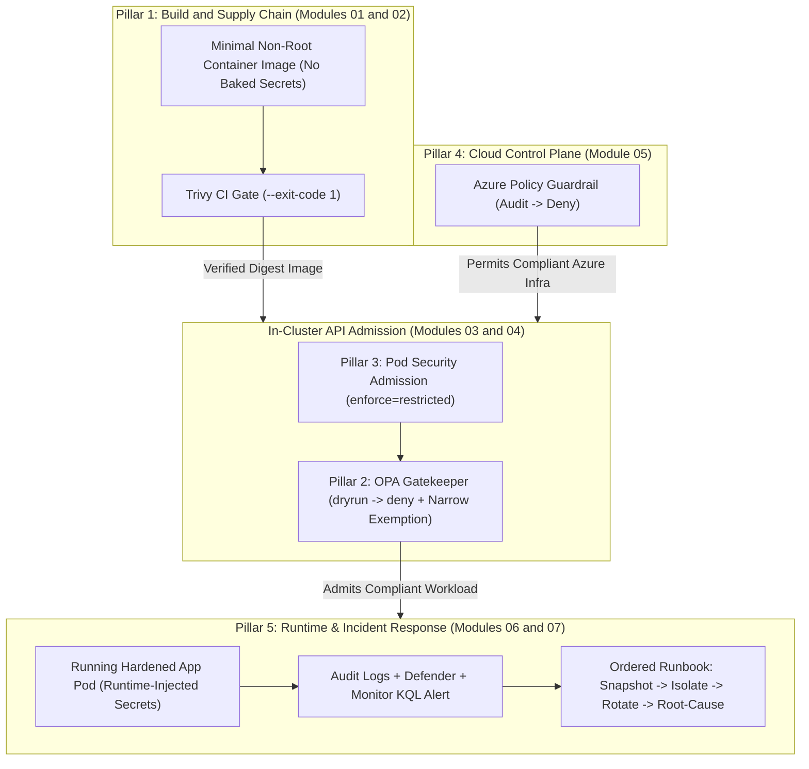
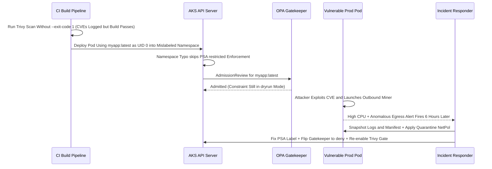

# Capstone Project: A Defensible Deployment, End to End

> **Prerequisites:** Modules 00–08 of Track 11 (Threat Modeling, Image Scanning, Secrets Management, Pod Security Admission, Gatekeeper, Azure Policy, Network Security in Depth, Incident Response), plus an AKS cluster (`rg-aks-learn` / `aks-learn` from Track 07) and optional local `kind` cluster for rapid iteration.  
> **Estimated Reading Time:** 45 minutes (2–4 hours hands-on build & verification)  
> **Target Audience:** Backend Engineers, Platform Engineers, DevSecOps Engineers, Cloud Security Practitioners.

> [!TIP]
> **The Golden Rule of Defense-in-Depth Capstones:** A security control you have only seen admit good workloads is unverified — prove every pillar by forcing a known-bad artifact, Pod spec, or ARM deployment to fail, roll out every enforcing boundary audit-first before promoting to hard denial, and verify billable Azure teardown once every acceptance item is demonstrably proven.

---

## Why This Matters

Every module in this track added one layer of defense in isolation — a scanned image, a hardened `securityContext`, a Gatekeeper policy, an Azure guardrail, an incident runbook. Real security is none of those alone; it's all of them *stacked and working together* so that the failure of any one is caught by another (defense in depth, module 00). This capstone is where you prove you can assemble the whole stack on a real cluster and — just as important — write down what you'd do when it's breached anyway. There's no pre-built solution given and no quiz. Finishing this is what "you can secure the stack" means: you build it, you defend it, and you have a plan for the day a defense fails.

---

## 1. Architectural Mental Model: Five-Pillar Defense-in-Depth Stack

Rather than trusting any single perimeter, this capstone binds five independent security boundaries from build time through live runtime incident response:



### The Project

Take a small containerized web application (reuse one from the Docker or Kubernetes tracks, or write a trivial Flask/Node app) and stand it up on a cluster such that it is scanned, hardened, policy-constrained at both the Kubernetes and Azure layers, and backed by a written incident-response plan. You may do this on your **AKS cluster** from track 07 (for the Azure Policy and Defender pieces you'll need it) — but you can develop and test the Kubernetes-layer pieces (Gatekeeper, Pod Security Admission) on a local **kind** cluster first to save cost, then reproduce on AKS. Clean up billable resources when done.

#### The Five Required Pillars

1. **A scanned-and-hardened image** (modules 01, 02/09) — built from a current, minimal base, running non-root, with no secrets baked into layers, and passing a Trivy scan gate at a severity threshold you can justify.
2. **A Gatekeeper policy enforced on the cluster** (module 04) — a real `ConstraintTemplate` + `Constraint` that blocks a real misconfiguration (e.g., disallowed registries, missing required labels, or `:latest` tags), rolled out audit-first then set to `deny`, with a narrow exemption for any legitimate infra workload that needs one.
3. **Pod Security Admission at the `restricted` level** (module 03) — your application's namespace enforcing the `restricted` Pod Security Standard, with your app's Pod actually admitted and running under it (proper `securityContext`: non-root, no privilege escalation, all capabilities dropped, seccomp `RuntimeDefault`, read-only root FS with writable volumes only where needed).
4. **An Azure Policy guardrail assigned** (module 05) — at least one built-in Azure policy definition assigned to a scope covering your environment (e.g., "AKS clusters should not allow privileged containers", "allowed locations", or "storage accounts should disallow public access"), promoted from `Audit` to `Deny` (or left in `Audit` with a written justification), with compliance verified.
5. **A written incident-response runbook** (module 07) for a specific, realistic scenario — use: *"a container in this cluster starts making outbound connections to an unknown external IP — what do you do, in order?"* The runbook must give the ordered steps (detect → preserve evidence → isolate → rotate → root-cause → remediate), the exact command for each step, who is responsible, and the check that tells you it's contained.

---

## 2. Taxonomic Comparison: Capstone Pillars, Trust Boundaries & Environment Split

### Defense-in-Depth Coverage Matrix

| Pillar | Origin Modules | Trust Boundary Guarded | Audit-First Mode | Hard Verification Proof | Gap Caught If Another Pillar Fails |
| :--- | :--- | :--- | :--- | :--- | :--- |
| **1. Hardened & Scanned Image** | 01, 02/09 | CI Build & Artifact | Trivy report (`--exit-code 0`) | Trivy `--exit-code 1` fails vulnerable build | Catches CVEs inside base images before admission |
| **2. Gatekeeper Policy** | 04 | K8s API Custom Rules | `enforcementAction: dryrun` | Known-bad `:latest`/unapproved Pod rejected | Catches unapproved registries PSA cannot express |
| **3. PSA `restricted`** | 03 | K8s API Pod Spec | `warn=restricted` / `audit=restricted` | Privileged or UID-0 Pod rejected | Catches privilege escalation if image runs as root |
| **4. Azure Policy** | 05 | Azure Control Plane | `effect: Audit` | `RequestDisallowedByPolicy` blocks bad ARM write | Stops public storage/unapproved regions outside K8s |
| **5. IR Runbook & Signals** | 06, 07 | Runtime & Post-Breach | KQL / Defender alerts active | Dry-run drill executes Snapshot → Isolate → Rotate | Contains zero-day or leaked secret bypassing admission |

### Local `kind` vs. Cloud `AKS` Execution Strategy

| Workstream | Develop & Test First On | Final Verification Target | Cost Consideration |
| :--- | :--- | :--- | :--- |
| **Docker build, Trivy scan, non-root check** | Local Workstation / WSL2 | Local + Push to ACR | Free |
| **PSA `restricted` & custom Gatekeeper** | Local `kind` Cluster | Reproduce on AKS | `kind` is free |
| **Azure Policy & Defender / Monitor signals** | Azure Portal / CLI (`rg-sec-lab`) | AKS Cluster (`aks-learn`) | Delete AKS/Defender/FW immediately after proof |

---

## 3. Production War Story Post-Mortem: "Green Deployment" Masks Fail-Open Admission Controls

- **Severity:** SEV-1
- **Detection Time:** 6 hours (Azure Monitor CPU anomaly alert + unexpected external pool DNS lookups)
- **Resolution Time:** 2 hours 10 minutes
- **Impact:** A backend microservice deployed smoothly and showed green health checks, yet a silent namespace label typo (`pod-security.kubernetes.io/enfore=restricted`), an unpromoted `dryrun` Gatekeeper constraint, and a skipped Trivy `--exit-code 1` gate let a root-privileged `:latest` container run in production with open egress.

### What Happened



### Root Cause Analysis

1. **Only Testing the Happy Path:** Because the valid application deployed without errors, nobody tested whether a known-bad privileged Pod or `:latest` image was actually *rejected*.
2. **Stuck in Audit Mode:** Gatekeeper remained in `dryrun`, silently accumulating `status.violations` that no CI gate or alert monitored.
3. **No Runtime Containment Plan:** Because no default-deny egress policy or pre-written runbook existed, responders spent crucial initial minutes deciding whether to kill the Pod before preserving evidence.

### The Fix & Architectural Hardening

- **Mandatory Negative-Path Smoke Tests:** Deployment pipelines assert that submitting a dry-run privileged/latest Pod is actively *rejected* before marking any cluster security baseline complete.
- **Automated Admission & Compliance Audits:** Pre-deployment verifiers validate PSA labels, Gatekeeper enforcement mode, and container `securityContext` invariants in CI.
- **Standardized Runbook Playbook:** Every production service ships with a scenario-specific IR runbook listing exact `Snapshot -> Isolate -> Rotate -> Root-Cause` commands and owner rotation paths.

---

## 4. Multi-Language Production Implementation: Capstone Five-Pillar Compliance Verifier

Before deploying to AKS or submitting a pull request, platform gates programmatically verify that container manifests satisfy Pillar 1 (pinned, approved image tags), Pillar 2 (no `:latest`, required metadata labels), and Pillar 3 (`restricted` Pod Security Standard invariants).

````carousel
```go
package capstone

import (
	"fmt"
	"strings"

	corev1 "k8s.io/api/core/v1"
)

// ValidateCapstonePod enforces Pillar 1/2/3 invariants: pinned approved registry,
// restricted Pod Security Admission compliance, and non-root read-only execution.
func ValidateCapstonePod(pod *corev1.Pod, allowedRegistry string) []string {
	var violations []string

	if pod.Labels["app"] == "" || pod.Labels["owner"] == "" {
		violations = append(violations, "missing required governance labels (app, owner)")
	}

	if pod.Spec.SecurityContext == nil || pod.Spec.SecurityContext.RunAsNonRoot == nil || !*pod.Spec.SecurityContext.RunAsNonRoot {
		violations = append(violations, "pod securityContext.runAsNonRoot must be true")
	}
	if pod.Spec.SecurityContext == nil || pod.Spec.SecurityContext.SeccompProfile == nil ||
		pod.Spec.SecurityContext.SeccompProfile.Type != corev1.SeccompProfileTypeRuntimeDefault {
		violations = append(violations, "pod seccompProfile.type must be RuntimeDefault")
	}

	for _, c := range pod.Spec.Containers {
		if !strings.HasPrefix(c.Image, allowedRegistry) {
			violations = append(violations, fmt.Sprintf("container %s image %s violates allowed registry %s", c.Name, c.Image, allowedRegistry))
		}
		if strings.HasSuffix(c.Image, ":latest") || !strings.Contains(c.Image, ":") {
			violations = append(violations, fmt.Sprintf("container %s uses mutable or :latest tag", c.Name))
		}
		sc := c.SecurityContext
		if sc == nil || sc.AllowPrivilegeEscalation == nil || *sc.AllowPrivilegeEscalation {
			violations = append(violations, fmt.Sprintf("container %s must set allowPrivilegeEscalation=false", c.Name))
		}
		if sc == nil || sc.ReadOnlyRootFilesystem == nil || !*sc.ReadOnlyRootFilesystem {
			violations = append(violations, fmt.Sprintf("container %s must set readOnlyRootFilesystem=true", c.Name))
		}
		if sc == nil || sc.Capabilities == nil || len(sc.Capabilities.Drop) == 0 || sc.Capabilities.Drop[0] != "ALL" {
			violations = append(violations, fmt.Sprintf("container %s must drop ALL capabilities", c.Name))
		}
	}
	return violations
}
```
<!-- slide -->
```typescript
import * as k8s from "@kubernetes/client-node";

export interface GateCheckResult {
  passed: boolean;
  violations: string[];
}

/**
 * Validates that a Kubernetes Pod manifest satisfies Capstone Pillars 1–3:
 * approved registry + pinned tag, required labels, and restricted PSA securityContext.
 */
export function verifyCapstoneCompliance(
  pod: k8s.V1Pod,
  approvedRegistryPrefix: string
): GateCheckResult {
  const violations: string[] = [];
  const labels = pod.metadata?.labels ?? {};

  if (!labels.app || !labels.owner) {
    violations.push("Missing required governance labels: 'app' and 'owner'.");
  }

  const podSc = pod.spec?.securityContext;
  if (podSc?.runAsNonRoot !== true) {
    violations.push("Pod spec.securityContext.runAsNonRoot must be true.");
  }
  if (podSc?.seccompProfile?.type !== "RuntimeDefault") {
    violations.push("Pod spec.securityContext.seccompProfile.type must be RuntimeDefault.");
  }

  for (const c of pod.spec?.containers ?? []) {
    const img = c.image ?? "";
    if (!img.startsWith(approvedRegistryPrefix)) {
      violations.push(`Container '${c.name}' uses unapproved registry: ${img}`);
    }
    if (img.endsWith(":latest") || (!img.includes(":") && !img.includes("@sha256:"))) {
      violations.push(`Container '${c.name}' must use an immutable tag or digest, never :latest.`);
    }

    const sc = c.securityContext;
    if (sc?.allowPrivilegeEscalation !== false) {
      violations.push(`Container '${c.name}' must set allowPrivilegeEscalation: false.`);
    }
    if (sc?.readOnlyRootFilesystem !== true) {
      violations.push(`Container '${c.name}' must set readOnlyRootFilesystem: true.`);
    }
    if (!sc?.capabilities?.drop?.includes("ALL")) {
      violations.push(`Container '${c.name}' must include capabilities.drop: ['ALL'].`);
    }
  }

  return { passed: violations.length === 0, violations };
}
```
<!-- slide -->
```python
from typing import Any, Dict, List


def verify_pod_pillars(pod_manifest: Dict[str, Any], allowed_registry: str) -> List[str]:
    """Audits a Pod dict against Capstone Pillars 1-3 (Image Pinning, Labels, PSA Restricted)."""
    errors: List[str] = []
    meta = pod_manifest.get("metadata", {})
    labels = meta.get("labels", {})
    if not labels.get("app") or not labels.get("owner"):
        errors.append("Missing required governance labels ('app', 'owner').")

    spec = pod_manifest.get("spec", {})
    pod_sc = spec.get("securityContext", {})
    if pod_sc.get("runAsNonRoot") is not True:
        errors.append("spec.securityContext.runAsNonRoot must be True.")
    if pod_sc.get("seccompProfile", {}).get("type") != "RuntimeDefault":
        errors.append("spec.securityContext.seccompProfile.type must be 'RuntimeDefault'.")

    for c in spec.get("containers", []):
        cname = c.get("name", "unknown")
        img = c.get("image", "")
        if not img.startswith(allowed_registry):
            errors.append(f"Container '{cname}' image '{img}' not from '{allowed_registry}'.")
        if img.endswith(":latest") or (":" not in img and "@sha256:" not in img):
            errors.append(f"Container '{cname}' must pin an immutable version tag or digest.")

        sc = c.get("securityContext", {})
        if sc.get("allowPrivilegeEscalation") is not False:
            errors.append(f"Container '{cname}' requires allowPrivilegeEscalation=False.")
        if sc.get("readOnlyRootFilesystem") is not True:
            errors.append(f"Container '{cname}' requires readOnlyRootFilesystem=True.")
        if "ALL" not in sc.get("capabilities", {}).get("drop", []):
            errors.append(f"Container '{cname}' must drop ALL capabilities.")

    return errors
```
<!-- slide -->
```csharp
using System;
using System.Collections.Generic;
using System.Linq;
using k8s.Models;

namespace CapstoneSecurityGate
{
    public static class PodComplianceVerifier
    {
        /// <summary>
        /// Evaluates a V1Pod specification against Capstone Pillars 1-3:
        /// approved registry pinning, governance labels, and PSA restricted settings.
        /// </summary>
        public static IReadOnlyList<string> Evaluate(V1Pod pod, string allowedRegistryPrefix)
        {
            var issues = new List<string>();
            var labels = pod.Metadata?.Labels;
            if (labels == null || !labels.ContainsKey("app") || !labels.ContainsKey("owner"))
            {
                issues.Add("Pod must carry 'app' and 'owner' governance labels.");
            }

            var podSc = pod.Spec?.SecurityContext;
            if (podSc?.RunAsNonRoot != true)
                issues.Add("Pod SecurityContext.RunAsNonRoot must be true.");
            if (podSc?.SeccompProfile?.Type != "RuntimeDefault")
                issues.Add("Pod SeccompProfile.Type must be RuntimeDefault.");

            foreach (V1Container c in pod.Spec?.Containers ?? Array.Empty<V1Container>())
            {
                string img = c.Image ?? string.Empty;
                if (!img.StartsWith(allowedRegistryPrefix, StringComparison.Ordinal))
                    issues.Add($"Container '{c.Name}' image '{img}' is outside allowed registry '{allowedRegistryPrefix}'.");
                if (img.EndsWith(":latest", StringComparison.Ordinal) || (!img.Contains(':') && !img.Contains("@sha256:")))
                    issues.Add($"Container '{c.Name}' must not use mutable or ':latest' tags.");

                V1SecurityContext? sc = c.SecurityContext;
                if (sc?.AllowPrivilegeEscalation != false)
                    issues.Add($"Container '{c.Name}' must set AllowPrivilegeEscalation = false.");
                if (sc?.ReadOnlyRootFilesystem != true)
                    issues.Add($"Container '{c.Name}' must set ReadOnlyRootFilesystem = true.");
                if (sc?.Capabilities?.Drop == null || !sc.Capabilities.Drop.Contains("ALL"))
                    issues.Add($"Container '{c.Name}' must drop ALL capabilities.");
            }

            return issues;
        }
    }
}
```
````

---

## 5. Acceptance Checklist, Verification Workflows & Hints

### Acceptance Checklist

Work isn't done until you can demonstrate every one of these:

- [ ] The application image is built from a current, minimal base and runs as a non-root user; `docker inspect` / `whoami` confirms non-root.
- [ ] No secret appears in `docker history` / the image layers; any secret the app needs is injected at runtime (env/mounted file), not baked in.
- [ ] A Trivy scan runs as a **gate** (`--exit-code 1 --severity <threshold> --ignore-unfixed`) and the image **passes** it; you can articulate why you chose that threshold and how you handle unfixable CVEs.
- [ ] A Gatekeeper `ConstraintTemplate` + `Constraint` is installed, was rolled out in `dryrun`/audit first, and is now in `deny`; a **known-bad** object is actually **rejected** (not just a good one admitted).
- [ ] The Gatekeeper policy has a **narrow, labeled/namespaced exemption** for at least one legitimate workload — not a global off-switch — and an unexempted violation is still blocked.
- [ ] The app's namespace is labeled `pod-security.kubernetes.io/enforce=restricted`; the app Pod is admitted and `Running` under it, and a deliberately non-compliant Pod (e.g. privileged) is **rejected**.
- [ ] The app's `securityContext` satisfies `restricted`: `runAsNonRoot`, no privilege escalation, `capabilities.drop: ["ALL"]`, seccomp `RuntimeDefault`, and `readOnlyRootFilesystem` with writable volumes only where the app genuinely writes.
- [ ] At least one Azure Policy built-in is **assigned** to a scope covering your environment, its **compliance state** is visible, and either it's in `Deny` (with a blocked create demonstrated) or in `Audit` with a written reason.
- [ ] The incident-response runbook exists in writing, is scenario-specific, lists the steps **in the correct order**, gives the exact command per step, and ends with the single detection signal you'd add so the scenario fires an alert automatically next time.
- [ ] You can point at your module-00 data-flow diagram and name which layer each of the five pillars defends — demonstrating you understand *why* they stack, not just that they're present.
- [ ] All billable Azure resources (AKS cluster, any Defender plan, any firewall) are cleaned up or accounted for when you're done.

### Practical Verification CLI Workflows (Prove the Negative Path)

Use these exact verification probes to prove every pillar *actually blocks bad objects* rather than silently admitting everything:

#### 1. Verify Non-Root, No-Secrets Layers & Trivy Gate (Pillar 1)

```bash
docker inspect --format='{{.Config.User}}' <your-image>:<tag>
docker history --no-trunc <your-image>:<tag> | grep -iE "secret|password|token|key" || echo "Clean layer history"
trivy image --exit-code 1 --severity CRITICAL,HIGH --ignore-unfixed <your-image>:<tag>
```

**Expected Output:**
```text
10001:10001
Clean layer history
Total: 0 (HIGH: 0, CRITICAL: 0)
```

#### 2. Verify Gatekeeper `deny` & PSA `restricted` Reject Known-Bad Pods (Pillars 2 & 3)

```bash
# Known-bad privileged pod must be REJECTED by PSA restricted
kubectl apply -n <app-namespace> --dry-run=server -f - <<'EOF'
apiVersion: v1
kind: Pod
metadata: {name: bad-priv-test}
spec:
  containers:
    - name: test
      image: busybox:1.36
      securityContext: {privileged: true}
EOF

# Known-bad :latest or unapproved-registry pod must be REJECTED by Gatekeeper
kubectl apply -n <app-namespace> --dry-run=server -f - <<'EOF'
apiVersion: v1
kind: Pod
metadata: {name: bad-latest-test}
spec:
  securityContext: {runAsNonRoot: true, runAsUser: 10001, seccompProfile: {type: RuntimeDefault}}
  containers:
    - name: test
      image: nginx:latest
      securityContext: {allowPrivilegeEscalation: false, capabilities: {drop: ["ALL"]}}
EOF
```

**Expected Output:**
```text
Error from server (Forbidden): pods "bad-priv-test" is forbidden: violates PodSecurity "restricted:latest"...
Error from server (Forbidden): admission webhook "validation.gatekeeper.sh" denied the request...
```

#### 3. Verify Azure Policy State & Billable Resource Cleanup (Pillar 4 & Cost Guard)

```bash
az policy state summarize --resource-group rg-sec-lab -o table
az security pricing show -n Containers --query pricingTier -o tsv
# When completely finished:
# az group delete --name rg-sec-lab --yes --no-wait
```

**Expected Output:**
```text
PolicyAssignmentName    ComplianceState    Count
----------------------  -----------------  -------
...                     Compliant          ...

Free
```

### Hints (Not a Solution)

- **Sequence it the way the track was ordered.** Harden and scan the image first (you can't deploy what won't pass its own gate), then get it running under `restricted` PSA (fix the `securityContext` until it's admitted), then layer Gatekeeper on top, then the Azure guardrail, then write the runbook last — by then you understand the system well enough to write a good one.
- **Develop the Kubernetes pillars on kind first.** PSA and Gatekeeper behave the same locally and cost nothing; move to AKS only when you need the Azure Policy and (optional) Defender pieces. Azure Policy's AKS add-on (module 05) is *managed Gatekeeper* — if you enable it, don't also hand-install a conflicting Gatekeeper for the same rule.
- **Test the bad path, not just the good one.** For every control, the proof is a *rejected* known-bad object (module 04's "fail-open" warning). "My good Pod runs" tells you nothing about whether the policy actually enforces.
- **Roll out every enforcing control audit-first.** PSA `warn`/`--dry-run`, Gatekeeper `dryrun`, Azure Policy `Audit` — measure blast radius before you block, so a security control doesn't cause your own outage.
- **Build the runbook from your threat model.** The rotation checklist in the runbook *is* the list of everything the compromised Pod's identity could reach (its SA token, mounted secrets, Key Vault access) — that's a module-00 blast-radius exercise, not guesswork. Order matters: preserve evidence and isolate before you rotate or delete (module 07).
- **Exemptions should be visible and narrow.** A labeled exemption on one workload that a reviewer can see in the policy is right; disabling the policy to unblock something is wrong (modules 03/04).
- **Don't gold-plate.** Five solid, demonstrably-enforcing pillars beat ten half-configured ones. Depth on each acceptance item is the goal.

---

## 6. Operational Validation Checkpoints

<details>
<summary><strong>Checkpoint 1: Avoiding Gatekeeper Collision with the Azure Policy AKS Add-On</strong></summary>

**Scenario:** You built and tested a custom Gatekeeper installation (`gatekeeper-system`) on local `kind`. Now you migrate to AKS and enable `az aks enable-addons -a azure-policy`, which crashes with webhook/CRD conflicts. What caused the collision and how do you avoid it?

**Diagnosis & Remediation:** Enabling `azure-policy` on AKS installs Microsoft's managed OPA Gatekeeper into `gatekeeper-system`. Installing raw upstream Gatekeeper alongside it creates duplicate webhooks and conflicting CRD ownership. On AKS, either use the `azure-policy` add-on exclusively for built-in Azure-managed Constraints, or disable the add-on if operating self-managed custom Gatekeeper templates.

</details>

<details>
<summary><strong>Checkpoint 2: Application Crashes Immediately Under `readOnlyRootFilesystem: true`</strong></summary>

**Scenario:** Your web app container runs fine locally and passes Trivy, yet crashes with `Permission denied: '/tmp/app.pid'` or `Read-only file system` once you apply Pillar 3's `restricted` `securityContext` (`readOnlyRootFilesystem: true`). How do you satisfy `restricted` without disabling read-only root FS?

**Diagnosis & Remediation:** `restricted` workloads must mount the container root filesystem read-only so attackers cannot modify binaries or stage scripts in `/usr` or `/app`. For legitimate scratch files (`/tmp`, `/var/run`, cache dirs), attach scoped `emptyDir` volumeMounts explicitly at those exact writable paths while keeping `readOnlyRootFilesystem: true` across the container.

</details>

<details>
<summary><strong>Checkpoint 3: Validating the Runbook Rotation Scope</strong></summary>

**Scenario:** You finished writing Pillar 5's runbook for unexpected outbound traffic. A peer reviews it and sees `kubectl delete pod <pod>` on Step 2 and "rotate the database password" as the only secret rotation step. Identify both fatal flaws before signing off the capstone.

**Diagnosis & Remediation:** First, deleting the Pod on Step 2 destroys live container logs and runtime forensics before investigation and triggers ReplicaSet replacement immediately — you must **snapshot** volatile state and **isolate** in-place via default-deny `NetworkPolicy` + label detachment before deleting anything. Second, rotating *only* the DB password ignores the Pod's ServiceAccount token, any other mounted K8s Secrets, and any Azure Key Vault / Managed Identity scope reachable from that workload (module 00 blast radius).

</details>

---

## Next

**Before you move on:** if any acceptance item is checked only because "it applied without error," go back and prove it the hard way — reject a known-bad object, show the blocked create, watch the isolation actually cut the Pod's egress. A control you haven't seen *stop something* is a control you haven't verified. When every box is genuinely ticked and your billable resources are cleaned up, you've finished the track: you can threat-model, scan, harden, enforce policy at both the Kubernetes and Azure layers, and respond to a breach in the right order.

This track built the *defenses*. The next one gives you the *visibility* to know when they're being tested: [12-observability-deep-dive](../../12-observability-deep-dive/README.md) — because you can only respond to what you can detect, and every detection signal this track leaned on (audit logs, unexpected-egress alerts, Defender findings) is something observability teaches you to collect, query, and trust. And the signing/SBOM topic this track only *previewed* in module 01 gets its full, end-to-end treatment much later in [18-supply-chain-security](../../18-supply-chain-security/README.md) — image signing, SBOM generation and attestation, and admission control that refuses anything unsigned. You now have the foundation both of those build on.

[Back to the track index](../README.md) · [Back to main curriculum](../../README.md)
