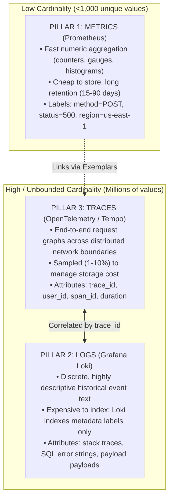
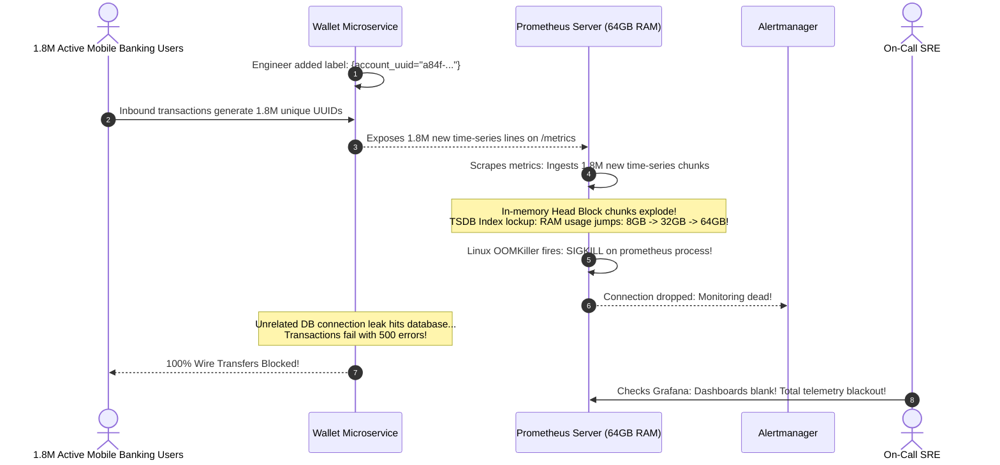

# 00 - Observability Concepts & The Three Pillars

> **Prerequisites**: [03 - Kubernetes Architecture & Workloads](../../03-kubernetes/01-kubernetes-architecture-and-concepts/README.md), [10 - Observability: Logging & Metrics](../../03-kubernetes/10-observability-logging-and-metrics/README.md).  
> **Target Audience**: SREs, Platform Architects, and Distributed Systems Engineers building unified telemetry, high-cardinality monitoring, and root-cause diagnostic pipelines.  
> **Estimated Deep-Dive Time**: 40 minutes.

---

> [!TIP]
> **The Golden Rule of Observability**: **Metrics detect, Traces isolate, Logs explain.** Never use metrics for high-cardinality individual entity tracking (such as `user_id` or `order_id`), as this triggers catastrophic time-series database (TSDB) cardinality explosions. Keep metric labels bounded and low-cardinality, inject high-cardinality attributes into structured **Logs** and distributed **Traces**, and link all three via W3C `trace_id` correlation.

---

## 1. Visual Mental Models: The Unified Telemetry Triad

In modern microservice architectures, diagnosing outages requires pivoting seamlessly across three fundamental telemetry pillars:

```mermaid
sequenceDiagram
    autonumber
    actor SRE as On-Call SRE (Grafana Dashboard)
    participant Prom as 1. Metrics (Prometheus)
    participant Tempo as 2. Traces (Tempo / Jaeger)
    participant Loki as 3. Logs (Loki / Elasticsearch)
    participant Code as Root Cause Identified

    Note over Prom: ALERT FIRES: Checkout API 5xx rate = 4.2%!<br/>P99 Latency jumped from 120ms to 2.4s!
    SRE->>Prom: Step 1: DETECT — Inspect SLO breach
    Prom-->>SRE: Prometheus returns Exemplar: Trace ID 4bf92f3577b34da6
    SRE->>Tempo: Step 2: ISOLATE — Query Trace ID 4bf92f3577b34da6
    Note over Tempo: Trace waterfall shows 2.2s spent in 'payment-db'<br/>Span: db.query 'SELECT * FROM wallets FOR UPDATE'
    Tempo-->>SRE: Downstream bottleneck isolated to payment-db container
    SRE->>Loki: Step 3: EXPLAIN — Filter logs by trace_id="4bf92f3577b34da6"
    Loki-->>SRE: Log Line: "FATAL: deadlock detected on wallet_locks_pkey; connection dropped"
    SRE->>Code: Step 4: RESOLVE — Fix lock ordering in transaction handler!
```

---

### The Dimensionality & Cardinality Spectrum



---

## 2. Technical Comparison: The Three Telemetry Pillars

### Telemetry Specification Matrix

| Metric / Dimension | Metrics (Prometheus) | Logs (Grafana Loki) | Traces (Tempo / OTel) |
| :--- | :--- | :--- | :--- |
| **Primary Question Answered** | *"Is the system degraded, and at what scale?"* | *"What exact error message occurred and why?"* | *"Where across services did this request spend time?"* |
| **Data Model** | Numeric time-series float values + label maps | Timestamped text records + stream labels | Directed Acyclic Graphs (DAGs) of timed Spans |
| **Indexing Strategy** | Inverted index across all label keys & values | Indexes stream metadata labels only (raw text unindexed) | Indexed by 128-bit `trace_id` hash |
| **Cardinality Tolerance**| **Strictly Low (<10,000 active series per metric)**| High (Handles unbounded attributes in log bodies) | **Infinite (Handles user IDs, session tokens)** |
| **Retention Strategy** | Aggregated & downsampled (Weeks / Months) | TTL purge (7–30 days) | Heavily sampled (1%–5% retained for 3–7 days) |
| **Query Language** | PromQL | LogQL | TraceQL |

---

### The Mathematical Cardinality Explosion Formula

Prometheus creates a distinct time-series entry for every unique permutation of label values:

$$\text{Total Active Series} = \prod_{i=1}^{n} \left| \text{Distinct Values of Label } i \right|$$

*Example of a Fatal Cardinality Trap:*
```
Metric: http_requests_total
  - method:     [GET, POST, PUT, DELETE]         (4 values)
  - status:     [200, 400, 404, 500]             (4 values)
  - endpoint:   [/checkout, /login, /orders]     (3 values)
  - user_id:    [Unbounded active user IDs]      (500,000 values)

Total Series = 4 × 4 × 3 × 500,000 = 24,000,000 Time Series!
```
At ~2 KB of RAM per active series in the TSDB memory buffer, **24 million series requires ~48 GB of RAM**, causing an instant, unrecoverable Out-Of-Memory (OOM) crash.

---

## 3. Production War Story: The UUID Cardinality Explosion Crash

### Incident Overview
A digital banking fintech service deployed a new release of their core `wallet-transfer` microservice. An engineer added the `account_uuid` as a Prometheus label to `http_requests_total` to "track individual account request volumes on Grafana."

Within 90 minutes of the release during morning peak transaction volume, the Prometheus server consumed all 64 GB of allocated node memory and crashed in `OOMKilled`. The cluster monitoring system went completely blind. Simultaneously, an unrelated database connection pool leak occurred, but because alerts and dashboards were dead, the incident escalated undetected for 3 hours, blocking $12M in wire transfers.

### The Catastrophic Failure Sequence



### Root Cause Analysis
1. **Unbounded Label Cardinality**: Labeling metrics with high-cardinality identifiers (`account_uuid`, `user_id`, `email`, raw URI paths containing query parameters) multiplies the time series count exponentially.
2. **TSDB Inverted Index Exhaustion**: Prometheus stores label indices in memory. When the number of series crossed 15 million, memory allocation outpaced garbage collection.
3. **WAL Replay Death Loop**: When Prometheus restarted, it attempted to replay the in-memory Write-Ahead Log (WAL) containing the 15 million series, immediately running out of memory and crashing again in an infinite loop.

### The Remediation & Permanent Architectural Invariants
1. **Remove High-Cardinality Labels**: Replace `account_uuid` with a bounded label (`account_type="retail|business"`).
2. **Enforce Ingestion Relabeling Drop Rules**: Configure Prometheus scrape jobs with `metric_relabel_configs` to automatically drop dangerous labels at ingest:
   ```yaml
   metric_relabel_configs:
     - regex: '(account_uuid|user_id|session_token)'
       action: labeldrop
   ```
3. **Move Identifiers to Tracing Attributes**: Move `account_uuid` to OpenTelemetry Span attributes or structured JSON logs, where unbounded data is indexed efficiently.

---

## 4. Multi-Language Correlated Telemetry Implementations

Below are complete implementations in **Go**, **Node.js/TypeScript**, and **Python**. Each microservice emits low-cardinality Prometheus metrics, structured JSON logs, and OpenTelemetry spans linked by the W3C `traceparent` context.

### Go Implementation (OpenTelemetry + Zap + Prometheus)

```go
// internal/observability/telemetry.go
package observability

import (
	"context"
	"net/http"
	"time"

	"github.com/prometheus/client_golang/prometheus"
	"github.com/prometheus/client_golang/prometheus/promhttp"
	"go.opentelemetry.io/otel"
	"go.opentelemetry.io/otel/trace"
	"go.uber.org/zap"
)

var (
	tracer = otel.Tracer("order-service")

	// Strictly low-cardinality metric labels: method, status, endpoint
	HttpRequestsTotal = prometheus.NewCounterVec(
		prometheus.CounterOpts{
			Name: "http_requests_total",
			Help: "Total HTTP requests processed",
		},
		[]string{"method", "status", "endpoint"},
	)
)

func init() {
	prometheus.MustRegister(HttpRequestsTotal)
}

// CorrelatedHttpMiddleware injects trace context into structured logs and records metrics
func CorrelatedHttpMiddleware(logger *zap.Logger, next http.Handler) http.Handler {
	return http.HandlerFunc(func(w http.ResponseWriter, r *http.Request) {
		ctx, span := tracer.Start(r.Context(), r.Method+" "+r.URL.Path)
		defer span.End()

		traceID := span.SpanContext().TraceID().String()
		spanID := span.SpanContext().SpanID().String()

		// Inject trace context into structured logger
		reqLogger := logger.With(
			zap.String("trace_id", traceID),
			zap.String("span_id", spanID),
			zap.String("method", r.Method),
			zap.String("path", r.URL.Path),
		)

		start := time.Now()
		next.ServeHTTP(w, r.WithContext(ctx))

		duration := time.Since(start)
		status := "200" // Extracted from custom response writer in production

		// Increment low-cardinality metric
		HttpRequestsTotal.WithLabelValues(r.Method, status, r.URL.Path).Inc()

		reqLogger.Info("Request completed successfully",
			zap.Duration("duration_ms", duration),
			zap.String("status", status),
		)
	})
}
```

---

### Node.js / TypeScript Implementation (Pino + OpenTelemetry)

```typescript
// src/observability/telemetry.ts
import { Request, Response, NextFunction } from 'express';
import { trace, context } from '@opentelemetry/api';
import client from 'prom-client';
import pino from 'pino';

export const logger = pino({
  level: 'info',
  formatters: {
    level: (label) => ({ level: label }),
  },
  timestamp: pino.stdTimeFunctions.isoTime,
});

// Low-cardinality metric definition
export const httpRequestsTotal = new client.Counter({
  name: 'http_requests_total',
  help: 'Total HTTP requests processed',
  labelNames: ['method', 'status', 'route'],
});

export function correlatedTelemetryMiddleware(req: Request, res: Response, next: NextFunction): void {
  const currentSpan = trace.getSpan(context.active());
  const traceId = currentSpan?.spanContext().traceId || 'no-trace';
  const spanId = currentSpan?.spanContext().spanId || 'no-span';

  // Attach contextual child logger
  const requestLogger = logger.child({
    trace_id: traceId,
    span_id: spanId,
    method: req.method,
    route: req.route?.path || req.path,
  });

  const start = Date.now();

  res.on('finish', () => {
    const duration = Date.now() - start;
    const statusCode = res.statusCode.toString();

    // 1. Metric: Low-cardinality count
    httpRequestsTotal.inc({
      method: req.method,
      status: statusCode,
      route: req.route?.path || req.path,
    });

    // 2. Log: Structured JSON carrying trace context
    requestLogger.info({
      duration_ms: duration,
      status_code: res.statusCode,
      message: 'HTTP transaction finished',
    });
  });

  next();
}
```

---

### Python Implementation (FastAPI + OpenTelemetry + Structlog)

```python
# observability/telemetry.py
import time
import structlog
from fastapi import FastAPI, Request
from starlette.middleware.base import BaseHTTPMiddleware
from opentelemetry import trace
from prometheus_client import Counter

tracer = trace.get_tracer("order-service")

HTTP_REQUESTS_TOTAL = Counter(
    "http_requests_total",
    "Total HTTP requests processed",
    ["method", "status", "endpoint"]
)

logger = structlog.get_logger()

class CorrelatedObservabilityMiddleware(BaseHTTPMiddleware):
    async def dispatch(self, request: Request, call_next):
        with tracer.start_as_current_span(f"{request.method} {request.url.path}") as span:
            ctx = span.get_span_context()
            trace_id = format(ctx.trace_id, "032x") if ctx.trace_id else "none"
            span_id = format(ctx.span_id, "016x") if ctx.span_id else "none"

            structlog.contextvars.bind_contextvars(
                trace_id=trace_id,
                span_id=span_id,
                method=request.method,
                endpoint=request.url.path
            )

            start_time = time.time()
            response = await call_next(request)
            duration = (time.time() - start_time) * 1000

            HTTP_REQUESTS_TOTAL.labels(
                method=request.method,
                status=str(response.status_code),
                endpoint=request.url.path
            ).inc()

            logger.info("Processed request", status=response.status_code, duration_ms=duration)
            return response
```

---

## 5. Practical Hands-On Verification Laboratory

In this laboratory, you will inspect baseline cluster telemetry, calculate cardinality mathematically, verify W3C trace header propagation, and observe log-trace correlation.

### Step 1: Inspect Live Resource Telemetry via `kubectl top`

Verify that the metrics pipeline is operational on your Kubernetes cluster:

```bash
kubectl top nodes
kubectl top pods -A --sort-by=memory
```

*Expected Terminal Output:*
```text
NAME                     CPU(cores)   CPU%   MEMORY(bytes)   MEMORY%
kind-control-plane       145m         3%     780Mi           9%

NAMESPACE     NAME                               CPU(cores)   MEMORY(bytes)
monitoring    prometheus-k8s-0                   35m          280Mi
kube-system   coredns-76f75df574-8b2xm           3m           22Mi
```

---

### Step 2: Simulate Trace Context Propagation via `traceparent`

Run a test curl simulating an upstream API Gateway passing standard W3C distributed tracing headers:

```bash
# W3C Traceparent format: version - trace_id (32 hex) - parent_span_id (16 hex) - flags (01 = sampled)
TRACE_ID="4bf92f3577b34da6a3ce929d0e0e4736"
SPAN_ID="00f067aa0ba902b7"
TRACEPARENT="00-${TRACE_ID}-${SPAN_ID}-01"

curl -v -H "traceparent: ${TRACEPARENT}" http://localhost:8080/api/orders
```

*Expected Server Log Output (Structured JSON):*
```json
{
  "timestamp": "2026-11-10T08:45:10.124Z",
  "level": "info",
  "service": "order-service",
  "trace_id": "4bf92f3577b34da6a3ce929d0e0e4736",
  "span_id": "00f067aa0ba902b7",
  "method": "GET",
  "path": "/api/orders",
  "duration_ms": 14.2,
  "status": 200,
  "message": "Transaction verified"
}
```

The log entry is now cryptographically bound to the distributed trace!

---

## 6. Command Quick-Reference Cheat Sheet

| Command / Flag | Action / Objective | Example Scenario |
| :--- | :--- | :--- |
| `curl http://localhost:8080/metrics` | Inspect raw Prometheus exposition text | Verify metric names, types, and label sets |
| `logcli query '{app="order-api"} \|= "trace_id"'` | Query Grafana Loki logs by trace ID | Pivot from trace to root-cause log lines |
| `kubectl top pods -A` | Instant cluster CPU/memory usage snapshot | Detect resource starvation during incidents |
| `prometheus_tsdb_head_series` | PromQL query to monitor active TSDB cardinality | Prevent cardinality explosion crashes |
| `traceparent: 00-<trace>-<span>-01` | W3C standardized distributed tracing header | Propagate context across HTTP boundaries |

---

## 7. Operational Validation Checkpoints

### Scenario 1: Prometheus Memory Blowup During Campaign Launch
**Context:** During a Black Friday promotion, Prometheus memory climbs from 4GB to 32GB in 40 minutes, triggering node memory alerts. Inspecting Prometheus logs shows `tsdb: compacted blocks failed: oom-killed`.

<details>
<summary>View Diagnostic Workflow & Resolution</summary>

**Root Cause:**  
A microservice began exporting a dynamic promotional code label (`promo_code="WINTER2026_XYZ"`) on `http_requests_total`. Because millions of unique promo codes exist, active time series jumped by 800%.

**Diagnostic Commands:**
```sql
# Identify top 10 highest-cardinality metric names in PromQL:
topk(10, count by (__name__) ({__name__=~".+"}))
```

**Resolution Steps:**
1. In the Prometheus scrape configuration, add `metric_relabel_configs` to drop the dangerous label immediately:
   ```yaml
   metric_relabel_configs:
     - action: labeldrop
       regex: 'promo_code'
   ```
2. Restart Prometheus and alert the engineering team to move `promo_code` into structured JSON logs.
</details>

---

### Scenario 2: Tracing Ingestion Storage Exhaustion (100% Sampling)
**Context:** Your distributed tracing cluster (Tempo or Jaeger) consumes 2TB of disk storage per day, threatening to fill the storage backend.

<details>
<summary>View Diagnostic Workflow & Resolution</summary>

**Root Cause:**  
Applications are configured with `AlwaysOnSampler` (100% head-based sampling), recording every single routine `GET /healthz` and background ping across millions of requests.

**Resolution Steps:**
1. Switch OpenTelemetry SDK to **Tail-Based Sampling** or probabilistic head-based sampling (e.g. `TraceIdRatioBased: 0.05` for 5% sampling).
2. Configure OpenTelemetry Collector filters to drop all traces targeting `/healthz`, `/metrics`, or `/ready` endpoints.
</details>

---

### Scenario 3: Loki Logs Unsearchable Due to "Label Misuse"
**Context:** An engineering team configures Fluent Bit to extract `user_id` and `request_id` as Grafana Loki stream labels. Loki query latency surges to 45 seconds, and queries crash with `max chunks per query exceeded`.

<details>
<summary>View Diagnostic Workflow & Resolution</summary>

**Root Cause:**  
Loki is designed around the philosophy: *"Index only metadata, not the data."* Creating high-cardinality stream labels (like `user_id` or `trace_id`) creates millions of separate microscopic streams, destroying Loki's chunk compression efficiency.

**Resolution Steps:**
1. Keep Loki stream labels strictly low-cardinality: `app`, `environment`, `namespace`, `container`.
2. Leave `user_id`, `trace_id`, and `error_message` inside the log message body. Use LogQL line filters (`|= "trace_id=..."`) or JSON parsers (`| json | trace_id = "..."`) during queries.
</details>

---

## 8. Further Reading & Official Documentation

- [Google SRE Book: Monitoring Distributed Systems](https://sre.google/sre-book/monitoring-distributed-systems/)
- [The Three Pillars of Observability (Charity Majors, Liz Fong-Jones)](https://www.oreilly.com/library/view/observability-engineering/9781492076438/)
- [Prometheus Documentation: Metric and Label Naming Best Practices](https://prometheus.io/docs/practices/naming/)
- [OpenTelemetry Official Architecture Specification](https://opentelemetry.io/docs/concepts/what-is-opentelemetry/)
- [Grafana Loki: Label Best Practices and Anti-Patterns](https://grafana.com/docs/loki/latest/best-practices/)

---

## Next

Continue to [01 - Prometheus Fundamentals](../01-prometheus-fundamentals/README.md) to deploy the Prometheus Operator, configure automated scraping targets, and query cluster telemetry using PromQL.
