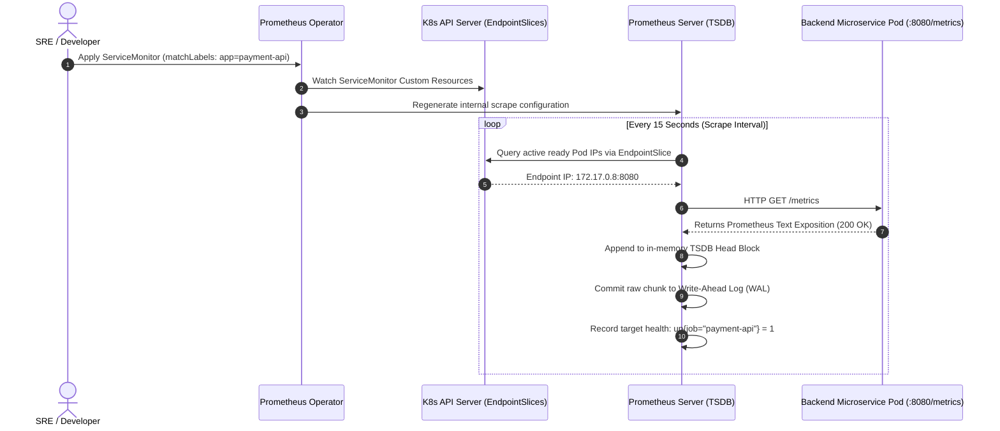
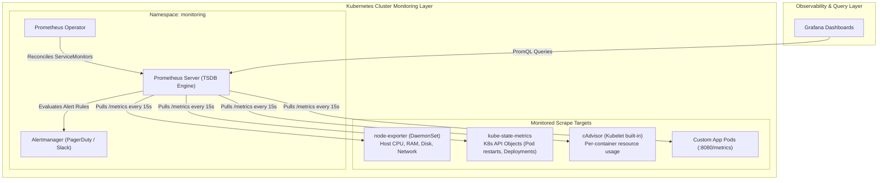
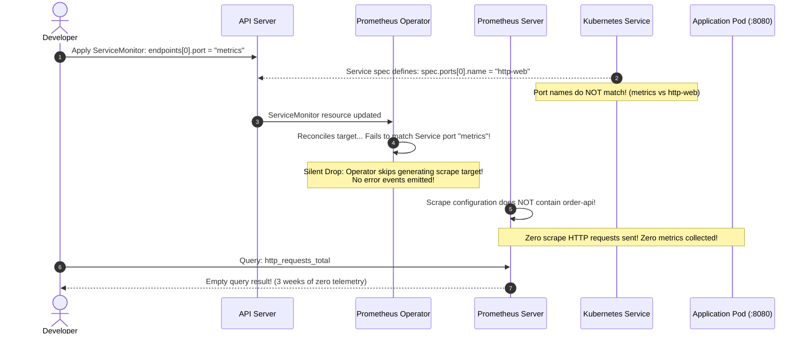

# 01 - Prometheus Fundamentals

> **Prerequisites**: [00 - Observability Concepts & The Three Pillars](../00-observability-concepts-and-three-pillars/README.md), [03 - Kubernetes Architecture & Workloads](../../03-kubernetes/01-kubernetes-architecture-and-concepts/README.md).  
> **Target Audience**: SREs, Systems Engineers, and Platform Administrators deploying the Prometheus Operator, configuring automated service discovery, and instrumenting custom microservices.  
> **Estimated Deep-Dive Time**: 40 minutes.

---

> [!TIP]
> **The Golden Rule of Prometheus Scraping**: **Prometheus is pull-based; if a scrape fails, it is an instant health signal.** In Prometheus, an unreachable target immediately records `up == 0`, providing a built-in availability heartbeat without dedicated ping daemons. When defining **`ServiceMonitors`**, always verify that `endpoints[].port` references the **name** of the port defined on the Kubernetes Service (e.g. `name: metrics`), never an unmapped numerical port.

---

## 1. Visual Mental Models: The Pull-Model Scraping Engine

Unlike legacy monitoring systems where applications push telemetry to central servers, Prometheus acts as an active crawler. It discovers workloads dynamically via the Kubernetes API, scrapes HTTP endpoints on a deterministic interval, and commits samples to its local Time-Series Database (TSDB).

### The Prometheus Operator & Scraping Lifecycle



---

### The Prometheus Ecosystem Architecture



---

## 2. Technical Comparison: Core Exporters & Exposition Formats

### Core Infrastructure Exporters Matrix

| Exporter | Host / Deployment | What It Measures | Example Metric |
| :--- | :--- | :--- | :--- |
| **`node-exporter`** | DaemonSet (1 per Node) | Physical/VM host hardware: CPU cycles, memory buffers, disk I/O, network bandwidth | `node_cpu_seconds_total`, `node_memory_MemAvailable_bytes` |
| **`cAdvisor`** | Built into every Kubelet | Individual container resource consumption within Linux cgroups | `container_cpu_usage_seconds_total`, `container_memory_working_set_bytes` |
| **`kube-state-metrics`** | Deployment (Singleton) | Declarative state of Kubernetes objects from API Server | `kube_pod_status_phase`, `kube_deployment_status_replicas_available` |
| **Custom App SDK** | Container process | Business transactions, latency histograms, error rates | `http_requests_total`, `checkout_latency_seconds_bucket` |

---

### The Prometheus Text Exposition Format

Any target exposing metrics must format them in the standard UTF-8 Prometheus text specification:

```text
# HELP http_requests_total Total number of HTTP requests processed by endpoint.
# TYPE http_requests_total counter
http_requests_total{method="POST",status="200",path="/orders"} 14820 1762764800000
http_requests_total{method="POST",status="500",path="/orders"} 34 1762764800000

# HELP jvm_memory_used_bytes Current memory usage of JVM heap.
# TYPE jvm_memory_used_bytes gauge
jvm_memory_used_bytes{area="heap"} 536870912

# HELP http_request_duration_seconds Latency histogram in seconds.
# TYPE http_request_duration_seconds histogram
http_request_duration_seconds_bucket{le="0.05"} 2400
http_request_duration_seconds_bucket{le="0.1"} 3100
http_request_duration_seconds_bucket{le="0.5"} 3500
http_request_duration_seconds_bucket{le="+Inf"} 3520
http_request_duration_seconds_sum 245.8
http_request_duration_seconds_count 3520
```

---

### ServiceMonitor Declarative Configuration

A `ServiceMonitor` links a set of Kubernetes Services to the Prometheus Operator:

```yaml
apiVersion: monitoring.coreos.com/v1
kind: ServiceMonitor
metadata:
  name: order-api-monitor
  namespace: default
  labels:
    release: prometheus # Must match Prometheus Operator release selector!
spec:
  selector:
    matchLabels:
      app: order-api     # Must match labels on the Kubernetes Service!
  namespaceSelector:
    matchNames:
      - default
  endpoints:
    - port: http-metrics # Must match Service spec.ports[].name!
      path: /metrics
      interval: 15s
      scrapeTimeout: 10s
```

---

## 3. Production War Story: The Phantom ServiceMonitor & Silent Telemetry Hole

### Incident Overview
A tier-1 retail logistics platform rolled out an automated order processing pipeline on Kubernetes. The team created a `ServiceMonitor` to scrape transaction metrics. 

For 21 days, developers assumed Prometheus was collecting performance data. When a customer reported missing order shipments, engineers navigated to Grafana to investigate, only to find completely empty graphs. Prometheus had collected zero metrics for 3 weeks.

### The Failure Sequence



### Root Cause Analysis
1. **Port Name Mismatch**: The `ServiceMonitor.spec.endpoints[].port` was set to `metrics`, but the `Service.spec.ports[].name` was configured as `http-web`.
2. **Silent Failure Contract**: Kubernetes operators validate schema validity, not target existence. Because the port did not match, the Operator generated an empty target list without throwing an alert.
3. **Missing `up == 1` Baseline Alerting**: The team lacked an automated alert verifying that critical microservice targets were registered in Prometheus.

### The Remediation & Permanent Policy
1. **Synchronize Service & ServiceMonitor Port Names**:
   ```yaml
   # Service manifest:
   spec:
     ports:
       - name: http-metrics # Identical port name!
         port: 8080
         targetPort: 8080

   # ServiceMonitor manifest:
   spec:
     endpoints:
       - port: http-metrics # Identical port name!
   ```
2. **Automated Target Registration Alerts**: Created an Alertmanager rule alerting whenever expected service scrape targets disappear:
   ```yaml
   alert: ServiceTargetMissing
   expr: absent(up{job="order-api"}) == 1
   for: 5m
   labels:
     severity: critical
   ```

---

## 4. Multi-Language Microservice Instrumentation

Below are production-grade implementations in **Go**, **Node.js/TypeScript**, and **Python** exposing standard `/metrics` endpoints with Counters, Gauges, and Histograms.

### Go Implementation (Official `client_golang`)

```go
// main.go
package main

import (
	"log"
	"net/http"
	"time"

	"github.com/prometheus/client_golang/prometheus"
	"github.com/prometheus/client_golang/prometheus/promhttp"
)

var (
	// 1. Counter: Only increments
	HttpRequestsTotal = prometheus.NewCounterVec(
		prometheus.CounterOpts{
			Name: "http_requests_total",
			Help: "Total HTTP requests processed by endpoint and status.",
		},
		[]string{"method", "status", "path"},
	)

	// 2. Gauge: Fluctuates up and down
	ActiveConnections = prometheus.NewGauge(
		prometheus.GaugeOpts{
			Name: "active_concurrent_connections",
			Help: "Number of active in-flight HTTP connections.",
		},
	)

	// 3. Histogram: Slices durations into buckets
	RequestDuration = prometheus.NewHistogramVec(
		prometheus.HistogramOpts{
			Name:    "http_request_duration_seconds",
			Help:    "Execution duration in seconds.",
			Buckets: []float64{0.01, 0.05, 0.1, 0.25, 0.5, 1.0, 2.5},
		},
		[]string{"path"},
	)
)

func init() {
	prometheus.MustRegister(HttpRequestsTotal)
	prometheus.MustRegister(ActiveConnections)
	prometheus.MustRegister(RequestDuration)
}

func main() {
	http.Handle("/metrics", promhttp.Handler())

	http.HandleFunc("/api/orders", func(w http.ResponseWriter, r *http.Request) {
		start := time.Now()
		ActiveConnections.Inc()
		defer ActiveConnections.Dec()

		// Simulate business logic
		time.Sleep(20 * time.Millisecond)

		w.WriteHeader(http.StatusOK)
		w.Write([]byte(`{"status":"order_created"}`))

		duration := time.Since(start).Seconds()
		HttpRequestsTotal.WithLabelValues(r.Method, "200", "/api/orders").Inc()
		RequestDuration.WithLabelValues("/api/orders").Observe(duration)
	})

	log.Println("Microservice listening on :8080 with /metrics active")
	log.Fatal(http.ListenAndServe(":8080", nil))
}
```

---

### Node.js / TypeScript Implementation (`prom-client`)

```typescript
// src/index.ts
import express, { Request, Response } from 'express';
import client from 'prom-client';

const app = express();
const port = 8080;

// Enable default Node.js runtime metrics (V8 heap, event loop lag, CPU)
client.collectDefaultMetrics({ prefix: 'node_app_' });

// 1. Counter
const httpRequestsTotal = new client.Counter({
  name: 'http_requests_total',
  help: 'Total HTTP requests processed',
  labelNames: ['method', 'status', 'path'],
});

// 2. Gauge
const activeDbConnections = new client.Gauge({
  name: 'db_connection_pool_active',
  help: 'Current active PostgreSQL connections in pool',
});

// 3. Histogram
const httpRequestDuration = new client.Histogram({
  name: 'http_request_duration_seconds',
  help: 'HTTP latency distributions in seconds',
  labelNames: ['path'],
  buckets: [0.01, 0.05, 0.1, 0.25, 0.5, 1.0],
});

// Exposition endpoint for Prometheus scraper
app.get('/metrics', async (req: Request, res: Response) => {
  res.set('Content-Type', client.register.contentType);
  res.end(await client.register.metrics());
});

app.post('/api/orders', (req: Request, res: Response) => {
  const end = httpRequestDuration.startTimer({ path: '/api/orders' });
  activeDbConnections.set(4); // Mock pool size

  res.status(201).json({ status: 'created' });

  httpRequestsTotal.inc({ method: 'POST', status: '201', path: '/api/orders' });
  end();
});

app.listen(port, () => {
  console.log(`Server listening on port ${port} with /metrics enabled`);
});
```

---

### Python Implementation (`prometheus_client`)

```python
# app.py
from fastapi import FastAPI, Response
from prometheus_client import Counter, Gauge, Histogram, generate_latest, CONTENT_TYPE_LATEST
import time

app = FastAPI()

HTTP_REQUESTS_TOTAL = Counter(
    "http_requests_total",
    "Total HTTP requests processed",
    ["method", "status", "path"]
)

ACTIVE_WORKERS = Gauge(
    "background_active_workers",
    "Current active background worker threads"
)

HTTP_LATENCY = Histogram(
    "http_request_duration_seconds",
    "Latency distribution in seconds",
    ["path"],
    buckets=[0.01, 0.05, 0.1, 0.25, 0.5, 1.0]
)

@app.get("/metrics")
def metrics():
    return Response(content=generate_latest(), media_type=CONTENT_TYPE_LATEST)

@app.post("/api/orders")
def create_order():
    start = time.time()
    ACTIVE_WORKERS.inc()
    try:
        time.sleep(0.015) # Business logic
        HTTP_REQUESTS_TOTAL.labels(method="POST", status="201", path="/api/orders").inc()
        return {"status": "success"}
    finally:
        ACTIVE_WORKERS.dec()
        HTTP_LATENCY.labels(path="/api/orders").observe(time.time() - start)
```

---

## 5. Practical Hands-On Verification Laboratory

In this laboratory, you will deploy a microservice exposing Prometheus metrics, construct a valid `ServiceMonitor`, verify target discovery in Prometheus, and write foundational PromQL queries.

### Step 1: Deploy Observable Microservice & Service

Create `01-prometheus-demo.yaml`:

```yaml
apiVersion: apps/v1
kind: Deployment
metadata:
  name: demo-telemetry-app
  namespace: default
  labels:
    app: demo-telemetry
spec:
  replicas: 2
  selector:
    matchLabels:
      app: demo-telemetry
  template:
    metadata:
      labels:
        app: demo-telemetry
    spec:
      containers:
        - name: app
          image: hashicorp/http-echo:0.2.3
          args:
            - "-text=# HELP app_requests_total Total requests\n# TYPE app_requests_total counter\napp_requests_total 42\n"
            - "-listen=:8080"
          ports:
            - name: http-metrics
              containerPort: 8080
---
apiVersion: v1
kind: Service
metadata:
  name: demo-telemetry-svc
  namespace: default
  labels:
    app: demo-telemetry
spec:
  type: ClusterIP
  selector:
    app: demo-telemetry
  ports:
    - name: http-metrics
      port: 8080
      targetPort: http-metrics
```

Apply to cluster:

```bash
kubectl apply -f 01-prometheus-demo.yaml
kubectl wait --for=condition=Ready pod -l app=demo-telemetry --timeout=30s
```

---

### Step 2: Create ServiceMonitor Custom Resource

Create `01-servicemonitor.yaml`:

```yaml
apiVersion: monitoring.coreos.com/v1
kind: ServiceMonitor
metadata:
  name: demo-telemetry-sm
  namespace: default
  labels:
    release: prometheus # Ensures Helm operator adopts this monitor
spec:
  selector:
    matchLabels:
      app: demo-telemetry
  endpoints:
    - port: http-metrics
      path: /
      interval: 15s
```

Apply to cluster:

```bash
kubectl apply -f 01-servicemonitor.yaml
```

---

### Step 3: Verify Active Target Scrape Status via CLI

Port-forward to the internal Prometheus server:

```bash
kubectl port-forward -n monitoring svc/prometheus-operated 9090:9090 &
```

Query the active targets API using `curl` and `jq`:

```bash
curl -s http://localhost:9090/api/v1/targets | jq '.data.activeTargets[] | select(.labels.job=="demo-telemetry-svc") | {job: .labels.job, health: .health, lastScrape: .lastScrape}'
```

*Expected Terminal Output:*
```json
{
  "job": "demo-telemetry-svc",
  "health": "up",
  "lastScrape": "2026-11-10T09:12:05.124Z"
}
```

The targets are healthy and actively scraping.

---

### Step 4: Execute Fundamental PromQL Queries

Execute PromQL queries using the Prometheus HTTP API:

```bash
# Query 1: Verify all active targets are reporting health = 1
curl -s "http://localhost:9090/api/v1/query?query=up%7Bjob%3D%22demo-telemetry-svc%22%7D" | jq '.data.result[] | {pod: .metric.pod, value: .value[1]}'

# Query 2: Inspect custom counter values
curl -s "http://localhost:9090/api/v1/query?query=app_requests_total" | jq '.data.result[] | {instance: .metric.instance, value: .value[1]}'
```

*Expected Terminal Output:*
```json
{
  "pod": "demo-telemetry-app-7b89f894bc-4x8w9",
  "value": "1"
}
{
  "instance": "172.17.0.6:8080",
  "value": "42"
}
```

---

## 6. Command Quick-Reference Cheat Sheet

| Command / Flag | Action / Objective | Example Scenario |
| :--- | :--- | :--- |
| `kubectl get servicemonitors -A` | List all declarative scrape configurations | Audit monitored cluster services |
| `curl localhost:9090/api/v1/targets` | Dump JSON list of all active/dropped scrape targets | Debug target discovery issues |
| `curl localhost:9090/api/v1/query?query=up` | Instantaneous vector query via CLI | Headless health checks in CI/CD |
| `up == 0` | PromQL query finding all unreachable targets | Alerting rule on offline workloads |
| `absent(up{job="x"})` | Detect if target configuration disappeared completely | Alert on deleted ServiceMonitors |

---

## 7. Operational Validation Checkpoints

### Scenario 1: Target Shows `DOWN` with `context deadline exceeded`
**Context:** In the Prometheus Targets dashboard (`http://localhost:9090/targets`), the target shows red state `DOWN` with error:
`Get "http://172.17.0.8:8080/metrics": context deadline exceeded`

<details>
<summary>View Diagnostic Workflow & Resolution</summary>

**Root Cause:**  
The application's `/metrics` endpoint is taking longer to generate than the configured `scrapeTimeout` (default 10s). This occurs when metrics handlers perform un-indexed database queries or mutex-locked operations on scrape.

**Resolution Steps:**
1. Fix application code: `/metrics` handlers must read from in-memory atomics only; they must **never** execute disk I/O or network calls.
2. In the `ServiceMonitor`, increase the timeout temporarily:
   ```yaml
   endpoints:
     - port: http-metrics
       scrapeTimeout: 20s
   ```
</details>

---

### Scenario 2: ServiceMonitor Applied Successfully but Target Never Appears
**Context:** You apply a valid `ServiceMonitor` in namespace `apps`. However, running `kubectl port-forward` to Prometheus shows zero targets registered.

<details>
<summary>View Diagnostic Workflow & Resolution</summary>

**Root Cause:**  
By default, the `kube-prometheus-stack` Helm chart configures the Prometheus resource with:
`serviceMonitorSelectorNilUsesHelmValues: true`
This tells Prometheus to **ignore all ServiceMonitors** unless they carry the exact Helm release label (`release: prometheus`).

**Resolution Steps:**
1. In your `values.yaml` for `kube-prometheus-stack`, configure:
   ```yaml
   prometheus:
     prometheusSpec:
       serviceMonitorSelectorNilUsesHelmValues: false
       serviceMonitorNamespaceSelector: {} # Watch across all namespaces!
   ```
2. Or add the required Helm label to your `ServiceMonitor`:
   ```yaml
   metadata:
     labels:
       release: prometheus
   ```
</details>

---

### Scenario 3: Target Down Due to Pod NetworkPolicy Blocking Port
**Context:** A newly secured microservice with a default-deny NetworkPolicy shows `up == 0` with `i/o timeout` in Prometheus.

<details>
<summary>View Diagnostic Workflow & Resolution</summary>

**Root Cause:**  
The microservice's `NetworkPolicy` blocks inbound packets from the `monitoring` namespace.

**Resolution Steps:**
Whitelist inbound scraping from Prometheus in the application's NetworkPolicy:
```yaml
ingress:
  - from:
      - namespaceSelector:
          matchLabels:
            kubernetes.io/metadata.name: monitoring
    ports:
      - protocol: TCP
        port: 8080
```
</details>

---

## 8. Further Reading & Official Documentation

- [Prometheus Official Documentation: Overview & Architecture](https://prometheus.io/docs/introduction/overview/)
- [Prometheus Operator: Getting Started with ServiceMonitors](https://prometheus-operator.dev/docs/operator/getting-started/)
- [Prometheus Community Helm Charts: kube-prometheus-stack](https://github.com/prometheus-community/helm-charts/tree/main/charts/kube-prometheus-stack)
- [Official Prometheus Go Client Documentation](https://github.com/prometheus/client_golang)
- [Node.js prom-client Library Specification](https://github.com/siimon/prom-client)

---

## Next

Continue to [02 - PromQL in Depth](../02-promql-in-depth/README.md) to master advanced metric querying: rates, histograms, quantiles, subqueries, and recording rules.
