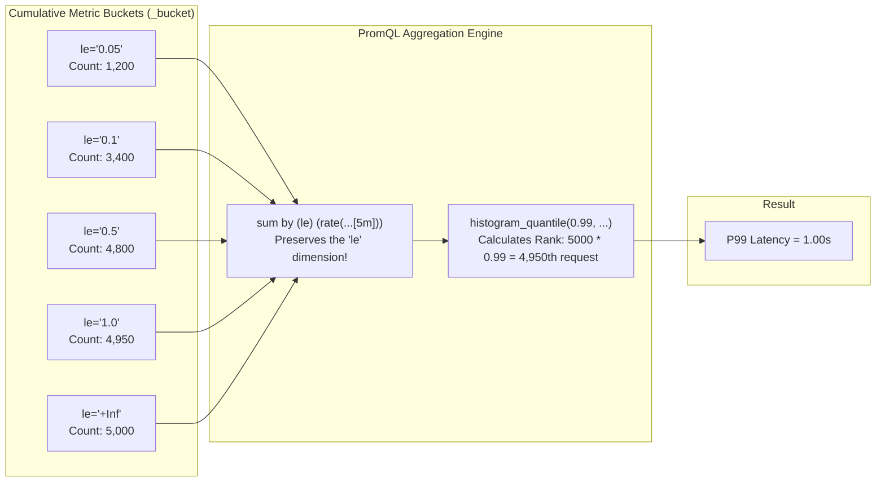
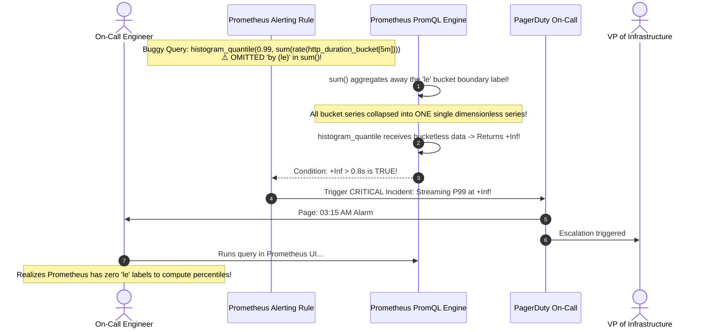

# 02 - PromQL in Depth

> **Prerequisites**: [01 - Prometheus Fundamentals](../01-prometheus-fundamentals/README.md), [10 - Observability: Metrics & Logging](../../03-kubernetes/10-observability-logging-and-metrics/README.md).  
> **Target Audience**: SREs, DevOps Engineers, and Backend Systems Architects authoring production Grafana dashboards, SLO burn rate alerts, and high-performance PromQL recording rules.  
> **Estimated Deep-Dive Time**: 40 minutes.

---

> [!TIP]
> **The Golden Rule of PromQL Math**: **Never alert on raw counts; always alert on normalized ratios and percentiles.** A counter alone tells you nothing about degradation; wrap it in `rate()` over a window at least \(4\times\) your scrape interval. When computing latencies with **`histogram_quantile`**, **you must retain the bucket boundary label using `sum by (le)`**. Omitting `by (le)` collapses bucket thresholds and causes the quantile function to output `NaN` or `+Inf`.

---

## 1. Visual Mental Models: Rate Calculations & Quantile Interpolation

PromQL operates entirely on multi-dimensional time series. Understanding how the query engine calculates rates and estimates percentiles across discrete sample windows is vital to preventing false alarms.

### `rate()` vs `irate()` Window Evaluation

```mermaid
sequenceDiagram
    autonumber
    actor Engine as PromQL Query Engine
    participant TSDB as Time-Series Database
    participant Output as Computed Vector

    Note over Engine: Query: rate(http_requests_total[5m])<br/>Window contains 20 samples (15s scrape interval)
    Engine->>TSDB: Fetch all 20 samples across the 5-minute window
    Note over Engine: Linear Regression / Slope calculation:<br/>• Computes difference between first and last samples<br/>• Compensates for counter resets (Pod restarts)<br/>• Smooth, noise-resistant trend for alerting!
    Engine-->>Output: Returns smoothed per-second rate

    Note over Engine: Query: irate(http_requests_total[5m])<br/>Window contains 20 samples
    Engine->>TSDB: Fetch samples across the 5-minute window
    Note over Engine: Instantaneous Rate calculation:<br/>• Looks ONLY at the last two raw samples in the window!<br/>• Extremely fast and spiky; reveals momentary micro-bursts<br/>• UNFIT for alerts (causes alert flap)!
    Engine-->>Output: Returns instant burst slope
```

---

### How `histogram_quantile` Interpolates Latency Buckets

Prometheus does not record individual request durations; instead, client libraries increment pre-allocated cumulative boundary buckets (`le` = less than or equal to):



---

## 2. Technical Comparison: PromQL Data Types & Functions

### PromQL Data Types Specification

| Data Type | Description | Syntax Example | When Used |
| :--- | :--- | :--- | :--- |
| **Instant Vector** | Single sample per time series at a specific point in time | `http_requests_total{status="500"}` | Current gauges, alert condition checks |
| **Range Vector** | Set of samples across a historical time window per series | `http_requests_total[5m]` | Input to rate, increase, and aggregation functions |
| **Scalar** | A single floating-point numerical value | `0.05` | Threshold comparisons (`> 0.05`), rate multiplications |
| **String** | Literal string value (rarely used outside CLI) | `"production"` | Static filter labels |

---

### Essential Range Vector Functions Taxonomy

| Function | Mathematics / Mechanics | Best Production Use Case |
| :--- | :--- | :--- |
| **`rate(v[5m])`** | Per-second average increase with counter reset extrapolation | **Default choice for all request rates, throughput, and error budgets** |
| **`irate(v[5m])`** | Instantaneous rate calculated between last two data points | High-resolution real-time dashboards to spot micro-bursts |
| **`increase(v[1h])`** | Total counter increase over the duration (\(\text{rate} \times 3600\)) | Billing reports, daily transaction volume count |
| **`predict_linear(v[4h], 86400)`** | Linear regression predicting value 24 hours into the future | Disk space exhaustion alerts (predicts disk fill before failure) |
| **`resets(v[1h])`** | Number of counter resets (restarts) in the window | Monitoring pod crash loops and unexpected restarts |

---

### Aggregation Operators & The Label Control Axis

When aggregating across series, `by` and `without` dictate dimensional survival:

```text
# KEEP SPECIFIED LABELS (Drop all others):
sum by (status, method) (rate(http_requests_total[5m]))
# Result: One series per (status, method) combination. Pod and instance labels are discarded.

# DISCARD SPECIFIED LABELS (Keep all others):
sum without (instance, pod) (rate(http_requests_total[5m]))
# Result: Pod and instance are dropped, preserving service, namespace, method, and status.
```

---

## 3. Production War Story: The Vanishing `by (le)` False Latency Alarm

### Incident Overview
An online streaming platform had an automated PagerDuty alert configured to notify SRE leadership if P99 streaming latency exceeded 800ms for 3 minutes. 

At 03:15 AM on a Sunday, the alert fired, paging 4 senior engineers and escalating to the VP of Infrastructure. The dashboard showed P99 latency at `+Inf` (infinity). However, external synthetic probes and client telemetry indicated all streams were starting in under 120ms with zero user buffering. Total incident duration: 90 minutes of sleep deprivation and executive escalation over a syntax error.

### The Failure Sequence



### Root Cause Analysis
1. **Aggregating Away the Bucket Dimension**: The engineer wrote `sum(rate(http_duration_bucket[5m]))`. The `sum()` operator dropped all labels, including the vital `le` boundary label.
2. **PromQL Failure Semantics**: `histogram_quantile()` expects an instant vector where each series contains an `le` label specifying the upper bucket boundary. When passed a vector lacking `le`, it cannot map values to distribution percentiles and returns `+Inf` or `NaN`.
3. **Missing Recording Rule Validation**: The query had not been pre-validated as a tested recording rule in staging.

### The Remediation & Permanent Fix
The query was corrected to preserve `le`:
```sql
# ✅ CORRECT PRODUCTION PATTERN:
histogram_quantile(0.99,
  sum by (le, service) (
    rate(http_duration_bucket[5m])
  )
) > 0.8
```
The team introduced CI linting for all `PrometheusRule` manifests using `pint` (Prometheus rule linter) to verify that any query containing `histogram_quantile` strictly retains `le`.

---

## 4. Multi-Language Programmatic PromQL Automation

Production platforms often query Prometheus programmatically to evaluate deployment quality gates, trigger automated rollbacks, or export compliance metrics.

### Go Implementation (Prometheus HTTP Client API)

```go
// cmd/promql-checker/main.go
package main

import (
	"context"
	"fmt"
	"log"
	"time"

	"github.com/prometheus/client_golang/api"
	v1 "github.com/prometheus/client_golang/api/prometheus/v1"
	"github.com/prometheus/common/model"
)

func main() {
	client, err := api.NewClient(api.Config{
		Address: "http://prometheus-k8s.monitoring.svc:9090",
	})
	if err != nil {
		log.Fatalf("Error creating client: %v", err)
	}

	v1api := v1.NewAPI(client)
	ctx, cancel := context.WithTimeout(context.Background(), 10*time.Second)
	defer cancel()

	// Query: Compute P99 latency across all services
	query := `histogram_quantile(0.99, sum by (le, service) (rate(http_request_duration_seconds_bucket[5m])))`

	result, warnings, err := v1api.Query(ctx, query, time.Now())
	if err != nil {
		log.Fatalf("PromQL query failed: %v", err)
	}
	if len(warnings) > 0 {
		log.Printf("Warnings: %v\n", warnings)
	}

	// Parse vector results
	vector, ok := result.(model.Vector)
	if !ok {
		log.Fatalf("Unexpected result format: %v", result)
	}

	for _, sample := range vector {
		service := sample.Metric["service"]
		p99Value := float64(sample.Value)
		fmt.Printf("Service: %s | P99 Latency: %.4f seconds\n", service, p99Value)

		// Quality gate evaluation
		if p99Value > 0.5 {
			log.Fatalf("SLA BREACH: Service %s P99 latency (%.4fs) exceeded 500ms target!", service, p99Value)
		}
	}
}
```

---

### Node.js / TypeScript Implementation (Axios PromQL Client)

```typescript
// src/metrics/promqlService.ts
import axios from 'axios';

interface PromQLMetricSample {
  metric: Record<string, string>;
  value: [number, string]; // [timestamp, string_value]
}

interface PromQLQueryResponse {
  status: string;
  data: {
    resultType: string;
    result: PromQLMetricSample[];
  };
}

export class PromQLQueryService {
  constructor(private readonly prometheusUrl: string) {}

  async get5xxErrorRatio(jobName: string): Promise<number> {
    const query = `sum(rate(http_requests_total{job="${jobName}", status=~"5.."}[5m])) / sum(rate(http_requests_total{job="${jobName}"}[5m]))`;
    const response = await axios.get<PromQLQueryResponse>(`${this.prometheusUrl}/api/v1/query`, {
      params: { query },
      timeout: 5000,
    });

    if (response.data.status !== 'success' || !response.data.data.result.length) {
      return 0.0; // Zero errors or no traffic
    }

    const rawVal = response.data.data.result[0].value[1];
    const ratio = parseFloat(rawVal);
    console.log(`Current 5xx Error Ratio for [${jobName}]: ${(ratio * 100).toFixed(2)}%`);
    return isNaN(ratio) ? 0.0 : ratio;
  }
}
```

---

### Python Implementation (Requests PromQL Client)

```python
# metrics/promql_evaluator.py
import requests
from typing import Dict, Any

class PromQLEvaluator:
    def __init__(self, base_url: str = "http://localhost:9090"):
        self.base_url = base_url.rstrip("/")

    def query_instant(self, query: str) -> Dict[str, float]:
        url = f"{self.base_url}/api/v1/query"
        res = requests.get(url, params={"query": query}, timeout=5)
        res.raise_for_status()
        data = res.json()

        if data.get("status") != "success":
            raise RuntimeError(f"Prometheus query error: {data}")

        results = {}
        for item in data.get("data", {}).get("result", []):
            label = item.get("metric", {}).get("service", "default")
            val = float(item.get("value", [0, 0])[1])
            results[label] = val
        return results

if __name__ == "__main__":
    evaluator = PromQLEvaluator()
    # Check current CPU usage by service
    query = 'sum by (service) (rate(container_cpu_usage_seconds_total[5m]))'
    print("Live CPU Usage:", evaluator.query_instant(query))
```

---

## 5. Practical Hands-On Verification Laboratory

In this laboratory, you will author a production `PrometheusRule` Custom Resource containing both pre-computed **Recording Rules** and automated **Alerting Rules**, apply it to your cluster, and verify evaluation.

### Step 1: Write Production `PrometheusRule` Manifest

Save as `02-rules.yaml`:

```yaml
apiVersion: monitoring.coreos.com/v1
kind: PrometheusRule
metadata:
  name: order-api-observability-rules
  namespace: monitoring
  labels:
    role: alert-rules
    release: prometheus # Ensures Prometheus Operator loads this rule!
spec:
  groups:
    - name: order_api.rules
      rules:
        # 1. RECORDING RULE: Pre-computes per-second request rate by status
        - record: job:http_requests:rate5m
          expr: sum by (job, status) (rate(http_requests_total[5m]))

        # 2. RECORDING RULE: Pre-computes P99 latency preserving 'le'
        - record: job:http_request_duration_seconds:p99
          expr: histogram_quantile(0.99, sum by (le, job) (rate(http_request_duration_seconds_bucket[5m])))

        # 3. ALERTING RULE: High 5xx Error Ratio Alert
        - alert: HighHttpErrorRate
          expr: |
            sum by (job) (rate(http_requests_total{status=~"5.."}[5m]))
            /
            sum by (job) (rate(http_requests_total[5m])) > 0.05
          for: 3m
          labels:
            severity: critical
            team: backend-platform
          annotations:
            summary: "High HTTP 5xx error rate on {{ $labels.job }}"
            description: "5xx error ratio is {{ $value | humanizePercentage }} (exceeds 5% threshold for 3m)."

        # 4. ALERTING RULE: P99 Latency SLA Breach
        - alert: LatencySlaBreached
          expr: job:http_request_duration_seconds:p99 > 1.0
          for: 5m
          labels:
            severity: warning
          annotations:
            summary: "P99 latency breached SLA on {{ $labels.job }}"
            description: "P99 response time is {{ $value | humanizeDuration }} (exceeds 1s threshold)."
```

Apply to cluster:

```bash
kubectl apply -f 02-rules.yaml
```

---

### Step 2: Verify Rule Ingestion via Prometheus Rules API

Query the Prometheus Rule API to confirm the operator parsed and loaded the rules:

```bash
kubectl port-forward -n monitoring svc/prometheus-operated 9090:9090 &
curl -s http://localhost:9090/api/v1/rules | jq '.data.groups[] | select(.name=="order_api.rules") | {name: .name, rulesCount: (.rules | length)}'
```

*Expected Terminal Output:*
```json
{
  "name": "order_api.rules",
  "rulesCount": 4
}
```

---

### Step 3: Query the Pre-Computed Recording Rule

Query the newly created recording rule metric directly:

```bash
curl -s "http://localhost:9090/api/v1/query?query=job:http_requests:rate5m" | jq .data.result
```

Notice that Prometheus now serves the pre-computed series in **under 2 milliseconds**, completely eliminating the CPU overhead of evaluating raw rate calculations across thousands of individual containers!

---

## 6. Command Quick-Reference Cheat Sheet

| PromQL Expression | Objective / Calculation | Example Scenario |
| :--- | :--- | :--- |
| `rate(m[5m])` | Smooth per-second counter increase over 5 minutes | Measuring request throughput |
| `sum by (code) (...)` | Aggregate series while retaining the `code` label | Status code breakdown chart |
| `histogram_quantile(0.95, sum by (le) (...))` | Calculate 95th percentile latency | SLO / Latency SLA tracking |
| `topk(5, rate(m[5m]))` | Return top 5 highest series | Identifying noisy neighbor microservices |
| `predict_linear(disk_free[4h], 86400) < 0` | Forecast if disk will exhaust within 24 hours | Early warning disk capacity alert |
| `metric1 / on(instance) metric2` | Divide two metrics matching by `instance` label | Normalized error percentage ratio |

---

## 7. Operational Validation Checkpoints

### Scenario 1: `many-to-many matching not allowed` Error
**Context:** You attempt to calculate the error ratio by dividing error requests by total requests:
`rate(errors_total[5m]) / rate(requests_total[5m])`
Prometheus returns error:
`many-to-many matching not allowed: matching labels must be unique on one side`

<details>
<summary>View Diagnostic Workflow & Resolution</summary>

**Root Cause:**  
Vector matching failure. In PromQL, dividing two vectors requires that both sides share identical label sets, or one side must be explicitly reduced via aggregation. If `errors_total` contains labels that `requests_total` does not, Prometheus cannot align the rows.

**Resolution Steps:**
Use the `on()` or `ignoring()` label matching modifier, or aggregate with `sum by`:
```sql
# Aggregate to common labels first:
sum by (service, endpoint) (rate(errors_total[5m]))
/
sum by (service, endpoint) (rate(requests_total[5m]))
```
</details>

---

### Scenario 2: `rate()` Returns Empty Results During Low-Traffic Lulls
**Context:** During overnight testing, a dashboard panel querying `rate(http_requests_total[30s])` displays `No Data` or jagged gaps.

<details>
<summary>View Diagnostic Workflow & Resolution</summary>

**Root Cause:**  
The range window (`[30s]`) is too small relative to the scrape interval (15s). To calculate a slope, `rate()` requires **at least two valid samples** within the window. If any sample is delayed or dropped, the window contains only 1 sample, and `rate()` mathematically returns empty.

**Resolution Steps:**
Follow the \(4\times\) Scrape Rule: If scrape interval is 15s, use at least `[1m]` or `[2m]` range window:
```sql
rate(http_requests_total[2m])
```
</details>

---

### Scenario 3: `absent()` Alert Never Clears After Resolution
**Context:** An alert monitoring for service presence `absent(up{job="billing-api"} == 1)` fires when the service dies. When the service recovers, the alert remains stuck in `FIRING` state.

<details>
<summary>View Diagnostic Workflow & Resolution</summary>

**Root Cause:**  
`absent()` returns `1` when the target series is completely missing from Prometheus, and returns an empty vector when the series exists. In some Alertmanager setups, transitioning to an empty vector leaves stale alert fingerprints.

**Resolution Steps:**
Instead of `absent()`, alert directly on the boolean target state:
```sql
up{job="billing-api"} == 0
```
This guarantees an active metric transitions deterministically from `0` (firing) to `1` (resolved).
</details>

---

## 8. Further Reading & Official Documentation

- [Prometheus Official Documentation: PromQL Basics](https://prometheus.io/docs/prometheus/latest/querying/basics/)
- [Prometheus Recording Rules & Naming Conventions](https://prometheus.io/docs/practices/rules/)
- [Robust Perception: Understanding histogram_quantile](https://www.robustperception.io/how-does-a-prometheus-histogram-work/)
- [Google SRE Book: Service Level Objectives & Error Budgets](https://sre.google/sre-book/service-level-objectives/)
- [Pint: The Prometheus Rule Linter](https://cloudflare.github.io/pint/)

---

## Next

Continue to [03 - Grafana Dashboards](../03-grafana-dashboards/README.md) to visualize PromQL queries, configure dynamic template variables, and design production operational dashboards.
