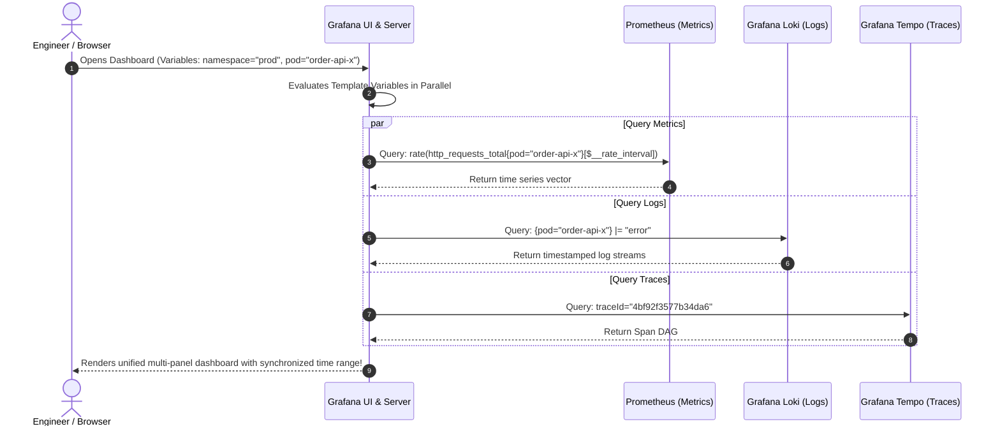
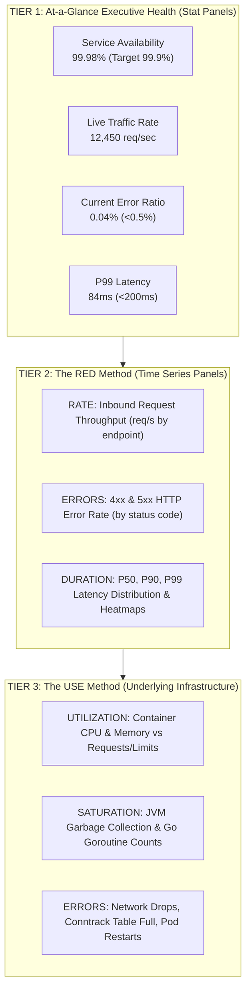
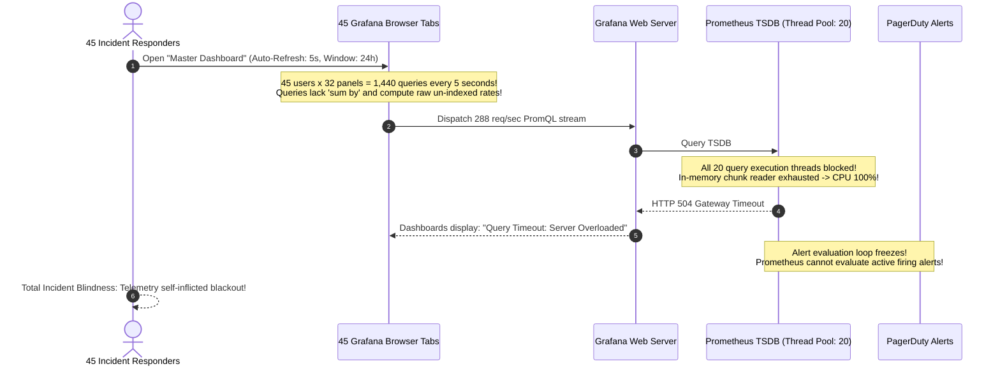

# 03 - Grafana: Dashboards and Visualization

> **Prerequisites**: [01 - Prometheus Fundamentals](../01-prometheus-fundamentals/README.md), [02 - PromQL in Depth](../02-promql-in-depth/README.md).  
> **Target Audience**: SREs, Systems Architects, and DevOps Engineers engineering actionable, high-performance operational dashboards, templated variable chains, and declarative Dashboards-as-Code.  
> **Estimated Deep-Dive Time**: 40 minutes.

---

> [!TIP]
> **The Golden Rule of Dashboard Architecture**: **Organize by intent, not by infrastructure.** Structure your operational dashboards around the **RED Method (Rate, Errors, Duration)** at the top for customer-facing services, and the **USE Method (Utilization, Saturation, Errors)** at the bottom for underlying infrastructure. Never click-build permanent production dashboards in the web UI; treat dashboards as version-controlled **JSON artifacts deployed via Kubernetes ConfigMaps and GitOps**.

---

## 1. Visual Mental Models: The Unified Pane of Glass

Grafana stores no telemetry of its own; it acts as a high-performance query dispatcher and rendering engine querying disparate data sources simultaneously:



---

### Dashboard Information Architecture: The RED Method

To reduce cognitive overload during high-stress production incidents, layout panels vertically according to diagnostic priority:



---

## 2. Technical Comparison: Panel Visualization Types

### Visualization Selection Matrix

| Visualization Type | Data Shape Expected | Best Used For | Anti-Pattern Warning |
| :--- | :--- | :--- | :--- |
| **Time Series** | Vector with multiple timestamp samples | Tracking throughput, CPU%, latency trends over time | Do not use for current singleton values (use Stat) |
| **Stat** | Single scalar or current vector sample | High-level KPI status tiles, SLO error budget remaining | Avoid plotting 50 series into one tile |
| **Bar Gauge** | Categorical series with current value | Comparing CPU across 10 worker nodes | Do not use for long-term historical trending |
| **Heatmap** | Histogram bucket distribution (`le`) | Visualizing multi-modal latency distributions & tail spikes | Requires `sum by (le)` buckets |
| **Logs** | Chronological text streams | Live log tails correlated with metric spikes | Never query unbounded broad time ranges without label filters |
| **Node Graph** | Directed Acyclic Graph (Edges & Nodes) | Visualizing microservice call DAGs and network latency | Requires distributed tracing backend (Tempo) |

---

### Template Variables Syntax Reference

Grafana variables transform static dashboards into dynamic, reusable templates:

```text
# 1. Query all available namespaces:
label_values(kube_pod_info, namespace)

# 2. Chained variable: Query pods belonging strictly to selected $namespace:
label_values(kube_pod_info{namespace="$namespace"}, pod)

# 3. Query all endpoints for a specific service:
label_values(http_requests_total{service="order-api"}, path)

# 4. Built-in Dynamic Variables:
$__interval          # Dynamically chosen range (e.g. 15s or 1m) based on panel width
$__rate_interval     # Guarantees range is at least (4 * scrape_interval) to prevent empty rate()
$__range             # Current dashboard full time range (e.g. 6h or 24h)
```

---

## 3. Production War Story: The Dashboard UI Freeze & Database Denial-of-Service

### Incident Overview
A global payment processing platform experienced a major latency degradation during morning market opening. To monitor the incident, 45 engineers and managers opened the "Payment Processing Master Dashboard."

The dashboard contained 32 individual panels. Several panels executed raw unaggregated PromQL queries over 24-hour windows with auto-refresh set to `5s`. Within 2 minutes of the engineers opening their browsers, the Prometheus server was hit with over 1,200 complex PromQL queries per minute. Prometheus thread pool saturated, memory surged from 8GB to 64GB, and the server locked up completely, blinding both the incident response team and the automated Kubernetes autoscaler.

### The Catastrophic Failure Sequence



### Root Cause Analysis
1. **Unbounded Auto-Refresh Rates**: The dashboard enabled a default refresh rate of `5s`. With 45 concurrent browser sessions, this generated an accidental Distributed Denial of Service (DDoS) against the monitoring backend.
2. **Missing Pre-Computed Recording Rules**: Complex panels evaluated heavy multi-hour quantile regressions on the fly rather than querying pre-computed recording rules (`job:http_request_duration:p99`).
3. **No Max Concurrent Query Limits**: Grafana's Prometheus data source lacked rate limits, forwarding every raw browser query directly to the TSDB.

### The Remediation & Permanent Hardening Rules
1. **Enforce Minimum Dashboard Refresh**: Set minimum auto-refresh to `30s` or `1m` across all shared team dashboards:
   ```json
   "refresh": "1m"
   ```
2. **Replace Heavy Queries with Recording Rules**: Replace live raw metric queries with pre-computed recording rules (from module 02).
3. **Configure Query Concurrency Limits**: In the Prometheus data source configuration, set `Max concurrent queries: 10` and enable query caching in Grafana.

---

## 4. Multi-Language Dashboards-as-Code Implementations

Production dashboards should never be created exclusively in the web UI. Below are automated Dashboard-as-Code generators in **Go**, **TypeScript**, and **Python** outputting version-controlled, production-ready Grafana JSON.

### Go Implementation (Grafana Foundation SDK)

```go
// cmd/gen-dashboard/main.go
package main

import (
	"encoding/json"
	"fmt"
	"log"
	"os"

	"github.com/grafana/grafana-foundation-sdk/go/common"
	"github.com/grafana/grafana-foundation-sdk/go/dashboard"
	"github.com/grafana/grafana-foundation-sdk/go/timeseries"
)

func main() {
	builder := dashboard.NewDashboardBuilder("Order Service RED Dashboard").
		Uid("order-service-red").
		Tags([]string{"production", "red-method", "backend"}).
		Refresh("30s").
		Time("now-1h", "now")

	// Panel 1: Inbound Request Rate (Time Series)
	ratePanel := timeseries.NewPanelBuilder().
		Title("HTTP Inbound Throughput (Rate)").
		Description("Per-second request rate partitioned by status code").
		Unit("reqps").
		WithTarget(common.NewDataqueryBuilder().
			Expr(`sum by (status) (rate(http_requests_total{service="order-api"}[$__rate_interval]))`).
			LegendFormat("{{status}}"))

	builder.WithPanel(ratePanel)

	builtDashboard, err := builder.Build()
	if err != nil {
		log.Fatalf("Failed to build dashboard: %v", err)
	}

	data, err := json.MarshalIndent(builtDashboard, "", "  ")
	if err != nil {
		log.Fatal(err)
	}

	if err := os.WriteFile("order-service-dashboard.json", data, 0644); err != nil {
		log.Fatal(err)
	}

	fmt.Println("Successfully generated order-service-dashboard.json")
}
```

---

### Node.js / TypeScript Implementation (Grafana Schema)

```typescript
// scripts/generateDashboard.ts
import fs from 'node:fs';

export interface GrafanaDashboard {
  title: string;
  uid: string;
  tags: string[];
  timezone: string;
  schemaVersion: number;
  refresh: string;
  panels: Array<Record<string, unknown>>;
}

export function buildRedDashboard(serviceName: string): GrafanaDashboard {
  return {
    title: `${serviceName} Operational Telemetry`,
    uid: `${serviceName}-ops-board`,
    tags: ['production', 'red', serviceName],
    timezone: 'utc',
    schemaVersion: 38,
    refresh: '1m',
    panels: [
      {
        id: 1,
        type: 'timeseries',
        title: 'Throughput (Requests/sec)',
        gridPos: { h: 8, w: 12, x: 0, y: 0 },
        targets: [
          {
            expr: `sum by (status) (rate(http_requests_total{service="${serviceName}"}[$__rate_interval]))`,
            legendFormat: 'Status {{status}}',
          },
        ],
      },
      {
        id: 2,
        type: 'timeseries',
        title: 'P99 Latency (Seconds)',
        gridPos: { h: 8, w: 12, x: 12, y: 0 },
        targets: [
          {
            expr: `histogram_quantile(0.99, sum by (le) (rate(http_request_duration_seconds_bucket{service="${serviceName}"}[$__rate_interval])))`,
            legendFormat: 'P99 Latency',
          },
        ],
      },
    ],
  };
}

const dashboardJson = JSON.stringify(buildRedDashboard('payment-api'), null, 2);
fs.writeFileSync('payment-api-dashboard.json', dashboardJson, 'utf8');
console.log('Generated payment-api-dashboard.json');
```

---

### Python Implementation (`grafanalib`)

```python
# scripts/gen_dashboard.py
from grafanalib.core import (
    Dashboard, TimeSeries, Target, GridPos,
    OPS_FORMAT, SECONDS_FORMAT, SHORT_FORMAT
)
from grafanalib._gen import DashboardEncoder
import json

def generate_dashboard(service_name: str) -> Dashboard:
    return Dashboard(
        title=f"{service_name.title()} Service RED Telemetry",
        uid=f"{service_name}-red-v1",
        tags=["production", "sre", service_name],
        timezone="utc",
        refresh="1m",
        panels=[
            TimeSeries(
                title="HTTP Request Rate (req/sec)",
                dataSource="Prometheus",
                targets=[
                    Target(
                        expr=f'sum by (status) (rate(http_requests_total{{service="{service_name}"}}[$__rate_interval]))',
                        legendFormat="{{status}}",
                    ),
                ],
                unit=OPS_FORMAT,
                gridPos=GridPos(h=8, w=12, x=0, y=0),
            ),
            TimeSeries(
                title="P99 Response Time",
                dataSource="Prometheus",
                targets=[
                    Target(
                        expr=f'histogram_quantile(0.99, sum by (le) (rate(http_request_duration_seconds_bucket{{service="{service_name}"}}[$__rate_interval])))',
                        legendFormat="P99",
                    ),
                ],
                unit=SECONDS_FORMAT,
                gridPos=GridPos(h=8, w=12, x=12, y=0),
            ),
        ],
    ).auto_panel_ids()

if __name__ == "__main__":
    board = generate_dashboard("order-service")
    with open("order-service-dashboard.json", "w") as f:
        json.dump(board.to_json_data(), f, sort_keys=True, indent=2, cls=DashboardEncoder)
    print("Generated order-service-dashboard.json")
```

---

## 5. Practical Hands-On Verification Laboratory

In this laboratory, you will configure a Grafana dashboard declaratively using a Kubernetes `ConfigMap` sidecar, verify automatic dashboard loading, and inspect template variable bindings.

### Step 1: Create Declarative Dashboard ConfigMap

Save as `03-dashboard-configmap.yaml`:

```yaml
apiVersion: v1
kind: ConfigMap
metadata:
  name: order-service-grafana-dashboard
  namespace: monitoring
  labels:
    grafana_dashboard: "1" # Sidecar watches for this label!
data:
  order-service.json: |
    {
      "annotations": { "list": [] },
      "editable": false,
      "fiscalYearStartMonth": 0,
      "graphTooltip": 1,
      "id": null,
      "links": [],
      "liveNow": false,
      "panels": [
        {
          "type": "stat",
          "title": "Cluster Pod Health Status",
          "gridPos": { "h": 6, "w": 6, "x": 0, "y": 0 },
          "targets": [
            {
              "expr": "sum(up)",
              "legendFormat": "Healthy Targets"
            }
          ]
        },
        {
          "type": "timeseries",
          "title": "Throughput by Method",
          "gridPos": { "h": 6, "w": 18, "x": 6, "y": 0 },
          "targets": [
            {
              "expr": "sum by (method) (rate(http_requests_total[$__rate_interval]))",
              "legendFormat": "{{method}}"
            }
          ]
        }
      ],
      "refresh": "1m",
      "schemaVersion": 38,
      "style": "dark",
      "tags": ["kubernetes", "production"],
      "time": { "from": "now-1h", "to": "now" },
      "timepicker": {},
      "timezone": "browser",
      "title": "Declarative Order Platform Telemetry",
      "uid": "decl-order-platform",
      "version": 1
    }
```

Apply to cluster:

```bash
kubectl apply -f 03-dashboard-configmap.yaml
```

---

### Step 2: Verify Grafana Sidecar Auto-Import

Inspect the Grafana sidecar container logs to verify it discovered the ConfigMap:

```bash
kubectl logs -n monitoring -l app.kubernetes.io/name=grafana -c grafana-sc-dashboard --tail=10
```

*Expected Terminal Output:*
```text
[INFO] ConfigMap "order-service-grafana-dashboard" found in namespace "monitoring"
[INFO] File "order-service.json" written to "/tmp/dashboards/order-service.json"
[INFO] Reloading Grafana dashboard provisioning... Done.
```

---

### Step 3: Verify Dashboard via Grafana REST API

Query the live Grafana API to confirm the dashboard exists:

```bash
kubectl port-forward -n monitoring svc/prometheus-grafana 3000:80 &

# Query dashboard metadata by UID
curl -s -u admin:prom-operator http://localhost:3000/api/dashboards/uid/decl-order-platform | jq '{title: .dashboard.title, panelsCount: (.dashboard.panels | length)}'
```

*Expected Terminal Output:*
```json
{
  "title": "Declarative Order Platform Telemetry",
  "panelsCount": 2
}
```

---

## 6. Command Quick-Reference Cheat Sheet

| UI Path / Command | Objective / Action | Example Scenario |
| :--- | :--- | :--- |
| `kubectl port-forward -n monitoring svc/kps-grafana 3000:80` | Forward local port to cluster Grafana | Local development and UI review |
| `label_values(metric, label)` | Populate template variable dropdown from Prometheus | Namespace and Pod selector filters |
| `grafana_dashboard: "1"` | Kubernetes ConfigMap label triggering sidecar reload | GitOps Dashboards-as-Code delivery |
| `$__rate_interval` | Optimal dynamic range window for `rate()` queries | Prevent `No Data` gaps on zoom out |
| `curl -u admin:pass http://.../api/dashboards/db` | Programmatically export or create dashboards | Automated CI/CD dashboard publishing |

---

## 7. Operational Validation Checkpoints

### Scenario 1: Panel Displays `No Data` When Zooming Out
**Context:** A time-series panel querying `rate(http_requests_total[30s])` works fine on a 15-minute window. However, when the user zooms out to `Last 7 Days`, every graph line disappears, displaying `No Data`.

<details>
<summary>View Diagnostic Workflow & Resolution</summary>

**Root Cause:**  
When viewing a 7-day range, Grafana downsamples the graph step to 15 minutes per pixel. A static 30-second window (`[30s]`) leaves gigantic 14.5-minute uncalculated voids between graph points, causing the visualization renderer to drop the line.

**Resolution Steps:**
Replace static time windows with Grafana’s built-in `$__rate_interval` variable:
```sql
rate(http_requests_total[$__rate_interval])
```
`$__rate_interval` automatically scales with the graph resolution, guaranteeing continuous, gap-free rendering across seconds or months.
</details>

---

### Scenario 2: Chained Variable `$pod` Fails to Update on `$namespace` Selection
**Context:** When users select a different namespace in the `$namespace` dropdown, the `$pod` dropdown continues displaying pods from the previous namespace.

<details>
<summary>View Diagnostic Workflow & Resolution</summary>

**Root Cause:**  
The `$pod` variable query is not scoped to `$namespace`, or the variable refresh policy is set to `On Dashboard Load` rather than `On Time Range Change` or `On Variable Change`.

**Resolution Steps:**
1. Update the variable query to incorporate the parent variable:
   ```sql
   label_values(kube_pod_info{namespace="$namespace"}, pod)
   ```
2. In the variable configuration settings, set **Refresh** to `On variable value change`.
</details>

---

### Scenario 3: Manually Edited Dashboard Reverts on Pod Restart
**Context:** An engineer adds 4 new panels in the Grafana UI and saves the dashboard. When the Grafana Pod is rescheduled, the changes are gone.

<details>
<summary>View Diagnostic Workflow & Resolution</summary>

**Root Cause:**  
The dashboard was provisioned via a Kubernetes `ConfigMap`. Grafana treats provisioned dashboards as read-only or overwrites local sqlite modifications whenever the provisioning sidecar restarts.

**Resolution Steps:**
1. After modifying a dashboard in the UI, export the JSON via **Dashboard Settings -> JSON Model**.
2. Commit the exported JSON into your GitOps repository or update the underlying Kubernetes `ConfigMap`.
</details>

---

## 8. Further Reading & Official Documentation

- [Grafana Official Documentation: Best Practices for Designing Dashboards](https://grafana.com/docs/grafana/latest/dashboards/build-dashboards/best-practices/)
- [The RED Method: How to Instrument Your Services](https://grafana.com/blog/2018/08/02/the-red-method-how-to-instrument-your-services/)
- [Grafana Community Dashboard Directory](https://grafana.com/grafana/dashboards/)
- [Grafana Sidecar Provisioning in Kubernetes](https://github.com/grafana/helm-charts/tree/main/charts/grafana#sidecar-for-dashboards)
- [Grafana Foundation SDK (Go & TypeScript)](https://github.com/grafana/grafana-foundation-sdk)

---

## Next

Continue to [04 - Logging and Log Aggregation with Loki](../04-logging-and-log-aggregation-loki/README.md) to add the second pillar of observability: indexing structured logs with Grafana Loki and querying error streams using LogQL.
