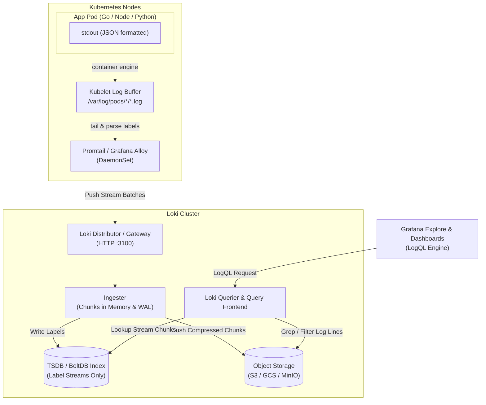
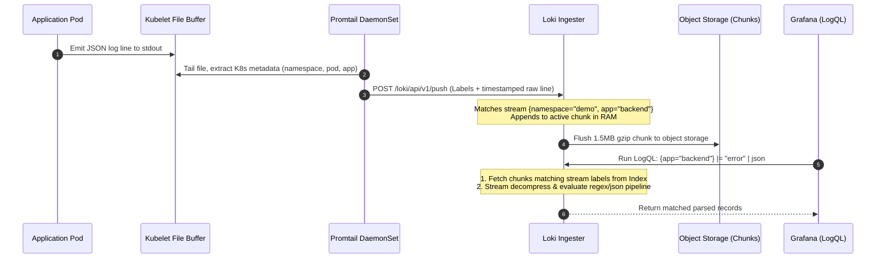

# Structured Logging and Log Aggregation with Loki

> **Difficulty**: Intermediate | **Estimated Time**: 35m | **Hands-On**: Mandatory

> [!TIP]
> **The Golden Rule of Log Aggregation:**
> **Index labels, never log messages.** In Grafana Loki, high cardinality in labels (such as `user_id`, `order_id`, or `request_id`) destroys index performance and exhausts memory budgets. Keep stream labels low-cardinality (`namespace`, `app`, `env`, `component`, `level`), store the high-cardinality detail inside the raw log payload, and extract it dynamically at query time using LogQL parsers.

---

## 1. Architecture & Visual Mental Models

Centralized logging in distributed microservices differs fundamentally from metric collection. Metrics aggregate events into counters and histograms before sending; logs preserve the rich, discrete narrative of every execution.

Grafana Loki is built on the philosophy of **"Prometheus, but for logs"**. Instead of full-text indexing every word in every string (like Elasticsearch), Loki indexes only a small set of labels (metadata). The raw log content is compressed, packed into chunks, and stored in inexpensive object storage.



### Ingestion vs. Query Lifecycle



---

## 2. ELK vs. Loki: Structural Comparison Grid

| Dimension | Elastic Stack (ELK / OpenSearch) | Grafana Loki | Engineering Tradeoff |
| :--- | :--- | :--- | :--- |
| **Indexing Model** | Inverted full-text index across every field and token | Inverted index **only** on stream labels; payload unindexed | Loki is 5-10x cheaper to store and run; ELK is faster on label-less global text search |
| **Storage Engine** | Lucene indices on fast NVMe/SSD | Compressed immutable chunks stored in S3/GCS/MinIO | Loki runs with zero expensive local disk persistence requirements |
| **Label Sensitivity** | High cardinality fields are standard indices | High cardinality labels cause catastrophic OOM crashes | Strict rule in Loki: Keep unique stream count strictly bounded |
| **Query Engine** | Lucene Query Syntax / KQL / Elasticsearch DSL | LogQL (promQL-compatible pipeline expressions) | LogQL shares syntax and mental model with Prometheus |
| **Resource Usage** | Heavy JVM memory footprint (16GB - 64GB+ per node) | Lightweight Go binary (512MB - 2GB typical) | Ideal for Kubernetes microservice edge-logging |
| **Schema Management** | Requires index templates, mappings, type conversions | Schema-free on ingestion; schema applied on read (`\| json`) | Zero pipeline breakages when developers add new log fields |

---

## 3. LogQL Deep Dive & Query Taxonomy

LogQL queries consist of two distinct parts:
1. **Log Stream Selector**: Filters by indexed labels (Mandatory, bounded in `{}`).
2. **Log Pipeline**: Line filters, parsers, and formatters evaluated sequentially over the matched chunks.

```
+---------------------------+   +----------------+   +-------------------+   +--------------------+
|  Stream Selector          |   |  Line Filter   |   |  JSON Parser      |   |  Label Filter      |
|  {app="order-service"}    |-->|  |= "failed"   |-->|  | json           |-->|  | duration_ms > 500|
+---------------------------+   +----------------+   +-------------------+   +--------------------+
```

### Comprehensive LogQL Operator Reference

| Operation | Syntax | Description | Example |
| :--- | :--- | :--- | :--- |
| **Stream Matcher** | `{label="val", env=~"prod|stage"}` | Filters indexed streams (exact, regex, negation) | `{namespace="production", app="payment"}` |
| **Line Contains** | `\|= "string"` | Case-sensitive substring search (fast grep) | `{app="payment"} \|= "card_declined"` |
| **Line Negative** | `!= "string"` | Rejects lines containing substring | `{app="payment"} != "healthcheck"` |
| **Regex Match** | `\|~ "pattern"` | RE2 regex search across raw log line | `{app="payment"} \|~ "status=(500\|502)"` |
| **JSON Parser** | `\| json` | Unpacks JSON keys into transient query labels | `{app="api"} \| json \| user="admin"` |
| **Logfmt Parser** | `\| logfmt` | Parses key=value pairs into query labels | `{app="ingress"} \| logfmt \| status=504` |
| **Line Format** | `\| line_format "{{.msg}}"` | Rewrites the displayed output line | `... \| line_format "WARN [{{.user}}]: {{.err}}"` |
| **Metric Generation** | `rate({stream}[5m])` | Number of log lines per second over window | `sum by (app) (rate({namespace="demo"} \|= "error" [5m]))` |
| **Quantile from Logs** | `quantile_over_time(0.99, ...)` | Derives percentiles from parsed numeric fields | `quantile_over_time(0.99, {app="api"} \| json \| unwrap latency [5m])` |

---

## 4. Production War Story: The Cardinality Explosion of User IDs

```
INCIDENT SUMMARY: INC-8491
SEVERITY: P1 - Critical
IMPACT: Complete logging infrastructure outage across 40 Kubernetes clusters.
DURATION: 1 hour 45 minutes
ROOT CAUSE: Dynamic label extraction from JSON log payloads promoted high-cardinality user IDs into Loki stream index.
```

### Incident Timeline

```mermaid
sequenceDiagram
    autonumber
    participant Dev as Engineering Team
    participant Promtail as Promtail DaemonSet
    participant Loki as Loki Ingester Nodes
    participant K8s as Kubernetes OOMKiller

    Dev->>Promtail: Deploys Promtail config with dynamic label: user_id
    Note over Promtail: Every distinct user logged creates a new unique stream label
    Promtail->>Loki: 2,500,000 distinct log streams pushed in 20 minutes
    Note over Loki: Memory usage jumps from 4GB to 32GB per pod.<br/>WAL flush queues stall under chunk index thrash.
    K8s->>Loki: Ingester pod OOMKilled (Exit Code 137)
    Loki-->>Promtail: Connection refused / 503 Service Unavailable
    Note over Promtail: Local buffers fill; logs dropped at the node buffer.
    Dev->>Loki: Pager fires: "LokiDown - Zero Logs Ingested"
```

### The Post-Mortem

- **What Happened**: A developer wanted to filter logs in Grafana by customer ID quickly. They added a Promtail pipeline stage:
  ```yaml
  # CATASTROPHIC CONFIGURATION:
  - json:
      expressions:
        user_id: user_id
  - labels:
      user_id: # <--- THIS PROMOTED UNBOUNDED CARDINALITY TO THE INDEX!
  ```
- **The Failure Mode**: A flash marketing sale occurred. 400,000 active users logged in. Each `user_id` spawned a dedicated Loki stream chunk buffer. Loki's ingesters ran out of memory, entered an OOMKilled crash loop, and halted all log ingestion across the engineering organization during active payment errors.
- **The Remediation**:
  1. Removed `user_id` from the Promtail `labels` block.
  2. Maintained `user_id` strictly inside the JSON stdout payload.
  3. Replaced queries with read-time LogQL extraction: `{app="checkout"} | json | user_id="usr_94819"`.
  4. Enforced strict Loki configuration bounds: `max_streams_per_user: 10000` and `reject_old_samples_max_age: 12h`.

---

## 5. Multi-Language Production Implementations

Centralized logging is fundamentally an application-tier responsibility. Never emit unstructured plaintext `fmt.Println` or `console.log`. Always emit newline-delimited JSON with standard schema attributes (`level`, `ts`, `service`, `trace_id`, `msg`).

### Go (`uber-go/zap` with Standard Fields)

```go
package main

import (
	"context"
	"net/http"
	"time"

	"go.uber.org/zap"
	"go.uber.org/zap/zapcore"
)

var logger *zap.Logger

func initLogger() {
	config := zap.NewProductionConfig()
	config.EncoderConfig.TimeKey = "ts"
	config.EncoderConfig.EncodeTime = zapcore.RFC3339TimeEncoder
	config.EncoderConfig.MessageKey = "msg"
	config.EncoderConfig.LevelKey = "level"
	
	var err error
	logger, err = config.Build(zap.Fields(
		zap.String("service", "order-processor"),
		zap.String("env", "production"),
	))
	if err != nil {
		panic(err)
	}
}

func handleOrder(w http.ResponseWriter, r *http.Request) {
	traceID := r.Header.Get("X-Trace-ID")
	if traceID == "" {
		traceID = "trace-fallback-001"
	}

	// High-cardinality fields MUST be attributes in the JSON body, NOT stream labels
	reqLogger := logger.With(
		zap.String("trace_id", traceID),
		zap.String("customer_id", r.URL.Query().Get("customer_id")),
		zap.String("order_id", "ord-98234"),
	)

	reqLogger.Info("processing order transaction",
		zap.Int("amount_cents", 4999),
		zap.String("currency", "USD"),
	)

	w.WriteHeader(http.StatusOK)
	w.Write([]byte(`{"status":"confirmed"}`))
}
```

### Node.js / TypeScript (`pino`)

```typescript
import pino from 'pino';
import http from 'http';

// Production logger outputting raw JSON to stdout
const logger = pino({
  level: process.env.LOG_LEVEL || 'info',
  formatters: {
    level: (label) => ({ level: label }),
  },
  base: {
    service: 'payment-gateway',
    env: process.env.NODE_ENV || 'production',
  },
  timestamp: pino.stdTimeFunctions.isoTime,
});

const server = http.createServer((req, res) => {
  const traceId = req.headers['x-trace-id'] || 'trace-node-101';
  
  // Child logger binds contextual fields for this specific request lifecycle
  const reqLog = logger.child({
    trace_id: traceId,
    path: req.url,
    method: req.method,
  });

  reqLog.info({ order_id: 'ord-8172', user_id: 'usr-3342' }, 'Payment initiated');

  if (req.url === '/simulate-error') {
    reqLog.error(
      { error_code: 'INSUFFICIENT_FUNDS', retry_count: 2 },
      'Transaction declined by upstream processor'
    );
    res.writeHead(500, { 'Content-Type': 'application/json' });
    return res.end(JSON.stringify({ error: 'declined' }));
  }

  res.writeHead(200, { 'Content-Type': 'application/json' });
  res.end(JSON.stringify({ status: 'ok' }));
});

server.listen(8080, () => logger.info('Payment service listening on :8080'));
```

### Python (`structlog`)

```python
import sys
import logging
import structlog
from datetime import datetime, timezone

def configure_structured_logging():
    logging.basicConfig(format="%(message)s", stream=sys.stdout, level=logging.INFO)
    
    structlog.configure(
        processors=[
            structlog.contextvars.merge_contextvars,
            structlog.processors.add_log_level,
            structlog.processors.TimeStamper(fmt="iso", utc=True),
            structlog.processors.JSONRenderer()
        ],
        logger_factory=structlog.stdlib.LoggerFactory(),
    )

configure_structured_logging()
log = structlog.get_logger(service="auth-service", env="production")

def authenticate_user(username: str, client_ip: str, trace_id: str):
    # Context variables stay in JSON payload, perfectly safe from cardinality explosions
    ctx_log = log.bind(trace_id=trace_id, client_ip=client_ip, user=username)
    
    ctx_log.info("user login attempt", auth_method="oauth2_pkce")
    
    if username == "suspicious_bot":
        ctx_log.warning(
            "failed authentication attempt",
            reason="rate_limit_exceeded",
            attempts_window=5
        )
        return False
    return True

if __name__ == "__main__":
    authenticate_user("john_doe", "192.168.1.10", "trace-py-7721")
    authenticate_user("suspicious_bot", "10.0.4.99", "trace-py-9999")
```

---

## 6. Practical Hands-On Verification CLI Workflows

Follow this verification loop on your local `kind` cluster with Helm and Grafana installed.

### Step 1: Deploy Loki and Promtail via Helm

```bash
# Add Grafana Helm repository
helm repo add grafana https://grafana.github.io/helm-charts
helm repo update

# Install loki-stack into monitoring namespace (disable bundled grafana)
helm install loki grafana/loki-stack \
  --namespace monitoring \
  --set promtail.enabled=true \
  --set grafana.enabled=false \
  --set loki.isDefault=false
```

Verify the pods are running across nodes:

```bash
kubectl get pods -n monitoring -l "app in (loki, promtail)"
```

**Expected Output:**
```
NAME                 READY   STATUS    RESTARTS   AGE
loki-0               1/1     Running   0          42s
promtail-daemon-k2   1/1     Running   0          38s
```

### Step 2: Deploy JSON Logging Generator

Deploy an automated workload in the `demo` namespace that outputs structured events:

```bash
kubectl create namespace demo --dry-run=client -o yaml | kubectl apply -f -

kubectl apply -f - <<EOF
apiVersion: apps/v1
kind: Deployment
metadata:
  name: json-workload
  namespace: demo
spec:
  replicas: 1
  selector:
    matchLabels:
      app: json-workload
  template:
    metadata:
      labels:
        app: json-workload
    spec:
      containers:
      - name: logger
        image: busybox
        command: ["/bin/sh", "-c"]
        args:
        - >
          i=0;
          while true; do
            lvl="info";
            [ \$((i % 4)) -eq 0 ] && lvl="error";
            echo "{\"level\":\"\$lvl\",\"msg\":\"order processed\",\"order_id\":\$i,\"user\":\"user_\$((i % 10))\",\"duration_ms\":\$((10 + i % 150))}";
            i=\$((i + 1));
            sleep 1;
          done
EOF
```

### Step 3: Query Loki Wire API Directly

Verify that Promtail has scraped the logs and ingested them into Loki by executing a LogQL query through Loki's REST HTTP interface:

```bash
kubectl run loki-test-curl --rm -i --restart=Never --image=curlimages/curl -- \
  curl -s -G "http://loki.monitoring.svc.cluster.local:3100/loki/api/v1/query_range" \
  --data-urlencode 'query={namespace="demo", app="json-workload"} | json | level="error"' \
  --data-urlencode 'limit=2'
```

**Expected Output:**
```json
{
  "status": "success",
  "data": {
    "resultType": "streams",
    "result": [
      {
        "stream": {
          "app": "json-workload",
          "container": "logger",
          "namespace": "demo",
          "pod": "json-workload-75984f4dc-w6q7l"
        },
        "values": [
          [
            "1712498210345000000",
            "{\"level\":\"error\",\"msg\":\"order processed\",\"order_id\":28,\"user\":\"user_8\",\"duration_ms\":78}"
          ],
          [
            "1712498206345000000",
            "{\"level\":\"error\",\"msg\":\"order processed\",\"order_id\":24,\"user\":\"user_4\",\"duration_ms\":34}"
          ]
        ]
      }
    ],
    "stats": {
      "summary": {
        "bytesScanned": 1548,
        "linesScanned": 12
      }
    }
  }
}
```

---

## 7. Operational Validation Checkpoints

Test your mastery of centralized log aggregation with these production incident scenarios.

<details>
<summary><b>Checkpoint 1: Why does a 7-day query run slowly, and how do you optimize it safely?</b></summary>

**Scenario:** An engineer queries `{app="billing"} | json | status >= 500` over a 7-day interval. The query times out after 60 seconds.

**Analysis & Root Cause:**
Loki stores log payloads unindexed in object storage chunks. When evaluating `| json | status >= 500`, Loki's queriers must download and decompress every chunk of `{app="billing"}` from the past 7 days and parse every JSON line.

**Production Solution:**
1. **Narrow with Line Filter First:** Add a raw string filter *before* the JSON parser to eliminate 95% of lines via fast regex before invoking the JSON engine:
   `{app="billing"} |= "error" | json | status >= 500`
2. **Narrow the Stream:** Add low-cardinality stream labels if available (e.g., `{app="billing", env="prod", cluster="us-east-1"}`).
3. **Chunk Splitting:** Loki Query Frontend automatically splits long time intervals (e.g., 7 days into 1-hour parallel sub-queries), but raw line filtering (`|=`) provides immediate 10x-50x speedups.
</details>

<details>
<summary><b>Checkpoint 2: Logs from namespace `payment-prod` are missing in Loki. How do you troubleshoot?</b></summary>

**Scenario:** Pods in `payment-prod` emit logs visible in `kubectl logs`, but Grafana returns `No data` for `{namespace="payment-prod"}`.

**Analysis & Troubleshooting Flow:**
1. **Check Promtail Pod Logs on that Node:** Determine which node is running the payment pod:
   `kubectl get pod -n payment-prod -o wide`
   Then check the Promtail pod on that specific node:
   `kubectl logs -n monitoring -l app.kubernetes.io/name=promtail --field-selector spec.nodeName=<NODE>`
2. **Inspect Scrape Targets & Positions:** Promtail maintains `/var/log/positions.yaml` tracking byte offsets. If Promtail lacks read permissions on `/var/log/pods/*/*.log`, it logs `permission denied`.
3. **Verify Drop/Relabel Configs:** Check `promtail-config` ConfigMap to see if a `drop` stage or namespace filter excludes `payment-prod`.
4. **Inspect Loki Rate Limits & Rejections:** Check Loki ingester metrics: `loki_discarded_samples_total{reason="rate_limited|too_old"}`. If the app logged too quickly, Loki's tenant rate limit may have dropped the stream silently.
</details>

<details>
<summary><b>Checkpoint 3: How do you create an alert on high error log frequency without a dedicated Prometheus exporter?</b></summary>

**Scenario:** The security team needs an alert when failed login attempts exceed 5 per second, but the legacy authentication app does not expose a Prometheus `/metrics` endpoint.

**Production Solution:**
Use LogQL's metric aggregation engine in Prometheus alerting rules or Alertmanager:

```yaml
groups:
  - name: logging_alerts
    rules:
      - alert: HighAuthFailureRate
        expr: sum(rate({app="auth-service"} |= "login failed" [1m])) > 5
        for: 2m
        labels:
          severity: critical
          team: security
        annotations:
          summary: "Excessive authentication failures detected in auth-service"
          description: "Login failure rate is {{ $value }} failures/sec over the last 2 minutes."
```

Loki evaluates this rule on its internal Rule evaluation engine (`loki-ruler`), generates Prometheus-compatible alert notifications, and forwards them directly to Alertmanager.
</details>

---

## Next

Continue to **[05-distributed-tracing-and-opentelemetry](../05-distributed-tracing-and-opentelemetry/README.md)** to unlock the third and most critical pillar: tracing individual requests as they travel across distributed network boundaries.
