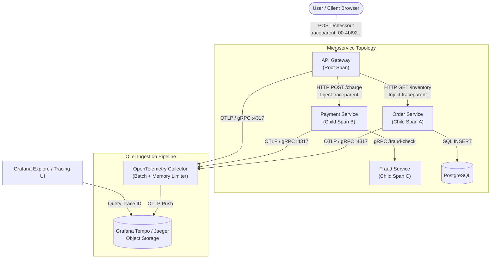
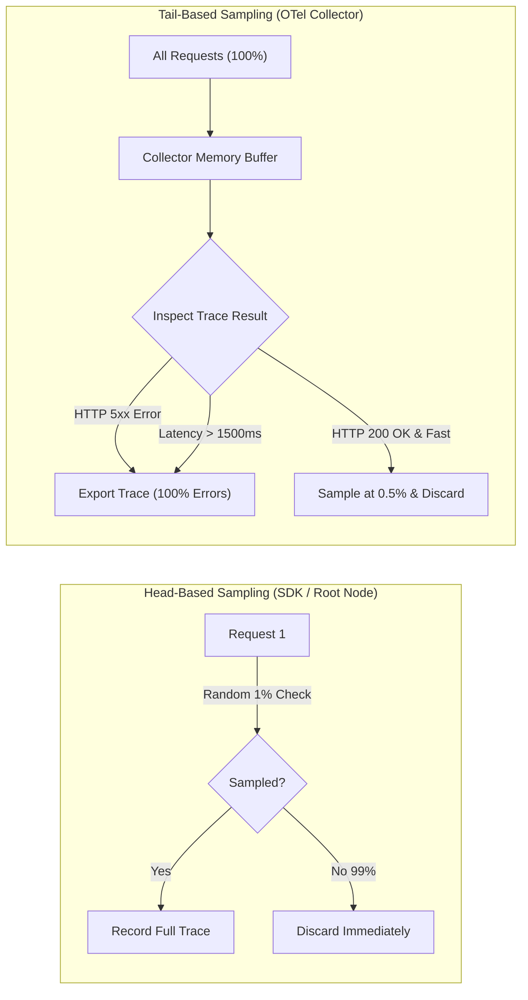
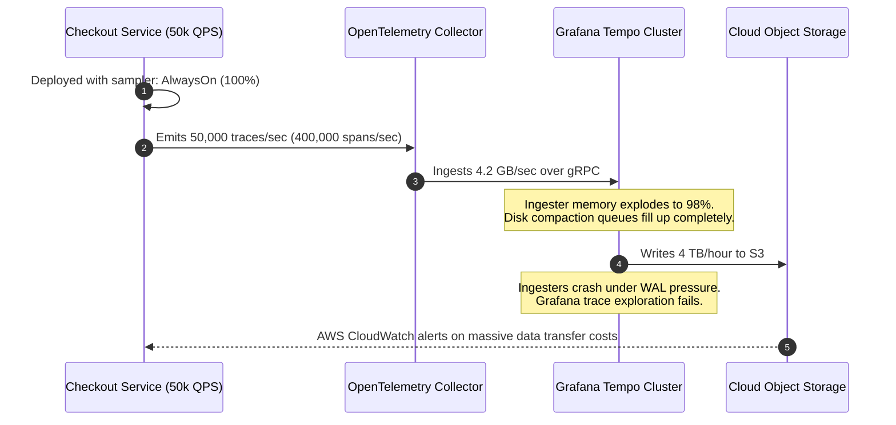

# Distributed Tracing and OpenTelemetry

> **Difficulty**: Advanced | **Estimated Time**: 40m | **Hands-On**: Mandatory

> [!TIP]
> **The Golden Rule of Distributed Tracing:**
> **Context propagation is sacred.** If a single microservice, background queue worker, or proxy drops the W3C `traceparent` header, the causal chain breaks and your distributed trace fragments into isolated orphan spans. Auto-instrument your HTTP clients and server middlewares to pass headers automatically, and inject trace context explicitly into asynchronous message broker headers (Kafka, RabbitMQ, SQS).

---

## 1. Architecture & Visual Mental Models

In monolithic systems, a stack trace records function calls in a single process memory space. In distributed microservice architectures, a single user click triggers a cascade of asynchronous network calls across gateways, services, caches, and databases.

Distributed tracing assigns a globally unique identifier (**Trace ID**) to the originating request and carries it through every network hop, recording execution time and metadata for every sub-operation as a **Span**.



### Trace Waterfall & Span Hierarchy

```mermaid
gantt
    title Distributed Trace Waterfall (Trace ID: 4bf92f3577b34da6)
    dateFormat X
    axisFormat %s ms

    section API Gateway
    POST /checkout (Root Span)       :active, span1, 0, 850

    section Order Service
    Process Order                    :crit, span2, 50, 400
    DB: INSERT INTO orders           :span3, 120, 380

    section Payment Service
    POST /charge                     :active, span4, 450, 820
    gRPC: Fraud Inspection           :span5, 480, 620
    Stripe API Call (External)       :span6, 630, 810
```



---

## 2. Anatomy of W3C Trace Context

The W3C Trace Context specification defines the standard HTTP wire format for passing tracing metadata across service boundaries without vendor lock-in.

```
                  W3C traceparent Header Format
  00-4bf92f3577b34da6a3ce929d0e0e4736-00f067aa0ba902b7-01
  -- -------------------------------- ---------------- --
  ^                 ^                         ^         ^
  |                 |                         |         |
Version      Trace ID (16 bytes)      Parent ID (8 bytes) Trace Flags
(Current: 00) (Hexadecimal 32 chars)   (Span ID 16 chars)  (01 = Sampled)
```

| Field | Size | Example | Purpose |
| :--- | :--- | :--- | :--- |
| **Version** | 2 Hex Chars | `00` | Currently fixed at `00`. Forward-compatible for future spec extensions. |
| **Trace ID** | 32 Hex Chars | `4bf92f3577b34da6a3ce929d0e0e4736` | Global request identifier. Remains identical across every hop in the request tree. |
| **Parent ID (Span ID)** | 16 Hex Chars | `00f067aa0ba902b7` | Identifies the immediate parent span that invoked the downstream call. |
| **Trace Flags** | 2 Hex Chars | `01` | Bitmask controls. `01` indicates the trace was recorded (**Sampled**). `00` means unsampled. |

---

## 3. Sampling Strategies: Head vs. Tail Sampling

Collecting 100% of traces in high-throughput systems (e.g., 50,000 requests/sec) exhausts network bandwidth and object storage capacity. Choosing the right sampling mechanism is a critical architecture decision.



| Feature | Head-Based Sampling | Tail-Based Sampling |
| :--- | :--- | :--- |
| **Decision Point** | At the root service when the request enters the system | At the OpenTelemetry Collector after the entire trace completes |
| **Compute / Memory Cost** | Minimal; spans are dropped at the SDK tier | Higher; Collector must buffer spans in memory for 5-30 seconds |
| **Anomaly Capture Rate** | Low; a 1% sample rate misses 99% of rare 500 errors | Near 100%; Collector keeps every trace that ended in an error or latency anomaly |
| **Implementation Complexity** | Simple configuration flag in OTel SDK (`RatioBasedSampler`) | Requires running OTel Collector cluster with `tail_sampling` processor |

---

## 4. Production War Story: The 100% Tracing Storage Avalanche

```
INCIDENT SUMMARY: INC-9304
SEVERITY: P1 - Infrastructure Degradation
IMPACT: $65,000 unbudgeted Cloud Storage bill and cluster-wide crash of Tempo ingesters.
DURATION: 6 hours 20 minutes
ROOT CAUSE: A default AlwaysOnSampler in a high-QPS service generated 4TB of trace chunks per hour during a product launch.
```

### Incident Timeline



### The Post-Mortem

- **The Flaw**: A junior developer initialized the tracer with `sdktrace.WithSampler(sdktrace.AlwaysSample())` for local testing and merged it to production.
- **The Impact**: Under peak launch traffic (50,000 QPS), the service generated over 1.4 billion spans in 4 hours. The Tempo cluster ran out of memory, compacted chunks saturated the local NVMe disks, and storage egress fees exceeded monthly budgets.
- **The Remediation**:
  1. Configured head-based parent-based ratio sampling at the application layer:
     ```go
     sdktrace.WithSampler(sdktrace.ParentBased(sdktrace.TraceIDRatioBased(0.01))) // 1% of normal traffic
     ```
  2. Deployed an OpenTelemetry Collector `tail_sampling` processor rule to capture 100% of errors (`status.code == ERROR`) and slow requests (`duration > 1s`), while dropping healthy traces down to a 0.5% baseline.

---

## 5. Multi-Language Production Context Propagation

To guarantee traces travel across network calls, services must inject context into outgoing HTTP headers and extract context from incoming headers.

### Go (`go.opentelemetry.io/otel`)

```go
package main

import (
	"context"
	"fmt"
	"net/http"

	"go.opentelemetry.io/otel"
	"go.opentelemetry.io/otel/attribute"
	"go.opentelemetry.io/otel/propagation"
	sdktrace "go.opentelemetry.io/otel/sdk/trace"
	semconv "go.opentelemetry.io/otel/semconv/v1.24.0"
	"go.opentelemetry.io/otel/trace"
)

var tracer trace.Tracer

func initTracer() *sdktrace.TracerProvider {
	// Register W3C TraceContext propagator globally
	otel.SetTextMapPropagator(propagation.NewCompositeTextMapPropagator(
		propagation.TraceContext{},
		propagation.Baggage{},
	))

	tp := sdktrace.NewTracerProvider(
		sdktrace.WithSampler(sdktrace.ParentBased(sdktrace.TraceIDRatioBased(0.05))),
	)
	otel.SetTracerProvider(tp)
	tracer = tp.Tracer("order-service")
	return tp
}

// Inbound Middleware: Extracts W3C traceparent from incoming request
func traceMiddleware(next http.HandlerFunc) http.HandlerFunc {
	return func(w http.ResponseWriter, r *http.Request) {
		propagator := otel.GetTextMapPropagator()
		ctx := propagator.Extract(r.Context(), propagation.HeaderCarrier(r.Header))

		ctx, span := tracer.Start(ctx, fmt.Sprintf("HTTP %s %s", r.Method, r.URL.Path),
			trace.WithAttributes(
				semconv.HTTPMethodKey.String(r.Method),
				semconv.HTTPRouteKey.String(r.URL.Path),
			),
		)
		defer span.End()

		next(w, r.WithContext(ctx))
	}
}

// Outbound Client: Injects W3C traceparent into downstream call
func callPaymentService(ctx context.Context, amount int) error {
	ctx, span := tracer.Start(ctx, "CallPaymentGateway",
		trace.WithAttributes(attribute.Int("payment.amount", amount)),
	)
	defer span.End()

	req, _ := http.NewRequestWithContext(ctx, "POST", "http://payment-service:8080/charge", nil)
	
	// Inject trace context into outbound HTTP headers
	otel.GetTextMapPropagator().Inject(ctx, propagation.HeaderCarrier(req.Header))

	// Execute HTTP request
	client := &http.Client{}
	resp, err := client.Do(req)
	if err != nil {
		span.RecordError(err)
		return err
	}
	defer resp.Body.Close()
	return nil
}
```

### Node.js / TypeScript (`@opentelemetry/api`)

```typescript
import { context, propagation, trace, SpanStatusCode } from '@opentelemetry/api';
import http from 'http';
import axios from 'axios';

const tracer = trace.getTracer('frontend-service', '1.0.0');

const server = http.createServer(async (req, res) => {
  // 1. Extract inbound W3C traceparent from headers
  const extractedContext = propagation.extract(context.active(), req.headers);

  // 2. Start Child Span tied to extracted context
  await context.with(extractedContext, async () => {
    const span = tracer.startSpan(`HTTP ${req.method} ${req.url}`);
    span.setAttribute('http.target', req.url || '/');

    try {
      // 3. Inject trace context into outbound Axios call to backend
      const outboundHeaders: Record<string, string> = {};
      propagation.inject(context.active(), outboundHeaders);

      const backendResponse = await axios.get('http://backend-service:8080/data', {
        headers: outboundHeaders,
      });

      span.setStatus({ code: SpanStatusCode.OK });
      res.writeHead(200, { 'Content-Type': 'application/json' });
      res.end(JSON.stringify({ result: backendResponse.data }));
    } catch (err: any) {
      span.recordError(err);
      span.setStatus({ code: SpanStatusCode.ERROR, message: err.message });
      res.writeHead(500, { 'Content-Type': 'application/json' });
      res.end(JSON.stringify({ error: err.message }));
    } finally {
      span.end();
    }
  });
});

server.listen(3000, () => console.log('Server running on :3000'));
```

### Python (`opentelemetry`)

```python
import requests
from flask import Flask, request, jsonify
from opentelemetry import trace, propagate
from opentelemetry.trace import Status, StatusCode
from opentelemetry.trace.propagation.tracecontext import TraceContextTextMapPropagator

app = Flask(__name__)
tracer = trace.get_tracer("inventory-service")

@app.route("/items/<item_id>", methods=["GET"])
def get_item(item_id: str):
    # 1. Extract context from incoming WSGI headers
    carrier = dict(request.headers)
    ctx = TraceContextTextMapPropagator().extract(carrier=carrier)

    # 2. Start span as child of extracted context
    with tracer.start_as_current_span("inspect_inventory", context=ctx) as span:
        span.set_attribute("inventory.item_id", item_id)
        
        # 3. Propagate context down to Database Service
        outbound_headers = {}
        TraceContextTextMapPropagator().inject(carrier=outbound_headers)

        try:
            resp = requests.get(
                f"http://db-service:8081/stock/{item_id}",
                headers=outbound_headers,
                timeout=2.0
            )
            span.set_status(Status(StatusCode.OK))
            return jsonify(resp.json()), 200
        except Exception as e:
            span.record_error(e)
            span.set_status(Status(StatusCode.ERROR, str(e)))
            return jsonify({"error": "database_unreachable"}), 502

if __name__ == "__main__":
    app.run(host="0.0.0.0", port=8080)
```

---

## 6. Practical Hands-On Verification CLI Workflows

Follow this exercise on your `kind` cluster to install Grafana Tempo and observe a distributed trace traveling across services.

### Step 1: Install Grafana Tempo via Helm

```bash
# Add Grafana Helm repository
helm repo add grafana https://grafana.github.io/helm-charts
helm repo update

# Install minimal Tempo cluster into monitoring namespace
helm install tempo grafana/tempo \
  --namespace monitoring \
  --set tempo.receivers.otlp.protocols.http.endpoint="0.0.0.0:4318" \
  --set tempo.receivers.otlp.protocols.grpc.endpoint="0.0.0.0:4317"
```

Verify the Tempo pod is running:

```bash
kubectl get pods -n monitoring -l app.kubernetes.io/name=tempo
```

**Expected Output:**
```
NAME                     READY   STATUS    RESTARTS   AGE
tempo-74bc84fc65-m8k9q   1/1     Running   0          35s
```

### Step 2: Emit a Synthetic Two-Span Distributed Trace via OTLP/HTTP

Execute a test pod that sends an OTLP JSON payload directly to Tempo at `:4318/v1/traces`:

```bash
kubectl run otel-trace-emitter --rm -i --restart=Never --image=curlimages/curl -- \
  curl -s -X POST "http://tempo.monitoring.svc.cluster.local:4318/v1/traces" \
  -H "Content-Type: application/json" \
  -d '{
    "resourceSpans": [{
      "resource": {
        "attributes": [
          {"key": "service.name", "value": {"stringValue": "checkout-api"}},
          {"key": "host.name", "value": {"stringValue": "node-prod-01"}}
        ]
      },
      "scopeSpans": [{
        "spans": [
          {
            "traceId": "4bf92f3577b34da6a3ce929d0e0e4736",
            "spanId": "00f067aa0ba902b7",
            "name": "POST /checkout",
            "kind": 1,
            "startTimeUnixNano": "1712498200000000000",
            "endTimeUnixNano": "1712498200850000000",
            "status": {"code": 1}
          },
          {
            "traceId": "4bf92f3577b34da6a3ce929d0e0e4736",
            "spanId": "5fb397be34d23b0f",
            "parentSpanId": "00f067aa0ba902b7",
            "name": "SELECT FROM accounts",
            "kind": 3,
            "startTimeUnixNano": "1712498200100000000",
            "endTimeUnixNano": "1712498200450000000",
            "status": {"code": 1}
          }
        ]
      }]
    }]
  }'
```

### Step 3: Query Tempo for the Ingested Trace

Verify that Tempo successfully indexed the trace ID `4bf92f3577b34da6a3ce929d0e0e4736`:

```bash
kubectl run tempo-fetcher --rm -i --restart=Never --image=curlimages/curl -- \
  curl -s "http://tempo.monitoring.svc.cluster.local:3200/api/traces/4bf92f3577b34da6a3ce929d0e0e4736"
```

**Expected Output:**
```json
{
  "batches": [
    {
      "resource": {
        "attributes": [
          {"key": "service.name", "value": {"stringValue": "checkout-api"}}
        ]
      },
      "scopeSpans": [
        {
          "spans": [
            {
              "traceId": "4bf92f3577b34da6a3ce929d0e0e4736",
              "spanId": "00f067aa0ba902b7",
              "name": "POST /checkout"
            },
            {
              "traceId": "4bf92f3577b34da6a3ce929d0e0e4736",
              "spanId": "5fb397be34d23b0f",
              "parentSpanId": "00f067aa0ba902b7",
              "name": "SELECT FROM accounts"
            }
          ]
        }
      ]
    }
  ]
}
```

The parent-child relationship (`parentSpanId == 00f067aa0ba902b7`) is intact and viewable as an interactive waterfall in Grafana Tempo!

---

## 7. Operational Validation Checkpoints

Test your understanding of distributed tracing with these real-world production incident scenarios.

<details>
<summary><b>Checkpoint 1: Why does a trace terminate at the API Gateway instead of continuing downstream?</b></summary>

**Scenario:** Grafana shows a root span for `POST /orders` from the gateway, but zero child spans appear for the Order Service or Database, even though the order completed successfully.

**Analysis & Troubleshooting Flow:**
1. **Verify Context Propagation Headers:** Inspect the outbound request from the gateway using an ingress access log or network tap. Check if the `traceparent` HTTP header is present.
2. **Inspect Downstream HTTP Client Configuration:** In modern microservices, developers often use raw HTTP clients (e.g. `http.Get` in Go or standard `fetch()` in Node.js) instead of an instrumented client. Raw HTTP clients omit the `traceparent` header.
3. **Verify OpenTelemetry Tracer Registration:** Check if `otel.SetTextMapPropagator(...)` was invoked during application initialization. If the global propagator is unset, context injection is a silent no-op.
</details>

<details>
<summary><b>Checkpoint 2: How do you configure Tail-Based Sampling in the OpenTelemetry Collector to capture errors?</b></summary>

**Scenario:** Your billing service processes 20,000 QPS. You cannot afford to store all traces, but you must retain 100% of failed HTTP 5xx transactions.

**Production Solution:**
Configure an OpenTelemetry Collector with the `tail_sampling` processor:

```yaml
processors:
  tail_sampling:
    decision_wait: 10s
    num_traces: 50000
    expected_new_traces_per_sec: 2000
    policies:
      # Policy 1: Always keep errors
      - name: drop_errors_policy
        type: status_code
        status_code: { status_codes: [ ERROR ] }
      # Policy 2: Always keep slow transactions (> 2s)
      - name: latency_policy
        type: numeric_attribute
        numeric_attribute: { key: "http.status_code", value_condition: { greater_than_or_equal: 500 } }
      # Policy 3: Sample 1% of remaining successful traces
      - name: probabilistic_policy
        type: probabilistic
        probabilistic: { sampling_percentage: 1.0 }

service:
  pipelines:
    traces:
      receivers: [otlp]
      processors: [memory_limiter, tail_sampling, batch]
      exporters: [tempo]
```
</details>

<details>
<summary><b>Checkpoint 3: Explain the structure of the W3C `traceparent` header and the role of the sampled flag.</b></summary>

**Header Format:** `00-4bf92f3577b34da6a3ce929d0e0e4736-00f067aa0ba902b7-01`

**Components:**
1. `00`: Spec version.
2. `4bf92f3577b34da6a3ce929d0e0e4736`: 16-byte (32 hex character) globally unique Trace ID.
3. `00f067aa0ba902b7`: 8-byte (16 hex character) Span ID of the caller (Parent Span).
4. `01`: Trace Flags bitmask.
   - Bit 0 (`01`): **Sampled bit**. Signals to all downstream microservices that the root span was chosen for recording. Downstream services observe this flag and automatically record their own child spans, guaranteeing the entire trace tree remains complete without each service independently rolling dice.
</details>

---

## Next

Continue to **[06-alerting-and-on-call-basics](../06-alerting-and-on-call-basics/README.md)** to bridge telemetry to human operational response: routing, deduplicating, and silencing alerts with Alertmanager.
