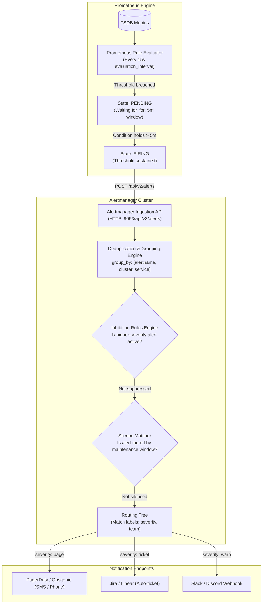
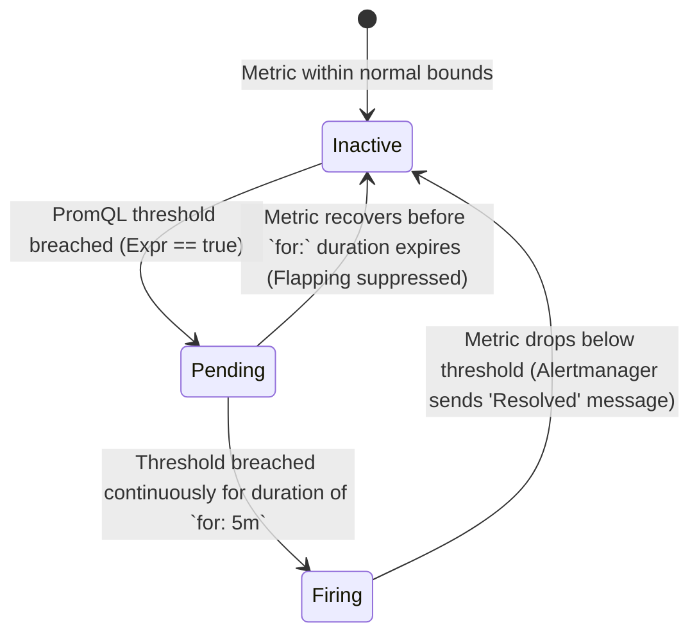
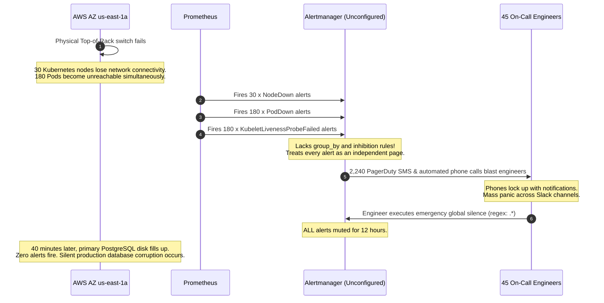

# Alerting and On-Call Basics

> **Difficulty**: Intermediate | **Estimated Time**: 35m | **Hands-On**: Mandatory

> [!TIP]
> **The Golden Rule of Actionable Alerting:**
> **Alert on symptoms, not causes.** Never wake an on-call engineer at 3:00 AM because "CPU usage is 85%" or "Disk read IOPS spiked". Page humans only when **user-visible symptoms or SLOs are actively degrading** (e.g., HTTP 5xx error rate > 2%, p99 latency > 1.5s, or pending checkout queue backlog growing monotonically). Automate cause remediation with autoscalers and self-healing pods.

---

## 1. Architecture & Visual Mental Models

The alerting pipeline cleanly separates **detection** from **notification**. Prometheus handles metric evaluation; Alertmanager handles notification routing, deduplication, and suppression.



### The State Transition: Inactive $\to$ Pending $\to$ Firing



---

## 2. Alert Routing, Grouping, and Timing Mechanics

When 100 pods in a microservice crash simultaneously due to a bad configuration push, an unconfigured alert pipeline sends 100 immediate notifications. Alertmanager prevents this through **Grouping** and **Timing parameters**.

```
                           Timeline of a Grouped Alert
   T = 0s         T = 25s (group_wait)      T = 5m 25s (group_interval)
     |                      |                            |
     +-- Pod A crashes      |                            |
     +-- Pod B crashes      |                            |
     +-- Pod C crashes ---->| SENDS NOTIFICATION 1:      |
                            | "3 pods failing in demo"   |
                            |                            +-- Pod D crashes
                            |                            +-- Pod E crashes ----> SENDS NOTIFICATION 2:
                            |                                                    "5 pods failing in demo"
```

| Timing Parameter | Default | Production Recommendation | Purpose |
| :--- | :--- | :--- | :--- |
| **`group_wait`** | `30s` | `10s` - `30s` | Buffer time to wait before sending the initial notification. Allows related sibling alerts from the same incident to arrive and group together into a single message. |
| **`group_interval`** | `5m` | `5m` - `10m` | Minimum time to wait before sending an update when *new* alerts join an already-firing group. Prevents noisy notification updates. |
| **`repeat_interval`** | `4h` | `3h` - `12h` | Cooldown period before resending an identical, unchanged notification for an alert that remains actively firing. Prevents notification flooding during prolonged outages. |

---

## 3. Symptom-Based vs. Cause-Based Alerting Matrix

| Alert Type | Metric Used | On-Call Impact | Recommended Action |
| :--- | :--- | :--- | :--- |
| **Anti-Pattern (Cause)** | `node_cpu_utilization > 85%` | High noise; pages engineers during scheduled batch jobs or normal load spikes when users experience zero impact. | Demote to dashboard metric; scale horizontally via Horizontal Pod Autoscaler (HPA). |
| **Anti-Pattern (Cause)** | `kube_pod_container_status_restarts_total > 0` | Wakes engineer for a single transient crash loop on a 50-replica service with active self-healing. | Set threshold to `rate(...) > 0.5` across multiple pods or demote to warning. |
| **Best Practice (Symptom)** | `http_requests_total{status=~"5.."}[5m] / http_requests_total[5m] > 0.02` | High actionable value; user traffic is failing at >2% error budget burn rate. | **Page immediately**. Direct engineer to runbook and triage deployment. |
| **Best Practice (Symptom)** | `histogram_quantile(0.99, rate(http_request_duration_seconds_bucket[5m])) > 2.0` | High actionable value; user checkout flow is stalling at p99 > 2 seconds. | **Page immediately**. Trace latency bottleneck across database and upstream APIs. |

---

## 4. Production War Story: The 3:15 AM Pager Storm

```
INCIDENT SUMMARY: INC-7719
SEVERITY: P1 - Operational Meltdown
IMPACT: 2,240 SMS notifications fired in 8 minutes; 45 engineers paged simultaneously; on-call engineer silenced all alerts globally, causing an unmonitored database corruption outage 40 minutes later.
ROOT CAUSE: Alertmanager route lacked group_by and inhibition rules during an AWS Availability Zone network partition.
```

### Incident Timeline



### The Post-Mortem

- **The Flaw**: Every alert rule had `group_by: []` (empty grouping), and no **Inhibition Rules** were defined between node infrastructure and pod workloads.
- **The Failure Mode**: When a single node died, instead of receiving one notification ("Node 14 down, 20 pods impacted"), engineers received 21 distinct high-priority phone calls. The sheer volume overwhelmed on-call engineers, triggering human error (blanket global alert silencing).
- **The Remediation**:
  1. Configured global grouping: `group_by: ['alertname', 'cluster', 'service', 'namespace']`.
  2. Implemented mandatory **Inhibition Rules**:
     ```yaml
     # If NodeDown is firing, inhibit all PodDown alerts on that specific node:
     inhibit_rules:
       - source_match:
           alertname: 'NodeDown'
         target_match:
           alertname: 'PodDown'
         equal: ['node', 'cluster']
     ```
  3. Established runbook links and strict SLO-based page criteria.

---

## 5. Production Alertmanager & PrometheusRule Configurations

Here are production-grade declarative specifications for Prometheus alerting rules and Alertmanager routing trees.

### Declarative Alerting Rules (`PrometheusRule` Custom Resource)

```yaml
apiVersion: monitoring.coreos.com/v1
kind: PrometheusRule
metadata:
  name: api-service-slo-alerts
  namespace: monitoring
  labels:
    role: alert-rules
    prometheus: kps-prometheus
spec:
  groups:
    - name: api-service.rules
      rules:
        # Symptom 1: High Error Rate (SLO Breach)
        - alert: APIHighErrorRate
          expr: |
            sum by (namespace, service) (rate(http_requests_total{status=~"5.."}[5m]))
            /
            sum by (namespace, service) (rate(http_requests_total[5m])) > 0.05
          for: 3m
          labels:
            severity: page
            team: checkout
            tier: api
          annotations:
            summary: "High HTTP 5xx error rate in {{ $labels.service }}"
            description: "Service {{ $labels.service }} in namespace {{ $labels.namespace }} is experiencing a {{ $value | humanizePercentage }} error rate over the last 5 minutes."
            runbook_url: "https://wiki.internal/ops/runbooks/api-high-error-rate"

        # Symptom 2: High Latency Degradation
        - alert: APIP99LatencyBreach
          expr: |
            histogram_quantile(0.99, sum by (le, namespace, service) (rate(http_request_duration_seconds_bucket[5m]))) > 1.5
          for: 5m
          labels:
            severity: warning
            team: checkout
            tier: api
          annotations:
            summary: "P99 latency breach in {{ $labels.service }}"
            description: "P99 latency for {{ $labels.service }} has exceeded 1.5s (current value: {{ $value | humanizeDuration }})."
            runbook_url: "https://wiki.internal/ops/runbooks/api-high-latency"
```

### Complete Alertmanager Routing & Inhibition Tree (`alertmanager.yaml`)

```yaml
global:
  resolve_timeout: 5m
  slack_api_url: "https://hooks.slack.com/services/T00/B00/X00"

# Root Route: Default catching tree
route:
  receiver: "slack-default"
  group_by: ["alertname", "cluster", "service", "namespace"]
  group_wait: 30s
  group_interval: 5m
  repeat_interval: 4h

  # Child Routes: Specialized matchers
  routes:
    # Critical Pager Alerts -> PagerDuty
    - matchers:
        - severity = page
      receiver: "pagerduty-oncall"
      continue: true # Also mirror to Slack channel below

    # Team-Specific Routing
    - matchers:
        - team = checkout
      receiver: "slack-checkout-team"

    # Warning / Ticket Routing
    - matchers:
        - severity = warning
      receiver: "slack-warnings"

# Inhibition: Suppress noisy alerts when parent infrastructure fails
inhibit_rules:
  # When an entire node is down, suppress all pod and container alerts on that node
  - source_matchers:
      - alertname = "NodeDown"
    target_matchers:
      - alertname =~ "PodDown|ContainerOOMKilled|KubeletLivenessProbeFailed"
    equal: ["node"]

  # When a service is 100% down, suppress latency warnings for that service
  - source_matchers:
      - alertname = "ServiceUnavailable"
    target_matchers:
      - alertname = "APIP99LatencyBreach"
    equal: ["service", "namespace"]

receivers:
  - name: "slack-default"
    slack_configs:
      - channel: "#alerts-general"
        send_resolved: true
        title: '[{{ .Status | toUpper }}] {{ .GroupLabels.alertname }} ({{ .CommonLabels.namespace }})'
        text: >-
          {{ range .Alerts }}
            *Alert:* {{ .Annotations.summary }}
            *Description:* {{ .Annotations.description }}
            *Runbook:* <{{ .Annotations.runbook_url }}|Runbook Link>
          {{ end }}

  - name: "slack-checkout-team"
    slack_configs:
      - channel: "#alerts-checkout"
        send_resolved: true

  - name: "slack-warnings"
    slack_configs:
      - channel: "#alerts-low-priority"
        send_resolved: false

  - name: "pagerduty-oncall"
    pagerduty_configs:
      - service_key: "YOUR-PAGERDUTY-INTEGRATION-KEY"
        severity: "critical"
        send_resolved: true
```

---

## 6. Practical Hands-On Verification CLI Workflows

Follow this exercise to fire a live test alert on your `kind` cluster and inspect it using the Alertmanager CLI (`amtool`) and HTTP API.

### Step 1: Forward the Alertmanager Web Service

Forward Alertmanager port `9093` to your local environment:

```bash
kubectl port-forward -n monitoring svc/kps-alertmanager 9093:9093 &
```

Verify Alertmanager is healthy:

```bash
curl -s http://localhost:9093/api/v2/status | grep -o '"clusterStatus":"ready"'
```

**Expected Output:**
```
"clusterStatus":"ready"
```

### Step 2: Inject a Synthetic Firing Alert via HTTP API

Use `curl` to push a firing alert directly to Alertmanager's v2 API:

```bash
curl -X POST http://localhost:9093/api/v2/alerts \
  -H "Content-Type: application/json" \
  -d '[
    {
      "labels": {
        "alertname": "SyntheticCheckoutFailure",
        "severity": "page",
        "team": "checkout",
        "service": "order-processor",
        "namespace": "demo"
      },
      "annotations": {
        "summary": "Simulated critical failure for on-call verification",
        "description": "Order processor transaction success dropped below 90%",
        "runbook_url": "https://wiki.internal/ops/checkout-runbook"
      },
      "generatorURL": "http://prometheus.local/test"
    }
  ]'
```

Verify that the alert is registered as active:

```bash
curl -s http://localhost:9093/api/v2/alerts | grep -E '"alertname":"SyntheticCheckoutFailure"'
```

**Expected Output:**
```
      "alertname": "SyntheticCheckoutFailure",
```

### Step 3: Create a Maintenance Silence via CLI

During planned maintenance or bug remediation, silence the alert for 1 hour so the on-call pager does not fire:

```bash
curl -X POST http://localhost:9093/api/v2/silences \
  -H "Content-Type: application/json" \
  -d '{
    "matchers": [
      {
        "name": "alertname",
        "value": "SyntheticCheckoutFailure",
        "isRegex": false,
        "isEqual": true
      }
    ],
    "startsAt": "'"$(date -u +%Y-%m-%dT%H:%M:%SZ)"'",
    "endsAt": "'"$(date -u -d '+1 hour' +%Y-%m-%dT%H:%M:%SZ)"'",
    "createdBy": "oncall-engineer",
    "comment": "Silencing synthetic alert during pipeline verification"
  }'
```

**Expected Output:**
```json
{"silenceID":"9b3e1572-18ad-4d87-9bb3-938749a21b3f"}
```

Verify that the active alert now transitions to state `silenced`:

```bash
curl -s http://localhost:9093/api/v2/alerts | grep -B 2 -A 5 "SyntheticCheckoutFailure"
```

---

## 7. Operational Validation Checkpoints

Test your incident handling and alert design readiness with these scenarios.

<details>
<summary><b>Checkpoint 1: Why did 30 pods crashing trigger 30 individual Slack messages, and how do you fix it?</b></summary>

**Scenario:** A worker node crashed, taking down 30 pods. Instead of one summary notification, the `#alerts` channel received 30 individual messages within 10 seconds.

**Analysis & Root Cause:**
The Alertmanager route was missing the `group_by` directive or had `group_wait` set to `0s`. When `group_wait` is `0s`, Alertmanager dispatches each incoming alert immediately without buffering.

**Production Fix:**
1. Configure `group_by` to cluster related alerts:
   ```yaml
   group_by: ['alertname', 'namespace', 'service']
   ```
2. Set `group_wait: 30s`. Alertmanager will hold the first alert for 30 seconds, collect all other 29 failing pod alerts, and dispatch a single aggregated notification: `"30 instances of PodDown firing in namespace prod"`.
</details>

<details>
<summary><b>Checkpoint 2: What is the exact operational lifecycle difference between `group_wait`, `group_interval`, and `repeat_interval`?</b></summary>

**Operational Timeline:**
1. **`group_wait` (e.g. 30s):** Initial pause upon the *first* alert in a group. It allows all sibling alerts from the same root incident to arrive before publishing the initial message.
2. **`group_interval` (e.g. 5m):** The rate-limit on updates. If a 31st pod crashes 1 minute after the initial notification, Alertmanager waits until the `group_interval` expires before sending an updated batch notification.
3. **`repeat_interval` (e.g. 4h):** The reminder cooldown. If the same 31 pods remain crashed for hours with no new alerts added or resolved, Alertmanager stays completely silent until `repeat_interval` elapses, at which point it sends a reminder notification to the on-call engineer.
</details>

<details>
<summary><b>Checkpoint 3: How does an Alertmanager Inhibition Rule prevent paging during network switch failures?</b></summary>

**Scenario:** A Top-of-Rack network switch fails. All 20 worker nodes in the rack lose connectivity.

**Mechanism:**
1. Prometheus fires `RackSwitchDown{rack="R10"}` and 20 instances of `NodeUnreachable{rack="R10"}`.
2. An inhibition rule matches:
   ```yaml
   inhibit_rules:
     - source_matchers: [alertname = "RackSwitchDown"]
       target_matchers: [alertname = "NodeUnreachable"]
       equal: ["rack"]
   ```
3. Alertmanager suppresses all 20 `NodeUnreachable` notifications as long as `RackSwitchDown` is actively firing. The on-call network engineer receives one page for the switch, and the compute team is not spammed with 20 phantom node alerts.
4. **Resolution Transition:** Once the switch recovers and `RackSwitchDown` resolves, the inhibition rule deactivates automatically. If any individual node remains down after the switch is healthy, its alert immediately uninhibits and notifies the team.
</details>

---

## Next

Continue to **[07-correlating-the-three-pillars](../07-correlating-the-three-pillars/README.md)** to connect metrics, logs, and traces into a single unified incident troubleshooting workflow.
