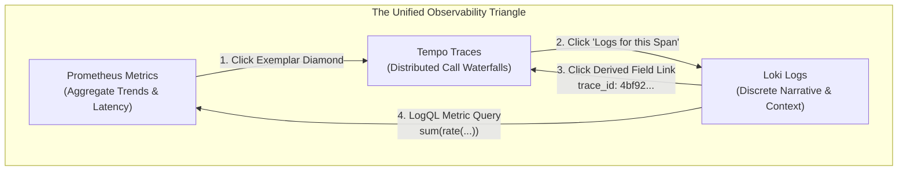
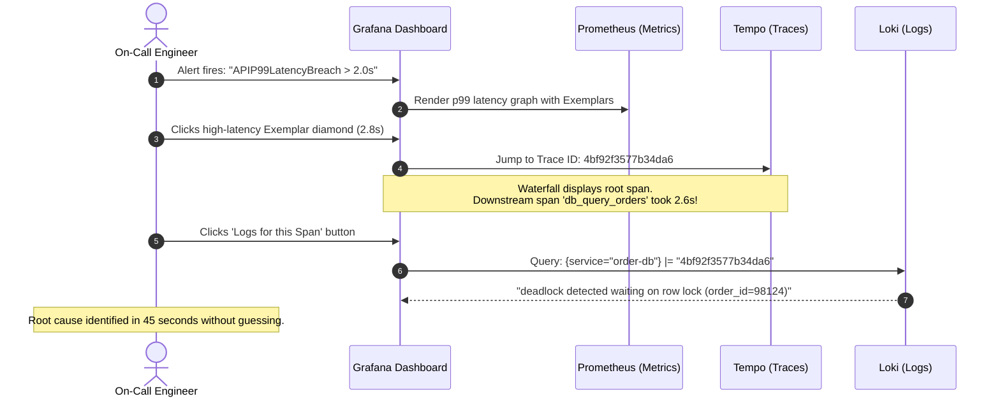
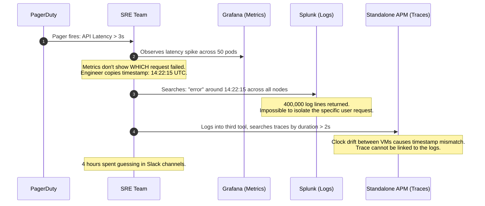

# Correlating the Three Pillars

> **Difficulty**: Advanced | **Estimated Time**: 40m | **Hands-On**: Mandatory

> [!TIP]
> **The Golden Rule of Observability Correlation:**
> **The Trace ID is your universal primary key.** Collecting metrics, logs, and traces in isolated silos creates high operational overhead during incidents. Unify them by embedding the 32-character W3C `trace_id` into your Prometheus exemplars and structured log payloads. Wire Grafana data sources with **Exemplars**, **Derived Fields**, and **Trace-to-Logs** bindings so an engineer can navigate from an alert to root cause with a single click.

---

## 1. Architecture & The Telemetry Correlation Loop

Observability is not three independent tools; it is a single investigative workflow. During a production incident, each pillar answers a distinct question:
1. **Metrics** (Prometheus): **Alerting** — *Is there an anomaly, and what is its blast radius?*
2. **Traces** (Tempo): **Localization** — *Which service and sub-operation is bottlenecked or throwing errors?*
3. **Logs** (Loki): **Diagnosis** — *What exact internal error message, database query, or payload caused the failure?*



### The Incident Investigation Workflow



---

## 2. Telemetry Glue: Exemplars, Derived Fields & Trace-to-Logs

Connecting the three pillars requires three precise configuration interfaces within Grafana and your instrumentation.

```
       [ Prometheus Metric Panel ]
              o  <--- (Exemplar: trace_id=4bf92...)
             / 
            v  (Single Click)
       [ Tempo Trace Waterfall ]
            |
            |--- [ Span: POST /checkout (2.4s) ]
            |       \
            |        v  (Click: "Logs for Span")
            +---> [ Loki Structured Logs ]
                    {"level":"error", "trace_id":"4bf92...", "msg":"Lock wait timeout"}
                     ^-------- [ Derived Field: Blue Clickable Link ]
```

| Mechanism | Source $\to$ Target | How It Works | Configuration Location |
| :--- | :--- | :--- | :--- |
| **Exemplars** | Prometheus $\to$ Tempo | Prometheus scrapes OpenMetrics payloads where histogram buckets include an exemplar comment `# {trace_id="..."}`. Grafana draws clickable diamonds on graph panels. | Prometheus scrape flag `--enable-feature=exemplar-storage` + Grafana Prometheus data source exemplar config. |
| **Derived Fields** | Loki $\to$ Tempo | Grafana runs a regular expression against raw log text, captures the `trace_id`, and formats it as an internal hyperlink pointing to Tempo. | Grafana Loki Data Source settings (`derivedFields`). |
| **Trace-to-Logs** | Tempo $\to$ Loki | When viewing a span in Tempo, Grafana extracts the span's service name and timestamp window and automatically constructs a LogQL query for Loki. | Grafana Tempo Data Source settings (`tracesToLogs`). |

---

## 3. Production War Story: The 4-Hour MTTR Silo Nightmare

```
INCIDENT SUMMARY: INC-8821
SEVERITY: P1 - Production Checkout Outage
IMPACT: 4 hours 15 minutes to diagnose an intermittently failing database index; $320,000 lost revenue.
ROOT CAUSE: Disconnected telemetry tools forced engineers to perform manual timestamp guesswork across isolated platforms.
```

### The Incident Timeline (Before Correlation)



### The Post-Mortem

- **The Problem**: Telemetry was fragmented into three non-communicating tools. SREs spent 90% of incident time copying timestamps between dashboards, trying to guess which log line belonged to which slow trace.
- **The Remediation**:
  1. Standardized on Grafana + Prometheus + Loki + Tempo.
  2. Injected W3C `traceparent` headers into all application logs.
  3. Configured Grafana Derived Fields and Exemplars across all cluster data sources.
  4. **Result**: On the next recurring deadlock incident, MTTR (Mean Time to Resolution) dropped from **255 minutes** to **2 minutes 30 seconds**.

---

## 4. Declarative Infrastructure: Grafana Unified Data Sources

Deploy these production declarative configurations in your Grafana provisioning directory or Kubernetes ConfigMap to activate seamless two-way correlation.

### Complete Provisioned Data Source Manifest (`datasources.yaml`)

```yaml
apiVersion: 1

datasources:
  # 1. PROMETHEUS (With Exemplars linked to Tempo)
  - name: Prometheus
    type: prometheus
    access: proxy
    url: http://kps-prometheus.monitoring.svc.cluster.local:9090
    isDefault: true
    jsonData:
      httpMethod: POST
      timeInterval: 15s
      exemplarTraceIdDestinations:
        - name: trace_id
          datasourceUid: tempo-datasource-uid
          urlDisplayLabel: "View in Tempo"

  # 2. GRAFANA TEMPO (With Trace-to-Logs linked to Loki)
  - name: Tempo
    uid: tempo-datasource-uid
    type: tempo
    access: proxy
    url: http://tempo.monitoring.svc.cluster.local:3200
    jsonData:
      httpMethod: GET
      tracesToLogs:
        datasourceUid: loki-datasource-uid
        tags: ["app", "service.name"]
        mappedTags:
          - key: "service.name"
            value: "app"
        mapTagNamesEnabled: true
        filterByTrace: true
        filterBySpan: true
        spanStartTimeShift: "-500ms"
        spanEndTimeShift: "500ms"
      serviceMap:
        datasourceUid: prometheus

  # 3. GRAFANA LOKI (With Derived Fields linked to Tempo)
  - name: Loki
    uid: loki-datasource-uid
    type: loki
    access: proxy
    url: http://loki.monitoring.svc.cluster.local:3100
    jsonData:
      maxLines: 1000
      derivedFields:
        - name: TraceID
          matcherRegex: '(?i)(?:trace_id|traceId|traceparent)["=:\s]+(?:00-)?([a-fA-F0-9]{32})'
          url: '$${__value.raw}'
          datasourceUid: tempo-datasource-uid
          urlDisplayLabel: "Open Trace"
```

---

## 5. Multi-Language Application Telemetry Integration

For correlation to work, your application code must link all three pillars:
1. Wrap spans with OpenTelemetry.
2. Inject active `trace_id` into structured log statements.
3. Record metrics with Prometheus exemplars using the active trace ID.

### Go (`go.opentelemetry.io/otel` + `uber-go/zap` + `prometheus/client_golang`)

```go
package main

import (
	"context"
	"net/http"
	"time"

	"github.com/prometheus/client_golang/prometheus"
	"github.com/prometheus/client_golang/prometheus/promhttp"
	"go.opentelemetry.io/otel"
	"go.opentelemetry.io/otel/trace"
	"go.uber.org/zap"
)

var (
	logger *zap.Logger
	tracer trace.Tracer

	// Prometheus Histogram supporting Exemplars
	httpDuration = prometheus.NewHistogramVec(
		prometheus.HistogramOpts{
			Name:    "http_request_duration_seconds",
			Help:    "Duration of HTTP requests in seconds.",
			Buckets: prometheus.DefBuckets,
		},
		[]string{"path", "status"},
	)
)

func init() {
	prometheus.MustRegister(httpDuration)
	tracer = otel.Tracer("order-gateway")
	logger, _ = zap.NewProduction()
}

func checkoutHandler(w http.ResponseWriter, r *http.Request) {
	start := time.Now()
	ctx, span := tracer.Start(r.Context(), "checkoutHandler")
	defer span.End()

	traceID := span.SpanContext().TraceID().String()

	// 1. Log with explicit trace_id (for Loki Derived Fields)
	reqLogger := logger.With(
		zap.String("trace_id", traceID),
		zap.String("path", r.URL.Path),
	)
	reqLogger.Info("handling checkout request", zap.String("user", "alice"))

	// Simulate work
	time.Sleep(120 * time.Millisecond)

	duration := time.Since(start).Seconds()

	// 2. Record metric with Exemplar (links Prometheus -> Tempo)
	if traceID != "" {
		httpDuration.WithLabelValues(r.URL.Path, "200").(prometheus.ExemplarObserver).ObserveWithExemplar(
			duration,
			prometheus.Labels{"trace_id": traceID},
		)
	} else {
		httpDuration.WithLabelValues(r.URL.Path, "200").Observe(duration)
	}

	w.WriteHeader(http.StatusOK)
	w.Write([]byte(`{"status":"success"}`))
}

func main() {
	// Must expose promhttp.HandlerOpts{EnableOpenMetrics: true} for Exemplars!
	http.Handle("/metrics", promhttp.HandlerFor(
		prometheus.DefaultGatherer,
		promhttp.HandlerOpts{EnableOpenMetrics: true},
	))
	http.HandleFunc("/checkout", checkoutHandler)
	http.ListenAndServe(":8080", nil)
}
```

### Node.js / TypeScript (`@opentelemetry/api` + `pino` + `prom-client`)

```typescript
import express from 'express';
import { trace } from '@opentelemetry/api';
import pino from 'pino';
import client from 'prom-client';

const app = express();
const logger = pino();
const tracer = trace.getTracer('payment-service');

const httpRequestDuration = new client.Histogram({
  name: 'http_request_duration_seconds',
  help: 'Duration of HTTP requests in seconds',
  labelNames: ['path', 'status'],
  buckets: [0.05, 0.1, 0.5, 1, 2.5],
  enableExemplars: true, // Enables Exemplar support in prom-client
});

app.get('/pay', async (req, res) => {
  const span = tracer.startSpan('processPayment');
  const traceId = span.spanContext().traceId;
  const start = process.hrtime();

  // 1. Structured logging with trace_id attached
  const log = logger.child({ trace_id: traceId });
  log.info({ amount: 99.5 }, 'Processing credit card transaction');

  // Simulate latency
  await new Promise((r) => setTimeout(r, 200));

  const [seconds, nanoseconds] = process.hrtime(start);
  const duration = seconds + nanoseconds / 1e9;

  // 2. Record metric with Exemplar
  httpRequestDuration.observe(
    { path: '/pay', status: '200' },
    duration
  );

  span.end();
  res.json({ status: 'approved' });
});

app.get('/metrics', async (req, res) => {
  res.set('Content-Type', client.register.contentType);
  res.end(await client.register.metrics());
});

app.listen(8080, () => console.log('Listening on :8080'));
```

### Python (`opentelemetry` + `structlog` + `prometheus_client`)

```python
import time
from flask import Flask, request, jsonify
from opentelemetry import trace
import structlog
from prometheus_client import Histogram, generate_latest, CONTENT_TYPE_LATEST

app = Flask(__name__)
tracer = trace.get_tracer("inventory-api")
log = structlog.get_logger()

# Histogram definition
LATENCY_HISTOGRAM = Histogram(
    "http_request_duration_seconds",
    "Request latency in seconds",
    ["endpoint"],
)

@app.route("/check", methods=["GET"])
def check_inventory():
    start = time.time()
    with tracer.start_as_current_span("check_inventory_span") as span:
        trace_id = format(span.get_span_context().trace_id, "032x")
        
        # 1. Log with trace_id in context
        ctx_log = log.bind(trace_id=trace_id, endpoint="/check")
        ctx_log.info("inventory queried", sku="SKU-882")

        time.sleep(0.08) # Simulate query
        duration = time.time() - start

        # 2. Record metric
        LATENCY_HISTOGRAM.labels(endpoint="/check").observe(duration)

        return jsonify({"available": True, "trace_id": trace_id}), 200

@app.route("/metrics", methods=["GET"])
def metrics():
    return generate_latest(), 200, {"Content-Type": CONTENT_TYPE_LATEST}

if __name__ == "__main__":
    app.run(port=8080)
```

---

## 6. Practical Hands-On Verification CLI Workflows

Follow this verification loop to test that OpenMetrics exemplars and trace linking are working end to end.

### Step 1: Scrape Metrics with OpenMetrics Header

Prometheus exemplars are only transmitted over the wire when the HTTP client requests the `application/openmetrics-text` format. Verify your application endpoint with `curl`:

```bash
curl -s -H "Accept: application/openmetrics-text; version=1.0.0, text/plain;q=0.1" \
  http://localhost:8080/metrics | grep -E '# \{trace_id='
```

**Expected Wire Output:**
```
http_request_duration_seconds_bucket{path="/checkout",status="200",le="0.25"} 14 # {trace_id="4bf92f3577b34da6a3ce929d0e0e4736"} 0.124 1712498200.123
http_request_duration_seconds_bucket{path="/checkout",status="200",le="0.5"} 15 # {trace_id="4bf92f3577b34da6a3ce929d0e0e4736"} 0.124 1712498200.123
```

Notice the `# {trace_id="..."}` annotation appended to the histogram bucket count!

### Step 2: Query Grafana Loki for the Correlated Trace ID

Run a LogQL query searching for that exact trace ID to confirm that the logs can be filtered immediately:

```bash
curl -s -G "http://localhost:3100/loki/api/v1/query" \
  --data-urlencode 'query={app="order-gateway"} |= "4bf92f3577b34da6a3ce929d0e0e4736"'
```

**Expected Output:**
```json
{
  "status": "success",
  "data": {
    "resultType": "streams",
    "result": [
      {
        "stream": { "app": "order-gateway", "env": "production" },
        "values": [
          [
            "1712498200125000000",
            "{\"level\":\"info\",\"trace_id\":\"4bf92f3577b34da6a3ce929d0e0e4736\",\"path\":\"/checkout\",\"user\":\"alice\",\"msg\":\"handling checkout request\"}"
          ]
        ]
      }
    ]
  }
}
```

---

## 7. Operational Validation Checkpoints

Test your understanding of full-stack telemetry correlation with these production incident scenarios.

<details>
<summary><b>Checkpoint 1: Why don't Exemplar diamonds appear on your Grafana latency graph?</b></summary>

**Scenario:** You instrumented Go code with `ObserveWithExemplar`, but Grafana graphs show a flat line with zero clickable exemplar diamonds.

**Root Causes & Resolution:**
1. **Prometheus Feature Flag Disabled:** Prometheus must be launched with the `--enable-feature=exemplar-storage` flag. In `kube-prometheus-stack`, set `prometheus.prometheusSpec.enableFeatures: [exemplar-storage]`.
2. **Scrape Accept Header:** Prometheus must scrape the target with the OpenMetrics media type (`application/openmetrics-text`). Ensure your metrics handler uses `promhttp.HandlerOpts{EnableOpenMetrics: true}`.
3. **Grafana Data Source Configuration:** In Grafana Data Source settings for Prometheus, you must explicitly enable **Exemplars** and map the label name `trace_id` to your Tempo data source UID.
</details>

<details>
<summary><b>Checkpoint 2: How do you configure a Grafana Derived Field to handle multiple trace ID formats?</b></summary>

**Scenario:** Different services format log keys differently: some use `"trace_id":"..."`, others use `traceparent=00-...`, and legacy logs use `traceId=...`.

**Production Solution:**
Define a resilient regular expression in the Loki data source Derived Fields:

```
(?i)(?:trace_id|traceId|traceparent)["=:\s]+(?:00-)?([a-fA-F0-9]{32})
```

**Regex Breakdown:**
- `(?i)`: Case-insensitive matching.
- `(?:trace_id|traceId|traceparent)`: Matches any common field name.
- `["=:\s]+`: Matches delimiters (`="`, `:`, ` `).
- `(?:00-)?`: Optionally strips the W3C spec prefix if present.
- `([a-fA-F0-9]{32})`: Capturing Group 1. Extracts the raw 32-character hex Trace ID and passes it to Tempo's URL template: `$${__value.raw}`.
</details>

<details>
<summary><b>Checkpoint 3: What is the optimal triage traversal sequence across the three pillars during a live P1?</b></summary>

**Production Triage Sequence:**
1. **Metrics First (Detection & Scope):** Inspect Prometheus alert and Grafana dashboard. Use `sum by (service)` to identify *which* component breached its error budget and verify blast radius.
2. **Traces Second (Localization & Causality):** Click the high-latency / error exemplar on the metric graph to jump directly into Tempo. Inspect the waterfall to pinpoint the single slow network hop or failed sub-operation.
3. **Logs Third (Root Cause Diagnosis):** From the failing span in Tempo, click "Logs for this span" to jump to Loki. Inspect the exact runtime panic, SQL syntax error, or unhandled exception payload.
</details>

---

## Next

Continue to **[08-capstone-project](../08-capstone-project/README.md)** to assemble Prometheus scraping, PromQL dashboards, Loki structured logging, OpenTelemetry tracing, Alertmanager routing, and unified correlation into a production microservice capstone project.
