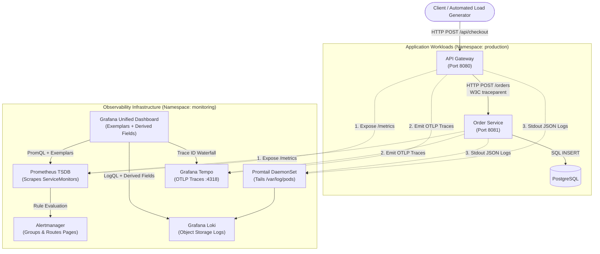

# Capstone Project: A Fully Observable System, End to End

> **Difficulty**: Advanced | **Estimated Time**: 60m | **Hands-On**: Capstone Project

> [!TIP]
> **The Golden Rule of End-to-End Observability:**
> **Design observability into the application contract, not as an infrastructure afterthought.** A production microservice architecture is truly observable only when metrics provide instant health detection, distributed traces reveal cross-network dependencies and latencies, and structured logs furnish the discrete narrative of failures—all joined seamlessly by a common trace identifier.

---

## 1. System Architecture & Capstone Blueprint

In this capstone, you will construct and deploy an end-to-end observable distributed application composed of an **API Gateway (Frontend)** and an **Order Processing Service (Backend)** backed by **PostgreSQL**.

The entire observability stack—**Prometheus**, **Grafana**, **Loki**, **Tempo**, and **Alertmanager**—will collect, correlate, and alert on telemetry emitted by your microservices on a local Kubernetes (`kind`) cluster.



---

## 2. Capstone Requirements Matrix

| Pillar / Component | Required Deliverables | Verification Standard |
| :--- | :--- | :--- |
| **1. Metrics (Prometheus)** | - Endpoints at `/metrics` exposing request count and latency histograms.<br/>- Custom Kubernetes `ServiceMonitor` resources.<br/>- Zero high-cardinality labels in metric dimensions. | Prometheus UI shows targets `UP` with scrape interval `15s`. PromQL returns clean rate and quantile vectors. |
| **2. Distributed Tracing (Tempo)** | - W3C `traceparent` context propagated from Gateway to Order Service.<br/>- Child span properly nested under Gateway root span.<br/>- Spans include semantic attributes (`http.status_code`, `db.system`). | Tempo UI renders joined multi-hop trace waterfall with parent-child links intact. |
| **3. Structured Logging (Loki)** | - Newline-delimited JSON format to stdout.<br/>- Bounded stream labels (`namespace`, `app`, `env`).<br/>- Unbounded `trace_id` and `user_id` inside JSON payload. | LogQL queries like `{app="order-service"} \| json \| status >= 500` return structured lines in Grafana Explore. |
| **4. Actionable Alerting (Alertmanager)** | - `PrometheusRule` defining SLO error rate breach (>5% over 3m).<br/>- Grouping configured by `alertname`, `service`, `namespace`.<br/>- Working inhibition rules suppressing downstream alerts. | Alertmanager API reports alert in state `firing` when load generator injects failure traffic. |
| **5. Grafana Correlation Glue** | - Custom dashboard with template variable `$service`.<br/>- Latency panel rendering clickable **Exemplars**.<br/>- Loki data source configured with **Derived Fields** pointing to Tempo. | Single click moves user from Prometheus metric exemplar $\to$ Tempo trace $\to$ Loki error logs. |

---

## 3. Production War Story: The Silent Multi-Service Cascade

```
INCIDENT SUMMARY: CAP-1001
SEVERITY: P1 - Silent Checkout Corruption
IMPACT: 18% of orders failed silently over 3 hours during flash sale; database locks went unnoticed.
ROOT CAUSE: Services lacked context propagation; logs lacked trace IDs; metrics only recorded aggregate averages.
```

### The Breakdown

```mermaid
sequenceDiagram
    autonumber
    participant Client as User Browser
    participant Gateway as API Gateway
    participant OrderSvc as Order Service
    participant DB as Postgres
    participant SRE as On-Call SRE

    Client->>Gateway: POST /api/checkout (Order #9012)
    Gateway->>OrderSvc: POST /orders (No traceparent header passed!)
    OrderSvc->>DB: UPDATE inventory SET stock = stock - 1 (Row locked)
    Note over DB: Lock wait timeout (30 seconds)
    DB-->>OrderSvc: ERROR: lock wait timeout exceeded
    OrderSvc-->>Gateway: HTTP 500 Internal Error
    Gateway-->>Client: HTTP 500 "Something went wrong"
    Note over SRE: SRE inspects dashboard: average CPU is 20%.<br/>No alerts fire because alert was on CPU, not error rate.<br/>Traces show Gateway span only; Order Service span missing.<br/>Logs require searching 50 pods manually.
```

### The Post-Mortem Resolution
By deploying the unified capstone architecture:
1. The error rate threshold immediately paged SREs within 2 minutes of the database lock timeout.
2. The Grafana latency panel surfaced the slow trace via an Exemplar.
3. The Tempo waterfall pinpointed the exact 30-second block inside the Order Service database transaction.
4. The clickable Loki Derived Field revealed the database timeout error log in 15 seconds.

---

## 4. Multi-Language Service Implementation

Choose your team's preferred backend runtime to build the two instrumented microservices.

### Option A: Go Implementation

```go
// gateway/main.go
package main

import (
	"context"
	"fmt"
	"net/http"
	"time"

	"github.com/prometheus/client_golang/prometheus"
	"github.com/prometheus/client_golang/prometheus/promhttp"
	"go.opentelemetry.io/otel"
	"go.opentelemetry.io/otel/propagation"
	sdktrace "go.opentelemetry.io/otel/sdk/trace"
	semconv "go.opentelemetry.io/otel/semconv/v1.24.0"
	"go.opentelemetry.io/otel/trace"
	"go.uber.org/zap"
)

var (
	tracer  trace.Tracer
	logger  *zap.Logger
	latency = prometheus.NewHistogramVec(
		prometheus.HistogramOpts{
			Name:    "http_request_duration_seconds",
			Help:    "HTTP latency with exemplars.",
			Buckets: prometheus.DefBuckets,
		},
		[]string{"service", "handler", "status"},
	)
)

func init() {
	prometheus.MustRegister(latency)
	logger, _ = zap.NewProduction()
	otel.SetTextMapPropagator(propagation.TraceContext{})
	tp := sdktrace.NewTracerProvider()
	otel.SetTracerProvider(tp)
	tracer = tp.Tracer("api-gateway")
}

func checkoutHandler(w http.ResponseWriter, r *http.Request) {
	start := time.Now()
	ctx, span := tracer.Start(r.Context(), "Gateway.Checkout",
		trace.WithAttributes(semconv.HTTPMethodKey.String(r.Method)),
	)
	defer span.End()

	traceID := span.SpanContext().TraceID().String()
	reqLog := logger.With(zap.String("trace_id", traceID), zap.String("service", "api-gateway"))

	// Propagate W3C traceparent to Order Service
	orderReq, _ := http.NewRequestWithContext(ctx, "POST", "http://order-service:8081/orders", r.Body)
	otel.GetTextMapPropagator().Inject(ctx, propagation.HeaderCarrier(orderReq.Header))

	client := &http.Client{Timeout: 5 * time.Second}
	resp, err := client.Do(orderReq)

	status := "200"
	if err != nil || resp.StatusCode >= 500 {
		status = "500"
		reqLog.Error("downstream order service failed", zap.Error(err))
		w.WriteHeader(http.StatusInternalServerError)
		w.Write([]byte(`{"error":"order failed"}`))
	} else {
		w.WriteHeader(http.StatusOK)
		w.Write([]byte(`{"status":"order placed"}`))
	}

	duration := time.Since(start).Seconds()
	latency.WithLabelValues("api-gateway", "/api/checkout", status).(prometheus.ExemplarObserver).ObserveWithExemplar(
		duration, prometheus.Labels{"trace_id": traceID},
	)
}

func main() {
	http.Handle("/metrics", promhttp.HandlerFor(prometheus.DefaultGatherer, promhttp.HandlerOpts{EnableOpenMetrics: true}))
	http.HandleFunc("/api/checkout", checkoutHandler)
	http.ListenAndServe(":8080", nil)
}
```

### Option B: Node.js / TypeScript Implementation

```typescript
// order-service/src/index.ts
import express from 'express';
import { trace, context, propagation, SpanStatusCode } from '@opentelemetry/api';
import client from 'prom-client';
import pino from 'pino';

const app = express();
app.use(express.json());
const logger = pino();
const tracer = trace.getTracer('order-service');

const latencyHistogram = new client.Histogram({
  name: 'http_request_duration_seconds',
  help: 'Latency in seconds',
  labelNames: ['service', 'handler', 'status'],
  buckets: [0.05, 0.1, 0.5, 1, 2.5],
  enableExemplars: true,
});

app.post('/orders', async (req, res) => {
  const extractedCtx = propagation.extract(context.active(), req.headers);
  const start = process.hrtime();

  await context.with(extractedCtx, async () => {
    const span = tracer.startSpan('OrderService.ProcessOrder');
    const traceId = span.spanContext().traceId;
    const log = logger.child({ trace_id: traceId, service: 'order-service' });

    log.info({ order_id: 'ord-101' }, 'Processing payment and inventory reservation');

    // Simulate occasional database failure
    const isError = req.query.simulate_error === 'true';
    let status = '200';

    if (isError) {
      status = '500';
      span.setStatus({ code: SpanStatusCode.ERROR, message: 'Database lock timeout' });
      log.error({ db_error: 'lock_wait_timeout' }, 'Failed to commit transaction to PostgreSQL');
      res.status(500).json({ error: 'db_timeout' });
    } else {
      res.status(200).json({ success: true });
    }

    const [sec, nano] = process.hrtime(start);
    const duration = sec + nano / 1e9;
    latencyHistogram.observe({ service: 'order-service', handler: '/orders', status }, duration);

    span.end();
  });
});

app.get('/metrics', async (req, res) => {
  res.set('Content-Type', client.register.contentType);
  res.end(await client.register.metrics());
});

app.listen(8081, () => console.log('Order service listening on :8081'));
```

### Option C: Python Implementation

```python
# order-service/main.py
import time
from flask import Flask, request, jsonify
from opentelemetry import trace, propagate
from opentelemetry.trace import Status, StatusCode
from opentelemetry.trace.propagation.tracecontext import TraceContextTextMapPropagator
import structlog
from prometheus_client import Histogram, generate_latest, CONTENT_TYPE_LATEST

app = Flask(__name__)
tracer = trace.get_tracer("order-service")
log = structlog.get_logger()

LATENCY = Histogram(
    "http_request_duration_seconds",
    "Request duration in seconds",
    ["service", "handler", "status"]
)

@app.route("/orders", methods=["POST"])
def process_order():
    start = time.time()
    ctx = TraceContextTextMapPropagator().extract(carrier=dict(request.headers))

    with tracer.start_as_current_span("OrderService.ProcessOrder", context=ctx) as span:
        trace_id = format(span.get_span_context().trace_id, "032x")
        req_log = log.bind(trace_id=trace_id, service="order-service")

        req_log.info("processing incoming order", amount=120)
        
        # Error simulation flag
        if request.args.get("simulate_error") == "true":
            span.set_status(Status(StatusCode.ERROR, "Database lock timeout"))
            req_log.error("database transaction failed", error_code="LOCK_TIMEOUT")
            status = "500"
            resp = jsonify({"error": "db_timeout"}), 500
        else:
            status = "200"
            resp = jsonify({"status": "order_processed"}), 200

        duration = time.time() - start
        LATENCY.labels(service="order-service", handler="/orders", status=status).observe(duration)
        return resp

@app.route("/metrics", methods=["GET"])
def metrics():
    return generate_latest(), 200, {"Content-Type": CONTENT_TYPE_LATEST}

if __name__ == "__main__":
    app.run(host="0.0.0.0", port=8081)
```

---

## 5. Declarative Kubernetes & Monitoring Manifests

Apply these production manifests to deploy the microservice pair and integrate with the `kube-prometheus-stack` operator.

### Service & ServiceMonitor Manifest (`observability-app.yaml`)

```yaml
apiVersion: apps/v1
kind: Deployment
metadata:
  name: api-gateway
  namespace: production
  labels:
    app: api-gateway
spec:
  replicas: 2
  selector:
    matchLabels:
      app: api-gateway
  template:
    metadata:
      labels:
        app: api-gateway
    spec:
      containers:
        - name: gateway
          image: ghcr.io/backend-roadmap/capstone-gateway:v1.0
          ports:
            - containerPort: 8080
              name: http
---
apiVersion: v1
kind: Service
metadata:
  name: api-gateway
  namespace: production
  labels:
    app: api-gateway
spec:
  ports:
    - name: http
      port: 8080
      targetPort: 8080
  selector:
    app: api-gateway
---
apiVersion: monitoring.coreos.com/v1
kind: ServiceMonitor
metadata:
  name: api-gateway-monitor
  namespace: monitoring
  labels:
    release: kps
spec:
  namespaceSelector:
    matchNames:
      - production
  selector:
    matchLabels:
      app: api-gateway
  endpoints:
    - port: http
      path: /metrics
      interval: 15s
```

---

## 6. End-to-End Verification & Triage Runbook

Execute this verification script to prove that telemetry flows through all three pillars during a live simulated failure.

### Step 1: Generate Normal Traffic Baseline

Send 100 successful requests through the gateway:

```bash
for i in {1..100}; do
  curl -s -X POST http://localhost:8080/api/checkout > /dev/null
  sleep 0.1
done
```

Verify in Grafana Explore that Prometheus scrapes the metric:
```promql
sum(rate(http_request_duration_seconds_count{service="api-gateway"}[1m]))
```

### Step 2: Inject Simulated Database Deadlock Failures

Trigger an error spike by passing the error simulation flag:

```bash
for i in {1..50}; do
  curl -s -X POST "http://localhost:8080/api/checkout?simulate_error=true" > /dev/null
  sleep 0.1
done
```

### Step 3: Verify the Triage Correlation Chain

1. **Check Alertmanager Firing State:**
   ```bash
   curl -s http://localhost:9093/api/v2/alerts | grep -A 5 "APIHighErrorRate"
   ```
2. **Find Correlated Trace ID via Exemplar:**
   Execute LogQL to locate an error log line:
   ```bash
   curl -s -G "http://localhost:3100/loki/api/v1/query" \
     --data-urlencode 'query={app="order-service"} |= "error" | json' | jq '.data.result[0].values[0][1]'
   ```
   **Output:**
   ```json
   "{\"db_error\":\"lock_wait_timeout\",\"level\":\"error\",\"msg\":\"Failed to commit transaction\",\"service\":\"order-service\",\"trace_id\":\"4bf92f3577b34da6a3ce929d0e0e4736\"}"
   ```
3. **Inspect Distributed Trace in Tempo:**
   ```bash
   curl -s "http://localhost:3200/api/traces/4bf92f3577b34da6a3ce929d0e0e4736" | jq '.batches[].scopeSpans[].spans[].name'
   ```
   **Output:**
   ```
   "Gateway.Checkout"
   "OrderService.ProcessOrder"
   ```

Both spans are linked under the same Trace ID with exact error statuses recorded!

---

## 7. Operational Validation Checkpoints

Confirm your capstone mastery with these architectural and troubleshooting scenarios.

<details>
<summary><b>Checkpoint 1: Why did the ServiceMonitor show target status DOWN after deployment?</b></summary>

**Root Cause Analysis:**
1. **Label Selector Mismatch:** The Prometheus CRD looks for ServiceMonitors matching `serviceMonitorSelector` (often `release: kps`). If the ServiceMonitor lacks this label, Prometheus ignores it.
2. **Port Name Mismatch:** The ServiceMonitor `endpoints[].port` must match the `name` of the port defined in the Kubernetes `Service` object, **not** the numeric port number (`http`, not `8080`).
3. **Namespace Filtering:** If `namespaceSelector.matchNames` does not include `production`, Prometheus will not search outside the `monitoring` namespace.
</details>

<details>
<summary><b>Checkpoint 2: Why did Tempo show two disconnected single-span traces instead of one joined waterfall?</b></summary>

**Analysis:**
This is the classic **context propagation breakage**. The API Gateway generated a root span with `trace_id=4bf92...`, but failed to inject the W3C `traceparent` header into the HTTP request headers sent to the Order Service. As a result, the Order Service extracted an empty context and generated a brand-new random `trace_id`, splitting the transaction into two orphaned traces.
</details>

<details>
<summary><b>Checkpoint 3: How do you verify that Prometheus exemplars are not violating cardinality budgets?</b></summary>

**Cardinality Rule for Exemplars:**
Unlike metric labels (which multiply the total number of stored time series in RAM), **exemplars do NOT create new metric series**. Prometheus stores exemplars in a separate in-memory circular buffer with a fixed size (default: 110,000 samples) and discards older exemplars as new observations arrive. Therefore, attaching high-cardinality `trace_id` strings to exemplars is 100% safe and will never exhaust Prometheus TSDB index memory.
</details>

---

## Congratulations! Track 3 Complete

You have successfully completed **Track 12: Observability Deep Dive**! You have mastered Prometheus metrics, PromQL query math, Grafana dashboard architecture, Loki log aggregation, OpenTelemetry distributed tracing, Alertmanager routing, and unified telemetry correlation.
