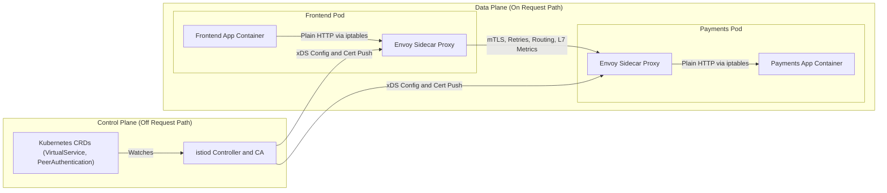
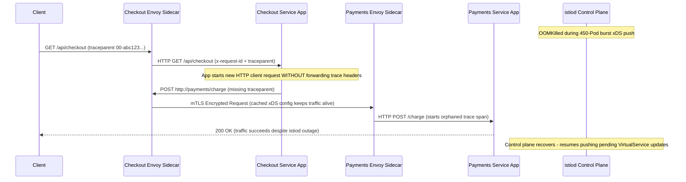

# 00 - Service Mesh Concepts

> **Prerequisites:** Kubernetes Services, Ingress, NetworkPolicy, and RBAC (Track 03); Observability instrumentation basics (Track 12); Progressive delivery concepts (Tracks 06 & 10).  
> **Estimated Reading Time:** 25 minutes  
> **Target Audience:** Backend Engineers, Platform Engineers, SREs, Cloud Architects.

> [!TIP]
> **The Golden Rule of Service Mesh Adoption:** Never adopt a service mesh just to check a single box like weighted canaries—every injected Envoy sidecar adds memory, CPU, and two extra network hops per call; reach for a mesh only when service count and cross-cutting demands (uniform mTLS, identity-based authorization, and zero-code L7 telemetry) outweigh the operational complexity of running a second distributed system.

---

## Why This Matters

By the end of track 03 you could route traffic with Services and Ingress, restrict it with NetworkPolicy, and secure the API server with RBAC — all real, all sufficient for a lot of systems. A **service mesh** exists because those tools stop scaling well once you have dozens of services that all need encryption, retries, fine-grained routing, and a live picture of who calls whom. This module builds the mental model — the sidecar pattern, the data plane / control plane split, and the honest question of when a mesh is worth its weight — before you install anything in module 01.

---

## 1. Architectural Mental Model: Sidecars, Data Plane & Control Plane

A service mesh separates **traffic execution** (the **data plane**, composed of per-Pod Envoy proxies on the request path) from **policy computation and distribution** (the **control plane**, `istiod`, which sits off the request path and pushes xDS config and SPIFFE certificates asynchronously):



### Core Concepts

#### The Problem: Cross-Cutting Concerns Duplicated in Every Service
Think about what every service in a real system needs: TLS to its neighbours, retries on transient failures, timeouts so one slow dependency doesn't hang the caller, metrics on every call, and a way to say "only the checkout service may call the payments service." In track 03 you solved pieces of this per-object: a `Service` for discovery, a `NetworkPolicy` for coarse allow/deny, hand-configured TLS if you bothered. The trouble is these are **cross-cutting concerns** — every service needs them, so without a mesh every *team* re-implements them in application code, in a different library, in a different language, slightly wrong each time. A mesh's core idea is to lift all of that *out* of the application and into infrastructure.

#### The Sidecar Proxy Pattern
A service mesh does this by putting a **proxy container** (Istio uses Envoy) into every application Pod, alongside your app container — a **sidecar**. This is the exact same Pod-with-two-containers shape you first saw as an "init/sidecar" idea in track 03, and it's the same shape ACA's Dapr sidecar took in track 06's revisions module — one process for your code, one alongside it for the platform's concerns. All traffic in and out of the app container is transparently redirected through its sidecar proxy (via `iptables` rules the mesh installs), so:

- your app makes a plain `http://payments` call, unaware anything changed;
- its sidecar intercepts the outbound call, encrypts it (mTLS), applies retry/timeout/routing rules, and records metrics;
- the payments Pod's sidecar receives it, decrypts it, checks authorization, records metrics, and hands plaintext to the payments app container.

Your application code is untouched. That transparency is the whole selling point — and also the whole cost, because now there are twice as many containers to run and one more network hop each way.

#### Data Plane vs. Control Plane
The set of all those sidecar proxies — the things actually carrying and acting on your traffic — is the **data plane**. But the proxies don't decide policy on their own; something has to tell every proxy "route 10% to v2," "require mTLS here," "allow checkout→payments." That something is the **control plane** (in Istio, a component called `istiod`). You write Kubernetes objects (CRDs like `VirtualService`, `PeerAuthentication`); the control plane watches them, computes the right configuration for each proxy, and pushes it out. This is the same **declared-desired-state / a-controller-reconciles-it** loop behind every controller you've met since track 03 — a Deployment controller reconciles ReplicaSets, `istiod` reconciles Envoy configs. The data plane is on the request path; the control plane is not, so if `istiod` is briefly down, existing traffic keeps flowing on the last config it pushed.

#### What a Mesh Solves That Plain Kubernetes Doesn't
Line the mesh up against the track 03 tools you already know:

- **Encryption in transit.** `NetworkPolicy` controls *whether* Pod A may reach Pod B, but the traffic itself is plaintext on the wire. A mesh gives you **mTLS everywhere** automatically (module 04) — every call encrypted *and* both ends cryptographically identified, with certificates issued and rotated for you.
- **Traffic routing by request content.** A `Service` load-balances across all matching Pods equally by label selector — it cannot send 5% of traffic to a canary, or route requests with header `x-user: beta` to v2. A mesh's `VirtualService` can (modules 02–03).
- **Identity-based authorization.** RBAC governs who can call the *Kubernetes API*; it says nothing about which service may call which *at runtime*. A mesh's `AuthorizationPolicy` does that, keyed on the cryptographic identity mTLS establishes (module 05).
- **Uniform L7 observability.** In track 12 you instrumented apps for metrics and traces. A mesh gives you golden-signal metrics (request rate, error rate, latency) and a service dependency graph for *every* call with zero app changes, because the proxy sees every request (module 06).
- **Resilience without code.** Retries, timeouts, and circuit breaking become configuration instead of client-library code (module 07).

#### Where a Mesh Is Overkill
A mesh is not free and not always worth it. The honest counsel:

- **A handful of services** get most of these benefits more cheaply from Ingress + NetworkPolicy + a decent HTTP client library; the mesh's fixed cost (a proxy per Pod, a control plane, a steeper operational learning curve, extra latency and CPU) dominates when you have three services, not thirty.
- **Latency-critical paths** pay for the extra hop through two proxies on every call — usually small, but real.
- **Small teams** take on a genuinely complex new system to operate; an outage in the mesh is an outage in everything.

The rule of thumb: reach for a mesh when the *number of services* and the *need for uniform mTLS/authz/observability across all of them* is what hurts — not as a default first move. This is exactly why the curriculum put tracks 03 and 12 first: you should feel the pain the mesh removes before adopting it.

#### Istio vs. Linkerd
**Istio** is the most feature-complete mesh (rich traffic management, Envoy-based, huge surface area) and is what this track teaches in depth. **Linkerd** is the notable lighter-weight alternative: a purpose-built Rust "micro-proxy" instead of Envoy, dramatically simpler to operate and lower overhead, at the cost of fewer knobs (less elaborate traffic-routing and extensibility than Istio). The tradeoff in one line: **Istio buys you power and pays in complexity; Linkerd buys you simplicity and pays in flexibility.** Everything you learn here about the *concepts* — sidecars, data/control plane, mTLS, traffic splitting, authz — applies to Linkerd too; only the CRDs and tooling differ. We go deep on Istio because the mechanics it exposes make the concepts concrete.

---

## 2. Taxonomic Comparison & Command Reference

### Plain Kubernetes Primitives vs. Service Mesh Capabilities

| Concern | Track 03 / 12 Kubernetes Tool | What It Solves Today | Fundamental Gap Filled by Service Mesh |
|---|---|---|---|
| **Service Discovery & Splitting** | `Service` (ClusterIP / kube-proxy) | Stable DNS name and even L4 endpoint balancing | Cannot weight by exact percentage (e.g., 5% canary) or route by L7 header/path |
| **Traffic Allow / Deny** | `NetworkPolicy` (CNI) | L3/L4 Pod-to-Pod firewall rules | Traffic stays plaintext on the wire; identity relies on spoofable IP/labels |
| **Access Control** | Kubernetes `RBAC` | Authorizes calls to the Kubernetes API server | Governs `kubectl` / control plane actions, not runtime `checkout -> payments` calls |
| **Observability** | App SDK instrumentation (Prometheus/OTel) | Custom per-language metrics and spans | Requires per-team code changes; mesh emits uniform L7 golden signals automatically |
| **Resilience** | Per-language client libraries | Retries, timeouts, circuit breakers in app code | Divergent implementations across Go, Node, Python, C#; mesh standardizes via config |

### Istio vs. Linkerd Trade-Off Matrix

| Dimension | Istio (Envoy-Based) | Linkerd (linkerd2-proxy) |
|---|---|---|
| **Sidecar Proxy Implementation** | C++ Envoy (general-purpose L4/L7 proxy) | Purpose-built Rust micro-proxy |
| **Per-Pod Resource Overhead** | Higher (~50–120 MB RAM baseline per Envoy, scales with cluster services) | Lower (~10–30 MB RAM baseline per proxy) |
| **Traffic Management & Routing** | Exhaustive (headers, regex URI, mirroring, fault injection, Gateway API) | Focused (HTTPRoute splits, basic retries/timeouts) |
| **Extensibility** | EnvoyFilter, WebAssembly (Wasm) plugins, external authz (`ext_authz`) | Minimal extension points by design |
| **Operational Profile** | Larger CRD surface area; steeper learning curve | Opinionated defaults; faster day-1 operations |

### Command & Vocabulary Reference

This module is conceptual — you install nothing yet. These are the terms and the objects you'll meet, so the vocabulary is set before module 01.

| Term / object | What it is | Where it shows up |
|---|---|---|
| Sidecar proxy | Envoy container injected into each Pod; carries all its traffic | Every meshed Pod (module 01) |
| Data plane | The set of all sidecar proxies actually moving traffic | Modules 02-07 |
| Control plane (`istiod`) | Watches CRDs, computes and pushes proxy config | Installed in module 01 |
| `istioctl` | Istio's CLI: install, inject, diagnose | Module 01 onward |
| `VirtualService` | Rules for *how* to route requests to a service | Modules 02-03 |
| `DestinationRule` | Defines subsets (versions) and per-destination policy | Modules 02-03, 07 |
| `PeerAuthentication` | Requires/relaxes mTLS between proxies | Module 04 |
| `AuthorizationPolicy` | Allow/deny rules on service-to-service calls | Module 05 |
| mTLS | Mutual TLS: both ends encrypt *and* prove identity | Module 04 |

---

## 3. Production War Story Post-Mortem

- **Incident ID:** INC-2026-0411 (`checkout` -> `payments` mesh outage investigation)
- **Severity:** SEV-2
- **Detection Time:** 2 minutes (distributed trace fragmentation alert + Argo sync timeout)
- **Resolution Time:** 18 minutes
- **Blast Radius / Impact:** Zero dropped steady-state production requests during a 9-minute `istiod` control-plane crash, proving data-plane resilience—however, 100% of new canary config pushes stalled and 40% of cross-service traces fragmented because teams assumed Envoy automatically correlated outbound HTTP spans without app header propagation.

### What Happened

During a cluster scale-up (450 new Pods), `istiod` ran out of memory (`OOMKilled`) due to unpinned xDS push concurrency. Steady-state traffic between `checkout` and `payments` kept flowing cleanly on cached Envoy configurations. However, operators noticed two simultaneous anomalies: newly deployed canary `VirtualService` updates never reached sidecars, and distributed traces split into disconnected root spans inside `payments`.



### Root Cause Analysis

1. **Control Plane Sizing Blind Spot:** `istiod` lacked memory requests/limits calibrated for cluster-wide xDS fan-out (every Pod receives cluster-wide `Service` endpoints unless restricted by a `Sidecar` resource), causing an OOM loop under pod churn. Meanwhile, existing Pods suffered **zero request drops** because Envoy keeps serving from its last valid xDS snapshot.
2. **The "Zero-Code Tracing" Myth:** Teams deleted their HTTP client instrumentation assuming Envoy sidecars stitch distributed traces magically. In reality, an Envoy sidecar sees *inbound* HTTP on port 8080 and a separate *outbound* HTTP socket from the app—Envoy has no visibility into internal goroutine/async boundaries inside your process, so unless your app propagates correlation headers (`traceparent`, `x-request-id`, `x-b3-traceid`), every hop generates an orphan trace.

### The Fix & Architectural Hardening

1. Scoped `istiod` memory limits (`2Gi`–`4Gi`) and configured `Sidecar` CRDs per namespace to trim xDS endpoint tables by 78%, reducing control-plane push CPU/memory pressure.
2. Standardized a shared outbound HTTP middleware across Go, TypeScript, Python, and C# services to forward W3C/Envoy correlation headers (`x-request-id`, `traceparent`, `x-b3-*`) while leaving TLS, retries, and timeouts solely in the Envoy sidecar.

---

## 4. Multi-Language Production Implementation

Even when Envoy handles mTLS, retries, timeouts, and L7 telemetry transparently out-of-process, production backend services still share one critical contract with the mesh: **propagating inbound trace and request-routing headers** onto outbound `http://payments` calls so Envoy can stitch traces and evaluate multi-hop `VirtualService` header matches.

````carousel
```go
package meshclient

import (
	"context"
	"net/http"
	"time"
)

// MeshPropagatedHeaders lists L7 correlation headers Envoy expects apps to forward.
var MeshPropagatedHeaders = []string{
	"x-request-id",
	"traceparent",
	"tracestate",
	"x-b3-traceid",
	"x-b3-spanid",
	"x-b3-parentspanid",
	"x-b3-sampled",
	"x-b3-flags",
	"x-ot-span-context",
}

type ctxKey struct{}

// WithIncomingHeaders captures mesh headers from an inbound HTTP request.
func WithIncomingHeaders(ctx context.Context, r *http.Request) context.Context {
	captured := make(http.Header)
	for _, h := range MeshPropagatedHeaders {
		if val := r.Header.Get(h); val != "" {
			captured.Set(h, val)
		}
	}
	return context.WithValue(ctx, ctxKey{}, captured)
}

// NewPaymentsClient creates a plain HTTP client (no TLS/retry code—Envoy handles both).
func NewPaymentsClient() *http.Client {
	return &http.Client{
		Timeout: 10 * time.Second, // Fallback ceiling; Envoy VirtualService enforces tighter hop timeouts
	}
}

// ForwardHeaders copies captured mesh correlation headers onto an outbound request.
func ForwardHeaders(ctx context.Context, req *http.Request) {
	headers, ok := ctx.Value(ctxKey{}).(http.Header)
	if !ok {
		return
	}
	for k, vals := range headers {
		for _, v := range vals {
			req.Header.Set(k, v)
		}
	}
}
```
<!-- slide -->
```typescript
import { AsyncLocalStorage } from "node:async_hooks";
import type { IncomingHttpHeaders } from "node:http";

const MESH_PROPAGATED_HEADERS = [
  "x-request-id",
  "traceparent",
  "tracestate",
  "x-b3-traceid",
  "x-b3-spanid",
  "x-b3-parentspanid",
  "x-b3-sampled",
  "x-b3-flags",
  "x-ot-span-context",
] as const;

const meshHeaderStore = new AsyncLocalStorage<Record<string, string>>();

export function runWithMeshHeaders<T>(
  inboundHeaders: IncomingHttpHeaders,
  fn: () => Promise<T>
): Promise<T> {
  const propagated: Record<string, string> = {};
  for (const key of MESH_PROPAGATED_HEADERS) {
    const val = inboundHeaders[key];
    if (typeof val === "string" && val.length > 0) {
      propagated[key] = val;
    }
  }
  return meshHeaderStore.run(propagated, fn);
}

// Outbound call targets plain http://payments; Envoy sidecar intercepts via iptables for mTLS.
export async function callPaymentsService(payload: unknown): Promise<Response> {
  const meshHeaders = meshHeaderStore.getStore() ?? {};
  return fetch("http://payments.mesh-demo.svc.cluster.local/charge", {
    method: "POST",
    headers: {
      "content-type": "application/json",
      ...meshHeaders,
    },
    body: JSON.stringify(payload),
  });
}
```
<!-- slide -->
```python
from contextvars import ContextVar
import urllib.request
import json

MESH_PROPAGATED_HEADERS = (
    "x-request-id",
    "traceparent",
    "tracestate",
    "x-b3-traceid",
    "x-b3-spanid",
    "x-b3-parentspanid",
    "x-b3-sampled",
    "x-b3-flags",
    "x-ot-span-context",
)

_mesh_headers_var: ContextVar[dict[str, str]] = ContextVar("mesh_headers", default={})


def capture_inbound_mesh_headers(inbound_headers: dict[str, str]) -> None:
    lowered = {k.lower(): v for k, v in inbound_headers.items()}
    _mesh_headers_var.set(
        {h: lowered[h] for h in MESH_PROPAGATED_HEADERS if h in lowered and lowered[h]}
    )


def call_payments_service(order_id: str, amount_cents: int) -> bytes:
    """Calls plain http://payments; Envoy transparently upgrades the wire hop to mTLS."""
    headers = {"Content-Type": "application/json", **_mesh_headers_var.get()}
    body = json.dumps({"orderId": order_id, "amountCents": amount_cents}).encode("utf-8")
    req = urllib.request.Request(
        "http://payments.mesh-demo.svc.cluster.local/charge",
        data=body,
        headers=headers,
        method="POST",
    )
    with urllib.request.urlopen(req, timeout=10) as resp:
        return resp.read()
```
<!-- slide -->
```csharp
using System.Collections.Concurrent;
using System.Net.Http.Json;

namespace ServiceMesh.Concepts;

public sealed class MeshHeaderContext
{
    public static readonly string[] PropagatedHeaders =
    [
        "x-request-id",
        "traceparent",
        "tracestate",
        "x-b3-traceid",
        "x-b3-spanid",
        "x-b3-parentspanid",
        "x-b3-sampled",
        "x-b3-flags",
        "x-ot-span-context"
    ];

    private static readonly AsyncLocal<IReadOnlyDictionary<string, string>?> CurrentHeaders = new();

    public static void CaptureFromInbound(IDictionary<string, string> inboundHeaders)
    {
        var captured = new Dictionary<string, string>(StringComparer.OrdinalIgnoreCase);
        foreach (var header in PropagatedHeaders)
        {
            if (inboundHeaders.TryGetValue(header, out var value) && !string.IsNullOrWhiteSpace(value))
            {
                captured[header] = value;
            }
        }
        CurrentHeaders.Value = captured;
    }

    public static void ApplyToOutbound(HttpRequestMessage request)
    {
        if (CurrentHeaders.Value is null) return;
        foreach (var (key, value) in CurrentHeaders.Value)
        {
            request.Headers.TryAddWithoutValidation(key, value);
        }
    }
}

// Registered as a DelegatingHandler on HttpClient targeting plain http://payments
public sealed class MeshCorrelationHandler : DelegatingHandler
{
    protected override Task<HttpResponseMessage> SendAsync(
        HttpRequestMessage request, CancellationToken cancellationToken)
    {
        MeshHeaderContext.ApplyToOutbound(request);
        return base.SendAsync(request, cancellationToken);
    }
}
```
````

---

## 5. Practical Hands-On Verification & CLI Workflows

No cluster mesh changes yet — these exercises and diagnostic inspections make the concepts concrete by inspecting what plain Kubernetes gives you today and reasoning about the exact gaps a service mesh fills. Work in a notebook; several answers are things you'll verify hands-on in later modules.

### Baseline Cluster Inspection (Optional Pre-Mesh Check)

Before installing Istio in module 01, inspect the raw Kubernetes L3/L4 objects and Pod container counts on your cluster:

```bash
kubectl get svc,networkpolicy,ingress -A
kubectl get pods -A -o custom-columns="NAMESPACE:.metadata.namespace,NAME:.metadata.name,CONTAINERS:.spec.containers[*].name,READY:.status.containerStatuses[*].ready"
```

**Expected Output:**

```text
NAMESPACE     NAME                        TYPE        CLUSTER-IP     PORT(S)
default       service/kubernetes          ClusterIP   10.96.0.1      443/TCP
kube-system   service/kube-dns            ClusterIP   10.96.0.10     53/UDP,53/TCP

NAMESPACE     NAME              CONTAINERS   READY
kube-system   coredns-xxxx      coredns      true
```

Notice that application Pods currently run **one container** (`READY 1/1`) and Kubernetes only knows about ClusterIP endpoints—zero mTLS certificates, zero L7 percentage weights, and zero sidecar proxies exist yet.

### 1. Inventory What Track 03 Already Gives You

On any existing kind cluster (or on paper), list, for a two-service `frontend`→`backend` app, exactly which track-03 object provides each of: service discovery, load balancing, coarse allow/deny between Pods, and external exposure.

**Expected Output / Takeaway:** `Service` (discovery + L4 load balancing), `NetworkPolicy` (coarse allow/deny), `Ingress` (external exposure). Note that *encryption*, *percentage routing*, and *service-to-service authz* are on nobody's list — those are the mesh's gaps to fill.

### 2. Find the Gaps a Service Can't Cover

For that same app, write down what you would have to do *today*, without a mesh, to (a) encrypt `frontend`→`backend` traffic, and (b) send 5% of `frontend` traffic to a second version of `backend`.

**Expected Output / Takeaway:** (a) Terminate TLS in each app or run your own sidecar/cert tooling — non-trivial and per-app; (b) approximate it with replica ratios (coarse, as track 10 module 04 warned) because a `Service` splits evenly by label. Both are exactly what modules 02–04 make one-liners.

### 3. Draw the Request Path, Twice

Sketch a single `frontend`→`backend` HTTP request as it flows **today** (app → Service/kube-proxy → app), then sketch it again **with a mesh** (app → its sidecar → network → backend's sidecar → backend app). Count the hops and mark where encryption, retries, and metrics get applied in the meshed version.

**Expected Output / Takeaway:** The meshed path has two extra proxy hops; encryption/retries/metrics all live in the sidecars, not the app — this is the transparency *and* the overhead in one picture.

### 4. Separate the Planes

Given the statement "we deploy a new routing rule and 30 seconds later traffic shifts," identify which plane the rule is *written to* and which plane *acts on* traffic, and answer: if the control plane crashed the moment after the rule was accepted, would already-flowing traffic stop?

**Expected Output / Takeaway:** You write to the control plane (a CRD `istiod` reads); the data plane (sidecars) acts on traffic. Existing traffic keeps flowing on the last pushed config even if `istiod` is down — only *new* config changes stall.

### 5. Map Each Mesh Feature to the Track-03 Tool It Surpasses

Make a two-column table: left, the mesh feature (mTLS, weighted routing, service authz, L7 metrics); right, the closest track-03/12 tool and the one thing it *can't* do that the mesh can.

**Expected Output / Takeaway:** mTLS vs. NetworkPolicy (policy allows/denies but doesn't encrypt); weighted routing vs. Service (even split only); service authz vs. RBAC (RBAC is API-server access, not runtime call authz); L7 metrics vs. app instrumentation (mesh needs no app changes).

### 6. Decide: Mesh or Not?

For each system, decide "mesh" or "not yet," and justify in one sentence:
(a) three services behind one Ingress, one team; (b) forty microservices, six teams, a compliance requirement that all internal traffic be encrypted; (c) two latency-critical trading services where every millisecond counts.

**Expected Output / Takeaway:** (a) Not yet — Ingress + NetworkPolicy + a good HTTP client is cheaper than a mesh; (b) mesh — uniform mTLS + authz + observability across forty services is exactly the pain a mesh removes; (c) probably not, or Linkerd if anything — the per-hop latency tax is hardest to justify where milliseconds are the product.

### 7. Istio or Linkerd?

For system (b) above, argue in three sentences which mesh you'd pick and why, naming one concrete factor that would flip your choice.

**Expected Output / Takeaway:** A defensible answer either way — Istio for rich traffic-routing and extensibility if you'll use those knobs; Linkerd for lower overhead and operational simplicity if you mostly want mTLS + basic splitting. A flipping factor: needing header-based routing / elaborate `VirtualService` rules pushes toward Istio; a tiny platform team pushes toward Linkerd.

### Independent Challenge

No commands here — this is a reasoning task drawing on [track 03 Services](../../03-kubernetes/04-services-and-networking/README.md), [track 03 NetworkPolicy/RBAC](../../03-kubernetes/11-security-rbac-and-network-policies/README.md), and the canary discussions in [track 10 module 06](../../10-cicd-and-gitops/06-progressive-delivery-canary-and-blue-green/README.md) and [track 06 module 05](../../06-azure-container-apps/05-revisions-traffic-splitting-and-dapr/README.md).

**Task:** Write a one-page "should we adopt a service mesh?" recommendation for a hypothetical platform team running twelve services on AKS. Cover: which specific problems they have today that a mesh solves (be concrete — name the track-03 tool that currently half-solves each), what new operational cost and failure modes they take on, whether their canary needs are already met by the mechanisms they know (Argo Rollouts from track 10, ACA revisions from track 06) or genuinely need mesh-based weighting, and a final go/no-go with the one condition that would change your answer. No YAML — this is the judgment call the rest of the track assumes you can make.

<details>
<summary>Stuck? One hint</summary>

Structure it as a table of "concern → what half-solves it today → what the mesh adds → is the delta worth it here." The honest recommendation for *twelve* services often hinges on the encryption/compliance requirement and the team size, not on the traffic-routing features — decide which of those is load-bearing for your imaginary team and let it drive the go/no-go.

</details>

---

## 6. Operational Validation Checkpoints & Quiz

### Operational Validation Checkpoints

<details>
<summary><strong>Checkpoint 1: Control Plane Outage Behavior During Peak Load</strong></summary>

**Scenario:** An alert fires at 02:14 UTC that all replicas of `istiod` in `istio-system` are in `CrashLoopBackOff` due to a corrupted webhook configuration. Your team is NOT rolling out any new Deployments or `VirtualService` edits right now, and your `checkout` and `payments` Pods have been running for 6 hours. Does customer checkout traffic immediately fail with `503 Service Unavailable`?

**Answer & Rationale:** **No.** `istiod` is the **control plane** and sits completely off the request path. Existing Envoy sidecars (the **data plane**) hold their last valid xDS routing table and active 24-hour workload certificates in memory, so steady-state `checkout -> payments` traffic continues flowing uninterrupted. What *does* break until `istiod` recovers: (1) new Pods created during autoscaling cannot inject sidecars or fetch initial certificates, and (2) any newly applied `VirtualService`/`PeerAuthentication` changes will not propagate.

</details>

<details>
<summary><strong>Checkpoint 2: Diagnosing Why Sidecars Didn't Stitch Distributed Traces</strong></summary>

**Scenario:** After onboarding to Istio, a Go microservice team removes their OpenTelemetry HTTP middleware because "the Envoy sidecar traces every request automatically." In Jaeger/Tempo, `frontend -> checkout` appears as one trace, while `checkout -> payments` spawns an unrelated second trace ID. What did the team miss?

**Answer & Rationale:** Envoy creates inbound and outbound spans, **but Envoy cannot link an incoming request to an outbound request inside your application process**. Unless the application copies correlation headers (`x-request-id`, `traceparent`, `x-b3-traceid`, `x-b3-spanid`) from the inbound HTTP context to every outbound HTTP request, Envoy treats the outbound call to `http://payments` as a brand-new root trace.

</details>

<details>
<summary><strong>Checkpoint 3: Justifying Mesh vs. Non-Mesh for a Latency-Sensitive Pipeline</strong></summary>

**Scenario:** A 4-engineer startup runs 3 services behind a single Ingress (`api`, `worker`, `billing`) with a strict 3 ms p99 internal hop SLA and no SOC2 mTLS mandate yet. An architect suggests deploying Istio across all namespaces solely to enable 5% weighted canaries on `api`. Should you approve or push back?

**Answer & Rationale:** **Push back.** Every meshed RPC traverses two extra userspace Envoy proxies (`app -> proxy -> wire -> proxy -> app`), adding measurable tail latency and ~100–200 MB of memory overhead per Pod, plus control-plane operational burden for a tiny team. For 3 services needing only weighted canaries without uniform mTLS/L7 authz, an Ingress controller canary annotation or Argo Rollouts is dramatically cheaper and avoids taxing the 3 ms p99 budget.

</details>

### Checkpoint Quiz

Write down your answer to each question before expanding it — checking without attempting first is the single easiest way to fool yourself into thinking you've learned this.

1. In one sentence, what does the sidecar proxy pattern let a mesh do that editing the application couldn't do as cleanly?
2. Which plane is on the request path — data or control — and what does that mean if the control plane briefly goes down?
3. NetworkPolicy already controls Pod-to-Pod traffic. Name two things a mesh adds that a NetworkPolicy fundamentally can't.
4. Why can't a plain `Service` send 5% of traffic to a canary version?
5. Give two concrete situations where adopting a mesh would be overkill.
6. State the Istio-vs-Linkerd tradeoff in one sentence each.
7. Which mesh feature relates to Kubernetes RBAC, and why is it a *different layer* rather than a replacement?

<details>
<summary>Show answers</summary>

1. It moves cross-cutting concerns (mTLS, retries, routing, metrics) into an injected proxy that intercepts all traffic transparently, so every service in every language gets them uniformly without any application code change.
2. The **data plane** (the sidecars) is on the request path; the control plane is not. If the control plane goes down briefly, existing traffic keeps flowing on the last configuration already pushed to the proxies — only new config changes stall until it's back.
3. Encryption in transit (mTLS) and cryptographic identity of each end; also request-level (L7) routing and authorization. NetworkPolicy is L3/4 allow/deny only — it never encrypts or identifies, and can't route by header/weight.
4. A `Service` load-balances evenly across *all* Pods matching its label selector; "5%" is a traffic weight, not a pod ratio, and the Service has no concept of weighting — you need a mesh (or an ingress/mesh traffic provider) to set a real percentage independent of pod count.
5. E.g. a three-service app behind one Ingress with one team (fixed mesh cost dominates), and a latency-critical path where the extra proxy hop each way is unacceptable. (Also: a small team that can't absorb operating another distributed system.)
6. Istio: maximum features/flexibility, higher complexity and overhead. Linkerd: much simpler to operate with lower overhead, fewer traffic-management and extensibility knobs.
7. `AuthorizationPolicy`. RBAC governs access to the *Kubernetes API server* (who can `kubectl get pods`); `AuthorizationPolicy` governs *runtime service-to-service calls* (may checkout call payments). Different layer, same least-privilege principle.

</details>

---

## Common Mistakes & Troubleshooting

- **Treating the mesh as a router replacement.** It doesn't replace Services, Ingress, or DNS — it layers on top of them. Your `Service` objects still exist and still do discovery; the mesh adds routing *rules* over that.
- **Thinking NetworkPolicy and mTLS are the same layer.** NetworkPolicy is L3/4 allow/deny (can Pod A reach Pod B at all); mTLS is encryption + identity on the traffic that's allowed. They compose — you'll use both (module 04).
- **Assuming a mesh is a security feature you can bolt on for free.** It's a distributed system you now operate. The proxies, the control plane, and the certificate machinery are all things that can break and page you.
- **Believing "sidecarless" or "ambient" modes make the concepts moot.** Newer Istio "ambient" mode moves some functions out of per-Pod sidecars, but the data-plane/control-plane split, mTLS identity, and routing concepts are identical — learn them with sidecars first; they transfer.
- **Adopting a mesh to get *one* feature.** If all you need is percentage canaries, Argo Rollouts (track 10) does that without a mesh. Adopt the mesh when *several* of its features are needed uniformly across many services.

---

## Sources & Further Reading

- [Istio Architecture Overview (Data Plane & Control Plane)](https://istio.io/latest/docs/ops/deployment/architecture/)
- [Envoy Proxy Architecture & xDS Protocol](https://www.envoyproxy.io/docs/envoy/latest/intro/arch_overview/arch_overview)
- [Linkerd Architecture Overview](https://linkerd.io/2-edge/reference/architecture/)

---

## Next

[01-installing-istio-and-sidecar-injection](../01-installing-istio-and-sidecar-injection/README.md) — put the concepts on a real cluster: install Istio, label a namespace for injection, and prove the sidecars actually attached.
