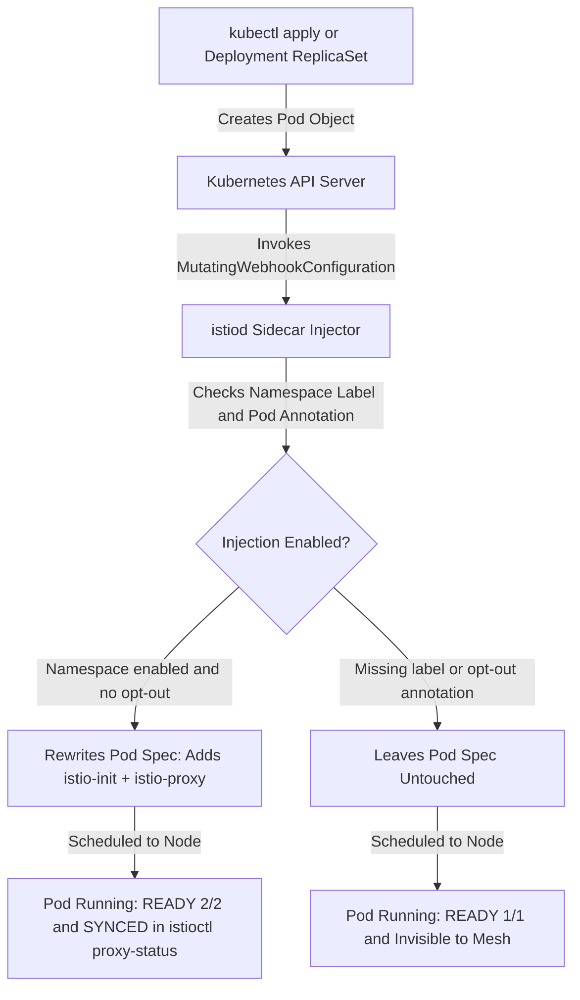
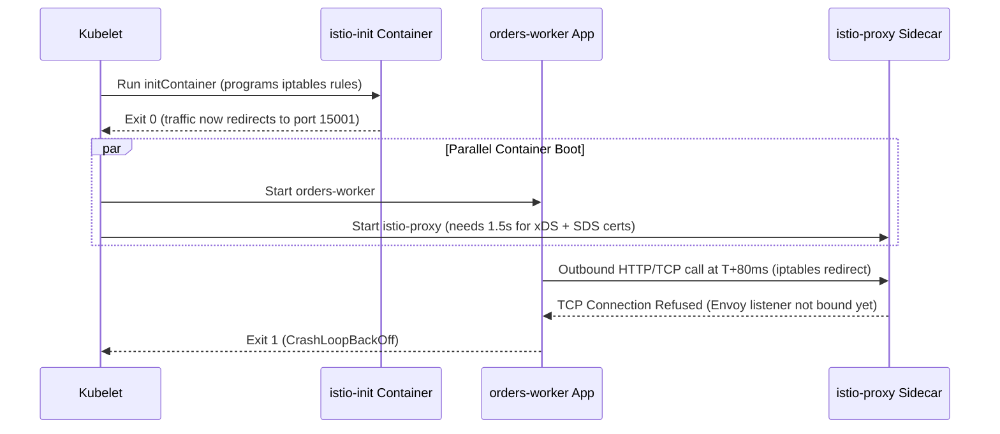

# 01 - Installing Istio and Sidecar Injection

> **Prerequisites:** Running local Kubernetes cluster (`kind`) with `kubectl` configured; `istioctl` CLI on `PATH`; Service Mesh mental model (Module 00).  
> **Estimated Reading Time:** 35 minutes  
> **Target Audience:** Backend Engineers, Platform Engineers, Kubernetes Operators.

> [!TIP]
> **The Golden Rule of Sidecar Injection:** Namespace labels (`istio-injection=enabled`) are evaluated strictly at Pod creation time by the mutating admission webhook—labeling an existing namespace never injects running Pods, and a missing label fails silently at `1/1`; always verify `READY 2/2`, `istioctl proxy-status`, and `istio-proxy` containers after every rollout.

---

## Why This Matters

Everything else in this track — mTLS, routing, authorization, observability — is delivered by the sidecar proxies, and a Pod only gets a sidecar if injection is set up correctly. The single most common "the mesh isn't working" bug is a Pod that was never actually meshed because a namespace label was missing, so it silently behaves like a plain track-03 Pod. This module installs Istio and, more importantly, teaches you to *verify* that sidecars really attached rather than assuming they did.

---

## 1. Architectural Mental Model: Mutating Admission Webhook & Pod Lifecycle

Your Deployment YAML still declares one container, yet a meshed Pod runs two (`app` + `istio-proxy`) plus an init container (`istio-init`). That injection happens synchronously at Pod admission inside the Kubernetes API server:



### Core Concepts

#### `istioctl` and Installation Profiles
Istio ships a CLI, **`istioctl`**, that installs the control plane, injects sidecars, and diagnoses the mesh. You install with `istioctl install`, which lays down `istiod` (the control plane) and the mesh's CRDs. Installs come in **profiles** — `demo` (all features on, verbose, for learning — what we use), `default` (production-leaning), `minimal` (control plane only). A profile is just a bundle of defaults; picking `demo` here is the mesh analogue of using the verbose `demo`-grade settings you used for local learning in earlier tracks rather than a hardened production config.

#### The Injection Model: How a Sidecar Gets Into a Pod
Your Deployment YAML says one container; a meshed Pod runs two. Where did the second come from? Istio registers a **mutating admission webhook** with the API server. When a Pod is created in a namespace marked for injection, the API server calls out to `istiod`, which *rewrites the Pod spec on the way in* to add the Envoy sidecar container (and an init container that sets up the `iptables` redirect). This is the same admission-webhook mechanism that policy enforcement used in track 11 — a hook that inspects and mutates objects at create time — here used to add a container instead of to validate one. Your stored Deployment is unchanged; the *Pods* it creates come out with two containers.

#### Namespace Labels: The Injection Switch
Injection is opt-in **per namespace**, controlled by a label on the Namespace:

```text
istio-injection=enabled
```

(Newer revision-based installs use `istio.io/rev=<revision>` instead, but the idea is identical — a label that flips injection on.) A Pod created in a labelled namespace gets a sidecar; a Pod in an unlabelled namespace does not. This is deliberately the same label-selector philosophy from track 03: behaviour is driven by labels, and a *missing* label is a silent no-op, not an error — exactly the failure class you saw with Service selector typos in track 03 module 04 and NetworkPolicy typos in module 11. **Labelling the namespace does not retroactively inject already-running Pods** — injection happens at Pod *creation*, so existing Pods must be restarted (rolled) to pick up a sidecar.

#### Verifying Sidecars Actually Attached
Because a missing label fails silently, verification is a skill, not an afterthought. Three independent checks:

- **`READY` column count.** `kubectl get pods` on a meshed Pod shows `2/2` (app + sidecar) instead of `1/1`. A meshed-namespace Pod stuck at `1/1` was not injected.
- **`istioctl proxy-status`.** Lists every proxy the control plane knows about and whether its config is in sync (`SYNCED`). A Pod you expected to be meshed but that's absent from this list has no proxy.
- **`kubectl describe pod`.** A meshed Pod's container list includes `istio-proxy` and an `istio-init` init container.

Building the habit of checking `2/2` first will save you from debugging "mTLS isn't working" when the real problem is "this Pod isn't in the mesh."

#### The Ingress Gateway: Getting Traffic *Into* the Mesh
Sidecars handle traffic *between* meshed Pods, but external traffic has to enter the mesh somewhere. Istio's **ingress gateway** is a standalone Envoy (a `LoadBalancer`/`NodePort` Service at the edge, not a per-Pod sidecar) that external clients hit; it applies mesh routing on the way in. It plays the role Ingress played in track 03, but it's mesh-aware and driven by a `Gateway` + `VirtualService` (module 02) rather than an `Ingress` object. On kind there's no cloud load balancer (same reason `LoadBalancer` stayed `<pending>` in track 03 module 04), so we reach it via `port-forward` or NodePort.

---

## 2. Taxonomic Comparison & Command Reference

### Istio Installation Profiles

| Profile | Components Installed | Default Telemetry & Gateways | Intended Use Case |
|---|---|---|---|
| **`demo`** | `istiod`, `istio-ingressgateway`, `istio-egressgateway` | High tracing sampling, debug-friendly defaults | Local `kind` learning & feature exploration |
| **`default`** | `istiod`, `istio-ingressgateway` | Production-tuned resource limits & sampling | Standard production clusters |
| **`minimal`** | `istiod` only | No gateways installed by default | Custom gateway topologies or separate gateway installs |
| **`ambient`** | `istiod`, `ztunnel` DaemonSet, `istio-cni` | Sidecarless L4 mTLS + optional L7 waypoint proxies | Low-overhead mesh topologies (concepts identical) |

### Sidecar Injection Precedence Matrix

| Namespace Label | Pod Annotation (`sidecar.istio.io/inject`) | Outcome on Pod Creation | Resulting `READY` Count |
|---|---|---|---|
| None | None | Not injected | `1/1` |
| `istio-injection=enabled` | None | Injected by webhook | `2/2` |
| `istio-injection=enabled` | `"false"` | **Opt-out overrides namespace** | `1/1` |
| None | `"true"` | Injected (if webhook selector allows) | `2/2` |

### Command Reference

| Command / field | What it does | Notes |
|---|---|---|
| `istioctl install --set profile=demo -y` | Installs control plane + CRDs with the demo profile | `-y` skips the confirm prompt; `demo` = all features on for learning |
| `istioctl version` | Shows client and control-plane versions | Control-plane line blank until installed |
| `istioctl verify-install` | Checks the install is complete and healthy | Run right after install |
| `kubectl label namespace <ns> istio-injection=enabled` | Turns on sidecar injection for that namespace | The core injection switch; missing = no sidecars |
| `kubectl label namespace <ns> istio-injection-` | Removes the label (trailing `-` deletes it) | Disables injection for *new* Pods |
| `kubectl get namespace -L istio-injection` | Lists namespaces with the injection label shown as a column | Fast way to see which are meshed |
| `istioctl proxy-status` | Lists all known proxies and their config sync state | `SYNCED` = healthy; absence = not meshed |
| `kubectl get pods -n <ns>` | `READY 2/2` means app + sidecar; `1/1` means no sidecar | First check when "the mesh isn't working" |
| `istioctl kube-inject -f <file>` | Prints the Pod spec with the sidecar added, without applying | Shows exactly what injection *would* add |
| `istioctl analyze -n <ns>` | Static analysis of mesh config in a namespace | Flags missing labels, bad routing refs |
| `kubectl rollout restart deployment <name>` | Recreates Pods so a newly-labelled namespace injects them | Injection only happens at Pod creation |

---

## 3. Production War Story Post-Mortem

- **Incident ID:** INC-2026-0502 (`orders-worker` CrashLoopBackOff & Silent Unmeshed CronJobs)
- **Severity:** SEV-1
- **Detection Time:** 6 minutes (`CrashLoopBackOff` alert + missing `orders-worker` spans)
- **Resolution Time:** 24 minutes
- **Blast Radius / Impact:** Newly deployed `orders-worker` Pods failed startup migrations (`Connection refused` talking to PostgreSQL/Redis), while existing `billing-cron` Pods stayed at `1/1` bypassing mTLS after the team labeled the namespace without restarting workloads.

### What Happened

A platform team labeled an existing `production` namespace with `istio-injection=enabled`. Existing Deployments remained unmeshed at `READY 1/1` because nobody triggered a rollout. Worse, when `orders-worker` did deploy a new ReplicaSet at `READY 2/2`, Kubernetes started the `app` container and `istio-proxy` in parallel: `orders-worker` ran a fast Go startup check against an external API within 80 ms, *before* `istio-proxy` had finished booting and binding port `15001`. `iptables` intercepted the outbound packet and dropped it into an unready Envoy socket (`Connection refused`), crashing the container into `CrashLoopBackOff`.



### Root Cause Analysis

1. **Startup Race Condition:** Because `istio-init` completes *before* regular containers start, `iptables` redirects outbound sockets to `istio-proxy` immediately—even while `istio-proxy` is still downloading certificates and xDS routes from `istiod`.
2. **Retroactive Label Assumption:** Operators assumed adding `istio-injection=enabled` automatically attached sidecars to running Pods, leaving legacy Pods unmeshed (`1/1`) while thinking they were protected.

### The Fix & Architectural Hardening

1. Enabled global `meshConfig.defaultConfig.holdApplicationUntilProxyStarts=true` (or per-Pod annotation `proxy.istio.io/config: '{ "holdApplicationUntilProxyStarts": true }'`) so Kubelet blocks the app container's `postStart` / startup until Envoy passes `/healthz/ready` on `127.0.0.1:15021`.
2. Added lightweight sidecar-readiness & clean `SIGTERM` `/quitquitquit` handling in short-lived Jobs/workers so Job containers never hang forever waiting on a long-lived Envoy sidecar.
3. Ran `kubectl rollout restart deployment -n production` and added a CI/monitoring check ensuring zero Pods in injection-labeled namespaces stay at `1/1`.

---

## 4. Multi-Language Production Implementation

When running Kubernetes `Job`s, `CronJob`s, or fast-booting services inside an Istio-injected namespace, production services guard against the two sidecar lifecycle traps: waiting for Envoy readiness (`http://127.0.0.1:15021/healthz/ready`) before critical startup outbound calls, and triggering Envoy shutdown (`POST http://127.0.0.1:15020/quitquitquit`) when a finite Job finishes so the Pod reaches `Completed`.

````carousel
```go
package sidecar

import (
	"context"
	"fmt"
	"net/http"
	"time"
)

// WaitForEnvoyReady polls istio-proxy's local readiness endpoint before startup network calls.
func WaitForEnvoyReady(ctx context.Context, timeout time.Duration) error {
	deadline := time.Now().Add(timeout)
	client := &http.Client{Timeout: 500 * time.Millisecond}

	for time.Now().Before(deadline) {
		req, _ := http.NewRequestWithContext(ctx, http.MethodGet, "http://127.0.0.1:15021/healthz/ready", nil)
		resp, err := client.Do(req)
		if err == nil {
			resp.Body.Close()
			if resp.StatusCode == http.StatusOK {
				return nil
			}
		}
		select {
		case <-ctx.Done():
			return ctx.Err()
		case <-time.After(200 * time.Millisecond):
		}
	}
	return fmt.Errorf("istio-proxy did not become ready within %s", timeout)
}

// ShutdownEnvoyForJob signals istio-proxy to exit cleanly once a finite K8s Job completes.
func ShutdownEnvoyForJob() {
	client := &http.Client{Timeout: 2 * time.Second}
	resp, err := client.Post("http://127.0.0.1:15020/quitquitquit", "text/plain", nil)
	if err == nil {
		resp.Body.Close()
	}
}
```
<!-- slide -->
```typescript
const ENVOY_READY_URL = "http://127.0.0.1:15021/healthz/ready";
const ENVOY_QUIT_URL = "http://127.0.0.1:15020/quitquitquit";

export async function waitForEnvoyReady(timeoutMs = 15_000): Promise<void> {
  const deadline = Date.now() + timeoutMs;
  while (Date.now() < deadline) {
    try {
      const res = await fetch(ENVOY_READY_URL, { signal: AbortSignal.timeout(500) });
      if (res.ok) return;
    } catch {
      // Sidecar still booting or initializing SDS certificates
    }
    await new Promise((r) => setTimeout(r, 200));
  }
  throw new Error(`istio-proxy not ready after ${timeoutMs}ms`);
}

export async function shutdownEnvoySidecar(): Promise<void> {
  try {
    await fetch(ENVOY_QUIT_URL, { method: "POST", signal: AbortSignal.timeout(2000) });
  } catch {
    // Ignore when running locally outside a meshed Pod
  }
}
```
<!-- slide -->
```python
import time
import urllib.request
import urllib.error


def wait_for_envoy_ready(timeout_sec: float = 15.0) -> None:
    deadline = time.monotonic() + timeout_sec
    while time.monotonic() < deadline:
        try:
            with urllib.request.urlopen("http://127.0.0.1:15021/healthz/ready", timeout=0.5) as resp:
                if resp.status == 200:
                    return
        except (urllib.error.URLError, TimeoutError):
            pass
        time.sleep(0.2)
    raise TimeoutError(f"istio-proxy did not become ready within {timeout_sec}s")


def quit_envoy_sidecar() -> None:
    """Terminates istio-proxy so Kubernetes Jobs exit instead of staying NotReady/Running."""
    req = urllib.request.Request("http://127.0.0.1:15020/quitquitquit", data=b"", method="POST")
    try:
        urllib.request.urlopen(req, timeout=2.0).close()
    except urllib.error.URLError:
        pass
```
<!-- slide -->
```csharp
using System.Net;

namespace ServiceMesh.Sidecar;

public static class EnvoyLifecycle
{
    private static readonly HttpClient LocalClient = new() { Timeout = TimeSpan.FromMilliseconds(500) };

    public static async Task WaitForEnvoyReadyAsync(TimeSpan timeout, CancellationToken ct = default)
    {
        var deadline = DateTimeOffset.UtcNow + timeout;
        while (DateTimeOffset.UtcNow < deadline)
        {
            ct.ThrowIfCancellationRequested();
            try
            {
                using var resp = await LocalClient.GetAsync("http://127.0.0.1:15021/healthz/ready", ct);
                if (resp.StatusCode == HttpStatusCode.OK)
                {
                    return;
                }
            }
            catch (HttpRequestException) { }
            catch (TaskCanceledException) when (!ct.IsCancellationRequested) { }

            await Task.Delay(200, ct);
        }
        throw new TimeoutException($"istio-proxy did not become ready within {timeout}.");
    }

    public static async Task ShutdownEnvoyForJobAsync()
    {
        try
        {
            using var content = new StringContent(string.Empty);
            await LocalClient.PostAsync("http://127.0.0.1:15020/quitquitquit", content);
        }
        catch (Exception)
        {
            // Safe no-op when executed without an attached sidecar
        }
    }
}
```
````

---

## 5. Practical Hands-On Verification & CLI Workflows

You need a running `kind` cluster and `kubectl` (as in track 03) plus `istioctl` installed locally (download from the Istio release and put it on your `PATH`; `istioctl version` should print a client version).

### 1. Install Istio

```bash
istioctl install --set profile=demo -y
istioctl verify-install
kubectl get pods -n istio-system
```

**Expected Output:**

```text
✔ Istio core installed
✔ Istiod installed
✔ Egress gateways installed
✔ Ingress gateways installed
✔ Installation complete
...
NAME                                    READY   STATUS    RESTARTS   AGE
istio-egressgateway-6b9d8d5f7d-abcde    1/1     Running   0          42s
istio-ingressgateway-7f8b9c6d4e-fghij   1/1     Running   0          42s
istiod-5c8d9f7b6-klmno                  1/1     Running   0          48s
```

`verify-install` reports success; `istio-system` shows `istiod` and the ingress/egress gateway Pods reaching `Running`. This is the control plane from module 00, now real.

### 2. Confirm Nothing Is Meshed Yet

```bash
kubectl create namespace mesh-demo
kubectl get namespace -L istio-injection
```

**Expected Output:**

```text
NAME              STATUS   AGE   ISTIO-INJECTION
default           Active   2d
istio-system      Active   1m
mesh-demo         Active   4s
```

`mesh-demo` appears with an *empty* `ISTIO-INJECTION` column — no label yet, so any Pod you create here will not get a sidecar. Prove it:

```bash
kubectl -n mesh-demo run tmp --image=nginx:1.27
kubectl get pod tmp -n mesh-demo
```

**Expected Output:**

```text
NAME   READY   STATUS    RESTARTS   AGE
tmp    1/1     Running   0          8s
```

`READY 1/1` — one container, no sidecar. Delete it:

```bash
kubectl delete pod tmp -n mesh-demo
```

### 3. Turn On Injection and Deploy a Meshed App

```bash
kubectl label namespace mesh-demo istio-injection=enabled
kubectl get namespace -L istio-injection
```

**Expected Output:** The `ISTIO-INJECTION` column now shows `enabled` for `mesh-demo`. Deploy a two-tier app:

```yaml
# app.yaml
apiVersion: apps/v1
kind: Deployment
metadata:
  name: backend
  namespace: mesh-demo
spec:
  replicas: 1
  selector: {matchLabels: {app: backend}}
  template:
    metadata: {labels: {app: backend}}
    spec:
      containers:
        - name: app
          image: hashicorp/http-echo:1.0
          args: ["-text=backend v1", "-listen=:5678"]
          ports: [{containerPort: 5678}]
---
apiVersion: v1
kind: Service
metadata:
  name: backend
  namespace: mesh-demo
spec:
  selector: {app: backend}
  ports: [{port: 80, targetPort: 5678}]
---
apiVersion: apps/v1
kind: Deployment
metadata:
  name: frontend
  namespace: mesh-demo
spec:
  replicas: 1
  selector: {matchLabels: {app: frontend}}
  template:
    metadata: {labels: {app: frontend}}
    spec:
      containers:
        - name: app
          image: curlimages/curl:8.10.1
          command: ["sh", "-c", "sleep 3600"]
```

```bash
kubectl apply -f app.yaml
kubectl get pods -n mesh-demo
```

**Expected Output:**

```text
NAME                        READY   STATUS    RESTARTS   AGE
backend-7d9c6b8f9-vwxyz     2/2     Running   0          15s
frontend-6f8b5d7c4-mnopq    2/2     Running   0          15s
```

Both Pods reach `READY 2/2` — the sidecar attached because the namespace was labelled *before* the Pods were created.

### 4. Verify With the Mesh's Own Tooling

```bash
istioctl proxy-status
kubectl describe pod -n mesh-demo -l app=backend | grep -A2 "istio-proxy"
```

**Expected Output:**

```text
NAME                                         CLUSTER        CDS        LDS        EDS        RDS        ECDS         ISTIOD
backend-7d9c6b8f9-vwxyz.mesh-demo            Kubernetes     SYNCED     SYNCED     SYNCED     SYNCED     NOT SENT     istiod-5c8d9f7b6-klmno
frontend-6f8b5d7c4-mnopq.mesh-demo           Kubernetes     SYNCED     SYNCED     SYNCED     SYNCED     NOT SENT     istiod-5c8d9f7b6-klmno
istio-egressgateway-6b9d8d5f7d-abcde...      Kubernetes     SYNCED     SYNCED     SYNCED     NOT SENT   NOT SENT     istiod-5c8d9f7b6-klmno
istio-ingressgateway-7f8b9c6d4e-fghij...     Kubernetes     SYNCED     SYNCED     SYNCED     NOT SENT   NOT SENT     istiod-5c8d9f7b6-klmno
```

`proxy-status` lists both `frontend` and `backend` proxies as `SYNCED`; `describe` shows the `istio-proxy` container present. These are the three independent checks from Concepts — get in the habit of using all three.

### 5. Confirm Traffic Flows Through the Mesh

```bash
kubectl exec -n mesh-demo deploy/frontend -- curl -s http://backend
```

**Expected Output:**

```text
backend v1
```

The call looks identical to a track-03 call, but it now traverses two Envoy sidecars — which you'll *see* in module 06's Kiali graph and which is already carrying mTLS by default (module 04).

### 6. Preview What Injection Actually Added

```bash
kubectl get pod -n mesh-demo -l app=backend -o jsonpath='{.spec.containers[*].name}{"\n"}'
kubectl get pod -n mesh-demo -l app=backend -o jsonpath='{.spec.initContainers[*].name}{"\n"}'
```

**Expected Output:**

```text
app istio-proxy
istio-init
```

Containers list includes `app` and `istio-proxy`; init containers include `istio-init` (the one that programs the iptables redirect). This is the mutating webhook's work from Concepts, made visible.

### 7. Diagnose and Fix: A Pod Missing Its Sidecar (The Missing-Label Bug)

This is the canonical mesh bug. Create a namespace, *forget* to label it, and deploy:

```bash
kubectl create namespace legacy-demo
```

```yaml
# legacy.yaml
apiVersion: apps/v1
kind: Deployment
metadata:
  name: reports
  namespace: legacy-demo
spec:
  replicas: 1
  selector: {matchLabels: {app: reports}}
  template:
    metadata: {labels: {app: reports}}
    spec:
      containers:
        - name: app
          image: hashicorp/http-echo:1.0
          args: ["-text=reports", "-listen=:5678"]
          ports: [{containerPort: 5678}]
```

```bash
kubectl apply -f legacy.yaml
kubectl get pods -n legacy-demo
istioctl proxy-status | grep reports || echo "reports NOT in proxy list"
```

**Expected Output:**

```text
NAME                      READY   STATUS    RESTARTS   AGE
reports-5b7d8c9f4-rstuv   1/1     Running   0          10s
reports NOT in proxy list
```

`reports` is `READY 1/1` and does **not** appear in `proxy-status` — it looks like a normal running Pod, which is exactly why this is so easy to miss. Diagnose:

```bash
kubectl get namespace legacy-demo -L istio-injection
istioctl analyze -n legacy-demo
```

**Expected Output:** The label column is empty, and `analyze` flags (`IST0102`) that the namespace is not enabled for injection. Fix — label the namespace *and* restart, since injection only happens at Pod creation:

```bash
kubectl label namespace legacy-demo istio-injection=enabled
kubectl rollout restart deployment reports -n legacy-demo
kubectl get pods -n legacy-demo -w
```

**Expected Output:**

```text
NAME                      READY   STATUS    RESTARTS   AGE
reports-6c8f9d7a2-wxyz1   2/2     Running   0          9s
```

A new `reports` Pod comes up `READY 2/2` and now appears in `istioctl proxy-status`. Ctrl+C the watch. The lesson: labelling alone did nothing to the *existing* Pod — you had to recreate it.

### 8. Diagnose the Reverse: Labelled Namespace, Still 1/1

Sometimes a Pod stays `1/1` even in a labelled namespace because of an explicit opt-*out* annotation. Reproduce it:

```yaml
# opted-out.yaml
apiVersion: apps/v1
kind: Deployment
metadata:
  name: noproxy
  namespace: mesh-demo
spec:
  replicas: 1
  selector: {matchLabels: {app: noproxy}}
  template:
    metadata:
      labels: {app: noproxy}
      annotations:
        sidecar.istio.io/inject: "false"
    spec:
      containers:
        - name: app
          image: hashicorp/http-echo:1.0
          args: ["-text=noproxy", "-listen=:5678"]
```

```bash
kubectl apply -f opted-out.yaml
kubectl get pods -n mesh-demo -l app=noproxy
```

**Expected Output:**

```text
NAME                       READY   STATUS    RESTARTS   AGE
noproxy-5c4d8f7b9-jklmn    1/1     Running   0          8s
```

`1/1` despite the namespace being labelled — the pod-level annotation `sidecar.istio.io/inject: "false"` overrides the namespace label. This is the second thing to check (after the namespace label) when a Pod won't mesh. Clean up:

```bash
kubectl delete deployment noproxy -n mesh-demo
```

### 9. Clean Up the Legacy Namespace

```bash
kubectl delete namespace legacy-demo
```

Keep `mesh-demo` and its `frontend`/`backend` — module 02 builds on them.

### Independent Challenge

No YAML given — use this module plus [track 03 Deployments/Services](../../03-kubernetes/04-services-and-networking/README.md).

**Task:** Starting from a fresh namespace, deploy a three-container-Pod-free two-service app (`web` calling `api`) such that *only* `api` is meshed and `web` is not, without using two namespaces — do it with pod-level injection control. Then prove your setup: show that `api`'s Pod is `2/2` and appears in `istioctl proxy-status` while `web`'s Pod is `1/1` and does not, and confirm `web` can still reach `api` over the network. Finally, flip it: mesh `web` too, and verify both are now `2/2` — remembering what you learned in exercise 7 about why a label change alone isn't enough.

<details>
<summary>Stuck? One hint</summary>

With the namespace labelled `istio-injection=enabled`, use the pod-template annotation `sidecar.istio.io/inject: "false"` on `web`'s Deployment to opt it out while `api` (no annotation) gets injected — the annotation overrides the namespace default per-Pod. To flip `web` on, remove the annotation and `kubectl rollout restart` it so new Pods are injected.

</details>

---

## 6. Operational Validation Checkpoints & Quiz

### Operational Validation Checkpoints

<details>
<summary><strong>Checkpoint 1: Debugging a Newly Labeled Namespace Stuck at READY 1/1</strong></summary>

**Scenario:** An engineer runs `kubectl label namespace checkout-prod istio-injection=enabled` and runs `istioctl proxy-status` 5 minutes later, expecting to see 12 `checkout-prod` Pods listed. Zero `checkout-prod` Pods appear, and `kubectl get pods -n checkout-prod` still shows `1/1`. Why?

**Answer & Rationale:** Istio's mutating admission webhook only intercepts `CREATE` requests on Pods. Labeling an existing namespace leaves already-running Pods completely untouched at `1/1`. You must roll the workloads (`kubectl rollout restart deployment -n checkout-prod`) so Kubernetes creates new Pods that pass through the admission webhook and receive `istio-init` and `istio-proxy`.

</details>

<details>
<summary><strong>Checkpoint 2: Explaining Why a Labeled Pod Ignored Injection</strong></summary>

**Scenario:** You run `kubectl rollout restart deployment payment-gateway -n mesh-demo`. You confirm `kubectl get ns -L istio-injection` prints `enabled`, yet the newly created `payment-gateway` Pod still boots at `READY 1/1`. What two places do you inspect next?

**Answer & Rationale:** First inspect the Pod template annotations (`kubectl get pod -n mesh-demo -l app=payment-gateway -o jsonpath='{.metadata.annotations}'`) for `sidecar.istio.io/inject: "false"` (or `labels` for `sidecar.istio.io/inject: "false"`), which overrides the namespace label. Second check `kubectl get mutatingwebhookconfiguration istio-sidecar-injector` and `istiod` logs/endpoints to ensure the webhook itself is healthy and reachable by the API server.

</details>

<details>
<summary><strong>Checkpoint 3: Handling Short-Lived Kubernetes Jobs in a Meshed Namespace</strong></summary>

**Scenario:** After enabling `istio-injection=enabled` on a namespace, a nightly `db-migrate` Kubernetes `Job` finishes its SQL migration and exits `0`, yet Kubernetes never marks the Job `Completed`—the Pod stays `Running (1/2 NotReady)` indefinitely. What happened and how do you fix it?

**Answer & Rationale:** The `db-migrate` app container exited `0`, **but the `istio-proxy` sidecar runs as a continuous daemon inside the same Pod**, keeping the Pod alive forever. Fix this either by sending a `POST http://127.0.0.1:15020/quitquitquit` from the Job wrapper at exit, opting the Job out via `sidecar.istio.io/inject: "false"` if it doesn't need mesh routing, or using Kubernetes native sidecar containers (`restartPolicy: Always` initContainers) supported in modern Istio + Kubernetes versions.

</details>

### Checkpoint Quiz

Write down your answer to each question before expanding it — checking without attempting first is the single easiest way to fool yourself into thinking you've learned this.

1. What exact mechanism adds the sidecar container to a Pod, and at what moment in the Pod's life does it happen?
2. You label a namespace `istio-injection=enabled` but the already-running Pods stay `1/1`. Why, and what's the fix?
3. Name the three independent ways to verify a Pod actually has its sidecar.
4. A Pod is `1/1` in a namespace whose injection label is correctly set. What pod-level setting should you suspect?
5. Why does the Istio ingress gateway's Service stay `<pending>` on kind, and what did you learn in track 03 that explains it?
6. What does `istioctl proxy-status` tell you that `kubectl get pods` alone doesn't?
7. Why is a missing injection label such a dangerous bug compared to, say, a syntax error in a manifest?

<details>
<summary>Show answers</summary>

1. A mutating admission webhook: when a Pod is created in an injection-enabled namespace, the API server calls `istiod`, which rewrites the Pod spec to add the `istio-proxy` sidecar and `istio-init` container. It happens at Pod *creation* time, not to already-running Pods.
2. Injection only occurs when a Pod is created; existing Pods predate the label. Fix: `kubectl rollout restart` the Deployment (or delete the Pods) so new, injected Pods are created.
3. `kubectl get pods` showing `READY 2/2`; `istioctl proxy-status` listing the proxy as `SYNCED`; `kubectl describe pod` showing the `istio-proxy` container (and `istio-init` init container).
4. A `sidecar.istio.io/inject: "false"` annotation on the pod template, which overrides the namespace-level injection label.
5. There's no cloud provider on kind to fulfil a `LoadBalancer` Service, so its `EXTERNAL-IP` stays `<pending>` — the exact behaviour track 03 module 04 showed for any `LoadBalancer` Service locally. Use `port-forward`/NodePort instead.
6. It reports whether each proxy exists and has the control plane's latest config (`SYNCED`) — i.e. that the Pod is actually part of the mesh and up to date. `get pods` shows the Pod is running but not whether it's meshed or in sync.
7. Because it fails *silently*: the Pod runs perfectly at `1/1`, so nothing errors — it just quietly isn't in the mesh, so all the mTLS/routing/authz you configure later has no effect on it, and you debug the wrong layer. A syntax error stops you immediately; this doesn't.

</details>

---

## Common Mistakes & Troubleshooting

- **Forgetting the namespace label.** The number-one mesh bug: Pods run fine at `1/1` and behave like plain Pods — no mTLS, no routing, invisible to Kiali. Always check `kubectl get ns -L istio-injection` and the Pod's `READY` count first.
- **Labelling but not restarting.** Injection happens at Pod *creation*. Labelling a namespace does nothing to Pods already running — you must `kubectl rollout restart` (or delete/recreate) them.
- **A pod-level `sidecar.istio.io/inject: "false"` annotation.** This overrides the namespace label, so a Pod stays `1/1` even in a meshed namespace. Check pod annotations when the namespace label looks right.
- **Expecting the ingress gateway to get an external IP on kind.** Like any `LoadBalancer` Service locally (track 03 module 04), it stays `<pending>` — use `port-forward` or NodePort for local access.
- **Injecting system namespaces.** Never label `kube-system` or `istio-system` for injection — you can wedge cluster components. Mesh only your app namespaces.
- **Assuming `istioctl version` proving the client works means the mesh is installed.** The client is local; check the *control-plane* line and `istio-system` Pods to confirm the server side is actually up.

---

## Sources & Further Reading

- [Istio Installing the Sidecar & Injection Mechanics](https://istio.io/latest/docs/setup/additional-setup/sidecar-injection/)
- [Istio Installation Profiles](https://istio.io/latest/docs/setup/additional-setup/config-profiles/)
- [Istio `istioctl` CLI Reference](https://istio.io/latest/docs/reference/commands/istioctl/)

---

## Next

[02-traffic-management-basics](../02-traffic-management-basics/README.md) — now that Pods are meshed, start steering their traffic with `VirtualService` and `DestinationRule`: route by header and by weight.
