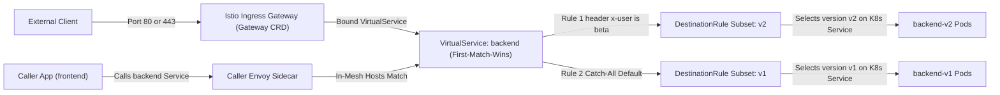
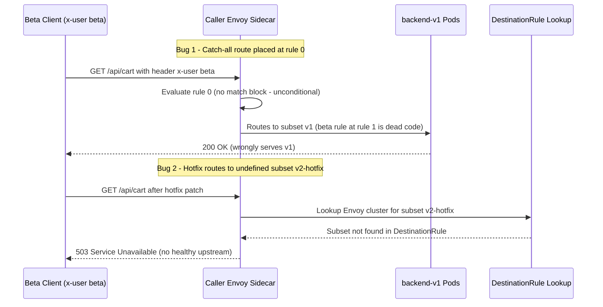

# 02 - Traffic Management Basics

> **Prerequisites:** Istio installed and `mesh-demo` namespace injection-enabled with `frontend` and `backend` Pods running at `READY 2/2` (Module 01); Kubernetes `Service` endpoint mechanics (Track 03).  
> **Estimated Reading Time:** 35 minutes  
> **Target Audience:** Backend Engineers, Platform Engineers, SREs.

> [!TIP]
> **The Golden Rule of Istio Traffic Routing:** `VirtualService` rules are evaluated strictly top-to-bottom on a first-match-wins basis, and `DestinationRule` subsets are inert label filters—always place specific header/URI matches above the catch-all route, keep `Service` selectors broad (`app: backend`), and run `istioctl analyze` before applying so an unreachable subset or shadowed route never fails silently in production.

---

## Why This Matters

A Kubernetes `Service` can only do one thing with traffic: spread it evenly across every matching Pod. The moment you want "send beta users to v2," "route mobile clients differently," or "5% to the canary," the `Service` selector runs out of expressiveness — this is the gap module 00 promised the mesh would fill. This module introduces the two objects that do all of Istio's routing, `VirtualService` and `DestinationRule`, and the subset concept that ties routing to specific versions. Every later module (canary, mTLS scoping, resilience) builds on these two CRDs.

---

## 1. Architectural Mental Model: `Gateway` -> `VirtualService` -> `DestinationRule` -> `Service`

Istio layers L7 routing *over* standard Kubernetes `Service` discovery. Both external requests (entering through an Istio `Gateway`) and internal Pod-to-Pod requests (intercepted by the caller's Envoy sidecar) pass through the same `VirtualService` -> `DestinationRule` evaluation pipeline:



### Core Concepts

#### The `Service` Still Exists — The Mesh Routes *Within* It
Nothing you learned in track 03 goes away. Your `Service` (say `backend`) still provides the stable name and the set of endpoints. What changes is that a meshed request to `backend` is intercepted by the caller's sidecar, and the sidecar consults Istio's routing rules to decide *which* of those endpoints (and with what policy) to send to. So the mental model is: **`Service` = "here are all the Pods called backend"; `VirtualService` = "here's how to choose among them per request."** The `Service` does discovery; the mesh does routing.

#### `DestinationRule`: Naming Subsets (Versions)
Before you can route "to v2," Istio needs a name for "v2." A **`DestinationRule`** defines **subsets** of a Service's Pods, each subset a label match:

```yaml
subsets:
  - name: v1
    labels: {version: v1}
  - name: v2
    labels: {version: v2}
```

This requires your Pods to carry a `version` label (a convention, not magic) — the same label-selector idea as everywhere in track 03, now used to carve one Service's Pods into named groups. The `DestinationRule` is also where per-destination *policy* lives (load-balancing algorithm, connection pool limits, outlier detection — module 07, and mTLS mode — module 04); for now we use it only to declare subsets. **A subset name is inert until a `VirtualService` routes to it** — same "definition object does nothing until something references it" pattern as a Role without a binding (track 11).

#### `VirtualService`: The Routing Rules
A **`VirtualService`** attaches to a host (usually a `Service` name) and lists **routes** evaluated top-to-bottom. Each route has optional **match** conditions (on headers, URI, method, etc.) and a **destination** (a Service + subset, optionally with a **weight**). The first matching rule wins, so **order matters** and you almost always end a `VirtualService` with a catch-all default route. Two headline capabilities:

- **Match-based routing:** "if header `x-user: beta`, go to subset `v2`; otherwise `v1`." The `Service` selector could never express a per-request condition like this.
- **Weighted routing:** "90% to `v1`, 10% to `v2`" — real traffic percentages independent of pod count, which is the precise knob track 10 module 06 said needed a mesh (module 03 uses it for canaries).

#### Match Order and the Catch-All
Because routes are first-match-wins, a broad rule placed above a specific one shadows it. The classic bug — which you'll fix by hand in the exercises — is a default/weighted rule sitting *above* a header-match rule, so 100% of traffic takes the default and the header rule never runs. The discipline: **specific matches first, catch-all last.** This is the same ordering hazard as firewall rules or NGINX `location` blocks — most-specific-first, default-last.

#### The `Gateway`: Routing Traffic Entering the Mesh
`VirtualService` routes traffic *inside* the mesh. To route traffic *entering* from outside, you bind a `VirtualService` to a **`Gateway`** — the config object for the ingress gateway Envoy from module 01. A `Gateway` declares which ports/hosts the edge proxy accepts; the `VirtualService` then says where that traffic goes. This is the mesh's replacement for a track-03 `Ingress` object: `Gateway` ≈ the listener, `VirtualService` ≈ the routing rules, and unlike `Ingress` it reuses the exact same routing primitives you use internally.

---

## 2. Taxonomic Comparison & Command Reference

### Kubernetes Discovery vs. Istio Routing Primitives

| Object | Layer / Plane | Primary Responsibility | What Breaks If Misconfigured |
|---|---|---|---|
| **Kubernetes `Service`** | L4 Discovery | Registers healthy Pod IPs under a stable DNS name | Empty Endpoints (`0` IPs) -> all requests fail |
| **`Gateway`** | L4–L7 Edge Listener | Exposes ports/TLS hosts on `istio-ingressgateway` | External traffic dropped at edge proxy |
| **`VirtualService`** | L7 Route Rules | Evaluates URI/header/method matches & percentage weights | Mis-ordered routes silently send traffic to wrong version |
| **`DestinationRule`** | L7 Subsets & Policy | Maps subset names (`v1`, `v2`) to Pod labels + pool/TLS policy | Missing subset causes `503 NR` (no route / healthy upstream) |

### Command Reference

| Field / command | What it does | Notes |
|---|---|---|
| `kind: VirtualService` | Defines routing rules for a host | The "how to route" object |
| `spec.hosts` | Which service name(s) these rules apply to | Usually the short Service name for in-mesh |
| `spec.http[].match` | Conditions (headers, uri, method) for a route | Omit for an unconditional route |
| `spec.http[].match[].headers` | Match on request headers | `headers: {x-user: {exact: beta}}` |
| `spec.http[].route[].destination.host` | Target Service | `host: backend` |
| `spec.http[].route[].destination.subset` | Target subset (from a DestinationRule) | Must exist in a DestinationRule |
| `spec.http[].route[].weight` | Percentage of traffic to this destination | Weights in one route array must sum to 100 |
| `kind: DestinationRule` | Declares subsets and per-destination policy | Subsets are label matches |
| `spec.subsets[].labels` | Labels selecting the Pods in this subset | Pods must actually carry these labels |
| `kind: Gateway` | Configures the ingress-gateway Envoy's listeners | Bound to by a VirtualService for edge traffic |
| `istioctl analyze -n <ns>` | Flags routing that references a missing subset/host | Catches typos before they bite |
| `istioctl proxy-config routes <pod>` | Dumps the actual routes programmed into a proxy | Ground truth of what a sidecar will do |
| `kubectl get virtualservice,destinationrule -n <ns>` | Lists the routing objects | `vs`/`dr` are the short names |

---

## 3. Production War Story Post-Mortem

- **Incident ID:** INC-2026-0614 (`checkout` `VirtualService` Shadowing & Subset Blackhole)
- **Severity:** SEV-1
- **Detection Time:** 4 minutes (QA beta verification failed + 503 spike on staging-mirror traffic)
- **Resolution Time:** 15 minutes
- **Blast Radius / Impact:** 100% of beta-cohort traffic (`x-user: beta`) silently stayed on legacy `v1` during a feature launch, and a panicked hotfix referencing a not-yet-applied `v2-hotfix` subset blackholed 20% of requests with HTTP `503` (`no healthy upstream`).

### What Happened

An engineer appended a new `x-user: beta` match block to the *bottom* of an existing `VirtualService` that already began with an unconditional default route to `subset: v1`. Because the manifest was valid YAML and applied cleanly, beta testers kept receiving `v1` responses. Trying to force traffic onto `v2-hotfix`, the engineer patched `VirtualService` to point to `subset: v2-hotfix` before applying the matching `DestinationRule` update—causing Envoy to reject matching requests with `503 Service Unavailable`.



### Root Cause Analysis

1. **First-Match-Wins Shadowing:** `VirtualService` evaluates `spec.http[]` sequentially. Putting an unconditional `route:` first turns every lower `match:` block into unreachable dead code without triggering any Kubernetes API error.
2. **Apply-Order Dependency:** Referencing a subset in `VirtualService` before the `DestinationRule` defines it leaves Envoy with zero endpoints for that subset (`503` blackhole).

### The Fix & Architectural Hardening

1. Reordered `spec.http[]` so specific `match:` blocks appear strictly above the catch-all default route.
2. Created `DestinationRule` subsets *before* updating `VirtualService` weights/routes (enforced via Argo CD sync waves: `DestinationRule` at wave `0`, `VirtualService` at wave `1`).
3. Added `istioctl analyze --failure-threshold Warning` as a mandatory pre-merge CI gate to block shadowed rules and dangling subset references.

---

## 4. Multi-Language Production Implementation

Header-based Istio routing (`x-user: beta`, `x-canary: true`) breaks immediately in multi-hop architectures (`gateway -> frontend -> api -> backend`) if intermediate services drop custom routing headers when constructing outbound HTTP calls. Production microservices extract allowlisted routing headers from incoming requests and propagate them cleanly across every downstream hop.

````carousel
```go
package routing

import (
	"context"
	"net/http"
	"strings"
)

// RoutingHeaders are forwarded across microservice hops so Istio VirtualService matches stay intact.
var RoutingHeaders = []string{
	"x-user",
	"x-canary",
	"x-tenant-tier",
	"x-request-id",
}

type routeCtxKey struct{}

// CaptureRoutingHeaders middleware extracts Istio routing headers into request context.
func CaptureRoutingHeaders(next http.Handler) http.Handler {
	return http.HandlerFunc(func(w http.ResponseWriter, r *http.Request) {
		captured := make(http.Header)
		for _, key := range RoutingHeaders {
			if val := strings.TrimSpace(r.Header.Get(key)); val != "" {
				captured.Set(key, val)
			}
		}
		ctx := context.WithValue(r.Context(), routeCtxKey{}, captured)
		next.ServeHTTP(w, r.WithContext(ctx))
	})
}

// ForwardRoutingHeaders applies captured Istio match headers to an outbound HTTP request.
func ForwardRoutingHeaders(ctx context.Context, outbound *http.Request) {
	headers, ok := ctx.Value(routeCtxKey{}).(http.Header)
	if !ok {
		return
	}
	for k, values := range headers {
		for _, v := range values {
			outbound.Header.Set(k, v)
		}
	}
}
```
<!-- slide -->
```typescript
import { AsyncLocalStorage } from "node:async_hooks";
import type { IncomingHttpHeaders } from "node:http";

const ROUTING_HEADERS = [
  "x-user",
  "x-canary",
  "x-tenant-tier",
  "x-request-id",
] as const;

const routingContext = new AsyncLocalStorage<Record<string, string>>();

export function withRoutingContext<T>(
  inboundHeaders: IncomingHttpHeaders,
  handler: () => Promise<T>
): Promise<T> {
  const propagated: Record<string, string> = {};
  for (const name of ROUTING_HEADERS) {
    const raw = inboundHeaders[name];
    if (typeof raw === "string" && raw.trim() !== "") {
      propagated[name] = raw.trim();
    }
  }
  return routingContext.run(propagated, handler);
}

export async function fetchDownstreamBackend(path: string): Promise<Response> {
  const headers = routingContext.getStore() ?? {};
  // Envoy matches x-user / x-canary headers on http://backend against VirtualService rules.
  return fetch(`http://backend.mesh-demo.svc.cluster.local${path}`, {
    headers: { ...headers },
  });
}
```
<!-- slide -->
```python
from contextvars import ContextVar
import urllib.request

ROUTING_HEADERS = ("x-user", "x-canary", "x-tenant-tier", "x-request-id")
_routing_headers: ContextVar[dict[str, str]] = ContextVar("routing_headers", default={})


def bind_routing_headers(inbound_headers: dict[str, str]) -> None:
    normalized = {k.lower(): v.strip() for k, v in inbound_headers.items()}
    _routing_headers.set(
        {h: normalized[h] for h in ROUTING_HEADERS if h in normalized and normalized[h]}
    )


def call_backend(path: str = "/") -> str:
    """Preserves VirtualService match headers across multi-hop in-mesh calls."""
    url = f"http://backend.mesh-demo.svc.cluster.local{path}"
    req = urllib.request.Request(url, headers=_routing_headers.get())
    with urllib.request.urlopen(req, timeout=5) as resp:
        return resp.read().decode("utf-8")
```
<!-- slide -->
```csharp
using System.Collections.Concurrent;

namespace ServiceMesh.Routing;

public sealed class RoutingHeaderPropagator : DelegatingHandler
{
    private static readonly string[] MatchHeaders =
    [
        "x-user",
        "x-canary",
        "x-tenant-tier",
        "x-request-id"
    ];

    private static readonly AsyncLocal<IReadOnlyDictionary<string, string>?> ScopedHeaders = new();

    public static void CaptureFromRequest(IDictionary<string, string> inboundHeaders)
    {
        var extracted = new Dictionary<string, string>(StringComparer.OrdinalIgnoreCase);
        foreach (var name in MatchHeaders)
        {
            if (inboundHeaders.TryGetValue(name, out var value) && !string.IsNullOrWhiteSpace(value))
            {
                extracted[name] = value.Trim();
            }
        }
        ScopedHeaders.Value = extracted;
    }

    protected override Task<HttpResponseMessage> SendAsync(
        HttpRequestMessage request, CancellationToken cancellationToken)
    {
        if (ScopedHeaders.Value is not null)
        {
            foreach (var (key, value) in ScopedHeaders.Value)
            {
                request.Headers.TryAddWithoutValidation(key, value);
            }
        }
        return base.SendAsync(request, cancellationToken);
    }
}
```
````

---

## 5. Practical Hands-On Verification & CLI Workflows

Continue in `mesh-demo` from module 01, with injection enabled. These exercises build a two-version backend and steer traffic between the versions.

### 1. Deploy Two Versions of the Backend, Both Labelled

```yaml
# backend-v1-v2.yaml
apiVersion: apps/v1
kind: Deployment
metadata:
  name: backend-v1
  namespace: mesh-demo
spec:
  replicas: 1
  selector: {matchLabels: {app: backend, version: v1}}
  template:
    metadata: {labels: {app: backend, version: v1}}
    spec:
      containers:
        - name: app
          image: hashicorp/http-echo:1.0
          args: ["-text=backend v1", "-listen=:5678"]
          ports: [{containerPort: 5678}]
---
apiVersion: apps/v1
kind: Deployment
metadata:
  name: backend-v2
  namespace: mesh-demo
spec:
  replicas: 1
  selector: {matchLabels: {app: backend, version: v2}}
  template:
    metadata: {labels: {app: backend, version: v2}}
    spec:
      containers:
        - name: app
          image: hashicorp/http-echo:1.0
          args: ["-text=backend v2", "-listen=:5678"]
          ports: [{containerPort: 5678}]
```

If you still have the single `backend` Deployment from module 01, delete it so only these two version-labelled Deployments back the `backend` Service:

```bash
kubectl delete deployment backend -n mesh-demo --ignore-not-found
kubectl apply -f backend-v1-v2.yaml
kubectl get pods -n mesh-demo --show-labels
```

**Expected Output:**

```text
NAME                          READY   STATUS    RESTARTS   AGE   LABELS
backend-v1-5f8d9c7b6-abcde    2/2     Running   0          12s   app=backend,version=v1
backend-v2-7c9d8b6f5-fghij    2/2     Running   0          12s   app=backend,version=v2
frontend-6f8b5d7c4-mnopq      2/2     Running   0          18m   app=frontend
```

Two backend Pods, `2/2`, one labelled `version=v1` and one `version=v2`. The existing `backend` Service (selector `app: backend`) now has *both* as endpoints — so calls currently hit either at random.

### 2. See the Un-Routed Default: Random Split

```bash
for i in $(seq 1 10); do kubectl exec -n mesh-demo deploy/frontend -- curl -s http://backend; echo; done
```

**Expected Output:**

```text
backend v1
backend v2
backend v1
backend v1
backend v2
...
```

A roughly random mix of `backend v1` and `backend v2` — the plain `Service` behaviour, evenly across all endpoints, with no way to control the ratio. This is the baseline the mesh improves on.

### 3. Declare Subsets With a DestinationRule

```yaml
# dr-backend.yaml
apiVersion: networking.istio.io/v1
kind: DestinationRule
metadata:
  name: backend
  namespace: mesh-demo
spec:
  host: backend
  subsets:
    - name: v1
      labels: {version: v1}
    - name: v2
      labels: {version: v2}
```

```bash
kubectl apply -f dr-backend.yaml
istioctl analyze -n mesh-demo
```

**Expected Output:** `analyze` may warn (`Info [IST0101]`) that the subsets aren't referenced by any VirtualService yet — that's the "inert until referenced" point from Concepts, not an error.

### 4. Pin All Traffic to v1 With a VirtualService

```yaml
# vs-backend-v1.yaml
apiVersion: networking.istio.io/v1
kind: VirtualService
metadata:
  name: backend
  namespace: mesh-demo
spec:
  hosts: [backend]
  http:
    - route:
        - destination: {host: backend, subset: v1}
```

```bash
kubectl apply -f vs-backend-v1.yaml
for i in $(seq 1 10); do kubectl exec -n mesh-demo deploy/frontend -- curl -s http://backend; echo; done
```

**Expected Output:** **All ten** responses are `backend v1` — the VirtualService now pins every request to the v1 subset regardless of the even endpoint set. You just did something a `Service` cannot.

### 5. Route by Header

Send beta users to v2 while everyone else stays on v1:

```yaml
# vs-backend-header.yaml
apiVersion: networking.istio.io/v1
kind: VirtualService
metadata:
  name: backend
  namespace: mesh-demo
spec:
  hosts: [backend]
  http:
    - match:
        - headers:
            x-user:
              exact: beta
      route:
        - destination: {host: backend, subset: v2}
    - route:
        - destination: {host: backend, subset: v1}
```

```bash
kubectl apply -f vs-backend-header.yaml
kubectl exec -n mesh-demo deploy/frontend -- curl -s http://backend
kubectl exec -n mesh-demo deploy/frontend -- curl -s -H "x-user: beta" http://backend
```

**Expected Output:**

```text
backend v1
backend v2
```

The first (no header) returns `backend v1`; the second (with `x-user: beta`) returns `backend v2`. Per-request routing on request content — the capability module 00 said a `Service` fundamentally lacks.

### 6. Weighted Routing (a Preview of Canary)

```yaml
# vs-backend-weighted.yaml
apiVersion: networking.istio.io/v1
kind: VirtualService
metadata:
  name: backend
  namespace: mesh-demo
spec:
  hosts: [backend]
  http:
    - route:
        - destination: {host: backend, subset: v1}
          weight: 80
        - destination: {host: backend, subset: v2}
          weight: 20
```

```bash
kubectl apply -f vs-backend-weighted.yaml
for i in $(seq 1 20); do kubectl exec -n mesh-demo deploy/frontend -- curl -s http://backend; echo; done | sort | uniq -c
```

**Expected Output:**

```text
  16 backend v1
   4 backend v2
```

Roughly 16 `v1` and 4 `v2` (80/20) — a *real* traffic weight, not a pod ratio (both subsets have one Pod each). Module 03 turns this into a disciplined canary.

### 7. Inspect What the Proxy Actually Got

```bash
istioctl proxy-config routes deploy/frontend -n mesh-demo | head -20
```

**Expected Output:**

```text
NAME                                                      VHOST NAME                                            DOMAINS     MATCH                  VIRTUAL SERVICE
80                                                        backend.mesh-demo.svc.cluster.local:80                backend*    /*                     backend.mesh-demo
```

The routes programmed into `frontend`'s Envoy reflect your VirtualService (the weighted/subset destinations for `backend`). This is ground truth — what the sidecar will really do, distinct from the YAML you wrote.

### 8. Diagnose and Fix: A Typo Sending 100% Traffic the Wrong Way

This reproduces the classic ordering bug from Concepts. Apply a VirtualService whose catch-all is *above* the header match, plus a subset typo:

```yaml
# vs-backend-broken.yaml
apiVersion: networking.istio.io/v1
kind: VirtualService
metadata:
  name: backend
  namespace: mesh-demo
spec:
  hosts: [backend]
  http:
    - route:
        - destination: {host: backend, subset: v1}
    - match:
        - headers:
            x-user:
              exact: beta
      route:
        - destination: {host: backend, subset: v2}
```

```bash
kubectl apply -f vs-backend-broken.yaml
kubectl exec -n mesh-demo deploy/frontend -- curl -s -H "x-user: beta" http://backend
```

**Expected Output:** `backend v1` **even with the beta header** — 100% of traffic, including the traffic that was supposed to reach v2, takes the first (unconditional) route because first-match-wins and the catch-all was placed first. The header rule below it is dead code. Diagnose:

```bash
istioctl proxy-config routes deploy/frontend -n mesh-demo
istioctl analyze -n mesh-demo
```

**Expected Output:** The routes show the unconditional route ordered before the match route. Fix by moving the specific match *above* the catch-all (re-apply the correct `vs-backend-header.yaml` from exercise 5):

```bash
kubectl apply -f vs-backend-header.yaml
kubectl exec -n mesh-demo deploy/frontend -- curl -s -H "x-user: beta" http://backend
```

**Expected Output:** `backend v2` again. Lesson: **specific matches first, catch-all last** — the single most common VirtualService bug, and it fails by silently routing everything the wrong way rather than erroring.

### 9. Diagnose and Fix: Routing to a Subset That Doesn't Exist

```yaml
# vs-backend-badsubset.yaml
apiVersion: networking.istio.io/v1
kind: VirtualService
metadata:
  name: backend
  namespace: mesh-demo
spec:
  hosts: [backend]
  http:
    - route:
        - destination: {host: backend, subset: v3}
```

```bash
kubectl apply -f vs-backend-badsubset.yaml
kubectl exec -n mesh-demo deploy/frontend -- curl -s -m 5 http://backend
istioctl analyze -n mesh-demo
```

**Expected Output:**

```text
Error [IST0101] (VirtualService mesh-demo/backend) Referenced host+subset in route destination not found: "backend+v3"
```

The call fails (`503 no healthy upstream`), and `analyze` reports that subset `v3` is referenced but not defined in any DestinationRule. Fix by routing to a real subset or adding `v3` to the DestinationRule; for now, restore the good header VirtualService:

```bash
kubectl apply -f vs-backend-header.yaml
kubectl exec -n mesh-demo deploy/frontend -- curl -s http://backend
```

**Expected Output:** `backend v1`. Leave the header VirtualService and DestinationRule in place for module 03.

### Independent Challenge

No YAML given — draw on this module and [track 03 Services](../../03-kubernetes/04-services-and-networking/README.md).

**Task:** Stand up a `catalog` Service with two versions (`stable` and `experimental`, labelled accordingly) and write routing that satisfies three rules simultaneously: (1) any request carrying header `x-tester: true` always goes to `experimental`; (2) all other traffic is split 95% `stable` / 5% `experimental`; (3) requests with URI prefix `/admin` always go to `stable` regardless of any header. Prove each rule with `curl` from a meshed client, then explain — referencing the first-match-wins ordering — why you had to place the three routes in the order you did, and what breaks if `/admin` and the `x-tester` rules are swapped.

<details>
<summary>Stuck? One hint</summary>

You need a DestinationRule with `stable`/`experimental` subsets and one VirtualService with three `http` entries. Ordering is the whole puzzle: the two unconditional-override rules (`/admin` and `x-tester`) must come before the weighted catch-all, and between those two, place the one that must win when *both* conditions are true first — decide which of "admin path" and "tester header" should dominate and let first-match-wins encode it.

</details>

---

## 6. Operational Validation Checkpoints & Quiz

### Operational Validation Checkpoints

<details>
<summary><strong>Checkpoint 1: Debugging a Silent 50/50 Split When VirtualService Is Applied</strong></summary>

**Scenario:** You apply a `VirtualService` pinning 100% of `backend` traffic to `subset: v1`, yet running `curl http://backend` from `frontend` still alternates randomly between `backend v1` and `backend v2`. Checking `kubectl get virtualservice -n mesh-demo` confirms the object exists. What are the two most likely causes?

**Answer & Rationale:** (1) Check `frontend` (`READY` count and `istioctl proxy-status`)—if the *caller* Pod is unmeshed (`1/1`), its traffic goes straight through `kube-proxy` and never hits an Envoy sidecar capable of reading `VirtualService`. (2) Verify `hosts:` in the `VirtualService` matches how `frontend` addresses the service (`backend` short name in the same namespace vs. cross-namespace FQDN `backend.mesh-demo.svc.cluster.local`).

</details>

<details>
<summary><strong>Checkpoint 2: Resolving a HTTP 503 After Deploying a New Subset</strong></summary>

**Scenario:** Immediately after deploying `backend-v3` Pods (`READY 2/2`, healthy readiness probe) and updating `VirtualService` to send `x-user: internal` to `subset: v3`, requests with `x-user: internal` return `503 no healthy upstream`. Regular traffic to `v1` succeeds. What command identifies the bug in seconds?

**Answer & Rationale:** `istioctl analyze -n mesh-demo`. It detects either (a) `DestinationRule` does not declare a `v3` subset yet (`IST0101`), or (b) `DestinationRule` selects `version: v3` while the new `backend-v3` Pods are missing the `version: v3` label (or have a casing typo like `V3`), leaving zero Endpoints in the `v3` Envoy cluster.

</details>

<details>
<summary><strong>Checkpoint 3: Diagnosing Multi-Hop Header Match Failure</strong></summary>

**Scenario:** An external user calls `https://shop.example.com/checkout` with header `x-user: beta`. The Ingress `Gateway` routes to `frontend-v2` (matching `x-user: beta`), which makes an internal HTTP call to `http://backend`. Yet `backend` receives traffic on `v1` instead of `v2`, even though `backend`'s `VirtualService` has the `x-user: beta -> v2` rule first! Why?

**Answer & Rationale:** Istio's Envoy sidecars do **not** automatically copy custom incoming headers from `frontend`'s inbound request onto `frontend`'s new outbound request to `backend`. Unless `frontend`'s application code extracts `x-user` and attaches it to the outbound HTTP call to `http://backend`, Envoy on `frontend` sees no `x-user` header and evaluates the catch-all route (`v1`).

</details>

### Checkpoint Quiz

Write down your answer to each question before expanding it — checking without attempting first is the single easiest way to fool yourself into thinking you've learned this.

1. What does a `VirtualService` do that a plain `Service` cannot?
2. What is a subset, which object defines it, and what must the Pods have for a subset to match them?
3. Routes in a `VirtualService` are evaluated in what order, and what's the most common bug that causes?
4. You route to `subset: v2` but no DestinationRule defines `v2`. What happens, and how do you catch it before it hits users?
5. How is weighted routing here fundamentally different from faking a canary with replica counts (track 10 module 06)?
6. What's the division of labour between `VirtualService` and `DestinationRule`?
7. What object routes traffic *entering* the mesh from outside, and what track-03 object does it replace?

<details>
<summary>Show answers</summary>

1. Route per-request based on content (headers, URI, method) and split traffic by real weight (percentages) — neither of which a `Service`, which only spreads evenly across matching endpoints, can express.
2. A subset is a named group of a Service's Pods, defined in a `DestinationRule` by a label match; the Pods must carry the labels the subset selects on (e.g. `version: v2`).
3. Top-to-bottom, first-match-wins. The most common bug is putting an unconditional/catch-all route above a specific match, so the specific rule never runs and 100% of traffic takes the default.
4. The route has no valid destination and calls fail (no healthy upstream). `istioctl analyze` flags the referenced-but-undefined subset before it affects users.
5. Weighted routing sets a real traffic percentage independent of pod count (both subsets can have one Pod and still get 80/20), whereas replica-ratio canaries conflate pod count with traffic share and are coarse.
6. `DestinationRule` names the subsets and holds per-destination policy; `VirtualService` chooses among those destinations per request. They're a pair — one is inert without the other.
7. A `Gateway` (configuring the ingress-gateway Envoy), bound to by a `VirtualService`. It replaces the track-03 `Ingress` object, but reuses the same routing primitives used inside the mesh.

</details>

---

## Common Mistakes & Troubleshooting

- **Catch-all route placed first.** First-match-wins means an unconditional route above a match route shadows it, silently sending 100% of traffic the wrong way (exercise 8). Specific matches first, default last.
- **Routing to a subset with no matching DestinationRule.** The subset name is just a string; if no DestinationRule defines it, the route has no destination and calls fail. `istioctl analyze` catches this.
- **Pods missing the `version` label.** Subsets select on labels; a Pod without the label belongs to no subset and gets no traffic from subset routes — the same selector-mismatch failure as a Service with a typo'd selector (track 03 module 04).
- **Weights that don't sum to 100.** Istio treats the weights as proportions, but writing them to sum to 100 keeps the intent readable and avoids surprises when you edit one.
- **Confusing `VirtualService` (how to route) with `DestinationRule` (what the subsets/policies are).** They're a pair: the DestinationRule names the targets, the VirtualService chooses among them. Forgetting one leaves the other inert.
- **Expecting a VirtualService to route external traffic without a Gateway.** In-mesh routing works with just the Service host; edge traffic needs a `Gateway` bound in the VirtualService's `gateways` list.

---

## Sources & Further Reading

- [Istio Traffic Management Concepts](https://istio.io/latest/docs/concepts/traffic-management/)
- [Istio VirtualService Reference](https://istio.io/latest/docs/reference/config/networking/virtual-service/)
- [Istio DestinationRule Reference](https://istio.io/latest/docs/reference/config/networking/destination-rule/)

---

## Next

[03-canary-and-blue-green-traffic-splitting](../03-canary-and-blue-green-traffic-splitting/README.md) — turn weighted routing into a disciplined canary and blue/green process, and compare it head-to-head with Argo Rollouts and ACA revisions.
