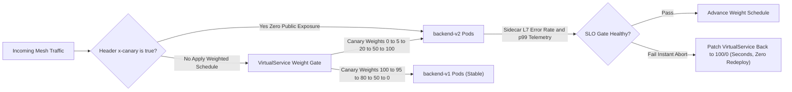
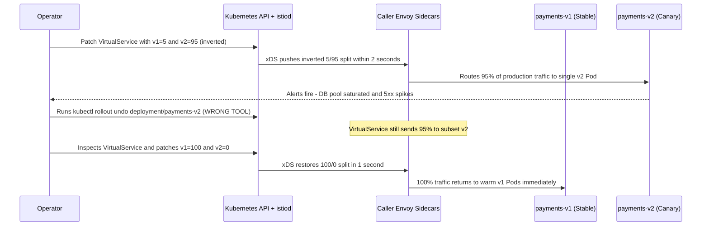

# 03 - Canary and Blue/Green Traffic Splitting

> **Prerequisites:** `VirtualService` and `DestinationRule` fundamentals with `backend-v1`/`backend-v2` subsets deployed in `mesh-demo` (Module 02); Progressive delivery concepts in Argo Rollouts (Track 10) and ACA revisions (Track 06).  
> **Estimated Reading Time:** 40 minutes  
> **Target Audience:** Backend Engineers, Release Engineers, SREs, Platform Architects.

> [!TIP]
> **The Golden Rule of Mesh Progressive Delivery:** Keep both `v1` and `v2` Deployments scaled and healthy for the entire rollout—never use `kubectl rollout undo` to revert an Istio canary; rollback is simply restoring the `VirtualService` weights (`100/0`), and always verify which `subset` holds which `weight` while gating every promotion step on real error-rate and latency telemetry.

---

## Why This Matters

You've now met the *same problem* — ship a new version safely by shifting a controlled slice of traffic to it — in three different worlds: ACA revisions (track 06), Argo Rollouts (track 10), and now Istio. This module makes you fluent in the Istio mechanism (weighted `VirtualService` routing) and, just as importantly, able to say *why you'd reach for each of the three*. Canary and blue/green are the highest-value everyday use of the traffic-management you learned in module 02.

---

## 1. Architectural Mental Model: Weight Schedules, Dogfood Overrides & Instant Rollback

In Istio, both `v1` and `v2` remain running concurrently behind the same `Service`. Progressive delivery becomes a **pure data-plane routing schedule** controlled via `VirtualService` weights (with optional header-pinned dogfooding at the top):



### Core Concepts

#### Canary vs. Blue/Green, in Istio Terms
Both are just weight schedules over the `v1`/`v2` subsets from module 02:

- **Canary**: gradually shift weight — `100/0 → 95/5 → 80/20 → 50/50 → 0/100`, pausing at each step to watch metrics, so only a small blast radius is exposed to a bad version at any moment. In Istio this is editing the `weight` fields of a `VirtualService` between steps.
- **Blue/green**: keep both versions fully deployed but send 100% to one ("blue"), then flip 100% to the other ("green") in a single step, with an instant flip back if it misbehaves. In Istio this is `100/0` then `0/100` on the same VirtualService — no redeploy, because both subsets are already running (exactly the "old revision is still there" instant-rollback property you saw with ACA revisions in track 06 module 05).

The key Istio property: because weight is a *routing* decision made by the sidecars, changing it is a config edit that takes effect in seconds, and **rollback is just restoring the previous weights** — no image pull, no rescheduling.

#### Mesh Weighting vs. Replica-Ratio Weighting (The Track 10 Tie-In)
Track 10 module 06 built canaries with **Argo Rollouts** and, without a traffic provider, used **replica-based weighting** — approximating "10%" with pod counts, which it explicitly warned "lies to you" because pod count isn't traffic share. It also said the fix was a traffic provider such as a **service mesh**, and that *track 13 would upgrade it to true mesh-based weighting*. This module *is* that upgrade. With Istio, `weight: 10` means 10% of requests regardless of how many Pods back each subset — one v2 Pod can take exactly 10% while ten v1 Pods share the other 90%. That precision is the entire reason Rollouts integrates with a mesh.

Crucially, the two compose rather than compete: **Argo Rollouts can drive the Istio VirtualService weights for you**, adding automated, metric-gated promotion on top of the precise weighting Istio provides. Istio gives the accurate knob; Rollouts (track 10) turns the knob automatically based on analysis. This module turns the knob by hand so you understand what Rollouts would be automating.

#### Three Mechanisms, One Problem — When to Use Which
You now know three ways to do a weighted rollout. They are not interchangeable; they live at different layers:

| Mechanism | Layer | How you set weight | Reach for it when |
|---|---|---|---|
| **ACA revisions** (track 06) | Managed platform | `az containerapp ingress traffic set` | You're on Azure Container Apps and want zero mesh to operate |
| **Argo Rollouts** (track 10) | K8s controller / GitOps | `setWeight` steps in a `Rollout`, auto-gated by analysis | You want *automated* metric-gated promotion/rollback, with or without a mesh |
| **Istio VirtualService** (this track) | Service mesh data plane | `weight` in a `VirtualService` | You already run a mesh and want precise weighting (and to combine it with mTLS/authz/routing) |

The honest guidance: if you already run a mesh, its weighting is the natural choice and it's *precise*; if you want the rollout to promote itself based on metrics, that's Argo Rollouts' job (which can drive the mesh); if you're on ACA, the platform already does this and you don't operate a mesh at all. The skill this module builds is recognising which world you're in.

#### Metric-Gating: What the Mesh Gives You for Free
A canary is only useful if you *watch* the canary's health at each step. Track 10's Argo Rollouts automated this with `AnalysisTemplate` queries. Even by hand, Istio helps: because every request flows through the sidecars, you get per-subset request rate, error rate, and latency **without instrumenting the app** (module 06 is the full treatment). So the manual canary loop is: bump weight → watch the v2 subset's error rate and latency in the mesh metrics → promote or roll back. This is the same decision Rollouts' analysis automates; doing it by hand here teaches you what "good" and "bad" look like.

---

## 2. Taxonomic Comparison & Command Reference

### Canary vs. Blue/Green vs. Dogfood Rollout Strategies

| Strategy | Weight Schedule | Blast Radius | Validation Signal | Rollback Path |
|---|---|---|---|---|
| **Canary** | `100/0 -> 95/5 -> 80/20 -> 50/50 -> 0/100` | Bounded small % of live traffic | Sidecar 5xx error rate & p99 latency per subset | Patch `VirtualService` weights back to `100/0` |
| **Blue/Green** | `100/0 -> 0/100` (single cutover) | 100% at cutover time | Smoke tests prior to cutover + live metrics after | Single patch back to `100/0` (old pods still warm) |
| **Header-Pinned Dogfood** | `x-canary: true -> v2`, default `100/0` | Zero public users | QA / internal staff testing in real production | Remove header match rule or set `x-canary: false` |

### Command Reference

| Field / command | What it does | Notes |
|---|---|---|
| `spec.http[].route[].weight` | Percentage to each destination in a canary step | Edit between steps to advance the canary |
| `kubectl apply -f <vs>.yaml` | Applies the next weight step | Takes effect in seconds; the rollout "step" |
| `kubectl patch virtualservice <n> --type=merge -p '...'` | Adjust weights without re-applying the whole file | Handy for quick step changes |
| `istioctl proxy-config routes <pod>` | Confirm the weights the proxy actually holds | Ground truth per step |
| `kubectl rollout undo` | *Not* how you roll back an Istio canary | Rollback is restoring previous VirtualService weights, not a Deployment undo |
| `watch -n1 'kubectl exec ... curl ...'` | Sample the live split during a step | Quick, crude health/ratio check |

---

## 3. Production War Story Post-Mortem

- **Incident ID:** INC-2026-0709 (`payments` Canary Weight Inversion & Wrong Rollback Command)
- **Severity:** SEV-1
- **Detection Time:** 3 minutes (DB connection pool exhaustion + 5xx alert on `payments-v2`)
- **Resolution Time:** 1 minute after diagnosing the inverted `VirtualService` weights (total incident 11 min due to wasted `kubectl rollout undo` attempt)
- **Blast Radius / Impact:** A "5% canary" immediately routed **95% of production checkout traffic** to `payments-v2`, saturating database connections due to an unindexed query in `v2`.

### What Happened

To start a 5% canary of `payments-v2`, an operator ran a manual `kubectl patch virtualservice payments` command—accidentally assigning `weight: 5` to `subset: v1` and `weight: 95` to `subset: v2`. Within 90 seconds, `v2`'s database connection pool spiked and requests timed out. Seeing the alert, a responder ran `kubectl rollout undo deployment/payments-v2`, which didn't shift traffic off `v2` at all—the `VirtualService` kept pouring 95% of requests onto `v2` until someone inspected the `VirtualService` YAML and patched weights back to `100/0`.



### Root Cause Analysis

1. **Inverted Subset Weights:** The YAML schema checks that weights are valid integers—it cannot verify human intent. Putting `5` on `v1` instead of `v2` passed validation silently.
2. **Wrong Rollback Reflex:** Reaching for `kubectl rollout undo` during a mesh canary wastes critical MTTR because Deployments (`payments-v1` and `payments-v2`) are independent objects; only the `VirtualService` controls traffic distribution.

### The Fix & Architectural Hardening

1. Replaced ad-hoc `kubectl patch` commands with GitOps-reviewed step templates / Argo Rollouts `setWeight` automation.
2. Updated the team's incident runbook to put `kubectl patch virtualservice ... 100/0` as the #1 rollback action and added CI assertion tests checking `v1.weight >= v2.weight` on initial canary steps.

---

## 4. Multi-Language Production Implementation

Before advancing an Istio `VirtualService` from `95/5` to `80/20` (or triggering an instant `100/0` rollback), automated canary controllers evaluate **subset-level error rate and p99 latency telemetry** gathered from the Envoy sidecars. The following implementations model a deterministic Canary Health-Gate Evaluator computing safe weight progression or immediate abort.

````carousel
```go
package canary

import "fmt"

type SubsetMetrics struct {
	Requests   int64
	Errors5xx  int64
	P99Latency float64 // milliseconds
}

func (m SubsetMetrics) ErrorRate() float64 {
	if m.Requests == 0 {
		return 0
	}
	return float64(m.Errors5xx) / float64(m.Requests)
}

type WeightSplit struct {
	V1Weight int
	V2Weight int
	Action   string
}

var CanarySteps = []int{0, 5, 20, 50, 100}

// EvaluateCanaryStep checks v2 telemetry against SLOs before advancing VirtualService weights.
func EvaluateCanaryStep(currentV2Weight int, v1, v2 SubsetMetrics) (WeightSplit, error) {
	if v2.Requests < 50 {
		return WeightSplit{100 - currentV2Weight, currentV2Weight, "HOLD_INSUFFICIENT_SAMPLES"}, nil
	}
	// Roll back instantly to 100/0 if v2 error rate exceeds 1% or p99 degrades > 25% over v1.
	if v2.ErrorRate() > 0.01 || (v1.P99Latency > 0 && v2.P99Latency > v1.P99Latency*1.25) {
		return WeightSplit{100, 0, "ROLLBACK_TO_V1"}, fmt.Errorf(
			"canary gate failed: v2_err=%.4f v2_p99=%.1fms v1_p99=%.1fms",
			v2.ErrorRate(), v2.P99Latency, v1.P99Latency,
		)
	}
	for i, step := range CanarySteps {
		if step == currentV2Weight && i+1 < len(CanarySteps) {
			nextV2 := CanarySteps[i+1]
			return WeightSplit{100 - nextV2, nextV2, "PROMOTE_NEXT_STEP"}, nil
		}
	}
	return WeightSplit{0, 100, "COMPLETE"}, nil
}
```
<!-- slide -->
```typescript
export interface SubsetTelemetry {
  requests: number;
  errors5xx: number;
  p99LatencyMs: number;
}

export interface CanaryDecision {
  v1Weight: number;
  v2Weight: number;
  action: "HOLD" | "PROMOTE" | "ROLLBACK_100_0" | "COMPLETE";
  reason: string;
}

const CANARY_SCHEDULE = [0, 5, 20, 50, 100] as const;

export function evaluateCanaryGate(
  currentV2Weight: number,
  baseline: SubsetTelemetry,
  canary: SubsetTelemetry
): CanaryDecision {
  if (canary.requests < 50) {
    return {
      v1Weight: 100 - currentV2Weight,
      v2Weight: currentV2Weight,
      action: "HOLD",
      reason: `Need >= 50 canary requests before evaluating (saw ${canary.requests})`,
    };
  }

  const canaryErrRate = canary.errors5xx / canary.requests;
  const latencySpike = baseline.p99LatencyMs > 0 && canary.p99LatencyMs > baseline.p99LatencyMs * 1.25;

  if (canaryErrRate > 0.01 || latencySpike) {
    return {
      v1Weight: 100,
      v2Weight: 0,
      action: "ROLLBACK_100_0",
      reason: `SLO breach: errorRate=${(canaryErrRate * 100).toFixed(2)}%, p99=${canary.p99LatencyMs}ms`,
    };
  }

  const idx = CANARY_SCHEDULE.indexOf(currentV2Weight as (typeof CANARY_SCHEDULE)[number]);
  if (idx >= 0 && idx + 1 < CANARY_SCHEDULE.length) {
    const nextV2 = CANARY_SCHEDULE[idx + 1];
    return {
      v1Weight: 100 - nextV2,
      v2Weight: nextV2,
      action: "PROMOTE",
      reason: `Canary healthy; advancing VirtualService to ${100 - nextV2}/${nextV2}`,
    };
  }

  return { v1Weight: 0, v2Weight: 100, action: "COMPLETE", reason: "Canary already at 100%" };
}
```
<!-- slide -->
```python
from dataclasses import dataclass

CANARY_SCHEDULE = (0, 5, 20, 50, 100)


@dataclass(frozen=True)
class SubsetMetrics:
    requests: int
    errors_5xx: int
    p99_latency_ms: float

    @property
    def error_rate(self) -> float:
        return (self.errors_5xx / self.requests) if self.requests > 0 else 0.0


def next_virtualservice_weights(
    current_v2_weight: int,
    v1: SubsetMetrics,
    v2: SubsetMetrics,
) -> tuple[int, int, str]:
    """Evaluates sidecar subset metrics and returns (v1_weight, v2_weight, decision)."""
    if v2.requests < 50:
        return (100 - current_v2_weight, current_v2_weight, "HOLD_LOW_VOLUME")

    if v2.error_rate > 0.01 or (v1.p99_latency_ms > 0 and v2.p99_latency_ms > v1.p99_latency_ms * 1.25):
        # Instant weight restore: zero pod redeploy required because v1 never scaled down.
        return (100, 0, "ROLLBACK_TO_V1")

    if current_v2_weight in CANARY_SCHEDULE:
        idx = CANARY_SCHEDULE.index(current_v2_weight)
        if idx + 1 < len(CANARY_SCHEDULE):
            next_v2 = CANARY_SCHEDULE[idx + 1]
            return (100 - next_v2, next_v2, "PROMOTE")

    return (0, 100, "COMPLETE")
```
<!-- slide -->
```csharp
namespace ServiceMesh.Canary;

public sealed record SubsetTelemetry(long Requests, long Errors5xx, double P99LatencyMs)
{
    public double ErrorRate => Requests == 0 ? 0.0 : (double)Errors5xx / Requests;
}

public sealed record WeightDecision(int V1Weight, int V2Weight, string Action, string Reason);

public static class CanaryGateEvaluator
{
    private static readonly int[] Steps = [0, 5, 20, 50, 100];

    public static WeightDecision Evaluate(int currentV2Weight, SubsetTelemetry v1, SubsetTelemetry v2)
    {
        if (v2.Requests < 50)
        {
            return new WeightDecision(100 - currentV2Weight, currentV2Weight, "HOLD", "Insufficient sample size");
        }

        if (v2.ErrorRate > 0.01 || (v1.P99LatencyMs > 0 && v2.P99LatencyMs > v1.P99LatencyMs * 1.25))
        {
            return new WeightDecision(
                100, 0, "ROLLBACK_100_0",
                $"SLO violation: v2 errorRate={v2.ErrorRate:P2}, v2 p99={v2.P99LatencyMs}ms");
        }

        var idx = Array.IndexOf(Steps, currentV2Weight);
        if (idx >= 0 && idx + 1 < Steps.Length)
        {
            var nextV2 = Steps[idx + 1];
            return new WeightDecision(100 - nextV2, nextV2, "PROMOTE", $"Step to {100 - nextV2}/{nextV2}");
        }

        return new WeightDecision(0, 100, "COMPLETE", "Rollout finished");
    }
}
```
````

---

## 5. Practical Hands-On Verification & CLI Workflows

Continue in `mesh-demo`. You should have `backend-v1` and `backend-v2` Deployments, the `backend` Service, and the `backend` DestinationRule with `v1`/`v2` subsets from module 02.

### 1. Start From a Clean 100/0 (All on v1)

```yaml
# canary-step0.yaml
apiVersion: networking.istio.io/v1
kind: VirtualService
metadata:
  name: backend
  namespace: mesh-demo
spec:
  hosts: [backend]
  http:
    - route:
        - destination: {host: backend, subset: v1}
          weight: 100
        - destination: {host: backend, subset: v2}
          weight: 0
```

```bash
kubectl apply -f canary-step0.yaml
for i in $(seq 1 20); do kubectl exec -n mesh-demo deploy/frontend -- curl -s http://backend; echo; done | sort | uniq -c
```

**Expected Output:**

```text
  20 backend v1
```

20 `backend v1`, 0 `v2` — the stable starting point of a canary.

### 2. Step the Canary to 5%

```bash
kubectl patch virtualservice backend -n mesh-demo --type=merge -p \
  '{"spec":{"http":[{"route":[{"destination":{"host":"backend","subset":"v1"},"weight":95},{"destination":{"host":"backend","subset":"v2"},"weight":5}]}]}}'
for i in $(seq 1 40); do kubectl exec -n mesh-demo deploy/frontend -- curl -s http://backend; echo; done | sort | uniq -c
```

**Expected Output:**

```text
  38 backend v1
   2 backend v2
```

Roughly 38 `v1` / 2 `v2` — about 5% on the canary. Note this is a *precise 5%*, not "one pod out of twenty," even though both subsets have one Pod. This is the difference from replica-ratio weighting.

### 3. Progress Through the Canary

Repeat the patch with weights `80/20`, then `50/50`, sampling 40 requests after each and confirming the ratio tracks the weights. At each step you would, in production, be watching the v2 subset's error rate/latency (module 06) before advancing.

```bash
# 20%:
kubectl patch virtualservice backend -n mesh-demo --type=merge -p \
  '{"spec":{"http":[{"route":[{"destination":{"host":"backend","subset":"v1"},"weight":80},{"destination":{"host":"backend","subset":"v2"},"weight":20}]}]}}'
for i in $(seq 1 40); do kubectl exec -n mesh-demo deploy/frontend -- curl -s http://backend; echo; done | sort | uniq -c
```

**Expected Output:**

```text
  32 backend v1
   8 backend v2
```

Sampled ratios follow 80/20 then 50/50 as you step. This is the manual version of the `setWeight` steps a `Rollout` walks automatically.

### 4. Complete the Canary: 0/100

```bash
kubectl patch virtualservice backend -n mesh-demo --type=merge -p \
  '{"spec":{"http":[{"route":[{"destination":{"host":"backend","subset":"v1"},"weight":0},{"destination":{"host":"backend","subset":"v2"},"weight":100}]}]}}'
for i in $(seq 1 20); do kubectl exec -n mesh-demo deploy/frontend -- curl -s http://backend; echo; done | sort | uniq -c
```

**Expected Output:**

```text
  20 backend v2
```

20 `v2`, 0 `v1` — v2 is now stable. The canary is complete; v1 can be retired.

### 5. Instant Rollback (The Payoff)

Imagine v2 misbehaves after full promotion. Roll back with a single weight restore — no redeploy, because v1 is still running:

```bash
kubectl apply -f canary-step0.yaml
for i in $(seq 1 20); do kubectl exec -n mesh-demo deploy/frontend -- curl -s http://backend; echo; done | sort | uniq -c
```

**Expected Output:**

```text
  20 backend v1
```

Back to 100% `v1` in seconds. This is the same instant-rollback property as ACA revisions (track 06 module 05) — the old version never left, so rollback is a routing change, not a deployment.

### 6. Blue/Green Flip

Blue/green is the degenerate canary: no intermediate steps, just flip. With `canary-step0.yaml` (blue=v1 at 100%) applied, flip green in one shot:

```bash
kubectl patch virtualservice backend -n mesh-demo --type=merge -p \
  '{"spec":{"http":[{"route":[{"destination":{"host":"backend","subset":"v1"},"weight":0},{"destination":{"host":"backend","subset":"v2"},"weight":100}]}]}}'
```

**Expected Output:** `virtualservice.networking.istio.io/backend patched` — 100% cut to v2 instantly, with an instant flip back available. The difference from canary is purely the *schedule* (one big step vs. many small ones), not the mechanism.

### 7. Header-Pinned "Canary for Me Only"

A subtler pattern: keep 100% of *public* traffic on v1, but let *you* reach v2 by header — a canary you can dogfood before exposing anyone. Combine module 02's header match with the weighted default:

```yaml
# canary-dogfood.yaml
apiVersion: networking.istio.io/v1
kind: VirtualService
metadata:
  name: backend
  namespace: mesh-demo
spec:
  hosts: [backend]
  http:
    - match:
        - headers:
            x-canary: {exact: "true"}
      route:
        - destination: {host: backend, subset: v2}
    - route:
        - destination: {host: backend, subset: v1}
          weight: 100
        - destination: {host: backend, subset: v2}
          weight: 0
```

```bash
kubectl apply -f canary-dogfood.yaml
kubectl exec -n mesh-demo deploy/frontend -- curl -s http://backend
kubectl exec -n mesh-demo deploy/frontend -- curl -s -H "x-canary: true" http://backend
```

**Expected Output:**

```text
backend v1
backend v2
```

Default request → `v1`; `x-canary: true` → `v2`. You can validate v2 in production with zero public exposure — something replica-ratio canaries can't do at all. (Remember module 02's lesson: the header match must come *before* the weighted default.)

### 8. Diagnose and Fix: Weights That Send Everyone to the Wrong Version

A colleague "adjusted the canary to 10%" but everyone's on v2. Reproduce:

```yaml
# canary-broken.yaml
apiVersion: networking.istio.io/v1
kind: VirtualService
metadata:
  name: backend
  namespace: mesh-demo
spec:
  hosts: [backend]
  http:
    - route:
        - destination: {host: backend, subset: v1}
          weight: 10
        - destination: {host: backend, subset: v2}
          weight: 90
```

```bash
kubectl apply -f canary-broken.yaml
for i in $(seq 1 20); do kubectl exec -n mesh-demo deploy/frontend -- curl -s http://backend; echo; done | sort | uniq -c
```

**Expected Output:** ~18 `v2` / 2 `v1` — the weights are *inverted*. The intent was "10% to the new v2," but the weights read "10% to v1, 90% to v2," so the canary is actually a near-full rollout. This is the weighted-routing analogue of module 02's ordering typo — it applies cleanly and fails silently by routing the wrong ratio. Diagnose by reading the actual weights:

```bash
kubectl get virtualservice backend -n mesh-demo -o yaml | grep -A2 weight
```

**Expected Output:** You see `subset: v1` paired with `weight: 10` and `subset: v2` paired with `weight: 90` — the numbers are on the wrong subsets. Fix by restoring the correct 90/10 split:

```bash
kubectl patch virtualservice backend -n mesh-demo --type=merge -p \
  '{"spec":{"http":[{"route":[{"destination":{"host":"backend","subset":"v1"},"weight":90},{"destination":{"host":"backend","subset":"v2"},"weight":10}]}]}}'
for i in $(seq 1 20); do kubectl exec -n mesh-demo deploy/frontend -- curl -s http://backend; echo; done | sort | uniq -c
```

**Expected Output:** ~18 `v1` / 2 `v2` — a real 10% canary. Lesson: always confirm which *subset* each weight is attached to, not just that the numbers sum to 100.

### 9. Reset for the Next Module

```bash
kubectl apply -f canary-step0.yaml
```

**Expected Output:** 100% v1. Leave the app and DestinationRule in place — module 04 adds mTLS on top.

### Independent Challenge

No step-by-step given — draw on this module, [track 10 module 06](../../10-cicd-and-gitops/06-progressive-delivery-canary-and-blue-green/README.md), and [track 06 module 05](../../06-azure-container-apps/05-revisions-traffic-splitting-and-dapr/README.md).

**Task:** Run a full five-step canary (`100/0 → 95/5 → 75/25 → 50/50 → 0/100`) of a `payments` service from v1 to v2, sampling the live split at each step to confirm it tracks the weights, and practise a mid-canary abort: partway through (say at 50/50), pretend v2's error rate spiked and roll all the way back to `100/0` in one action, then explain why that rollback needed no redeploy. Finally, write three sentences contrasting how you'd have done this *same* rollout with Argo Rollouts (track 10) and with ACA revisions (track 06), naming the one thing each mechanism does that the other two don't.

<details>
<summary>Stuck? One hint</summary>

The rollback is just re-applying the step-0 VirtualService (or a patch back to `100/0`) — the whole point is that v1 never stopped running, so it's a routing change, not a deploy. For the contrast: Argo Rollouts' distinguishing feature is *automated metric-gated promotion/rollback*; ACA revisions' is *zero mesh to operate on a managed platform*; Istio's is *precise weighting composable with mTLS/authz on a mesh you already run*.

</details>

---

## 6. Operational Validation Checkpoints, Quiz & Cumulative Review

### Operational Validation Checkpoints

<details>
<summary><strong>Checkpoint 1: Avoiding Premature Pod Scale-Down During Canary</strong></summary>

**Scenario:** Your team wants to save cloud compute during a blue/green cutover, so right after shifting the `VirtualService` from `100/0` (`v1`) to `0/100` (`v2`), their pipeline runs `kubectl scale deployment/backend-v1 --replicas=0`. Two minutes later, `v2` hits a memory leak. What happens when they patch the `VirtualService` back to `100/0`?

**Answer & Rationale:** **100% outage (`503 no healthy upstream`)**. Because `backend-v1` has 0 running Pods, restoring `100/0` on the `VirtualService` routes every request to an empty subset! Keep the previous version scaled up during the bake/soak window (until confidence is established) so rollback remains a 1-second weight patch rather than waiting on image pulls and pod startup.

</details>

<details>
<summary><strong>Checkpoint 2: Interpreting Tiny-Sample Variance on a 5% Canary</strong></summary>

**Scenario:** You apply a `95/5` `VirtualService` weight split and run 10 `curl` checks inside `frontend`. Three out of the 10 responses come back from `backend-v2` (30%). Did Istio miscalculate your 5% weight?

**Answer & Rationale:** **No.** Envoy implements weighted clusters probabilistically per request; over 10 requests, seeing 0, 1, 2, or even 3 canary responses falls well within binomial statistical variance. Confirm actual route weights with `istioctl proxy-config routes` and verify the split over a larger sample (100+ requests) or sidecar Prometheus metrics (`istio_requests_total`).

</details>

<details>
<summary><strong>Checkpoint 3: Combining Argo Rollouts and Istio Without Conflicts</strong></summary>

**Scenario:** A platform engineer proposes running Argo Rollouts *alongside* manual `kubectl patch virtualservice` commands during a canary release. What happens if both Argo Rollouts and a human edit the same `VirtualService`?

**Answer & Rationale:** **Split-brain reconciliation fight.** When Argo Rollouts is configured with `trafficRouting.istio.virtualService`, the Rollouts controller continuously overwrites that `VirtualService`'s weights to match the `Rollout` step state. Manual `kubectl patch` edits get reverted within seconds by Argo Rollouts; either drive the `Rollout` CRD (`kubectl argo rollouts abort/promote`) or manage the `VirtualService` directly—never both simultaneously on the same route.

</details>

### Checkpoint Quiz

Write down your answer to each question before expanding it — checking without attempting first is the single easiest way to fool yourself into thinking you've learned this.

1. In Istio terms, what is the only difference between a canary and a blue/green rollout?
2. Why is rolling back an Istio canary instant and redeploy-free?
3. Track 10's Argo Rollouts used replica-based weighting by default. What does Istio weighting give you that replica ratios can't, and how do the two tools *combine* rather than compete?
4. You have three ways to do a weighted rollout (ACA revisions, Argo Rollouts, Istio). Give the one deciding factor that would send you to each.
5. What does a mesh give you "for free" that makes metric-gating a canary possible without touching the app?
6. In exercise 8, the weights summed to 100 and the YAML applied cleanly, yet the canary was wrong. What was the bug, and why didn't anything error?
7. What is the header-pinned "dogfood" canary pattern, and what can it do that a purely weighted canary cannot?

<details>
<summary>Show answers</summary>

1. The weight *schedule*: canary shifts weight gradually through intermediate steps with health checks between them; blue/green flips 100% in a single step. Same VirtualService mechanism, different step plan.
2. Both subsets stay fully deployed the whole time, so rollback is just restoring the previous `weight` values in the VirtualService — a routing change the sidecars apply in seconds, with no image pull or rescheduling.
3. Istio sets a real traffic percentage independent of pod count (one canary Pod can take exactly 5%), whereas replica ratios conflate pods with traffic and are coarse. They combine: Argo Rollouts can drive the Istio VirtualService weights, adding automated metric-gated promotion on top of Istio's precise knob.
4. ACA revisions: you're on Azure Container Apps and don't want to operate a mesh. Argo Rollouts: you want automated, metric-gated promotion/rollback. Istio: you already run a mesh and want precise weighting composable with mTLS/authz/routing.
5. Per-request golden-signal metrics (request rate, error rate, latency) for each subset, because every request passes through the sidecars — so you can judge the canary's health with no app instrumentation.
6. The weights were attached to the wrong subsets (10% to v1, 90% to v2 instead of the reverse), so a "10% canary" was actually a 90% rollout. The API only validates schema, not intent — the object was structurally valid, so it applied silently, exactly like the ordering typo in module 02.
7. A VirtualService that routes requests with a chosen header (e.g. `x-canary: true`) to v2 while keeping 100% of default traffic on v1. It lets you validate the new version in production with zero public exposure — something a purely weighted canary, which always exposes *some* real users, cannot do.

</details>

### Cumulative Review

Closed-book. Don't reopen earlier modules while attempting these — the point is to find out what actually stuck, across this track *and* the tracks it builds on.

1. A meshed Pod is `2/2` and appears in `istioctl proxy-status`, but a `VirtualService` routing 100% to `subset: v2` sends everyone to v1 anyway. Give the two most likely causes (one from module 01, one from module 02) and how you'd tell them apart.
2. Explain, using the data-plane/control-plane split from module 00, why editing a `VirtualService` weight takes effect in seconds and why traffic keeps flowing even if `istiod` is briefly down.
3. A `Service` selector typo (track 03 module 04), a NetworkPolicy label typo (track 03 module 11), a missing injection label (module 01), and an inverted canary weight (module 03) are all the "same class" of bug. State the class in one sentence and what all four share at the moment of failure.
4. You need "5% of traffic to v2." Describe how you'd achieve it with (a) a plain `Service` (track 03), (b) Argo Rollouts without a mesh (track 10), and (c) Istio — and rank the three by how truthfully each delivers exactly 5%.
5. A DestinationRule defines subsets `v1`/`v2`, but a Pod meant to be `v2` is labelled `version: V2` (capital V). What breaks, what doesn't error, and which command surfaces it?
6. Blue/green in ACA revisions (track 06) and blue/green in Istio both give "instant rollback." Explain the shared reason rollback is instant in both, despite the completely different underlying platforms.
7. Why does a canary without watching per-subset metrics reduce to "a slow blind rollout," and which module gives you the metrics that make it a real canary — with no app code change?
8. You want *only your own* requests to hit the new version while 100% of public traffic stays on the old one. Which two module-02/03 primitives do you combine, in which order, and why does the order matter?
9. A teammate says "just use `kubectl rollout undo` to roll back the canary." Explain why that's the wrong tool for an Istio weighted canary and what the correct rollback actually is.
10. Map each of these to the right layer: `Service`, `VirtualService`, `DestinationRule`, NetworkPolicy, injection label. For each, one sentence on what stops working if it's misconfigured.

<details>
<summary>Show answers</summary>

1. (module 02) The VirtualService routes are mis-ordered or the subset doesn't match — e.g. a catch-all above the intended route, or the `v2` subset's label doesn't match the Pods; (module 01) the *client* Pod isn't actually meshed (`1/1`, absent from `proxy-status`) so its sidecar applies no routing. Tell them apart: confirm the *caller* is `2/2` and in `proxy-status` (rules out module 01), then `istioctl proxy-config routes` on the caller to see the actual programmed routes (finds the module-02 issue).
2. You write the weight to the control plane (a CRD `istiod` watches); `istiod` computes and pushes new Envoy config to the sidecars (data plane) within seconds. Traffic is carried by the sidecars using their last pushed config, so if `istiod` is briefly down, existing traffic keeps flowing — only new config changes stall until it returns.
3. The class: a label/selector/weight mismatch that is schema-valid, so it applies with no error but silently does the wrong thing. All four share that at failure time nothing errors — the object was accepted — and the symptom is "traffic goes nowhere / the wrong place," found only by comparing the configured selector/weight against reality.
4. (a) You can't set 5% with a `Service` — it splits evenly across endpoints; the closest is a replica ratio, which is coarse. (b) Argo Rollouts without a mesh approximates 5% with pod counts — also coarse. (c) Istio sets `weight: 5` as a true 5% of requests. Truthfulness ranking: Istio (exact) > Rollouts/replica (approximate) ≈ Service/replica (approximate); the two replica-based ones can't be exactly 5% unless pod counts happen to allow it.
5. The `v2` subset selects `version: v2` but the Pod carries `version: V2`, so the Pod belongs to no subset and any route to `v2` has no endpoints — calls to `v2` fail, but nothing errors at apply time because labels are free-form strings. `istioctl analyze` (or checking `get pods --show-labels` against the subset) surfaces it; same selector-mismatch class as track 03.
6. In both, the old version stays fully deployed and running the whole time, so "rollback" is just redirecting 100% of traffic back to it — a routing change (weights in Istio, `ingress traffic set` in ACA), not a redeploy or image pull — which is why it's near-instant on both platforms.
7. Because the whole value of a canary is the *decision gate* at each step; without watching the canary's error rate/latency you just advance on a timer, exposing more users to a possibly-bad version blindly. Module 06 (mesh observability) supplies per-subset golden-signal metrics with no app change, because every request crosses the sidecars.
8. A header `match` route to the new subset placed *before* a weighted default route (100% old). Order matters because VirtualService routes are first-match-wins — if the weighted default came first it would catch every request and the header rule would never run.
9. `kubectl rollout undo` reverts a *Deployment's* pod template to a previous revision; an Istio canary doesn't change the Deployment at all — both versions stay deployed and only the VirtualService weights change. Correct rollback: restore the previous VirtualService weights (e.g. back to `100/0`).
10. `Service` — discovery/endpoints; misconfig (selector typo) → no endpoints, routes nowhere. `VirtualService` — per-request routing; misconfig (ordering/weights) → traffic to the wrong version. `DestinationRule` — subset/policy definitions; misconfig (bad labels/missing subset) → routes have no valid target. NetworkPolicy — L3/4 allow/deny; misconfig → legit traffic blocked or everything open. Injection label — mesh membership; missing → Pod runs unmeshed and all mesh config silently ignores it.

</details>

---

## Common Mistakes & Troubleshooting

- **Inverting the weights.** Attaching the small weight to the wrong subset turns a 10% canary into a 90% rollout (exercise 8). Always check which *subset* each weight sits on, not just that they sum to 100.
- **Thinking rollback needs a redeploy.** With both subsets running, rollback is restoring the previous VirtualService weights — seconds, no image pull. Reaching for `kubectl rollout undo` here is the wrong tool.
- **Canary weight without health-watching.** Stepping weights without watching the canary subset's error rate/latency (module 06) is just a slow blind rollout — the point of a canary is the *gate*, which by hand you supply.
- **Header canary rule ordered after the weighted default.** Same first-match hazard as module 02 — the header match must come before the catch-all or it never runs.
- **Confusing the three mechanisms' layers.** Istio weighting, Argo Rollouts, and ACA revisions solve the same problem at different layers; using Istio's weights doesn't give you Rollouts' *automated* gating, and vice versa — combine them if you want both.
- **Assuming precise weight means precise for tiny sample sizes.** `weight: 5` is 5% over many requests; a handful of `curl`s can look off just from randomness — sample enough to see the ratio.

---

## Sources & Further Reading

- [Istio Traffic Shifting](https://istio.io/latest/docs/tasks/traffic-management/traffic-shifting/)
- [Argo Rollouts Istio Traffic Management Integration](https://argo-rollouts.readthedocs.io/en/stable/features/traffic-management/istio/)

---

## Next

[04-mtls-and-zero-trust](../04-mtls-and-zero-trust/README.md) — everything you've routed so far has *already* been encrypted with mTLS by default; now make that explicit, enforce it STRICTly, and see how it layers with the NetworkPolicy you know from track 03.
