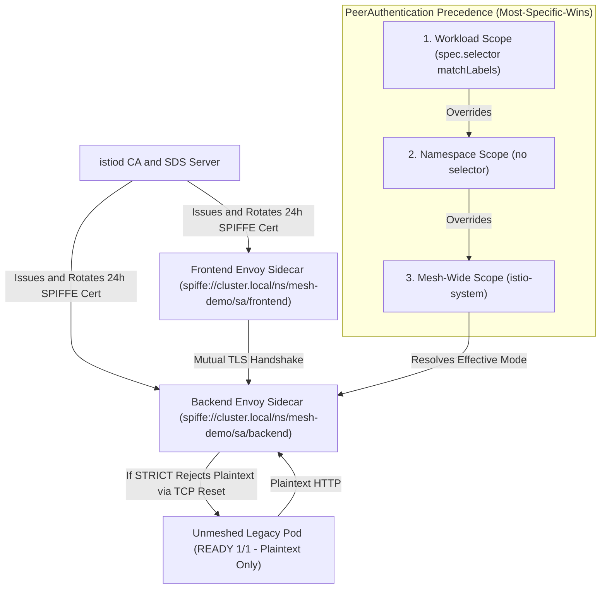
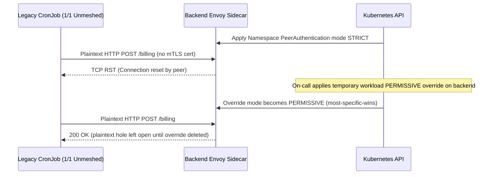

# 04 - mTLS and Zero-Trust Networking

> **Prerequisites:** Meshed `frontend`/`backend` deployment in `mesh-demo` (Modules 01–03); Kubernetes `NetworkPolicy` (Track 03) and RBAC basics (Track 11).  
> **Estimated Reading Time:** 35 minutes  
> **Target Audience:** Backend Engineers, Security Engineers, Platform Engineers, SREs.

> [!TIP]
> **The Golden Rule of Mesh mTLS Migration:** Never flip `PeerAuthentication` to `STRICT` before confirming every active caller has an injected `istio-proxy` (`READY 2/2`) and is already negotiating mTLS under `PERMISSIVE`—enforcing `STRICT` drops plaintext callers with immediate TCP connection resets, and never remove L3/4 `NetworkPolicy` because encryption does not block unauthorized Pods from reaching your port.

---

## Why This Matters

In track 03, NetworkPolicy could say "frontend may reach backend," but the traffic on that allowed path was still **plaintext**, and "frontend" was identified only by a spoofable Pod label/IP. A service mesh closes both gaps at once: every call is encrypted *and* both ends are cryptographically identified, with certificates issued and rotated for you. This module makes the mTLS that's already been running under your exercises explicit, teaches you to enforce it STRICTly, and — critically — shows the failure mode where turning on STRICT mTLS breaks calls from a service that isn't in the mesh.

---

## 1. Architectural Mental Model: `istiod` SPIFFE CA, SDS Rotation & `PeerAuthentication` Scope

`istiod` acts as the cluster's Certificate Authority (CA), issuing short-lived SPIFFE X.509 certificates to sidecars over the Envoy Secret Discovery Service (SDS) and enforcing mTLS posture via `PeerAuthentication` with **most-specific-wins** scope precedence:



### Core Concepts

#### mTLS, and What It Adds Over NetworkPolicy
Plain TLS (like HTTPS) encrypts traffic and proves the *server's* identity to the client. **Mutual TLS (mTLS)** additionally proves the *client's* identity to the server — both ends present certificates. In a mesh, the sidecars do this on every hop automatically, so you get two things NetworkPolicy never provided:

- **Encryption in transit** — an attacker who sniffs the Pod network sees ciphertext, not your requests.
- **Strong workload identity** — each workload's certificate encodes a verifiable identity (in Istio, a SPIFFE identity derived from its `ServiceAccount`, e.g., `spiffe://cluster.local/ns/mesh-demo/sa/frontend`), so "this call is from the checkout service" is cryptographically proven, not inferred from an easily-spoofed label or IP.

This is the "same mTLS idea" you saw ACA's Dapr provide between apps (track 06 module 05) — except here Istio issues and rotates the certificates for *every* meshed workload with no per-app setup, instead of you wiring TLS by hand.

#### It's Already On — Istio's Default
Here's the part that surprises people: **you've been using mTLS since module 01.** Every `frontend`→`backend` call in modules 01–03 was already encrypted and mutually authenticated by the sidecars, because Istio enables mTLS in **PERMISSIVE** mode by default. You didn't configure it; it just happened. This module is about making that explicit and *tightening* it — the mesh's "secure by default" posture is the opposite of NetworkPolicy's "open by default until you restrict it" (track 03 module 11).

#### PERMISSIVE vs. STRICT
`PeerAuthentication` controls the mTLS *mode* for a workload or namespace:

- **PERMISSIVE** (the default): meshed workloads accept *both* mTLS and plaintext. This is what lets a not-yet-meshed or external service still talk to your meshed services during a migration — encryption where possible, compatibility where necessary. The catch: because plaintext is still accepted, you don't yet have a *guarantee* of encryption.
- **STRICT**: the workload accepts *only* mTLS; any plaintext connection is rejected. This is the real "zero-trust" posture — nothing on the network is trusted unless it presents a valid mesh certificate. STRICT is the goal, but flipping it on will **break** any caller that isn't presenting mesh mTLS (i.e. any non-meshed Pod), which is the central hazard of this module.

The migration pattern this enables: mesh everything under PERMISSIVE (nothing breaks), verify all real traffic is already mTLS, *then* flip to STRICT to forbid the plaintext you've confirmed nobody needs.

#### `PeerAuthentication` Scope: Mesh, Namespace, Workload
A `PeerAuthentication` applies at one of three scopes, most-specific-wins:

- **Mesh-wide** — in the Istio root namespace (`istio-system`), no selector: the default for everything.
- **Namespace-wide** — in a namespace, no selector: overrides mesh default for that namespace.
- **Workload-specific** — in a namespace *with* a `selector`: overrides the namespace default for matching Pods.

This mirrors the layering you already know from RBAC (`Role` vs. `ClusterRole`, track 11) and from NetworkPolicy's per-Pod selectors — coarse defaults, refined by more specific rules. It lets you keep one legacy service PERMISSIVE while the rest of the namespace is STRICT.

#### How mTLS *Layers With* NetworkPolicy (Not Replaces It)
These are different layers and you want both. NetworkPolicy (L3/4) decides *whether a connection is allowed to exist at all* — it can drop a packet before it's even a TLS handshake. mTLS (L7-ish, in the proxies) decides *whether an allowed connection is encrypted and who's on each end*. A robust setup uses NetworkPolicy to keep unrelated Pods from even reaching a service's port, *and* STRICT mTLS so that whatever does reach it is encrypted and identified. One is the outer fence, the other is the locked door — defence in depth, and neither makes the other redundant. (Authorization of *which identity may call which* is a third layer — `AuthorizationPolicy`, module 05.)

#### Certificate Issuance and Rotation, Conceptually
You never touched a certificate in modules 01–03, yet every call was mTLS. That's because `istiod` runs a **certificate authority**: when a sidecar starts, it proves its identity (via its `ServiceAccount` token) and `istiod` issues it a short-lived workload certificate, then **automatically rotates** it (re-issues a fresh one) long before it expires — typically every 24 hours, with no restart and no human involved. Compare this to the hand-managed TLS of track 03/04: certificates that expire and page you at 2am because someone forgot to renew. The mesh turning cert lifecycle into an invisible, self-healing background process is one of its highest-value features — you get short-lived, frequently-rotated certs (a security best practice that's painful to do by hand) essentially for free.

---

## 2. Taxonomic Comparison & Command Reference

### Defense-in-Depth Zero-Trust Security Layers

| Security Layer | Object / Mechanism | OSI Layer | Threat It Mitigates | What It Cannot Do Alone |
|---|---|---|---|---|
| **NetworkPolicy** | CNI Pod/Namespace Firewall | L3 / L4 | Unrelated Pods opening TCP sockets to protected ports | Does not encrypt payload or verify cryptographic identity |
| **mTLS (`PeerAuthentication`)** | Envoy Sidecar Certificates (`istiod` CA) | Transport (TLS) | Packet sniffing, IP spoofing, MITM interception | Does not block an unauthorized *meshed* Pod from calling an API |
| **Service Authz (`AuthorizationPolicy`)** | SPIFFE Principal + HTTP Method/Path Rules | L7 | Meshed service `A` calling privileged endpoint on `B` | Relies on mTLS identity already established by `PeerAuthentication` |
| **Kubernetes RBAC** | `Role` / `ClusterRole` | K8s Control Plane | Unauthorized `kubectl` or API server mutations | Does not inspect runtime Pod-to-Pod application HTTP traffic |

### `PeerAuthentication` Modes & Precedence

| Mode | Plaintext Accepted? | mTLS Accepted? | Typical Lifecycle Phase |
|---|---|---|---|
| **`PERMISSIVE`** (Default) | Yes | Yes | Initial mesh onboarding / migration bridge |
| **`STRICT`** | **No (TCP Reset)** | Yes | Zero-trust target steady state |
| **`DISABLE`** | Yes | No | Rare legacy debugging or TLS-terminating external ports |
| **`UNSET`** | Inherited | Inherited | Port-level override inheriting parent namespace/mesh setting |

### Command Reference

| Field / command | What it does | Notes |
|---|---|---|
| `kind: PeerAuthentication` | Sets the mTLS mode for a scope | Mesh/namespace/workload scope by placement + selector |
| `spec.mtls.mode` | `STRICT`, `PERMISSIVE`, or `DISABLE` | STRICT = mTLS-only; PERMISSIVE = both; DISABLE = plaintext |
| `spec.selector` (on PeerAuthentication) | Narrows the policy to matching workloads | Omit for namespace/mesh-wide |
| `istioctl authn tls-check <pod> <host>` | Reports whether a call would use mTLS and the effective mode | Best "is mTLS actually on?" check |
| `istioctl proxy-config secret <pod>` | Shows the workload's issued certificate | Inspect identity + validity/rotation |
| `kubectl get peerauthentication -A` | Lists all mTLS policies and their scopes | Find what's overriding what |
| `istioctl analyze -n <ns>` | Flags conflicting or dangerous mTLS config | Run before flipping STRICT |

---

## 3. Production War Story Post-Mortem

- **Incident ID:** INC-2026-0819 (`mesh-demo` STRICT Rollout & Forgotten `PERMISSIVE` Hole)
- **Severity:** SEV-1
- **Detection Time:** 2 minutes (nightly billing batch failure alerts)
- **Resolution Time:** 16 minutes
- **Blast Radius / Impact:** Enabling `STRICT` mTLS broke a non-meshed CronJob (`curl: (56) Recv failure: Connection reset by peer`), and a rushed workload-scoped `PERMISSIVE` bridge remained active for 3 weeks after the CronJob was meshed—leaving `backend` silently accepting plaintext connections during an audit.

### What Happened

To satisfy an encryption-in-transit compliance milestone, a security engineer applied a namespace-wide `PeerAuthentication` (`mode: STRICT`) to `production`. Immediately, a legacy batch CronJob running in an unmeshed `batch` namespace (`READY 1/1`) started failing with TCP connection resets. To restore the job fast, an on-call engineer applied a workload-scoped `PeerAuthentication` (`mode: PERMISSIVE`) targeting `app: backend`. Weeks later, the `batch` namespace was meshed, yet a security scanner discovered `backend` still accepted plaintext because nobody cleaned up the workload-level `PERMISSIVE` override.



### Root Cause Analysis

1. **Uninventoried Plaintext Callers:** `STRICT` was applied before querying Prometheus (`istio_requests_total{connection_security_policy="none"}`) or verifying `READY 2/2` across all client namespaces.
2. **Most-Specific-Wins Blind Spot:** Workload-scoped `PeerAuthentication` silently overrides namespace-wide `STRICT`, creating an invisible security exception if forgotten.

### The Fix & Architectural Hardening

1. Meshed the `batch` namespace (`istio-injection=enabled` + job spec update) so all callers negotiated mTLS (`connection_security_policy="mutual_tls"`).
2. Deleted the temporary workload-scoped `PERMISSIVE` `PeerAuthentication` and verified `kubectl get peerauthentication -A` showed only `STRICT`.
3. Added a weekly policy audit alerting whenever any `PeerAuthentication` contains `mode: PERMISSIVE` or `DISABLE` in production.

---

## 4. Multi-Language Production Implementation

When an Envoy sidecar terminates mTLS on behalf of your application container, it forwards the authenticated client's cryptographic SPIFFE identity to your app inside the HTTP `X-Forwarded-Client-Cert` (`XFCC`) header (`By=spiffe://...;Hash=...;URI=spiffe://cluster.local/ns/<ns>/sa/<sa>`). Production services can parse and validate this SPIFFE URI for fine-grained audit logging or defense-in-depth identity checks.

````carousel
```go
package spiffe

import (
	"errors"
	"net/http"
	"strings"
)

type WorkloadIdentity struct {
	TrustDomain    string
	Namespace      string
	ServiceAccount string
	RawURI         string
}

// ExtractCallerSPIFFE parses Envoy's X-Forwarded-Client-Cert (XFCC) URI field.
func ExtractCallerSPIFFE(r *http.Request) (*WorkloadIdentity, error) {
	xfcc := r.Header.Get("x-forwarded-client-cert")
	if xfcc == "" {
		return nil, errors.New("missing XFCC header: connection may be unmeshed plaintext")
	}

	// Example element: By=spiffe://...;Hash=...;URI=spiffe://cluster.local/ns/mesh-demo/sa/frontend
	for _, part := range strings.Split(xfcc, ";") {
		kv := strings.SplitN(strings.TrimSpace(part), "=", 2)
		if len(kv) == 2 && strings.EqualFold(kv[0], "URI") {
			return parseSpiffeURI(kv[1])
		}
	}
	return nil, errors.New("no SPIFFE URI found in XFCC header")
}

func parseSpiffeURI(uri string) (*WorkloadIdentity, error) {
	const prefix = "spiffe://"
	if !strings.HasPrefix(uri, prefix) {
		return nil, errors.New("invalid SPIFFE scheme")
	}
	segments := strings.Split(strings.TrimPrefix(uri, prefix), "/")
	// Expected format: <trust-domain>/ns/<namespace>/sa/<service-account>
	if len(segments) != 5 || segments[1] != "ns" || segments[3] != "sa" {
		return nil, errors.New("unexpected SPIFFE path format")
	}
	return &WorkloadIdentity{
		TrustDomain:    segments[0],
		Namespace:      segments[2],
		ServiceAccount: segments[4],
		RawURI:         uri,
	}, nil
}
```
<!-- slide -->
```typescript
export interface SpiffeIdentity {
  trustDomain: string;
  namespace: string;
  serviceAccount: string;
  uri: string;
}

export function extractSpiffeFromXfcc(xfccHeader: string | undefined): SpiffeIdentity | null {
  if (!xfccHeader) return null;

  for (const field of xfccHeader.split(";")) {
    const trimmed = field.trim();
    if (trimmed.toLowerCase().startsWith("uri=")) {
      const uri = trimmed.slice(4);
      const match = /^spiffe:\/\/([^/]+)\/ns\/([^/]+)\/sa\/([^/]+)$/.exec(uri);
      if (!match) return null;
      return {
        trustDomain: match[1],
        namespace: match[2],
        serviceAccount: match[3],
        uri,
      };
    }
  }
  return null;
}

export function isTrustedCaller(
  xfccHeader: string | undefined,
  allowedNamespace: string,
  allowedServiceAccount: string
): boolean {
  const identity = extractSpiffeFromXfcc(xfccHeader);
  return (
    identity !== null &&
    identity.trustDomain === "cluster.local" &&
    identity.namespace === allowedNamespace &&
    identity.serviceAccount === allowedServiceAccount
  );
}
```
<!-- slide -->
```python
from dataclasses import dataclass
import re

SPIFFE_RE = re.compile(r"^spiffe://([^/]+)/ns/([^/]+)/sa/([^/]+)$")


@dataclass(frozen=True)
class SpiffeIdentity:
    trust_domain: str
    namespace: str
    service_account: str
    raw_uri: str


def parse_xfcc_spiffe(xfcc_header: str | None) -> SpiffeIdentity | None:
    """Extracts the peer workload SPIFFE identity forwarded by Envoy after mTLS."""
    if not xfcc_header:
        return None
    for part in xfcc_header.split(";"):
        segment = part.strip()
        if segment.lower().startswith("uri="):
            uri = segment[4:]
            match = SPIFFE_RE.match(uri)
            if match:
                return SpiffeIdentity(
                    trust_domain=match.group(1),
                    namespace=match.group(2),
                    service_account=match.group(3),
                    raw_uri=uri,
                )
    return None
```
<!-- slide -->
```csharp
using System.Text.RegularExpressions;

namespace ServiceMesh.ZeroTrust;

public sealed record SpiffeIdentity(string TrustDomain, string Namespace, string ServiceAccount, string RawUri);

public static partial class EnvoyXfccParser
{
    [GeneratedRegex(@"^spiffe://([^/]+)/ns/([^/]+)/sa/([^/]+)$", RegexOptions.Compiled)]
    private static partial Regex SpiffePattern();

    public static SpiffeIdentity? ParseCallerIdentity(string? xfccHeader)
    {
        if (string.IsNullOrWhiteSpace(xfccHeader))
        {
            return null;
        }

        foreach (var part in xfccHeader.Split(';', StringSplitOptions.RemoveEmptyEntries | StringSplitOptions.TrimEntries))
        {
            if (part.StartsWith("URI=", StringComparison.OrdinalIgnoreCase))
            {
                var uri = part[4..];
                var match = SpiffePattern().Match(uri);
                if (match.Success)
                {
                    return new SpiffeIdentity(
                        match.Groups[1].Value,
                        match.Groups[2].Value,
                        match.Groups[3].Value,
                        uri);
                }
            }
        }
        return null;
    }
}
```
````

---

## 5. Practical Hands-On Verification & CLI Workflows

Continue in `mesh-demo` with the meshed `frontend`/`backend` app. You'll also create a deliberately *non-meshed* namespace to trigger the STRICT-breaks-legacy scenario.

### 1. Prove mTLS Is Already On (PERMISSIVE Default)

```bash
BACKEND_POD=$(kubectl get pod -n mesh-demo -l app=backend -o jsonpath='{.items[0].metadata.name}')
istioctl authn tls-check deploy/frontend.mesh-demo backend.mesh-demo.svc.cluster.local
```

**Expected Output:**

```text
HOST:PORT                                    STATUS     SERVER        CLIENT     AUTHN POLICY       DESTINATION RULE
backend.mesh-demo.svc.cluster.local:80       OK         mTLS          mTLS       default/           -
```

The check reports the effective policy as PERMISSIVE (default) and that the connection uses mTLS — confirming the calls you've been making since module 01 were already encrypted and mutually authenticated without any config from you.

### 2. Look at a Workload's Certificate

```bash
istioctl proxy-config secret deploy/backend -n mesh-demo -o json | \
  jq -r '.dynamicActiveSecrets[0].secret.tlsCertificate.certificateChain.inlineBytes' 2>/dev/null | head -c 40; echo
istioctl proxy-config secret deploy/backend -n mesh-demo
```

**Expected Output:**

```text
RESOURCE NAME     TYPE           STATUS     VALID CERT     SERIAL NUMBER                        NOT AFTER                NOT BEFORE
default           Cert Chain     ACTIVE     true           29841278941289412...                 2026-11-12T04:00:00Z     2026-11-11T04:00:00Z
ROOTCA            CA             ACTIVE     true           ...                                  2036-11-08T04:00:00Z     2026-11-11T04:00:00Z
```

A certificate exists with a short validity window (24 hours) — the one `istiod` issued to this workload and rotates automatically. You never created it. Note the short lifetime: that's the frequent-rotation property from Concepts.

### 3. Enforce STRICT mTLS Namespace-Wide

```yaml
# strict-mtls.yaml
apiVersion: security.istio.io/v1
kind: PeerAuthentication
metadata:
  name: default
  namespace: mesh-demo
spec:
  mtls:
    mode: STRICT
```

```bash
kubectl apply -f strict-mtls.yaml
kubectl exec -n mesh-demo deploy/frontend -- curl -s http://backend
```

**Expected Output:**

```text
backend v1
```

Still works — both `frontend` and `backend` are meshed, so both ends present mesh certificates and STRICT is satisfied. Nothing looks different from the client's side, but plaintext is now *forbidden*, which the next exercises prove.

### 4. Confirm the Mode Really Changed

```bash
istioctl authn tls-check deploy/frontend.mesh-demo backend.mesh-demo.svc.cluster.local
kubectl get peerauthentication -n mesh-demo
```

**Expected Output:**

```text
HOST:PORT                                    STATUS     SERVER        CLIENT     AUTHN POLICY           DESTINATION RULE
backend.mesh-demo.svc.cluster.local:80       OK         STRICT        mTLS       default/mesh-demo      -

NAME      MODE     AGE
default   STRICT   15s
```

`tls-check` now reports STRICT for backend; the `PeerAuthentication` is listed. You've moved from "encrypted but plaintext still accepted" to "encrypted, plaintext rejected."

### 5. Create a Non-Meshed (Legacy) Caller

Make a namespace *without* the injection label and put a client in it:

```bash
kubectl create namespace legacy
# deliberately NOT labelling it for injection
kubectl -n legacy run legacy-client --image=curlimages/curl:8.10.1 --command -- sleep 3600
kubectl get pod legacy-client -n legacy
```

**Expected Output:**

```text
NAME            READY   STATUS    RESTARTS   AGE
legacy-client   1/1     Running   0          10s
```

`legacy-client` is `1/1` — no sidecar, so it will speak *plaintext* when it calls into `mesh-demo`. This is the migration reality: not everything is meshed at once.

### 6. Diagnose and Fix: STRICT mTLS Breaks the Legacy Service's Calls

```bash
kubectl exec -n legacy legacy-client -- curl -s -m 5 http://backend.mesh-demo || echo "FAILED (connection reset)"
```

**Expected Output:**

```text
FAILED (connection reset)
```

**It fails** — `backend` is STRICT and `legacy-client` has no sidecar, so it can only offer plaintext, which STRICT rejects. This is the canonical "mTLS broke a legacy non-meshed service" incident: nothing in `mesh-demo` changed, the legacy caller just can't speak mTLS. Diagnose — prove the meshed path still works so you know it's specifically the non-meshed caller:

```bash
kubectl exec -n mesh-demo deploy/frontend -- curl -s http://backend    # still works
kubectl get pod legacy-client -n legacy                                # 1/1 = not meshed
istioctl authn tls-check deploy/frontend.mesh-demo backend.mesh-demo.svc.cluster.local  # STRICT
```

**Expected Output:** Meshed caller succeeds (`backend v1`), legacy caller is `1/1`, backend is `STRICT` — the diagnosis is complete: STRICT plus a non-meshed caller. You have three legitimate fixes; pick based on intent:

**Fix A (right long-term): mesh the legacy caller.**

```bash
kubectl label namespace legacy istio-injection=enabled
kubectl delete pod legacy-client -n legacy
kubectl -n legacy run legacy-client --image=curlimages/curl:8.10.1 --command -- sleep 3600
kubectl get pod legacy-client -n legacy   # now 2/2
kubectl exec -n legacy legacy-client -- curl -s http://backend.mesh-demo
```

**Expected Output:** `2/2`, and the call now succeeds (`backend v1`) — the caller presents a mesh cert. This is the migration-done-right outcome: mesh the stragglers, keep STRICT.

**Fix B (bridge during migration): relax just backend to PERMISSIVE.** If you *can't* mesh the caller yet, scope a PERMISSIVE override to backend so it accepts both while you migrate — deliberately less secure, temporary:

```yaml
# backend-permissive.yaml
apiVersion: security.istio.io/v1
kind: PeerAuthentication
metadata:
  name: backend-permissive
  namespace: mesh-demo
spec:
  selector:
    matchLabels: {app: backend}
  mtls:
    mode: PERMISSIVE
```

This is the workload-scoped override from Concepts (most-specific-wins). Don't apply it now — Fix A is what you want here. The point is knowing this bridge exists so a migration doesn't force an all-or-nothing cutover.

### 7. Verify STRICT Still Holds for Everyone Else

With the legacy namespace now meshed (Fix A), confirm STRICT is still enforced and there's no plaintext path left:

```bash
istioctl authn tls-check deploy/backend.mesh-demo backend.mesh-demo.svc.cluster.local
kubectl get peerauthentication -n mesh-demo
```

**Expected Output:**

```text
NAME      MODE     AGE
default   STRICT   4m
```

Still STRICT, no PERMISSIVE override — the ideal end state: every caller meshed, plaintext forbidden mesh-wide.

### 8. See mTLS and NetworkPolicy as Different Layers

Reason about (and, if your kind cluster has a policy-enforcing CNI like the Calico setup from track 03 module 11, test): STRICT mTLS encrypts and identifies allowed traffic, but does it stop an *unauthorized* meshed Pod from *connecting* to backend's port? No — that's NetworkPolicy's job (L3/4), and authz of *which identity* may call is module 05's job. Write down which of the three layers (NetworkPolicy / mTLS / AuthorizationPolicy) would stop each of: a packet from an unrelated Pod reaching backend's port at all; an eavesdropper reading backend traffic; a meshed-but-unauthorized service successfully calling backend.

**Expected Output / Takeaway:** NetworkPolicy stops the first (drops the connection), mTLS stops the second (encryption), AuthorizationPolicy (module 05) stops the third — three distinct layers, all wanted.

### 9. Clean Up the Legacy Namespace

```bash
kubectl delete namespace legacy
```

Leave `mesh-demo` STRICT — module 05 adds authorization on top of it.

### Independent Challenge

No YAML given — draw on this module, [track 03 NetworkPolicy](../../03-kubernetes/11-security-rbac-and-network-policies/README.md), and the injection mechanics from [module 01](../01-installing-istio-and-sidecar-injection/README.md).

**Task:** Simulate a realistic "tighten security without an outage" migration. Start with two meshed services (`web`→`orders`) plus one *non-meshed* batch job that also calls `orders` over plaintext, all working under PERMISSIVE. Now reach a fully zero-trust end state — `orders` STRICT, every real caller on mTLS — *without ever breaking the batch job's traffic mid-migration*. Prove at each step that both the meshed and (until you mesh it) the non-meshed caller keep working, then flip STRICT only once nothing needs plaintext, and confirm a fresh non-meshed Pod is now rejected. Finally, explain in three sentences why you'd keep a NetworkPolicy on `orders` even after STRICT mTLS is fully enforced.

<details>
<summary>Stuck? One hint</summary>

The safe order is: mesh everything first (label + restart, so the batch job becomes `2/2` and starts speaking mTLS while PERMISSIVE still tolerates any stragglers), verify with `istioctl authn tls-check` that real traffic is already mTLS, *then* apply STRICT last. If you truly can't mesh the batch job in time, a workload-scoped PERMISSIVE `PeerAuthentication` on `orders` is the temporary bridge. Keep the NetworkPolicy because mTLS doesn't stop an unauthorized Pod from *reaching the port* — it only encrypts/identifies traffic that's allowed to connect.

</details>

---

## 6. Operational Validation Checkpoints & Quiz

### Operational Validation Checkpoints

<details>
<summary><strong>Checkpoint 1: Diagnosing Sudden TCP Connection Resets After STRICT Cutover</strong></summary>

**Scenario:** Thirty seconds after applying `PeerAuthentication` (`mode: STRICT`) to the `payments` namespace, a Prometheus exporter pod in `monitoring` starts logging `Get "http://payments.payments.svc.cluster.local:8080/metrics": EOF / connection reset by peer`. Meanwhile `checkout -> payments` works normally. What happened, and what two fixes exist?

**Answer & Rationale:** The Prometheus pod in `monitoring` is unmeshed (`READY 1/1`) or deliberately opted out of sidecar injection, so it sends plaintext HTTP while `payments` now rejects non-mTLS connections under `STRICT`. Fix A (preferred): inject the Prometheus/caller Pod or configure Istio Prometheus TLS scraping certificates. Fix B (scoped exception): configure port-level `portLevelMtls: { 8080: { mode: PERMISSIVE } }` on `payments` only for the scrape port while keeping business ports `STRICT`.

</details>

<details>
<summary><strong>Checkpoint 2: Explaining Why Traffic Between Two Meshed Pods Was Plaintext Despite Namespace STRICT</strong></summary>

**Scenario:** Security audit logs show plaintext HTTP packets between `frontend` and `legacy-db-proxy` inside `mesh-demo`, even though `kubectl get peerauthentication -n mesh-demo` shows `default` set to `STRICT`. Which two checks reveal the loophole?

**Answer & Rationale:** First run `kubectl get peerauthentication -A` to check for a **workload-scoped** `PeerAuthentication` with `selector: {matchLabels: {app: legacy-db-proxy}}` and `mode: PERMISSIVE` or `DISABLE` (workload scope overrides namespace `STRICT`). Second check `kubectl get pods -n mesh-demo` and `istioctl proxy-status` to verify whether `legacy-db-proxy` or `frontend` has `sidecar.istio.io/inject: "false"` (`READY 1/1`), because Pods without sidecars never participate in mesh mTLS!

</details>

<details>
<summary><strong>Checkpoint 3: Handling Istio mTLS When a Pod Also Has a Calico NetworkPolicy</strong></summary>

**Scenario:** You apply `STRICT` mTLS to `mesh-demo`, and you also have a `NetworkPolicy` allowing ingress to `backend` only from pods labeled `app: frontend` on TCP port `5678`. A teammate argues: "Shouldn't we open the NetworkPolicy to port `15006` because Envoy intercepts inbound traffic?" Wait—does `NetworkPolicy` evaluate the app container port (`5678`) or Envoy's internal capture port?

**Answer & Rationale:** **Keep `5678` (the Pod's destination port before Pod-local iptables redirects it).** `NetworkPolicy` rules are enforced by the CNI at the Pod network interface (`eth0` / `veth`) *before* `istio-init`'s Pod-internal `iptables` rules redirect incoming packets to Envoy's `15006` inbound port. You keep the exact same L3/4 port (`5678`) in `NetworkPolicy`, and mTLS runs transparently inside that allowed L4 connection.

</details>

### Checkpoint Quiz

Write down your answer to each question before expanding it — checking without attempting first is the single easiest way to fool yourself into thinking you've learned this.

1. What does mTLS add over plain TLS, and what does it add over a NetworkPolicy that already allows the traffic?
2. Were your module 01–03 calls encrypted? Why or why not, given you never wrote a `PeerAuthentication`?
3. Explain PERMISSIVE vs. STRICT and why PERMISSIVE is the safe default during a migration.
4. You flip a namespace to STRICT and a batch job's calls immediately start failing with connection resets. What's the cause and the two ways to fix it?
5. mTLS and NetworkPolicy — do you keep both, and what does each stop that the other doesn't?
6. Who issues and rotates a meshed workload's certificate, and how does that compare to the hand-managed TLS of earlier tracks?
7. A workload-scoped PERMISSIVE `PeerAuthentication` exists in a STRICT namespace. Which wins for the selected Pods, and why might that be both useful and dangerous?

<details>
<summary>Show answers</summary>

1. Plain TLS encrypts and proves the *server's* identity; mTLS additionally proves the *client's* identity, so both ends are authenticated. Over a NetworkPolicy (which only allows/denies a connection), mTLS adds encryption in transit and cryptographic workload identity — the allowed traffic is now private and both ends are provably who they claim to be.
2. Yes, they were encrypted and mutually authenticated. Istio enables mTLS in PERMISSIVE mode by default, so meshed sidecars already do mTLS between themselves without any `PeerAuthentication` from you.
3. PERMISSIVE accepts both mTLS and plaintext; STRICT accepts only mTLS and rejects plaintext. PERMISSIVE is safe during migration because not-yet-meshed or external callers (which can only do plaintext) keep working while you mesh them, so you don't force an all-at-once cutover.
4. The batch job isn't meshed (no sidecar → plaintext only), and STRICT rejects plaintext. Fix by meshing the job (label its namespace + restart so it gets a sidecar and speaks mTLS), or, as a temporary bridge, scope a PERMISSIVE `PeerAuthentication` to the target workload until the job is meshed.
5. Yes, keep both — different layers. NetworkPolicy (L3/4) stops an unauthorized Pod from reaching the port at all; mTLS encrypts the allowed traffic and proves both ends' identity. Neither substitutes for the other.
6. `istiod` acts as the CA: it issues each meshed workload a short-lived certificate (identity from its ServiceAccount) and automatically rotates it before expiry, with no restart or human action — versus earlier tracks' hand-managed certs that expire and require manual renewal.
7. The workload-scoped PERMISSIVE wins for the selected Pods (most-specific-wins). Useful as a temporary migration bridge for one legacy service; dangerous because it silently punches a plaintext-allowed hole in an otherwise-STRICT namespace that's easy to forget.

</details>

---

## Common Mistakes & Troubleshooting

- **Flipping STRICT before everything is meshed.** Any non-meshed caller speaks plaintext and gets rejected the instant backend goes STRICT — the exact incident in exercise 6. Mesh first (PERMISSIVE tolerates stragglers), verify all real traffic is mTLS, then STRICT.
- **Assuming mTLS replaces NetworkPolicy.** It doesn't — mTLS encrypts and identifies *allowed* traffic but doesn't decide whether a connection may exist. Keep NetworkPolicy (L3/4) and mTLS (encryption/identity) as separate layers.
- **Thinking "no config" means "no mTLS."** Istio is mTLS-PERMISSIVE by default, so meshed traffic is already encrypted before you write any `PeerAuthentication` — the opposite default from NetworkPolicy's open-by-default.
- **Debugging cert errors as app bugs.** A `connection reset`/`RST` on a meshed call after enabling STRICT is almost always a non-meshed caller or a DISABLE/STRICT mismatch, not the application — check the caller's `READY` count and `istioctl authn tls-check` first.
- **Forgetting most-specific-wins for PeerAuthentication.** A workload-scoped PERMISSIVE override silently beats a namespace STRICT for those Pods — great for a migration bridge, dangerous if you forget it's there. `kubectl get peerauthentication -A` shows the full picture.
- **Worrying about certificate expiry.** You don't manage mesh certs — `istiod` issues and rotates short-lived ones automatically. If you find yourself hand-renewing a mesh workload cert, you've misunderstood who owns them.

---

## Sources & Further Reading

- [Istio Mutual TLS Migration & Authentication](https://istio.io/latest/docs/tasks/security/authentication/mtls-migration/)
- [Istio PeerAuthentication Reference](https://istio.io/latest/docs/reference/config/security/peer_authentication/)
- [SPIFFE Workload Identity Specification](https://spiffe.io/docs/latest/spiffe-about/overview/)

---

## Next

[05-authorization-policies](../05-authorization-policies/README.md) — mTLS proves *who* a caller is; now use that proven identity to decide *which* services are allowed to call *which*, with `AuthorizationPolicy`.
