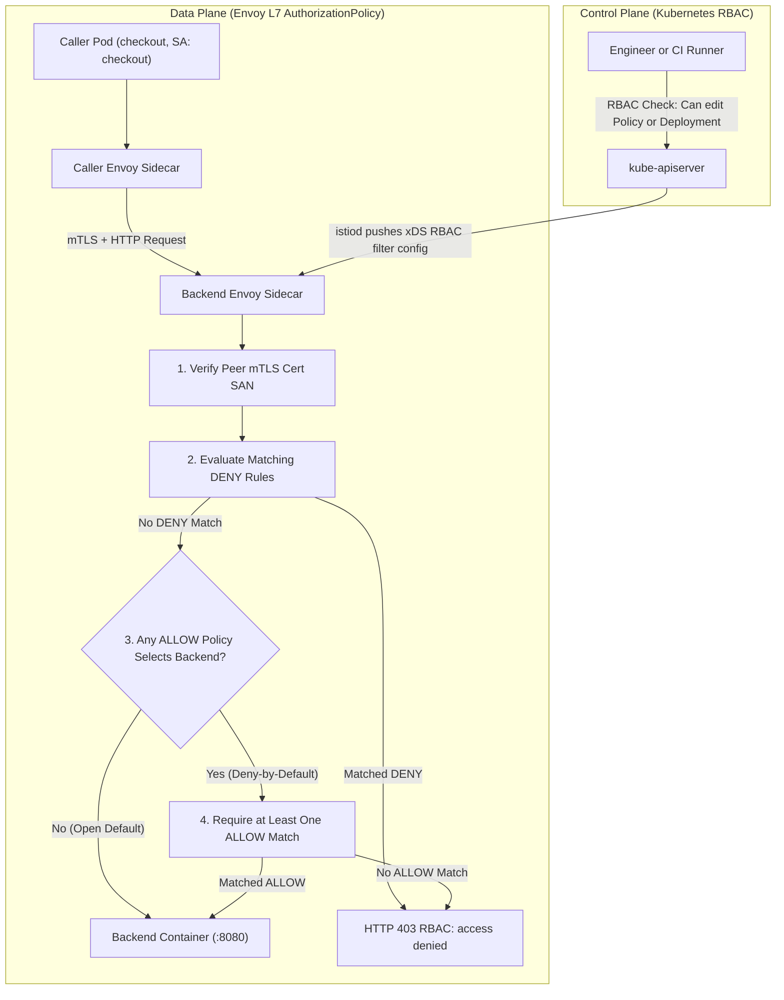
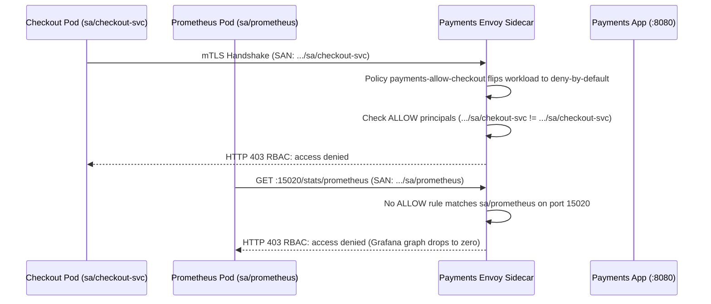

# 05 - Authorization Policies

> **Prerequisites:** Module 04 (`STRICT` mTLS active in `mesh-demo`), distinct workload `ServiceAccount`s, `kubectl`, and `istioctl`.  
> **Estimated Reading Time:** 30 minutes  
> **Target Audience:** Backend Engineers, Platform Engineers, Security & Kubernetes Operators.

> [!TIP]
> **The Golden Rule of Mesh Authorization:** An `AuthorizationPolicy` keyed on mTLS principals is only as trustworthy as the `STRICT` mTLS layer beneath it—and the instant a single `ALLOW` policy selects a workload, that workload flips from open-by-default to deny-by-default, silently blocking every unlisted caller (including Prometheus scrapers and health checks) or locking out everyone if a principal string has a one-character typo.

---

## Why This Matters

mTLS (module 04) proves *who* every caller is, but by itself it lets any meshed workload call any other — a strong identity that nobody is checking. `AuthorizationPolicy` is where you actually *use* that identity to enforce "only checkout may call payments," at the request layer, keyed on the cryptographic identity rather than a spoofable IP. This is the mesh's answer to the least-privilege principle you learned as RBAC in tracks 03/11 — same principle, different layer — and the exercise you'll spend the most time on is the one where a policy accidentally blocks legitimate traffic, because that's the failure that pages real teams.

---

## 1. Architectural Mental Model: Identity-Driven L7 Enforcement & Evaluation Order

Every meshed request first completes an mTLS handshake at the destination Envoy sidecar, which extracts the caller's SPIFFE URI (`spiffe://cluster.local/ns/<ns>/sa/<sa>`) from its X.509 SAN extension and feeds it into Envoy's HTTP/TCP RBAC filter (`DENY` evaluated first, then `ALLOW`):



### Core Concepts

#### What an `AuthorizationPolicy` governs (and how it differs from RBAC)
Track 11's **RBAC** answered "may this *user/ServiceAccount* perform this action on the *Kubernetes API server*?" — it gates `kubectl` and controllers. An **`AuthorizationPolicy`** answers a completely different question: "may this *workload* send this *request* to that *workload* at runtime?" — it gates service-to-service traffic inside the mesh, enforced by the destination's sidecar. Same underlying idea (least privilege: deny by default, grant explicitly), different layer:

- RBAC subject = a user or ServiceAccount calling the API; AuthZ policy principal = a *workload identity* (from mTLS, derived from the caller's ServiceAccount).
- RBAC protects the control plane (the API server); `AuthorizationPolicy` protects the data plane (your services' request paths).

They compose: RBAC stops a compromised token from creating Pods; an `AuthorizationPolicy` stops a compromised *service* from calling payments.

#### It depends on mTLS identity
An `AuthorizationPolicy` rule like "allow principal `checkout`" only means anything because mTLS (module 04) cryptographically established that the caller *is* checkout. Without mTLS you'd be authorizing based on spoofable source IPs. So authz sits *on top of* mTLS: module 04 provides trustworthy identities; this module decides what each identity is allowed to do. This is why the curriculum ordered them this way — you can't do meaningful zero-trust authz without trustworthy identity first.

#### Allow-by-default until the first policy — then deny-by-default
The behaviour has a crucial asymmetry, deliberately echoing NetworkPolicy from track 03 module 11:

- With **no** `AuthorizationPolicy` selecting a workload, **all** requests to it are allowed (subject to mTLS).
- The moment **any ALLOW policy** selects that workload, it flips to **deny-by-default**: only requests matching some allow rule get through, everything else is denied.

So — exactly like adding your first NetworkPolicy — writing one allow rule doesn't just *add* an allowance, it *removes the open default* for everything not listed. This is the single most common way an `AuthorizationPolicy` accidentally blocks legitimate traffic: you write "allow checkout," forgetting that this now *denies* the monitoring scraper, the health checker, and every other legitimate caller you didn't list.

#### `ALLOW` vs. `DENY` policies, and how they combine
Policies come in two primary `action`s (`CUSTOM` and `AUDIT` also exist for external authorizers and dry-run logging):

- **ALLOW** (the common one): once any ALLOW policy selects a workload, a request needs to match at least one ALLOW rule.
- **DENY**: explicitly denies matching requests, and **DENY is evaluated first and wins** over ALLOW. Useful for carving an exception ("deny everything from the `dev` namespace, even if an ALLOW rule would permit it").

Evaluation order: **DENY rules checked first (deny if matched) → then, if any ALLOW policy applies, require an ALLOW match → otherwise allow.** Most designs use ALLOW policies for the allowlist and reserve DENY for hard exceptions.

#### What a rule can match on
An `AuthorizationPolicy` rule has three parts, all optional (omitting one means "any"):

- **`from.source`** — *who*: principals (mTLS identities like `cluster.local/ns/<ns>/sa/<serviceaccount>`), namespaces, or IP blocks.
- **`to.operation`** — *what*: HTTP methods, paths, ports.
- **`when`** — *conditions*: arbitrary attributes (headers, JWT claims, etc.).

The most robust rules key on **principal** (the mTLS ServiceAccount identity), not namespace or IP, because principal is the thing mTLS actually proves. A rule that allows `from.namespaces: [frontend]` trusts the network topology; a rule that allows `from.principals: [.../sa/frontend]` trusts cryptographic identity — prefer the latter.

---

## 2. Taxonomic Comparison & Command Reference

### Defense-in-Depth Layer Comparison

| Dimension | Kubernetes RBAC | Kubernetes `NetworkPolicy` | Istio `AuthorizationPolicy` |
| :--- | :--- | :--- | :--- |
| **Layer Protected** | Control Plane (`kube-apiserver`) | Data Plane L3/L4 (Pod IP & TCP/UDP port) | Data Plane L7 (HTTP/gRPC + mTLS identity) |
| **Identity Basis** | Bearer Token / X.509 Client Cert | Pod Label -> CNI IP Sets | Cryptographic SPIFFE SAN (`<domain>/ns/<ns>/sa/<sa>`) |
| **Enforcement Point** | Kubernetes API Server | Host Kernel / CNI eBPF / iptables | Destination Envoy Sidecar RBAC Filter |
| **Default Before First Rule** | Deny-by-default (except system roles) | Allow-all until first policy selects Pod | Allow-all until first `ALLOW` selects workload |
| **Granularity** | API verbs (`get`, `list`, `apply`) & kinds | CIDR blocks, namespaces, TCP/UDP ports | Principals, HTTP methods, URI paths, JWT claims |
| **Primary Failure Mode** | `403 Forbidden` on `kubectl`/controllers | TCP connection timeout / drop | HTTP `403 RBAC: access denied` (or TCP close) |

### Policy Combination Semantics

| Policies Selecting Target Workload | Rule Evaluation Outcome |
| :--- | :--- |
| **None** | Open default: all meshed requests allowed |
| **Empty `AuthorizationPolicy` (`spec: {}`)** | Explicit `ALLOW` with zero rules: denies **100%** of traffic |
| **One or more `ALLOW` policies** | Deny-by-default: request must match at least one `ALLOW` rule |
| **`DENY` policies only** | Request denied if any `DENY` rule matches; otherwise allowed |
| **`DENY` + `ALLOW` policies** | `DENY` checked first (wins on match); then must match at least one `ALLOW` rule |

### Command & Field Reference

| Field / command | What it does | Notes |
|---|---|---|
| `kind: AuthorizationPolicy` | Defines allow/deny rules for selected workloads | Enforced by the destination sidecar |
| `spec.selector` | Which workloads the policy protects | Omit for namespace-wide |
| `spec.action` | `ALLOW` (default) or `DENY` | DENY is evaluated first and wins |
| `spec.rules[].from.source.principals` | Allowed mTLS identities | `cluster.local/ns/<ns>/sa/<sa>` — the robust key |
| `spec.rules[].from.source.namespaces` | Allowed source namespaces | Weaker than principals (trusts topology) |
| `spec.rules[].to.operation.methods` | Allowed HTTP methods | e.g. `["GET"]` |
| `spec.rules[].to.operation.paths` | Allowed URI paths | e.g. `["/api/*"]` |
| `spec.rules[].when` | Extra conditions (headers, claims) | Fine-grained matching |
| `kubectl get authorizationpolicy -A` | Lists all authz policies and scopes | Find what selects a workload |
| `istioctl analyze -n <ns>` | Flags authz config issues | Run after any policy change |

---

## 3. Production War Story Post-Mortem: Principal Typo + Scraper Blackout

* **Severity:** SEV-1 (Complete Checkout Outage & Blind Monitoring)
* **Detection / Resolution Time:** 18 minutes
* **Impact:** 100% of checkout-to-payments API calls returned `403 RBAC: access denied`; Prometheus scraping of `payments` sidecars silently returned `403`, wiping latency and error dashboards during the outage.

### What Happened

To satisfy a PCI audit, an engineer authored the first `AuthorizationPolicy` (`payments-allow-checkout`) targeting `app: payments` with `action: ALLOW`. Two subtle bugs slipped into the manifest: the ServiceAccount name had a one-character transposition (`sa/chekout-svc` instead of `sa/checkout-svc`), and the rule omitted the `prometheus` scraper's identity and port `:15020`. Because the YAML was schema-valid, `kubectl apply` succeeded cleanly and traffic instantly collapsed.



### Root Cause Analysis

1. **Silent Principal Typo:** Istio does not reject an `AuthorizationPolicy` referencing a non-existent `ServiceAccount` string at admission time. Selecting `app: payments` flipped it to deny-by-default, and matching nobody turned an `ALLOW` policy into an unintended deny-all.
2. **Assumed Control-Plane Exemption:** The engineer assumed infrastructure traffic like Prometheus scrapes or kubelet probes bypassed `AuthorizationPolicy`. While kubelet HTTP probes are rewritten by Istio (`15021`), Prometheus scraping `:15020` through a meshed path or strict policy still hits RBAC rules unless scoped by port or principal.

### The Fix & Architectural Hardening

1. Restored exact principal `cluster.local/ns/prod/sa/checkout-svc` and added an explicit `ALLOW` rule for `cluster.local/ns/monitoring/sa/prometheus` on metrics port `15020` (or scoped business `ALLOW` rules to `to.operation.ports: ["8080"]` while testing with `action: AUDIT` first).
2. Added a CI policy check cross-referencing every `principals` entry against actual `ServiceAccount` manifests in Git before merge, and mandated `istioctl proxy-config listener` / Envoy `http.rbac.denied` metric alerts.

---

## 4. Multi-Language Production Implementation: L7 Policy Evaluator & Principal Gate

The four implementations below model the exact evaluation semantics enforced inside Envoy's HTTP RBAC filter: verifying cryptographic SPIFFE identity presence, evaluating `DENY` rules before `ALLOW` rules, handling the "open until first `ALLOW` policy selects the workload" transition, and matching HTTP method + path prefix constraints.

````carousel
```go
package authz

import (
	"errors"
	"strings"
)

type Action string

const (
	ActionAllow Action = "ALLOW"
	ActionDeny  Action = "DENY"
)

type Rule struct {
	Principals []string // e.g. "cluster.local/ns/mesh-demo/sa/checkout"
	Methods    []string // e.g. "GET"
	Paths      []string // supports trailing "*" prefix match
}

type AuthorizationPolicy struct {
	Name   string
	Action Action
	Rules  []Rule
}

type RequestContext struct {
	SpiffeSAN string // e.g. "spiffe://cluster.local/ns/mesh-demo/sa/checkout"
	Method    string
	Path      string
}

var ErrAccessDenied = errors.New("403 RBAC: access denied")

// Evaluate enforces Istio AuthorizationPolicy precedence:
// 1) DENY rules evaluated first (any match denies immediately)
// 2) If any ALLOW policy selects the workload, at least one ALLOW rule must match
// 3) If no ALLOW policy selects the workload, allow by default
func Evaluate(policies []AuthorizationPolicy, req RequestContext) error {
	principal := strings.TrimPrefix(req.SpiffeSAN, "spiffe://")
	if principal == "" {
		return ErrAccessDenied
	}

	hasAllowPolicy := false
	allowMatched := false

	for _, p := range policies {
		if p.Action == ActionDeny {
			for _, r := range p.Rules {
				if ruleMatches(r, principal, req.Method, req.Path) {
					return ErrAccessDenied
				}
			}
		} else if p.Action == ActionAllow {
			hasAllowPolicy = true
			for _, r := range p.Rules {
				if ruleMatches(r, principal, req.Method, req.Path) {
					allowMatched = true
				}
			}
		}
	}

	if hasAllowPolicy && !allowMatched {
		return ErrAccessDenied
	}
	return nil
}

func ruleMatches(r Rule, principal, method, path string) bool {
	if len(r.Principals) > 0 && !containsExact(r.Principals, principal) {
		return false
	}
	if len(r.Methods) > 0 && !containsExact(r.Methods, method) {
		return false
	}
	if len(r.Paths) > 0 && !matchesAnyPath(r.Paths, path) {
		return false
	}
	return true
}

func containsExact(items []string, target string) bool {
	for _, item := range items {
		if item == target {
			return true
		}
	}
	return false
}

func matchesAnyPath(patterns []string, path string) bool {
	for _, pat := range patterns {
		if strings.HasSuffix(pat, "*") {
			if strings.HasPrefix(path, strings.TrimSuffix(pat, "*")) {
				return true
			}
		} else if pat == path {
			return true
		}
	}
	return false
}
```
<!-- slide -->
```typescript
export type PolicyAction = "ALLOW" | "DENY";

export interface AuthzRule {
  principals?: string[]; // e.g., ["cluster.local/ns/mesh-demo/sa/checkout"]
  methods?: string[];
  paths?: string[];
}

export interface AuthorizationPolicy {
  name: string;
  action: PolicyAction;
  rules: AuthzRule[];
}

export interface MeshRequest {
  spiffeSan?: string; // e.g., "spiffe://cluster.local/ns/mesh-demo/sa/checkout"
  method: string;
  path: string;
}

export interface AuthzDecision {
  allowed: boolean;
  statusCode: 200 | 403;
  reason: string;
}

export function evaluateAuthorizationPolicies(
  policies: AuthorizationPolicy[],
  req: MeshRequest
): AuthzDecision {
  const principal = req.spiffeSan?.replace(/^spiffe:\/\//, "") ?? "";
  if (!principal) {
    return { allowed: false, statusCode: 403, reason: "RBAC: missing mTLS principal" };
  }

  // Phase 1: DENY policies always evaluate first and win over ALLOW.
  for (const policy of policies.filter((p) => p.action === "DENY")) {
    if (policy.rules.some((rule) => matchesRule(rule, principal, req.method, req.path))) {
      return {
        allowed: false,
        statusCode: 403,
        reason: `RBAC: denied by policy ${policy.name}`,
      };
    }
  }

  // Phase 2: Presence of ANY ALLOW policy (even with 0 rules) flips to deny-by-default.
  const allowPolicies = policies.filter((p) => p.action === "ALLOW");
  if (allowPolicies.length === 0) {
    return { allowed: true, statusCode: 200, reason: "Open default (no ALLOW policy)" };
  }

  const matchedAllow = allowPolicies.find((policy) =>
    policy.rules.some((rule) => matchesRule(rule, principal, req.method, req.path))
  );

  return matchedAllow
    ? { allowed: true, statusCode: 200, reason: `Allowed by ${matchedAllow.name}` }
    : { allowed: false, statusCode: 403, reason: "RBAC: access denied" };
}

function matchesRule(rule: AuthzRule, principal: string, method: string, path: string): boolean {
  if (rule.principals?.length && !rule.principals.includes(principal)) return false;
  if (rule.methods?.length && !rule.methods.includes(method.toUpperCase())) return false;
  if (rule.paths?.length) {
    const pathOk = rule.paths.some((p) =>
      p.endsWith("*") ? path.startsWith(p.slice(0, -1)) : path === p
    );
    if (!pathOk) return false;
  }
  return true;
}
```
<!-- slide -->
```python
from dataclasses import dataclass, field
from typing import Literal, Sequence


@dataclass(frozen=True)
class AuthzRule:
    principals: tuple[str, ...] = ()
    methods: tuple[str, ...] = ()
    paths: tuple[str, ...] = ()

    def matches(self, principal: str, method: str, path: str) -> bool:
        if self.principals and principal not in self.principals:
            return False
        if self.methods and method.upper() not in self.methods:
            return False
        if self.paths:
            if not any(
                path.startswith(pat[:-1]) if pat.endswith("*") else path == pat
                for pat in self.paths
            ):
                return False
        return True


@dataclass(frozen=True)
class AuthorizationPolicy:
    name: str
    action: Literal["ALLOW", "DENY"] = "ALLOW"
    rules: tuple[AuthzRule, ...] = field(default_factory=tuple)


class AuthorizationEngine:
    """Simulates Envoy sidecar RBAC evaluation order (DENY -> ALLOW -> Open Default)."""

    @staticmethod
    def evaluate(
        policies: Sequence[AuthorizationPolicy],
        spiffe_san: str,
        method: str,
        path: str,
    ) -> tuple[int, str]:
        principal = spiffe_san.removeprefix("spiffe://")
        if not principal:
            return 403, "RBAC: unauthenticated caller (no SPIFFE SAN)"

        for policy in policies:
            if policy.action == "DENY" and any(
                rule.matches(principal, method, path) for rule in policy.rules
            ):
                return 403, f"RBAC: explicitly denied by {policy.name}"

        allow_policies = [p for p in policies if p.action == "ALLOW"]
        if not allow_policies:
            return 200, "Allowed (no ALLOW policy selecting workload)"

        for policy in allow_policies:
            if any(rule.matches(principal, method, path) for rule in policy.rules):
                return 200, f"Allowed by {policy.name}"

        return 403, "RBAC: access denied"
```
<!-- slide -->
```csharp
using System;
using System.Collections.Generic;
using System.Linq;

namespace MeshSecurity.Authorization;

public enum PolicyAction { Allow, Deny }

public sealed record AuthzRule(
    IReadOnlyList<string> Principals,
    IReadOnlyList<string> Methods,
    IReadOnlyList<string> Paths)
{
    public bool Matches(string principal, string method, string path)
    {
        if (Principals.Count > 0 && !Principals.Contains(principal, StringComparer.Ordinal))
            return false;

        if (Methods.Count > 0 && !Methods.Contains(method, StringComparer.OrdinalIgnoreCase))
            return false;

        if (Paths.Count > 0 && !Paths.Any(p => p.EndsWith('*')
                ? path.StartsWith(p[..^1], StringComparison.Ordinal)
                : string.Equals(path, p, StringComparison.Ordinal)))
            return false;

        return true;
    }
}

public sealed record AuthorizationPolicy(string Name, PolicyAction Action, IReadOnlyList<AuthzRule> Rules);

public static class AuthorizationPolicyEvaluator
{
    public static (int StatusCode, string Reason) Evaluate(
        IReadOnlyList<AuthorizationPolicy> policies,
        string? spiffeSan,
        string method,
        string path)
    {
        if (string.IsNullOrWhiteSpace(spiffeSan))
            return (403, "RBAC: missing mTLS SPIFFE identity");

        var principal = spiffeSan.StartsWith("spiffe://", StringComparison.Ordinal)
            ? spiffeSan["spiffe://".Length..]
            : spiffeSan;

        foreach (var deny in policies.Where(p => p.Action == PolicyAction.Deny))
        {
            if (deny.Rules.Any(r => r.Matches(principal, method, path)))
                return (403, $"RBAC: denied by {deny.Name}");
        }

        var allowPolicies = policies.Where(p => p.Action == PolicyAction.Allow).ToList();
        if (allowPolicies.Count == 0)
            return (200, "Open default (no ALLOW policy selects workload)");

        var matched = allowPolicies.FirstOrDefault(p => p.Rules.Any(r => r.Matches(principal, method, path)));
        return matched is not null
            ? (200, $"Allowed by {matched.Name}")
            : (403, "RBAC: access denied");
    }
}
```
````

---

## 5. Practical Hands-On Verification CLI Workflows

Continue in `mesh-demo` with STRICT mTLS from module 04. You'll build a small three-workload setup with distinct ServiceAccounts so identity-based rules are meaningful.

### 5.1 Give the callers distinct identities

Authz on principals only works if callers run as different ServiceAccounts. Create two and point two client Deployments at them:

```bash
kubectl create serviceaccount checkout -n mesh-demo
kubectl create serviceaccount reporting -n mesh-demo
```

```yaml
# callers.yaml
apiVersion: apps/v1
kind: Deployment
metadata:
  name: checkout
  namespace: mesh-demo
spec:
  replicas: 1
  selector: {matchLabels: {app: checkout}}
  template:
    metadata: {labels: {app: checkout}}
    spec:
      serviceAccountName: checkout
      containers:
        - name: app
          image: curlimages/curl:8.10.1
          command: ["sh", "-c", "sleep 3600"]
---
apiVersion: apps/v1
kind: Deployment
metadata:
  name: reporting
  namespace: mesh-demo
spec:
  replicas: 1
  selector: {matchLabels: {app: reporting}}
  template:
    metadata: {labels: {app: reporting}}
    spec:
      serviceAccountName: reporting
      containers:
        - name: app
          image: curlimages/curl:8.10.1
          command: ["sh", "-c", "sleep 3600"]
```

```bash
kubectl apply -f callers.yaml
kubectl get pods -n mesh-demo -l app=checkout
kubectl get pods -n mesh-demo -l app=reporting
```

**Expected Output:**

```text
NAME                        READY   STATUS    RESTARTS   AGE
checkout-6f8b9c7d4b-x9k2p   2/2     Running   0          18s
NAME                        READY   STATUS    RESTARTS   AGE
reporting-7c5d4b8f9-m3n7q   2/2     Running   0          18s
```

Each now has a distinct mTLS identity (`.../sa/checkout` and `.../sa/reporting`) that an authz rule can match.

### 5.2 Confirm the open default (no policy yet)

```bash
kubectl exec -n mesh-demo deploy/checkout -- curl -s http://backend
kubectl exec -n mesh-demo deploy/reporting -- curl -s http://backend
```

**Expected Output:**

```text
backend v1
backend v1
```

With no `AuthorizationPolicy` selecting `backend`, every meshed caller is allowed. This is the open-until-first-policy default from Concepts.

### 5.3 Lock backend to only checkout

```yaml
# authz-backend-checkout.yaml
apiVersion: security.istio.io/v1
kind: AuthorizationPolicy
metadata:
  name: backend-allow-checkout
  namespace: mesh-demo
spec:
  selector:
    matchLabels: {app: backend}
  action: ALLOW
  rules:
    - from:
        - source:
            principals: ["cluster.local/ns/mesh-demo/sa/checkout"]
```

```bash
kubectl apply -f authz-backend-checkout.yaml
kubectl exec -n mesh-demo deploy/checkout -- curl -s http://backend
kubectl exec -n mesh-demo deploy/reporting -- curl -s -m 5 -o /dev/null -w "%{http_code}\n" http://backend
```

**Expected Output:**

```text
backend v1
403
```

`checkout` still gets `backend v1`; `reporting` now gets **`403`** (`RBAC: access denied` by the mesh). The first `ALLOW` policy flipped `backend` to deny-by-default; only the listed principal gets through. This is exactly the NetworkPolicy asymmetry from track 03 module 11, at the request layer.

### 5.4 Verify it's identity-based, not network-based

The block is on the cryptographic identity, not the IP or namespace. Confirm `reporting`'s denial persists even though it's in the same namespace and can reach the port — the sidecar rejects it *after* the mTLS handshake, based on principal:

```bash
kubectl exec -n mesh-demo deploy/reporting -- curl -s -m 5 -o /dev/null -w "%{http_code}\n" http://backend
```

**Expected Output:**

```text
403
```

Same-namespace, meshed, reachable, but the wrong identity. This is what "trust identity, not topology" looks like.

### 5.5 Restrict by method and path too

Tighten so `checkout` may only `GET`:

```yaml
# authz-backend-getonly.yaml
apiVersion: security.istio.io/v1
kind: AuthorizationPolicy
metadata:
  name: backend-allow-checkout
  namespace: mesh-demo
spec:
  selector:
    matchLabels: {app: backend}
  action: ALLOW
  rules:
    - from:
        - source:
            principals: ["cluster.local/ns/mesh-demo/sa/checkout"]
      to:
        - operation:
            methods: ["GET"]
```

```bash
kubectl apply -f authz-backend-getonly.yaml
kubectl exec -n mesh-demo deploy/checkout -- curl -s -o /dev/null -w "%{http_code}\n" http://backend
kubectl exec -n mesh-demo deploy/checkout -- curl -s -o /dev/null -w "%{http_code}\n" -X POST http://backend
```

**Expected Output:**

```text
200
403
```

`GET` → `200`; `POST` → `403`. Even the authorized principal is now limited to the allowed operation — fine-grained, request-level least privilege.

### 5.6 A DENY exception that overrides ALLOW

Add a hard `DENY` that beats the `ALLOW` (e.g. block a specific path even for `checkout`):

```yaml
# authz-backend-deny-admin.yaml
apiVersion: security.istio.io/v1
kind: AuthorizationPolicy
metadata:
  name: backend-deny-admin
  namespace: mesh-demo
spec:
  selector:
    matchLabels: {app: backend}
  action: DENY
  rules:
    - to:
        - operation:
            paths: ["/admin*"]
```

```bash
kubectl apply -f authz-backend-deny-admin.yaml
kubectl exec -n mesh-demo deploy/checkout -- curl -s -o /dev/null -w "%{http_code}\n" http://backend/admin
kubectl exec -n mesh-demo deploy/checkout -- curl -s -o /dev/null -w "%{http_code}\n" http://backend
```

**Expected Output:**

```text
403
200
```

`/admin` → `403` even for `checkout` (`DENY` wins and is evaluated first); the normal path is still `200`. `DENY` is your hard-exception tool on top of an allowlist.

### 5.7 Diagnose and fix: an AuthorizationPolicy accidentally blocking legitimate traffic

The classic incident. A well-meaning "allow the frontend" policy is written with the *principal* misspelled, so it matches nobody and — because it's still an `ALLOW` policy that selects `backend` — denies *everyone*, including the legitimate `checkout` traffic:

```yaml
# authz-backend-broken.yaml
apiVersion: security.istio.io/v1
kind: AuthorizationPolicy
metadata:
  name: backend-allow-checkout
  namespace: mesh-demo
spec:
  selector:
    matchLabels: {app: backend}
  action: ALLOW
  rules:
    - from:
        - source:
            principals: ["cluster.local/ns/mesh-demo/sa/chekout"]
```

(note the deliberate typo: `chekout`)

```bash
kubectl delete authorizationpolicy backend-deny-admin -n mesh-demo --ignore-not-found
kubectl apply -f authz-backend-broken.yaml
kubectl exec -n mesh-demo deploy/checkout -- curl -s -m 5 -o /dev/null -w "%{http_code}\n" http://backend
```

**Expected Output:**

```text
403
```

**`403` even for the legitimate `checkout` caller** — the `ALLOW` policy selects `backend` (flipping it to deny-by-default) but its one rule matches a principal that doesn't exist (`chekout`), so nothing is actually allowed. This is the same silent selector-typo class as the Service selector (track 03 module 04), NetworkPolicy selector (track 03 module 11), and VirtualService subset (module 02) bugs — schema-valid, applies cleanly, blocks legitimate traffic. Diagnose:

```bash
kubectl get authorizationpolicy backend-allow-checkout -n mesh-demo -o jsonpath='{.spec.rules[0].from[0].source.principals}{"\n"}'
kubectl get serviceaccount -n mesh-demo | grep checkout
istioctl analyze -n mesh-demo
```

**Expected Output:**

```text
["cluster.local/ns/mesh-demo/sa/chekout"]
checkout   0         4m
Info [IST0102] (Namespace mesh-demo) ...
```

The policy allows principal `.../sa/chekout` but the real `ServiceAccount` is `checkout` — a one-character mismatch. (Enabling Istio proxy access logs or checking the sidecar's `rbac` stats via `kubectl exec -n mesh-demo deploy/backend -c istio-proxy -- pilot-agent request GET stats | grep rbac` would also show `http.rbac.denied` increments.) Fix by correcting the principal:

```bash
kubectl apply -f authz-backend-checkout.yaml
kubectl exec -n mesh-demo deploy/checkout -- curl -s -o /dev/null -w "%{http_code}\n" http://backend
kubectl exec -n mesh-demo deploy/reporting -- curl -s -m 5 -o /dev/null -w "%{http_code}\n" http://backend
```

**Expected Output:**

```text
200
403
```

`checkout` `200`, `reporting` `403` — the intended policy restored. The lesson matches every prior selector-typo module: an authz policy that "matches nobody" doesn't fail open, it denies everyone it selects.

### 5.8 Reason about the deny-by-default trap

Without applying anything, answer: you have `backend` working with the `checkout` `ALLOW` policy, and now the monitoring stack from track 12 needs to scrape `backend`'s metrics endpoint. Will it work? What must you add, and why is this the *same* trap as adding a default-deny NetworkPolicy that then blocks Prometheus scraping (track 03 module 11's cumulative review)?

**Expected Output / Reasoning:**

It will be **denied** — the `ALLOW` policy made `backend` deny-by-default, and the monitoring principal isn't listed. You must add an allow rule for the monitoring identity/namespace (or restrict the application `ALLOW` policy to application ports while keeping metrics scraping reachable). It's the same trap because in both cases adding one allow rule silently removed the open default for every unlisted legitimate caller, monitoring included.

### 5.9 Clean up authz for the next module

```bash
kubectl delete authorizationpolicy backend-allow-checkout -n mesh-demo --ignore-not-found
kubectl delete authorizationpolicy backend-deny-admin -n mesh-demo --ignore-not-found
```

Leave the `checkout`/`reporting` Deployments and `STRICT` mTLS — module 06 observes this traffic.

### Independent Challenge

No YAML given — draw on this module, module 04's mTLS identity, and [track 11 RBAC](../../03-kubernetes/11-security-rbac-and-network-policies/README.md).

**Task:** Model a realistic three-tier authorization: a `gateway` service may call `orders`; `orders` may call `payments`; and `payments` may be called by *nothing except* `orders`. Enforce it with `AuthorizationPolicy` keyed on mTLS principals (distinct ServiceAccounts per tier), then prove the full matrix — `gateway`→`orders` allowed, `orders`→`payments` allowed, `gateway`→`payments` denied, `reporting`→anything denied. Deliberately introduce, then find and fix, the "first ALLOW flips deny-by-default" trap by adding a health-check caller that your initial policies forgot to allow. Finally, write three sentences on how this differs from — and layers with — the RBAC you'd write to control who can `kubectl` these same workloads.

<details>
<summary>Stuck? One hint</summary>

One ALLOW `AuthorizationPolicy` per protected service, each listing only the principal(s) permitted to call it (`cluster.local/ns/<ns>/sa/<sa>`). The trap appears the moment you apply the first one: any caller you didn't list — including a health checker — starts getting `403`, so add its principal to the relevant allow rule. RBAC (track 11) governs API-server access to these objects (who can edit the Deployments); `AuthorizationPolicy` governs runtime calls between them — different layer, same deny-by-default-once-you-start least-privilege discipline.

</details>

---

## 6. Common Mistakes & Troubleshooting

- **Forgetting the first ALLOW flips deny-by-default.** Writing "allow checkout" silently denies every other legitimate caller (monitoring, health checks) you didn't list — the exact trap in exercises 7–8, identical to adding your first NetworkPolicy.
- **Typo'd principals denying everyone.** An ALLOW rule whose principal matches nobody doesn't fail open — it selects the workload (deny-by-default) and then allows nothing, blocking legitimate traffic. Verify the exact `ServiceAccount` string.
- **Authorizing on namespace/IP instead of principal.** Namespace and IP rules trust network topology, which is spoofable; principal rules trust the mTLS identity, which isn't. Prefer principals — and remember they only work because module 04's mTLS is on.
- **Expecting authz to work without mTLS identity.** Principal-based rules need the caller to present a mesh certificate; a non-meshed caller has no principal to match. Authz sits on top of mTLS, not beside it.
- **Confusing `AuthorizationPolicy` with RBAC.** RBAC gates the Kubernetes API server; `AuthorizationPolicy` gates runtime service-to-service calls. A workload can be fully RBAC-locked and still call any service unless an `AuthorizationPolicy` restricts it.
- **Forgetting DENY is evaluated first.** A DENY rule beats any ALLOW; if authorized traffic is unexpectedly blocked, check for a broad DENY policy before debugging the ALLOW rules.

---

## 7. Operational Validation Checkpoints & Checkpoint Quiz

### Operational Validation Checkpoints

<details>
<summary><strong>Checkpoint 1: Production Deployment Rollout Causes Instant 403s Across All Callers</strong></summary>

You apply an `ALLOW` `AuthorizationPolicy` for `payments` that specifies `principals: ["cluster.local/ns/prod/sa/checkout-api"]`, yet `checkout-api` immediately receives `403` responses alongside every other service. What two checks prove why `checkout-api` is rejected?

**Answer:**
1. Verify `checkout-api`'s actual Kubernetes `ServiceAccount` and namespace (`kubectl get deploy checkout-api -n prod -o jsonpath='{.spec.template.spec.serviceAccountName}'`) against the policy's `principals` array — a one-character mismatch or `default` ServiceAccount leaves the policy selecting `payments` (deny-by-default) while matching zero callers.
2. Verify `checkout-api` is meshed (`2/2`) and presenting a valid mTLS cert (`istioctl authn tls-check`), because without mTLS an unauthenticated caller has no principal to match.

</details>

<details>
<summary><strong>Checkpoint 2: Emergency Block on Staging Calling Production</strong></summary>

Two `ALLOW` policies exist on `orders` in `prod`: one permits `checkout` and another permits `analytics`. During an incident, an engineer spins up a debug Pod inside namespace `staging` using a `ServiceAccount` named `checkout` (Wait: `cluster.local/ns/staging/sa/checkout`), or an existing `ALLOW` policy accidentally lists `namespaces: ["staging"]`. You want an instant guardrail blocking all `staging` traffic to `prod` without deleting existing `ALLOW` rules. What policy do you apply and why?

**Answer:**
Apply a namespace-scoped `AuthorizationPolicy` in `prod` with `action: DENY` matching `from.source.namespaces: ["staging"]` (omitting `selector` so it protects all workloads in `prod`). Because Istio always evaluates `DENY` policies *before* `ALLOW` policies, every request from `staging` is immediately rejected with `403`, even if an `ALLOW` rule overlaps.

</details>

<details>
<summary><strong>Checkpoint 3: Auditing Before Enforcing Least Privilege</strong></summary>

A legacy monolith is being decomposed and you don't know every caller hitting `inventory` yet. Applying an `ALLOW` policy blindly will break undiscovered callers. How can you inspect `AuthorizationPolicy` impact safely before enforcing deny-by-default, and why doesn't `istioctl analyze` catch missing callers?

**Answer:**
First observe live edges in Kiali / `istio_requests_total` (source workloads) and optionally test rules using `action: AUDIT` (or sidecar access logs) before switching to `action: ALLOW`. `istioctl analyze` only validates static Kubernetes/Istio configuration references; it cannot predict runtime business callers that are absent from an `ALLOW` allowlist.

</details>

### Checkpoint Quiz

Write down your answer to each question before expanding it — checking without attempting first is the single easiest way to fool yourself into thinking you've learned this.

1. What question does an `AuthorizationPolicy` answer that RBAC (track 11) does not?
2. Why does identity-based authz depend on module 04's mTLS being in place?
3. With no `AuthorizationPolicy` selecting a service, who can call it? What changes the instant you apply your first ALLOW policy?
4. In exercise 7, the policy applied cleanly but blocked the legitimate caller. What was the bug and why didn't it fail open?
5. You allow `checkout` to call `backend`, and now the monitoring scraper (track 12) can't reach backend's metrics. Why, and what's the fix?
6. Which is more robust to key an allow rule on — source namespace or source principal — and why?
7. If a request matches both a DENY rule and an ALLOW rule, what happens?

<details>
<summary>Show answers</summary>

1. "May this *workload* send this *request* to that *workload* at runtime?" — authorization of service-to-service calls in the data plane. RBAC answers "may this user/ServiceAccount perform this action on the Kubernetes API server?" — a different layer (control-plane access), same least-privilege principle.
2. Because the rules match on *principals* — the caller's cryptographic mTLS identity. Without mTLS you'd be authorizing on spoofable source IPs; module 04's mTLS is what makes "this call is from checkout" trustworthy enough to authorize on.
3. With no policy selecting it, every meshed caller is allowed (subject to mTLS). The instant you apply the first ALLOW policy, the workload flips to deny-by-default: only requests matching an allow rule get through, everything else is denied.
4. The ALLOW rule's principal was misspelled (`chekout`), so it matched no real identity — but the policy still selected backend, flipping it to deny-by-default. With nothing actually allowed, every caller (including the real checkout) got `403`. It didn't fail open because an ALLOW policy that matches nobody denies everyone it selects.
5. The ALLOW policy made backend deny-by-default, and the monitoring scraper's identity/namespace isn't in the allowlist, so it's denied. Fix: add an allow rule permitting the monitoring principal (or namespace) to the metrics path/port — the same trap as a default-deny NetworkPolicy blocking Prometheus.
6. Source **principal** — it's the mTLS-proven workload identity, which can't be spoofed. Source namespace (and IP) trust network topology, which can be spoofed and doesn't survive workloads moving around; prefer principals.
7. The request is denied. DENY policies are evaluated first and win over any ALLOW match — DENY is the hard-exception tool that overrides the allowlist.

</details>

---

## 8. Further Reading & Sources

- [Track 03 Module 11: Kubernetes RBAC and Network Policies](../../03-kubernetes/11-security-rbac-and-network-policies/README.md) — control-plane RBAC and L3/L4 NetworkPolicy deny-by-default mechanics.

## Next

[06-mesh-observability](../06-mesh-observability/README.md) — you've routed, encrypted, and authorized traffic; now *see* all of it: Istio's built-in golden-signal metrics, the Kiali service graph, and wiring traces into track 12's OpenTelemetry/Grafana stack.
