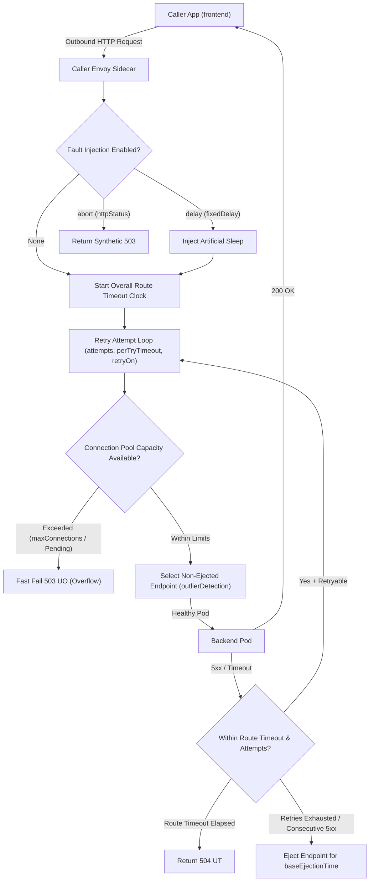
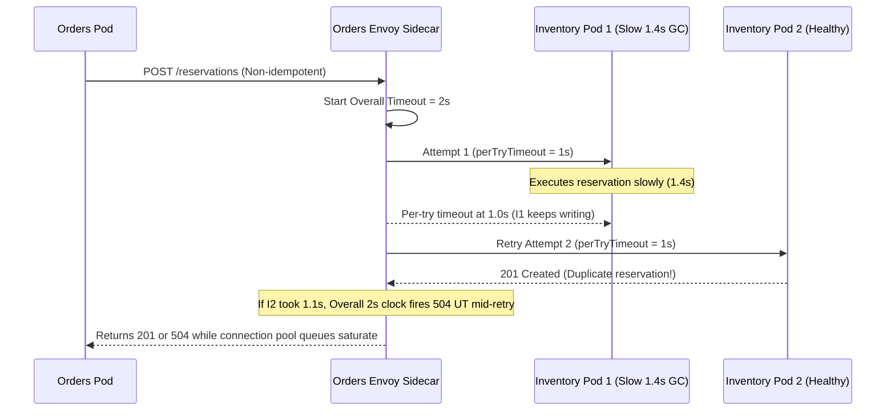

# 07 - Resilience Patterns via the Mesh

> **Prerequisites:** Module 06 (`mesh-demo` with `frontend`, `backend` v1/v2 `DestinationRule`, `STRICT` mTLS, and observability stack), `kubectl`, and `istioctl`.  
> **Estimated Reading Time:** 35 minutes  
> **Target Audience:** Backend Engineers, SREs, Distributed Systems Engineers.

> [!TIP]
> **The Golden Rule of Mesh Resilience:** Every `VirtualService` timeout and retry budget must obey `timeout >= attempts * perTryTimeout` (plus backoff margin), retries must only target strictly idempotent operations, and every resilience rule should be proven with `VirtualService` fault injection—and stripped of `fault` blocks before shipping to steady-state traffic.

---

## Why This Matters

Real dependencies fail intermittently — a Pod restarts, a network blip drops a packet, one slow instance drags down every caller. Without the mesh you'd bake retry/timeout logic into every app's HTTP client, differently in each language. The mesh moves retries, timeouts, and circuit breaking into configuration on the sidecars, uniform across every service and language, and — its unique gift — lets you **inject** failures on demand to *prove* those policies work before real users find the gaps. That fault-injection idea is the on-ramp to the deliberate failure testing you'll do at cluster scale in track 22.

---

## 1. Architectural Mental Model: Sidecar Resilience Pipeline & Failure Interaction

Unlike application-embedded libraries that duplicate logic across Go, Node, Python, and C#, Envoy runs an identical state machine on every outbound call—evaluating fault injection before starting the overall route deadline, bounding individual retry attempts inside that clock, shedding excess concurrency at the connection pool, and ejecting poisoned endpoints via outlier detection:



### Core Concepts

#### Timeouts: bounding how long a caller waits
A **timeout** caps how long a caller's sidecar waits for a response before giving up and returning an error. Without one, a single hung dependency ties up the caller's resources indefinitely and the stall cascades upward. In Istio a timeout is a field on a `VirtualService` route (`spec.http[].timeout`), so it's set per-route, in config, not in each app's client library. The discipline is the same you'd apply anywhere — fail fast rather than hang — but now it's uniform and adjustable without redeploying code.

#### Retries: absorbing transient failures
A **retry** re-sends a failed request, on the theory that many failures are transient (a Pod mid-restart, a brief network drop). Istio configures retries on a `VirtualService` route: how many attempts, a per-try timeout, and *which* conditions are retryable (e.g. `5xx`, `connect-failure`, `reset`). Two cautions the mesh makes explicit: only retry **idempotent** operations (a retried `POST` can double-charge a customer), and retries + a total timeout must be sane together (three retries each waiting the full timeout can blow your latency budget). Retries turn a flaky dependency into a mostly-invisible one — but only if applied thoughtfully.

#### Circuit breaking and outlier detection: stop hammering a sick instance
If a backend instance is failing, retrying *harder* makes it worse. **Circuit breaking** protects the *dependency* by capping load: Istio's `DestinationRule` connection-pool limits bound concurrent connections/requests, and requests over the limit are rejected fast rather than queued (`503 UO`). **Outlier detection** (also on the `DestinationRule`) goes further — it watches per-endpoint error rates and **ejects** an unhealthy instance from the load-balancing pool for a while, so traffic routes only to healthy Pods. This is the mesh doing automatically, per-endpoint, what a human does manually when they cordon a bad node — and it's why "one bad Pod" doesn't have to mean "elevated errors for everyone."

#### Fault injection: proving resilience instead of hoping
Here's the capability you can't easily get without a mesh: **fault injection**. A `VirtualService` can deliberately introduce **delays** (add N seconds to a percentage of requests) or **aborts** (return an HTTP error code for a percentage of requests) — *without touching the backend*. You use this to *test* that your timeouts, retries, and circuit breakers actually behave as designed: inject a 5s delay and confirm your 2s timeout fires; inject 50% `503`s and confirm your retries mask them. Injecting failure to verify recovery is exactly the philosophy of **chaos engineering** — and this per-request, app-scoped fault injection is the gentle preview of the cluster- and infrastructure-level failure experiments you'll run in **track 22 (disaster recovery and chaos engineering)**. The mesh lets you rehearse "what happens when this dependency misbehaves?" as a routine, reversible config change.

#### These compose — and can fight each other
Resilience settings interact, and getting them consistent is the real skill:

- A **retry** budget that exceeds the **timeout** means the timeout fires mid-retries and you never get the retries you configured.
- **Aggressive retries** can *defeat* circuit breaking by generating exactly the surge of load the breaker exists to prevent — a "retry storm."
- **Outlier ejection** plus a tiny pool can eject so many endpoints that the healthy remainder gets overwhelmed.

The mesh gives you the knobs; fault injection is how you verify the *combined* behaviour is what you intended, rather than discovering the interaction in a real incident.

---

## 2. Taxonomic Comparison & Command Reference

### Resilience Mechanism Taxonomy

| Pattern | Istio CRD Location | Protects Whom | Failure Mode Prevented | Key Envoy Flag | Primary Configuration Trap |
| :--- | :--- | :--- | :--- | :--- | :--- |
| **Route Timeout** | `VirtualService.spec.http[].timeout` | Caller threads & queues | Cascading hang from slow dependency | `UT` (`504`) | Setting `timeout` smaller than `attempts * perTryTimeout` |
| **Bounded Retry** | `VirtualService.spec.http[].retries` | Caller UX during blips | Dropped requests during pod restarts | `URX` (`503`) | Retrying non-idempotent `POST` or causing retry storms |
| **Connection Pool Breaker** | `DestinationRule.trafficPolicy.connectionPool` | Target dependency | Thread/DB exhaustion under overload | `UO` (`503`) | Setting limits below normal burst concurrency |
| **Outlier Detection** | `DestinationRule.trafficPolicy.outlierDetection` | Healthy replicas & callers | Traffic hitting a degraded Pod | `Ejected` | `maxEjectionPercent: 100` on tiny 1–2 Pod pools |
| **Fault Injection** | `VirtualService.spec.http[].fault` | Pre-prod confidence | Untested resilience YAML in production | `FI` (`503` / delay) | Leaving a `fault` block committed to steady-state config |

### Command & Field Reference

| Field / command | What it does | Notes |
|---|---|---|
| `spec.http[].timeout` (VirtualService) | Max wait before the caller's proxy gives up | e.g. `timeout: 2s` |
| `spec.http[].retries.attempts` | Number of retry attempts | Total tries = attempts (Istio counts retries) |
| `spec.http[].retries.perTryTimeout` | Timeout for each individual attempt | Keep `attempts × perTryTimeout` ≤ route timeout |
| `spec.http[].retries.retryOn` | Which failures are retryable | e.g. `5xx,connect-failure,reset` |
| `spec.http[].fault.delay` | Inject latency into a % of requests | `fixedDelay: 5s`, `percentage.value: 100` |
| `spec.http[].fault.abort` | Return an error code for a % of requests | `httpStatus: 503`, `percentage.value: 50` |
| `spec.trafficPolicy.connectionPool` (DestinationRule) | Caps concurrent connections/requests (circuit breaking) | `tcp.maxConnections`, `http.http1MaxPendingRequests` |
| `spec.trafficPolicy.outlierDetection` (DestinationRule) | Ejects unhealthy endpoints from the pool | `consecutive5xxErrors`, `baseEjectionTime`, `maxEjectionPercent` |
| `istioctl proxy-config route <pod>` | Shows the timeouts/retries programmed into the proxy | Ground truth of the effective policy |

---

## 3. Production War Story Post-Mortem: Retry Storm & Duplicate Orders Collapse

* **Severity:** SEV-1 (Site-Wide Checkout Slowdown & Duplicate Inventory Locks)
* **Detection / Resolution Time:** 32 minutes
* **Impact:** A single degraded `inventory` Pod triggered 4x retry amplification across `orders`, saturating `connectionPool` queues and generating duplicate `POST /reservations` locks for customers.

### What Happened

To improve reliability ahead of a flash sale, an engineer added a single catch-all route to `inventory`'s `VirtualService` with `attempts: 4`, `perTryTimeout: 1s`, and `timeout: 2s`, without splitting read (`GET`) and write (`POST`) routes and without `outlierDetection`. When one `inventory` Pod hit a GC pause lasting 1.4s per call, `orders` retried `POST /reservations` repeatedly. Worse, because `timeout: 2s` capped the overall wait at 2 seconds while 4 attempts at 1s needed 4 seconds, requests aborted mid-flight after the backend had already begun processing the first reservation—causing duplicate holds and exhausting the connection pool.



### Root Cause Analysis

1. **Unsafe Retries on `POST`:** Matching all methods with `attempts: 4` allowed Envoy to replay a timed-out `POST /reservations` whose first attempt had already committed on `Inventory Pod 1`.
2. **Timeout / Retry Math Mismatch:** `attempts(4) * perTryTimeout(1s) = 4s > timeout(2s)` guaranteed retries were truncated early, wasting upstream CPU for zero caller benefit.
3. **Missing `outlierDetection`:** Without ejection, Envoy kept scheduling attempts onto the struggling `Inventory Pod 1` instead of removing it from the active pool.

### The Fix & Architectural Hardening

1. Split the `VirtualService` `http` rules: enabled `retries` (`attempts: 2`, `perTryTimeout: 800ms`, `timeout: 3s`) **only** on `match: [{method: {exact: GET}}]` and disabled retries (`attempts: 0`) on `POST`/`PATCH` mutations unless backed by an idempotency key.
2. Added `outlierDetection` (`consecutive5xxErrors: 3`, `consecutiveGatewayErrors: 3`, `baseEjectionTime: 30s`, `maxEjectionPercent: 50`) and bounded `connectionPool` limits on the `DestinationRule`.
3. Added a pre-merge policy test enforcing `timeout >= attempts * perTryTimeout` and banning `fault` blocks in production overlays.

---

## 4. Multi-Language Production Implementation: Retry Budget & Outlier Circuit Breaker

Although Envoy executes resilience in the sidecar, backend engineers frequently mirror or integrate with these exact mechanics inside SDK wrappers, idempotency guards, and resilience simulators. The four implementations below enforce idempotency checking, strict `totalTimeout >= attempts * perTryTimeout` budget validation, connection-pool concurrency gating (`503 UO`), and consecutive-5xx endpoint outlier ejection.

````carousel
```go
package resilience

import (
	"errors"
	"sync"
	"time"
)

var (
	ErrPoolOverflow       = errors.New("503 UO: connection pool overflow")
	ErrGatewayTimeout     = errors.New("504 UT: overall route timeout exceeded")
	ErrNoHealthyEndpoints = errors.New("503 UH: all endpoints ejected")
)

type RetryPolicy struct {
	Timeout       time.Duration
	Attempts      int
	PerTryTimeout time.Duration
	Idempotent    bool
}

type Endpoint struct {
	mu               sync.Mutex
	Addr             string
	Consecutive5xx   int
	EjectedUntil     time.Time
	ActiveInFlight   int
	MaxConnections   int
	EjectionDuration time.Duration
	Threshold5xx     int
}

func ValidatePolicy(p RetryPolicy) error {
	if p.Attempts > 0 && time.Duration(p.Attempts)*p.PerTryTimeout > p.Timeout {
		return errors.New("invalid VirtualService: attempts * perTryTimeout exceeds route timeout")
	}
	return nil
}

func (e *Endpoint) Acquire(now time.Time) error {
	e.mu.Lock()
	defer e.mu.Unlock()
	if now.Before(e.EjectedUntil) {
		return ErrNoHealthyEndpoints
	}
	if e.ActiveInFlight >= e.MaxConnections {
		return ErrPoolOverflow
	}
	e.ActiveInFlight++
	return nil
}

func (e *Endpoint) Release(now time.Time, statusCode int) {
	e.mu.Lock()
	defer e.mu.Unlock()
	e.ActiveInFlight--
	if statusCode >= 500 {
		e.Consecutive5xx++
		if e.Consecutive5xx >= e.Threshold5xx {
			e.EjectedUntil = now.Add(e.EjectionDuration)
			e.Consecutive5xx = 0
		}
		return
	}
	e.Consecutive5xx = 0
}
```
<!-- slide -->
```typescript
export interface ResiliencePolicy {
  routeTimeoutMs: number;
  attempts: number;
  perTryTimeoutMs: number;
  retryableMethods: ReadonlySet<string>;
}

export interface EndpointState {
  id: string;
  activeRequests: number;
  maxPendingRequests: number;
  consecutive5xx: number;
  ejectedUntilMs: number;
}

export function assertSaneRetryBudget(policy: ResiliencePolicy): void {
  const maxRetryWindow = policy.attempts * policy.perTryTimeoutMs;
  if (policy.attempts > 0 && maxRetryWindow > policy.routeTimeoutMs) {
    throw new Error(
      `Invalid budget: ${policy.attempts} * ${policy.perTryTimeoutMs}ms (${maxRetryWindow}ms) > routeTimeout (${policy.routeTimeoutMs}ms)`
    );
  }
}

export async function callWithMeshResilience(
  method: string,
  policy: ResiliencePolicy,
  endpoints: EndpointState[],
  transportCall: (endpointId: string, timeoutMs: number) => Promise<number>
): Promise<{ status: number; attemptsMade: number; flag: string }> {
  assertSaneRetryBudget(policy);
  const deadline = Date.now() + policy.routeTimeoutMs;
  const maxTries = policy.retryableMethods.has(method.toUpperCase()) ? 1 + policy.attempts : 1;

  for (let tryIdx = 1; tryIdx <= maxTries; tryIdx++) {
    const remaining = deadline - Date.now();
    if (remaining <= 0) return { status: 504, attemptsMade: tryIdx - 1, flag: "UT" };

    const target = endpoints.find((ep) => Date.now() >= ep.ejectedUntilMs);
    if (!target) return { status: 503, attemptsMade: tryIdx - 1, flag: "UH" };
    if (target.activeRequests >= target.maxPendingRequests) {
      return { status: 503, attemptsMade: tryIdx - 1, flag: "UO" };
    }

    target.activeRequests++;
    try {
      const status = await transportCall(target.id, Math.min(policy.perTryTimeoutMs, remaining));
      if (status >= 500) {
        target.consecutive5xx++;
        if (target.consecutive5xx >= 3) {
          target.ejectedUntilMs = Date.now() + 30_000;
          target.consecutive5xx = 0;
        }
        if (tryIdx < maxTries) continue;
        return { status, attemptsMade: tryIdx, flag: "URX" };
      }
      target.consecutive5xx = 0;
      return { status, attemptsMade: tryIdx, flag: "-" };
    } finally {
      target.activeRequests--;
    }
  }
  return { status: 503, attemptsMade: maxTries, flag: "URX" };
}
```
<!-- slide -->
```python
from dataclasses import dataclass
import time
from typing import Callable


@dataclass(frozen=True)
class MeshRetryBudget:
    route_timeout_s: float
    attempts: int
    per_try_timeout_s: float
    idempotent_only: bool = True

    def validate(self) -> None:
        if self.attempts > 0 and (self.attempts * self.per_try_timeout_s) > self.route_timeout_s:
            raise ValueError(
                f"Retry budget {self.attempts * self.per_try_timeout_s:.2f}s exceeds route timeout {self.route_timeout_s:.2f}s"
            )


@dataclass
class OutlierEndpoint:
    name: str
    max_connections: int = 10
    consecutive_5xx_threshold: int = 3
    base_ejection_s: float = 30.0
    in_flight: int = 0
    consecutive_5xx: int = 0
    ejected_until: float = 0.0

    def is_healthy(self, now: float) -> bool:
        return now >= self.ejected_until

    def record_outcome(self, status: int, now: float) -> None:
        if status >= 500:
            self.consecutive_5xx += 1
            if self.consecutive_5xx >= self.consecutive_5xx_threshold:
                self.ejected_until = now + self.base_ejection_s
                self.consecutive_5xx = 0
        else:
            self.consecutive_5xx = 0


def execute_with_resilience(
    method: str,
    policy: MeshRetryBudget,
    pool: list[OutlierEndpoint],
    send_fn: Callable[[OutlierEndpoint, float], int],
) -> tuple[int, str]:
    policy.validate()
    deadline = time.monotonic() + policy.route_timeout_s
    allow_retry = (method.upper() in {"GET", "HEAD", "PUT", "DELETE"}) if policy.idempotent_only else True
    max_attempts = (1 + policy.attempts) if allow_retry else 1

    for attempt in range(max_attempts):
        now = time.monotonic()
        remaining = deadline - now
        if remaining <= 0:
            return 504, "UT"

        healthy = [ep for ep in pool if ep.is_healthy(now)]
        if not healthy:
            return 503, "UH"

        ep = healthy[attempt % len(healthy)]
        if ep.in_flight >= ep.max_connections:
            return 503, "UO"

        ep.in_flight += 1
        try:
            code = send_fn(ep, min(policy.per_try_timeout_s, remaining))
            ep.record_outcome(code, time.monotonic())
            if code < 500:
                return code, "-"
        finally:
            ep.in_flight -= 1

    return 503, "URX"
```
<!-- slide -->
```csharp
using System;
using System.Collections.Generic;
using System.Linq;
using System.Threading;
using System.Threading.Tasks;

namespace MeshResilience;

public sealed record RouteResiliencePolicy(
    TimeSpan RouteTimeout,
    int Attempts,
    TimeSpan PerTryTimeout,
    bool RetryIdempotentOnly = true)
{
    public void EnsureConsistentBudget()
    {
        if (Attempts > 0 && TimeSpan.FromTicks(PerTryTimeout.Ticks * Attempts) > RouteTimeout)
            throw new InvalidOperationException("Retry budget (attempts * perTryTimeout) exceeds route timeout.");
    }
}

public sealed class OutlierEndpointState
{
    public required string Id { get; init; }
    public int MaxConnections { get; init; } = 10;
    public int Consecutive5xxThreshold { get; init; } = 3;
    public TimeSpan BaseEjectionTime { get; init; } = TimeSpan.FromSeconds(30);

    private int _inFlight;
    private int _consecutive5xx;
    private DateTimeOffset _ejectedUntil = DateTimeOffset.MinValue;

    public bool TryAcquire(DateTimeOffset now, out string failureFlag)
    {
        if (now < _ejectedUntil) { failureFlag = "UH"; return false; }
        if (Interlocked.Increment(ref _inFlight) > MaxConnections)
        {
            Interlocked.Decrement(ref _inFlight);
            failureFlag = "UO";
            return false;
        }
        failureFlag = string.Empty;
        return true;
    }

    public void Release(DateTimeOffset now, int statusCode)
    {
        Interlocked.Decrement(ref _inFlight);
        if (statusCode >= 500)
        {
            if (Interlocked.Increment(ref _consecutive5xx) >= Consecutive5xxThreshold)
            {
                _ejectedUntil = now + BaseEjectionTime;
                Interlocked.Exchange(ref _consecutive5xx, 0);
            }
        }
        else
        {
            Interlocked.Exchange(ref _consecutive5xx, 0);
        }
    }
}
```
````

---

## 5. Practical Hands-On Verification CLI Workflows

Continue in `mesh-demo` with the meshed `frontend`/`backend` app, STRICT mTLS, and the `backend` DestinationRule (subsets `v1`/`v2`). Reset routing to 100% v1 if you haven't:

```bash
kubectl patch virtualservice backend -n mesh-demo --type=merge -p \
  '{"spec":{"http":[{"route":[{"destination":{"host":"backend","subset":"v1"},"weight":100},{"destination":{"host":"backend","subset":"v2"},"weight":0}]}]}}'
```

### 5.1 Inject a delay and watch the baseline hang

Add a 5-second delay to 100% of `backend` requests, then time a call:

```yaml
# vs-fault-delay.yaml
apiVersion: networking.istio.io/v1
kind: VirtualService
metadata:
  name: backend
  namespace: mesh-demo
spec:
  hosts: [backend]
  http:
    - fault:
        delay:
          fixedDelay: 5s
          percentage: {value: 100}
      route:
        - destination: {host: backend, subset: v1}
```

```bash
kubectl apply -f vs-fault-delay.yaml
kubectl exec -n mesh-demo deploy/frontend -- sh -c 'time curl -s -o /dev/null http://backend'
```

**Expected Output:**

```text
real    0m 5.02s
user    0m 0.00s
sys     0m 0.01s
```

The call takes ~5 seconds and *succeeds* — the mesh injected the delay without the backend doing anything. Right now nothing bounds that wait; the caller just hangs for 5s. That's the problem a timeout solves.

### 5.2 Add a timeout and prove it fires

Now add a 2-second timeout alongside the 5s injected delay:

```yaml
# vs-timeout.yaml
apiVersion: networking.istio.io/v1
kind: VirtualService
metadata:
  name: backend
  namespace: mesh-demo
spec:
  hosts: [backend]
  http:
    - fault:
        delay:
          fixedDelay: 5s
          percentage: {value: 100}
      timeout: 2s
      route:
        - destination: {host: backend, subset: v1}
```

```bash
kubectl apply -f vs-timeout.yaml
kubectl exec -n mesh-demo deploy/frontend -- sh -c 'time curl -s -o /dev/null -w "%{http_code}\n" http://backend'
```

**Expected Output:**

```text
504
real    0m 2.01s
user    0m 0.00s
sys     0m 0.01s
```

The call now fails at ~2 seconds with `504` (gateway timeout) — you've **proven** the timeout works by injecting a delay longer than it. This is fault injection's whole point: verify the policy, don't assume it.

### 5.3 Inject aborts and prove a retry masks them

Remove the delay; instead abort 50% of requests with `503`, and confirm the un-retried failure rate first:

```yaml
# vs-fault-abort.yaml
apiVersion: networking.istio.io/v1
kind: VirtualService
metadata:
  name: backend
  namespace: mesh-demo
spec:
  hosts: [backend]
  http:
    - fault:
        abort:
          httpStatus: 503
          percentage: {value: 50}
      route:
        - destination: {host: backend, subset: v1}
```

```bash
kubectl apply -f vs-fault-abort.yaml
for i in $(seq 1 20); do kubectl exec -n mesh-demo deploy/frontend -- curl -s -o /dev/null -w "%{http_code}\n" http://backend; done | sort | uniq -c
```

**Expected Output:**

```text
  10 200
  10 503
```

Roughly half `200`, half `503` — the injected 50% failure rate, with no retries yet.

### 5.4 Add retries and watch the failures shrink

```yaml
# vs-retry.yaml
apiVersion: networking.istio.io/v1
kind: VirtualService
metadata:
  name: backend
  namespace: mesh-demo
spec:
  hosts: [backend]
  http:
    - fault:
        abort:
          httpStatus: 503
          percentage: {value: 50}
      retries:
        attempts: 3
        perTryTimeout: 1s
        retryOn: "503,reset,connect-failure"
      route:
        - destination: {host: backend, subset: v1}
```

```bash
kubectl apply -f vs-retry.yaml
for i in $(seq 1 20); do kubectl exec -n mesh-demo deploy/frontend -- curl -s -o /dev/null -w "%{http_code}\n" http://backend; done | sort | uniq -c
```

**Expected Output:**

```text
  19 200
   1 503
```

Far fewer `503`s (each request now gets up to 3 more tries, and with a 50% independent failure chance most eventually hit a `200`). You've proven the retry policy masks transient failures — measured, not assumed. Note this only works because the injected abort is *retryable* (`503`) and the operation is safe to repeat.

### 5.5 Inspect the effective policy on the proxy

```bash
istioctl proxy-config route deploy/frontend -n mesh-demo -o json | grep -iE "timeout|retr" | head
```

**Expected Output:**

```text
"timeout": "0s",
"retryPolicy": {
    "retryOn": "503,reset,connect-failure",
    "numRetries": 3,
    "perTryTimeout": "1s",
```

The retry/timeout settings you wrote appear in the caller's Envoy route config — ground truth that the sidecar, not the app, is enforcing them.

### 5.6 Configure outlier detection (circuit breaking)

Add outlier detection to the `DestinationRule` so a consistently-failing endpoint gets ejected:

```yaml
# dr-outlier.yaml
apiVersion: networking.istio.io/v1
kind: DestinationRule
metadata:
  name: backend
  namespace: mesh-demo
spec:
  host: backend
  subsets:
    - name: v1
      labels: {version: v1}
    - name: v2
      labels: {version: v2}
  trafficPolicy:
    connectionPool:
      tcp: {maxConnections: 10}
      http: {http1MaxPendingRequests: 10, maxRequestsPerConnection: 10}
    outlierDetection:
      consecutive5xxErrors: 3
      interval: 5s
      baseEjectionTime: 30s
      maxEjectionPercent: 100
```

```bash
kubectl apply -f dr-outlier.yaml
kubectl get destinationrule backend -n mesh-demo -o yaml | grep -A6 outlierDetection
```

**Expected Output:**

```text
    outlierDetection:
      baseEjectionTime: 30s
      consecutive5xxErrors: 3
      interval: 5s
      maxEjectionPercent: 100
```

With more than one `backend` replica, an endpoint returning 3 consecutive `5xx`s is ejected from the pool for 30s — traffic then avoids the sick instance automatically. (With a single replica there's nothing to fail over to; scale `backend-v1` to 3 to see ejection in action if you want.)

### 5.7 Diagnose and fix: retries that never happen because the timeout is too tight

A common self-inflicted bug: the route timeout is *shorter* than the time the retries need, so the timeout fires before the retries can help. Reproduce with a 5s injected delay, 3 retries at 1s each, but a 2s overall timeout:

```yaml
# vs-retry-broken.yaml
apiVersion: networking.istio.io/v1
kind: VirtualService
metadata:
  name: backend
  namespace: mesh-demo
spec:
  hosts: [backend]
  http:
    - fault:
        delay:
          fixedDelay: 5s
          percentage: {value: 100}
      timeout: 2s
      retries:
        attempts: 3
        perTryTimeout: 1s
        retryOn: "gateway-error,reset,connect-failure"
      route:
        - destination: {host: backend, subset: v1}
```

```bash
kubectl apply -f vs-retry-broken.yaml
kubectl exec -n mesh-demo deploy/frontend -- sh -c 'time curl -s -o /dev/null -w "%{http_code}\n" http://backend'
```

**Expected Output:**

```text
504
real    0m 2.01s
```

Fails at ~2s with `504`. The intent was "retry the slow calls," but the overall `timeout: 2s` is the hard cap — it fires before the 3×1s of retries can complete, so the retry budget is effectively wasted. This is the "retry budget exceeds timeout" trap from Concepts. Diagnose by comparing the numbers: `attempts(3) × perTryTimeout(1s) = 3s > timeout(2s)`. Fix by making the overall timeout accommodate the retries (and, since the fault here is a *delay* not an abort, note that no per-try timeout shorter than 5s will ever get a success from a 5s-delayed backend — a delay that always exceeds `perTryTimeout` can't be retried into success; the real fix for *transient* failures is a retryable abort, not a permanent delay):

```bash
# Widen the overall timeout so retries can run, and test against a retryable abort instead:
kubectl apply -f vs-retry.yaml
kubectl exec -n mesh-demo deploy/frontend -- curl -s -o /dev/null -w "%{http_code}\n" http://backend
```

**Expected Output:**

```text
200
```

With `vs-retry.yaml` (retryable `503` abort, no crushing overall timeout) the retries actually run and mostly succeed. Lesson: retries only help when the failure is retryable *and* the timeout leaves room for the attempts — verify both with fault injection rather than trusting the YAML.

### 5.8 Remove all fault injection (return to healthy)

```yaml
# vs-clean.yaml
apiVersion: networking.istio.io/v1
kind: VirtualService
metadata:
  name: backend
  namespace: mesh-demo
spec:
  hosts: [backend]
  http:
    - timeout: 3s
      retries:
        attempts: 3
        perTryTimeout: 1s
        retryOn: "5xx,reset,connect-failure"
      route:
        - destination: {host: backend, subset: v1}
```

```bash
kubectl apply -f vs-clean.yaml
kubectl exec -n mesh-demo deploy/frontend -- curl -s -o /dev/null -w "%{http_code}\n" http://backend
```

**Expected Output:**

```text
200
```

Fast — a healthy service with a sensible timeout and retry policy and no injected faults. This is the steady state you'd actually run: resilience policies in place, verified, faults removed.

### 5.9 Preview the chaos-engineering mindset

Without applying anything, write down: which of your resilience policies you'd *deliberately* stress-test on a schedule (not just once), how fault injection here differs from killing a whole node or zone (track 22's scope), and why "inject failure to prove recovery" is safer as a routine practice than discovering the gap during a real outage.

**Expected Output / Reasoning:**

You'd periodically re-inject aborts/delays to confirm timeouts and retries still hold after code changes; mesh fault injection is per-request and app-scoped and instantly reversible, whereas track 22 fails whole nodes/zones/infrastructure; rehearsing failure on your terms beats meeting it unrehearsed at 3am.

### Independent Challenge

No YAML given — draw on this module, module 03's canary, and module 06's metrics, previewing [track 22](../../README.md).

**Task:** Give `backend` a production-grade resilience posture and *prove* each piece with fault injection: a route timeout, a bounded retry policy on idempotent requests only, and outlier detection on the DestinationRule. Then run three fault-injection experiments and record the observed behaviour in each against what you predicted: (1) inject a delay longer than the timeout and confirm it fires at the right time; (2) inject a retryable abort at 50% and show the retry policy drops the caller-visible error rate, watching it in the module-06 metrics/Kiali; (3) scale `backend` to 3 replicas, make one replica fail consistently, and confirm outlier detection ejects it so caller error rate recovers. Finish by writing two sentences on how these per-request experiments are a scaled-down rehearsal for the node/zone failure testing in track 22.

<details>
<summary>Stuck? One hint</summary>

Timeout and retries live on the `VirtualService` route; connection-pool limits and `outlierDetection` live on the `DestinationRule`. Ensure `attempts × perTryTimeout` fits inside the overall `timeout`, and only put retries on GET-like idempotent traffic. To make "one replica fail," give it a different image/args that returns `503` (or inject the abort scoped to its subset) and watch Kiali's error edge recover as the endpoint is ejected — the mesh metrics from module 06 are how you *prove* recovery rather than assume it.

</details>

---

## 6. Common Mistakes & Troubleshooting

- **Retry budget larger than the timeout.** If `attempts × perTryTimeout` exceeds the route `timeout`, the timeout fires mid-retries and you never get the retries you configured (exercise 7). Size them together.
- **Retrying non-idempotent operations.** A retried `POST`/`PATCH` can double-charge, double-send, or corrupt state. Scope retries to safe (idempotent) operations only.
- **Retrying a permanent failure.** Retries help *transient* failures; retrying a request against a backend that always fails (or is always too slow for the per-try timeout) just wastes attempts and adds latency.
- **Retry storms defeating circuit breaking.** Aggressive retries generate the exact load surge a circuit breaker exists to prevent — tune retries and connection-pool limits as a pair, not independently.
- **Leaving fault injection applied.** A `fault` block is real config on live traffic — forget to remove it and you're injecting failures into production. Always clean it back out (exercise 8) after an experiment.
- **Outlier detection with too few endpoints.** Ejecting endpoints only helps when there are healthy ones left; with one replica there's nothing to fail over to, and a high `maxEjectionPercent` on a small pool can eject enough to overwhelm the survivors.

---

## 7. Operational Validation Checkpoints & Checkpoint Quiz

### Operational Validation Checkpoints

<details>
<summary><strong>Checkpoint 1: Distinguishing Upstream Timeouts (UT) from Circuit Breaker Overflows (UO)</strong></summary>

After deploying a new `DestinationRule` with tight `connectionPool` limits, callers start seeing intermittent `503` responses with sub-millisecond durations. Checking Envoy proxy logs shows response flag `UO` rather than `UT` or `UF`. What happened and how do you confirm it?

**Answer:**
`UO` means **UpstreamOverflow** — the caller's sidecar tripped its local `connectionPool` circuit breaker (`maxConnections` or `http1MaxPendingRequests`) and rejected excess requests *before* sending them over the wire (hence sub-millisecond latency). Confirm via `kubectl exec <caller> -c istio-proxy -- pilot-agent request GET stats | grep upstream_rq_pending_overflow`.

</details>

<details>
<summary><strong>Checkpoint 2: Why Outlier Detection Didn't Eject a Crashing Pod</strong></summary>

You deployed `backend` with 2 replicas. One Pod throws `503` on every request, yet `outlierDetection` (`consecutive5xxErrors: 5`, `maxEjectionPercent: 50`) never ejects it after 10 failures. What subtle interaction prevented ejection?

**Answer:**
First check Envoy's panic threshold / `maxEjectionPercent` rounding or whether `gateway-error` vs `5xx` is counted: with 2 Pods, `50%` allows 1 ejection, *except* Envoy disables outlier-detection routing (entering **panic mode**) if healthy endpoints fall below `50%` (default `healthy_panic_threshold: 50%`) or if the Pod returned `502`/`504` gateway errors rather than upstream `500`/`503` when `consecutiveGatewayErrors` wasn't configured. Also verify `outlierDetection` was placed under `trafficPolicy` (or the active subset).

</details>

<details>
<summary><strong>Checkpoint 3: Fault Injection Applied Globally Instead of Scoped</strong></summary>

You want to inject a `5s` delay only for requests carrying header `x-chaos-test: true`, so production users are unaffected. What happens if you place `fault:` on the single default route rule without a `match` clause ahead of it?

**Answer:**
Every request in the mesh hitting that `VirtualService` matches the default rule and gets delayed by `5s` — an instant production outage. Always place a `match:` block (matching a test header like `x-chaos-test: true` or specific canary route) on the fault-injected route rule *above* the clean fallback route rule.

</details>

### Checkpoint Quiz

Write down your answer to each question before expanding it — checking without attempting first is the single easiest way to fool yourself into thinking you've learned this.

1. Where do a timeout and a retry policy live in Istio, and why is putting them there better than in each app's HTTP client?
2. What is fault injection, and why is it the feature that lets you *prove* a resilience policy instead of hoping it works?
3. You set `attempts: 3`, `perTryTimeout: 1s`, and route `timeout: 2s`. What goes wrong, and how do you fix it?
4. Why must you be careful applying retries to non-idempotent requests?
5. What's the difference between connection-pool circuit breaking and outlier detection, and where is each configured?
6. How can an aggressive retry policy *defeat* a circuit breaker?
7. How does the fault injection in this module relate to what you'll do in track 22's chaos engineering — same idea or different scope?

<details>
<summary>Show answers</summary>

1. On the `VirtualService` route (`timeout` and `retries`), enforced by the sidecar. Better than per-app client code because it's uniform across every service and language, and adjustable in config without redeploying the application.
2. Deliberately introducing delays or error responses (via a `VirtualService` `fault` block) into a percentage of requests without touching the backend. It lets you *observe* whether your timeout fires, your retries mask failures, and your circuit breaker trips — turning "I think this works" into a measured result.
3. `attempts × perTryTimeout` (3×1s = 3s) exceeds the overall `timeout` (2s), so the timeout fires before the retries can finish and the retry budget is wasted. Fix: widen the overall timeout to accommodate the attempts (and only retry genuinely retryable/transient failures).
4. A retry re-sends the request; for non-idempotent operations (`POST` a payment, `PATCH` a counter) the re-send can execute the side effect twice — double-charging, duplicate records. Only retry idempotent operations.
5. Connection-pool circuit breaking caps concurrent connections/requests (rejecting excess load fast) to protect the dependency; outlier detection watches per-endpoint error rates and *ejects* unhealthy instances from the pool. Both live on the `DestinationRule` (`connectionPool` and `outlierDetection`).
6. Retries multiply the request volume to a struggling backend — the surge the circuit breaker is meant to shed — so heavy retries can create exactly the overload (a "retry storm") that circuit breaking exists to prevent. Tune them together.
7. Same idea (inject failure to verify recovery), smaller scope. Mesh fault injection is per-request, app-scoped, and instantly reversible; track 22 scales the philosophy up to failing whole nodes, zones, and infrastructure. This module is the gentle on-ramp.

</details>

---

## 8. Further Reading & Sources

- [Track 22: Disaster Recovery & Chaos Engineering Preview](../../README.md) — cluster- and zone-level chaos testing built on these failure-rehearsal principles.

## Next

[08-multi-cluster-mesh-federation](../08-multi-cluster-mesh-federation/README.md) — every module so far ran one mesh on one cluster. This module extends the same mesh across two, so services in different clusters can call each other through the mesh as if they were local.
