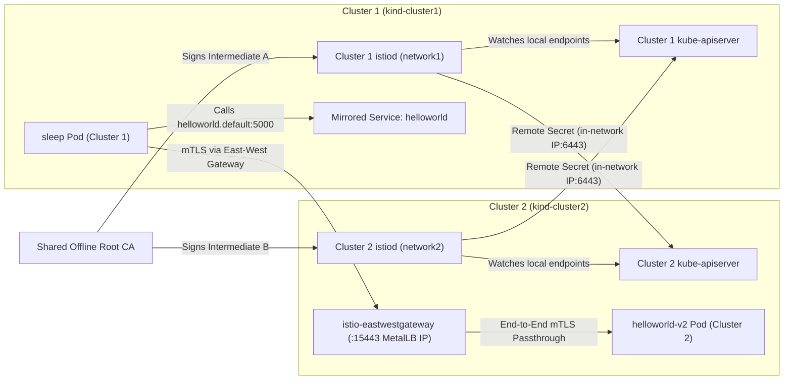
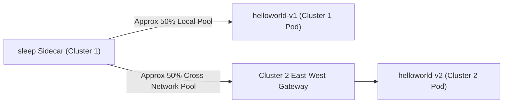
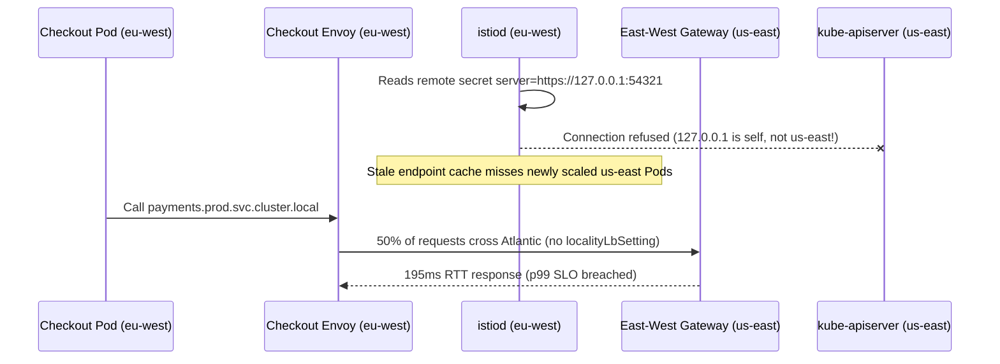

# 08 - Multi-Cluster Mesh Federation

> **Prerequisites:** Modules 04–07 (mTLS trust chains, `DestinationRule`s, and `istioctl` diagnostics), `kind`, `docker`, `openssl`, `kubectl`, and Istio release binaries (`samples/multicluster/`).  
> **Estimated Reading Time:** 45 minutes  
> **Target Audience:** Platform Engineers, Staff Backend Engineers, Multi-Region SREs.

> [!TIP]
> **The Golden Rule of Multi-Cluster Istio:** Cross-cluster mTLS requires a shared root CA (`cacerts` secret created **before** `istioctl install`), cross-cluster service discovery requires remote secrets carrying an in-network `--server` address (never `127.0.0.1`), every remote service must still have a mirrored `Service` object in the calling cluster, and endpoints pool ~50/50 across clusters unless you explicitly configure `localityLbSetting` plus `outlierDetection`.

---

## Why This Matters

Every module in this track so far — sidecar injection, traffic management, mTLS, authorization policies, resilience patterns — ran inside **one** mesh on **one** cluster. Real organizations running at any scale rarely stay on one cluster forever: a second region for disaster recovery, a cluster per environment that still needs to share some services, or simply outgrowing one cluster's blast radius all push toward *multiple* clusters. The question this module answers is the one that actually matters once you have two: can a service in cluster A call a service in cluster B **the same way it calls a service next to it** — same mTLS identity, same `AuthorizationPolicy` model, same `ServiceName.namespace` addressing — or does crossing a cluster boundary mean falling back to raw HTTPS calls, hand-rolled auth, and losing every mesh guarantee modules 04–07 gave you? This module builds a real two-cluster mesh, proves a service in cluster A can call a service that exists **only** in cluster B, and shows you the one default behavior that surprises almost everyone the first time: without extra configuration, the mesh treats both clusters' endpoints as one pool and splits traffic across them, rather than preferring the local cluster.

---

## 1. Architectural Mental Model: Shared Trust, Cross-Cluster Discovery & East-West Data Plane

Multi-primary, multi-network Istio federation splits control-plane coordination and data-plane forwarding across two distinct bridges:



When healthy endpoints exist in **both** clusters without `localityLbSetting`, Envoy distributes requests across local and remote endpoints uniformly rather than pinning to the local cluster:



### Core Concepts

#### One mesh, many clusters: what actually has to be shared
A single-cluster mesh's `istiod` handles two jobs for every workload: proving identity (mTLS certificates, module 04) and routing (service discovery, module 02). Extending the mesh across clusters means both jobs now span cluster boundaries, and each needs its own mechanism:

- **Shared identity**: every cluster's `istiod` must issue certificates that every *other* cluster's `istiod` trusts — otherwise a workload in cluster A can't establish mTLS with a workload in cluster B at all. This requires a **common root CA**, with each cluster's `istiod` running as an intermediate CA signed by that shared root (the same root-then-intermediate pattern module 04 introduced, just with the root now shared across cluster boundaries instead of being cluster-local).
- **Shared discovery**: cluster A's `istiod` needs to know what services and endpoints exist in cluster B (and vice versa) to route traffic to them. This requires a **remote secret** — credentials that let cluster A's `istiod` watch cluster B's Kubernetes API server directly, the same way it already watches its own cluster's API server for local endpoints.

#### The east-west gateway: how actual traffic crosses the network boundary
The remote secret lets `istiod` in cluster A *know about* a Pod IP living in cluster B's private pod network — but that Pod IP usually isn't directly routable from cluster A's network at all (separate clusters typically mean separate, non-overlapping pod networks with no direct routing between them). The **east-west gateway** — a dedicated Istio ingress gateway, deployed in each cluster specifically for cluster-to-cluster mesh traffic — solves this: instead of routing directly to a remote Pod IP, sidecar-to-sidecar traffic crossing a cluster boundary routes through the destination cluster's east-west gateway, which is reachable (given a real external IP, e.g. via a cloud load balancer or, in a local kind lab, MetalLB) and forwards the request on to the correct Pod inside its own cluster, still end-to-end mTLS encrypted the whole way (SNI-routed via port `15443`).

#### The same `Service` object has to exist in both clusters
A client in cluster A addresses a service the normal Kubernetes way — `helloworld.default.svc.cluster.local` — which only resolves if a `Service` object named `helloworld` in namespace `default` **exists in cluster A's own API server**. If `helloworld`'s actual Pods only run in cluster B, cluster A still needs its own `Service` object (same name, same namespace, same selector) with no matching local Pods — `istiod`'s cross-cluster endpoint discovery is what fills in cluster B's real endpoints behind that locally-addressable name. This is why multi-cluster Istio deployments mirror `Service` definitions across clusters even when only one cluster actually runs the workload.

#### The default surprise: traffic splits across clusters, it doesn't prefer local
The single most counter-intuitive default in multi-cluster Istio: once a service has healthy endpoints in **both** clusters, a client's requests are, by default, load-balanced across **all** of them — local and remote — roughly evenly, the same way requests are load-balanced across multiple Pods in one cluster. There's no automatic "prefer the nearby one" behavior out of the box; that requires **explicit** locality-aware load balancing configuration (a `DestinationRule` with `localityLbSetting` and typically `outlierDetection` for failover), which this module's core lab leaves off deliberately — it's flagged here specifically because assuming locality-preference is "just how meshes work" is a common, costly misunderstanding, and the honest thing to do is show you the real default before opting in via the Independent Challenge.

---

## 2. Taxonomic Comparison & Command Reference

### Multi-Cluster Istio Topology Models

| Topology Model | Control Plane Placement | Network Assumption | East-West Gateway Required? | Blast Radius | Primary Trade-off |
| :--- | :--- | :--- | :--- | :--- | :--- |
| **Multi-Primary on Different Networks** (this module) | Independent `istiod` per cluster | Non-overlapping / unroutable Pod CIDRs | Yes (`LoadBalancer` `:15443`) | Cluster-isolated control planes | Highest resilience; requires CA + remote secret sync |
| **Multi-Primary on Same Network** | Independent `istiod` per cluster | Flat L3 routable Pod networks (VPC peering) | No (direct Pod-to-Pod mTLS) | Cluster-isolated control planes | Simpler data path; demands non-overlapping CIDRs |
| **Primary-Remote** | Single `istiod` in Primary manages Remote | Flat or multi-network | Yes (for multi-network) | Primary outage halts xDS updates everywhere | Fewer control planes; coupled availability |

### Command Reference

This module's local lab uses two `kind` clusters plus **MetalLB** to give Istio's east-west gateway a real, routable IP — `kind` has no built-in cloud load balancer, so a `LoadBalancer`-type Service stays `<pending>` without it. A real cloud-hosted multi-cluster setup (AKS, EKS, GKE) gets a real external IP from the cloud provider directly and doesn't need this step.

| Concern | Command |
|---|---|
| Create a named `kind` cluster | `kind create cluster --name cluster1` |
| Create the shared root + per-cluster intermediate CAs | `openssl` (root, then each intermediate signed by it — module 04's cert chain, shared) |
| Install the `cacerts` trust secret | `kubectl create secret generic cacerts -n istio-system --from-file=...` (must exist **before** installing Istio) |
| Install Istio with a cluster/network name | `istioctl install -f <IstioOperator with global.multiCluster.clusterName / global.network>` |
| Generate the east-west gateway manifest | `samples/multicluster/gen-eastwest-gateway.sh --mesh <id> --cluster <name> --network <net>` |
| Expose cross-network services through the gateway | `kubectl apply -f samples/multicluster/expose-services.yaml` |
| Expose istiod for remote discovery | `kubectl apply -f samples/multicluster/expose-istiod.yaml` |
| Generate a remote secret for another cluster to trust | `istioctl create-remote-secret --context=<ctx> --name=<cluster> --server=<in-network API server URL>` |
| Apply a remote secret to the other cluster | `kubectl --context=<other-ctx> apply -f <remote-secret.yaml>` |

---

## 3. Production War Story Post-Mortem: Cross-Region Latency Spike & Blind Failover

* **Severity:** SEV-1 (10x Tail Latency Spike & Broken DR Failover)
* **Detection / Resolution Time:** 41 minutes
* **Impact:** EU checkout p99 latency jumped from 18ms to 195ms immediately after federating `eu-west` and `us-east` AKS clusters, and when `payments` scaled down in `eu-west`, discovery failed to populate new `us-east` replicas.

### What Happened

Platform engineers federated two regional clusters (`eu-west` and `us-east`) on different VNet ranges. Two issues compounded: (1) they forgot a `DestinationRule` with `localityLbSetting`, so Istio immediately split 50% of EU traffic across the Atlantic via the east-west gateway; (2) the remote secret pointing `eu-west`'s `istiod` at `us-east` was generated from a workstation kubeconfig using a private bastion `127.0.0.1` tunnel URL, so `eu-west` stopped receiving live endpoint updates from `us-east`.



### Root Cause Analysis

1. **Non-Routable Remote Secret Endpoint:** Running `istioctl create-remote-secret` without an explicit in-network `--server` embedded the operator's local SSH-tunnel kubeconfig server URL.
2. **Default Global Endpoint Pooling:** Without `localityLbSetting` and `outlierDetection` on `payments`'s `DestinationRule`, Envoy treated `eu-west` and `us-east` as a flat global pool.

### The Fix & Architectural Hardening

1. Regenerated both remote secrets with explicit internal LoadBalancer/peered API server endpoints via `--server=https://<internal-api-fqdn>:443` and verified `istioctl remote-clusters` reported `SYNCED`.
2. Applied a global `DestinationRule` enforcing `localityLbSetting: { enabled: true }` paired with `outlierDetection` (`consecutive5xxErrors: 3`, `interval: 5s`, `baseEjectionTime: 30s`) so traffic stays regional during normal health and fails over across the east-west gateway only on regional degradation.

---

## 4. Multi-Language Production Implementation: Cross-Cluster Trust & Locality Failover Router

The four implementations below model the two foundational multi-cluster invariants: (1) verifying a remote workload's certificate chain shares the federated root CA and extracting its SPIFFE trust domain/namespace/ServiceAccount, and (2) contrasting Istio's default cross-cluster 50/50 pooling against opt-in `localityLbSetting` failover when local endpoints are ejected.

````carousel
```go
package federation

import (
	"crypto/x509"
	"errors"
	"strings"
)

type Endpoint struct {
	Address  string
	Region   string
	Healthy  bool
	IsRemote bool
}

// VerifyCrossClusterSpiffe validates a remote workload leaf cert against a shared Root CA pool
// and extracts its SPIFFE URI (e.g., spiffe://cluster.local/ns/default/sa/helloworld).
func VerifyCrossClusterSpiffe(leaf, intermediate, sharedRoot *x509.Certificate) (string, error) {
	roots := x509.NewCertPool()
	roots.AddCert(sharedRoot)
	inters := x509.NewCertPool()
	inters.AddCert(intermediate)

	if _, err := leaf.Verify(x509.VerifyOptions{
		Roots:         roots,
		Intermediates: inters,
		KeyUsages:     []x509.ExtKeyUsage{x509.ExtKeyUsageClientAuth, x509.ExtKeyUsageServerAuth},
	}); err != nil {
		return "", err
	}

	for _, uri := range leaf.URIs {
		if uri.Scheme == "spiffe" {
			return uri.String(), nil
		}
	}
	return "", errors.New("missing SPIFFE SAN URI in federated workload certificate")
}

// SelectEndpoints models default multi-cluster pooling vs. explicit localityLbSetting failover.
func SelectEndpoints(all []Endpoint, localRegion string, localityEnabled bool) []Endpoint {
	var healthy []Endpoint
	for _, ep := range all {
		if ep.Healthy {
			healthy = append(healthy, ep)
		}
	}
	if !localityEnabled {
		// Default Istio behavior: pool local + remote endpoints evenly.
		return healthy
	}

	var local []Endpoint
	for _, ep := range healthy {
		if strings.EqualFold(ep.Region, localRegion) {
			local = append(local, ep)
		}
	}
	if len(local) > 0 {
		return local
	}
	// Fail over to remote cluster endpoints via east-west gateway only when local is unhealthy.
	return healthy
}
```
<!-- slide -->
```typescript
import * as crypto from "node:crypto";

export interface ClusterEndpoint {
  id: string;
  cluster: string;
  localityRegion: string;
  viaEastWestGateway: boolean;
  healthy: boolean;
}

export function verifySharedRootTrust(
  sharedRootPem: string,
  clusterIntermediatePem: string
): boolean {
  const root = new crypto.X509Certificate(sharedRootPem);
  const intermediate = new crypto.X509Certificate(clusterIntermediatePem);
  return intermediate.verify(root.publicKey) && intermediate.ca;
}

export function resolveMeshEndpointPool(
  endpoints: readonly ClusterEndpoint[],
  localRegion: string,
  localityLbEnabled: boolean
): ClusterEndpoint[] {
  const healthy = endpoints.filter((ep) => ep.healthy);
  if (!localityLbEnabled) {
    // Default multi-cluster behavior: ~50/50 split across all healthy clusters.
    return healthy;
  }

  const localHealthy = healthy.filter((ep) => ep.localityRegion === localRegion);
  if (localHealthy.length > 0) {
    return localHealthy;
  }

  // Outlier failover: all local pods unhealthy/ejected, spill over to remote east-west gateway.
  return healthy;
}
```
<!-- slide -->
```python
from dataclasses import dataclass
from typing import Sequence


@dataclass(frozen=True)
class FederatedEndpoint:
    cluster: str
    locality: str
    address: str
    via_eastwest_gateway: bool
    healthy: bool = True


def validate_trust_chain(
    root_fingerprint: str,
    cluster_a_root_fp: str,
    cluster_b_root_fp: str,
    spiffe_san: str,
) -> bool:
    if cluster_a_root_fp != root_fingerprint or cluster_b_root_fp != root_fingerprint:
        return False
    return spiffe_san.startswith("spiffe://") and "/ns/" in spiffe_san and "/sa/" in spiffe_san


def route_multi_cluster(
    endpoints: Sequence[FederatedEndpoint],
    local_locality: str,
    locality_lb_enabled: bool = False,
) -> list[FederatedEndpoint]:
    healthy = [ep for ep in endpoints if ep.healthy]
    if not locality_lb_enabled:
        # Default multi-cluster behavior: both clusters' endpoints pooled together.
        return healthy

    local_pool = [ep for ep in healthy if ep.locality == local_locality]
    return local_pool if local_pool else healthy
```
<!-- slide -->
```csharp
using System;
using System.Collections.Generic;
using System.Linq;
using System.Security.Cryptography.X509Certificates;

namespace MeshFederation;

public sealed record FederatedEndpoint(
    string ClusterName,
    string Region,
    string TargetHost,
    bool ViaEastWestGateway,
    bool IsHealthy);

public static class MultiClusterTrustAndRouting
{
    public static bool VerifySharedRoot(X509Certificate2 sharedRoot, X509Certificate2 intermediate, X509Certificate2 workloadLeaf)
    {
        using var chain = new X509Chain();
        chain.ChainPolicy.TrustMode = X509ChainTrustMode.CustomRootTrust;
        chain.ChainPolicy.CustomTrustStore.Add(sharedRoot);
        chain.ChainPolicy.ExtraStore.Add(intermediate);
        chain.ChainPolicy.RevocationMode = X509RevocationMode.NoCheck;
        return chain.Build(workloadLeaf);
    }

    public static IReadOnlyList<FederatedEndpoint> SelectCandidatePool(
        IReadOnlyList<FederatedEndpoint> discoveredEndpoints,
        string localRegion,
        bool localityLbEnabled)
    {
        var healthy = discoveredEndpoints.Where(e => e.IsHealthy).ToList();
        if (!localityLbEnabled)
            return healthy; // Default: load-balance across local + remote clusters evenly.

        var local = healthy.Where(e => string.Equals(e.Region, localRegion, StringComparison.Ordinal)).ToList();
        return local.Count > 0 ? local : healthy; // Fail over via east-west gateway when local is empty.
    }
}
```
````

---

## 5. Practical Hands-On Verification CLI Workflows

This is the most involved lab in the track — budget real time for it. Two `kind` clusters, `istioctl`, and MetalLB, entirely local.

### 5.1 Create two `kind` clusters

```bash
kind create cluster --name cluster1
kind create cluster --name cluster2
kubectl config get-contexts
```

**Expected Output:**

```text
CURRENT   NAME            CLUSTER         AUTHINFO        NAMESPACE
          kind-cluster1   kind-cluster1   kind-cluster1
*         kind-cluster2   kind-cluster2   kind-cluster2
```

Confirm both clusters' nodes share the same underlying Docker network (`docker network inspect kind`) — real separate clusters, but reachable from each other at the node level, which is what makes a local multi-cluster lab possible at all.

### 5.2 Generate a shared root CA and one intermediate per cluster

```bash
openssl req -x509 -newkey rsa:4096 -nodes -keyout root-key.pem -out root-cert.pem -days 365 -subj "/O=learn-mesh/CN=Root CA"

for cluster in cluster1 cluster2; do
  mkdir -p $cluster
  openssl req -newkey rsa:4096 -nodes -keyout $cluster/ca-key.pem -out $cluster/ca-csr.pem -subj "/O=learn-mesh/CN=Intermediate CA $cluster"
  openssl x509 -req -in $cluster/ca-csr.pem -CA root-cert.pem -CAkey root-key.pem -CAcreateserial \
    -out $cluster/ca-cert.pem -days 365 \
    -extfile <(printf "basicConstraints=critical,CA:TRUE\nkeyUsage=critical,digitalSignature,keyCertSign,cRLSign\n")
  cat $cluster/ca-cert.pem root-cert.pem > $cluster/cert-chain.pem
  cp root-cert.pem $cluster/root-cert.pem
done
```

**Expected Output:**

```text
cluster1/ca-cert.pem  cluster1/ca-key.pem  cluster1/cert-chain.pem  cluster1/root-cert.pem
cluster2/ca-cert.pem  cluster2/ca-key.pem  cluster2/cert-chain.pem  cluster2/root-cert.pem
```

Module 04's cert chain concept, now with one shared root behind two cluster-specific intermediates instead of each cluster inventing its own trust root.

### 5.3 Install the `cacerts` secret on both clusters *before* installing Istio

```bash
for cluster in cluster1 cluster2; do
  kubectl --context kind-$cluster create namespace istio-system
  kubectl --context kind-$cluster create secret generic cacerts -n istio-system \
    --from-file=ca-cert.pem=$cluster/ca-cert.pem \
    --from-file=ca-key.pem=$cluster/ca-key.pem \
    --from-file=root-cert.pem=$cluster/root-cert.pem \
    --from-file=cert-chain.pem=$cluster/cert-chain.pem
done
```

**Expected Output:**

```text
namespace/istio-system created
secret/cacerts created
namespace/istio-system created
secret/cacerts created
```

This secret must exist before `istioctl install` runs — Istio picks it up automatically and uses it as its CA instead of generating its own self-signed root, which is what makes cross-cluster mTLS trust possible at all.

### 5.4 Install Istio on both clusters with cluster/network identity

```bash
cat > istio-cluster1.yaml << 'EOF'
apiVersion: install.istio.io/v1alpha1
kind: IstioOperator
spec:
  values:
    global:
      meshID: mesh1
      multiCluster:
        clusterName: cluster1
      network: network1
EOF
istioctl install --context kind-cluster1 -f istio-cluster1.yaml -y
```

Repeat for `cluster2` with `clusterName: cluster2` and `network: network2` (same `meshID: mesh1` — both clusters are part of one mesh).

**Expected Output:**

```text
✔ Istio core installed
✔ Istiod installed
✔ Installation complete
```

The `network` value marks each cluster as its own network — this is what tells Istio "these endpoints aren't directly routable to each other, route cross-cluster traffic through a gateway" rather than assuming a flat network.

### 5.5 Deploy the east-west gateway and expose services/istiod

```bash
# (from a downloaded Istio release directory, for samples/multicluster/*.sh and *.yaml)
samples/multicluster/gen-eastwest-gateway.sh --mesh mesh1 --cluster cluster1 --network network1 | \
  istioctl --context kind-cluster1 install -f - -y
kubectl --context kind-cluster1 apply -n istio-system -f samples/multicluster/expose-services.yaml
kubectl --context kind-cluster1 apply -n istio-system -f samples/multicluster/expose-istiod.yaml
```

Repeat for `cluster2`.

**Expected Output:**

```text
NAME                    TYPE           CLUSTER-IP      EXTERNAL-IP   PORT(S)
istio-eastwestgateway   LoadBalancer   10.96.142.18    <pending>     15021:...,15443:...,15012:...,15017:...
```

`kubectl get svc istio-eastwestgateway -n istio-system` shows a `LoadBalancer` service on each cluster (currently `<pending>` until MetalLB allocates real IPs in step 5.6).

### 5.6 Give the east-west gateways real IPs with MetalLB (local-lab only)

```bash
for ctx in kind-cluster1 kind-cluster2; do
  kubectl --context $ctx apply -f https://raw.githubusercontent.com/metallb/metallb/v0.14.8/config/manifests/metallb-native.yaml
  kubectl --context $ctx wait --namespace metallb-system --for=condition=ready pod --selector=app=metallb --timeout=90s
done
```

Apply a non-overlapping `IPAddressPool`/`L2Advertisement` per cluster (distinct IP ranges within your `kind` Docker network's subnet — check `docker network inspect kind` for the exact range).

**Expected Output:**

```text
NAME                    TYPE           CLUSTER-IP      EXTERNAL-IP     PORT(S)
istio-eastwestgateway   LoadBalancer   10.96.142.18    172.18.255.200  15021:...,15443:...
```

`kubectl get svc istio-eastwestgateway -n istio-system` now shows a real `EXTERNAL-IP` instead of `<pending>` on both clusters — without this, the gateway has no address the other cluster could ever reach, and nothing cross-cluster will work no matter how correctly everything else is configured.

### 5.7 Exchange remote secrets — with the correct, in-network API server address

```bash
CLUSTER1_IP=$(docker inspect cluster1-control-plane --format '{{.NetworkSettings.Networks.kind.IPAddress}}')
CLUSTER2_IP=$(docker inspect cluster2-control-plane --format '{{.NetworkSettings.Networks.kind.IPAddress}}')

istioctl create-remote-secret --context=kind-cluster1 --name=cluster1 --server="https://$CLUSTER1_IP:6443" > cluster1-secret.yaml
istioctl create-remote-secret --context=kind-cluster2 --name=cluster2 --server="https://$CLUSTER2_IP:6443" > cluster2-secret.yaml

kubectl --context kind-cluster2 apply -f cluster1-secret.yaml
kubectl --context kind-cluster1 apply -f cluster2-secret.yaml

kubectl --context kind-cluster1 rollout restart deployment istiod -n istio-system
kubectl --context kind-cluster2 rollout restart deployment istiod -n istio-system
istioctl remote-clusters --context kind-cluster1
```

**Expected Output:**

```text
NAME       SECRET                                       STATUS   ISTIOD
cluster1                                                synced   istiod-7f8b9c6d4-abc12
cluster2   istio-system/istio-remote-secret-cluster2    synced   istiod-7f8b9c6d4-abc12
```

**Watch for this exact gotcha**: `istioctl create-remote-secret` without `--server` embeds whatever address is in your local kubeconfig — often `127.0.0.1:<random-port>` for a `kind` cluster, since that's how you reach it from your host machine. That address is meaningless *inside* the other cluster's Pods — `istiod` running in `cluster2` can't reach `127.0.0.1` and mean `cluster1`'s API server. Always pass `--server` explicitly with an address reachable from inside the other cluster (here, the control-plane container's real Docker-network IP on `:6443`).

### 5.8 Deploy a service that exists ONLY in cluster2, and a mirrored `Service` object in cluster1

```bash
kubectl --context kind-cluster1 label namespace default istio-injection=enabled --overwrite
kubectl --context kind-cluster2 label namespace default istio-injection=enabled --overwrite

# Full Service + Deployment in cluster2:
kubectl --context kind-cluster2 apply -f samples/helloworld/helloworld.yaml -l version=v2

# Service ONLY (no Deployment) in cluster1 -- so cluster1 can address it locally:
kubectl --context kind-cluster1 apply -f <(kubectl --context kind-cluster2 get svc helloworld -o yaml)
```

**Expected Output:**

```text
namespace/default labeled
namespace/default labeled
service/helloworld created
deployment.apps/helloworld-v2 created
service/helloworld created
```

### 5.9 Prove a client in cluster1 reaches a Pod that only exists in cluster2

```bash
kubectl --context kind-cluster1 apply -f samples/sleep/sleep.yaml
kubectl --context kind-cluster1 wait --for=condition=ready pod -l app=sleep --timeout=90s

kubectl --context kind-cluster1 exec deploy/sleep -- curl -s helloworld.default:5000/hello
```

**Expected Output:**

```text
Hello version: v2, instance: helloworld-v2-5d4b8c7f9-k9x2p
```

`Hello version: v2, instance: helloworld-v2-...` — a Pod name you'll find running in **cluster2**, not `cluster1`, when you check `kubectl --context kind-cluster2 get pods`. The `sleep` Pod in `cluster1` addressed `helloworld.default:5000` exactly like a local service and got a real answer from a Pod in an entirely different cluster, routed through the east-west gateway, end-to-end mTLS encrypted using the shared-root trust from exercise 2–3. This is the core proof this whole module builds toward.

### 5.10 Prove the "no local preference by default" behavior directly

Deploy a **second** version of the same service, this time locally in `cluster1`:

```bash
kubectl --context kind-cluster1 apply -f samples/helloworld/helloworld.yaml -l version=v1
kubectl --context kind-cluster1 wait --for=condition=ready pod -l app=helloworld,version=v1 --timeout=90s
```

Now `helloworld` has healthy endpoints in **both** clusters. Send several requests from the same `sleep` Pod:

```bash
for i in 1 2 3 4 5 6; do kubectl --context kind-cluster1 exec deploy/sleep -- curl -s helloworld.default:5000/hello; done
```

**Expected Output:**

```text
Hello version: v1, instance: helloworld-v1-7c8d9b6f4-m2n4x
Hello version: v2, instance: helloworld-v2-5d4b8c7f9-k9x2p
Hello version: v2, instance: helloworld-v2-5d4b8c7f9-k9x2p
Hello version: v1, instance: helloworld-v1-7c8d9b6f4-m2n4x
Hello version: v1, instance: helloworld-v1-7c8d9b6f4-m2n4x
Hello version: v2, instance: helloworld-v2-5d4b8c7f9-k9x2p
```

A **mix** of `version: v1` (the local `cluster1` Pod) and `version: v2` (the remote `cluster2` Pod) responses, roughly split — *not* all `v1`. This is the default, unconfigured behavior described in the Concepts section, now proven rather than asserted: Istio pooled both clusters' endpoints together and load-balanced across all of them, crossing the cluster boundary on a meaningful fraction of requests even though a perfectly healthy local instance was available the whole time.

### 5.11 Diagnose and fix: "multi-cluster is configured but cross-cluster calls fail"

A team follows every step through exercise 7 correctly, but calls from `cluster1` to a service that only exists in `cluster2` simply time out. They generated the remote secrets with plain `istioctl create-remote-secret --context=... --name=...`, no `--server` flag.

<details>
<summary>Solution</summary>

Root cause: exactly the gotcha flagged in exercise 7. Without an explicit `--server`, the generated remote secret embeds the kubeconfig's existing server address — for a local cluster, frequently a `127.0.0.1:<port>` address only meaningful from the host machine, not from inside the *other* cluster's Pods. Cluster1's `istiod`, holding this secret, tries to reach `cluster2`'s API server at an address that means "myself" from inside `cluster1`'s own network, not `cluster2` — so it never successfully watches `cluster2`'s endpoints, and cross-cluster service discovery silently never populates.

Fix: regenerate the remote secret with `--server` pointing at an address genuinely reachable from inside the *other* cluster's network — the target cluster's real control-plane IP (or, in a cloud environment, its actual API server endpoint), apply the corrected secret, and restart `istiod` so it picks up the change. This is a purely control-plane problem (endpoint discovery never worked), distinct from a data-plane problem (east-west gateway/mTLS misconfigured) — worth distinguishing when diagnosing, since the symptoms (timeouts) look similar but the fix is completely different.

</details>

### 5.12 Clean up

```bash
kind delete cluster --name cluster1
kind delete cluster --name cluster2
```

### Independent Challenge

No commands given. Using this module's setup as a base, configure **locality-aware load balancing** so that `helloworld` traffic from `cluster1` prefers the local `cluster1` endpoint and only falls back to `cluster2` when the local endpoint is unhealthy — the behavior exercise 10 proved is *not* the default. Research and apply a `DestinationRule` with `trafficPolicy.localityLbSetting` (and `outlierDetection` for the failover trigger). Prove it two ways: (1) with both endpoints healthy, confirm requests now consistently hit the local `v1` Pod, not a roughly 50/50 split; (2) scale `helloworld-v1` in `cluster1` to zero replicas and confirm traffic now fails over to `cluster2`'s `v2` Pod automatically. Explain, in your own words, why this had to be configured explicitly rather than being automatic — tying back to this module's Concepts section.

<details>
<summary>Stuck? One hint</summary>

The `DestinationRule` needs `outlierDetection` configured (so Istio has a signal for "this endpoint is unhealthy" at all — without it, there's nothing to fail over *from*) plus `localityLbSetting: { enabled: true }` to actually prefer same-locality endpoints when healthy ones exist locally. Apply it to the `helloworld` host, re-run exercise 10's loop to confirm the split disappears, then scale `helloworld-v1` to 0 replicas in `cluster1` and re-run the loop again to confirm it now goes to `cluster2` instead of hanging or erroring.

</details>

---

## 6. Common Mistakes & Troubleshooting

- **Generating a remote secret without an explicit, in-network `--server` address.** As exercise 11 showed, this is the single most common reason a seemingly-correct multi-cluster setup silently fails — a `127.0.0.1`-style address in the secret is meaningless from inside the other cluster.
- **Installing Istio before creating the `cacerts` secret.** Istio generates its own self-signed root CA automatically if `cacerts` doesn't exist yet, and that root won't match the other cluster's — you must create `cacerts` first, or reinstall after fixing it.
- **Assuming multi-cluster automatically prefers local traffic.** Exercise 10 proved the real default: endpoints from both clusters are pooled and load-balanced together. Locality preference is an explicit, separate `DestinationRule` configuration (the independent challenge), not something federating clusters gives you automatically.
- **Forgetting the `Service` object must be mirrored in both clusters.** A client can only address `servicename.namespace.svc.cluster.local` if that `Service` exists in its *own* cluster's API server — even with perfect cross-cluster discovery working, an entirely missing local `Service` object means the name simply doesn't resolve.
- **No routable IP for the east-west gateway.** On a real cloud platform this comes for free from the cloud load balancer; in a local `kind` lab, skipping MetalLB (or an equivalent) leaves the gateway's `LoadBalancer` Service `<pending>` forever, and nothing cross-cluster can work no matter how correct the rest of the configuration is.
- **Confusing a control-plane discovery failure with a data-plane routing failure.** Both can look like "the request just times out." Check whether cluster A's `istiod` actually knows about cluster B's endpoints first (a remote-secret/discovery problem) before assuming the east-west gateway or mTLS itself is misconfigured.

---

## 7. Operational Validation Checkpoints & Checkpoint Quiz

### Operational Validation Checkpoints

<details>
<summary><strong>Checkpoint 1: Diagnosing TLS Handshake Failures Across Federated Clusters</strong></summary>

Cross-cluster endpoint discovery is working (`istioctl proxy-config endpoints deploy/sleep` in `cluster1` lists `cluster2`'s east-west gateway IP for `helloworld.default`), yet `curl helloworld.default:5000/hello` fails with `503 UC` / TLS verification errors. Checking `kubectl logs -n istio-system deploy/istiod` in `cluster2` reveals `cacerts` was applied *after* `istioctl install`. How do you confirm the trust mismatch and fix it?

**Answer:**
Inspect the root cert in both clusters (`kubectl --context kind-cluster1 get cm istio-ca-root-cert -o jsonpath='{.data.root-cert\.pem}'` vs `kind-cluster2`) — they differ because `cluster2` generated an independent self-signed root before `cacerts` existed. Restarting `istiod` and rolling workloads after ensuring `cacerts` is present forces `istiod` to re-issue workload certificates chained to the shared root CA.

</details>

<details>
<summary><strong>Checkpoint 2: Why Cross-Cluster `AuthorizationPolicy` Still Works</strong></summary>

In `cluster2`, you apply an `AuthorizationPolicy` on `helloworld` allowing `principals: ["cluster.local/ns/default/sa/sleep"]`. When `sleep` in `cluster1` calls `helloworld`, why does the policy allow it without needing an IP block for `cluster1`'s east-west NAT?

**Answer:**
Because the east-west gateway forwards traffic using **mTLS SNI passthrough** (`AUTO_PASSTHROUGH`) rather than terminating and re-originating TLS. `helloworld`'s sidecar in `cluster2` performs the mTLS handshake directly with `sleep`'s sidecar in `cluster1`, seeing `sleep`'s genuine SPIFFE SAN (`cluster.local/ns/default/sa/sleep`) intact.

</details>

<details>
<summary><strong>Checkpoint 3: Detecting Non-Overlapping MetalLB IP Pool Collisions</strong></summary>

Both `cluster1` and `cluster2` use MetalLB on the same `kind` Docker bridge (`172.18.0.0/16`). What breaks if both clusters are accidentally configured with the exact same `IPAddressPool` range (`172.18.255.200-172.18.255.210`)?

**Answer:**
Both east-west gateways claim the identical `EXTERNAL-IP` (`172.18.255.200`), causing ARP/L2 conflicts on the shared Docker bridge. Packets from `cluster1` intended for `cluster2`'s gateway loop back into `cluster1`'s own gateway or drop intermittently. Each cluster's MetalLB pool must have a strictly disjoint range inside the bridge subnet.

</details>

### Checkpoint Quiz

Write down your answer to each question before expanding it — checking without attempting first is the single easiest way to fool yourself into thinking you've learned this.

1. What two separate things does extending a mesh across clusters require sharing, and what mechanism handles each?
2. Why can't cluster A's sidecars usually route directly to a Pod IP in cluster B, and what component solves this?
3. Why does the same `Service` object need to exist in both clusters even when only one cluster runs the actual Pods?
4. What is the default load-balancing behavior when a service has healthy endpoints in two federated clusters, and what would you need to configure to change it?
5. In exercise 11's scenario, why did cross-cluster calls fail even though the east-west gateway and mTLS trust were both configured correctly?

<details>
<summary>Answers</summary>

1. Shared **identity** (so workloads in different clusters can establish mTLS with each other) — handled by a common root CA with each cluster's `istiod` as a trusted intermediate. Shared **discovery** (so each cluster's `istiod` knows about the other's services/endpoints) — handled by a remote secret letting each cluster's `istiod` watch the other's Kubernetes API server directly.
2. Because separate clusters typically have separate, non-overlapping pod networks with no direct routing between them, even though `istiod` may know a remote Pod's IP exists. The east-west gateway solves this — cross-cluster sidecar traffic routes through the destination cluster's east-west gateway (which has a real, reachable address) instead of attempting to reach an unroutable Pod IP directly.
3. Because a client only resolves `servicename.namespace.svc.cluster.local` against its *own* cluster's API server. Cross-cluster endpoint discovery fills in the *endpoints* behind that name once the `Service` object exists locally — but if the `Service` object itself is missing from a cluster, the name never resolves there at all, regardless of how well cross-cluster discovery is otherwise working.
4. The default is that all healthy endpoints across every federated cluster are pooled together and load-balanced roughly evenly, with no automatic preference for the local cluster. Changing this requires an explicit `DestinationRule` with `localityLbSetting` (to prefer local endpoints) and typically `outlierDetection` (to define what "failing over" from an unhealthy endpoint even means).
5. Because the remote secrets were generated without an explicit `--server` address and defaulted to an address (often `127.0.0.1:<port>`) only meaningful from the host machine — so each cluster's `istiod` could never actually reach the other cluster's API server to discover its endpoints, even though the east-west gateway and CA trust (both configured correctly) had nothing to do with the failure. It was purely a control-plane discovery problem, not a data-plane routing or trust problem.

</details>

---

## 8. Further Reading & Sources

- [Istio: Multi-Primary on different networks](https://istio.io/latest/docs/setup/install/multicluster/multi-primary_multi-network/) - the official, complete procedure this module's exercises are based on.
- [Istio: Install multicluster CA certificates](https://istio.io/latest/docs/tasks/security/cert-management/plugin-ca-cert/) - the shared root/intermediate CA generation this module's exercise 2 reproduces.
- [Istio: Locality Load Balancing](https://istio.io/latest/docs/tasks/traffic-management/locality-load-balancing/) - the `DestinationRule` configuration behind this module's independent challenge.
- [MetalLB documentation](https://metallb.universe.tf/) - the bare-metal load-balancer implementation used to give `kind`'s east-west gateway a real IP in this module's local lab.
- [Istio: create-remote-secret reference](https://istio.io/latest/docs/reference/commands/istioctl/#istioctl-create-remote-secret) - the exact `--server` flag behavior behind this module's exercise 7 and 11 gotcha.

## Next

Continue to [09-capstone-project](../09-capstone-project/README.md) — bring every capability from this track together: sidecar injection, traffic management, mTLS, authorization policies, and resilience patterns, in one meshed deployment.
