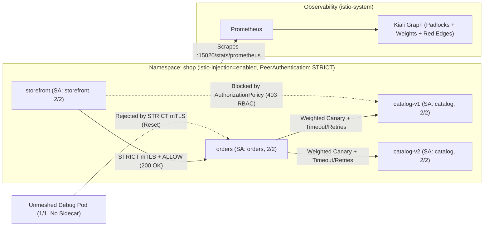
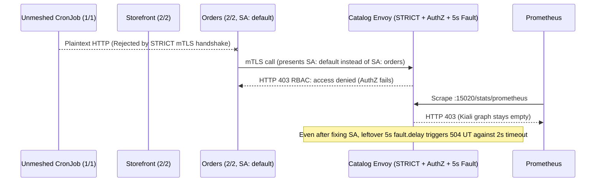

# 09 - Capstone Project

> **Prerequisites:** Modules 00–08 (`kind` cluster, Istio installed with addons, `kubectl`, `istioctl`, sidecar injection, traffic shifting, `STRICT` mTLS, `AuthorizationPolicy`, observability, and resilience patterns).  
> **Estimated Reading Time:** 60–90 minutes (hands-on build & verification)  
> **Target Audience:** Backend Engineers, Platform Engineers, Kubernetes & Service Mesh Operators.

> [!TIP]
> **The Golden Rule of Mesh Integration:** Build and verify the mesh strictly bottom-up—(1) sidecar injection (`2/2` + `SYNCED`), (2) baseline L7 routing, (3) `STRICT` mTLS, (4) principal-keyed `AuthorizationPolicy`, (5) bounded resilience verified via transient fault injection (then stripped cleanly), and (6) end-to-end telemetry in Kiali/Prometheus—never stack an unverified layer onto another.

---

## Why This Matters

The previous nine modules each drilled one mesh capability in isolation. Real mesh work is making them hold *together*: a namespace where injection is on, every service is meshed under STRICT mTLS, one service is mid-canary between two versions, an `AuthorizationPolicy` enforces who may call whom, and a resilience policy you can *prove* works under injected failure. This capstone asks you to stand all of that up at once, with no full solution given — the integration is the test. If you can build and verify this, you can operate a service mesh, not just recite its objects.

---

## 1. Architectural Mental Model: Full-Stack Service Mesh Topology (`shop` Namespace)

When all six layers are active simultaneously in your `shop` namespace, every call is governed by sidecar identity, L7 routing rules, authorization checks, bounded resilience, and automatic telemetry emission:



### The Project

Build a meshed multi-service application on your local `kind` cluster and prove every mesh property end to end. Design the app yourself (three small services is plenty — e.g. an edge `storefront` calling an `orders` service, which calls a `catalog` service). Use throwaway images you already know from this track (`hashicorp/http-echo`, `curlimages/curl`) — the point is the mesh, not the app code.

---

## 2. Taxonomic Integration Order & Diagnostic Matrix

### Layered Rollout & Verification Sequence

| Layer Order | Capability | Istio / K8s Object(s) | Must Exist First | Proof Command |
| :--- | :--- | :--- | :--- | :--- |
| **1. Injection** | Envoy sidecars injected | `Namespace` label `istio-injection=enabled`, distinct `ServiceAccount`s | Istio control plane running | `kubectl get pods -n shop` (`2/2`) & `istioctl proxy-status` |
| **2. Routing** | Canary traffic shifting | `DestinationRule` (`v1`/`v2` subsets) + `VirtualService` | Meshed Pods with `version` labels | Weighted `curl` loop tracks configured split |
| **3. Identity** | Encrypted workload identity | `PeerAuthentication` (`mode: STRICT`) | All callers restarted with `2/2` sidecars | `istioctl authn tls-check` + unmeshed Pod fails |
| **4. AuthZ** | Identity-based least privilege | `AuthorizationPolicy` (`action: ALLOW` on `principals`) | `STRICT` mTLS + unique `ServiceAccount`s | Allowed caller `200`; forbidden caller `403` |
| **5. Resilience** | Bounded timeouts & retries | `VirtualService` `timeout` + `retries` (tested via `fault`) | Baseline routing verified | Timed `curl` (`504`) & retry error drop (`503 -> 200`) |
| **6. Observability** | Graph, padlocks & golden signals | Prometheus + Kiali (and scraper allowed past AuthZ) | Live traffic flowing across edges | Kiali padlocks, weighted edges, red `403` edge |

### Failure Signature Diagnostic Matrix

| Observed Failure | Likely Layer | Root Cause Pattern | Fastest Confirmation Command |
| :--- | :--- | :--- | :--- |
| Pod shows `1/1` instead of `2/2` | Injection | Missing `istio-injection=enabled` before Pod creation | `kubectl get ns shop --show-labels` |
| Connection reset from unmeshed Pod | `STRICT` mTLS | Caller lacks sidecar (plain TCP rejected by server sidecar) | `istioctl authn tls-check deploy/orders.shop` |
| `403 RBAC: access denied` on valid caller | `AuthorizationPolicy` | Principal typo, `default` SA used, or missing allow rule | `kubectl get authorizationpolicy -n shop -o yaml` |
| `503 UF` / no healthy upstream | Traffic Routing | `DestinationRule` subset labels don't match Pod labels | `istioctl analyze -n shop` |
| `504` gateway timeout unexpectedly | Resilience | Leftover `VirtualService` `fault.delay` block | `kubectl get virtualservice -n shop -o yaml` |
| Empty Kiali graph during load | Observability | Prometheus blocked by `AuthorizationPolicy` or no traffic | `sum(rate(istio_requests_total[1m]))` in Prometheus |

---

## 3. Production War Story Post-Mortem: Big-Bang Mesh Rollout Collapse

* **Severity:** SEV-1 (Simultaneous AuthZ Lockout, Unmeshed Job Failure, and Blind Dashboards)
* **Detection / Resolution Time:** 38 minutes
* **Impact:** Applying injection, `STRICT` mTLS, `AuthorizationPolicy`, canary weights, and resilience policies in one unverified commit broke inter-service traffic, crippled a legacy batch job, and hid telemetry in Kiali.

### What Happened

An engineering team migrated a three-service `shop` namespace onto Istio in a single pull request. They labeled the namespace for injection without restarting an existing CronJob Pod, applied `STRICT` `PeerAuthentication`, enabled `AuthorizationPolicy` rules keyed on `sa/orders`, added a canary `VirtualService` on `catalog`, and left a `5s` test `fault.delay` block in `catalog`'s manifest while `timeout: 2s` was set. Because multiple layers broke simultaneously, responders initially blamed mTLS for `403` errors and didn't notice the leftover `fault` block until AuthZ was fixed.



### Root Cause Analysis

1. **Stacked Unverified Layers:** No layer was verified before applying the next, turning independent failures (`1/1` Pod vs `STRICT` mTLS, missing `serviceAccountName` vs AuthZ, leftover `fault` block vs timeout) into an opaque outage.
2. **Missing `serviceAccountName`:** `orders` defaulted to `sa/default` while `catalog`'s `AuthorizationPolicy` expected `sa/orders`.
3. **Fault Block Committed:** Leaving `fault.delay: 5s` inside the steady-state `VirtualService` turned every valid call into a `504` once AuthZ passed.

### The Fix & Architectural Hardening

1. Rolled back to Layer 1, verified `2/2` on every Pod (including restarting batch jobs), then layered Routing → `STRICT` mTLS → Principal AuthZ → Resilience → Observability with an explicit CLI verification gate after each step.
2. Added a CI lint gate rejecting any `VirtualService` containing `fault:` in production branches and verifying every Deployment explicitly sets `serviceAccountName`.

---

## 4. Multi-Language Production Implementation: Mesh-Ready Microservice Contract

Even though Envoy enforces mTLS, routing, and resilience out-of-process, production services participating in a full-stack mesh still follow a strict contract: forward inbound W3C/B3 trace headers onto outbound requests, extract/log the `X-Forwarded-Client-Cert` (XFCC) SPIFFE caller identity for audit correlation, honor an application deadline beneath the Envoy route timeout, and emit domain metrics alongside sidecar golden signals.

````carousel
```go
package meshcontract

import (
	"context"
	"net/http"
	"strings"
	"time"
)

var traceHeaderKeys = []string{"traceparent", "tracestate", "x-request-id", "x-b3-traceid", "x-b3-spanid", "x-b3-sampled"}

type ctxKey struct{}

// ExtractSpiffePrincipal parses Envoy's X-Forwarded-Client-Cert header (URI=spiffe://...).
func ExtractSpiffePrincipal(r *http.Request) string {
	xfcc := r.Header.Get("X-Forwarded-Client-Cert")
	for _, part := range strings.Split(xfcc, ";") {
		for _, kv := range strings.Split(part, ",") {
			if strings.HasPrefix(strings.TrimSpace(kv), "URI=spiffe://") {
				return strings.TrimPrefix(strings.TrimSpace(kv), "URI=")
			}
		}
	}
	return "anonymous"
}

// WrapHandler captures mesh trace headers and applies an in-app budget below Envoy's route timeout.
func WrapHandler(appTimeout time.Duration, next http.Handler) http.Handler {
	return http.HandlerFunc(func(w http.ResponseWriter, r *http.Request) {
		ctx, cancel := context.WithTimeout(r.Context(), appTimeout)
		defer cancel()

		headers := make(http.Header)
		for _, k := range traceHeaderKeys {
			if v := r.Header.Get(k); v != "" {
				headers.Set(k, v)
			}
		}
		ctx = context.WithValue(ctx, ctxKey{}, headers)
		next.ServeHTTP(w, r.WithContext(ctx))
	})
}

func NewOutboundRequest(ctx context.Context, method, url string) (*http.Request, error) {
	req, err := http.NewRequestWithContext(ctx, method, url, nil)
	if err != nil {
		return nil, err
	}
	if headers, ok := ctx.Value(ctxKey{}).(http.Header); ok {
		for k, vals := range headers {
			for _, v := range vals {
				req.Header.Set(k, v)
			}
		}
	}
	return req, nil
}
```
<!-- slide -->
```typescript
import { AsyncLocalStorage } from "node:async_hooks";

const TRACE_HEADERS = ["traceparent", "tracestate", "x-request-id", "x-b3-traceid", "x-b3-spanid", "x-b3-sampled"] as const;
const meshCtx = new AsyncLocalStorage<{ traceHeaders: Record<string, string>; callerSpiffe: string }>();

export function parseXfccSpiffe(xfccHeader?: string): string {
  if (!xfccHeader) return "anonymous";
  const match = /URI=(spiffe:\/\/[^;,\s]+)/.exec(xfccHeader);
  return match?.[1] ?? "anonymous";
}

export async function withMeshContract<T>(
  inboundHeaders: Record<string, string | undefined>,
  fn: () => Promise<T>
): Promise<T> {
  const traceHeaders: Record<string, string> = {};
  for (const h of TRACE_HEADERS) {
    const val = inboundHeaders[h];
    if (val) traceHeaders[h] = val;
  }
  const callerSpiffe = parseXfccSpiffe(inboundHeaders["x-forwarded-client-cert"]);
  return meshCtx.run({ traceHeaders, callerSpiffe }, fn);
}

export async function callMeshService(url: string, appBudgetMs: number): Promise<Response> {
  const store = meshCtx.getStore();
  const headers = new Headers(store?.traceHeaders ?? {});
  return fetch(url, {
    headers,
    signal: AbortSignal.timeout(appBudgetMs), // bounded beneath Envoy VirtualService timeout
  });
}
```
<!-- slide -->
```python
from contextvars import ContextVar
import re
from typing import Mapping
import httpx

TRACE_HEADERS = ("traceparent", "tracestate", "x-request-id", "x-b3-traceid", "x-b3-spanid", "x-b3-sampled")
_trace_headers: ContextVar[dict[str, str]] = ContextVar("trace_headers", default={})


def extract_spiffe_from_xfcc(xfcc: str | None) -> str:
    if not xfcc:
        return "anonymous"
    match = re.search(r"URI=(spiffe://[^;,\s]+)", xfcc)
    return match.group(1) if match else "anonymous"


def bind_inbound_mesh_context(headers: Mapping[str, str]) -> str:
    lowered = {k.lower(): v for k, v in headers.items()}
    _trace_headers.set({k: lowered[k] for k in TRACE_HEADERS if k in lowered})
    return extract_spiffe_from_xfcc(lowered.get("x-forwarded-client-cert"))


async def call_mesh_upstream(client: httpx.AsyncClient, url: str, app_timeout_s: float = 1.5) -> httpx.Response:
    # app_timeout_s stays inside Envoy VirtualService perTryTimeout / route timeout
    return await client.get(url, headers=dict(_trace_headers.get()), timeout=app_timeout_s)
```
<!-- slide -->
```csharp
using System;
using System.Collections.Generic;
using System.Net.Http;
using System.Text.RegularExpressions;
using System.Threading;
using System.Threading.Tasks;

namespace MeshCapstone;

public static partial class MeshServiceContract
{
    private static readonly string[] TraceKeys =
        ["traceparent", "tracestate", "x-request-id", "x-b3-traceid", "x-b3-spanid", "x-b3-sampled"];

    private static readonly AsyncLocal<Dictionary<string, string>?> Propagated = new();

    [GeneratedRegex(@"URI=(spiffe://[^;,\s]+)")]
    private static partial Regex XfccUriRegex();

    public static string ExtractCallerSpiffe(IDictionary<string, string> inboundHeaders)
    {
        if (!inboundHeaders.TryGetValue("x-forwarded-client-cert", out var xfcc))
            return "anonymous";

        var match = XfccUriRegex().Match(xfcc);
        return match.Success ? match.Groups[1].Value : "anonymous";
    }

    public static async Task<T> RunInMeshScopeAsync<T>(IDictionary<string, string> inbound, Func<Task<T>> work)
    {
        var bag = new Dictionary<string, string>(StringComparer.OrdinalIgnoreCase);
        foreach (var k in TraceKeys)
            if (inbound.TryGetValue(k, out var v) && !string.IsNullOrEmpty(v))
                bag[k] = v;

        var prev = Propagated.Value;
        Propagated.Value = bag;
        try { return await work().ConfigureAwait(false); }
        finally { Propagated.Value = prev; }
    }

    public static async Task<HttpResponseMessage> SendMeshGetAsync(HttpClient client, Uri uri, TimeSpan appBudget)
    {
        using var req = new HttpRequestMessage(HttpMethod.Get, uri);
        if (Propagated.Value is not null)
            foreach (var (k, v) in Propagated.Value)
                req.Headers.TryAddWithoutValidation(k, v);

        using var cts = new CancellationTokenSource(appBudget);
        return await client.SendAsync(req, cts.Token).ConfigureAwait(false);
    }
}
```
````

---

## 5. Practical Hands-On Verification CLI Workflows & Capstone Acceptance Checklist

### Acceptance Checklist

Your project is complete when all of the following are true and you can *demonstrate* each with a command, not just assert it:

- [ ] **Istio installed and a namespace meshed.** A dedicated namespace (e.g. `shop`) is labelled for sidecar injection, and every application Pod in it comes up `2/2` and appears in `istioctl proxy-status` as `SYNCED`.
- [ ] **Multi-service app, all meshed.** At least three services, each with its own ServiceAccount (so they have distinct mTLS identities), deployed and serving traffic through the mesh.
- [ ] **STRICT mTLS across the namespace.** A `PeerAuthentication` enforces STRICT; you can show with `istioctl authn tls-check` that calls use mTLS, and demonstrate that a freshly-created *non-meshed* Pod is rejected when it tries to call a meshed service.
- [ ] **Weighted canary on one service.** One service (e.g. `catalog`) has two versions (`v1`/`v2`) with a `DestinationRule` defining subsets and a `VirtualService` splitting traffic by weight; you can step the weight (e.g. 90/10 → 50/50 → 0/100) and show the observed split tracks the weights.
- [ ] **AuthorizationPolicy restricting calls.** An `AuthorizationPolicy` keyed on mTLS principals enforces a real access matrix — e.g. `orders` may call `catalog`, but the edge `storefront` may *not* call `catalog` directly. You can show the allowed call returns `200` and the forbidden one returns `403`.
- [ ] **Fault-injection test proving a retry/timeout works.** One route has a timeout and/or a bounded retry policy, and you use `VirtualService` fault injection to *prove* it: inject a delay longer than the timeout and show the timeout fires at the expected time, and/or inject a retryable abort and show the retry policy drops the caller-visible error rate. The proof is the measured before/after, not the YAML.
- [ ] **Observability confirming it all.** You can point to the Kiali graph (or Istio metrics in Prometheus) showing the meshed topology, the mTLS padlocks, the canary split as weighted edges, and the authz denial as a red edge.

### Verification CLI Harnesses (Run Against Your Own `shop` Deployment)

Use these exact verification workflows at each stage to prove your acceptance criteria rather than trusting applied YAML:

#### 5.1 Prove Injection & Proxy Sync (Layers 1–2)

```bash
kubectl get ns shop --show-labels
kubectl get pods -n shop -o wide
istioctl proxy-status | grep shop
```

**Expected Output:**

```text
NAME   STATUS   AGE   LABELS
shop   Active   5m    istio-injection=enabled,...
NAME                          READY   STATUS    RESTARTS   AGE
catalog-v1-7c6d5b4f9-2x9mp    2/2     Running   0          2m
catalog-v2-5d4f8c7b6-8k3nq    2/2     Running   0          2m
orders-6f8b7c5d4-9m4vx        2/2     Running   0          2m
storefront-8b7c6d5f4-3n7kl    2/2     Running   0          2m
storefront-8b7c6d5f4-3n7kl.shop   SYNCED ...
```

#### 5.2 Prove STRICT mTLS & Reject Unmeshed Callers (Layer 3)

```bash
istioctl authn tls-check deploy/orders.shop catalog.shop.svc.cluster.local

# Launch a non-meshed probe in a separate uninjected namespace:
kubectl create ns unmeshed-test
kubectl run probe -n unmeshed-test --image=curlimages/curl:8.10.1 --rm -it --restart=Never -- \
  curl -v -m 5 http://orders.shop.svc.cluster.local
```

**Expected Output:**

```text
HOST:PORT                                    STATUS     SERVER     CLIENT     AUTHN POLICY       DESTINATION RULE
catalog.shop.svc.cluster.local:80            OK         STRICT     ISTIO_MUTUAL   default/shop       catalog/shop
...
Recv failure: Connection reset by peer
```

#### 5.3 Prove Weighted Canary Split (Layer 2)

```bash
for i in $(seq 1 50); do kubectl exec -n shop deploy/orders -- curl -s http://catalog; done | sort | uniq -c
```

**Expected Output (for a 90/10 split, tracking closely as you shift to 50/50 and 0/100):**

```text
  45 catalog v1
   5 catalog v2
```

#### 5.4 Prove Identity-Keyed Authorization Matrix (Layer 4)

```bash
# Allowed path: orders -> catalog
kubectl exec -n shop deploy/orders -- curl -s -o /dev/null -w "orders->catalog: %{http_code}\n" http://catalog

# Forbidden path: storefront -> catalog directly
kubectl exec -n shop deploy/storefront -- curl -s -o /dev/null -w "storefront->catalog: %{http_code}\n" http://catalog
```

**Expected Output:**

```text
orders->catalog: 200
storefront->catalog: 403
```

#### 5.5 Prove Timeout / Retry Under Fault Injection (Then Clean Up `fault`) (Layer 5)

```bash
# After temporarily applying a delay > timeout on catalog's VirtualService:
kubectl exec -n shop deploy/orders -- sh -c 'time curl -s -o /dev/null -w "%{http_code}\n" http://catalog'

# After removing the fault block from steady-state config:
istioctl analyze -n shop
```

**Expected Output:**

```text
504
real    0m 2.02s
...
✔ No validation issues found when analyzing namespace: shop.
```

#### 5.6 Confirm End-to-End Observability & Clean Up (Layer 6)

```bash
istioctl dashboard kiali
# Optional cleanup after verifying Prometheus/Kiali edges, padlocks, weights, and red 403s:
kubectl delete ns shop unmeshed-test --ignore-not-found
# Only if tearing down the control plane entirely:
# istioctl uninstall --purge -y
```

### Hints (not a solution)

- **Order of operations matters.** Mesh everything *first* (label + create Pods, verify `2/2`) before turning on STRICT mTLS — flipping STRICT with an unmeshed Pod still around is the module-04 outage you already met. Add `AuthorizationPolicy` after mTLS is working, since principals depend on mTLS identity (module 05).
- **Distinct ServiceAccounts are the linchpin.** Principal-based authz only works if each caller runs as its own ServiceAccount (module 05); if everything uses `default`, you can't tell callers apart. Set `serviceAccountName` on every Deployment.
- **Verify each layer before adding the next.** After injection, `curl` works and Pods are `2/2`; after routing, the canary split is observable; after mTLS, `authn tls-check` says STRICT and meshed callers still work; after authz, the allow/deny matrix holds; after resilience, fault injection proves the policy. Don't stack an unverified layer on another — that's how you get a failure you can't localise (the whole point of the module-06 review).
- **Prove, don't assume, the resilience policy.** A timeout/retry that's never been exercised is a guess. Inject the fault, measure the behaviour, then remove the fault — never leave a `fault` block on your steady-state config (module 07).
- **Watch the silent-typo class.** Every diagnose-and-fix in this track was the same bug shape — a schema-valid selector/label/weight/principal that matches the wrong thing and fails silently (Service selector, injection label, VirtualService order, inverted weight, authz principal). When something "applies cleanly but does nothing," suspect this first and compare the configured string against reality.
- **Clean up when done.** Delete the namespace (`kubectl delete ns shop`) to remove the app; the Istio control plane can stay for future tracks or be removed with `istioctl uninstall --purge`.

---

## 6. Common Mistakes & Troubleshooting

- **Turning on `STRICT` mTLS while Pods are still `1/1`.** Always restart existing Deployments after labeling `shop` with `istio-injection=enabled` before applying `PeerAuthentication: STRICT`.
- **Sharing the `default` ServiceAccount across tiers.** If `storefront` and `orders` both run as `cluster.local/ns/shop/sa/default`, an `AuthorizationPolicy` cannot tell them apart.
- **Blinding Kiali/Prometheus with your first `ALLOW` policy.** When locking down `catalog` or `orders`, verify Prometheus metrics scraping (`:15020`) still succeeds or explicitly permit the monitoring principal/port.
- **Leaving fault injection active after testing.** Always verify steady-state `VirtualService` manifests contain zero `fault:` blocks once your chaos/resilience experiment concludes.

---

## 7. Operational Validation Checkpoints

<details>
<summary><strong>Checkpoint 1: Resolving a 403 After Shifting Canary Weights to v2</strong></summary>

Your `orders -> catalog` canary works at `100/0` (`v1`), returning `200`. As soon as you shift `50/50` to `v2`, half the requests suddenly fail with `503` (not `403`), while `storefront -> catalog` continues returning `403`. Which layer broke?

**Answer:**
The **routing/subset layer**, not `AuthorizationPolicy`. `AuthorizationPolicy` selects `app: catalog` (covering both versions) and already permits `orders`, which is why `storefront` still gets `403`. The `503` on the `v2` fraction points to a Pod label mismatch (`version: v2` missing on `catalog-v2` Pods vs the `DestinationRule` subset) or `catalog-v2` failing readiness. Run `istioctl analyze -n shop` and `kubectl get pods -n shop --show-labels`.

</details>

<details>
<summary><strong>Checkpoint 2: Explaining Why `storefront` Can Spoof Nothing Under STRICT + AuthZ</strong></summary>

Suppose an attacker gains shell access inside the `storefront` container and tries to send `curl -H "X-Forwarded-Client-Cert: URI=spiffe://cluster.local/ns/shop/sa/orders" http://catalog` directly to `catalog`. Why does `catalog` still reject the call with `403`?

**Answer:**
Because under `STRICT` mTLS, `storefront`'s outbound traffic is intercepted by `storefront`'s Envoy sidecar, which presents `storefront`'s real mTLS X.509 certificate (`.../sa/storefront`) during the TLS handshake with `catalog`'s sidecar. `catalog`'s Envoy sidecar derives the `AuthorizationPolicy` principal strictly from the verified TLS peer certificate SAN—ignoring any spoofed HTTP `X-Forwarded-Client-Cert` header sent by an untrusted caller.

</details>

<details>
<summary><strong>Checkpoint 3: Tracing a 504 Timeout When `fault` Is Removed</strong></summary>

You removed `fault.delay` from `catalog`'s `VirtualService`, yet `orders -> catalog` still intermittently fails with `504` at `2.0s` while Kiali shows green traffic on `orders -> catalog-v1` and `0` healthy endpoints on `catalog-v2`. What two commands verify whether `istiod` pushed the updated `VirtualService` and whether `catalog-v2` endpoints are ready?

**Answer:**
Run `istioctl proxy-config route deploy/orders -n shop -o json` to verify the `fault` block was actually cleared from `orders`' sidecar (and `istioctl proxy-status` shows `SYNCED`), then run `kubectl get endpoints catalog -n shop` and `kubectl describe pod -n shop -l app=catalog,version=v2` to confirm why `v2` endpoints are unhealthy or hanging.

</details>

---

## 8. Before You Move On

You've now taken a plain-Kubernetes app and given it — without changing a line of application code — encryption and identity on every hop, request-level routing and canaries, identity-based authorization, and provable resilience, all observable in one graph. Just as importantly, you can articulate when this machinery earns its cost and when Ingress + NetworkPolicy + a good client library would have been the wiser, cheaper choice (module 00). That judgement — not the YAML — is what separates "used a mesh once" from "can decide whether to run one."

This track secured and steered *stateless* service-to-service traffic. The next track turns to the harder problem the mesh deliberately doesn't solve: **state**. Databases, persistent volumes, StatefulSets, and knowing when to run your own data store versus reaching for a managed Azure database are the subject of [14-databases-and-stateful-workloads](../../14-databases-and-stateful-workloads/README.md) — where "just reschedule the Pod" stops being a safe answer and durability becomes the whole game.

## Next

[14-databases-and-stateful-workloads](../../14-databases-and-stateful-workloads/README.md) — run stateful workloads on Kubernetes properly, and know when a managed Azure database is the right call instead.
