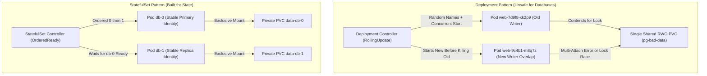
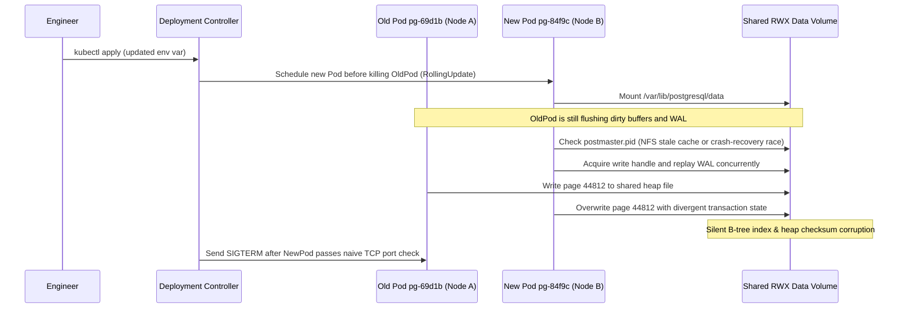

# 00 - Why Stateful Workloads Are Hard on Kubernetes

> **Prerequisites:** Familiarity with Kubernetes Pods, Deployments, Services, and PersistentVolumeClaims ([03-kubernetes](../../03-kubernetes/README.md) modules 03 and 06), plus a local `kind` cluster with `kubectl` configured.  
> **Estimated Reading Time:** 30 minutes  
> **Target Audience:** Backend Engineers, DevOps Engineers, Kubernetes Operators.

> [!TIP]
> **The Golden Rule of Stateful Workloads:** Never run a transactional database in a Kubernetes `Deployment` with default `RollingUpdate` or a shared PVC. Deployments treat Pods as disposable clones—creating overlapping writers during rollouts and forcing multiple instances onto one disk—so stateful systems require either a `StatefulSet` paired with an operator or a managed database service.

---

## Why This Matters

Everything you've deployed to Kubernetes so far worked *because* it was stateless — a Deployment can delete any Pod and start an identical one anywhere, and nothing notices. Databases break that assumption completely: they own durable data and expect a stable identity, and the moment you run one the way you'd run a web frontend, you get silent data corruption or data loss. This module is the framing for the whole track — understand the tension here and every later design decision (StatefulSets, operators, managed databases) becomes obvious rather than arbitrary.

---

## 1. Architectural Mental Model: Why Deployments Break State

Kubernetes' scheduler is optimized for **cattle** (disposable, interchangeable web Pods), whereas databases behave like **pets** (named instances tied to private disks). The diagram below contrasts what happens when you put a database in a `Deployment` versus a `StatefulSet`:



### Core Concepts

#### Stateless vs. stateful, precisely

A workload is **stateless** when any two of its instances are interchangeable: a request can hit any replica and get the same answer, and killing a replica loses nothing that isn't stored elsewhere. That's the web app you deployed as a Deployment in [03-kubernetes](../../03-kubernetes/README.md) — three replicas behind a Service, and the Service load-balances across them freely because they're clones.

A workload is **stateful** when instances are *not* interchangeable because each one owns data that lives on disk and an identity other things depend on. A Postgres primary is not the same as its replica; the shard holding user IDs 0-1M is not the same as the shard holding 1M-2M. You cannot round-robin traffic across them, and you cannot replace one with a fresh blank copy without losing what it held.

#### What a Deployment actually promises (and doesn't)

A Deployment's contract is: *keep N Pods matching this template running, and I am free to achieve that however I like.* Concretely, that freedom means:

- Pods get **random names** (`web-7d9f8-xk2p9`) — a new one each time.
- On a rolling update, it **creates new Pods before deleting old ones**, so two "versions" of the same Pod briefly run at once.
- It will happily **reschedule a Pod to a different node**, and start Pods in **any order**, all at once.
- Every Pod from the same Deployment template that mounts a PVC mounts **the same PVC** — they share one volume.

Each of those is a *feature* for a stateless web app and a *bug* for a database. Two Postgres primaries writing to the same data directory at once (which a rolling update invites) is exactly how you corrupt a database. Random, changing Pod names mean a replica can't reliably find "the primary." One shared PVC across replicas means you can't give each database instance its own independent disk.

#### The core tension

Here's the whole track in one sentence: **Kubernetes' scheduler is designed to treat Pods as disposable and interchangeable, and stateful workloads need exactly the opposite — stable identity and stable, private storage that follows a specific instance.**

Kubernetes doesn't refuse to run state — it gives you purpose-built objects that *constrain* the scheduler's freedom where state needs it:

- **Stable identity** instead of random names — so a replica can always find `db-0` as the primary (StatefulSets, module 01).
- **Private per-instance storage** instead of one shared volume — so each replica gets its own disk that stays with it across restarts (`volumeClaimTemplates`, module 01).
- **Ordered, one-at-a-time** creation, update, and deletion instead of all-at-once churn — so you never have two primaries live at once (StatefulSet ordering, module 01).

That's what a StatefulSet *is*: a Deployment with the scheduler's convenient freedoms deliberately removed.

#### Why "just run Postgres in a Deployment" is worse than it looks

You *can* write a Deployment with `replicas: 1`, a PVC, and a Postgres image, and it will appear to work. It fails in the ways that matter most and least visibly:

- **Rolling updates risk two primaries.** The default Deployment strategy starts the new Pod before terminating the old one. For a moment two Postgres processes can hold the same PVC (on the same node) or fight over it — a classic split-brain / corruption window. (You'd have to switch to the `Recreate` strategy to even make it safe-ish, and you've now given up rolling updates entirely.)
- **You can't scale it.** Bump `replicas` to 3 and all three Pods mount the *same* RWO PVC — the pattern you saw in [03-kubernetes module 06](../../03-kubernetes/06-storage-pv-and-pvc/README.md), where a second Pod on another node can't even mount it. There's no per-replica disk and no notion of "one is the primary."
- **No stable address.** Replicas and clients can't reliably name a specific instance, because Deployment Pod names are random and change.
- **No coordination.** Nothing promotes a replica when the primary dies, streams WAL between instances, or refuses to start a second writer.

None of these are Kubernetes bugs — they're the Deployment doing exactly what it promises. The fix isn't to fight the Deployment; it's to use the object built for the job (StatefulSet), and for a real database, an **operator** on top of that to handle the coordination a StatefulSet alone still doesn't do (module 03).

#### The escape hatch: don't run it at all

There's a second, equally valid answer that this track takes seriously: **a managed database service.** Azure runs the Postgres/SQL/Cosmos process, the storage, the backups, the failover, and the patching; you get a connection string. All the hardness above becomes *someone else's* operational problem. That's not cheating — for many teams it's the correct engineering decision, and half this track (modules 05-07) is about doing it well and knowing when to choose it. The point of learning the self-hosted path first is so that when you pick "managed," you're choosing it with your eyes open, not out of fear of StatefulSets.

---

## 2. Taxonomic Comparison & Command Reference

| Workload Pattern | Pod Naming & DNS | Storage Topology | Update Strategy & Risk | Replication & Failover | Best Use Case |
| :--- | :--- | :--- | :--- | :--- | :--- |
| **Deployment (`RollingUpdate`)** | Random suffixes (`pg-bad-7d9f8-xk2p9`) | Single shared PVC across all Pods | Overlapping Pods; concurrent mount race or `Multi-Attach` deadlock | None | Stateless APIs & web apps only (never databases) |
| **Deployment (`Recreate`, `replicas: 1`)** | Random suffix on every restart | Single RWO PVC | Stops old Pod before starting new Pod; hard downtime window | None (cannot scale beyond 1) | Ephemeral dev/test databases only |
| **Bare `StatefulSet`** | Ordinal (`db-0`, `db-1`, `db-2`) + Headless DNS | Dedicated PVC per ordinal (`volumeClaimTemplates`) | Ordered highest-to-lowest (`2 -> 1 -> 0`) gated on Ready | Manual / external scripts required | Custom clustered stores where app manages topology |
| **`StatefulSet` + Operator (CNPG)** | Managed ordinals + `-rw` / `-ro` Services | Dedicated per-instance PVCs + WAL archive | Rolling switchover with automated primary promotion | Automated streaming WAL + fencing | Production self-hosted PostgreSQL on Kubernetes |
| **Managed DB (Azure Postgres)** | Managed DNS endpoint | Provider-managed redundant storage | Zero/near-zero downtime managed patching | SLA-backed HA & automated backups | Default enterprise choice unless strict self-hosting needed |

### Command reference

This module is mostly conceptual, but you'll observe the failure modes directly. The relevant commands:

| Command | What it does | Example |
|---|---|---|
| `kubectl get pods -o wide` | Shows Pod names, nodes, and status — note how Deployment names churn | `kubectl get pods -o wide -w` |
| `kubectl get deploy` | Lists Deployments and their replica readiness | `kubectl get deploy` |
| `kubectl rollout restart deploy/<name>` | Forces a rolling replacement — watch two Pods coexist | `kubectl rollout restart deploy/pg-bad` |
| `kubectl get pvc` | Shows which PVCs exist and their bind status | `kubectl get pvc` |
| `kubectl scale deploy/<name> --replicas=N` | Changes replica count — the source of the shared-PVC failure | `kubectl scale deploy/pg-bad --replicas=3` |
| `kubectl describe pod <name>` | Shows scheduling/mount events when a Pod is stuck | `kubectl describe pod pg-bad-xxxx` |
| `kubectl logs <pod>` | Reads container logs — where Postgres reports a corrupt/locked data dir | `kubectl logs pg-bad-xxxx` |

Flag breakdown — `kubectl scale deploy/pg-bad --replicas=3`:
- `deploy/pg-bad` — the target Deployment (the `kind/name` shorthand).
- `--replicas=3` — desired Pod count; with one shared RWO PVC this is exactly what breaks, which is the point of the exercise.

---

## 3. Production War Story Post-Mortem

### SEV-1: Split-Brain Data Corruption from a Database Deployment Rolling Update

- **Severity:** SEV-1 (Critical Data Corruption & Write Outage)
- **Detection Time:** 4 minutes (application `500` errors + checksum panic in Postgres logs)
- **Resolution Time:** 3 hours 40 minutes (database stopped, restored from previous night's snapshot, 14 minutes of recent writes manually replayed from dead-letter queues)
- **Blast Radius:** 100% of checkout transactions in `prod-eu` failed for 3h 40m; ~14 minutes of in-flight ledger updates required manual reconciliation.

#### What Happened

A backend team deployed PostgreSQL inside a standard Kubernetes `Deployment` (`replicas: 1`, default `RollingUpdate`) backed by an NFS/Azure Files share so the Pod could reschedule onto any node without waiting for block volume detachment. When an engineer rotated an environment variable (`MAX_CONNECTIONS=200`), Kubernetes triggered a rolling update: it launched the new Pod (`pg-84f9c-k2m1p`) **before** terminating the old Pod (`pg-69d1b-z9x4w`). Because the underlying volume was shared `ReadWriteMany`, both Pods mounted `/var/lib/postgresql/data` on different nodes simultaneously.



#### Root Cause Analysis (RCA)

1. **Deployment Lifecycle Mismatch:** Default `RollingUpdate` (`maxSurge: 25%` rounds up to `1` for `replicas: 1`) explicitly allows 2 Pods simultaneously during updates.
2. **Shared Storage Anti-Pattern:** Putting `PGDATA` on a multi-writer filesystem bypassed the OS/hypervisor single-attach fence (`ReadWriteOnce`), letting two `postgres` processes mutate the same heap and `pg_wal` files concurrently.
3. **Naive Readiness Probe:** A raw TCP port `5432` probe passed on the new Pod before database lock ownership was exclusive, prompting Kubernetes to shift traffic across two active writers.

#### The Fix & Architectural Hardening

1. **Immediate Mitigation:** Changed `strategy.type` to `Recreate` to eliminate Pod overlap while migrating off the Deployment.
2. **Durable Architecture:** Migrated the database to a dedicated `StatefulSet` managed by the **CloudNativePG operator** backed by `ReadWriteOnce` `Premium_LRS` Azure Disks (modules 01–03), guaranteeing one PVC per instance and single-writer fencing.
3. **Policy Guardrail:** Added an admission policy (Kyverno/OPA) rejecting any `kind: Deployment` whose container image references `postgres`, `mysql`, or `mariadb`.

---

## 4. Multi-Language Production Implementation

When applications or migration runners interact with Kubernetes-hosted databases, they must **never** assume an endpoint points to an exclusive, non-split-brain writer. The production examples below implement a **Single-Writer Fencing & Topology Preflight Guard** that verifies the target PostgreSQL instance is a real primary (`pg_is_in_recovery() = false`), validates a monotonic fencing epoch stored in a lease table before mutating state, and fails fast if Pod identity churn or dual-writer conditions are detected.

````carousel
```go
// Go: Production single-writer fencing & role verification guard using pgxpool
package dbguard

import (
	"context"
	"errors"
	"fmt"
	"os"
	"regexp"
	"time"

	"github.com/jackc/pgx/v5/pgxpool"
)

var (
	ErrReadOnlyReplica  = errors.New("connected instance is a read-only standby")
	ErrUnstableIdentity = errors.New("workload hostname lacks deterministic stateful ordinal")
	ErrFencingConflict  = errors.New("fencing epoch mismatch: concurrent writer detected")
	ordinalPattern      = regexp.MustCompile(`^[a-z0-9-]+-[0-9]+$`)
)

type GuardResult struct {
	PodName       string
	ServerAddr    string
	FencingEpoch  int64
	VerifiedAtUTC time.Time
}

// VerifyExclusivePrimary checks ordinal identity, primary write status, and monotonic fencing lease.
func VerifyExclusivePrimary(ctx context.Context, pool *pgxpool.Pool, expectedWorkload string) (*GuardResult, error) {
	ctx, cancel := context.WithTimeout(ctx, 5*time.Second)
	defer cancel()

	hostname, err := os.Hostname()
	if err != nil {
		return nil, fmt.Errorf("read local hostname: %w", err)
	}
	if expectedWorkload != "" && !ordinalPattern.MatchString(expectedWorkload) {
		return nil, fmt.Errorf("%w: target=%q", ErrUnstableIdentity, expectedWorkload)
	}

	tx, err := pool.Begin(ctx)
	if err != nil {
		return nil, fmt.Errorf("begin guard transaction: %w", err)
	}
	defer func() { _ = tx.Rollback(ctx) }()

	var inRecovery bool
	var serverAddr string
	if err := tx.QueryRow(ctx, "SELECT pg_is_in_recovery(), COALESCE(inet_server_addr()::text, 'local')").
		Scan(&inRecovery, &serverAddr); err != nil {
		return nil, fmt.Errorf("probe recovery state: %w", err)
	}
	if inRecovery {
		return nil, fmt.Errorf("%w (addr=%s)", ErrReadOnlyReplica, serverAddr)
	}

	// Compare-and-increment lease row under SERIALIZABLE/ROW LOCK to detect overlapping writers.
	var newEpoch int64
	err = tx.QueryRow(ctx, `
		INSERT INTO cluster_writer_lease (lease_id, holder_pod, fencing_epoch, updated_at)
		VALUES ('primary', $1, 1, NOW())
		ON CONFLICT (lease_id) DO UPDATE
		SET holder_pod = EXCLUDED.holder_pod,
		    fencing_epoch = cluster_writer_lease.fencing_epoch + 1,
		    updated_at = NOW()
		RETURNING fencing_epoch`, hostname).Scan(&newEpoch)
	if err != nil {
		return nil, fmt.Errorf("%w: %v", ErrFencingConflict, err)
	}

	if err := tx.Commit(ctx); err != nil {
		return nil, fmt.Errorf("commit fencing lease: %w", err)
	}

	return &GuardResult{
		PodName:       hostname,
		ServerAddr:    serverAddr,
		FencingEpoch:  newEpoch,
		VerifiedAtUTC: time.Now().UTC(),
	}, nil
}
```
<!-- slide -->
```typescript
// TypeScript: Production single-writer topology guard for Node/pg migrations and workers
import { Pool } from 'pg';
import os from 'node:os';

export interface WriterLeaseResult {
  holderPod: string;
  serverIp: string;
  fencingEpoch: number;
  verifiedAtIso: string;
}

const ORDINAL_POD_REGEX = /^[a-z0-9-]+-\d+$/;

export async function verifyExclusivePrimary(
  pool: Pool,
  targetPodName?: string
): Promise<WriterLeaseResult> {
  if (targetPodName && !ORDINAL_POD_REGEX.test(targetPodName)) {
    throw new Error(
      `Unstable pod identity "${targetPodName}": expected StatefulSet ordinal (<name>-<index>)`
    );
  }

  const client = await pool.connect();
  try {
    await client.query('SET statement_timeout = 4000');
    await client.query('BEGIN');

    const roleRes = await client.query<{
      in_recovery: boolean;
      server_addr: string | null;
    }>('SELECT pg_is_in_recovery() AS in_recovery, inet_server_addr()::text AS server_addr');

    const row = roleRes.rows[0];
    if (!row || row.in_recovery) {
      throw new Error(
        `Refusing write: connected Postgres at ${row?.server_addr ?? 'unknown'} is a read-only replica`
      );
    }

    const holder = os.hostname();
    const leaseRes = await client.query<{ fencing_epoch: string }>(
      `INSERT INTO cluster_writer_lease (lease_id, holder_pod, fencing_epoch, updated_at)
       VALUES ('primary', $1, 1, NOW())
       ON CONFLICT (lease_id) DO UPDATE
       SET holder_pod = EXCLUDED.holder_pod,
           fencing_epoch = cluster_writer_lease.fencing_epoch + 1,
           updated_at = NOW()
       RETURNING fencing_epoch`,
      [holder]
    );

    await client.query('COMMIT');
    return {
      holderPod: holder,
      serverIp: row.server_addr ?? 'local',
      fencingEpoch: Number(leaseRes.rows[0].fencing_epoch),
      verifiedAtIso: new Date().toISOString(),
    };
  } catch (err) {
    await client.query('ROLLBACK').catch(() => undefined);
    throw err;
  } finally {
    client.release();
  }
}
```
<!-- slide -->
```python
# Python: Production pre-flight writer & ordinal identity guard using psycopg (v3)
from dataclasses import dataclass
from datetime import datetime, timezone
import re
import socket
import psycopg

ORDINAL_PATTERN = re.compile(r"^[a-z0-9-]+-[0-9]+$")


class StatefulTopologyError(RuntimeError):
    """Raised when DB endpoint violates single-writer or deterministic identity invariants."""


@dataclass(frozen=True)
class FencingLease:
    holder_pod: str
    server_addr: str
    fencing_epoch: int
    verified_at: datetime


def verify_exclusive_primary(dsn: str, expected_pod: str | None = None) -> FencingLease:
    if expected_pod and not ORDINAL_PATTERN.match(expected_pod):
        raise StatefulTopologyError(
            f"Target pod '{expected_pod}' lacks a deterministic StatefulSet ordinal"
        )

    holder_pod = socket.gethostname()
    with psycopg.connect(dsn, connect_timeout=5) as conn:
        with conn.transaction():
            with conn.cursor() as cur:
                cur.execute("SET LOCAL statement_timeout = '4000ms'")
                cur.execute(
                    "SELECT pg_is_in_recovery(), COALESCE(inet_server_addr()::text, 'local')"
                )
                in_recovery, server_addr = cur.fetchone()
                if in_recovery:
                    raise StatefulTopologyError(
                        f"Refusing writes: endpoint {server_addr} is a read-only replica"
                    )

                cur.execute(
                    """
                    INSERT INTO cluster_writer_lease (lease_id, holder_pod, fencing_epoch, updated_at)
                    VALUES ('primary', %s, 1, NOW())
                    ON CONFLICT (lease_id) DO UPDATE
                    SET holder_pod = EXCLUDED.holder_pod,
                        fencing_epoch = cluster_writer_lease.fencing_epoch + 1,
                        updated_at = NOW()
                    RETURNING fencing_epoch
                    """,
                    (holder_pod,),
                )
                (fencing_epoch,) = cur.fetchone()

    return FencingLease(
        holder_pod=holder_pod,
        server_addr=server_addr,
        fencing_epoch=int(fencing_epoch),
        verified_at=datetime.now(timezone.utc),
    )
```
<!-- slide -->
```csharp
// C#: Production single-writer primary & fencing lease verifier using Npgsql
using System.Text.RegularExpressions;
using Npgsql;

namespace BackendRoadmap.StatefulGuards;

public sealed record FencingLeaseResult(
    string HolderPod,
    string ServerAddress,
    long FencingEpoch,
    DateTimeOffset VerifiedAtUtc);

public static partial class PrimaryTopologyGuard
{
    [GeneratedRegex("^[a-z0-9-]+-[0-9]+$", RegexOptions.Compiled)]
    private static partial Regex OrdinalRegex();

    public static async Task<FencingLeaseResult> VerifyExclusivePrimaryAsync(
        NpgsqlDataSource dataSource,
        string? expectedPodName,
        CancellationToken cancellationToken = default)
    {
        if (!string.IsNullOrWhiteSpace(expectedPodName) && !OrdinalRegex().IsMatch(expectedPodName))
        {
            throw new InvalidOperationException(
                $"Pod '{expectedPodName}' is not a deterministic StatefulSet ordinal.");
        }

        string holderPod = Environment.MachineName;
        await using var conn = await dataSource.OpenConnectionAsync(cancellationToken);
        await using var tx = await conn.BeginTransactionAsync(cancellationToken);

        await using (var roleCmd = new NpgsqlCommand(
            "SELECT pg_is_in_recovery(), COALESCE(inet_server_addr()::text, 'local')", conn, tx))
        {
            roleCmd.CommandTimeout = 4;
            await using var reader = await roleCmd.ExecuteReaderAsync(cancellationToken);
            if (!await reader.ReadAsync(cancellationToken))
            {
                throw new InvalidOperationException("Failed to read PostgreSQL recovery state.");
            }

            bool inRecovery = reader.GetBoolean(0);
            string serverAddr = reader.GetString(1);
            if (inRecovery)
            {
                throw new InvalidOperationException(
                    $"Refusing write operations: endpoint {serverAddr} is a standby replica.");
            }

            await reader.CloseAsync();

            await using var leaseCmd = new NpgsqlCommand("""
                INSERT INTO cluster_writer_lease (lease_id, holder_pod, fencing_epoch, updated_at)
                VALUES ('primary', @holder, 1, NOW())
                ON CONFLICT (lease_id) DO UPDATE
                SET holder_pod = EXCLUDED.holder_pod,
                    fencing_epoch = cluster_writer_lease.fencing_epoch + 1,
                    updated_at = NOW()
                RETURNING fencing_epoch
                """, conn, tx);
            leaseCmd.Parameters.AddWithValue("holder", holderPod);
            leaseCmd.CommandTimeout = 4;

            object? scalar = await leaseCmd.ExecuteScalarAsync(cancellationToken);
            long epoch = Convert.ToInt64(scalar);
            await tx.CommitAsync(cancellationToken);

            return new FencingLeaseResult(holderPod, serverAddr, epoch, DateTimeOffset.UtcNow);
        }
    }
}
```
````

---

## 5. Practical Hands-On Verification CLI Workflows

Use a local **kind** cluster. Create and work in a namespace `stateful`:

```bash
kubectl create namespace stateful
kubectl config set-context --current --namespace=stateful
```

### 1. Establish the stateless baseline

Deploy a plain stateless web app and watch how freely Kubernetes churns its Pods.

```yaml
# web.yaml
apiVersion: apps/v1
kind: Deployment
metadata:
  name: web
spec:
  replicas: 3
  selector:
    matchLabels: { app: web }
  template:
    metadata:
      labels: { app: web }
    spec:
      containers:
        - name: web
          image: nginx:1.27
```

```bash
kubectl apply -f web.yaml
kubectl get pods -o wide
```

**Expected Output:**
```text
NAME                   READY   STATUS    RESTARTS   AGE   IP           NODE                 NOMINATED NODE   READINESS GATES
web-7d9f8c6b54-8m2kp   1/1     Running   0          12s   10.244.0.5   kind-control-plane   <none>           <none>
web-7d9f8c6b54-qt9vx   1/1     Running   0          12s   10.244.0.6   kind-control-plane   <none>           <none>
web-7d9f8c6b54-z4n1r   1/1     Running   0          12s   10.244.0.7   kind-control-plane   <none>           <none>
```
Three Pods with random suffixes appear. Note the names — you'll never type them from memory because they change.

### 2. Watch random, changing identity

```bash
kubectl delete pod -l app=web
kubectl get pods -o wide
```

**Expected Output:**
```text
pod "web-7d9f8c6b54-8m2kp" deleted
pod "web-7d9f8c6b54-qt9vx" deleted
pod "web-7d9f8c6b54-z4n1r" deleted
NAME                   READY   STATUS    RESTARTS   AGE   IP           NODE
web-7d9f8c6b54-b7c9l   1/1     Running   0          5s    10.244.0.8   kind-control-plane
web-7d9f8c6b54-k5w2m   1/1     Running   0          5s    10.244.0.9   kind-control-plane
web-7d9f8c6b54-p3x8d   1/1     Running   0          5s    10.244.0.10  kind-control-plane
```
Three *new* Pods with *different* random names appear immediately. For a stateless app this is fine — clients reach them through the Service, never by name. Sit with why this exact behavior would be a disaster if these were database replicas that had to find "the primary."

### 3. Deploy Postgres the wrong way (in a Deployment)

```yaml
# pg-bad.yaml
apiVersion: v1
kind: PersistentVolumeClaim
metadata:
  name: pg-bad-data
spec:
  accessModes: ["ReadWriteOnce"]
  resources:
    requests:
      storage: 1Gi
---
apiVersion: apps/v1
kind: Deployment
metadata:
  name: pg-bad
spec:
  replicas: 1
  selector:
    matchLabels: { app: pg-bad }
  template:
    metadata:
      labels: { app: pg-bad }
    spec:
      containers:
        - name: postgres
          image: postgres:16
          env:
            - name: POSTGRES_PASSWORD
              value: devpass
            - name: PGDATA
              value: /var/lib/postgresql/data/pgdata
          volumeMounts:
            - name: data
              mountPath: /var/lib/postgresql/data
      volumes:
        - name: data
          persistentVolumeClaim:
            claimName: pg-bad-data
```

```bash
kubectl apply -f pg-bad.yaml
kubectl get pods -w
```

**Expected Output:** One `pg-bad-...` Pod reaches `Running`. It *works* — a single replica with its own PVC is fine until you try to do anything real with it. Write a row so you have state to lose later:

```bash
POD=$(kubectl get pod -l app=pg-bad -o jsonpath='{.items[0].metadata.name}')
kubectl exec "$POD" -- psql -U postgres -c "CREATE TABLE t(x int); INSERT INTO t VALUES (1);"
kubectl exec "$POD" -- psql -U postgres -c "SELECT * FROM t;"
```

**Expected Output:**
```text
CREATE TABLE
INSERT 0 1
 x
---
 1
(1 row)
```

### 4. Break it by scaling — the shared-PVC trap

```bash
kubectl scale deploy/pg-bad --replicas=3
kubectl get pods -o wide
```

**Expected Output:** On kind (single node), the extra Pods schedule onto the same node and all reference the *same* RWO PVC. On a multi-node cluster the extra Pods sit `Pending` (a second node can't mount the RWO volume — the exact constraint from [03-kubernetes module 06](../../03-kubernetes/06-storage-pv-and-pvc/README.md)). Even where they start, you now have multiple Postgres processes pointed at one data directory — undefined behavior, not a 3-node database. Inspect:

```bash
kubectl describe pod -l app=pg-bad | grep -A3 -i "events\|multi-attach" || true
```

Scale back down before it does damage:

```bash
kubectl scale deploy/pg-bad --replicas=1
```

### 5. Break it by "updating" — the two-primaries window

```bash
kubectl rollout restart deploy/pg-bad
kubectl get pods -l app=pg-bad -o wide -w
```

**Expected Output:** Because the default strategy is `RollingUpdate`, Kubernetes tries to start the new Postgres Pod *before* killing the old one. Both want the same PVC. On kind you'll typically see the new Pod stuck `ContainerCreating` / `CrashLoopBackOff` or racing the old one while `Terminating`; inspect the logs of whichever loses the race:

```bash
kubectl logs -l app=pg-bad --tail=20
```

**Expected Output:**
```text
FATAL:  lock file "postmaster.pid" already exists
HINT:  Is another postmaster (PID 1) running in data directory "/var/lib/postgresql/data/pgdata"?
```
That contention window is exactly the split-brain risk a Deployment can't avoid for a database.

### 6. Diagnose-and-fix: make the Deployment at least *safe* (and see the cost)

The minimum fix for a single-replica DB-in-a-Deployment is the `Recreate` strategy — kill the old Pod fully *before* starting the new one:

```yaml
# add under spec: in pg-bad.yaml
  strategy:
    type: Recreate
```

```bash
kubectl apply -f pg-bad.yaml
kubectl rollout restart deploy/pg-bad
kubectl get pods -l app=pg-bad -w
```

**Expected Output:** Now the old Pod goes fully `Terminating` → gone, *then* the new one starts — no two-primaries window. Verify your row survived:

```bash
POD=$(kubectl get pod -l app=pg-bad -o jsonpath='{.items[0].metadata.name}')
kubectl exec "$POD" -- psql -U postgres -c "SELECT * FROM t;"
```

**Expected Output:** `x = 1` is still there. **But notice what you gave up:** every update now has a hard downtime gap (no old Pod while the new one boots), you still can't have more than one replica, and there's still nothing doing failover or replication. `Recreate` makes a single-instance DB *safe*, not *available* — which is precisely why the next modules exist.

### 7. Contrast: what you actually want (preview)

You don't need to understand this manifest yet — apply it and observe the difference in *identity*, which module 01 is all about.

```yaml
# ss-preview.yaml
apiVersion: apps/v1
kind: StatefulSet
metadata:
  name: db
spec:
  serviceName: db
  replicas: 3
  selector:
    matchLabels: { app: db }
  template:
    metadata:
      labels: { app: db }
    spec:
      containers:
        - name: c
          image: busybox:1.36
          command: ["sh","-c","sleep 3600"]
  volumeClaimTemplates:
    - metadata:
        name: data
      spec:
        accessModes: ["ReadWriteOnce"]
        resources:
          requests:
            storage: 100Mi
```

```bash
kubectl apply -f ss-preview.yaml
kubectl get pods -l app=db -o wide
kubectl get pvc
```

**Expected Output:**
```text
NAME   READY   STATUS    RESTARTS   AGE   IP            NODE
db-0   1/1     Running   0          18s   10.244.0.14   kind-control-plane
db-1   1/1     Running   0          11s   10.244.0.15   kind-control-plane
db-2   1/1     Running   0          4s    10.244.0.16   kind-control-plane

NAME        STATUS   VOLUME                                     CAPACITY   ACCESS MODES   STORAGECLASS   AGE
data-db-0   Bound    pvc-a1b2c3d4-...                           100Mi      RWO            standard       18s
data-db-1   Bound    pvc-e5f6a7b8-...                           100Mi      RWO            standard       11s
data-db-2   Bound    pvc-c9d0e1f2-...                           100Mi      RWO            standard       4s
```
Pods are named `db-0`, `db-1`, `db-2` — **stable, ordered, predictable** names, not random hashes — and **three separate PVCs** (`data-db-0`, `data-db-1`, `data-db-2`), one per Pod, not one shared volume. That's the whole fix in miniature. Delete a Pod and watch it come back with the *same* name and *same* PVC:

```bash
kubectl delete pod db-1
kubectl get pods -l app=db
```

**Expected Output:** `db-1` returns as `db-1`, re-bound to `data-db-1`.

### 8. Clean up

```bash
kubectl delete -f ss-preview.yaml
kubectl delete pvc -l app=db      # volumeClaimTemplate PVCs are NOT auto-deleted
kubectl delete -f pg-bad.yaml
kubectl delete pvc pg-bad-data
kubectl delete -f web.yaml
```

Note that deleting the StatefulSet did **not** delete its PVCs — you had to do it explicitly. That deliberate stickiness (keeping data even when the workload is gone) is a preview of module 01, and a cost pitfall this whole track keeps flagging.

### Independent challenge

No manifests given — reason it through and then prove it. Take the "wrong way" Postgres Deployment from exercise 3 and design a short written argument, backed by commands you actually run, for a colleague who insists "a Deployment with one replica and a PVC is a perfectly fine database." Demonstrate at least two distinct failure modes from first principles: one that shows up when you try to *update* the workload, and one that shows up when you try to *scale* it. For each, capture the exact `kubectl` output or log line that proves the problem, and then state precisely which property of a Deployment (drawing on Deployments and PVCs from [03-kubernetes](../../03-kubernetes/README.md) modules 03 and 06) causes it. Finish by naming which single property of a StatefulSet would remove each failure — you don't have to fix it yet, just name the mechanism.

<details>
<summary>Stuck? One hint</summary>

The update failure is about the default `RollingUpdate` strategy briefly running two Pods that contend for one PVC (exercise 5); the scaling failure is about every Deployment Pod mounting the *same* PVC rather than getting its own (exercise 4). The StatefulSet properties that fix them are, respectively, **ordered one-at-a-time replacement** and **`volumeClaimTemplates`** (per-Pod storage) — both previewed in exercise 7.

</details>

---

## 6. Common Mistakes & Troubleshooting

- **Assuming "it started, so it's fine."** A single-replica Postgres Deployment runs happily right up until your first rolling update or scale event — the failure is latent, not immediate. "It works on my cluster" is not evidence it's safe.
- **Scaling a DB Deployment to get HA.** More replicas on one shared RWO PVC is not high availability — it's multiple processes fighting over one disk (or Pods stuck `Pending`). Real replication needs per-instance storage and coordination, which a bare Deployment has neither of.
- **Leaving the default `RollingUpdate` strategy on a stateful Deployment.** It invites the two-primaries window from exercise 5. If you're going to run state in a Deployment at all (you shouldn't, past a throwaway dev DB), `Recreate` is the *minimum* — and it costs you zero-downtime updates.
- **Forgetting that StatefulSet PVCs outlive the StatefulSet.** Deleting the StatefulSet leaves its `volumeClaimTemplate` PVCs behind on purpose (so you don't lose data). On Azure those become real, billing Azure Disks — a cost pitfall you'll meet for real in module 02.
- **Confusing "stateful" with "important."** Statefulness is a technical property (owns durable data + identity), not a measure of business value. A stateless app can be mission-critical; the point is only that the *scheduling rules* it needs are different.

---

## 7. Operational Validation Checkpoints

Test your incident response instincts against these three real-world scenarios before moving on.

<details>
<summary><strong>Checkpoint 1: Rolling Update Stuck with Multi-Attach Error on AKS</strong></summary>

**Scenario:** A 1-replica Postgres `Deployment` on a 3-node AKS cluster enters `ContainerCreating` during an image tag bump and hangs for 10 minutes. `kubectl describe pod` shows `Multi-Attach error for volume "pvc-9f21a..." Volume is already exclusively attached to one node and can't be attached to another`.

**Correct Analysis & Action:** Because the Deployment uses `RollingUpdate` by default, Kubernetes scheduled the replacement Pod onto a different node before terminating the running Pod. The RWO Azure Disk remains attached to the first node. Immediately stop the rollout (`kubectl rollout undo deploy/<name>`), change `spec.strategy.type` to `Recreate` as an emergency stopgap (accepting brief downtime), and plan a proper migration to a `StatefulSet` + CloudNativePG operator (or Azure Database for PostgreSQL).

</details>

<details>
<summary><strong>Checkpoint 2: Teammate Proposes Azure Files (RWX) to "Fix" Scaling a Postgres Deployment</strong></summary>

**Scenario:** To scale `replicas: 3` without hitting `Multi-Attach` errors, a developer switches the Postgres Deployment's PVC to `ReadWriteMany` (`azurefile-csi`). All 3 Pods enter `Running`. Should you approve this PR?

**Correct Analysis & Action:** Reject immediately. `ReadWriteMany` allows three independent PostgreSQL `postmaster` processes on different nodes to overwrite the exact same `PGDATA` heap and WAL files simultaneously, guaranteeing silent B-tree index and transaction corruption. Databases must use `ReadWriteOnce` per-instance storage with database-level WAL streaming replication, not shared filesystems.

</details>

<details>
<summary><strong>Checkpoint 3: "Orphaned" PVCs After Deleting a Test StatefulSet</strong></summary>

**Scenario:** After running `kubectl delete -f ss-preview.yaml`, an engineer checks `kubectl get pvc` and sees `data-db-0`, `data-db-1`, and `data-db-2` still `Bound` even though all `db-*` Pods are gone. They suspect a stuck finalizer or controller bug.

**Correct Analysis & Action:** This is intentional Kubernetes behavior, not a bug. `StatefulSet` controllers never auto-delete `volumeClaimTemplate` PVCs by default (`Retain`) so an accidental `kubectl delete sts` does not destroy durable database disks. Explicitly delete the PVCs with `kubectl delete pvc -l app=db` only after verifying data is unneeded (or configure `persistentVolumeClaimRetentionPolicy` intentionally).

</details>

---

## Checkpoint quiz

Write down your answer to each question before expanding it — checking without attempting first is the single easiest way to fool yourself into thinking you've learned this.

1. In one sentence, what is the core tension between Kubernetes' scheduler and stateful workloads?
2. Name two specific behaviors a Deployment promises that are features for a stateless web app but bugs for a database.
3. Why does scaling a single-replica Postgres Deployment to 3 replicas fail to give you a 3-node database?
4. What exactly goes wrong during a `RollingUpdate` of a Postgres Deployment, and why?
5. The `Recreate` strategy makes a single-instance DB-in-a-Deployment *safe*. What does it *not* give you, and what did you trade away to get the safety?
6. In the exercise 7 preview, what two things about the StatefulSet were visibly different from the Deployment, and which failure mode does each address?
7. Is choosing a managed database instead of running your own "cheating"? Justify your answer in terms of what the hardness actually is.

<details>
<summary>Show answers</summary>

1. Kubernetes' scheduler is built to treat Pods as disposable and interchangeable (reschedule/replace them freely), while stateful workloads need the opposite: stable identity and stable, private storage that stays bound to a specific instance.
2. Any two of: random/changing Pod names; rolling updates that run two Pods at once; rescheduling Pods to any node in any order; every Pod from the template mounting the *same* PVC.
3. All three replicas reference the same RWO PVC — there's no per-replica disk and no primary/replica coordination, so you get multiple processes contending for one data directory (or Pods stuck `Pending` on a multi-node cluster), not three independent database nodes.
4. The default `RollingUpdate` starts the new Pod before terminating the old one, so two Postgres processes briefly contend for the same data directory/PVC — a split-brain/corruption window and a data-dir lock error in the logs.
5. It doesn't give you high availability, replication, failover, or more than one replica — and you traded away zero-downtime updates, because `Recreate` fully stops the old Pod before starting the new one, creating a downtime gap on every update.
6. The Pods had stable, ordered names (`db-0/1/2`) instead of random hashes — fixing the "can't find a specific instance" identity problem — and each Pod got its own PVC via `volumeClaimTemplates` — fixing the shared-storage/scaling problem.
7. No. The hardness is real operational work (stable identity, private storage, coordination, failover, backups, patching). A managed service doesn't make that work vanish — it moves it to the cloud provider, which for many teams is the correct engineering trade. Choosing it knowingly (as this track teaches) is engineering, not avoidance.

</details>

---

## 8. Sources & Further Reading

- Kubernetes Documentation: [StatefulSets](https://kubernetes.io/docs/concepts/workloads/controllers/statefulset/)
- Kubernetes Documentation: [Deployments — Strategy (`Recreate` vs `RollingUpdate`)](https://kubernetes.io/docs/concepts/workloads/controllers/deployment/#strategy)
- Kubernetes Documentation: [Persistent Volumes & Access Modes](https://kubernetes.io/docs/concepts/storage/persistent-volumes/)
- Track Prerequisite: [03-kubernetes](../../03-kubernetes/README.md) & [03-kubernetes module 06](../../03-kubernetes/06-storage-pv-and-pvc/README.md)

## Next

[01-statefulsets-in-depth](../01-statefulsets-in-depth/README.md) — you've seen the tension and the shape of the fix; now go deep on the object that implements it: stable identity, headless Services, ordered operations, and per-Pod storage.
