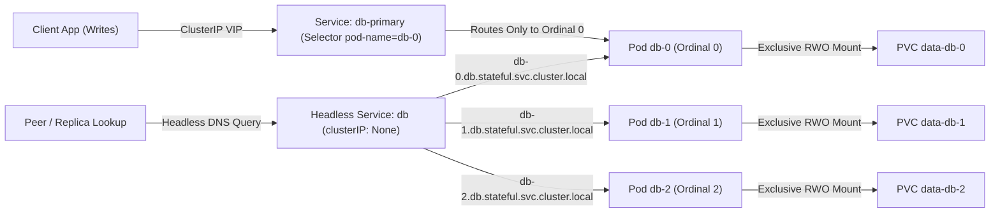
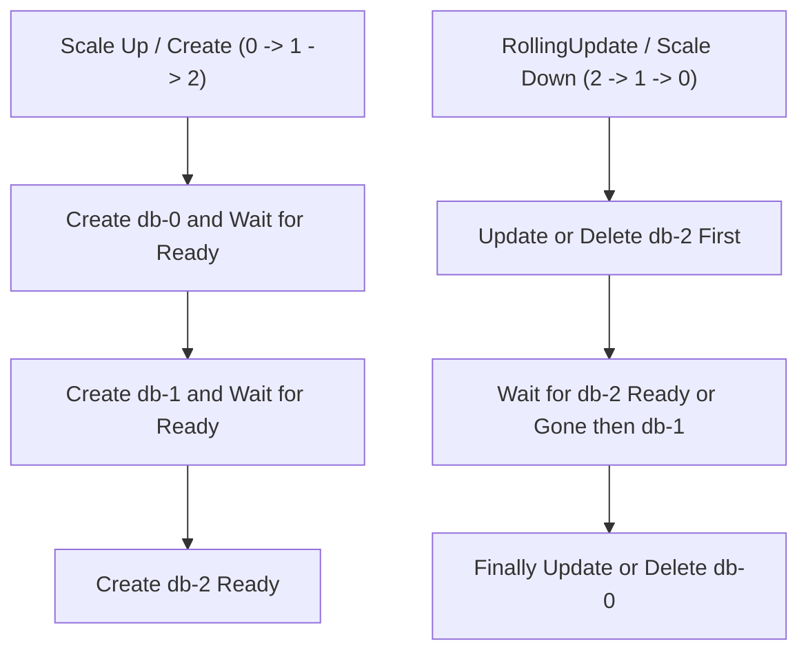
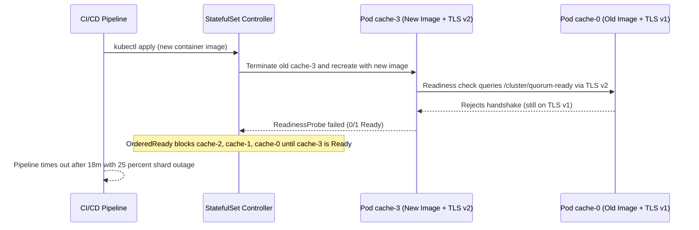

# 01 - StatefulSets in Depth

> **Prerequisites:** Stateful workload fundamentals (Module 00), Kubernetes Services and PersistentVolumeClaims ([03-kubernetes](../../03-kubernetes/README.md) modules 04 and 06), plus a local `kind` cluster with `kubectl` configured.  
> **Estimated Reading Time:** 35 minutes  
> **Target Audience:** Backend Engineers, DevOps Engineers, Kubernetes Operators.

> [!TIP]
> **The Golden Rule of StatefulSets:** Always pair a `StatefulSet` (`spec.serviceName`) with a `clusterIP: None` headless Service so each ordinal Pod gets a stable DNS name, and test every `readinessProbe` rigorously—under `OrderedReady`, a single non-Ready Pod halts all scaling and rolling updates across the entire StatefulSet.

---

## Why This Matters

Module 00 showed you *why* a Deployment can't safely run a database and previewed the object that can: a StatefulSet. This module makes that object concrete — stable network names, ordered start/stop, and one private PersistentVolumeClaim per replica. Almost every "real database on Kubernetes" thing you do later (operators, backups, failover) is built on top of a StatefulSet, so the mechanics here are load-bearing for the rest of the track.

---

## 1. Architectural Mental Model: Ordinal Identity, Headless DNS & Private Storage

A `StatefulSet` binds three primitives together for each index `0..N-1`: a deterministic Pod name (`db-0`), a dedicated DNS A record served via a headless Service (`db-0.db.stateful.svc.cluster.local`), and an exclusive, persistent PVC (`data-db-0`) that follows that ordinal across restarts and reschedules.



Ordered lifecycle guarantees ensure safe bootstrap and teardown:



### Core Concepts

#### What a StatefulSet guarantees that a Deployment doesn't

A StatefulSet manages Pods from a template just like a Deployment, but adds three guarantees the Deployment deliberately withholds:

1. **Stable, predictable identity.** Pods are named `<statefulset-name>-<ordinal>`: `db-0`, `db-1`, `db-2` — not random hashes. A deleted `db-1` comes back *as* `db-1`, not as a new name.
2. **Stable, private storage.** Each Pod gets its own PVC from a `volumeClaimTemplate`, named `<template>-<pod>` (e.g. `data-db-0`), and that PVC re-binds to the same Pod ordinal across restarts — it is *not* shared, and it is *not* deleted when the Pod is deleted.
3. **Ordered, one-at-a-time operations.** By default Pods are created in order `0 → 1 → 2` (each waiting for the previous to be Ready), deleted in reverse `2 → 1 → 0`, and updated one at a time. Contrast module 00's Deployment, which starts and replaces Pods all at once.

These are exactly the three properties module 00 said stateful workloads need. A StatefulSet is, functionally, "a Deployment with the scheduler's conveniences removed where state requires it."

#### The headless Service and stable DNS names

Stable Pod *names* only help if other Pods can *resolve* them. That's the job of a **headless Service** — a Service with `clusterIP: None`. A normal Service (the kind you used in [03-kubernetes](../../03-kubernetes/README.md)) gives you one virtual IP that load-balances across all backends — great for stateless, useless when you need to reach a *specific* replica. A headless Service instead creates a **per-Pod DNS record**:

```text
<pod-name>.<service-name>.<namespace>.svc.cluster.local
```

So `db-0.db.stateful.svc.cluster.local` always resolves to the `db-0` Pod, `db-1.db...` to `db-1`, and so on — stable, individual addresses. This is how a replica finds "the primary at `db-0`" reliably, which module 00 showed a Deployment can't offer. The StatefulSet's `spec.serviceName` must name this headless Service, and it's what wires the two together.

You often run **both** Services for one StatefulSet: the headless one for stable per-Pod addressing (replica-to-replica traffic), *and* a normal `ClusterIP` Service for clients that just want "any/the read-write endpoint" — the operator in module 03 does exactly this.

#### `volumeClaimTemplates`: per-Pod storage, done right

This is the piece that fixes module 00's shared-PVC trap. Instead of referencing an existing PVC in the Pod spec, a StatefulSet declares a `volumeClaimTemplate`, and the controller **creates one PVC per replica** from it:

```yaml
volumeClaimTemplates:
  - metadata:
      name: data
    spec:
      accessModes: ["ReadWriteOnce"]
      storageClassName: standard    # module 02 swaps this for an Azure Disk class
      resources:
        requests:
          storage: 1Gi
```

For a 3-replica StatefulSet this produces `data-db-0`, `data-db-1`, `data-db-2` — three independent RWO volumes, each dynamically provisioned through the StorageClass exactly as in [03-kubernetes module 06](../../03-kubernetes/06-storage-pv-and-pvc/README.md), just now *one per Pod*. Key consequences:

- Delete `db-1` and its replacement re-binds `data-db-1` — same data.
- Delete the whole StatefulSet and the PVCs **stay** (a safety choice, and a cost trap on Azure — module 02).
- Scaling *down* from 3 to 2 deletes the `db-2` Pod but **leaves `data-db-2`** behind, so scaling back up re-attaches the old data.

#### Ordering, readiness, and why it matters for databases

StatefulSet operations respect ordinal order, gated on **readiness**:

- **Scale up / create:** `db-0` is created and must become Ready before `db-1` starts, and so on. This lets a clustered database bootstrap the primary (`db-0`) first, then have each replica join in turn.
- **Scale down / delete:** highest ordinal first (`db-2`, then `db-1`), each fully terminated before the next — so you never yank the primary out from under replicas.
- **Rolling update** (`updateStrategy: RollingUpdate`, the default): updates one Pod at a time from the highest ordinal down, waiting for each to be Ready. `partition` lets you update only ordinals `>= N` — a built-in canary for stateful upgrades.

Because ordering is *readiness-gated*, your Pod's readiness probe is suddenly critical: if `db-0` never reports Ready, `db-1` never starts. A misconfigured probe can stall an entire StatefulSet rollout — a real diagnose-and-fix you'll do below.

#### `OrderedReady` vs `Parallel`, and `Retain` PVC policy

Two knobs worth knowing:

- **`podManagementPolicy`**: `OrderedReady` (default — the ordered behavior above) or `Parallel` (create/delete all Pods at once, but still with stable names and per-Pod PVCs). `Parallel` suits things that don't need bootstrap ordering (e.g. independent shards) and want faster scaling; it does *not* relax identity or storage guarantees.
- **`persistentVolumeClaimRetentionPolicy`** (a newer field): controls whether the per-Pod PVCs are deleted `whenScaled` and/or `whenDeleted`. The default is `Retain` for both — PVCs survive, which is safe but is the source of orphaned-disk cost on Azure. Setting `whenDeleted: Delete` makes deleting the StatefulSet also delete its PVCs.

---

## 2. Taxonomic Comparison & Command Reference

### Service Routing & StatefulSet Policy Modes

| Mechanism / Policy | Configuration Value | Routing / Lifecycle Behavior | Operational Impact |
| :--- | :--- | :--- | :--- |
| **Standard `ClusterIP` Service** | `spec.type: ClusterIP` (auto VIP) | Single virtual IP round-robins across all Ready Pods matching selector | Good for stateless reads; cannot address a specific ordinal Pod |
| **Headless Service** | `spec.clusterIP: None` | Returns per-Pod A/AAAA DNS records (`pod.svc.ns.svc.cluster.local`) | Essential for peer-to-peer replication & primary discovery |
| **Ordinal-Pinned `ClusterIP`** | `selector["statefulset.kubernetes.io/pod-name"] = "db-0"` | Virtual IP targets exclusively ordinal `0` | Simple convention-based primary endpoint (no auto-failover) |
| **`podManagementPolicy: OrderedReady`** | Default (`OrderedReady`) | Serialized `0 -> N-1` creation and `N-1 -> 0` termination/updates | Safe primary-first bootstrap; slows scaling and stalls on bad probes |
| **`podManagementPolicy: Parallel`** | `Parallel` | Launches/deletes all ordinal Pods simultaneously | Fast scale for independent shards (Cassandra/Kafka); still keeps ordinal PVCs |
| **`persistentVolumeClaimRetentionPolicy`** | `whenScaled: Retain` / `Delete`, `whenDeleted: Retain` / `Delete` | Controls automatic PVC deletion when scaling down or deleting StatefulSet | `Retain` protects data but risks orphaned cloud disk bills |

### Command reference

| Command | What it does | Example |
|---|---|---|
| `kubectl get statefulset` | Lists StatefulSets and ready-replica counts | `kubectl get sts` |
| `kubectl describe sts <name>` | Shows update strategy, pod-management policy, events | `kubectl describe sts db` |
| `kubectl get pods -l app=db` | Shows the ordinal-named Pods (`db-0`, `db-1`, …) | `kubectl get pods -l app=db -o wide` |
| `kubectl get pvc` | Shows the per-Pod PVCs from `volumeClaimTemplates` | `kubectl get pvc` |
| `kubectl exec <pod> -- nslookup <fqdn>` | Resolves a headless Service's per-Pod DNS record | `kubectl exec db-0 -- nslookup db-1.db` |
| `kubectl scale sts <name> --replicas=N` | Scales ordered up/down (watch PVCs stay on scale-down) | `kubectl scale sts db --replicas=2` |
| `kubectl rollout status sts/<name>` | Watches an ordered rolling update progress | `kubectl rollout status sts/db` |
| `kubectl delete sts <name> --cascade=orphan` | Deletes the StatefulSet but leaves its Pods running | `kubectl delete sts db --cascade=orphan` |

Field breakdown — a minimal StatefulSet + headless Service:
- `spec.serviceName` — the name of the headless Service that governs the per-Pod DNS records; **required** and must match the Service.
- `spec.selector` / `template.metadata.labels` — must match (same rule as a Deployment).
- `spec.replicas` — ordinal count; Pods `0 … replicas-1`.
- `volumeClaimTemplates[].metadata.name` — the PVC name *prefix*; final PVCs are `<name>-<statefulset>-<ordinal>`.
- Service `clusterIP: None` — what makes it *headless* (per-Pod DNS instead of one load-balanced VIP).

---

## 3. Production War Story Post-Mortem

### SEV-2: Frozen Multi-Shard StatefulSet Upgrade Left Canary Ordinal Isolated for 75 Minutes

- **Severity:** SEV-2 (Degraded Write Availability & Stalled Security Patch Rollout)
- **Detection Time:** 18 minutes (CI/CD deployment pipeline timeout + uneven shard latency alert)
- **Resolution Time:** 1 hour 15 minutes
- **Blast Radius:** 1 of 4 stateful cache/database shards (`cache-3`) remained unreachable in `0/1 Running` state while `cache-0..2` continued serving on old TLS parameters, dropping 25% of partitioned key lookups.

#### What Happened

An engineering team rolled out a base image upgrade with an updated TLS configuration across a 4-replica `StatefulSet` (`cache-0` through `cache-3`) running `OrderedReady` + `RollingUpdate`. The Pod's `readinessProbe` ran an HTTP check (`/cluster/quorum-ready`) that verified the restarted Pod could complete a TLS handshake with `cache-0`. Because `RollingUpdate` updated `cache-3` **first** (highest ordinal down) while `cache-0` still ran the old TLS certificate chain, `cache-3`'s readiness probe failed indefinitely.



#### Root Cause Analysis (RCA)

1. **Coupled Readiness Probe:** The `readinessProbe` depended on remote peer state (`cache-0` TLS compatibility) rather than purely local process readiness (`localhost` socket + local storage health).
2. **Highest-Ordinal-First Deadlock:** Under `RollingUpdate`, `cache-3` could never become Ready until `cache-0` upgraded, yet `StsCtrl` refused to update `cache-0` until `cache-3` became Ready—a circular deadlock.
3. **Missing Rollout Canary Partition:** Without testing `updateStrategy.rollingUpdate.partition: 3` during staging validation, the incompatible TLS handshake change shipped straight to production.

#### The Fix & Architectural Hardening

1. **Immediate Mitigation:** Rolled back the StatefulSet revision (`kubectl rollout undo sts/cache`) and deleted the stuck `cache-3` Pod (`kubectl delete pod cache-3`) so it rejoined on the compatible TLS v1 spec.
2. **Probe Isolation:** Scoped `readinessProbe` strictly to local node health (local process alive and accepting local connections), moving cluster-mesh checks to asynchronous telemetry metrics.
3. **Partitioned Canary Rollouts:** Used `spec.updateStrategy.rollingUpdate.partition` for staged dual-stack TLS rollouts (`TLS v1 + v2` compatibility bridge release first, enforce `TLS v2` second).

---

## 4. Multi-Language Production Implementation

Production clients and sidecars interacting with a `StatefulSet` use the headless Service FQDN schema (`<sts>-<ordinal>.<svc>.<ns>.svc.cluster.local`) to verify ordinal DNS resolution and probe per-Pod readiness in ordinal order. The implementations below perform deterministic DNS + HTTP/TCP readiness discovery across all ordinals in a `StatefulSet`.

````carousel
```go
// Go: StatefulSet headless DNS & ordinal readiness topology verifier
package ststopology

import (
	"context"
	"fmt"
	"net"
	"net/http"
	"time"
)

type OrdinalHealth struct {
	Ordinal int
	PodFQDN string
	PodIPs  []string
	Ready   bool
	Err     string
}

// InspectStatefulSet resolves each ordinal's headless DNS record and checks HTTP readiness.
func InspectStatefulSet(
	ctx context.Context,
	stsName, serviceName, namespace string,
	replicas int,
	port int,
	probePath string,
) ([]OrdinalHealth, error) {
	if replicas < 1 {
		return nil, fmt.Errorf("replicas must be >= 1, got %d", replicas)
	}

	resolver := &net.Resolver{}
	client := &http.Client{Timeout: 2 * time.Second}
	results := make([]OrdinalHealth, 0, replicas)

	for i := 0; i < replicas; i++ {
		fqdn := fmt.Sprintf("%s-%d.%s.%s.svc.cluster.local", stsName, i, serviceName, namespace)
		entry := OrdinalHealth{Ordinal: i, PodFQDN: fqdn}

		lookupCtx, cancel := context.WithTimeout(ctx, 2*time.Second)
		ips, err := resolver.LookupHost(lookupCtx, fqdn)
		cancel()
		if err != nil {
			entry.Err = fmt.Sprintf("dns lookup failed: %v", err)
			results = append(results, entry)
			continue
		}
		entry.PodIPs = ips

		probeURL := fmt.Sprintf("http://%s:%d%s", fqdn, port, probePath)
		req, err := http.NewRequestWithContext(ctx, http.MethodGet, probeURL, nil)
		if err != nil {
			entry.Err = fmt.Sprintf("build probe request: %v", err)
			results = append(results, entry)
			continue
		}

		resp, err := client.Do(req)
		if err != nil {
			entry.Err = fmt.Sprintf("readiness probe error: %v", err)
			results = append(results, entry)
			continue
		}
		_ = resp.Body.Close()

		entry.Ready = resp.StatusCode >= 200 && resp.StatusCode < 300
		if !entry.Ready {
			entry.Err = fmt.Sprintf("unexpected status %d", resp.StatusCode)
		}
		results = append(results, entry)
	}

	return results, nil
}
```
<!-- slide -->
```typescript
// TypeScript: Headless Service per-ordinal DNS resolver & readiness checker
import dns from 'node:dns/promises';

export interface OrdinalNodeStatus {
  ordinal: number;
  fqdn: string;
  addresses: string[];
  ready: boolean;
  error?: string;
}

export async function inspectStatefulSetTopology(
  stsName: string,
  headlessService: string,
  namespace: string,
  replicas: number,
  port = 80,
  healthPath = '/'
): Promise<OrdinalNodeStatus[]> {
  if (replicas < 1) {
    throw new RangeError(`Expected replicas >= 1, received ${replicas}`);
  }

  const statuses: OrdinalNodeStatus[] = [];

  for (let i = 0; i < replicas; i++) {
    const fqdn = `${stsName}-${i}.${headlessService}.${namespace}.svc.cluster.local`;
    let addresses: string[] = [];

    try {
      addresses = await dns.resolve4(fqdn);
    } catch (err) {
      statuses.push({
        ordinal: i,
        fqdn,
        addresses: [],
        ready: false,
        error: `DNS resolution failed: ${(err as Error).message}`,
      });
      continue;
    }

    const controller = new AbortController();
    const timer = setTimeout(() => controller.abort(), 2000);
    try {
      const res = await fetch(`http://${fqdn}:${port}${healthPath}`, {
        method: 'GET',
        signal: controller.signal,
      });
      statuses.push({
        ordinal: i,
        fqdn,
        addresses,
        ready: res.ok,
        error: res.ok ? undefined : `HTTP ${res.status}`,
      });
    } catch (err) {
      statuses.push({
        ordinal: i,
        fqdn,
        addresses,
        ready: false,
        error: `Probe failed: ${(err as Error).message}`,
      });
    } finally {
      clearTimeout(timer);
    }
  }

  return statuses;
}
```
<!-- slide -->
```python
# Python: StatefulSet headless DNS & ordered readiness validator
from dataclasses import dataclass
import socket
import urllib.error
import urllib.request


@dataclass(frozen=True)
class OrdinalTopology:
    ordinal: int
    fqdn: str
    resolved_ips: list[str]
    ready: bool
    detail: str


def inspect_statefulset(
    sts_name: str,
    headless_service: str,
    namespace: str,
    replicas: int,
    port: int = 80,
    probe_path: str = "/",
    timeout_sec: float = 2.0,
) -> list[OrdinalTopology]:
    if replicas < 1:
        raise ValueError(f"replicas must be >= 1, got {replicas}")

    nodes: list[OrdinalTopology] = []
    for ordinal in range(replicas):
        fqdn = f"{sts_name}-{ordinal}.{headless_service}.{namespace}.svc.cluster.local"
        try:
            addr_info = socket.getaddrinfo(fqdn, port, family=socket.AF_INET, type=socket.SOCK_STREAM)
            ips = sorted({info[4][0] for info in addr_info})
        except socket.gaierror as exc:
            nodes.append(OrdinalTopology(ordinal, fqdn, [], False, f"DNS error: {exc}"))
            continue

        url = f"http://{fqdn}:{port}{probe_path}"
        req = urllib.request.Request(url, method="GET")
        try:
            with urllib.request.urlopen(req, timeout=timeout_sec) as resp:
                ok = 200 <= resp.status < 300
                nodes.append(OrdinalTopology(ordinal, fqdn, ips, ok, f"HTTP {resp.status}"))
        except (urllib.error.URLError, TimeoutError) as exc:
            nodes.append(OrdinalTopology(ordinal, fqdn, ips, False, f"Probe error: {exc}"))

    return nodes
```
<!-- slide -->
```csharp
// C#: StatefulSet headless DNS & ordinal readiness verifier
using System.Net;
using System.Net.Sockets;

namespace BackendRoadmap.StatefulSetTopology;

public sealed record OrdinalStatus(
    int Ordinal,
    string Fqdn,
    IReadOnlyList<string> IpAddresses,
    bool Ready,
    string Detail);

public static class HeadlessTopologyInspector
{
    public static async Task<IReadOnlyList<OrdinalStatus>> InspectAsync(
        HttpClient httpClient,
        string statefulSetName,
        string headlessService,
        string @namespace,
        int replicas,
        int port = 80,
        string probePath = "/",
        CancellationToken cancellationToken = default)
    {
        if (replicas < 1)
        {
            throw new ArgumentOutOfRangeException(nameof(replicas), "Must be >= 1.");
        }

        var results = new List<OrdinalStatus>(replicas);

        for (int ordinal = 0; ordinal < replicas; ordinal++)
        {
            string fqdn = $"{statefulSetName}-{ordinal}.{headlessService}.{@namespace}.svc.cluster.local";
            IPAddress[] ips;
            try
            {
                ips = await Dns.GetHostAddressesAsync(fqdn, AddressFamily.InterNetwork, cancellationToken);
            }
            catch (SocketException ex)
            {
                results.Add(new OrdinalStatus(ordinal, fqdn, Array.Empty<string>(), false, $"DNS failed: {ex.Message}"));
                continue;
            }

            string[] ipStrings = ips.Select(ip => ip.ToString()).ToArray();
            using var timeoutCts = CancellationTokenSource.CreateLinkedTokenSource(cancellationToken);
            timeoutCts.CancelAfter(TimeSpan.FromSeconds(2));

            try
            {
                using var response = await httpClient.GetAsync(
                    $"http://{fqdn}:{port}{probePath}",
                    timeoutCts.Token);
                bool ready = response.IsSuccessStatusCode;
                results.Add(new OrdinalStatus(ordinal, fqdn, ipStrings, ready, $"HTTP {(int)response.StatusCode}"));
            }
            catch (Exception ex) when (ex is HttpRequestException or OperationCanceledException)
            {
                results.Add(new OrdinalStatus(ordinal, fqdn, ipStrings, false, $"Probe failed: {ex.Message}"));
            }
        }

        return results;
    }
}
```
````

---

## 5. Practical Hands-On Verification CLI Workflows

Local **kind** cluster, namespace `stateful` (create it if you cleaned up module 00: `kubectl create namespace stateful && kubectl config set-context --current --namespace=stateful`).

### 1. Create a headless Service and a StatefulSet

```yaml
# db.yaml
apiVersion: v1
kind: Service
metadata:
  name: db
spec:
  clusterIP: None          # headless
  selector:
    app: db
  ports:
    - port: 80
      name: web
---
apiVersion: apps/v1
kind: StatefulSet
metadata:
  name: db
spec:
  serviceName: db
  replicas: 3
  selector:
    matchLabels: { app: db }
  template:
    metadata:
      labels: { app: db }
    spec:
      containers:
        - name: web
          image: nginx:1.27
          ports:
            - containerPort: 80
          volumeMounts:
            - name: data
              mountPath: /usr/share/nginx/html
  volumeClaimTemplates:
    - metadata:
        name: data
      spec:
        accessModes: ["ReadWriteOnce"]
        resources:
          requests:
            storage: 100Mi
```

```bash
kubectl apply -f db.yaml
kubectl get pods -w
```

**Expected Output:** `db-0` appears and goes Ready *first*, then `db-1`, then `db-2` — one at a time, in order. This is `OrderedReady` in action.

### 2. Observe stable identity and per-Pod PVCs

```bash
kubectl get pods -l app=db
kubectl get pvc
```

**Expected Output:**
```text
NAME   READY   STATUS    RESTARTS   AGE
db-0   1/1     Running   0          45s
db-1   1/1     Running   0          35s
db-2   1/1     Running   0          25s

NAME        STATUS   VOLUME                                     CAPACITY   ACCESS MODES   STORAGECLASS   AGE
data-db-0   Bound    pvc-1111aaaa-...                           100Mi      RWO            standard       45s
data-db-1   Bound    pvc-2222bbbb-...                           100Mi      RWO            standard       35s
data-db-2   Bound    pvc-3333cccc-...                           100Mi      RWO            standard       25s
```
Pods `db-0`, `db-1`, `db-2`; PVCs `data-db-0`, `data-db-1`, `data-db-2` — one per Pod, independently bound. Contrast module 00's single shared PVC.

### 3. Prove per-Pod storage is genuinely private

Write a *different* file into each Pod's volume, then read it back:

```bash
for i in 0 1 2; do
  kubectl exec db-$i -- sh -c "echo 'I am db-$i' > /usr/share/nginx/html/id.txt"
done
for i in 0 1 2; do
  echo -n "db-$i says: "; kubectl exec db-$i -- cat /usr/share/nginx/html/id.txt
done
```

**Expected Output:**
```text
db-0 says: I am db-0
db-1 says: I am db-1
db-2 says: I am db-2
```
Each Pod reports its own line — the volumes are not shared. If they *were* shared (the Deployment failure), all three would show the last value written.

### 4. Prove identity + storage survive Pod deletion

```bash
kubectl delete pod db-1
kubectl get pods -l app=db -w      # ctrl-c once db-1 is Running again
kubectl exec db-1 -- cat /usr/share/nginx/html/id.txt
```

**Expected Output:**
```text
I am db-1
```
The replacement is again named `db-1`, re-binds `data-db-1`, and still shows `I am db-1` — same name, same disk, same data. This is the guarantee module 00's Deployment could not make.

### 5. Resolve per-Pod DNS through the headless Service

```bash
kubectl exec db-0 -- sh -c "apk add --no-cache bind-tools >/dev/null 2>&1; \
  nslookup db-2.db.stateful.svc.cluster.local" 2>/dev/null \
  || kubectl run dns-test --rm -it --image=busybox:1.36 --restart=Never -- \
     nslookup db-2.db.stateful.svc.cluster.local
```

**Expected Output:**
```text
Server:    10.96.0.10
Address 1: 10.96.0.10 kube-dns.kube-system.svc.cluster.local

Name:      db-2.db.stateful.svc.cluster.local
Address 1: 10.244.0.16 db-2.db.stateful.svc.cluster.local
```
The FQDN resolves to `db-2`'s Pod IP. Each Pod has its own stable DNS name via the headless Service — the mechanism a replica uses to find a specific peer (e.g. "connect to the primary at `db-0.db`").

### 6. Watch ordered scale-down keep data

```bash
kubectl scale sts db --replicas=2
kubectl get pods -l app=db
kubectl get pvc
```

**Expected Output:** `db-2` is terminated (highest ordinal first) but **`data-db-2` remains** in the PVC list. Scale back up and confirm the old data returns:

```bash
kubectl scale sts db --replicas=3
kubectl get pods -l app=db -w      # ctrl-c when db-2 is Ready
kubectl exec db-2 -- cat /usr/share/nginx/html/id.txt
```

**Expected Output:** `db-2` re-attaches `data-db-2` and still shows `I am db-2` — the retained PVC was reused, not re-provisioned blank.

### 7. Watch an ordered rolling update

```bash
kubectl set image sts/db web=nginx:1.27-alpine
kubectl rollout status sts/db
kubectl get pods -l app=db
```

**Expected Output:** Pods update one at a time from the highest ordinal down (`db-2`, then `db-1`, then `db-0`), each becoming Ready before the next — not all-at-once like a Deployment. Confirm the new image:

```bash
kubectl get pod db-0 -o jsonpath='{.spec.containers[0].image}{"\n"}'
```

**Expected Output:**
```text
nginx:1.27-alpine
```

### 8. Diagnose-and-fix: a stuck rollout from a bad readiness probe

Ordering is readiness-gated, so a broken probe stalls everything. Add a probe that can never pass:

```yaml
# patch the container in db.yaml, under the container spec:
          readinessProbe:
            httpGet:
              path: /nonexistent
              port: 80
            periodSeconds: 3
            failureThreshold: 2
```

```bash
kubectl apply -f db.yaml
kubectl rollout status sts/db --timeout=30s || true
kubectl get pods -l app=db
```

**Expected Output:** The rollout hangs. Because updates go highest-ordinal-first, `db-2` gets the bad probe, never reports Ready, and the update **never proceeds to `db-1`/`db-0`** — `kubectl get pods` shows `db-2` as `0/1 Running` (not Ready) and the others still on the old spec. Diagnose:

```bash
kubectl describe pod db-2 | grep -A5 -i readiness
```

**Expected Output:** `Readiness probe failed: HTTP probe failed with statuscode: 404`. Fix by pointing the probe at a path that exists:

```yaml
          readinessProbe:
            httpGet:
              path: /
              port: 80
            periodSeconds: 3
            failureThreshold: 2
```

```bash
kubectl apply -f db.yaml
kubectl rollout status sts/db
```

**Expected Output:** `db-2` becomes Ready, and *now* the rollout continues to `db-1` and `db-0` until `statefulset rolling update complete 3 pods at revision ...`. Lesson: for a StatefulSet, a wrong readiness probe doesn't just mark one Pod unhealthy — it can freeze the entire ordered rollout.

### 9. Diagnose-and-fix: a StatefulSet Pod stuck `Pending` on a PVC

Point the `volumeClaimTemplate` at a StorageClass that doesn't exist (this is the exact class-binding failure you'll hit for real on Azure in module 02). Delete and recreate the StatefulSet with a bad class:

```bash
kubectl delete sts db
```

Edit `db.yaml`'s `volumeClaimTemplate` to add `storageClassName: does-not-exist`, then:

```bash
kubectl apply -f db.yaml
kubectl get pods -l app=db
kubectl get pvc
```

**Expected Output:** `db-0` sits `Pending`, and because ordering is gated on it, `db-1`/`db-2` never even get created. Diagnose:

```bash
kubectl describe pvc data-db-0 | grep -A5 -i events
kubectl describe pod db-0 | grep -A5 -i events
```

**Expected Output:** The PVC event is `storageclass.storage.k8s.io "does-not-exist" not found` and the Pod is unschedulable pending the volume. Fix — delete the StatefulSet *and* the bad PVC (a `Pending` PVC won't fix itself just from editing the class), restore `storageClassName: standard` (or remove the line to use the default), and re-apply:

```bash
kubectl delete sts db
kubectl delete pvc data-db-0
# fix storageClassName in db.yaml
kubectl apply -f db.yaml
kubectl get pods -l app=db -w
```

**Expected Output:** `db-0` binds and goes Ready, then `db-1`, `db-2` follow. This is the single most common StatefulSet incident and you'll recognize it instantly on Azure next module.

### 10. Clean up (and see PVC retention one more time)

```bash
kubectl delete -f db.yaml
kubectl get pvc                 # PVCs are still here!
kubectl delete pvc -l app=db    # you must delete them explicitly
```

**Expected Output:** Deleting the StatefulSet leaves `data-db-0/1/2` behind — you delete them by hand. Remember this the moment those PVCs are billable Azure Disks (module 02).

### Independent challenge

No manifests given. Build a 3-replica StatefulSet that models a primary/replica topology *by convention*: replica `-0` is "the primary," and `-1` and `-2` are "replicas." Give each Pod its own PVC via a `volumeClaimTemplate`, front it with a headless Service, and *also* add a second, normal `ClusterIP` Service that selects only the primary (hint: you'll need a label the StatefulSet controller sets automatically to pin a Service to one ordinal). From a throwaway client Pod, demonstrate two things: (a) you can reach a *specific* replica by its stable per-Pod DNS name through the headless Service, and (b) the "primary" ClusterIP Service always lands on `-0` even after you delete and let Kubernetes recreate that Pod. This draws on Services from [03-kubernetes](../../03-kubernetes/README.md) module 04 and this module's headless-Service and stable-identity mechanics.

<details>
<summary>Stuck? One hint</summary>

The StatefulSet controller automatically labels each Pod with `statefulset.kubernetes.io/pod-name: <name>` (e.g. `statefulset.kubernetes.io/pod-name: db-0`). A normal Service whose `selector` includes that label will only ever select that one Pod — that's how you pin a "primary" Service to ordinal `-0` without hardcoding an IP. The headless Service, by contrast, has `clusterIP: None` and gives every Pod its own DNS record.

</details>

---

## 6. Common Mistakes & Troubleshooting

- **Forgetting `serviceName` / the headless Service.** A StatefulSet's `spec.serviceName` must reference a Service, and for stable per-Pod DNS that Service must be headless (`clusterIP: None`). Omit it or point it at a normal Service and you lose the per-Pod DNS records that make stable identity useful.
- **Expecting `volumeClaimTemplate` PVCs to be cleaned up.** They aren't, by default — deleting the StatefulSet (or scaling down) leaves them. That's a data-safety feature and an Azure-cost trap; use `persistentVolumeClaimRetentionPolicy` deliberately if you want auto-deletion.
- **A readiness probe that stalls the whole rollout.** Because ordered operations are gated on readiness, one Pod that never goes Ready freezes every subsequent Pod's update — the failure in exercise 8. Always verify your probe passes against a real, existing endpoint.
- **Editing a bound-but-`Pending` PVC's StorageClass and expecting a fix.** A PVC's StorageClass is immutable once set; you must delete the bad PVC (and usually the StatefulSet) and recreate — exactly exercise 9.
- **Assuming scale-down deletes data.** Scaling from 3→2 removes the `-2` *Pod* but keeps `data-...-2`; scaling back up re-attaches old data. Great when intended, surprising (and costly, on Azure) when not.
- **Using a StatefulSet when you didn't need one.** StatefulSets are slower to scale and roll out (ordered, one-at-a-time). If a workload doesn't actually need stable identity or per-Pod storage, a Deployment is simpler and faster — don't cargo-cult StatefulSets onto stateless apps.

---

## 7. Operational Validation Checkpoints

<details>
<summary><strong>Checkpoint 1: Rollout Stuck at Ordinal 2 Without Proceeding to Ordinals 1 and 0</strong></summary>

**Scenario:** After updating the container image on a 3-replica `StatefulSet` (`db`), `db-2` sits in `0/1 Running` for 20 minutes while `db-1` and `db-0` remain untouched on the previous revision.

**Correct Analysis & Action:** Under `RollingUpdate` + `OrderedReady`, Kubernetes updates highest-ordinal-first (`db-2` -> `db-1` -> `db-0`) and blocks progression until the current Pod passes its `readinessProbe`. Run `kubectl describe pod db-2` and `kubectl logs db-2` to inspect the failing probe or crash, fix the Pod template / probe, and re-apply. Once `db-2` transitions to `1/1 Ready`, `db-1` and `db-0` will update automatically.

</details>

<details>
<summary><strong>Checkpoint 2: Forbidden Error When Updating StatefulSet `volumeClaimTemplates`</strong></summary>

**Scenario:** You edit `db.yaml` to change `volumeClaimTemplates[0].spec.resources.requests.storage` from `100Mi` to `10Gi` and run `kubectl apply -f db.yaml`. The API server rejects it with `StatefulSet.apps "db" is invalid: spec: Forbidden: updates to statefulset spec for fields other than 'replicas', 'ordinals', 'template', 'updateStrategy', 'persistentVolumeClaimRetentionPolicy' and 'minReadySeconds' are forbidden`.

**Correct Analysis & Action:** `volumeClaimTemplates` on an existing `StatefulSet` are immutable. To expand storage without recreating the database, leave the StatefulSet untouched and patch each existing PVC individually (`kubectl patch pvc data-db-0 ...` — covered in module 02 via `allowVolumeExpansion`). If you genuinely need the template updated for future replicas, delete the StatefulSet with `--cascade=orphan` (keeping Pods running), recreate the StatefulSet manifest with the new template, and verify reconciliation.

</details>

<details>
<summary><strong>Checkpoint 3: Preventing Orphaned Disks on Scale-Down While Protecting Data on Accidental Delete</strong></summary>

**Scenario:** You run an elastic stateful cache cluster where scaling down from 5 to 3 replicas should release unneeded PVCs immediately, yet running `kubectl delete sts cache` by mistake should still preserve the core replicas' PVCs for recovery.

**Correct Analysis & Action:** Configure `spec.persistentVolumeClaimRetentionPolicy` asymmetrically: set `whenScaled: Delete` and `whenDeleted: Retain`. Scaling down cleanly garbage-collects `data-cache-4` and `data-cache-3`, while an accidental StatefulSet deletion leaves `data-cache-0..2` intact.

</details>

---

## Checkpoint quiz

Write down your answer to each question before expanding it — checking without attempting first is the single easiest way to fool yourself into thinking you've learned this.

1. Name the three guarantees a StatefulSet adds over a Deployment.
2. What makes a Service "headless," and what does a headless Service give you that a normal ClusterIP Service can't?
3. For a StatefulSet named `db` with a `volumeClaimTemplate` named `data` and 3 replicas, what are the exact PVC names created?
4. In what order are Pods created, deleted, and rolling-updated by default, and what gates each step?
5. You scale a StatefulSet down by one replica. What happens to that replica's PVC, and why might that surprise you on a cloud cluster?
6. In exercise 8, why did the whole rollout freeze instead of just marking one Pod unhealthy?
7. What is `persistentVolumeClaimRetentionPolicy` for, and what is its default?

<details>
<summary>Show answers</summary>

1. Stable/predictable network identity (ordinal Pod names + per-Pod DNS); stable, private per-Pod storage (`volumeClaimTemplates`); and ordered, one-at-a-time create/update/delete operations.
2. Setting `clusterIP: None`. It publishes a DNS record per Pod so you can resolve and reach a *specific* replica, instead of a single virtual IP that load-balances across all backends (which can't target one instance).
3. `data-db-0`, `data-db-1`, `data-db-2` — pattern `<template>-<statefulset>-<ordinal>`.
4. Created `0 → 1 → 2` (each Ready before the next); deleted in reverse `2 → 1 → 0`; rolling-updated highest-ordinal-first, one at a time. Each step is gated on the affected Pod becoming Ready.
5. The PVC is retained (default `Retain`), not deleted — the data stays. On a cloud cluster that PVC is a real billable managed disk, so a scaled-down (or deleted) StatefulSet can leave orphaned disks quietly costing money.
6. Ordered updates are readiness-gated and proceed highest-ordinal-first; the top Pod (`db-2`) never became Ready, so the controller never advanced to update the lower ordinals — the entire rollout stalled.
7. It controls whether the per-Pod PVCs are auto-deleted `whenScaled` and/or `whenDeleted`. The default is `Retain` for both (PVCs survive scale-down and StatefulSet deletion).

</details>

---

## 8. Sources & Further Reading

- Kubernetes Documentation: [StatefulSets](https://kubernetes.io/docs/concepts/workloads/controllers/statefulset/)
- Kubernetes Documentation: [Headless Services & DNS for Pods](https://kubernetes.io/docs/concepts/services-networking/service/#headless-services)
- Kubernetes Documentation: [StatefulSet PersistentVolumeClaim Retention](https://kubernetes.io/docs/concepts/workloads/controllers/statefulset/#persistentvolumeclaim-retention)
- Track Prerequisites: [03-kubernetes](../../03-kubernetes/README.md) & [03-kubernetes module 06](../../03-kubernetes/06-storage-pv-and-pvc/README.md)

## Next

[02-storageclasses-and-dynamic-provisioning-on-azure](../02-storageclasses-and-dynamic-provisioning-on-azure/README.md) — your `volumeClaimTemplates` have been backed by kind's local-path provisioner. Now put real Azure Disks and Azure Files behind them, choose access modes and reclaim policies deliberately, and provision the StorageClass with the Terraform patterns from track 09.
