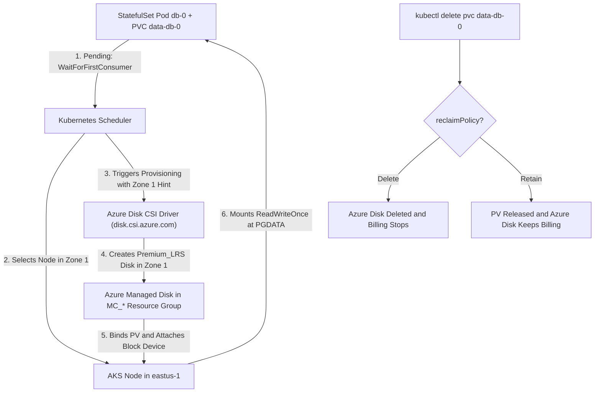
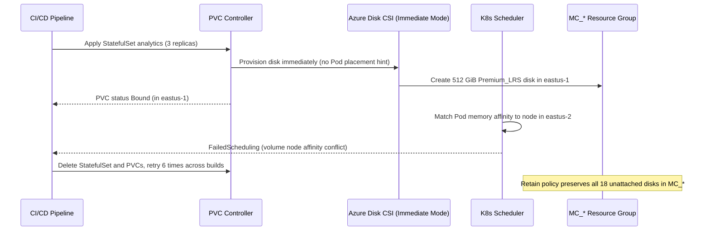

# 02 - StorageClasses and Dynamic Provisioning on Azure

> **Prerequisites:** StatefulSets and `volumeClaimTemplates` (Module 01), Kubernetes PV/PVC fundamentals ([03-kubernetes module 06](../../03-kubernetes/06-storage-pv-and-pvc/README.md)), Terraform AKS provisioning ([09-terraform-on-azure module 06](../../09-terraform-on-azure/06-provisioning-azure-infrastructure/README.md)), plus `az` CLI and `kubectl`.  
> **Estimated Reading Time:** 35 minutes  
> **Target Audience:** Backend Engineers, DevOps Engineers, Kubernetes Operators.

> [!TIP]
> **The Golden Rule of Azure Storage for Databases:** Always back transactional database `volumeClaimTemplates` with an Azure Disk StorageClass (`disk.csi.azure.com`, `ReadWriteOnce`, `volumeBindingMode: WaitForFirstConsumer`, `allowVolumeExpansion: true`), never Azure Files (`ReadWriteMany`). Whenever you choose `reclaimPolicy: Retain`, pair it with a mandatory `az disk list` audit on the `MC_*` node resource group after every teardown so deleted PVCs do not leave orphaned disks billing indefinitely.

---

## Why This Matters

Your StatefulSets in module 01 got their per-Pod volumes from kind's local-path provisioner — durable enough for a laptop, but tied to one node and gone when the cluster dies. On a real AKS cluster those same `volumeClaimTemplates` provision **real, billable Azure managed disks**, and the StorageClass you choose decides performance, whether multiple Pods can share a volume, and — critically — whether your data (and its bill) survives a PVC delete. This is where "it worked on kind" meets "this is costing money on Azure," and where the Terraform skills from track 09 start provisioning the storage layer under your databases.

---

## 1. Architectural Mental Model: Dynamic CSI Provisioning & Zonal Binding on AKS

On AKS, a `StorageClass` translates a Kubernetes `PersistentVolumeClaim` into a live Azure API call via the CSI driver. Crucially, `WaitForFirstConsumer` prevents zonal deadlocks by deferring disk creation until the Kubernetes Scheduler picks the target Node and Availability Zone:



### Core Concepts

#### The same PVC, a different provisioner underneath

Nothing about your PVC or `volumeClaimTemplate` YAML changes going from kind to AKS — this is the whole point of the PV/PVC abstraction you learned in [03-kubernetes module 06](../../03-kubernetes/06-storage-pv-and-pvc/README.md). A PVC still says "I need 10Gi, RWO"; what changes is the **StorageClass** it binds through, and therefore the **provisioner** (the CSI driver) that creates the actual storage. On kind that provisioner writes a directory on the node. On AKS the built-in provisioners call the Azure API and create a genuine managed resource — an Azure Disk or an Azure Files share. Same claim ticket, radically different (and billable) backend.

#### Azure Disk vs. Azure Files — the choice that matters

AKS ships two families of built-in StorageClasses, backed by two very different Azure storage products:

- **Azure Disk** (`disk.csi.azure.com`; classes `managed-csi`, `managed-csi-premium`). A single virtual hard disk attached to **one node at a time** — so it's **`ReadWriteOnce` only**. Low latency, high IOPS, block storage. This is the right default for a **database's data volume**: exactly one Pod writes to it, and you want fast block I/O. It's the direct cloud equivalent of the RWO local-path volume your StatefulSet used on kind.
- **Azure Files** (`file.csi.azure.com`; classes `azurefile-csi`, `azurefile-csi-premium`). An SMB/NFS network file share that **many nodes can mount at once** — so it supports **`ReadWriteMany`**. Higher latency than a disk; the right choice when several Pods on different nodes genuinely need to read/write the *same* files (shared uploads, a scratch area) — the RWX case that local-path *couldn't* satisfy on kind (module 06's exercise 9). It is generally the **wrong** choice for a transactional database's primary data directory.

The rule of thumb: **databases → Azure Disk (RWO, one writer); shared-file workloads → Azure Files (RWX, many writers).** Putting Postgres on Azure Files "so I can scale it" reintroduces exactly the shared-storage corruption problem from module 00 — more mount access does not mean more database.

#### StorageClass parameters: SKU, tier, and `volumeBindingMode`

A StorageClass is more than a provisioner name. The fields that matter for a database:

```yaml
apiVersion: storage.k8s.io/v1
kind: StorageClass
metadata:
  name: db-premium
provisioner: disk.csi.azure.com
parameters:
  skuName: Premium_LRS          # disk SKU: perf + redundancy tier
reclaimPolicy: Retain            # what happens to the disk when the PVC is deleted
allowVolumeExpansion: true       # lets you grow a PVC later without recreating
volumeBindingMode: WaitForFirstConsumer
```

- **`parameters.skuName`** — the Azure Disk SKU: `Standard_LRS` (cheap HDD), `StandardSSD_LRS`, `Premium_LRS` (SSD, what a real DB wants), `PremiumV2_LRS`/`UltraSSD_LRS` (highest, priciest). This is a direct cost and performance lever.
- **`reclaimPolicy`** — `Delete` (default) destroys the Azure Disk when the PVC is deleted; `Retain` keeps it (and keeps billing). Same concept as [03-kubernetes module 06](../../03-kubernetes/06-storage-pv-and-pvc/README.md), but now with real money attached.
- **`allowVolumeExpansion: true`** — lets you increase a PVC's size later by editing it, instead of the destroy-and-recreate a DB volume can't afford.
- **`volumeBindingMode: WaitForFirstConsumer`** — delays provisioning the disk until a Pod that uses the PVC is scheduled, so the disk is created in the **same Availability Zone** as the Pod. For zonal Azure Disks this is essential: with the default `Immediate` mode a disk can be created in zone 1 while the Pod is scheduled to zone 2, and the Pod then can't attach it — a real "stuck Pending" incident you'll reproduce below.

#### Reclaim policy is now a billing decision

On kind, `Delete` vs `Retain` was about whether a directory got cleaned up. On Azure it's about whether a managed disk keeps **billing**:

- `reclaimPolicy: Delete` — deleting the PVC deletes the Azure Disk; the bill stops. Safe for cost, dangerous for data (no undo).
- `reclaimPolicy: Retain` — deleting the PVC leaves the Azure Disk (and the PV goes `Released`); the disk **keeps billing** until *you* delete it in Azure. Safe for data, dangerous for cost.

And remember module 01: StatefulSet `volumeClaimTemplate` PVCs aren't deleted when the StatefulSet is deleted. Combine that with `Retain` and you have the track's headline cost trap: **delete a database StatefulSet, delete the namespace, even delete the cluster — and a pile of `Retain`ed Azure Disks can sit there billing indefinitely**, invisible unless you run `az disk list`.

#### Provisioning the StorageClass with Terraform (track 09 patterns)

You don't have to hand-`kubectl apply` StorageClasses. In track 09 module 06 you provisioned an AKS cluster and wired an AcrPull role assignment with `azurerm`. The same declarative approach extends to the storage layer using the `kubernetes` Terraform provider (pointed at the AKS cluster Terraform just built), so the StorageClass is part of the same `apply`:

```hcl
# Reuse the AKS cluster from track 09 module 06 for the k8s provider creds.
provider "kubernetes" {
  host                   = azurerm_kubernetes_cluster.aks.kube_config[0].host
  client_certificate     = base64decode(azurerm_kubernetes_cluster.aks.kube_config[0].client_certificate)
  client_key             = base64decode(azurerm_kubernetes_cluster.aks.kube_config[0].client_key)
  cluster_ca_certificate = base64decode(azurerm_kubernetes_cluster.aks.kube_config[0].cluster_ca_certificate)
}

resource "kubernetes_storage_class" "db_premium" {
  metadata { name = "db-premium" }
  storage_provisioner    = "disk.csi.azure.com"
  reclaim_policy         = "Retain"
  allow_volume_expansion = true
  volume_binding_mode    = "WaitForFirstConsumer"
  parameters = {
    skuName = "Premium_LRS"
  }
}
```

This is the exact shape of track 09's `azurerm` resources, just with a `kubernetes_*` type — same `plan`/`apply`/`destroy` lifecycle, same "config is the source of truth" recovery behavior. Now your database's storage tier is code-reviewed and reproducible, not a one-off `kubectl` someone forgot they ran.

---

## 2. Taxonomic Comparison & Command Reference

### Azure CSI Storage Families & Database StorageClass Knobs

| Storage Family / CSI Driver | Built-in AKS Classes | Access Modes | Performance & Protocol | Database Suitability |
| :--- | :--- | :--- | :--- | :--- |
| **Azure Disk** (`disk.csi.azure.com`) | `managed-csi`, `managed-csi-premium` | `ReadWriteOnce` (`RWO`) | Low-latency block storage; up to high SSD IOPS | **Recommended** for database data & WAL volumes |
| **Azure Files** (`file.csi.azure.com`) | `azurefile-csi`, `azurefile-csi-premium` | `ReadWriteMany` (`RWX`), `RWO` | Network SMB/NFS file share; higher metadata/fsync latency | **Anti-pattern** for transactional DBs; good for shared uploads/CMS assets |

| StorageClass Parameter / Field | Options | Safety & Reliability Trade-off | Billing Impact |
| :--- | :--- | :--- | :--- |
| **`parameters.skuName`** | `Standard_LRS`, `StandardSSD_LRS`, `Premium_LRS`, `PremiumV2_LRS`, `Premium_ZRS` | `Premium_LRS`/`Premium_ZRS` give predictable low latency & IOPS; `ZRS` replicates across 3 zones | Higher SKU = significantly higher per-GiB and provisioned IOPS cost |
| **`reclaimPolicy`** | `Retain` vs `Delete` | `Retain` saves data on accidental PVC delete; `Delete` removes disk irreversibly | `Retain` keeps billing after PVC/cluster deletion until manual `az disk delete` |
| **`volumeBindingMode`** | `WaitForFirstConsumer` vs `Immediate` | `WaitForFirstConsumer` guarantees disk and Pod share the same Availability Zone | Prevents failed-pod retry loops and orphaned cross-zone disks |
| **`allowVolumeExpansion`** | `true` vs `false` | `true` enables online disk resize via `kubectl patch pvc` without downtime | Prevents painful dump-and-restore migrations when disk fills up |

### Command reference

| Command | What it does | Example |
|---|---|---|
| `kubectl get storageclass` | Lists classes and their provisioners; shows the `(default)` | `kubectl get sc` |
| `kubectl describe sc <name>` | Shows provisioner, parameters, reclaim policy, binding mode | `kubectl describe sc managed-csi` |
| `kubectl get pvc -o wide` | Shows PVCs, their class, and bound PV | `kubectl get pvc -o wide` |
| `kubectl get pv` | Lists PVs; the `RECLAIM POLICY` column matters here | `kubectl get pv` |
| `az disk list -o table` | **Lists real Azure managed disks — how you catch orphans** | `az disk list -g <node-rg> -o table` |
| `az disk delete` | Deletes an orphaned Azure Disk (stops its billing) | `az disk delete --ids <disk-id> --yes` |
| `az aks show --query nodeResourceGroup` | Finds the `MC_*` group where AKS-provisioned disks live | `az aks show -g rg -n aks --query nodeResourceGroup -o tsv` |
| `kubectl patch pvc <n> -p '{"spec":{"resources":{"requests":{"storage":"20Gi"}}}}'` | Grows a PVC (needs `allowVolumeExpansion`) | see exercises |

Flag breakdown — StorageClass `parameters` for a DB disk:
- `provisioner: disk.csi.azure.com` — the Azure Disk CSI driver (RWO block storage); use `file.csi.azure.com` only when you truly need RWX.
- `skuName: Premium_LRS` — SSD-backed, the performance/redundancy tier a real database wants (and a cost lever).
- `reclaimPolicy: Retain` — keep the disk on PVC delete (data safety / billing risk); `Delete` for the opposite trade.
- `volumeBindingMode: WaitForFirstConsumer` — provision the zonal disk only once a Pod is scheduled, so disk and Pod land in the same zone.

---

## 3. Production War Story Post-Mortem

### SEV-2: Cross-Zone Disk Deadlock & Orphaned `Retain` Disk Sprawl

- **Severity:** SEV-2 (Staging & Pre-Prod Database Provisioning Outage + Unplanned Cloud Spend)
- **Detection Time:** 22 minutes (StatefulSet rollout timeout) for outage; 28 days (monthly FinOps invoice review) for cost leakage
- **Resolution Time:** 45 minutes to unblock workloads; 2 hours to audit and purge orphaned disks
- **Blast Radius:** New analytics Postgres cluster stuck `Pending` across multiple availability zones; 18 unattached 512 GiB `Premium_LRS` disks left billing ~\$1,400/month in `MC_*` resource groups after repeated developer retries.

#### What Happened

A platform engineer created a custom `StorageClass` (`analytics-premium`) with `reclaimPolicy: Retain` and `skuName: Premium_LRS`—forgetting `volumeBindingMode: WaitForFirstConsumer`, which caused Kubernetes to default to `Immediate`. When a deployment pipeline created a 3-replica `StatefulSet` in a multi-zone AKS cluster (`eastus-1`, `eastus-2`, `eastus-3`), the CSI driver immediately created `data-analytics-0` in `eastus-1`, while the scheduler placed `analytics-0` onto a memory-optimized node pool located solely in `eastus-2`.



#### Root Cause Analysis (RCA)

1. **Missing `WaitForFirstConsumer`:** Omitting `volumeBindingMode` defaulted to `Immediate`, decoupling disk zone selection from Pod node affinity/capacity placement.
2. **Blind Retries Under `reclaimPolicy: Retain`:** Each CI retry deleted the PVC and recreated a fresh claim; because `Retain` never deletes the backing Azure resource, every retry leaked another 512 GiB `Premium_LRS` disk inside `MC_*` invisible to `kubectl get pvc`.
3. **Lack of FinOps Tagging & Orphan Auditing:** Nothing monitored `diskState == "Unattached"` in `MC_*` resource groups.

#### The Fix & Architectural Hardening

1. **Immediate Mitigation:** Audited `MC_*` with `az disk list --query "[?diskState=='Unattached']"`, verified zero required snapshots/data on the failed CI disks, deleted all 18 orphaned disks, and purged `Released` PVs.
2. **StorageClass Standardization:** Moved all StorageClasses into Terraform (`kubernetes_storage_class`) enforcing `volume_binding_mode = "WaitForFirstConsumer"` and `allow_volume_expansion = true`, and switched non-prod classes to `reclaim_policy = "Delete"` + `StandardSSD_LRS`.
3. **Automated Orphan Alerting:** Added a weekly FinOps check alerting on any unattached Azure Managed Disk older than 48 hours in `MC_*` resource groups.

---

## 4. Multi-Language Production Implementation

Operating database StorageClasses on Azure requires automated guardrails that audit Kubernetes PVs/PVCs and StorageClasses for misconfigurations (`Immediate` binding, RWX `file.csi.azure.com` on DBs, missing `allowVolumeExpansion`) and detect orphaned `Released` PVs whose `Retain` Azure Disks continue billing. The four production implementations below evaluate PV/StorageClass manifests and flag cost & reliability risks.

````carousel
```go
// Go: Kubernetes StorageClass & Released Retain-PV billing auditor
package storageaudit

import (
	"fmt"
	"strings"
)

type StorageClassSpec struct {
	Name                 string
	Provisioner          string
	ReclaimPolicy        string
	VolumeBindingMode    string
	AllowVolumeExpansion bool
	SkuName              string
}

type PersistentVolumeInfo struct {
	Name          string
	Phase         string // Bound, Available, Released, Failed
	ReclaimPolicy string // Retain, Delete
	StorageClass  string
	CapacityGiB   int
	AzureDiskURI  string
}

type AuditFinding struct {
	Severity string
	Resource string
	Message  string
}

var monthlyCostPerGiB = map[string]float64{
	"Standard_LRS":    0.04,
	"StandardSSD_LRS": 0.075,
	"Premium_LRS":     0.132,
	"Premium_ZRS":     0.165,
}

func AuditDatabaseStorage(classes []StorageClassSpec, pvs []PersistentVolumeInfo) ([]AuditFinding, float64) {
	var findings []AuditFinding
	classByName := make(map[string]StorageClassSpec, len(classes))

	for _, sc := range classes {
		classByName[sc.Name] = sc
		if strings.Contains(sc.Name, "db") && sc.Provisioner == "file.csi.azure.com" {
			findings = append(findings, AuditFinding{
				Severity: "CRITICAL",
				Resource: "sc/" + sc.Name,
				Message:  "Azure Files (RWX) risks split-brain DB corruption; use disk.csi.azure.com",
			})
		}
		if sc.Provisioner == "disk.csi.azure.com" && sc.VolumeBindingMode != "WaitForFirstConsumer" {
			findings = append(findings, AuditFinding{
				Severity: "HIGH",
				Resource: "sc/" + sc.Name,
				Message:  fmt.Sprintf("volumeBindingMode=%q risks zonal volume node affinity conflict", sc.VolumeBindingMode),
			})
		}
		if !sc.AllowVolumeExpansion {
			findings = append(findings, AuditFinding{
				Severity: "MEDIUM",
				Resource: "sc/" + sc.Name,
				Message:  "allowVolumeExpansion=false blocks online PVC resizing",
			})
		}
	}

	var orphanMonthlySpend float64
	for _, pv := range pvs {
		if pv.Phase == "Released" && pv.ReclaimPolicy == "Retain" {
			rate := 0.132
			if sc, ok := classByName[pv.StorageClass]; ok {
				if r, found := monthlyCostPerGiB[sc.SkuName]; found {
					rate = r
				}
			}
			estCost := float64(pv.CapacityGiB) * rate
			orphanMonthlySpend += estCost
			findings = append(findings, AuditFinding{
				Severity: "COST_LEAK",
				Resource: "pv/" + pv.Name,
				Message:  fmt.Sprintf("Released Retain PV (%d GiB, est USD %.2f/mo) — verify and run az disk delete --ids %s", pv.CapacityGiB, estCost, pv.AzureDiskURI),
			})
		}
	}

	return findings, orphanMonthlySpend
}
```
<!-- slide -->
```typescript
// TypeScript: Azure StorageClass & Orphaned Retain PV Auditor
export interface StorageClassSpec {
  name: string;
  provisioner: string;
  reclaimPolicy: 'Retain' | 'Delete';
  volumeBindingMode: 'Immediate' | 'WaitForFirstConsumer';
  allowVolumeExpansion: boolean;
  skuName: string;
}

export interface PersistentVolumeRecord {
  name: string;
  phase: 'Available' | 'Bound' | 'Released' | 'Failed';
  reclaimPolicy: 'Retain' | 'Delete';
  storageClass: string;
  capacityGiB: number;
  azureDiskId: string;
}

export interface AuditReport {
  findings: Array<{ severity: 'CRITICAL' | 'HIGH' | 'MEDIUM' | 'COST_LEAK'; resource: string; detail: string }>;
  estimatedOrphanMonthlyUsd: number;
}

const SKU_RATE_USD_PER_GIB: Record<string, number> = {
  Standard_LRS: 0.04,
  StandardSSD_LRS: 0.075,
  Premium_LRS: 0.132,
  Premium_ZRS: 0.165,
};

export function auditAzureDatabaseStorage(
  storageClasses: StorageClassSpec[],
  persistentVolumes: PersistentVolumeRecord[]
): AuditReport {
  const findings: AuditReport['findings'] = [];
  const scMap = new Map(storageClasses.map((sc) => [sc.name, sc]));

  for (const sc of storageClasses) {
    if (sc.name.includes('db') && sc.provisioner === 'file.csi.azure.com') {
      findings.push({
        severity: 'CRITICAL',
        resource: `sc/${sc.name}`,
        detail: 'Azure Files RWX must not host transactional database data; switch to disk.csi.azure.com',
      });
    }
    if (sc.provisioner === 'disk.csi.azure.com' && sc.volumeBindingMode !== 'WaitForFirstConsumer') {
      findings.push({
        severity: 'HIGH',
        resource: `sc/${sc.name}`,
        detail: `Binding mode "${sc.volumeBindingMode}" risks cross-zone volume node affinity conflicts`,
      });
    }
    if (!sc.allowVolumeExpansion) {
      findings.push({
        severity: 'MEDIUM',
        resource: `sc/${sc.name}`,
        detail: 'allowVolumeExpansion is false; online database volume expansion will be rejected',
      });
    }
  }

  let estimatedOrphanMonthlyUsd = 0;
  for (const pv of persistentVolumes) {
    if (pv.phase === 'Released' && pv.reclaimPolicy === 'Retain') {
      const sku = scMap.get(pv.storageClass)?.skuName ?? 'Premium_LRS';
      const monthlyCost = pv.capacityGiB * (SKU_RATE_USD_PER_GIB[sku] ?? 0.132);
      estimatedOrphanMonthlyUsd += monthlyCost;
      findings.push({
        severity: 'COST_LEAK',
        resource: `pv/${pv.name}`,
        detail: `Orphaned Released PV (${pv.capacityGiB} GiB, ~USD ${monthlyCost.toFixed(2)}/mo); inspect ${pv.azureDiskId}`,
      });
    }
  }

  return {
    findings,
    estimatedOrphanMonthlyUsd: Number(estimatedOrphanMonthlyUsd.toFixed(2)),
  };
}
```
<!-- slide -->
```python
# Python: Azure StorageClass & Released Retain-PV Cost/Safety Auditor
from dataclasses import dataclass

SKU_MONTHLY_USD_PER_GIB: dict[str, float] = {
    "Standard_LRS": 0.04,
    "StandardSSD_LRS": 0.075,
    "Premium_LRS": 0.132,
    "Premium_ZRS": 0.165,
}


@dataclass(frozen=True)
class StorageClassConfig:
    name: str
    provisioner: str
    reclaim_policy: str
    volume_binding_mode: str
    allow_volume_expansion: bool
    sku_name: str


@dataclass(frozen=True)
class PersistentVolumeSnapshot:
    name: str
    phase: str
    reclaim_policy: str
    storage_class: str
    capacity_gib: int
    azure_disk_id: str


@dataclass(frozen=True)
class StorageAuditFinding:
    severity: str
    resource: str
    message: str


def audit_azure_storage(
    classes: list[StorageClassConfig],
    volumes: list[PersistentVolumeSnapshot],
) -> tuple[list[StorageAuditFinding], float]:
    findings: list[StorageAuditFinding] = []
    class_index = {sc.name: sc for sc in classes}

    for sc in classes:
        if "db" in sc.name and sc.provisioner == "file.csi.azure.com":
            findings.append(
                StorageAuditFinding(
                    "CRITICAL",
                    f"sc/{sc.name}",
                    "Azure Files (RWX) assigned to database class; switch to disk.csi.azure.com (RWO)",
                )
            )
        if sc.provisioner == "disk.csi.azure.com" and sc.volume_binding_mode != "WaitForFirstConsumer":
            findings.append(
                StorageAuditFinding(
                    "HIGH",
                    f"sc/{sc.name}",
                    f"volumeBindingMode={sc.volume_binding_mode!r} risks zonal affinity deadlocks",
                )
            )
        if not sc.allow_volume_expansion:
            findings.append(
                StorageAuditFinding(
                    "MEDIUM",
                    f"sc/{sc.name}",
                    "allowVolumeExpansion=False prevents live PVC growth",
                )
            )

    orphan_monthly_usd = 0.0
    for pv in volumes:
        if pv.phase == "Released" and pv.reclaim_policy == "Retain":
            sku = class_index[pv.storage_class].sku_name if pv.storage_class in class_index else "Premium_LRS"
            cost = pv.capacity_gib * SKU_MONTHLY_USD_PER_GIB.get(sku, 0.132)
            orphan_monthly_usd += cost
            findings.append(
                StorageAuditFinding(
                    "COST_LEAK",
                    f"pv/{pv.name}",
                    f"Released Retain disk ({pv.capacity_gib} GiB, ~USD {cost:.2f}/mo): {pv.azure_disk_id}",
                )
            )

    return findings, round(orphan_monthly_usd, 2)
```
<!-- slide -->
```csharp
// C#: Azure StorageClass & Released Retain-PV Compliance Auditor
namespace BackendRoadmap.AzureStorageAudit;

public sealed record StorageClassSpec(
    string Name,
    string Provisioner,
    string ReclaimPolicy,
    string VolumeBindingMode,
    bool AllowVolumeExpansion,
    string SkuName);

public sealed record PersistentVolumeRecord(
    string Name,
    string Phase,
    string ReclaimPolicy,
    string StorageClass,
    int CapacityGiB,
    string AzureDiskId);

public sealed record AuditFinding(string Severity, string Resource, string Message);

public static class AzureStorageAuditor
{
    private static readonly Dictionary<string, decimal> SkuRatesUsdPerGiB = new(StringComparer.OrdinalIgnoreCase)
    {
        ["Standard_LRS"] = 0.04m,
        ["StandardSSD_LRS"] = 0.075m,
        ["Premium_LRS"] = 0.132m,
        ["Premium_ZRS"] = 0.165m
    };

    public static (IReadOnlyList<AuditFinding> Findings, decimal EstimatedOrphanMonthlyUsd) Audit(
        IEnumerable<StorageClassSpec> storageClasses,
        IEnumerable<PersistentVolumeRecord> persistentVolumes)
    {
        var scList = storageClasses.ToList();
        var scByName = scList.ToDictionary(s => s.Name, StringComparer.Ordinal);
        var findings = new List<AuditFinding>();

        foreach (var sc in scList)
        {
            if (sc.Name.Contains("db", StringComparison.OrdinalIgnoreCase) &&
                sc.Provisioner == "file.csi.azure.com")
            {
                findings.Add(new AuditFinding(
                    "CRITICAL",
                    $"sc/{sc.Name}",
                    "Azure Files RWX is unsafe for transactional databases; use disk.csi.azure.com."));
            }

            if (sc.Provisioner == "disk.csi.azure.com" &&
                sc.VolumeBindingMode != "WaitForFirstConsumer")
            {
                findings.Add(new AuditFinding(
                    "HIGH",
                    $"sc/{sc.Name}",
                    $"volumeBindingMode='{sc.VolumeBindingMode}' risks zonal volume node affinity conflicts."));
            }

            if (!sc.AllowVolumeExpansion)
            {
                findings.Add(new AuditFinding(
                    "MEDIUM",
                    $"sc/{sc.Name}",
                    "allowVolumeExpansion is false; online PVC expansion will be blocked."));
            }
        }

        decimal totalOrphanUsd = 0m;
        foreach (var pv in persistentVolumes)
        {
            if (pv.Phase == "Released" && pv.ReclaimPolicy == "Retain")
            {
                string sku = scByName.TryGetValue(pv.StorageClass, out var sc) ? sc.SkuName : "Premium_LRS";
                decimal rate = SkuRatesUsdPerGiB.GetValueOrDefault(sku, 0.132m);
                decimal monthlyCost = pv.CapacityGiB * rate;
                totalOrphanUsd += monthlyCost;

                findings.Add(new AuditFinding(
                    "COST_LEAK",
                    $"pv/{pv.Name}",
                    $"Released Retain PV ({pv.CapacityGiB} GiB, est. USD {monthlyCost:F2}/mo); check disk {pv.AzureDiskId}"));
            }
        }

        return (findings, totalOrphanUsd);
    }
}
```
````

---

## 5. Practical Hands-On Verification CLI Workflows

These need a **real AKS cluster** — reuse the Terraform-provisioned one from [09-terraform-on-azure module 06](../../09-terraform-on-azure/06-provisioning-azure-infrastructure/README.md), or `az aks create` a small one. **This module creates billable disks — do the cleanup at the end.**

Set up credentials and a namespace:

```bash
az aks get-credentials -g <rg> -n <aks-name>
kubectl get nodes           # confirm real AKS nodes, not kind
kubectl create namespace stateful
kubectl config set-context --current --namespace=stateful
```

### 1. See what AKS gives you out of the box

```bash
kubectl get storageclass
```

**Expected Output:**
```text
NAME                    PROVISIONER          RECLAIMPOLICY   VOLUMEBINDINGMODE      ALLOWVOLUMEEXPANSION   AGE
azurefile-csi           file.csi.azure.com   Delete          Immediate              true                   1d
azurefile-csi-premium   file.csi.azure.com   Delete          Immediate              true                   1d
default (default)       disk.csi.azure.com   Delete          WaitForFirstConsumer   true                   1d
managed-csi             disk.csi.azure.com   Delete          WaitForFirstConsumer   true                   1d
managed-csi-premium     disk.csi.azure.com   Delete          WaitForFirstConsumer   true                   1d
```
Several classes appear including `managed-csi`, `managed-csi-premium` (Azure Disk), `azurefile-csi`, `azurefile-csi-premium` (Azure Files), with one marked `(default)`. Compare to kind's single `standard`/local-path class — same PVC abstraction, cloud backends behind it.

```bash
kubectl describe sc managed-csi | grep -iE "provisioner|reclaim|bindingmode|parameters"
```

**Expected Output:** `disk.csi.azure.com`, `Delete` reclaim policy, `WaitForFirstConsumer` binding mode.

### 2. Provision a real Azure Disk via a PVC

```yaml
# pvc-disk.yaml
apiVersion: v1
kind: PersistentVolumeClaim
metadata:
  name: db-disk
spec:
  accessModes: ["ReadWriteOnce"]
  storageClassName: managed-csi
  resources:
    requests:
      storage: 5Gi
```

```bash
kubectl apply -f pvc-disk.yaml
kubectl get pvc db-disk
```

**Expected Output:**
```text
NAME      STATUS    VOLUME   CAPACITY   ACCESS MODES   STORAGECLASS   AGE
db-disk   Pending                                      managed-csi    5s
```
With `WaitForFirstConsumer`, the PVC stays **`Pending`** with the event message `waiting for first consumer to be created before binding` — this is correct, not an error. It binds once a Pod uses it (next step). This is the key behavioral difference from kind's `Immediate` binding.

### 3. Attach a Pod and watch the disk appear in Azure

```yaml
# pod-disk.yaml
apiVersion: v1
kind: Pod
metadata:
  name: disk-writer
spec:
  containers:
    - name: app
      image: busybox:1.36
      command: ["sh","-c","echo hello-azure-disk > /data/file.txt; sleep 3600"]
      volumeMounts:
        - name: d
          mountPath: /data
  volumes:
    - name: d
      persistentVolumeClaim:
        claimName: db-disk
```

```bash
kubectl apply -f pod-disk.yaml
kubectl get pvc db-disk        # now Bound
NODE_RG=$(az aks show -g <rg> -n <aks-name> --query nodeResourceGroup -o tsv)
az disk list -g "$NODE_RG" -o table
```

**Expected Output:** PVC transitions to `Bound`, and `az disk list` shows a real managed disk (e.g., `pvc-xxxxxxxx-...`, `5` GiB, `StandardSSD_LRS` or `Premium_LRS`) in the AKS node resource group (`MC_*`). **That disk is billing right now.** Confirm the write:

```bash
kubectl exec disk-writer -- cat /data/file.txt
```

**Expected Output:**
```text
hello-azure-disk
```

### 4. Contrast with Azure Files (RWX)

```yaml
# pvc-files.yaml
apiVersion: v1
kind: PersistentVolumeClaim
metadata:
  name: shared-files
spec:
  accessModes: ["ReadWriteMany"]     # RWX — impossible on Azure Disk
  storageClassName: azurefile-csi
  resources:
    requests:
      storage: 5Gi
```

```bash
kubectl apply -f pvc-files.yaml
kubectl get pvc shared-files
```

**Expected Output:** This binds (`Bound`) even though it's `ReadWriteMany` — Azure Files supports RWX where Azure Disk (and kind's local-path) cannot. This is the concrete resolution of module 06's exercise-9 limitation. Note it is *not* what you'd put a transactional database on — many writers is the point for shared files and the *anti*-pattern for a DB.

### 5. Create a custom DB StorageClass with `Retain` + Premium

```yaml
# sc-db.yaml
apiVersion: storage.k8s.io/v1
kind: StorageClass
metadata:
  name: db-premium
provisioner: disk.csi.azure.com
parameters:
  skuName: Premium_LRS
reclaimPolicy: Retain
allowVolumeExpansion: true
volumeBindingMode: WaitForFirstConsumer
```

```bash
kubectl apply -f sc-db.yaml
kubectl describe sc db-premium | grep -iE "reclaim|parameters"
```

**Expected Output:** `Reclaim Policy: Retain`, `skuName=Premium_LRS`. This is the class you'd point a Postgres StatefulSet's `volumeClaimTemplate` at.

### 6. Back a StatefulSet's `volumeClaimTemplate` with the Azure class

Reuse the StatefulSet shape from module 01, now pointing at `db-premium`:

```yaml
# sts-azure.yaml
apiVersion: v1
kind: Service
metadata: { name: db }
spec:
  clusterIP: None
  selector: { app: db }
  ports: [{ port: 80, name: web }]
---
apiVersion: apps/v1
kind: StatefulSet
metadata: { name: db }
spec:
  serviceName: db
  replicas: 2
  selector: { matchLabels: { app: db } }
  template:
    metadata: { labels: { app: db } }
    spec:
      containers:
        - name: web
          image: nginx:1.27
          volumeMounts: [{ name: data, mountPath: /usr/share/nginx/html }]
  volumeClaimTemplates:
    - metadata: { name: data }
      spec:
        accessModes: ["ReadWriteOnce"]
        storageClassName: db-premium
        resources: { requests: { storage: 5Gi } }
```

```bash
kubectl apply -f sts-azure.yaml
kubectl get pods -l app=db -w        # ctrl-c when both Ready
kubectl get pvc
az disk list -g "$NODE_RG" -o table
```

**Expected Output:** `data-db-0` and `data-db-1` each provision a **separate Premium Azure Disk** (visible in `az disk list`) — the module 01 per-Pod storage model, now on real cloud disks with the tier and reclaim policy you chose.

### 7. Grow a PVC online (`allowVolumeExpansion`)

```bash
kubectl patch pvc data-db-0 -p '{"spec":{"resources":{"requests":{"storage":"10Gi"}}}}'
kubectl get pvc data-db-0 -w        # watch CAPACITY move toward 10Gi
```

**Expected Output:** The PVC (and the underlying Azure Disk) expands to `10Gi` without recreating anything — because the class had `allowVolumeExpansion: true`. Databases grow; this is how you grow their storage without a migrate-and-recreate.

### 8. Diagnose-and-fix: StatefulSet Pod stuck `Pending` on a zone mismatch

This reproduces the classic Azure-Disk-vs-zone incident using an `Immediate`-binding class (the wrong choice for zonal disks). Create it:

```yaml
# sc-immediate.yaml
apiVersion: storage.k8s.io/v1
kind: StorageClass
metadata: { name: disk-immediate }
provisioner: disk.csi.azure.com
parameters: { skuName: StandardSSD_LRS }
volumeBindingMode: Immediate         # provisions the disk before scheduling
```

```bash
kubectl apply -f sc-immediate.yaml
```

Point a single-Pod workload's PVC at it, but constrain the Pod to a *different* zone than the disk is likely to land in (on a multi-zone cluster). Apply a PVC with this class and a Pod with a `nodeSelector`/affinity for a specific zone, then:

```bash
kubectl get pvc immediate-claim        # Bound (disk already created, in some zone)
kubectl get pod zone-pinned            # may be Pending
kubectl describe pod zone-pinned | grep -A6 -i events
```

**Expected Output:** On a multi-zone AKS, with `Immediate`, the disk was created in one zone before the scheduler placed the Pod; if the Pod is pinned to a different zone, you get a scheduling failure like `volume node affinity conflict` / `had volume node affinity conflict` — the Pod can't attach a disk that lives in another zone. **Fix:** use a `WaitForFirstConsumer` class (like `managed-csi` or your `db-premium`), which provisions the disk only *after* the Pod is scheduled, guaranteeing disk and Pod share a zone. Recreate the PVC/Pod against `db-premium` and confirm it binds and runs. (On a single-zone cluster you won't reproduce the conflict — read the concept and note *why* `WaitForFirstConsumer` is the safe default.)

### 9. Diagnose-and-fix: the orphaned-disk cost trap

Delete the module's StatefulSet the way a careless operator would, then prove the disks (and the bill) survived:

```bash
kubectl delete -f sts-azure.yaml       # deletes StatefulSet + headless Service
kubectl get pvc                        # PVCs still here (module 01 behavior)
kubectl delete pvc data-db-0 data-db-1 # now delete the PVCs
az disk list -g "$NODE_RG" -o table
```

**Expected Output:** Because `db-premium` uses `reclaimPolicy: Retain`, deleting the PVCs leaves the underlying Premium disks **still present in `az disk list`** (and still billing) — the PVs show `Released`, and Azure never reclaimed the disks. This is the trap: the Kubernetes side looks clean, Azure is still charging you. **Fix — reclaim them by hand:**

```bash
kubectl get pv                          # find the Released PVs and their disk URIs
az disk list -g "$NODE_RG" --query "[].{name:name,disk:id}" -o table
az disk delete --ids <each-disk-id> --yes
kubectl delete pv <released-pv-names>
```

**Expected Output:** `az disk list` no longer shows the disks — billing stops. This is exactly why module 01 kept warning that retained PVCs are a cost trap on Azure: `Retain` is a data-safety choice you must pair with a manual-cleanup discipline.

### 10. Full cleanup — leave nothing billing

```bash
kubectl delete -f pod-disk.yaml -f pvc-disk.yaml -f pvc-files.yaml --ignore-not-found
kubectl delete sc db-premium disk-immediate --ignore-not-found
# any workloads from ex 8:
kubectl delete pod zone-pinned --ignore-not-found
kubectl delete pvc immediate-claim --ignore-not-found
# then confirm NOTHING survives in Azure:
az disk list -g "$NODE_RG" -o table
kubectl get pv
```

**Expected Output:** `az disk list` is empty (or only shows OS disks for nodes, never your data disks). If you're done with the cluster entirely, tear it down with `terraform destroy` / `az group delete` as in track 09 — and re-run `az disk list` across the node RG afterward to be certain no `Retain`ed disk outlived the cluster.

### Independent challenge

No manifests or HCL given. Using the Terraform patterns from [09-terraform-on-azure module 06](../../09-terraform-on-azure/06-provisioning-azure-infrastructure/README.md), extend a Terraform config that already builds an AKS cluster so that the *same* `terraform apply` also creates a custom `db-premium` StorageClass (Premium SSD, `Retain`, expansion enabled, `WaitForFirstConsumer`) via the `kubernetes` provider wired to that cluster's credentials. Then, with plain `kubectl`, deploy a 2-replica StatefulSet whose `volumeClaimTemplate` uses your Terraform-managed class, prove each replica got its own Premium disk in the node resource group, and finally demonstrate the orphaned-disk trap end to end: delete the StatefulSet and its PVCs, show the disks still exist and still bill under `Retain`, then reclaim them and prove `az disk list` is empty. Write two sentences on what you'd change in the StorageClass if this were a throwaway dev database where accidental data loss is fine but a lingering bill is not. This integrates track 09's provisioning, module 01's StatefulSet storage, and this module's reclaim-policy cost behavior.

<details>
<summary>Stuck? One hint</summary>

For the Terraform side, add a `provider "kubernetes"` block fed by `azurerm_kubernetes_cluster.aks.kube_config[0].*` (host + base64-decoded certs, exactly as in the Concepts section) and a `kubernetes_storage_class` resource — same `plan`/`apply` lifecycle as track 09's `azurerm` resources. For the "throwaway dev DB" question: the lever is `reclaimPolicy` — flip it to `Delete` so PVC deletion also deletes the disk (no orphan bill), and optionally drop `skuName` to `StandardSSD_LRS` to cut per-GB cost, since you've decided the data isn't worth protecting.

</details>

---

## 6. Common Mistakes & Troubleshooting

- **Putting a database on Azure Files to "make it scalable."** Azure Files (RWX) lets many Pods mount one share — which for a transactional database is the module-00 shared-storage corruption trap, not scaling. Databases belong on Azure Disk (RWO); scale a database with replication, not with more mounters.
- **`Immediate` binding for zonal disks.** With `volumeBindingMode: Immediate`, the disk is created before the Pod is scheduled and can land in the wrong Availability Zone, giving `volume node affinity conflict` and a stuck Pod (exercise 8). Use `WaitForFirstConsumer` for zonal Azure Disks — it's the default on the built-in classes for exactly this reason.
- **`reclaimPolicy: Retain` with no cleanup discipline.** Retained disks survive PVC *and* StatefulSet *and* cluster deletion and keep billing, invisible to `kubectl`. Whenever you use `Retain`, own a habit of `az disk list` after teardown. This is the single most expensive mistake in this track.
- **Forgetting `allowVolumeExpansion` until you need it.** A class without it can't grow a PVC; growing then means migrate-and-recreate, which a live database can't do cheaply. Set it on any DB StorageClass up front.
- **Cost pitfall — oversizing the SKU.** `Premium_LRS`/`PremiumV2_LRS` costs materially more per GB than `StandardSSD_LRS`. A learning lab or dev DB rarely needs Premium; match the tier to the workload, not to habit.
- **Assuming `terraform destroy` removes `Retain`ed disks.** It destroys what Terraform *manages*; a disk left `Released` by a `Retain` PVC that Kubernetes (not Terraform) created is not in Terraform's state, so it won't be destroyed. Reclaim those explicitly.

---

## 7. Operational Validation Checkpoints

<details>
<summary><strong>Checkpoint 1: PVC Sits Pending Immediately After Creation on `managed-csi`</strong></summary>

**Scenario:** You apply a new standalone `PersistentVolumeClaim` using `storageClassName: managed-csi` and see `STATUS: Pending` with event `waiting for first consumer to be created before binding`. A colleague suggests recreating the StorageClass with `volumeBindingMode: Immediate` to "fix" it.

**Correct Analysis & Action:** Do not switch to `Immediate`. `Pending` until a consumer Pod exists is the exact, healthy design of `WaitForFirstConsumer`. Once your Pod/StatefulSet schedules onto a Node in a specific Availability Zone, the Azure Disk CSI driver provisions the disk in that exact zone and binds the PVC automatically.

</details>

<details>
<summary><strong>Checkpoint 2: Database Pod Fails Rescheduling After Node Maintenance (`volume node affinity conflict`)</strong></summary>

**Scenario:** An AKS node in `eastus-1` shuts down during node-pool autoscaling. The Pod `pg-1` tries to reschedule onto healthy nodes in `eastus-2` and `eastus-3`, remaining `Pending` with `0/3 nodes are available: 3 node(s) had volume node affinity conflict`.

**Correct Analysis & Action:** `Premium_LRS` Azure Disks are locally redundant within a **single** Availability Zone (`eastus-1`), so Kubernetes cannot attach that disk to a VM in `eastus-2` or `eastus-3`. Either ensure node pools maintain capacity in `eastus-1` (e.g., min-count >= 1 per zone), use `Premium_ZRS` (zone-redundant managed disks) for cross-zone attachment, or rely on an operator-managed multi-zone replica cluster (module 03) where another replica in `eastus-2` takes over primary duty.

</details>

<details>
<summary><strong>Checkpoint 3: Persistent Monthly Disk Charges After `terraform destroy` of AKS Cluster</strong></summary>

**Scenario:** A temporary staging AKS cluster was destroyed via `terraform destroy`, yet Azure Cost Management continues billing for four 256 GiB `Premium_LRS` disks.

**Correct Analysis & Action:** Those disks were dynamically provisioned by Kubernetes PVCs using a StorageClass with `reclaimPolicy: Retain`, so neither PVC deletion nor `terraform destroy` deleted them from the `MC_*` node resource group (or snapshot/disk group). Query unattached disks across the subscription with `az disk list --query "[?diskState=='Unattached']" -o table`, confirm no backup/restore value remains, and remove them with `az disk delete --ids <id> --yes`.

</details>

---

## Cumulative review

Closed-book — cover the answers and write yours first. Pulls together modules 00-02 and the tracks underneath them.

1. State the core tension from module 00 in one sentence, then name the two StatefulSet mechanisms from module 01 that resolve it.
2. Your Postgres StatefulSet's `volumeClaimTemplate` uses `azurefile-csi` with `ReadWriteMany`. Two colleagues say this is fine because "now any node can mount it." Why is this the wrong storage for a database?
3. A PVC on AKS using `managed-csi` sits `Pending` with "waiting for first consumer." Is this a bug? What resolves it, and why is this behavior *safer* than kind's immediate binding for zonal disks?
4. Trace exactly what happens to the underlying Azure Disk when you delete a PVC whose StorageClass has `reclaimPolicy: Retain` — and what `az disk list` shows afterward.
5. In [09-terraform-on-azure module 06](../../09-terraform-on-azure/06-provisioning-azure-infrastructure/README.md) you granted AcrPull via an `azurerm_role_assignment`. What Terraform resource type and provider would you use instead to create a StorageClass, and where does it get its cluster credentials?
6. A StatefulSet Pod is stuck `Pending` with `volume node affinity conflict`. Give the root cause and the one-field fix on the StorageClass.
7. You deleted a database StatefulSet, its PVCs, its namespace, and even `terraform destroy`ed the cluster — but the monthly bill didn't drop. What's the most likely cause and how do you confirm and fix it?
8. Why does the identical PVC YAML from [03-kubernetes module 06](../../03-kubernetes/06-storage-pv-and-pvc/README.md) behave so differently on AKS than on kind — what actually changed?
9. Which two StorageClass fields are the direct cost levers for a database volume, and which way does each move the bill?
10. You need to double a live database volume's size with no downtime. What StorageClass field must have been set, and what command grows it?

<details>
<summary>Show answers</summary>

1. Kubernetes' scheduler treats Pods as disposable/interchangeable while stateful workloads need stable identity and stable private storage. StatefulSets resolve it with ordinal stable identity (+ headless-Service per-Pod DNS) and per-Pod storage via `volumeClaimTemplates`.
2. Azure Files RWX lets multiple Pods write the same files — the shared data-directory corruption trap from module 00. A transactional DB needs exactly one writer on fast block storage (Azure Disk, RWO); replication provides scale/HA, not shared mounts.
3. Not a bug — it's `WaitForFirstConsumer` binding. Scheduling a Pod that uses the PVC resolves it. It's safer for zonal disks because the disk is created in the *same* Availability Zone as the Pod, avoiding a cross-zone attach failure.
4. The PVC is deleted but the Azure Disk is *not* — the PV goes `Released` and the managed disk remains in the node resource group, still billing. `az disk list` still shows it; only an explicit `az disk delete` (and PV cleanup) removes it.
5. A `kubernetes_storage_class` resource via the `kubernetes` provider; the provider is configured from `azurerm_kubernetes_cluster.aks.kube_config[0]` (host + base64-decoded client cert/key/CA), so the same `apply` that built the cluster also makes the class.
6. An `Immediate`-binding StorageClass created the zonal disk before the Pod was scheduled, and the Pod landed in a different zone than the disk. Fix: set `volumeBindingMode: WaitForFirstConsumer` on the class.
7. Almost certainly `Retain`ed orphaned Azure Disks that outlived everything Kubernetes/Terraform managed. Confirm with `az disk list -g <MC_ node RG>`; fix with `az disk delete --ids <id> --yes` for each.
8. Nothing about the PVC changed — only the StorageClass/provisioner underneath. On kind it binds a local-path directory; on AKS it calls the Azure Disk CSI driver to create a real, billable managed disk.
9. `parameters.skuName` (e.g. `Standard_LRS` cheap → `Premium_LRS`/`PremiumV2_LRS` expensive) and `reclaimPolicy` (`Delete` stops billing on PVC delete; `Retain` keeps billing until manual cleanup).
10. `allowVolumeExpansion: true` must have been set on the class; grow it with `kubectl patch pvc <name> -p '{"spec":{"resources":{"requests":{"storage":"<bigger>"}}}}'` (or editing the PVC).

</details>

---

## Checkpoint quiz

Write down your answer to each question before expanding it — checking without attempting first is the single easiest way to fool yourself into thinking you've learned this.

1. Which AKS built-in storage family is right for a database data volume, which is right for shared multi-writer files, and what access mode does each support?
2. What does `volumeBindingMode: WaitForFirstConsumer` do, and why is it the safe default for zonal Azure Disks?
3. On Azure, what is the practical difference between `reclaimPolicy: Delete` and `Retain` — in terms of *billing*, not just data?
4. What does `az disk list -g <node-rg>` tell you that `kubectl get pvc` can't?
5. How would you create a StorageClass declaratively with the same Terraform workflow you used for AKS in track 09, and what feeds the `kubernetes` provider its credentials?
6. A StatefulSet Pod is `Pending` with `volume node affinity conflict`. What's the cause and the fix?
7. What single field lets you grow a database's PVC without recreating it, and where is it set?

<details>
<summary>Show answers</summary>

1. Azure Disk (`disk.csi.azure.com`, `managed-csi`/`managed-csi-premium`) for a database volume — `ReadWriteOnce`. Azure Files (`file.csi.azure.com`, `azurefile-csi`) for shared multi-writer files — `ReadWriteMany`.
2. It delays creating the volume until a Pod using the PVC is scheduled, so the disk is provisioned in the same Availability Zone as the Pod — avoiding a zonal Azure Disk being created where the Pod can't attach it.
3. `Delete` deletes the underlying Azure Disk when the PVC is deleted, so billing stops; `Retain` keeps the disk after PVC deletion, so it keeps billing until you delete it manually in Azure.
4. It shows the *real Azure managed disks* that exist and are billing — including `Retain`ed orphans whose PVCs are already gone, which `kubectl get pvc` no longer knows about.
5. Add a `provider "kubernetes"` configured from the AKS cluster's `kube_config[0]` outputs and a `kubernetes_storage_class` resource, run the same `plan`/`apply`. Credentials come from the `azurerm_kubernetes_cluster` outputs (host + base64-decoded certs).
6. An `Immediate`-binding class created the zonal disk in one zone before the Pod was scheduled to another; fix by using a `WaitForFirstConsumer` StorageClass.
7. `allowVolumeExpansion: true`, set on the StorageClass; then edit/patch the PVC's `resources.requests.storage` upward.

</details>

---

## 8. Sources & Further Reading

- Azure Documentation: [Storage Options for Applications in AKS](https://learn.microsoft.com/en-us/azure/aks/concepts-storage)
- Azure Documentation: [Use Azure Disks CSI Driver in AKS](https://learn.microsoft.com/en-us/azure/aks/azure-disk-csi)
- Kubernetes Documentation: [StorageClasses & Volume Binding Modes](https://kubernetes.io/docs/concepts/storage/storage-classes/)
- Track Prerequisites: [03-kubernetes module 06](../../03-kubernetes/06-storage-pv-and-pvc/README.md) & [09-terraform-on-azure module 06](../../09-terraform-on-azure/06-provisioning-azure-infrastructure/README.md)

## Next

[03-running-a-database-with-an-operator](../03-running-a-database-with-an-operator/README.md) — you can now give a StatefulSet real, well-chosen Azure storage. But a StatefulSet still doesn't *run* a database — it won't stream replication, promote a replica, or take a backup. That coordination is what an **operator** adds, and you'll deploy CloudNativePG to get it.
