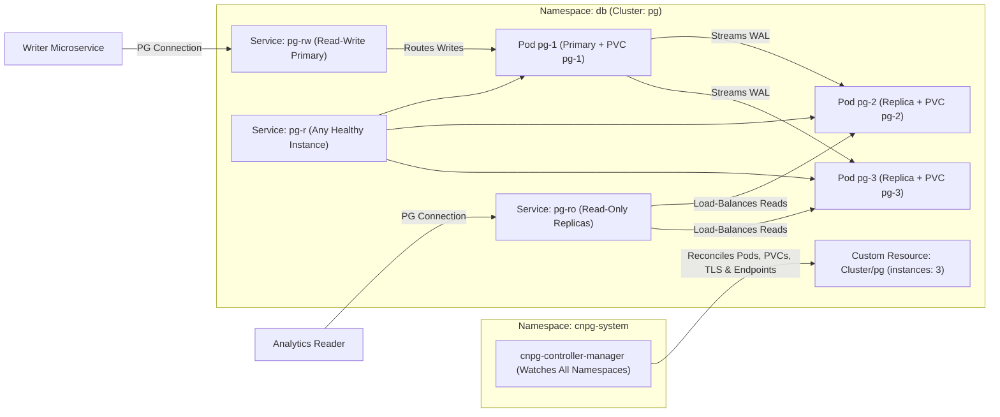
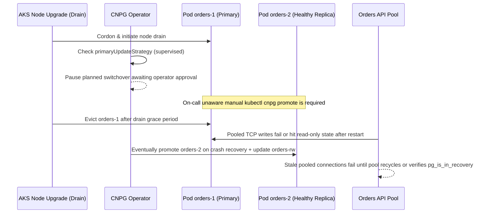

# 03 - Running a Real Database with an Operator

> **Prerequisites:** StatefulSets (Module 01), Azure Disk StorageClasses (Module 02), Kubernetes controller & Helm fundamentals ([03-kubernetes](../../03-kubernetes/README.md)), plus `kubectl` connected to a `kind` or AKS cluster.  
> **Estimated Reading Time:** 35 minutes  
> **Target Audience:** Backend Engineers, DevOps Engineers, Kubernetes Operators.

> [!TIP]
> **The Golden Rule of Database Operators:** Never hardcode an individual Pod address (`pg-1`) in application connection strings, and never force-promote a lagging replica to unstick a failover. Always connect writers through the operator-managed `-rw` Service, verify `pg_is_in_recovery() = false` on connection setup, and let the operator fence returning primaries back into streaming replicas automatically.

---

## Why This Matters

A StatefulSet gives a database stable identity and private storage — but it still has no idea what a "primary," a "replica," or a "failover" is. It won't stream WAL between Postgres instances, promote a standby when the primary dies, or take a base backup. Someone has to encode that operational knowledge, and doing it yourself in shell scripts and init containers is how teams end up with a fragile, bespoke, un-upgradable mess. An **operator** packages that knowledge as software that runs *in* your cluster. This is the module where "Postgres on Kubernetes" stops being a science project and becomes a defensible production choice.

---

## 1. Architectural Mental Model: The CNPG Control Loop & Role-Aware Routing

CloudNativePG splits database management into a **single cluster-wide controller** (running in `cnpg-system`) and **per-database `Cluster` Custom Resources** (in application namespaces). The controller watches Postgres health continuously and updates Kubernetes Services (`-rw`, `-ro`, `-r`) dynamically whenever the primary moves:



### Core Concepts

#### What an operator actually is

An **operator** is a controller plus one or more **Custom Resource Definitions (CRDs)**. Recall the pattern from all of Kubernetes: a controller watches objects and drives reality toward their declared spec (a Deployment controller keeps N Pods running). An operator extends that same loop to a *new* object type you define. Instead of `kind: Deployment`, you write `kind: Cluster` (a Postgres cluster), and the operator's controller — which understands Postgres — creates the StatefulSet-like Pods, the Services, the config, the replication, and the failover logic to make that declared cluster real. You describe *what* ("a 3-instance Postgres 16 cluster with 20Gi Premium disks and daily backups"); the operator handles *how*.

CRDs are the mechanism: a CRD registers a new API type (`clusters.postgresql.cnpg.io`) so `kubectl get clusters` works just like `kubectl get pods`. This is the same "declare desired state, a controller reconciles" model you've used since track 03 — just extended to a domain-specific object.

#### Why not "just a StatefulSet"?

A hand-rolled Postgres StatefulSet (module 01 + 02) gets you identity and storage, but you'd still have to build, by hand:

- **Bootstrap:** initialize the primary's data dir, create users, set up `pg_hba.conf` and replication slots.
- **Replication:** configure each replica to stream WAL from the current primary — and reconfigure them when the primary *changes*.
- **Failover:** detect a dead primary, pick the most up-to-date replica, promote it, and repoint everything else — without ever ending up with two primaries (the split-brain that corrupts data).
- **Connection routing:** give apps a stable "read-write" endpoint that always points at the *current* primary and a "read-only" endpoint across replicas.
- **Backups, restore, PITR, minor-version upgrades, certificate rotation.**

An operator ships all of that as tested, versioned code that thousands of clusters run. Writing it yourself means owning a distributed-systems failover algorithm as a side project — the exact thing module 00 warned "just run Postgres in a Deployment" hand-waves away.

#### CloudNativePG: the Cluster CRD

This track uses **CloudNativePG (CNPG)** — a widely used, CNCF, Postgres operator that models a database as a single `Cluster` resource:

```yaml
apiVersion: postgresql.cnpg.io/v1
kind: Cluster
metadata:
  name: pg
spec:
  instances: 3                       # 1 primary + 2 replicas
  storage:
    size: 5Gi
    storageClass: managed-csi        # module 02's Azure Disk class
  primaryUpdateStrategy: unsupervised
```

From that one object CNPG creates: three Postgres Pods with per-instance PVCs (the module 01/02 pattern, managed for you), streaming replication between them, and — crucially — a set of **Services** for connecting:

- `pg-rw` — always routes to the **current primary** (read-write).
- `pg-ro` — load-balances across **replicas** (read-only).
- `pg-r` — any instance.

Your app connects to `pg-rw` and never has to know *which* Pod is primary — CNPG repoints that Service on failover. This is the "stable endpoint for a moving primary" problem from module 01, solved by the operator.

#### Failover, promotion, and split-brain avoidance

When CNPG detects the primary is unhealthy, it runs a controlled failover: it selects the replica with the most WAL applied, **promotes** it to primary, updates the `pg-rw` Service to point at it, and reconfigures the remaining replicas to stream from the new primary. The old primary, when it comes back, rejoins as a *replica* (after re-syncing) — it is never allowed to resume as a second primary. That last guarantee is the whole point: avoiding two primaries is what prevents the corruption module 00 showed a Deployment inviting on every rolling update.

`primaryUpdateStrategy: unsupervised` lets CNPG do minor-version upgrades and node-drain failovers automatically (switch the primary, update, done); `supervised` makes you approve the primary switch. Understanding this knob matters for the diagnose-and-fix below, where a replica *doesn't* get promoted the way you expect.

#### The operator is itself a workload you install

The operator's controller runs as a Deployment in its own namespace (`cnpg-system`), installed once per cluster via a manifest or Helm chart — you met Helm in [03-kubernetes](../../03-kubernetes/README.md). It watches all namespaces for `Cluster` resources. So there are two layers: install the *operator* once (cluster-wide capability), then create as many `Cluster` resources as you want (each an actual database). Upgrading Postgres operational behavior becomes "upgrade the operator," not "rewrite everyone's StatefulSets."

---

## 2. Taxonomic Comparison & Command Reference

### Bare `StatefulSet` vs. CloudNativePG Operator

| Operational Responsibility | Bare `StatefulSet` | CloudNativePG (`Cluster` CRD) | Why It Matters |
| :--- | :--- | :--- | :--- |
| **Pod Identity & PVCs** | Manual ordinal naming + `volumeClaimTemplates` | Managed per-instance Pods & PVCs (`pg-1`, `pg-2`, `pg-3`) | Eliminates boilerplate and keeps storage bound cleanly |
| **WAL Streaming Replication** | Custom init scripts, `pg_basebackup`, `pg_hba.conf` | Declarative; auto-bootstraps & re-syncs with `pg_rewind` | Replicas automatically stream from whichever Pod is primary |
| **Failover & Split-Brain Fencing** | None (manual intervention or fragile shell scripts) | Automated election of highest-LSN replica; demotes old primary | Prevents two concurrent primaries from corrupting data |
| **Client Endpoints** | Static `db-0` convention (breaks if `db-0` fails over) | Dynamic `-rw`, `-ro`, and `-r` Services updated on promotion | Apps stay pointed at current primary without redeploying |
| **Rolling Upgrades & TLS** | Manual image rollouts & cert rotation | Automated replica-first upgrades + switchover + TLS CA | Zero/minimal downtime upgrades (`unsupervised` mode) |

| CNPG Knob / Service | Values / Endpoints | Behavior | When to Choose |
| :--- | :--- | :--- | :--- |
| **`<cluster>-rw`** | Routes to active primary only | Rejects/drops connections to standbys | All write workloads and strongly consistent reads |
| **`<cluster>-ro`** | Load-balances across Ready replicas | Distributes `SELECT` traffic off primary | Read-heavy dashboards, analytics, eventual-consistency reads |
| **`primaryUpdateStrategy`** | `unsupervised` vs `supervised` | `unsupervised` auto-switches primary; `supervised` waits for manual `promote` | `unsupervised` for automated cloud clusters; `supervised` for strict change-window control |

### Command reference

| Command | What it does | Example |
|---|---|---|
| `kubectl apply --server-side -f <cnpg-manifest>` | Installs the CNPG operator (CRDs + controller) | see exercises |
| `kubectl get clusters` | Lists CNPG `Cluster` CRs (a new type from the CRD) | `kubectl get clusters` |
| `kubectl describe cluster <name>` | Shows instances, primary, phase, and events | `kubectl describe cluster pg` |
| `kubectl cnpg status <name>` | (CNPG kubectl plugin) rich cluster/primary/replica status | `kubectl cnpg status pg` |
| `kubectl get pods -l cnpg.io/cluster=<name>` | The Postgres instance Pods the operator created | `kubectl get pods -l cnpg.io/cluster=pg` |
| `kubectl cnpg promote <cluster> <pod>` | Manually promote a specific replica to primary | `kubectl cnpg promote pg pg-2` |
| `kubectl get svc -l cnpg.io/cluster=<name>` | The `-rw`/`-ro`/`-r` Services CNPG manages | `kubectl get svc -l cnpg.io/cluster=pg` |
| `kubectl delete pod <primary-pod>` | Kills the primary to trigger a failover (test) | `kubectl delete pod pg-1` |

Field breakdown — the CNPG `Cluster` spec:
- `spec.instances` — total Postgres instances (1 primary + N-1 replicas); the operator manages their per-Pod storage and identity for you.
- `spec.storage.size` / `storage.storageClass` — feeds a `volumeClaimTemplate`-style per-instance PVC on your chosen class (module 02's `managed-csi`/`db-premium`).
- `spec.primaryUpdateStrategy` — `unsupervised` (auto primary switchover on updates/failover) or `supervised` (you approve).
- `spec.bootstrap` — how to initialize (fresh `initdb`, or restore from a backup — used in module 04).

---

## 3. Production War Story Post-Mortem

### SEV-1: 42-Minute Write Outage During Routine AKS Node Upgrade Under `supervised` Switchover

- **Severity:** SEV-1 (Complete Write Outage on `orders` Database)
- **Detection Time:** 3 minutes (API write error rate spiked to 100%, `orders-rw` connection refused)
- **Resolution Time:** 42 minutes
- **Blast Radius:** All order creations and payment mutations failed during scheduled AKS node-pool kernel patching; read-only queries against `orders-ro` continued functioning normally.

#### What Happened

During a routine AKS node image upgrade, Azure drained the node hosting `orders-1` (the current primary of a 3-instance CNPG `Cluster`). Months earlier, an engineer had copied a template setting `primaryUpdateStrategy: supervised` thinking it sounded safer. When CNPG completed upgrading the replicas (`orders-2` and `orders-3`), it needed to switch primary leadership before draining `orders-1`—but under `supervised`, CNPG paused and waited for explicit human promotion. Meanwhile, the AKS drain timeout forcefully evicted `orders-1`, leaving `orders-rw` briefly unserved and app connection pools holding stale TCP sockets even after emergency promotion.



#### Root Cause Analysis (RCA)

1. **`supervised` Mode Without On-Call Runbook:** `primaryUpdateStrategy: supervised` blocks planned primary switchovers during upgrades and node drains unless an engineer manually runs `kubectl cnpg promote`.
2. **Missing Connection Pool Role Verification:** Application clients opened connections to `orders-rw` without `target_session_attrs=read-write` (libpq/pgx/Npgsql/psycopg) and cached long-lived connections without verifying `pg_is_in_recovery() = false` after socket resets.

#### The Fix & Architectural Hardening

1. **Immediate Mitigation:** Promoted `orders-2` (`kubectl cnpg promote orders orders-2`), cycled the `orders` API Pods to drop stale socket caches, and patched `primaryUpdateStrategy: unsupervised`.
2. **Client Driver Hardening:** Added `target_session_attrs=read-write` plus fast connect/idle timeouts (`maxConnLifetime: 5m`) in every backend database DSN so drivers reject read-only sockets immediately during failovers.
3. **PodDisruptionBudgets & Availability Zones:** Configured `topologySpreadConstraints` across 3 Availability Zones in the CNPG `Cluster` spec so a single-zone/node drain never removes quorum.

---

## 4. Multi-Language Production Implementation

Even with an operator managing `-rw` and `-ro` Services, production services should **verify server role and replication health** directly in application health checks and connection pools (`pg_is_in_recovery()` must be `false` on `-rw`, and replica lag on `-ro` must remain within SLA). The four production implementations below validate CNPG primary writability and replica WAL replay lag in bytes.

````carousel
```go
// Go: CNPG Primary/Replica Role & WAL Replication Lag Guard using pgxpool
package cnpghealth

import (
	"context"
	"fmt"
	"time"

	"github.com/jackc/pgx/v5/pgxpool"
)

type ClusterHealth struct {
	PrimaryVerified bool
	ReplicaCount    int
	MaxLagBytes     int64
	CheckedAtUTC    time.Time
}

// VerifyClusterHealth validates that the -rw pool points to an active primary
// and checks streaming replica WAL replay lag in bytes.
func VerifyClusterHealth(ctx context.Context, rwPool *pgxpool.Pool, maxAllowedLagBytes int64) (*ClusterHealth, error) {
	ctx, cancel := context.WithTimeout(ctx, 4*time.Second)
	defer cancel()

	var inRecovery bool
	if err := rwPool.QueryRow(ctx, "SELECT pg_is_in_recovery()").Scan(&inRecovery); err != nil {
		return nil, fmt.Errorf("query primary role on -rw service: %w", err)
	}
	if inRecovery {
		return nil, fmt.Errorf("split-brain or stale DNS: -rw endpoint reported pg_is_in_recovery() = true")
	}

	rows, err := rwPool.Query(ctx, `
		SELECT application_name,
		       COALESCE(pg_wal_lsn_diff(pg_current_wal_lsn(), replay_lsn)::bigint, 0) AS lag_bytes
		FROM pg_stat_replication
		WHERE state = 'streaming'`)
	if err != nil {
		return nil, fmt.Errorf("query pg_stat_replication: %w", err)
	}
	defer rows.Close()

	var replicaCount int
	var maxLag int64
	for rows.Next() {
		var appName string
		var lagBytes int64
		if err := rows.Scan(&appName, &lagBytes); err != nil {
			return nil, fmt.Errorf("scan replication row: %w", err)
		}
		replicaCount++
		if lagBytes > maxLag {
			maxLag = lagBytes
		}
	}
	if err := rows.Err(); err != nil {
		return nil, fmt.Errorf("iterate replication rows: %w", err)
	}
	if maxLag > maxAllowedLagBytes {
		return nil, fmt.Errorf("replication lag %d bytes exceeds SLA limit %d bytes", maxLag, maxAllowedLagBytes)
	}

	return &ClusterHealth{
		PrimaryVerified: true,
		ReplicaCount:    replicaCount,
		MaxLagBytes:     maxLag,
		CheckedAtUTC:    time.Now().UTC(),
	}, nil
}
```
<!-- slide -->
```typescript
// TypeScript: CNPG -rw Primary Verifier & Replica WAL Lag Inspector
import { Pool } from 'pg';

export interface CnpgReplicationReport {
  isWritablePrimary: boolean;
  streamingReplicas: number;
  maxReplayLagBytes: number;
  replicas: Array<{ podName: string; lagBytes: number }>;
}

export async function verifyCnpgClusterHealth(
  rwPool: Pool,
  maxLagBytesThreshold: number
): Promise<CnpgReplicationReport> {
  const client = await rwPool.connect();
  try {
    await client.query('SET statement_timeout = 3500');

    const roleResult = await client.query<{ in_recovery: boolean }>(
      'SELECT pg_is_in_recovery() AS in_recovery'
    );
    if (roleResult.rows[0]?.in_recovery !== false) {
      throw new Error('Connected -rw endpoint is currently in recovery (standby); refusing writes');
    }

    const repResult = await client.query<{ application_name: string; lag_bytes: string }>(
      `SELECT application_name,
              COALESCE(pg_wal_lsn_diff(pg_current_wal_lsn(), replay_lsn)::bigint, 0) AS lag_bytes
       FROM pg_stat_replication
       WHERE state = 'streaming'`
    );

    const replicas = repResult.rows.map((r) => ({
      podName: r.application_name,
      lagBytes: Number(r.lag_bytes),
    }));
    const maxReplayLagBytes = replicas.reduce((max, r) => Math.max(max, r.lagBytes), 0);

    if (maxReplayLagBytes > maxLagBytesThreshold) {
      throw new Error(
        `Replica lag ${maxReplayLagBytes}B exceeds threshold ${maxLagBytesThreshold}B`
      );
    }

    return {
      isWritablePrimary: true,
      streamingReplicas: replicas.length,
      maxReplayLagBytes,
      replicas,
    };
  } finally {
    client.release();
  }
}
```
<!-- slide -->
```python
# Python: CNPG Primary Role Enforcement & Replication Lag Checker
from dataclasses import dataclass
import psycopg


class CnpgHealthError(RuntimeError):
    """Raised when -rw is not a writable primary or replica lag breaches SLA."""


@dataclass(frozen=True)
class CnpgStatusReport:
    writable_primary: bool
    streaming_replicas: int
    max_lag_bytes: int


def verify_cnpg_cluster(rw_dsn: str, max_allowed_lag_bytes: int = 16 * 1024 * 1024) -> CnpgStatusReport:
    # target_session_attrs=read-write guarantees libpq refuses standby sockets during failover
    with psycopg.connect(rw_dsn, connect_timeout=4) as conn:
        with conn.cursor() as cur:
            cur.execute("SET statement_timeout = '3500ms'")
            cur.execute("SELECT pg_is_in_recovery()")
            (in_recovery,) = cur.fetchone()
            if in_recovery:
                raise CnpgHealthError("-rw endpoint is in recovery mode (not primary)")

            cur.execute(
                """
                SELECT application_name,
                       COALESCE(pg_wal_lsn_diff(pg_current_wal_lsn(), replay_lsn)::bigint, 0) AS lag_bytes
                FROM pg_stat_replication
                WHERE state = 'streaming'
                """
            )
            rows = cur.fetchall()

    max_lag = max((int(lag) for _, lag in rows), default=0)
    if max_lag > max_allowed_lag_bytes:
        raise CnpgHealthError(
            f"Streaming replica lag {max_lag} bytes exceeds threshold {max_allowed_lag_bytes} bytes"
        )

    return CnpgStatusReport(
        writable_primary=True,
        streaming_replicas=len(rows),
        max_lag_bytes=max_lag,
    )
```
<!-- slide -->
```csharp
// C#: CNPG -rw Primary Enforcement & Streaming WAL Lag Check using Npgsql
using Npgsql;

namespace BackendRoadmap.CnpgHealth;

public sealed record CnpgClusterStatus(
    bool IsWritablePrimary,
    int StreamingReplicas,
    long MaxReplayLagBytes);

public static class CnpgClusterVerifier
{
    public static async Task<CnpgClusterStatus> VerifyAsync(
        NpgsqlDataSource rwDataSource,
        long maxAllowedLagBytes = 16 * 1024 * 1024,
        CancellationToken cancellationToken = default)
    {
        await using var conn = await rwDataSource.OpenConnectionAsync(cancellationToken);

        await using (var roleCmd = new NpgsqlCommand("SELECT pg_is_in_recovery()", conn))
        {
            roleCmd.CommandTimeout = 4;
            bool inRecovery = (bool)(await roleCmd.ExecuteScalarAsync(cancellationToken) ?? true);
            if (inRecovery)
            {
                throw new InvalidOperationException(
                    "Connected -rw endpoint is in recovery (standby); cannot accept writes.");
            }
        }

        await using var repCmd = new NpgsqlCommand("""
            SELECT application_name,
                   COALESCE(pg_wal_lsn_diff(pg_current_wal_lsn(), replay_lsn)::bigint, 0) AS lag_bytes
            FROM pg_stat_replication
            WHERE state = 'streaming'
            """, conn);
        repCmd.CommandTimeout = 4;

        int replicaCount = 0;
        long maxLag = 0;
        await using var reader = await repCmd.ExecuteReaderAsync(cancellationToken);
        while (await reader.ReadAsync(cancellationToken))
        {
            replicaCount++;
            long lagBytes = reader.GetInt64(1);
            if (lagBytes > maxLag)
            {
                maxLag = lagBytes;
            }
        }

        if (maxLag > maxAllowedLagBytes)
        {
            throw new InvalidOperationException(
                $"Replication lag {maxLag} bytes exceeds threshold {maxAllowedLagBytes} bytes.");
        }

        return new CnpgClusterStatus(true, replicaCount, maxLag);
    }
}
```
````

---

## 5. Practical Hands-On Verification CLI Workflows

You can do most of this on **kind** (the operator and replication work locally; storage falls back to kind's default class). Where a step is Azure-specific it's marked. Use a namespace `db`:

```bash
kubectl create namespace db
kubectl config set-context --current --namespace=db
```

### 1. Install the CloudNativePG operator

```bash
# Install the operator (CRDs + controller in cnpg-system). Pin a real release tag.
kubectl apply --server-side -f \
  https://raw.githubusercontent.com/cloudnative-pg/cloudnative-pg/release-1.24/releases/cnpg-1.24.0.yaml
kubectl get pods -n cnpg-system
kubectl get crds | grep cnpg
```

**Expected Output:**
```text
NAME                                       READY   STATUS    RESTARTS   AGE
cnpg-controller-manager-6b8d74f8c9-v2k9q   1/1     Running   0          25s

backups.postgresql.cnpg.io
clusters.postgresql.cnpg.io
poolers.postgresql.cnpg.io
scheduledbackups.postgresql.cnpg.io
```
A `cnpg-controller-manager` Pod is `Running` in `cnpg-system`, and CRDs like `clusters.postgresql.cnpg.io` are registered. The `kubectl get clusters` command now exists because the CRD created that API type. (Optionally install the `kubectl cnpg` plugin via `krew` for the richer `status` output; the exercises work without it.)

### 2. Create a 3-instance Postgres Cluster

```yaml
# pg.yaml
apiVersion: postgresql.cnpg.io/v1
kind: Cluster
metadata:
  name: pg
spec:
  instances: 3
  storage:
    size: 1Gi
    # storageClass: managed-csi     # uncomment on AKS to use an Azure Disk (module 02)
  primaryUpdateStrategy: unsupervised
```

```bash
kubectl apply -f pg.yaml
kubectl get pods -l cnpg.io/cluster=pg -w      # ctrl-c when 3/3 Running
```

**Expected Output:** The operator creates `pg-1` (bootstrapped as primary) first, then `pg-2` and `pg-3` join as streaming replicas — the ordered bootstrap you'd have had to script by hand. Each gets its own PVC:

```bash
kubectl get pvc
```

**Expected Output:**
```text
NAME   STATUS   VOLUME                                     CAPACITY   ACCESS MODES   STORAGECLASS   AGE
pg-1   Bound    pvc-1010abcd-...                           1Gi        RWO            standard       40s
pg-2   Bound    pvc-2020efgh-...                           1Gi        RWO            standard       25s
pg-3   Bound    pvc-3030ijkl-...                           1Gi        RWO            standard       12s
```
One PVC per instance — the module 01/02 per-Pod storage pattern, created and managed by the operator, not by you.

### 3. See the connection Services and which Pod is primary

```bash
kubectl get svc -l cnpg.io/cluster=pg
kubectl describe cluster pg | grep -iE "primary|instances|phase"
```

**Expected Output:**
```text
NAME    TYPE        CLUSTER-IP      EXTERNAL-IP   PORT(S)    AGE
pg-r    ClusterIP   10.96.142.10    <none>        5432/TCP   60s
pg-ro   ClusterIP   10.96.142.11    <none>        5432/TCP   60s
pg-rw   ClusterIP   10.96.142.12    <none>        5432/TCP   60s

Current Primary:              pg-1
Instances:                    3
Phase:                        Cluster in healthy state
```
`pg-rw`, `pg-ro`, `pg-r` Services exist, and the cluster reports a `Primary` (e.g. `pg-1`) with 3 healthy instances. Your app would use `pg-rw` for writes and never track the primary itself.

### 4. Write through the RW service, read through the RO service

```bash
# Get the app password the operator generated
kubectl get secret pg-app -o jsonpath='{.data.password}' | base64 -d; echo
```

```bash
# Write via the primary (pg-rw), from a throwaway psql client:
kubectl run psql --rm -it --image=postgres:16 --restart=Never -- \
  psql "postgresql://app:$(kubectl get secret pg-app -o jsonpath='{.data.password}' | base64 -d)@pg-rw.db.svc.cluster.local/app" \
  -c "CREATE TABLE t(x int); INSERT INTO t VALUES (42);"
```

```bash
# Read via a replica (pg-ro) — proves replication is streaming
kubectl run psql --rm -it --image=postgres:16 --restart=Never -- \
  psql "postgresql://app:$(kubectl get secret pg-app -o jsonpath='{.data.password}' | base64 -d)@pg-ro.db.svc.cluster.local/app" \
  -c "SELECT * FROM t;"
```

**Expected Output:**
```text
 x
----
 42
(1 row)
```
The write goes to the primary; the read from a *replica* returns `42` — meaning the operator wired up streaming replication with zero manual `pg_hba.conf`/replication-slot work from you.

### 5. Trigger an automatic failover and watch the primary move

```bash
PRIMARY=$(kubectl get cluster pg -o jsonpath='{.status.currentPrimary}')
echo "current primary: $PRIMARY"
kubectl delete pod "$PRIMARY"          # simulate the primary dying
kubectl get pods -l cnpg.io/cluster=pg -w   # watch, ctrl-c after failover settles
```

Then check the new primary and that writes still work:

```bash
kubectl get cluster pg -o jsonpath='{.status.currentPrimary}{"\n"}'
kubectl run psql --rm -it --image=postgres:16 --restart=Never -- \
  psql "postgresql://app:$(kubectl get secret pg-app -o jsonpath='{.data.password}' | base64 -d)@pg-rw.db.svc.cluster.local/app" \
  -c "INSERT INTO t VALUES (43); SELECT * FROM t;"
```

**Expected Output:** `status.currentPrimary` is now a *different* Pod (e.g. `pg-2`), the `pg-rw` Service was automatically repointed to it, and writes succeed against the new primary (`42` and `43` returned) — a real automated failover that a StatefulSet alone would never perform. The old primary rejoins as a replica once it's back.

### 6. Confirm the old primary rejoined as a replica (no split-brain)

```bash
kubectl get pods -l cnpg.io/cluster=pg
kubectl describe cluster pg | grep -iE "primary|replica|instances ready"
```

**Expected Output:** 3/3 instances healthy again, exactly **one** primary, and the formerly-dead Pod (`pg-1`) is now a streaming replica — the operator never allowed two primaries. This is the corruption-avoidance guarantee from the Concepts section, in action.

### 7. Scale the cluster and watch replicas join in order

```bash
kubectl patch cluster pg --type merge -p '{"spec":{"instances":4}}'
kubectl get pods -l cnpg.io/cluster=pg -w      # ctrl-c when 4/4
```

**Expected Output:** A fourth instance (`pg-4`) is created, base-backed from the primary, and joins as another replica — declaratively, by editing one field. Scale back:
`kubectl patch cluster pg --type merge -p '{"spec":{"instances":3}}'`.

### 8. Diagnose-and-fix: a failed-over replica that won't get promoted

Set the cluster to **supervised** promotion, which changes failover behavior in a way that surprises people who expect it to be automatic:

```bash
kubectl patch cluster pg --type merge -p '{"spec":{"primaryUpdateStrategy":"supervised"}}'
```

Now cordon/kill the primary and observe:

```bash
PRIMARY=$(kubectl get cluster pg -o jsonpath='{.status.currentPrimary}')
kubectl delete pod "$PRIMARY"
kubectl get cluster pg -o jsonpath='{.status.currentPrimary} phase={.status.phase}{"\n"}'
kubectl describe cluster pg | grep -A4 -i "switchover\|promotion\|waiting"
```

**Expected Output:** For a planned primary *switchover* under `supervised`, the operator **waits for you to approve** the promotion rather than doing it automatically — the `-rw` endpoint can stall and a healthy replica sits un-promoted, looking like a "stuck failover." (For an outright *crash*, an up-to-date replica is still promoted for availability, but a replica that is *lagging* or that hit a WAL/replication error won't be chosen — CNPG won't promote a replica that would lose committed data.) Diagnose which case you're in:

```bash
kubectl cnpg status pg 2>/dev/null || kubectl describe cluster pg
kubectl logs -l cnpg.io/cluster=pg --tail=30 | grep -i "promot\|lag\|wal\|switchover"
```

Fix, depending on the cause:
- If it's the `supervised` strategy waiting for approval, either promote the chosen replica explicitly or switch back to automatic:
  ```bash
  kubectl cnpg promote pg <replica-pod>          # explicit approval
  # or:
  kubectl patch cluster pg --type merge -p '{"spec":{"primaryUpdateStrategy":"unsupervised"}}'
  ```
- If a replica was *too far behind* to be safely promoted, the fix is not to force it (that loses data) — it's to let it catch up (or let the original primary recover). Confirm recovery:

```bash
kubectl get cluster pg -o jsonpath='{.status.currentPrimary}{"\n"}'
```

**Expected Output:** A single healthy primary again. Lesson: "the replica didn't get promoted" is usually the operator *correctly refusing* to promote a stale replica or *correctly waiting* for supervised approval — not a bug. Knowing which is the whole skill.

### 9. Clean up

```bash
kubectl delete cluster pg          # deletes the DB instances
kubectl get pvc                    # per-instance PVCs may remain — check
kubectl delete pvc -l cnpg.io/cluster=pg --ignore-not-found
# On AKS, confirm no Retain-ed disks lingered (module 02):
# az disk list -g <node-rg> -o table
kubectl delete namespace db
# Optionally remove the operator:
# kubectl delete -f https://.../cnpg-1.24.0.yaml
```

**Expected Output:** The cluster and its Pods are gone. On AKS, re-check `az disk list` per module 02's cost discipline — an operator-managed DB still leaves real disks behind.

### Independent challenge

No CRD YAML given beyond field *names*. Install CloudNativePG on a cluster and stand up a **two-database** setup that proves you understand the operator/CR split: one `Cluster` named `orders` and one named `catalog`, in separate namespaces, both served by the *single* operator you installed once. For `orders`, use a 3-instance cluster on an Azure Disk StorageClass from module 02 (on AKS) or the default class (on kind); for `catalog`, use a single-instance cluster. Then run a realistic drill: identify the `orders` primary, kill it, and *measure* — using `kubectl get cluster -w` and timestamps — how long the `-rw` endpoint takes to point at a new primary and accept writes again, and confirm the old primary rejoins as a replica with no second primary ever appearing. Write down the failover duration and one sentence on what an application connecting to `orders-rw` would have experienced during that window (this connects to the retry/backoff material coming in module 07). Draws on Helm/operator installation from [03-kubernetes](../../03-kubernetes/README.md), module 02's Azure storage, and this module's failover model.

<details>
<summary>Stuck? One hint</summary>

The operator is installed once, cluster-wide, in `cnpg-system` — you do *not* reinstall it per database; you just create two `Cluster` CRs in two namespaces and the one controller reconciles both (`kubectl get clusters -A`). To measure failover time, note the timestamp when you `kubectl delete pod <primary>` and the timestamp when `kubectl get cluster orders -o jsonpath='{.status.currentPrimary}'` first returns a *different* Pod and a write to `orders-rw` succeeds. The window between is exactly what module 07's connection-retry logic exists to absorb.

</details>

---

## 6. Common Mistakes & Troubleshooting

- **Thinking a StatefulSet alone is "running Postgres."** A StatefulSet gives identity and storage; it does not stream replication, promote a standby, or route clients to the current primary. The operator's controller is what supplies that — without it you're back to scripting a failover algorithm yourself.
- **Connecting your app to a specific Pod instead of the `-rw` Service.** Hardcoding `pg-1` means the moment a failover moves the primary to `pg-2`, your writes break. Always use the operator's `-rw` endpoint, which follows the primary automatically.
- **Expecting `supervised` to fail over automatically.** Under `supervised`, the operator waits for you to approve a primary switchover — a healthy replica sitting un-promoted is the *configured* behavior, not a stuck cluster (exercise 8). Use `unsupervised` if you want hands-off failover.
- **Forcing promotion of a lagging replica.** CNPG refuses to promote a replica that would lose committed writes; overriding that to "unstick" a failover is how you lose data. Let it catch up or recover the original primary instead.
- **Ignoring the operator's own upgrades.** The operator is where failover/backup logic lives; running a long-outdated operator means running outdated operational behavior. Treat operator upgrades as real maintenance, not an afterthought.
- **Cost pitfall — an operator doesn't free you from the disk bill.** Each instance still gets a real Azure Disk (module 02). A 3-instance cluster is 3 disks; `Retain`ed, they orphan just the same. `az disk list` after teardown still applies.

---

## 7. Operational Validation Checkpoints

<details>
<summary><strong>Checkpoint 1: Former Primary Restarts After Failover — Split-Brain Risk?</strong></summary>

**Scenario:** `pg-1` was the primary. You simulated a crash with `kubectl delete pod pg-1`. `pg-2` was promoted to primary and took new transactions. Twenty seconds later `pg-1` restarts and rejoins. Could `pg-1` resume serving stale writes as a second primary?

**Correct Analysis & Action:** No. CloudNativePG writes fencing/timeline metadata and enforces role discovery on instance startup. When `pg-1` restarts, CNPG detects `pg-2` is on a newer timeline/current primary in the `Cluster` status, runs `pg_rewind` if timelines diverged, and attaches `pg-1` strictly as a read-only streaming replica behind `pg-ro` (never `pg-rw`).

</details>

<details>
<summary><strong>Checkpoint 2: Rolling Minor Postgres Upgrade Stalls Waiting on Switchover</strong></summary>

**Scenario:** After bumping `imageName` from `16.2` to `16.4` on `Cluster/pg`, `pg-2` and `pg-3` upgraded smoothly, yet `pg-1` remains on `16.2` and `kubectl describe cluster pg` shows `Switchover waiting for approval`.

**Correct Analysis & Action:** The cluster has `spec.primaryUpdateStrategy: supervised`. CNPG intentionally paused before demoting `pg-1` so an operator can inspect replica health and approve the switchover window. Approve the promotion with `kubectl cnpg promote pg pg-2` (and switch to `unsupervised` if automated rolling upgrades are desired).

</details>

<details>
<summary><strong>Checkpoint 3: Transient `cannot execute INSERT in a read-only transaction` After Failover</strong></summary>

**Scenario:** During a 4-second failover from `pg-1` to `pg-2`, an application pod continues hitting `pg-rw` and throws `cannot execute INSERT in a read-only transaction` for 30 seconds even after `pg-2` is healthy.

**Correct Analysis & Action:** The application's connection pool kept an open, long-lived TCP session or cached socket that was established prior to role demotion (or before kube-proxy/conntrack flushed endpoints), or omitted `target_session_attrs=read-write`. Configure `target_session_attrs=read-write` in the Postgres DSN, add bounded connection lifetime/idle checks, and invalidate pooled connections immediately when Postgres returns SQLSTATE `25006` (`read_only_sql_transaction`).

</details>

---

## Checkpoint quiz

Write down your answer to each question before expanding it — checking without attempting first is the single easiest way to fool yourself into thinking you've learned this.

1. In one sentence, what is an operator, in terms of controllers and CRDs?
2. Name three specific things CloudNativePG does that a hand-written StatefulSet does not.
3. What are the `-rw`, `-ro`, and `-r` Services for, and which one should an application that writes use?
4. Walk through what CNPG does, step by step, when the primary dies under `unsupervised` strategy.
5. In exercise 8, you killed the primary and no replica got promoted. Give two distinct legitimate reasons that can happen (not a bug), and how you tell them apart.
6. Why is "the old primary comes back as a replica, never a second primary" the single most important guarantee here?
7. You installed the operator once but run five databases. How many operator controllers are running, and how many `Cluster` resources?

<details>
<summary>Show answers</summary>

1. An operator is a controller plus CRDs: it registers a new API type (e.g. `Cluster`) and runs a reconcile loop that drives real resources (Pods, Services, storage, replication) to match that custom object's declared spec — the same declare/reconcile model as built-in controllers, extended to a domain object.
2. Any three: bootstrap/initialize Postgres; configure streaming replication between instances; detect a dead primary and promote a replica (failover); repoint a stable RW endpoint to the current primary; take backups / PITR; do minor-version upgrades.
3. `-rw` routes to the current primary (writes), `-ro` load-balances read-only across replicas, `-r` hits any instance. An app that writes uses `-rw`, so it always reaches the primary even after failover moves it.
4. It detects the primary is unhealthy, selects the most up-to-date replica, promotes it to primary, repoints the `-rw` Service to it, and reconfigures the remaining replicas to stream from the new primary; the old primary later rejoins as a replica after re-syncing.
5. (a) Under `supervised` strategy it's waiting for your manual approval of the switchover; (b) the available replica is too far behind (lagging / WAL error) and CNPG refuses to promote it to avoid data loss. Tell them apart via `kubectl cnpg status` / describe / logs — one shows "waiting for approval," the other shows replication lag/WAL errors.
6. Two primaries writing to their own data would irreconcilably diverge (split-brain) and corrupt/lose data — exactly the failure module 00 showed a Deployment inviting; preventing a second primary is what makes failover safe rather than destructive.
7. One operator controller (installed once, cluster-wide in `cnpg-system`), and five `Cluster` resources — one per database — all reconciled by that single controller.

</details>

---

## 8. Sources & Further Reading

- CloudNativePG Documentation: [Architecture & Core Concepts](https://cloudnative-pg.io/documentation/current/architecture/)
- CloudNativePG Documentation: [Replication & Failover](https://cloudnative-pg.io/documentation/current/replication/)
- Kubernetes Documentation: [Operator Pattern](https://kubernetes.io/docs/concepts/extend-kubernetes/operator/)
- Track Prerequisites: [03-kubernetes](../../03-kubernetes/README.md)

## Next

[04-backup-and-restore-strategies](../04-backup-and-restore-strategies/README.md) — your operator-run cluster survives a Pod dying. It does not survive a dropped table, a bad migration, or a deleted namespace. Failover is not backup. Next you'll take real backups — volume snapshots and logical dumps — and, more importantly, *test restoring them*, because a backup you haven't restored is only a hope.
