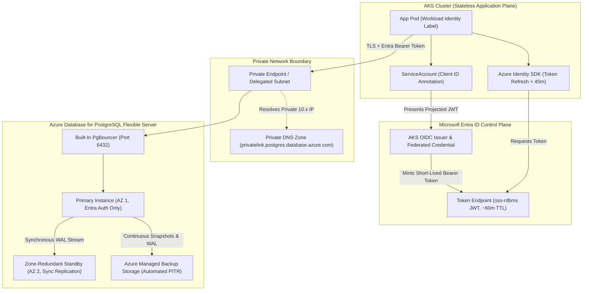
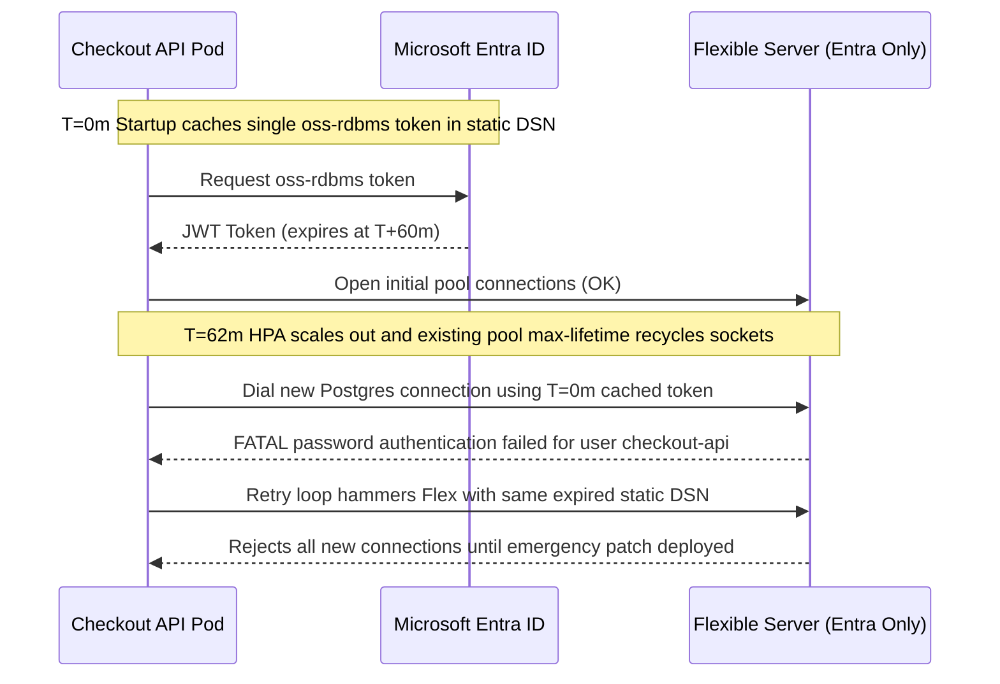

# 05 - Azure Managed Database Services: The Alternative

> **Prerequisites:** Completed Modules 00–04 (Kubernetes StatefulSets, Azure Disk StorageClasses, CloudNativePG operators, tested backups/PITR), Azure CLI authenticated, Terraform CLI installed, and familiarity with AKS Workload Identity ([07-aks](../../07-aks/README.md)).  
> **Estimated Reading Time:** 35 minutes  
> **Target Audience:** Backend Engineers, Cloud Architects, Platform Engineers, Kubernetes Operators.

> [!TIP]
> **The Golden Rule of Managed Database Security & Cost:** Never put a static database password inside a Kubernetes Secret or open a Flexible Server firewall to `0.0.0.0/0`—authenticate AKS workloads passwordlessly via Workload Identity + short-lived Entra ID tokens (`oss-rdbms`), isolate traffic via Private Link or VNet subnet delegation, and delete lab servers immediately because managed databases bill continuously until destroyed.

---

## Why This Matters

Modules 00–04 taught you to run a database on Kubernetes *properly*—StatefulSets, an operator, tested backups, failover. That was deliberately the hard path, so you would understand exactly what operational work it involves. This module is the other side of the deal: hand all of that operational work to Azure. A managed database means the provider runs the process, the storage, the replication, the failover, the patching, and the tested backups—you get an endpoint and a bill. Knowing these services well (and connecting to them the *modern* way, with a managed identity and no password) is half of being able to make the self-hosted-vs-managed decision in Module 06 honestly.

---

## 1. Architectural Mental Model: Managed Control Plane & Passwordless Entra Auth

With a managed database, the stateful Pod, PVC, operator, and cron-backup architecture from Modules 00–04 disappear from your AKS cluster. Your application runs statelessly in AKS, federates its Kubernetes `ServiceAccount` to an Azure User-Assigned Managed Identity via OIDC, exchanges that assertion for a short-lived Entra ID token scoped to `oss-rdbms`, and connects over Private Link (or VNet delegation) to Azure Database for PostgreSQL Flexible Server:



### Core Concepts

#### What "Managed" Actually Removes From Your Plate

Line up Module 03's operator responsibilities against a managed service and the value is obvious. Everything you learned to do—bootstrap, replication, failover, minor-version patching, backup/PITR, restore drills, disk sizing, zone placement—the managed service does for you, behind an SLA. What you keep: schema design, queries, indexes, connection management (Module 07), choosing a tier, and the bill. You're not escaping databases; you're escaping *database operations*. That's a smaller surface than it sounds until you remember Module 04's "an untested backup is worth zero"—a managed service's backups are tested by the provider at scale, which is a genuinely different risk profile than your own cron job.

#### Azure Database for PostgreSQL — Flexible Server

The direct managed counterpart to the CloudNativePG cluster you built. **Azure Database for PostgreSQL Flexible Server** runs Postgres for you with: automatic backups + PITR (Module 04's hard-won capability, built in), optional high-availability with a standby in another Availability Zone (Module 03's failover, managed), zone placement, VNet integration or Private Link (Track 05 networking), built-in PgBouncer connection pooling, and one-flag minor-version upgrades. You pick a compute tier (`Burstable` / `GeneralPurpose` / `MemoryOptimized`), storage size, and HA mode; Azure runs it. This is the apples-to-apples "managed version of what you self-hosted," and it's what the capstone's second path uses.

#### Azure SQL and Cosmos DB — Different Shapes for Different Needs

Two other managed options you should recognize at a survey level:

- **Azure SQL Database** — managed Microsoft SQL Server (T-SQL, not Postgres). Choose it when your app is built on SQL Server, or you want features like the serverless auto-pause tier (compute scales to zero when idle—a real cost win for spiky/dev workloads) or Hyperscale for very large databases. Same "managed operations" value, different engine.
- **Azure Cosmos DB** — a globally-distributed, multi-model **NoSQL** database (document, key-value, graph, and a Postgres-compatible option). Choose it for planet-scale, low-latency, multi-region-writable workloads with flexible schemas—think a global product catalog or session store, *not* a relational system with complex joins and transactions. Billed by provisioned or serverless **Request Units (RU/s)**, a model that surprises people used to per-hour compute.

The point isn't to master all three—it's to know that "managed database" isn't one thing, and to reach for Flexible Server when you'd otherwise self-host Postgres, Azure SQL for SQL Server workloads, and Cosmos DB for NoSQL/global scale.

#### Provisioning with Terraform (Track 09 Patterns)

You never click these into existence—you provision them exactly like the AKS/ACR resources in [09-terraform-on-azure module 06](../../09-terraform-on-azure/06-provisioning-azure-infrastructure/README.md):

```hcl
resource "azurerm_postgresql_flexible_server" "db" {
  name                = "pg-flex-learn"
  resource_group_name = azurerm_resource_group.main.name
  location            = azurerm_resource_group.main.location
  version             = "16"
  sku_name            = "B_Standard_B1ms"     # Burstable — smallest, cheapest
  storage_mb          = 32768
  zone                = "1"

  # Passwordless: no admin password; use Entra (AAD) auth instead.
  authentication {
    active_directory_auth_enabled = true
    password_auth_enabled         = false
  }
}

resource "azurerm_postgresql_flexible_server_database" "app" {
  name      = "app"
  server_id = azurerm_postgresql_flexible_server.db.id
}
```

Same `plan`/`apply`/`destroy` lifecycle, same "config is the source of truth" recovery behavior, same **billable-resource discipline** Track 09 drilled into you—a Flexible Server bills continuously the moment it exists. The `sku_name` here is the single biggest cost lever in this whole track (see Common Mistakes).

#### Passwordless: Connecting via Managed Identity, Not a Password

The modern, correct way to connect an app on AKS to a managed database is **no password at all**. Recall [07-aks module 07](../../07-aks/README.md) and Track 09's role assignments: a workload gets an Azure **managed identity**, and Azure grants that identity permission on the target resource. The same pattern applies here—and it's strictly better than a password in a Secret:

1. Enable **Entra ID (Azure AD) authentication** on the Flexible Server (and disable password auth, as above).
2. Give your app a managed identity—on AKS, via **Workload Identity** (a Kubernetes `ServiceAccount` federated to an Azure identity).
3. Create a Postgres role for that identity (`pgaadauth_create_principal`) and grant it database permissions.
4. The app fetches a short-lived **Entra token** (`oss-rdbms`) at connect time and uses it as the "password." No secret to store, rotate, or leak; access is revoked by removing the role assignment, and every connection is auditable to a specific identity.

This is the same "grant an identity a role, skip the shared secret" philosophy as the `AcrPull` assignment in Track 09 Module 06—applied to database auth. The capstone requires this passwordless path.

---

## 2. Taxonomic Comparison: Managed Services, Tiers & Network Isolation

### Azure Managed Database Portfolio

| Dimension | Azure DB for PostgreSQL Flexible Server | Azure SQL Database | Azure Cosmos DB |
| :--- | :--- | :--- | :--- |
| **Engine / Data Model** | PostgreSQL 13–16 (Relational, ACID) | Microsoft SQL Server / T-SQL (Relational) | Multi-Model NoSQL (Document, KV, Graph) |
| **Best-Fit Workload** | Drop-in managed replacement for self-hosted Postgres | .NET / SQL Server apps, spiky dev (Serverless) | Global multi-region writes, sub-10ms catalog/session store |
| **High Availability & Failover** | Optional `ZoneRedundant` sync standby (60–120s RTO) | Built-in zone-redundant replicas / Business Critical | Multi-region active-active with 99.999% SLA |
| **Backup & PITR** | Built-in automated snapshots + PITR (7–35 days) | Built-in automated PITR + Long-Term Retention | Continuous periodic or continuous PITR backup |
| **Billing Model** | Compute SKU + Storage GB + Backup GB (2x compute for HA) | DTU or vCore/hour (Serverless auto-pauses to zero compute) | Provisioned or Serverless **Request Units (RU/s)** + GB |

### Flexible Server Compute Tiers & Network Isolation Modes

| Configuration Axis | Option A (Lab / Small Dev) | Option B (Production OLTP) | Option C (High-Throughput / Cache-Heavy) |
| :--- | :--- | :--- | :--- |
| **Compute Tier / SKU** | `Burstable` (`B_Standard_B1ms`, 1 vCPU, 2 GiB) | `GeneralPurpose` (`GP_Standard_D2s_v3`, 2 vCPU, 8 GiB) | `MemoryOptimized` (`MO_Standard_E4s_v3`, 4 vCPU, 32 GiB) |
| **High Availability** | `Disabled` (Single AZ, cheapest) | `ZoneRedundant` (Sync standby in 2nd AZ, doubles compute bill) | `ZoneRedundant` + Read Replicas |
| **Network Mode** | Public Access + Explicit Client IP Firewall Rule | VNet Integration (Delegated Subnet) | Private Link (Private Endpoint + Private DNS Zone) |
| **Connection Pooling** | Direct (`5432`) for low concurrency | Built-in PgBouncer enabled (`6432`, transaction mode) | Built-in PgBouncer (`6432`) + App Pooler |

---

## 3. Production War Story Post-Mortem: Stale `oss-rdbms` Token Cliff During Pod Autoscaling

### Incident Metadata

- **Severity:** SEV-1 (Complete checkout write outage across 18 AKS replicas)
- **Detection Time:** 14 minutes (alert fired on 5xx checkout spike, not token expiry metric)
- **Resolution Time:** 38 minutes
- **Impact:** All new database connections rejected for 24 minutes after the 60-minute mark; 4,200 failed orders

### What Happened

A platform team migrated their checkout API to Azure Database for PostgreSQL Flexible Server with passwordless Entra ID auth. During startup, `main()` called `DefaultAzureCredential.GetToken()` once, embedded the resulting JWT inside the `DATABASE_URL` string, and initialized a long-lived connection pool. During quiet traffic, existing pooled TCP sockets stayed open and queries succeeded past the 60-minute token TTL. At T+62m, Horizontal Pod Autoscaler scaled the deployment from 4 to 18 Pods and idle connections recycled—every newly opened TLS session presented the 62-minute-old cached token and immediately failed authentication:



### Root Cause Analysis

1. **Static Startup Credential Capture:** Postgres validates Entra tokens only during the initial connection startup handshake—not per query—so a stale token baked into a startup DSN looks healthy until connection churn or Pod scale-out occurs.
2. **Missing Dynamic Token Callback:** The application did not hook into the driver's per-dial password provider (`BeforeConnect` / `UsePeriodicPasswordProvider`) to fetch or refresh cached tokens before expiry.
3. **Absent `max_lifetime` & Auth-Failure Alerting:** Pool connections lived indefinitely until traffic scaled, hiding the misconfiguration for an hour until peak traffic hit.

### The Fix & Architectural Hardening

1. **Per-Connection Token Provider Hook:** Switched all services to request the `https://ossrdbms-aad.database.windows.net/.default` token inside the connection pool's dynamic password/dial callback, caching it in-memory with a strict 45-minute refresh ceiling (15-minute buffer before the 60-minute expiry).
2. **Bounded Connection Lifetimes:** Set `MaxConnLifetime = 30m` so token rotation happens smoothly and continuously across healthy sockets.
3. **Private Link + Built-In PgBouncer:** Migrated traffic from public firewall rules to a Private Endpoint (`privatelink.postgres.database.azure.com`) and enabled built-in PgBouncer (`port 6432`) so Pod scale-outs reuse warm backend sockets cleanly.

---

## 4. Multi-Language Production Implementation: Passwordless Entra Token Provider

The snippets below demonstrate production-safe passwordless authentication to Azure Database for PostgreSQL Flexible Server with automatic token refresh ahead of the 60-minute expiry window:

````carousel
```go
package manageddb

import (
	"context"
	"fmt"
	"sync"
	"time"

	"github.com/Azure/azure-sdk-for-go/sdk/azcore"
	"github.com/Azure/azure-sdk-for-go/sdk/azcore/policy"
	"github.com/Azure/azure-sdk-for-go/sdk/azidentity"
	"github.com/jackc/pgx/v5"
	"github.com/jackc/pgx/v5/pgxpool"
)

const ossRdbmsScope = "https://ossrdbms-aad.database.windows.net/.default"

type EntraTokenCache struct {
	cred    azcore.TokenCredential
	mu      sync.RWMutex
	token   string
	expires time.Time
}

func NewEntraTokenCache() (*EntraTokenCache, error) {
	cred, err := azidentity.NewDefaultAzureCredential(nil)
	if err != nil {
		return nil, fmt.Errorf("init managed identity credential: %w", err)
	}
	return &EntraTokenCache{cred: cred}, nil
}

func (c *EntraTokenCache) GetToken(ctx context.Context) (string, error) {
	c.mu.RLock()
	if c.token != "" && time.Until(c.expires) > 10*time.Minute {
		tok := c.token
		c.mu.RUnlock()
		return tok, nil
	}
	c.mu.RUnlock()

	c.mu.Lock()
	defer c.mu.Unlock()
	if c.token != "" && time.Until(c.expires) > 10*time.Minute {
		return c.token, nil
	}
	at, err := c.cred.GetToken(ctx, policy.TokenRequestOptions{Scopes: []string{ossRdbmsScope}})
	if err != nil {
		return "", fmt.Errorf("acquire oss-rdbms token: %w", err)
	}
	c.token = at.Token
	c.expires = at.ExpiresOn
	return c.token, nil
}

// NewPasswordlessPool wires Entra bearer tokens on every new dial for Zone-Redundant HA + PgBouncer.
func NewPasswordlessPool(ctx context.Context, host, dbName, identityName string) (*pgxpool.Pool, error) {
	cache, err := NewEntraTokenCache()
	if err != nil {
		return nil, err
	}
	dsn := fmt.Sprintf("host=%s port=6432 dbname=%s user=%s sslmode=require", host, dbName, identityName)
	cfg, err := pgxpool.ParseConfig(dsn)
	if err != nil {
		return nil, err
	}
	cfg.MaxConnLifetime = 30 * time.Minute
	cfg.BeforeConnect = func(ctx context.Context, connCfg *pgx.ConnConfig) error {
		tok, err := cache.GetToken(ctx)
		if err != nil {
			return err
		}
		connCfg.Password = tok
		return nil
	}
	return pgxpool.NewWithConfig(ctx, cfg)
}
```
<!-- slide -->
```typescript
import { DefaultAzureCredential, AccessToken } from "@azure/identity";
import { Pool, PoolConfig } from "pg";

const OSS_RDBMS_SCOPE = "https://ossrdbms-aad.database.windows.net/.default";
const REFRESH_MARGIN_MS = 10 * 60 * 1000;

class EntraTokenProvider {
  private readonly credential = new DefaultAzureCredential();
  private cached: AccessToken | null = null;
  private inflight: Promise<string> | null = null;

  async getToken(): Promise<string> {
    const now = Date.now();
    if (this.cached && this.cached.expiresOnTimestamp - now > REFRESH_MARGIN_MS) {
      return this.cached.token;
    }
    if (!this.inflight) {
      this.inflight = this.credential
        .getToken(OSS_RDBMS_SCOPE)
        .then((tok) => {
          if (!tok) throw new Error("Failed to acquire oss-rdbms Entra token");
          this.cached = tok;
          return tok.token;
        })
        .finally(() => {
          this.inflight = null;
        });
    }
    return this.inflight;
  }
}

export function createPasswordlessPool(host: string, database: string, user: string): Pool {
  const tokenProvider = new EntraTokenProvider();
  const config: PoolConfig = {
    host,
    port: 6432, // Built-in PgBouncer port on Flexible Server
    database,
    user,
    password: () => tokenProvider.getToken(), // pg invokes dynamically on every new socket
    ssl: { rejectUnauthorized: true },
    max: 20,
    connectionTimeoutMillis: 5000,
    idleTimeoutMillis: 30000,
  };
  return new Pool(config);
}
```
<!-- slide -->
```python
import threading
import time
from azure.identity import DefaultAzureCredential
import psycopg
from psycopg_pool import ConnectionPool

OSS_RDBMS_SCOPE = "https://ossrdbms-aad.database.windows.net/.default"


class EntraTokenManager:
    def __init__(self, refresh_margin_sec: int = 600) -> None:
        self._cred = DefaultAzureCredential()
        self._margin = refresh_margin_sec
        self._lock = threading.Lock()
        self._token: str = ""
        self._expires_on: float = 0.0

    def get_token(self) -> str:
        with self._lock:
            if self._token and (self._expires_on - time.time()) > self._margin:
                return self._token
            access_token = self._cred.get_token(OSS_RDBMS_SCOPE)
            self._token = access_token.token
            self._expires_on = float(access_token.expires_on)
            return self._token


class PasswordlessConnection(psycopg.Connection):
    token_manager = EntraTokenManager()

    @classmethod
    def connect(cls, conninfo: str = "", **kwargs):
        kwargs["password"] = cls.token_manager.get_token()
        return super().connect(conninfo, **kwargs)


def create_passwordless_pool(host: str, dbname: str, identity_name: str) -> ConnectionPool:
    conninfo = f"host={host} port=6432 dbname={dbname} user={identity_name} sslmode=require"
    return ConnectionPool(
        conninfo=conninfo,
        connection_class=PasswordlessConnection,
        min_size=2,
        max_size=20,
        max_lifetime=1800,  # Recycle connections every 30m before token expiry
    )
```
<!-- slide -->
```csharp
using System;
using System.Threading;
using System.Threading.Tasks;
using Azure.Core;
using Azure.Identity;
using Npgsql;

public static class ManagedPostgresFactory
{
    private static readonly string[] OssRdbmsScopes =
        ["https://ossrdbms-aad.database.windows.net/.default"];

    public static NpgsqlDataSource CreatePasswordlessDataSource(
        string host,
        string database,
        string identityPrincipalName)
    {
        var credential = new DefaultAzureCredential();
        var connString = new NpgsqlConnectionStringBuilder
        {
            Host = host,
            Port = 6432, // Built-in PgBouncer port on Azure Flexible Server
            Database = database,
            Username = identityPrincipalName,
            SslMode = SslMode.Require,
            ConnectionLifetime = 1800, // Recycle sockets every 30m
            Timeout = 5
        }.ConnectionString;

        var builder = new NpgsqlDataSourceBuilder(connString);

        // Npgsql automatically refreshes cached tokens every 45m and retries cleanly on failure
        builder.UsePeriodicPasswordProvider(
            async (_, ct) =>
            {
                AccessToken token = await credential.GetTokenAsync(
                    new TokenRequestContext(OssRdbmsScopes), ct);
                return token.Token;
            },
            successRefreshInterval: TimeSpan.FromMinutes(45),
            failureRefreshInterval: TimeSpan.FromSeconds(10));

        return builder.Build();
    }
}
```
````

---

## 5. Practical Hands-On Verification CLI Workflows

### Command Reference

| Command | What it does | Example |
|---|---|---|
| `az postgres flexible-server create` | Provisions a Flexible Server (imperative alt to Terraform) | `az postgres flexible-server create -g rg -n pg-flex --tier Burstable --sku-name Standard_B1ms` |
| `az postgres flexible-server list -o table` | **Lists managed servers — how you catch ones left billing** | `az postgres flexible-server list -o table` |
| `az postgres flexible-server show` | Shows tier, storage, HA state, version | `az postgres flexible-server show -g rg -n pg-flex` |
| `az postgres flexible-server ad-admin create` | Sets an Entra ID admin on the server (passwordless) | `az postgres flexible-server ad-admin create -g rg -s pg-flex --display-name user --object-id <oid> --type User` |
| `az postgres flexible-server parameter set` | Enables built-in PgBouncer or tunes server parameters | `az postgres flexible-server parameter set -g rg -s pg-flex --name pgbouncer.enabled --value true` |
| `az postgres flexible-server delete` | Deletes the server (stops the bill) | `az postgres flexible-server delete -g rg -n pg-flex --yes` |
| `az sql db create` | Creates an Azure SQL Database | `az sql db create -g rg -s srv -n appdb --tier GeneralPurpose` |
| `az cosmosdb create` | Creates a Cosmos DB account | `az cosmosdb create -g rg -n cosmos-learn` |
| `terraform apply` | Provisions the managed DB declaratively (preferred) | `terraform apply` |

#### Flag Breakdown — `az postgres flexible-server create`

- `--tier Burstable` — compute family; Burstable is the cheapest, right for labs/dev (General Purpose / Memory Optimized cost far more).
- `--sku-name Standard_B1ms` — the specific VM size within the tier—the main cost lever.
- `--storage-size 32` — GB of storage (also bills; can grow, not shrink).
- `--high-availability` — `Disabled` (cheap, one instance) vs `ZoneRedundant` (a managed standby—Module 03's failover, but you pay for two).

### Hands-On Exercises

**These create billable managed resources—do the cleanup at the end and confirm `az postgres flexible-server list` is empty.** Use a dedicated resource group so cleanup is one command.

```bash
az group create -n rg-mgdb-lab -l eastus
```

#### 1. Provision a Flexible Server with Terraform

Create a Terraform config (reusing the Track 09 provider skeleton) with the `azurerm_postgresql_flexible_server` + `_database` from Concepts, Burstable `B_Standard_B1ms`, 32 GB, HA disabled. Then:

```bash
terraform init
terraform plan
terraform apply -auto-approve
az postgres flexible-server show -g rg-mgdb-lab -n pg-flex-learn -o table
```

**Expected Output:**

```text
Plan: 3 to add, 0 to change, 0 to destroy.
...
Name           Location    Version    State    SkuName          StorageSizeGb
-------------  ----------  ---------  -------  ---------------  ---------------
pg-flex-learn  eastus      16         Ready    Standard_B1ms    32
```

Verify `Plan: N to add` including the flexible server (**this is the billable one**), then confirm `State` shows `Ready`.

#### 2. Compare What You *Didn't* Have to Build

```bash
az postgres flexible-server show -g rg-mgdb-lab -n pg-flex-learn \
  --query "{version:version, ha:highAvailability.mode, backupDays:backup.backupRetentionDays, storage:storage.storageSizeGb}"
```

**Expected Output:**

```json
{
  "backupDays": 7,
  "ha": "Disabled",
  "storage": 32,
  "version": "16"
}
```

It already has a Postgres version, a backup retention window (automatic PITR—Module 04's capability, free and pre-tested), and optional HA—none of which you configured. Contrast the effort this took in Modules 03–04. Write down, in one line, what you gave up to get it (you'll answer this properly in Module 06).

#### 3. Enable Entra ID Auth and Disable Passwords

If not already set via Terraform's `authentication` block:

```bash
az postgres flexible-server update -g rg-mgdb-lab -n pg-flex-learn \
  --active-directory-auth Enabled --password-auth Disabled
# Make yourself the Entra admin so you can create roles:
az postgres flexible-server ad-admin create -g rg-mgdb-lab -s pg-flex-learn \
  --display-name "$(az account show --query user.name -o tsv)" \
  --object-id "$(az ad signed-in-user show --query id -o tsv)" --type User
```

**Expected Output:**

```json
{
  "objectId": "xxxxxxxx-xxxx-xxxx-xxxx-xxxxxxxxxxxx",
  "principalName": "engineer@example.com",
  "principalType": "User"
}
```

The server now authenticates via Entra ID tokens, not passwords—the passwordless foundation.

#### 4. Connect Using an Entra Token as the Password

```bash
# Get a short-lived Entra access token scoped to Postgres
TOKEN=$(az account get-access-token --resource-type oss-rdbms --query accessToken -o tsv)
FQDN=$(az postgres flexible-server show -g rg-mgdb-lab -n pg-flex-learn --query fullyQualifiedDomainName -o tsv)
USER=$(az account show --query user.name -o tsv)
PGPASSWORD="$TOKEN" psql "host=$FQDN port=5432 dbname=app user=$USER sslmode=require" \
  -c "SELECT 'connected passwordlessly' AS status;"
```

**Expected Output:**

```text
          status
--------------------------
 connected passwordlessly
(1 row)
```

It connects with **no stored password**—the "password" is a token that expires in ~1 hour and is tied to your identity. This is the app connection pattern the capstone requires, just with your user identity standing in for the app's managed identity.

#### 5. (AKS) Wire an App's Managed Identity via Workload Identity

On an AKS cluster with Workload Identity enabled ([07-aks module 07](../../07-aks/README.md) territory), federate a Kubernetes `ServiceAccount` to an Azure user-assigned managed identity, then create a Postgres role for that identity:

```bash
# (identity + federated credential creation as in track 09 / AKS module 07)
# Then, as the Entra admin, create a DB role for the app identity:
PGPASSWORD="$TOKEN" psql "host=$FQDN dbname=app user=$USER sslmode=require" -c \
  "SELECT * FROM pgaadauth_create_principal('<app-identity-name>', false, false);"
```

**Expected Output:**

```text
 pgaadauth_create_principal
----------------------------
 Created role <app-identity-name>
(1 row)
```

A Postgres principal exists for the app's managed identity. A Pod using that `ServiceAccount` can now fetch its own token and connect—no Secret, no password anywhere in the manifest. (On a cluster without Workload Identity, read this and note it as the capstone's connection method.)

#### 6. (Survey) Peek at Azure SQL Serverless Auto-Pause

Provision a tiny serverless Azure SQL DB to see the auto-pause cost model:

```bash
SQL_SRV="sqlsrv-lab$RANDOM"
az sql server create -g rg-mgdb-lab -n "$SQL_SRV" -l eastus \
  --admin-user sqladmin --admin-password '<StrongP@ssw0rd!>'
az sql db create -g rg-mgdb-lab -s "$SQL_SRV" -n appdb \
  --compute-model Serverless --edition GeneralPurpose \
  --family Gen5 --capacity 1 --auto-pause-delay 60
az sql db show -g rg-mgdb-lab -s "$SQL_SRV" -n appdb \
  --query "{tier:currentServiceObjectiveName, autoPause:autoPauseDelay}"
```

**Expected Output:**

```json
{
  "autoPause": 60,
  "tier": "GP_S_Gen5_1"
}
```

A serverless DB that auto-pauses after 60 min idle and bills compute only when active—a different cost shape than Flexible Server's always-on Burstable tier. Note it (Module 06 weighs these trade-offs).

#### 7. (Survey) A Cosmos DB Account and the RU Model

```bash
COSMOS_ACC="cosmos-lab$RANDOM"
az cosmosdb create -g rg-mgdb-lab -n "$COSMOS_ACC" --default-consistency-level Session
az cosmosdb sql database create -g rg-mgdb-lab -a "$COSMOS_ACC" -n appdb
```

**Expected Output:**

```text
Provisioning state: Succeeded (Consistency: Session, Billing: Provisioned RU/s or Serverless)
```

A globally-distributable NoSQL account. Note its billing is **Request Units (RU/s)**, not per-hour compute—provision too many RU/s and you pay for throughput you never use. This is the "different mental model" callout; you're not expected to build on it here.

#### 8. Diagnose-and-Fix: Can't Connect to the Managed Server (Firewall/Auth)

Try connecting from your laptop and hit the two most common managed-DB connection failures:

```bash
psql "host=$FQDN dbname=app user=$USER sslmode=require" -c "SELECT 1;"
```

**Expected Failure #1** — a timeout or `no pg_hba.conf entry` because the server's firewall/networking blocks your IP (Flexible Server defaults to closed). Diagnose and fix by allowing your client:

```bash
MYIP=$(curl -s ifconfig.me)
az postgres flexible-server firewall-rule create -g rg-mgdb-lab -n pg-flex-learn \
  --rule-name myip --start-ip-address "$MYIP" --end-ip-address "$MYIP"
```

**Expected Failure #2** — after networking is fixed, an auth error (`FATAL: password authentication failed`) because you passed a stale/empty token or password auth is disabled. Fix by getting a *fresh* Entra token (Exercise 4)—tokens expire. Retry and confirm `SELECT 1` returns:

```bash
TOKEN=$(az account get-access-token --resource-type oss-rdbms --query accessToken -o tsv)
PGPASSWORD="$TOKEN" psql "host=$FQDN dbname=app user=$USER sslmode=require" -c "SELECT 1;"
```

**Expected Output:**

```text
 ?column?
----------
        1
(1 row)
```

Lesson: managed-DB connection failures are almost always **network reachability** or **auth/token**, in that order—check firewall/VNet first, then credentials.

#### 9. Clean Up — Stop the Managed Bill

```bash
az group delete -n rg-mgdb-lab --yes --no-wait
# Then confirm across the subscription that nothing survived:
az postgres flexible-server list -o table
az sql server list -o table
az cosmosdb list -o table
```

**Expected Output:**

```text
(empty — 0 resources running in all three tables)
```

After the delete completes, all three lists are empty (or free of your lab resources). **A managed database bills continuously until deleted**—leaving a Flexible Server or a provisioned-throughput Cosmos account running over a weekend is a real charge, exactly like an idle AKS cluster in Track 07.

### Independent Challenge

No full HCL given. Using the Terraform patterns from [09-terraform-on-azure module 06](../../09-terraform-on-azure/06-provisioning-azure-infrastructure/README.md) and the passwordless approach from this module, provision an Azure Database for PostgreSQL Flexible Server (Burstable tier, HA disabled, Entra auth on and password auth off) **and** the plumbing for an AKS-hosted app to reach it with a managed identity—a user-assigned identity, a federated credential for a Kubernetes `ServiceAccount`, and a Postgres role for that identity—all as code in one `terraform apply`. Then prove, end to end, that a Pod using that `ServiceAccount` can run a query against the server with no password, connection string secret, or firewall exception for a password anywhere in the manifests. Finally, `terraform destroy` and confirm `az postgres flexible-server list` is empty. This integrates Track 09's provisioning, AKS Workload Identity from [07-aks](../../07-aks/README.md), and this module's passwordless auth—and it's the exact second path your capstone will need.

<details>
<summary>Stuck? One hint</summary>

The chain is: `azurerm_user_assigned_identity` → an `azurerm_federated_identity_credential` binding it to the AKS OIDC issuer + your Pod's `namespace:serviceaccount` → the app identity added as a Postgres principal (`pgaadauth_create_principal`, or Terraform's `azurerm_postgresql_flexible_server_active_directory_administrator` for the admin). The Pod's `ServiceAccount` needs the `azure.workload.identity/client-id` annotation and the Pod the `azure.workload.identity/use: "true"` label. At runtime the app calls the Azure token endpoint (the Azure Identity SDK does this automatically) to get an `oss-rdbms` token and uses it as the password—exactly Exercise 4, but the identity is the workload's, not yours.

</details>

---

## 6. Common Mistakes & Troubleshooting

- **Storing a DB password in a Secret when you could go passwordless.** A password in a Kubernetes Secret is a thing to rotate, leak, and audit poorly. Entra ID + managed identity removes the secret entirely and ties every connection to an identity—prefer it, exactly as Track 09 preferred a role assignment over an ACR admin password.
- **Firewall/VNet/Private DNS blocks before auth.** Flexible Server is closed by default; a connection timeout is almost always networking (missing firewall rule, VNet subnet delegation, or Private DNS Zone link `privatelink.postgres.database.azure.com`), not credentials. Fix reachability first (`nslookup <fqdn>` inside the Pod) before suspecting the token (Exercise 8).
- **Stale Entra tokens.** `oss-rdbms` tokens expire (~1h); a "worked earlier, fails now" passwordless connection usually just needs a fresh token—configure your driver's dynamic token hook (`BeforeConnect` / `UsePeriodicPasswordProvider`), as static startup `DATABASE_URL` strings and ad-hoc `psql` sessions do not auto-refresh.
- **Cost pitfall — oversizing the tier.** Provisioning General Purpose or Memory Optimized (or `ZoneRedundant` HA, which doubles compute) for a learning/dev workload is the single most expensive mistake in this module. Start Burstable, HA disabled; scale up only when a real workload proves it needs it.
- **Cost pitfall — leaving it running.** Unlike an AKS cluster you can `az aks stop`, a Flexible Server bills whenever it exists (you can *stop* it, but it auto-starts after 7 days). Delete lab servers; confirm with `az postgres flexible-server list`.
- **Cosmos RU/s sticker shock.** Cosmos bills provisioned throughput (`RU/s`), not per-hour compute—over-provisioning `RU/s` or forgetting a serverless option bills for throughput you never use.

---

## 7. Operational Validation Checkpoints

<details>
<summary><strong>Checkpoint 1: Your AKS deployment worked smoothly for 58 minutes after rollout, then every newly autoscaled Pod fails with FATAL password authentication failed. What happened?</strong></summary>

The app acquired an Entra ID `oss-rdbms` token once at startup and baked it into a static `DATABASE_URL` string. Existing TCP sockets in the older Pods remained authenticated until recycled, whereas newly autoscaled Pods opened fresh connections with the cached token after its ~60-minute TTL expired. Fix it by integrating `DefaultAzureCredential` inside a per-connection callback (`BeforeConnect` / `UsePeriodicPasswordProvider` / dynamic `password` function) with a 10–15 minute refresh margin and setting `MaxConnLifetime` below 45 minutes.

</details>

<details>
<summary><strong>Checkpoint 2: You configured Private Link for Flexible Server, yet an AKS Pod connecting to pg-flex.postgres.database.azure.com times out while nslookup returns a public IP. Diagnose the broken link.</strong></summary>

The AKS VNet lacks a Virtual Network Link to the Azure Private DNS Zone `privatelink.postgres.database.azure.com` (or the Private Endpoint DNS Zone Group was not created). Consequently, CoreDNS forwards the query to public Azure DNS, receives the public gateway IP, and hits the disabled public firewall. Create and link the `privatelink.postgres.database.azure.com` zone to the AKS VNet so `nslookup` resolves to the Private Endpoint's `10.x.x.x` IP.

</details>

<details>
<summary><strong>Checkpoint 3: A junior engineer provisioned a dev Flexible Server using Memory Optimized MO_Standard_E4s_v3 with ZoneRedundant HA, and stopped the server on Friday to save money—only to find a high bill next week. Why?</strong></summary>

Two compounding issues: (1) `MemoryOptimized` + `ZoneRedundant` (which runs a synchronous standby in a second zone) multiplies compute costs several times over `Burstable` + `Disabled`, and (2) stopped Flexible Servers automatically restart after 7 days (and storage still bills continuously while stopped). Lab and dev servers must use `B_Standard_B1ms` / `Disabled` and be deleted completely (`terraform destroy` / `az group delete`) rather than stopped.

</details>

---

## Cumulative Review

Closed-book—cover the answers and write yours first. Spans the whole track so far (Modules 00–05), self-hosted *and* managed.

1. State the Module-00 core tension, then say how a *managed* database sidesteps it entirely (who owns the scheduler problem now?).
2. Module 03's operator gave you automatic failover; Module 04 gave you tested PITR. Which single Azure resource gives you *both* with no operator and no cron job, and what do you configure on it to get each?
3. You connected to Flexible Server with `az account get-access-token --resource-type oss-rdbms`. How is that conceptually the same move as Track 09's `AcrPull` `azurerm_role_assignment`?
4. A teammate provisions a `ZoneRedundant`, Memory-Optimized Flexible Server for a dev environment and asks why the bill tripled. Diagnose in terms of the two cost levers.
5. On kind you saw an RWX PVC stay `Pending` (Module 06 / Module 02). Which managed service's *billing model* is the analogous "surprise because it's a different model than you expected," and why?
6. Trace the passwordless connection for an AKS Pod: name the four Azure/Kubernetes objects involved, from `ServiceAccount` to a token the DB accepts.
7. You deleted a self-hosted DB's StatefulSet and PVCs but the bill didn't drop (Module 02); you deleted a managed server's resource group and it did. What's the structural difference in *what you were responsible for cleaning up* in each case?
8. Give one workload you'd put on Cosmos DB and one you'd keep on relational Postgres (self-hosted or Flexible Server), and the deciding property.
9. A managed-DB connection times out. What do you check first and why—and what do you check only after that's ruled out?
10. In one sentence each, when would you reach for Flexible Server vs Azure SQL vs Cosmos DB?

<details>
<summary>Show answers</summary>

1. The tension: K8s treats Pods as disposable while state needs stable identity/storage. A managed database sidesteps it because the database doesn't run on your Kubernetes at all—Azure owns the "keep this stateful process alive with stable storage and failover" problem entirely; you just get an endpoint.
2. Azure Database for PostgreSQL Flexible Server. Failover: enable high-availability (`ZoneRedundant`, a managed standby). PITR: it's on by default via automatic backups with a configurable retention window—no operator or cron.
3. Both grant an *identity* a role on a *resource* and then use a short-lived token instead of a shared secret: `AcrPull` lets the kubelet identity pull from ACR; the `oss-rdbms` token lets your identity authenticate to Postgres—no password/registry-key stored anywhere.
4. Two levers: compute tier (`--tier`/`sku_name`)—Memory Optimized costs far more than Burstable—and HA mode—`ZoneRedundant` runs (and bills) a second standby instance. Together they easily triple a dev bill; Burstable + HA disabled is the dev-appropriate choice.
5. Cosmos DB's Request Units (`RU/s`) model—you pay for provisioned throughput, not per-hour compute, so over-provisioning `RU/s` bills for throughput you never use; it's "different from the model you assumed" the way an RWX PVC behaved differently than you assumed on kind.
6. A Kubernetes `ServiceAccount` (annotated with the identity's `client-id`) → a user-assigned managed identity → a federated identity credential binding the SA to the AKS OIDC issuer → an Entra `oss-rdbms` access token the app presents as its password (with a matching Postgres principal/role for that identity).
7. Self-hosted: *you* created the underlying Azure Disks (via PVCs/StorageClass), so `Retain`ed disks are yours to find and delete—deleting Kubernetes objects doesn't remove them. Managed: Azure owns the storage inside the server resource, so deleting the server/resource group removes everything you were billed for. The responsibility boundary moved.
8. Cosmos DB: a globally-distributed, low-latency, flexible-schema workload (e.g. a planet-scale session/catalog store with multi-region writes). Relational Postgres: anything needing complex joins, multi-row transactions, and strong relational integrity. Deciding property: relational/transactional needs vs. global-scale flexible-schema NoSQL.
9. Check network reachability first (firewall rule / VNet / private endpoint)—Flexible Server is closed by default and a timeout is almost always networking. Only after reachability is confirmed do you suspect auth (expired token, disabled password auth, missing role).
10. Flexible Server: managed Postgres, the drop-in for self-hosted Postgres. Azure SQL: SQL Server-based apps, or serverless auto-pause / Hyperscale needs. Cosmos DB: global-scale, low-latency NoSQL with flexible schema and multi-region writes.

</details>

---

## Checkpoint Quiz

Write down your answer to each question before expanding it—checking without attempting first is the single easiest way to fool yourself into thinking you've learned this.

1. Name four database *operations* a managed service does for you that you had to do yourself in Modules 03–04.
2. Which Azure service is the managed counterpart to your CloudNativePG cluster, and how do you get failover and PITR from it?
3. What is the passwordless connection pattern, and why is it better than a password in a Secret?
4. What are the two biggest cost levers on a Flexible Server, and which way does each move the bill?
5. When would you choose Cosmos DB over Flexible Server, and what's unusual about how Cosmos bills?
6. A managed-DB connection times out. What's the first thing to check, and the second?
7. How do you provision a Flexible Server the way this curriculum prefers, and what discipline from Track 09 carries straight over?

<details>
<summary>Show answers</summary>

1. Any four: bootstrap/initialize; streaming replication; failover/promotion; minor-version patching; automatic backups + PITR; tested restores; storage sizing/zone placement.
2. Azure Database for PostgreSQL Flexible Server. Failover: enable high-availability (a managed zone-redundant standby). PITR: automatic backups are on by default with a configurable retention window.
3. The app authenticates with a short-lived Entra ID token (via a managed identity / Workload Identity) instead of a stored password. Better because there's no secret to store, rotate, or leak; access is a revocable role assignment and every connection is tied to an auditable identity.
4. Compute tier/SKU (`--tier`/`--sku-name`: Burstable cheap → Memory Optimized expensive) and HA mode (`ZoneRedundant` runs and bills a second standby). Bigger tier or enabling HA raises the bill.
5. When you need global distribution, very low latency at scale, multi-region writes, and a flexible/NoSQL schema rather than relational joins/transactions. It bills by Request Units (`RU/s`)—provisioned throughput—not per-hour compute.
6. First: network reachability (firewall rule / VNet / private endpoint)—Flexible Server is closed by default. Second (only after that's fine): auth—an expired Entra token, disabled password auth, or a missing role.
7. With Terraform (`azurerm_postgresql_flexible_server` + `_database`), same `plan`/`apply`/`destroy` as Track 09 Module 06. The billable-resource discipline carries over: it bills continuously while it exists, so `destroy` promptly and confirm with `az postgres flexible-server list`.

</details>

---

## Next

[06-the-decision-framework](../06-the-decision-framework/README.md) — you now know both paths first-hand: run it yourself (Modules 00–04) or let Azure run it (this module). Next you'll turn that into an honest, two-sided decision framework—operational burden, cost, control, and compliance—so you can defend *which* path for a given workload rather than defaulting to a habit.
