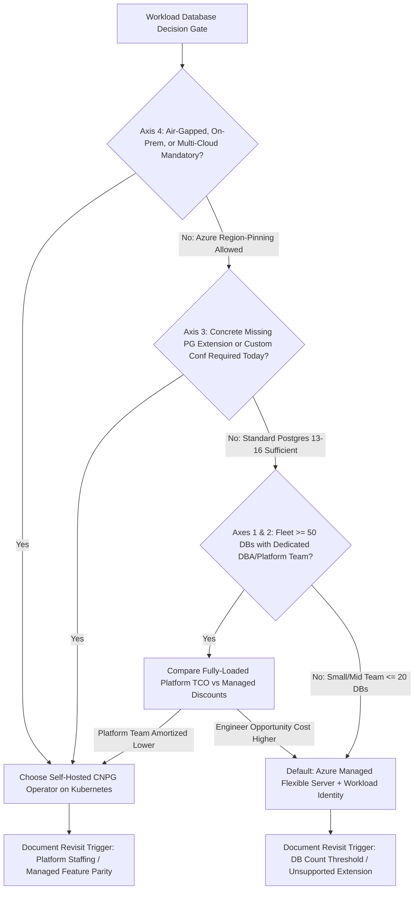
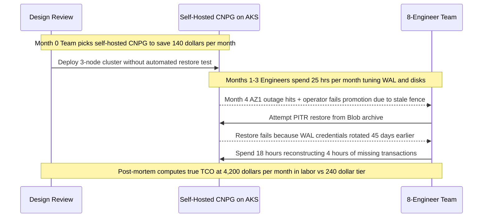

# 06 - The Decision Framework: Self-Hosted vs. Managed

> **Prerequisites:** Completed Modules 00–05 (experience operating CloudNativePG + Azure Disks + PITR on AKS and provisioning/connecting passwordlessly to Azure Database for PostgreSQL Flexible Server).  
> **Estimated Reading Time:** 25 minutes  
> **Target Audience:** Backend Engineers, Staff/Principal Engineers, Engineering Managers, Platform Architects.

> [!TIP]
> **The Golden Rule of Infrastructure Trade-Offs:** Never score all four decision axes equally or compare Pod sticker prices against managed database tiers—check **Compliance & Data Residency** first because it can veto everything else, compute **fully-loaded TCO** by adding engineer-hours and incident risk to self-hosted disk/node spend, and default to Managed Flexible Server unless a concrete, present control, portability, or multi-hundred-database platform scale need proves otherwise.

---

## Why This Matters

You've now built both paths first-hand: a database you run yourself on Kubernetes with an operator, tested backups, and failover (Modules 00–04), and a database Azure runs for you behind an endpoint (Module 05). The career-relevant skill isn't knowing *how* to do either—it's being able to walk into a design review and defend *which* one for a specific workload, against people who'll push back. This module gives you an honest, two-sided framework across four axes—operational burden, cost, control, and compliance—so your recommendation is reasoning, not a habit or a resume-driven preference.

---

## 1. Architectural Mental Model: The Four-Axis Evaluation Pipeline

Instead of averaging four unweighted scores on a spreadsheet, evaluate database placement as an ordered decision gate. Compliance and residency constraints execute first (because a hard veto ends the debate immediately), followed by concrete present-day engine control requirements, and finally fully-loaded economic scale:



### Core Concepts

#### The Framework Is Four Axes, and Neither Side Wins All Four

There is no universally correct answer, and any framework that always picks one side is a strawman. The four axes that actually decide it:

1. **Operational burden** — who does the 3am work (failover, patching, backup verification, capacity)?
2. **Cost** — not just the sticker price, but the fully-loaded cost including *your team's time*.
3. **Control** — how much can you tune, extend, and customize the engine?
4. **Compliance & data residency** — what do your regulators, contracts, and security team actually require?

Most real decisions are won or lost on **one dominant axis** for that specific workload, with the others as tie-breakers. The skill is identifying which axis dominates *here*, not scoring all four equally every time.

#### Axis 1 — Operational Burden (Managed Usually Wins, and That's Fine)

Everything you did in Modules 03–04—install and upgrade the operator, watch replication, test-restore backups, handle a failover that didn't promote cleanly—is ongoing operational work that a managed service does for you behind an SLA. This is the axis where managed most often wins, and admitting that isn't weakness: Module 04's "an untested backup is worth zero" is a genuinely hard discipline to sustain, and a provider doing it at scale is a real risk reduction.

The honest counter-point: managed removes burden *only within the provider's paved path*. The moment you need something Azure doesn't offer—a specific extension, a Postgres version they haven't released, an odd replication topology—you're stuck waiting on the provider, which is its own kind of burden (a slower, less-controllable one). Self-hosting trades steady, predictable operational toil for the ability to fix things yourself immediately.

#### Axis 2 — Cost (The Sticker Price Lies in Both Directions)

Naively, self-hosting on a cluster you already run looks cheaper (you're "just" adding Pods and disks). Managed looks expensive (a Flexible Server line item, and Module 05 showed how a wrong tier triples it). Both intuitions are incomplete:

- **Self-hosted true cost** = the Azure Disks (Module 02, and orphaned ones keep billing), the node capacity the DB reserves, **plus your team's time** building and operating everything in Modules 03–04, plus the cost of the incidents that time doesn't prevent. Engineer-hours are the largest and most-often-ignored line.
- **Managed true cost** = the service tier (right-sized—Module 05's cost levers), which is a predictable, visible number that *includes* the operational labor you'd otherwise pay your own team for.

So the comparison isn't "disk + Pods" vs "Flexible Server"—it's "disk + Pods + engineer-time + incident-risk" vs "Flexible Server tier." For a small team, managed is frequently *cheaper* fully-loaded even though the line item is bigger, because engineer time is the scarcest resource. For a large org running hundreds of databases with a dedicated platform team, the per-database managed premium can dominate and self-hosting a well-run operator platform wins. **Scale and team size flip this axis.**

#### Axis 3 — Control (Self-Hosted Wins When You Actually Need It)

Self-hosting gives you total control: any Postgres version the day it ships, any extension, custom `postgresql.conf`, exotic replication, sidecar tooling, the exact operator behavior you configured in Module 03. Managed gives you a curated subset—the versions, extensions, and parameters Azure chooses to expose, on their upgrade timeline.

The honest framing: **most workloads never use the control they'd be buying.** "We might need a custom extension someday" is not a reason to take on Modules 03–04's operational burden today. Control is a decisive advantage only when you have a *concrete, present* requirement the managed service can't meet—a specific extension it doesn't offer, a version it won't run, a tuning knob it hides. Wanting control in the abstract is how teams talk themselves into unnecessary toil.

#### Axis 4 — Compliance, Residency, and Lock-In

Sometimes the decision is made *for* you and the other three axes don't matter:

- **Data residency / sovereignty** — if data must live in a specific region or under specific controls, whichever option can satisfy that wins outright. (Both Azure managed services and self-hosted-on-AKS can be region-pinned, so this often cuts *both* ways rather than deciding it.)
- **Compliance certifications** — a managed service inherits Azure's audited compliance posture (SOC 2, HIPAA, etc.) for the database layer, which can be far cheaper than certifying your own operator setup. This usually favors *managed*.
- **Air-gapped / on-prem / multi-cloud** — if you must run the same database on-prem or across clouds, a Kubernetes operator is portable in a way a specific cloud's managed service is not. This favors *self-hosted*.
- **Lock-in** — managed ties you to Azure's API and migration path; self-hosted-on-Kubernetes is more portable but you own more. This is a real strategic axis, not just an engineering one.

#### Putting It Together — A Decision Heuristic

A defensible default, not a law:

- **Start with managed** (Flexible Server) unless a specific axis pushes you off it. It minimizes the burden that's genuinely hard to sustain, and its cost is honest and predictable.
- **Choose self-hosted** when you have a *concrete* control requirement managed can't meet, when portability/multi-cloud/on-prem is a hard requirement, or when you're at a scale where a dedicated platform team makes the fully-loaded cost favor it.
- **Let compliance/residency override everything** when it applies—check it first, because it can make the other three axes moot.
- **Never decide on habit or resume.** "We always self-host" and "managed is always simpler" are both how teams get the wrong answer for the workload in front of them.

---

## 2. Taxonomic Comparison: Four-Axis Matrix & Workload Archetypes

### Self-Hosted CloudNativePG vs. Managed Flexible Server

| Axis | Self-Hosted CNPG on AKS | Managed Azure Flexible Server | Default Winner |
| :--- | :--- | :--- | :--- |
| **Operational Burden** | Team owns operator upgrades, PITR drills, WAL retention, zone scheduling | Provider owns patching, failover, snapshots, PITR behind SLA | **Managed** (Small/Mid Teams) |
| **Fully-Loaded Cost** | Azure Disks + AKS Node Compute + On-Call & Ops Engineer Hours + Incident Risk | Predictable Monthly Tier (doubles compute if `ZoneRedundant` HA enabled) | **Managed** (< 20 DBs) / **Self-Hosted** (200+ DB Fleet) |
| **Engine Control** | Unrestricted extensions, zero-day PG versions, full `postgresql.conf` & sidecars | Curated allowlisted extensions, provider-paced major upgrades | **Self-Hosted** (only if present concrete gap exists) |
| **Compliance & Portability** | Full on-prem / multi-cloud / air-gap portability; team certifies DB layer | Inherits SOC 2 / HIPAA / PCI scope; Azure API lock-in | **Managed** (Audit Inheritance) / **Self-Hosted** (Multi-Cloud) |

### Decision Archetypes by Dominant Axis

| Scenario Archetype | Dominant Axis | Recommended Path | Key Revisit Trigger |
| :--- | :--- | :--- | :--- |
| **4-Engineer Startup (1 Production DB, No DBA)** | Operational Burden & Fully-Loaded Cost | **Managed Flexible Server** | Exceeding 20+ DBs or hiring a dedicated platform team |
| **200-DB Regulated Bank (On-Prem + Custom C Extension)** | Compliance / Portability & Control | **Self-Hosted CNPG Operator** | Cloud provider supports custom extension & bank exits on-prem |
| **Growing Mid-Size SaaS (10 DBs, Extension Supported by Azure)** | Operational Burden | **Managed Flexible Server** | Azure deprecates extension or monthly tier spend justifies 2 FTEs |
| **Bursting Dev/Staging Environments** | Cost (Idle Compute Elimination) | **Azure SQL Serverless / Ephemeral CNPG** | Continuous 24/7 traffic replaces spiky dev access |

---

## 3. Production War Story Post-Mortem: The "Pods Are Free" Cost Illusion

### Incident Metadata

- **Severity:** SEV-2 (4-hour RPO data loss + 2-quarter engineering roadmap delay)
- **Detection Time:** 28 minutes (pager fired on checkout write timeouts during AZ outage)
- **Resolution Time:** 18 hours (emergency WAL recovery + manual order reconciliation)
- **Impact:** 1,850 lost/un-reconciled records; ~\$28,000 in burned engineering time over 3 months vs. saving ~\$140/month in cloud line items

### What Happened

An 8-engineer fintech team rejected a `GP_Standard_D2s_v3` `ZoneRedundant` Flexible Server (~\$240/mo) in favor of self-hosting a 3-node Postgres operator on their existing AKS worker pool because "the AKS nodes are already paid for, so Pods are basically free." To hit a product launch deadline, the team postponed writing automated restore drills and forgot to configure `VolumeBindingMode: WaitForFirstConsumer` on their custom `StorageClass`. Four months later, an availability zone interruption struck AZ1 alongside an operator upgrade deadlock:



### Root Cause Analysis

1. **Sticker-Price Fallacy:** The original design memo counted only disk GB and omitted 25–35 hours/month of engineer toil (worth thousands of dollars per month) plus unpriced outage exposure.
2. **Untested Backup Discipline:** Without a dedicated platform engineer running Module 04's automated restore drill, a silent credential rotation broke PITR 45 days before the outage.
3. **Zero Revisit Trigger:** Nobody wrote down a threshold (such as ops hours exceeding 8 hrs/month) that would force re-evaluating the decision.

### The Fix & Architectural Hardening

1. **Standardized TCO Gate:** Engineering adopted a mandatory four-axis decision template requiring explicit `engineer_hours_per_month * loaded_hourly_rate` in every database RFC.
2. **Workload Migration to Flexible Server:** Using Module 07's logical replication cutover, the team migrated onto a Zone-Redundant Flexible Server with Workload Identity (`\$240/mo`), reclaiming ~30 engineer hours/month for product delivery.
3. **Explicit Revisit Clause:** Defined a concrete trigger to re-evaluate self-hosting only if the database fleet surpasses 40 production instances or requires an extension Azure refuses to support.

---

## 4. Multi-Language Production Implementation: Four-Axis TCO & Policy Evaluator

The following production-grade evaluators model the Module 06 decision framework quantitatively—checking compliance/control vetoes first, computing fully-loaded TCO (including engineer hours and HA compute multipliers), naming the dominant axis, and outputting explicit revisit triggers:

````carousel
```go
package decision

import "fmt"

type Path string

const (
	PathManaged    Path = "Azure Flexible Server (Managed)"
	PathSelfHosted Path = "CloudNativePG on AKS (Self-Hosted)"
)

type WorkloadSpec struct {
	DBCount                 int
	DiskGBPerDB             float64
	DiskCostPerGBMonth      float64
	NodeComputeCostPerDB    float64
	OpsHoursPerDBMonth      float64
	EngineerHourlyRateUSD   float64
	ManagedTierCostPerDB    float64
	ZoneRedundantHA         bool
	RequiresAirGapOrMulti   bool
	MissingManagedExtension bool
	StrictAuditInheritance  bool
}

type MemoResult struct {
	Recommended       Path
	DominantAxis      string
	SelfHostedTCOUSD  float64
	ManagedTCOUSD     float64
	StrongestCounter  string
	RevisitTrigger    string
}

func EvaluateDecision(spec WorkloadSpec) MemoResult {
	haMultiplier := 1.0
	if spec.ZoneRedundantHA {
		haMultiplier = 2.0
	}
	infraSelf := float64(spec.DBCount) * (spec.DiskGBPerDB*spec.DiskCostPerGBMonth + spec.NodeComputeCostPerDB)
	laborSelf := float64(spec.DBCount) * spec.OpsHoursPerDBMonth * spec.EngineerHourlyRateUSD
	selfTCO := infraSelf + laborSelf
	managedTCO := float64(spec.DBCount) * spec.ManagedTierCostPerDB * haMultiplier

	if spec.RequiresAirGapOrMulti {
		return MemoResult{
			Recommended:      PathSelfHosted,
			DominantAxis:     "Compliance & Portability (Veto Override)",
			SelfHostedTCOUSD: selfTCO,
			ManagedTCOUSD:    managedTCO,
			StrongestCounter: fmt.Sprintf("Managed saves %.0f USD/mo in ops labor and inherits SOC2/HIPAA scope, but cannot run outside Azure.", laborSelf),
			RevisitTrigger:   "Revisit if workload consolidates solely onto Azure without multi-cloud/on-prem mandate.",
		}
	}
	if spec.MissingManagedExtension {
		return MemoResult{
			Recommended:      PathSelfHosted,
			DominantAxis:     "Control (Concrete Present Requirement)",
			SelfHostedTCOUSD: selfTCO,
			ManagedTCOUSD:    managedTCO,
			StrongestCounter: "Managed removes patching and PITR drill burden, yet lacks the required engine extension today.",
			RevisitTrigger:   "Revisit within 30 days if Azure adds the missing extension to Flexible Server allowlist.",
		}
	}
	if spec.StrictAuditInheritance || managedTCO <= selfTCO {
		axis := "Fully-Loaded Cost & Operational Burden"
		if spec.StrictAuditInheritance {
			axis = "Compliance Certification Inheritance"
		}
		return MemoResult{
			Recommended:      PathManaged,
			DominantAxis:     axis,
			SelfHostedTCOUSD: selfTCO,
			ManagedTCOUSD:    managedTCO,
			StrongestCounter: "Self-hosting gives zero-day PG upgrades and Kubernetes portability, which this workload does not currently require.",
			RevisitTrigger:   fmt.Sprintf("Revisit if DB fleet exceeds %d clusters or monthly managed bill surpasses dedicated platform team cost.", max(25, spec.DBCount*3)),
		}
	}
	return MemoResult{
		Recommended:      PathSelfHosted,
		DominantAxis:     "Fully-Loaded Cost at Platform Scale",
		SelfHostedTCOUSD: selfTCO,
		ManagedTCOUSD:    managedTCO,
		StrongestCounter: "Managed offers provider-tested PITR SLAs without team-owned restore drills, which loses at this fleet scale.",
		RevisitTrigger:   "Revisit if platform team turnover raises ops hours per DB above target threshold.",
	}
}
```
<!-- slide -->
```typescript
export type DatabasePath =
  | "Azure Flexible Server (Managed)"
  | "CloudNativePG on AKS (Self-Hosted)";

export interface WorkloadProfile {
  dbCount: number;
  diskGbPerDb: number;
  diskRatePerGbUsd: number;
  aksNodeComputePerDbUsd: number;
  opsHoursPerDbMonth: number;
  engineerHourlyRateUsd: number;
  managedBaseTierPerDbUsd: number;
  zoneRedundantHa: boolean;
  requiresMultiCloudOrOnPrem: boolean;
  requiresUnsupportedExtension: boolean;
  needsInheritedAuditScope: boolean;
}

export interface DecisionMemo {
  recommendation: DatabasePath;
  dominantAxis: string;
  selfHostedTcoUsd: number;
  managedTcoUsd: number;
  strongestCounterArgument: string;
  revisitTrigger: string;
}

export function evaluateDatabaseChoice(w: WorkloadProfile): DecisionMemo {
  const haFactor = w.zoneRedundantHa ? 2.0 : 1.0;
  const infraSelf = w.dbCount * (w.diskGbPerDb * w.diskRatePerGbUsd + w.aksNodeComputePerDbUsd);
  const laborSelf = w.dbCount * w.opsHoursPerDbMonth * w.engineerHourlyRateUsd;
  const selfHostedTcoUsd = Number((infraSelf + laborSelf).toFixed(2));
  const managedTcoUsd = Number((w.dbCount * w.managedBaseTierPerDbUsd * haFactor).toFixed(2));

  if (w.requiresMultiCloudOrOnPrem) {
    return {
      recommendation: "CloudNativePG on AKS (Self-Hosted)",
      dominantAxis: "Compliance & Residency (Portability Override)",
      selfHostedTcoUsd,
      managedTcoUsd,
      strongestCounterArgument:
        "Managed eliminates 3am failover toil and PITR testing, but locks deployment exclusively to Azure.",
      revisitTrigger: "Revisit if multi-cloud/on-prem mandate is officially retired.",
    };
  }

  if (w.requiresUnsupportedExtension) {
    return {
      recommendation: "CloudNativePG on AKS (Self-Hosted)",
      dominantAxis: "Control (Concrete Present Engine Gap)",
      selfHostedTcoUsd,
      managedTcoUsd,
      strongestCounterArgument:
        "Managed avoids operator upgrades and disk cleanup risk, yet cannot execute the required extension.",
      revisitTrigger: "Revisit if Azure Flexible Server adds support for the required extension.",
    };
  }

  if (w.needsInheritedAuditScope || managedTcoUsd <= selfHostedTcoUsd) {
    return {
      recommendation: "Azure Flexible Server (Managed)",
      dominantAxis: w.needsInheritedAuditScope
        ? "Compliance Certification Inheritance"
        : "Operational Burden & Fully-Loaded Cost",
      selfHostedTcoUsd,
      managedTcoUsd,
      strongestCounterArgument:
        "Self-hosting grants full postgresql.conf tuning and cross-cloud portability, neither of which solves an active requirement here.",
      revisitTrigger: `Revisit if fleet exceeds ${Math.max(25, w.dbCount * 3)} databases or an unsupported extension becomes mandatory.`,
    };
  }

  return {
    recommendation: "CloudNativePG on AKS (Self-Hosted)",
    dominantAxis: "Fully-Loaded Cost (Amortized Platform Fleet)",
    selfHostedTcoUsd,
    managedTcoUsd,
    strongestCounterArgument:
      "Managed provides SLA-backed provider PITR verification, though per-DB tier fees outweigh platform staffing at this scale.",
    revisitTrigger: "Revisit if ops hours per DB double or platform team headcount drops.",
  };
}
```
<!-- slide -->
```python
from dataclasses import dataclass


@dataclass(frozen=True)
class WorkloadProfile:
    db_count: int
    disk_gb_per_db: float
    disk_rate_usd: float
    node_compute_usd: float
    ops_hours_per_db_month: float
    engineer_hourly_usd: float
    managed_tier_usd: float
    zone_redundant_ha: bool
    requires_on_prem_or_multicloud: bool = False
    requires_unsupported_extension: bool = False
    requires_inherited_compliance: bool = False


@dataclass(frozen=True)
class DecisionReport:
    recommended_path: str
    dominant_axis: str
    self_hosted_tco_usd: float
    managed_tco_usd: float
    counter_argument: str
    revisit_trigger: str


def score_database_decision(w: WorkloadProfile) -> DecisionReport:
    ha_multiplier = 2.0 if w.zone_redundant_ha else 1.0
    self_infra = w.db_count * (w.disk_gb_per_db * w.disk_rate_usd + w.node_compute_usd)
    self_labor = w.db_count * w.ops_hours_per_db_month * w.engineer_hourly_usd
    self_tco = round(self_infra + self_labor, 2)
    managed_tco = round(w.db_count * w.managed_tier_usd * ha_multiplier, 2)

    if w.requires_on_prem_or_multicloud:
        return DecisionReport(
            recommended_path="Self-Hosted CNPG on Kubernetes",
            dominant_axis="Compliance & Portability (Hard Veto)",
            self_hosted_tco_usd=self_tco,
            managed_tco_usd=managed_tco,
            counter_argument="Managed avoids operator maintenance and restore drills, but cannot run on-prem.",
            revisit_trigger="Revisit only if the on-prem/multi-cloud requirement is dropped.",
        )

    if w.requires_unsupported_extension:
        return DecisionReport(
            recommended_path="Self-Hosted CNPG on Kubernetes",
            dominant_axis="Control (Concrete Engine Requirement)",
            self_hosted_tco_usd=self_tco,
            managed_tco_usd=managed_tco,
            counter_argument="Managed removes 3am failover operations, yet cannot load the required extension.",
            revisit_trigger="Revisit when Azure Flexible Server allowlists the required extension.",
        )

    if w.requires_inherited_compliance or managed_tco <= self_tco:
        axis = (
            "Compliance Posture Inheritance"
            if w.requires_inherited_compliance
            else "Fully-Loaded Cost & Operational Burden"
        )
        return DecisionReport(
            recommended_path="Azure Managed Flexible Server",
            dominant_axis=axis,
            self_hosted_tco_usd=self_tco,
            managed_tco_usd=managed_tco,
            counter_argument="Self-hosting gives total postgresql.conf control, which is unused overhead for this app.",
            revisit_trigger=f"Revisit if DB count exceeds {max(25, w.db_count * 3)} or an unsupported extension is required.",
        )

    return DecisionReport(
        recommended_path="Self-Hosted CNPG on Kubernetes",
        dominant_axis="Fully-Loaded Cost at Scale",
        self_hosted_tco_usd=self_tco,
        managed_tco_usd=managed_tco,
        counter_argument="Managed reduces incident blast radius via provider backups, but costs more across this fleet.",
        revisit_trigger="Revisit if operator incident hours rise above 20% of platform capacity.",
    )
```
<!-- slide -->
```csharp
using System;

public record WorkloadProfile(
    int DbCount,
    double DiskGbPerDb,
    double DiskRatePerGbUsd,
    double NodeComputeCostPerDbUsd,
    double OpsHoursPerDbMonth,
    double EngineerHourlyRateUsd,
    double ManagedTierCostPerDbUsd,
    bool ZoneRedundantHa,
    bool RequiresMultiCloudOrOnPrem = false,
    bool RequiresUnsupportedExtension = false,
    bool RequiresInheritedCompliance = false);

public record DecisionMemo(
    string RecommendedPath,
    string DominantAxis,
    double SelfHostedTcoUsd,
    double ManagedTcoUsd,
    string StrongestCounterArgument,
    string RevisitTrigger);

public static class ArchitectureDecisionEvaluator
{
    public static DecisionMemo Evaluate(WorkloadProfile spec)
    {
        double haFactor = spec.ZoneRedundantHa ? 2.0 : 1.0;
        double selfInfra = spec.DbCount * (spec.DiskGbPerDb * spec.DiskRatePerGbUsd + spec.NodeComputeCostPerDbUsd);
        double selfLabor = spec.DbCount * spec.OpsHoursPerDbMonth * spec.EngineerHourlyRateUsd;
        double selfTco = Math.Round(selfInfra + selfLabor, 2);
        double managedTco = Math.Round(spec.DbCount * spec.ManagedTierCostPerDbUsd * haFactor, 2);

        if (spec.RequiresMultiCloudOrOnPrem)
        {
            return new DecisionMemo(
                "Self-Hosted CloudNativePG on Kubernetes",
                "Compliance & Residency (Portability Veto)",
                selfTco,
                managedTco,
                "Managed removes backup-verification toil and patching overhead, yet ties deployment solely to Azure.",
                "Revisit if multi-cloud/on-prem mandate is eliminated.");
        }

        if (spec.RequiresUnsupportedExtension)
        {
            return new DecisionMemo(
                "Self-Hosted CloudNativePG on Kubernetes",
                "Control (Concrete Engine Requirement)",
                selfTco,
                managedTco,
                "Managed offers SLA-backed failover and PITR, but does not allowlist the required extension.",
                "Revisit when Azure Flexible Server adds support for the extension.");
        }

        if (spec.RequiresInheritedCompliance || managedTco <= selfTco)
        {
            string axis = spec.RequiresInheritedCompliance
                ? "Compliance Certification Inheritance"
                : "Operational Burden & Fully-Loaded Cost";
            return new DecisionMemo(
                "Azure Managed Flexible Server",
                axis,
                selfTco,
                managedTco,
                "Self-hosting yields zero-day PG versions and total config tuning, neither of which is needed today.",
                $"Revisit if fleet grows past {Math.Max(25, spec.DbCount * 3)} databases or custom C extensions become mandatory.");
        }

        return new DecisionMemo(
            "Self-Hosted CloudNativePG on Kubernetes",
            "Fully-Loaded Cost at Fleet Scale",
            selfTco,
            managedTco,
            "Managed avoids team-owned restore verification, though per-DB managed pricing exceeds platform team cost here.",
            "Revisit if per-DB ops hours double or platform staffing shrinks.");
    }
}
```
````

---

## 5. Practical Hands-On Verification CLI Workflows

### Command Reference

This module is analytical, but you'll gather the real numbers that feed the decision rather than guessing them. The commands that produce evidence:

| Command | What it produces for the decision | Example |
|---|---|---|
| `az postgres flexible-server list -o table` | Managed inventory + tiers actually running (cost axis) | `az postgres flexible-server list -o table` |
| `az consumption usage list` | Actual Azure spend to compare against estimates | `az consumption usage list -o table` |
| `az vm list-skus --location eastus` | VM/tier options + pricing inputs for both paths | `az vm list-skus -l eastus --query "[?family=='standardBFamily']"` |
| `kubectl top pods -l cnpg.io/cluster=pg` | Real resource use of a self-hosted DB (node-capacity cost) | `kubectl top pods -n db` |
| `az disk list -o table` | Self-hosted storage footprint (incl. orphaned disks) | `az disk list -g <node-rg> -o table` |
| `az postgres flexible-server show` | Managed capabilities available (control axis) | `az postgres flexible-server show -g rg -n pg-flex` |
| `az policy assignment list` | Compliance/residency constraints already in force | `az policy assignment list -o table` |

#### Flag Breakdown — `az vm list-skus -l eastus --query "..."`

- `-l eastus` — pin to your region; SKU availability and price vary by region (a residency-axis input too).
- `--query "[?family=='standardBFamily']"` — filter to the Burstable family you'd realistically size a small self-hosted DB node or Flexible Server on, so you're comparing like tiers, not a Burstable managed DB against a Memory-Optimized node.

### Hands-On Exercises

These are analysis exercises with real evidence-gathering, not just prose—the deliverable each time is a short written judgement backed by a command's output. Keep a running `decision-log.md`.

#### 1. Build the Fully-Loaded Cost of Your Self-Hosted Path

Using the Module 03 CNPG cluster (or its spec), enumerate every billable and human-cost component:

```bash
kubectl top pods -l cnpg.io/cluster=pg -n db          # CPU/mem the DB reserves
kubectl get pvc -n db                                  # count + size of disks
az disk list -g <node-rg> -o table                     # actual Azure Disks
```

**Expected Output:**

```text
NAME   CPU(cores)   MEMORY(bytes)
pg-1   120m         420Mi
pg-2   45m          310Mi
pg-3   42m          305Mi

NAME   STATUS   VOLUME                                     CAPACITY   STORAGECLASS
pg-1   Bound    pvc-9d1a...                                10Gi       azure-disk-retain
pg-2   Bound    pvc-3c8b...                                10Gi       azure-disk-retain
pg-3   Bound    pvc-7e2f...                                10Gi       azure-disk-retain
```

Write down: node capacity consumed, disk GB × count × SKU price, **and an honest estimate of engineer-hours/month** to operate it (patching, backup verification, on-call). That last number is the one people omit—write it anyway.

#### 2. Build the Fully-Loaded Cost of the Managed Path

```bash
az postgres flexible-server show -g rg-mgdb-lab -n pg-flex-learn \
  --query "{tier:sku.name, storage:storage.storageSizeGb, ha:highAvailability.mode}"
```

**Expected Output:**

```json
{
  "ha": "Disabled",
  "storage": 32,
  "tier": "Standard_B1ms"
}
```

Look up the tier's monthly price. Write it down as a single predictable number, and explicitly note that this number *includes* the operational labor you costed separately in Exercise 1. Now compare the two totals—which wins, and does the answer flip if you halve or 10× the team size?

#### 3. Score a Small-Startup Scenario

Scenario: 4-engineer startup, one production Postgres, no dedicated DBA, no special extensions, standard compliance. Score each axis (managed / self-hosted / neutral) with a one-line justification, then give a recommendation. Commit it to your log before reading the expected answer in the quiz.

#### 4. Score a Large-Regulated-Enterprise Scenario

Scenario: 200-database platform team at a regulated bank, strict data residency, an in-house Postgres extension, must also run identical DBs on-prem. Score each axis and recommend. Notice how the *same framework* produces a different answer—that's the point.

#### 5. Score a Deliberately Ambiguous Scenario

Scenario: mid-size SaaS, growing fast, one control requirement (a Postgres extension) that Azure *does* currently offer, moderate compliance, a small but real platform team forming. This one has no clean answer—force yourself to name the *dominant axis* and decide on it, and write what single fact would flip your recommendation.

#### 6. Check the Compliance/Residency Axis with Real Constraints

```bash
az policy assignment list -o table
az account list-locations -o table
```

**Expected Output:**

```text
Name                        DisplayName                              Scope
--------------------------  ---------------------------------------  ------------------------------------
allowed-locations-policy    Allowed locations (eastus, westus2)      /subscriptions/00000000-...
```

Determine whether any policy or residency rule in your subscription would *override* the cost/control analysis for a given data class. Write one line: "For data class X, compliance forces [managed/self-hosted/either] because [rule]." If nothing applies, say so explicitly—"no binding constraint" is a valid, important finding.

#### 7. Diagnose-and-Fix: A Decision Justified on the Wrong Axis

Here's a real anti-pattern to correct. A team's design doc says: *"We chose self-hosted Postgres on AKS to save money—a Flexible Server is \$X/month and our Pods are basically free since we already have the cluster."* Using your Exercise 1–2 numbers, find the flaw in the reasoning and rewrite the justification honestly. Then decide whether the *conclusion* (self-host) still holds once the reasoning is fixed.

**Expected Finding:** The cost claim ignored engineer-time and incident-risk (the largest self-hosted line), so "to save money" is likely false for a small team—the Pods aren't "basically free" once you load in the Modules 03–04 operational labor. The fix is either (a) change the justification to a *real* reason self-hosting wins here (a concrete control/portability requirement), or (b) if there's no such reason, change the *decision* to managed. Lesson: a right decision for a wrong reason is a landmine—it gets cargo-culted to the next workload where the reason is even more wrong.

#### 8. Produce a One-Page Recommendation You'd Defend

Pick one of your own real or hypothetical workloads. Write a one-page decision: the four axes scored, the dominant axis named, the recommendation, and—critically—the *conditions under which you'd revisit it* (e.g. "revisit if we exceed 20 databases" or "revisit if Azure drops support for extension Y"). A decision with no revisit trigger is a decision nobody will ever re-examine when the facts change.

### Independent Challenge

No template given. Take the exact application you'll build in the capstone (Module 08)—an app that needs one Postgres database—and write a genuine two-sided decision memo a senior engineer would sign off on. Score all four axes (operational burden, cost, control, compliance) using *real numbers* you gather with the commands above (fully-loaded cost including engineer-time, actual tier prices, your subscription's real policy constraints), name the dominant axis, and make a recommendation. Then—this is the hard part—write the *strongest honest argument for the option you did not choose*, and explain specifically why it loses *for this workload* rather than dismissing it. This draws on Module 02's storage cost model, Modules 03–04's operational burden, and Module 05's managed tiers and cost levers. The memo should be good enough that the capstone's required written comparison is largely a matter of filling in what you actually observed building both paths.

<details>
<summary>Stuck? One hint</summary>

The trap is treating all four axes as equally weighted every time—they're not. For most single-database, small-team workloads the *operational burden* and fully-loaded *cost* axes dominate and point at managed, while *control* is a theoretical advantage nobody will use. Your memo is only credible if the "argument for the road not taken" is real: for a managed recommendation, the strongest counter is a *specific* control or portability requirement (not "we might want control someday"); for a self-hosted recommendation, the strongest counter is the engineer-time cost and the Module-04 backup-verification discipline you'd have to sustain forever.

</details>

---

## 6. Common Mistakes & Troubleshooting

- **Scoring all four axes equally every time.** Real decisions turn on a single dominant axis for that workload; forcing a balanced scorecard hides which fact actually decides it.
- **Comparing sticker prices, not fully-loaded costs.** "Pods are free, the managed tier is \$X" ignores the largest self-hosted line item—engineer-time and incident-risk (Exercise 7). Always load in the human cost of Modules 03–04.
- **Justifying self-hosting with control you'll never use.** "We might need a custom extension" is not a present requirement. Control decides it only when there's a *concrete, current* need managed can't meet.
- **Treating managed as always-simpler.** Managed removes burden only on the paved path; a requirement Azure doesn't support turns "managed" into "wait indefinitely for the provider," a burden of its own.
- **Ignoring compliance until late.** Data residency/certification can override the other three axes entirely—check it *first*, because it can make an elaborate cost/control analysis irrelevant.
- **Deciding once and never revisiting.** The right answer flips with scale, team size, and provider capabilities. A decision with no written revisit trigger becomes permanent by neglect.
- **Cost pitfall — the decision itself leaves resources running.** Costing both paths for real means provisioning both (a CNPG cluster *and* a Flexible Server). Tear both down after the analysis—a comparison lab that outlives the comparison is exactly the orphaned-disk / idle-server bill this track keeps warning about (`az disk list`, `az postgres flexible-server list`).

---

## 7. Operational Validation Checkpoints

<details>
<summary><strong>Checkpoint 1: An architect argues your 6-person team should run CloudNativePG on existing AKS nodes because "Flexible Server costs 240 USD/month while Kubernetes Pods are free." Expose the accounting flaw in one minute.</strong></summary>

The comparison omits the two largest cost items on the self-hosted path: (1) ongoing operational engineer hours (Modules 03–04 patching, WAL monitoring, automated restore testing, and on-call failover debugging—even 10 hours/month at loaded engineering cost dwarfs \$240/month), and (2) dedicated Azure Disks (`Retain` PVCs) plus node reservation headroom. Once engineer time is included, Managed Flexible Server is dramatically cheaper for a 6-person team.

</details>

<details>
<summary><strong>Checkpoint 2: Mid-way through a multi-week cost analysis favoring Managed Flexible Server, Legal informs you that a new client requires running the exact same stack inside an air-gapped customer data center next quarter. How does the framework respond?</strong></summary>

Axis 4 (Compliance, Residency & Portability) acts as an immediate veto override over Cost and Operational Burden. Managed Flexible Server cannot leave Azure, so the cost/ops optimization becomes moot; the workload shifts to self-hosted CloudNativePG on Kubernetes so the same manifests and backup operators run identically in Azure and in the air-gapped data center.

</details>

<details>
<summary><strong>Checkpoint 3: A mid-size team picks Managed Flexible Server today because it currently supports their required PostGIS extension. What critical element is still missing from their decision memo?</strong></summary>

A concrete **revisit trigger** and the **strongest honest counter-argument**. Without documented triggers (e.g., "revisit if database fleet exceeds 30 clusters or if a required PostGIS upgrade lags > 6 months on Flexible Server"), the architectural choice becomes permanent inertia even when scale or provider capabilities change.

</details>

---

## Checkpoint Quiz

Write down your answer to each question before expanding it—checking without attempting first is the single easiest way to fool yourself into thinking you've learned this.

1. Name the four axes of the framework, and explain why scoring them equally every time is a mistake.
2. On the cost axis, what is the largest self-hosted line item that teams most often omit, and why does it flip the naive comparison?
3. Control is a real advantage—but under exactly what condition does it actually decide the outcome, versus being a distraction?
4. Give one scenario where the framework points to *managed* and one where it points to *self-hosted*, each on its dominant axis.
5. Why should you check the compliance/residency axis *first*?
6. In Exercise 7, the reasoning "self-host to save money, the Pods are free" was wrong. What was omitted, and what are the two valid ways to fix a decision justified on a wrong axis?
7. What makes a decision memo defensible rather than a rationalization of a preexisting preference?

<details>
<summary>Show answers</summary>

1. Operational burden, cost, control, and compliance/residency. Scoring them equally hides the reality that most decisions turn on a single dominant axis for that workload—a balanced scorecard obscures which fact actually decides it.
2. Engineer-time (plus incident-risk)—the ongoing operational labor of Modules 03–04. It flips the naive "Pods are cheaper than a managed tier" comparison because that labor is usually the largest fully-loaded cost, often making managed cheaper in total for a small team despite the bigger line item.
3. Only when there's a *concrete, present* requirement the managed service can't meet (a specific extension/version/tuning knob). Wanting control in the abstract ("we might need it someday") is a distraction that talks teams into unnecessary operational burden.
4. Managed: a small startup, one DB, no DBA, no special needs—operational burden and fully-loaded cost dominate. Self-hosted: a regulated enterprise that must run identical DBs on-prem/multi-cloud with a custom extension—portability and control dominate.
5. Because a residency or certification requirement can override the other three axes entirely; discovering it late means potentially redoing a whole cost/control analysis that a compliance rule made moot.
6. It omitted engineer-time and incident-risk, so "Pods are free / saves money" was likely false for a small team. Fix by either (a) replacing the justification with a real reason self-hosting wins here (a concrete control/portability need), or (b) changing the decision to managed if no such reason exists.
7. It scores the axes with real gathered numbers, names the dominant axis, states a revisit trigger, and includes the strongest honest argument for the option *not* chosen with a specific reason it loses for this workload—rather than dismissing the alternative to protect a habit or preference.

</details>

---

## Next

[07-data-migration-and-connection-resilience](../07-data-migration-and-connection-resilience/README.md) — whichever path you pick, apps still have to *connect* to the database and survive its failovers, and you'll often need to *move* data from one path to the other. Next: migrating data between self-hosted and managed, and the retry/backoff and connection-pooling patterns that keep an app alive through the failover windows you measured in Module 03.
