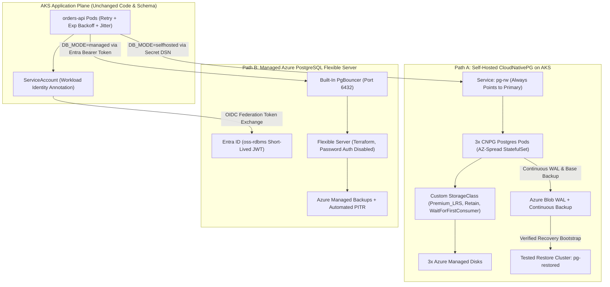
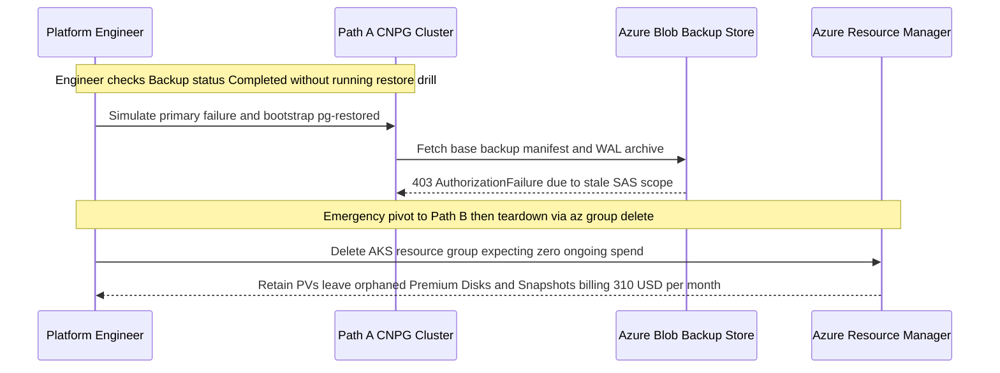

# Capstone Project

> **Prerequisites:** Completed Modules 00–07 (StatefulSets, Azure Disk StorageClasses, CloudNativePG operators, continuous WAL/Blob backups + PITR restore, Azure Flexible Server + Workload Identity, Decision Framework, Migration & Connection Resilience), active AKS cluster, Terraform CLI, `kubectl`, and `az` CLI.  
> **Estimated Reading Time:** 3–4 hours (End-to-End Dual-Path Implementation, Failover & Restore Proof, Written TCO Memo)  
> **Target Audience:** Backend Engineers, Platform Engineers, Cloud Architects.

> [!TIP]
> **The Golden Rule of Dual-Path Engineering:** Never build Path A and Path B simultaneously and never trust a backup merely because its Kubernetes status says `Completed`—finish Path A end-to-end (including an actual restore into a fresh cluster and live primary failover survival) first, wire Path B passwordlessly with zero secrets in manifests, verify checksum parity across both databases, and prove every billable resource is destroyed (`az aks list`, `az disk list`, `az postgres flexible-server list`) before concluding.

---

This is the last module of the track. There's no new concept section, no command reference, no quiz, no independent challenge, and no cumulative review—the goal is to combine everything from Modules 00–07 into one real piece of work that only *building it* can teach. The deliverable is not a running database; it's a running database **on both paths** plus an honest written comparison you could only write having done both.

Treat this as a project, not a checklist of isolated exercises. The two paths depend on the skills you built in order—StatefulSets and storage (00–02), the operator (03), tested backup/restore (04), managed provisioning and passwordless auth (05), the decision framework (06), and migration/connection resilience (07)—and the whole point is that the comparison at the end is grounded in what you actually experienced, not what a blog post told you.

---

## Why This Matters

Every prior module taught one side of a skill; this is where you find out whether you can hold the *whole* thing in your head at once—run a stateful database properly on Kubernetes, protect it with a restore you've actually tested, stand up the managed alternative the modern passwordless way, and then say, with evidence, which one you'd choose and why. That last part is the real professional skill: not "I can run Postgres on Kubernetes" and not "I can click a Flexible Server into existence," but "I have run the same application both ways and I can defend the trade-off to a senior engineer." Teams get this decision wrong constantly because almost nobody has honestly done both. After this capstone, you will have.

---

## 1. Architectural Mental Model: Dual-Path Parity & Zero-Secret Cutover

One stateless `orders-api` application connects through a single resilience wrapper (exponential backoff + full jitter + PgBouncer transaction-mode safety) and toggles solely via configuration between **Path A (Self-Hosted CNPG on AKS)** and **Path B (Terraform-Managed Azure Flexible Server with Workload Identity)**:



---

## 2. Taxonomic Comparison: Path A vs. Path B Capstone Evidence Scorecard

### Architectural & Operational Parity Matrix

| Dimension | Path A: Self-Hosted CNPG on AKS | Path B: Azure Managed Flexible Server | Capstone Proof Required |
| :--- | :--- | :--- | :--- |
| **Provisioning Plane** | `StorageClass` + CNPG Operator + `Cluster` YAML | Terraform (`azurerm_postgresql_flexible_server` + identity) | `kubectl get cluster` vs `terraform apply` |
| **Storage & Placement** | Dedicated Azure Disk per Pod (`WaitForFirstConsumer`, `Retain`) | Provider-managed storage inside Flexible Server resource | `kubectl get pvc` + `az disk list` vs `az postgres flexible-server show` |
| **High Availability Failover** | CNPG promotes standby Pod (~5–15s outage on `pg-rw`) | Optional `ZoneRedundant` managed standby (~60–120s RTO) | Live Pod kill survived via client retry/backoff |
| **Backup & Restore Proof** | Continuous Barman WAL to Azure Blob + manual restore cluster | Automated snapshots + built-in PITR (provider-verified) | Fresh `pg-restored` cluster `SELECT count(*)` transcript |
| **Authentication Footprint** | Kubernetes Secret (`pg-app` credentials) | Zero secrets: Workload Identity OIDC + `oss-rdbms` JWT | `grep` proves zero DB passwords in Path B manifests |
| **Post-Tear-Down Trap** | Orphaned `Retain` Azure Disks + Blob snapshots continue billing | Stopped server auto-starts after 7 days; only `delete` stops billing | Empty `az disk list`, `az postgres flexible-server list`, `az aks list` |

### Lived Comparison Worksheet (For Your Written Deliverable)

| Framework Axis | Path A Observed Evidence | Path B Observed Evidence | Dominant Winner & Revisit Trigger |
| :--- | :--- | :--- | :--- |
| **Operational Burden** | Time spent installing CNPG, tuning StorageClass, testing restore: `___ hrs` | Time spent writing Terraform + Workload Identity role: `___ hrs` | Name which saved ongoing 3am toil |
| **Fully-Loaded Cost** | `(Node CPU/RAM + 3x Disks + Engineer Hours * Rate) = \$___/mo` | `(Burstable/GP Tier * HA Multiplier) = \$___/mo` | Compare sticker price vs engineer-adjusted total |
| **Control & Extensions** | Full `postgresql.conf`, any version/extension | Curated Azure allowlist & upgrade cadence | State if your `orders` app actually needed custom control |
| **Compliance & Portability** | Portable across on-prem / multi-cloud K8s | Inherits Azure SOC 2 / HIPAA scope; Azure-bound | Name which rule overrides cost/ops if regulated |

---

## 3. Production War Story Post-Mortem: False-Green Backup & Orphaned `Retain` Billing Leak

### Incident Metadata

- **Severity:** SEV-1 (Failed production disaster recovery + unexpected \$310/month orphan storage bill)
- **Detection Time:** 4 hours into disaster recovery test; billing leak discovered 34 days post-teardown
- **Resolution Time:** 6 hours to repair WAL object-store RBAC; 45 minutes to hunt and purge orphaned Azure Disks
- **Impact:** Zero recoverable backup snapshots during live DR drill despite 60 days of `Completed` CNPG Backup objects

### What Happened

During a capstone-style dual-path platform validation, an engineer verified Path A backups solely by checking `kubectl get backups` showing `phase: completed`. When a simulated namespace deletion wiped the primary cluster, bootstrapping `pg-restored` failed because the Blob storage SAS token lacked read/list scope for base-backup manifests while WAL archiving had silently started failing three weeks earlier. The team pivoted urgently to Path B Flexible Server, ran `az group delete` on the old test AKS resource group assuming cleanup was finished, and discovered a month later that `Retain`-policy Azure Disks and snapshots inside `MC_*` resource groups—plus an un-deleted Flexible Server in a separate RG—kept billing continuously:



### Root Cause Analysis

1. **Untested Backup Fallacy:** Status `Completed` on a `ScheduledBackup` only indicates a job exited; without restoring into an isolated `pg-restored` cluster and querying rows, RBAC, WAL continuity, and recovery syntax remain unproven.
2. **`Retain` Lifecycle Blind Spot:** Deleting a Kubernetes `Cluster` or even an AKS cluster does not purge dynamically provisioned Azure Disks bound with `reclaimPolicy: Retain`.
3. **Incomplete Teardown Verification:** Skipping a subscription-wide audit across `az disk list`, `az snapshot list`, and `az postgres flexible-server list` masked lingering billable infrastructure.

### The Fix & Architectural Hardening

1. **Automated Restore Gate:** Promoted "restore into fresh `pg-restored` cluster + checksum `SELECT`" as a mandatory acceptance criterion before signing off on Path A.
2. **Workload Identity Over SAS Tokens:** Replaced expiring Blob SAS strings in CNPG `ObjectStore` specs with Managed Identity authentication.
3. **Three-List Zero-Billing Sign-Off:** Standardized teardown cleanup so sign-off requires empty outputs from `az aks list`, `az disk list`, and `az postgres flexible-server list`.

---

## 4. Multi-Language Production Implementation: Dual-Path Orders App & Parity Harness

Use any of the four production implementations below as your single `orders-api` codebase. Changing `DB_MODE=selfhosted` to `DB_MODE=managed` switches cleanly between Path A (`pg-rw` Secret DSN) and Path B (passwordless Workload Identity `oss-rdbms` token) with identical schema migrations, bounded jitter retries, and shadow parity checksums:

````carousel
```go
package main

import (
	"context"
	"encoding/json"
	"errors"
	"fmt"
	"log"
	"math/rand/v2"
	"net/http"
	"os"
	"sync"
	"time"

	"github.com/Azure/azure-sdk-for-go/sdk/azcore/policy"
	"github.com/Azure/azure-sdk-for-go/sdk/azidentity"
	"github.com/jackc/pgx/v5"
	"github.com/jackc/pgx/v5/pgconn"
	"github.com/jackc/pgx/v5/pgxpool"
)

const ossScope = "https://ossrdbms-aad.database.windows.net/.default"

func buildDualPathPool(ctx context.Context) (*pgxpool.Pool, error) {
	mode := os.Getenv("DB_MODE") // "selfhosted" (Path A) or "managed" (Path B)
	if mode == "selfhosted" {
		cfg, err := pgxpool.ParseConfig(os.Getenv("SELFHOSTED_DSN"))
		if err != nil {
			return nil, err
		}
		cfg.ConnConfig.DefaultQueryExecMode = pgx.QueryExecModeSimpleProtocol
		return pgxpool.NewWithConfig(ctx, cfg)
	}

	cred, err := azidentity.NewDefaultAzureCredential(nil)
	if err != nil {
		return nil, err
	}
	var mu sync.Mutex
	var cachedTok string
	var expires time.Time

	dsn := fmt.Sprintf("host=%s port=6432 dbname=%s user=%s sslmode=require",
		os.Getenv("FLEX_HOST"), os.Getenv("FLEX_DB"), os.Getenv("FLEX_IDENTITY"))
	cfg, err := pgxpool.ParseConfig(dsn)
	if err != nil {
		return nil, err
	}
	cfg.MaxConnLifetime = 30 * time.Minute
	cfg.ConnConfig.DefaultQueryExecMode = pgx.QueryExecModeSimpleProtocol
	cfg.BeforeConnect = func(ctx context.Context, cc *pgx.ConnConfig) error {
		mu.Lock()
		defer mu.Unlock()
		if cachedTok == "" || time.Until(expires) < 10*time.Minute {
			at, err := cred.GetToken(ctx, policy.TokenRequestOptions{Scopes: []string{ossScope}})
			if err != nil {
				return err
			}
			cachedTok, expires = at.Token, at.ExpiresOn
		}
		cc.Password = cachedTok
		return nil
	}
	return pgxpool.NewWithConfig(ctx, cfg)
}

func withRetry(ctx context.Context, fn func() error) error {
	for attempt := 0; attempt < 7; attempt++ {
		err := fn()
		if err == nil {
			return nil
		}
		var pgErr *pgconn.PgError
		if errors.As(err, &pgErr) && pgErr.Code != "57P01" && pgErr.Code != "57P03" && pgErr.Code != "08006" {
			return err
		}
		wait := time.Duration(rand.Int64N(int64(min(10*time.Second, 250*time.Millisecond<<attempt))))
		log.Printf("failover/retry attempt %d err=%v wait=%s", attempt+1, err, wait)
		select {
		case <-time.After(wait):
		case <-ctx.Done():
			return ctx.Err()
		}
	}
	return errors.New("retry budget exceeded")
}

func main() {
	ctx := context.Background()
	pool, err := buildDualPathPool(ctx)
	if err != nil {
		log.Fatal(err)
	}
	defer pool.Close()

	_ = withRetry(ctx, func() error {
		_, err := pool.Exec(ctx, `CREATE TABLE IF NOT EXISTS orders(id serial primary key, item text not null, qty int not null)`)
		return err
	})

	http.HandleFunc("/orders", func(w http.ResponseWriter, r *http.Request) {
		var count, sum int64
		var digest string
		err := withRetry(r.Context(), func() error {
			if r.Method == http.MethodPost {
				_, err := pool.Exec(r.Context(), `INSERT INTO orders(item, qty) VALUES ('capstone-item', 1)`)
				return err
			}
			return pool.QueryRow(r.Context(),
				`SELECT count(*), coalesce(sum(qty),0), coalesce(md5(string_agg(item,',' ORDER BY id)),'') FROM orders`).
				Scan(&count, &sum, &digest)
		})
		if err != nil {
			http.Error(w, err.Error(), http.StatusServiceUnavailable)
			return
		}
		_ = json.NewEncoder(w).Encode(map[string]any{"mode": os.Getenv("DB_MODE"), "count": count, "sum": sum, "checksum": digest})
	})
	log.Fatal(http.ListenAndServe(":8080", nil))
}
```
<!-- slide -->
```typescript
import http from "node:http";
import { DefaultAzureCredential, AccessToken } from "@azure/identity";
import { Pool, PoolConfig } from "pg";

const OSS_SCOPE = "https://ossrdbms-aad.database.windows.net/.default";
const RETRYABLE = new Set(["57P01", "57P02", "57P03", "08001", "08006", "40001"]);

function createDualPathPool(): Pool {
  if (process.env.DB_MODE === "selfhosted") {
    return new Pool({ connectionString: process.env.SELFHOSTED_DSN, max: 15 });
  }
  const cred = new DefaultAzureCredential();
  let cached: AccessToken | null = null;
  const cfg: PoolConfig = {
    host: process.env.FLEX_HOST,
    port: 6432,
    database: process.env.FLEX_DB,
    user: process.env.FLEX_IDENTITY,
    ssl: { rejectUnauthorized: true },
    max: 15,
    password: async () => {
      if (!cached || cached.expiresOnTimestamp - Date.now() < 600_000) {
        cached = await cred.getToken(OSS_SCOPE);
      }
      if (!cached) throw new Error("Unable to acquire Entra oss-rdbms token");
      return cached.token;
    },
  };
  return new Pool(cfg);
}

async function execResilient<T>(op: () => Promise<T>): Promise<T> {
  for (let i = 0; i < 7; i++) {
    try {
      return await op();
    } catch (err: unknown) {
      const code = (err as { code?: string }).code;
      if (code && !RETRYABLE.has(code)) throw err;
      const wait = Math.floor(Math.random() * Math.min(10_000, 250 * 2 ** i));
      console.warn(`retry attempt=${i + 1} code=${code ?? "net"} waitMs=${wait}`);
      await new Promise((r) => setTimeout(r, wait));
    }
  }
  throw new Error("DB retry limit exceeded");
}

const pool = createDualPathPool();

(async () => {
  await execResilient(() =>
    pool.query(`CREATE TABLE IF NOT EXISTS orders(id serial primary key, item text not null, qty int not null)`)
  );
  http.createServer(async (req, res) => {
    try {
      const payload = await execResilient(async () => {
        if (req.method === "POST") {
          await pool.query(`INSERT INTO orders(item, qty) VALUES ('capstone-item', 1)`);
        }
        const r = await pool.query(
          `SELECT count(*)::int AS count, coalesce(sum(qty),0)::int AS sum,
                  coalesce(md5(string_agg(item,',' ORDER BY id)),'') AS checksum FROM orders`
        );
        return { mode: process.env.DB_MODE, ...r.rows[0] };
      });
      res.writeHead(200, { "Content-Type": "application/json" });
      res.end(JSON.stringify(payload));
    } catch (e) {
      res.writeHead(503).end(String(e));
    }
  }).listen(8080);
})();
```
<!-- slide -->
```python
import os
import random
import threading
import time
from http.server import BaseHTTPRequestHandler, HTTPServer
import json
from azure.identity import DefaultAzureCredential
import psycopg
from psycopg_pool import ConnectionPool

OSS_SCOPE = "https://ossrdbms-aad.database.windows.net/.default"
RETRYABLE = {"57P01", "57P02", "57P03", "08001", "08006", "40001"}


class ManagedEntraConnection(psycopg.Connection):
    _cred = DefaultAzureCredential()
    _lock = threading.Lock()
    _tok = ""
    _exp = 0.0

    @classmethod
    def connect(cls, conninfo: str = "", **kwargs):
        with cls._lock:
            if not cls._tok or (cls._exp - time.time()) < 600:
                at = cls._cred.get_token(OSS_SCOPE)
                cls._tok, cls._exp = at.token, float(at.expires_on)
            kwargs["password"] = cls._tok
        return super().connect(conninfo, **kwargs)


def create_pool() -> ConnectionPool:
    if os.getenv("DB_MODE") == "selfhosted":
        return ConnectionPool(os.environ["SELFHOSTED_DSN"], max_size=15, kwargs={"prepare_threshold": None})
    conninfo = (
        f"host={os.environ['FLEX_HOST']} port=6432 dbname={os.environ['FLEX_DB']} "
        f"user={os.environ['FLEX_IDENTITY']} sslmode=require"
    )
    return ConnectionPool(conninfo, connection_class=ManagedEntraConnection, max_size=15, max_lifetime=1800)


def resilient_exec(fn):
    for attempt in range(7):
        try:
            return fn()
        except Exception as exc:
            code = getattr(exc, "sqlstate", None)
            if code and code not in RETRYABLE:
                raise
            if not isinstance(exc, psycopg.OperationalError) and not code:
                raise
            wait = random.uniform(0, min(10.0, 0.25 * (2 ** attempt)))
            print(f"retry attempt={attempt+1} err={exc} wait={wait:.2f}s", flush=True)
            time.sleep(wait)
    raise RuntimeError("DB retry exhausted")


POOL = create_pool()


def ensure_schema():
    def _init():
        with POOL.connection() as conn:
            conn.execute("CREATE TABLE IF NOT EXISTS orders(id serial primary key, item text not null, qty int not null)")
    resilient_exec(_init)


class Handler(BaseHTTPRequestHandler):
    def do_POST(self):
        def _write():
            with POOL.connection() as conn:
                conn.execute("INSERT INTO orders(item, qty) VALUES ('capstone-item', 1)")
        resilient_exec(_write)
        self.do_GET()

    def do_GET(self):
        def _read():
            with POOL.connection() as conn:
                return conn.execute(
                    "SELECT count(*), coalesce(sum(qty),0), coalesce(md5(string_agg(item,',' ORDER BY id)),'') FROM orders"
                ).fetchone()
        cnt, total, digest = resilient_exec(_read)
        body = json.dumps({"mode": os.getenv("DB_MODE"), "count": cnt, "sum": total, "checksum": digest}).encode()
        self.send_response(200)
        self.end_headers()
        self.wfile.write(body)


if __name__ == "__main__":
    ensure_schema()
    HTTPServer(("0.0.0.0", 8080), Handler).serve_forever()
```
<!-- slide -->
```csharp
using System;
using System.Collections.Generic;
using System.Threading;
using System.Threading.Tasks;
using Azure.Core;
using Azure.Identity;
using Microsoft.AspNetCore.Builder;
using Microsoft.AspNetCore.Http;
using Npgsql;

var builder = WebApplication.CreateBuilder(args);
var mode = Environment.GetEnvironmentVariable("DB_MODE") ?? "selfhosted";

NpgsqlDataSource dataSource;
if (mode == "selfhosted")
{
    dataSource = NpgsqlDataSource.Create(Environment.GetEnvironmentVariable("SELFHOSTED_DSN")!);
}
else
{
    var cred = new DefaultAzureCredential();
    var cs = new NpgsqlConnectionStringBuilder
    {
        Host = Environment.GetEnvironmentVariable("FLEX_HOST"),
        Port = 6432,
        Database = Environment.GetEnvironmentVariable("FLEX_DB"),
        Username = Environment.GetEnvironmentVariable("FLEX_IDENTITY"),
        SslMode = SslMode.Require,
        ConnectionLifetime = 1800
    }.ConnectionString;
    var dsBuilder = new NpgsqlDataSourceBuilder(cs);
    dsBuilder.UsePeriodicPasswordProvider(async (_, ct) =>
    {
        var tok = await cred.GetTokenAsync(new TokenRequestContext(["https://ossrdbms-aad.database.windows.net/.default"]), ct);
        return tok.Token;
    }, TimeSpan.FromMinutes(45), TimeSpan.FromSeconds(10));
    dataSource = dsBuilder.Build();
}

var retryable = new HashSet<string> { "57P01", "57P02", "57P03", "08001", "08006", "40001" };

async Task<T> RunResilientAsync<T>(Func<Task<T>> op, CancellationToken ct)
{
    for (int i = 0; i < 7; i++)
    {
        try { return await op(); }
        catch (Exception ex) when ((ex is PostgresException p && retryable.Contains(p.SqlState)) || ex is NpgsqlException)
        {
            if (i == 6) throw;
            int waitMs = Random.Shared.Next(0, (int)Math.Min(10_000, 250 * Math.Pow(2, i)));
            Console.WriteLine($"retry attempt={i + 1} err={ex.Message} waitMs={waitMs}");
            await Task.Delay(waitMs, ct);
        }
    }
    throw new TimeoutException("Retry budget exhausted");
}

await RunResilientAsync(async () =>
{
    await using var cmd = dataSource.CreateCommand(
        "CREATE TABLE IF NOT EXISTS orders(id serial primary key, item text not null, qty int not null);");
    return await cmd.ExecuteNonQueryAsync();
}, CancellationToken.None);

var app = builder.Build();
app.MapPost("/orders", async (CancellationToken ct) =>
{
    await RunResilientAsync(async () =>
    {
        await using var cmd = dataSource.CreateCommand("INSERT INTO orders(item, qty) VALUES ('capstone-item', 1);");
        return await cmd.ExecuteNonQueryAsync(ct);
    }, ct);
    return Results.Ok(new { status = "inserted", mode });
});

app.MapGet("/orders", async (CancellationToken ct) =>
{
    var stats = await RunResilientAsync(async () =>
    {
        await using var cmd = dataSource.CreateCommand(
            "SELECT count(*)::bigint, coalesce(sum(qty),0)::bigint, coalesce(md5(string_agg(item,',' ORDER BY id)),'') FROM orders;");
        await using var r = await cmd.ExecuteReaderAsync(ct);
        await r.ReadAsync(ct);
        return new { mode, count = r.GetInt64(0), sum = r.GetInt64(1), checksum = r.GetString(2) };
    }, ct);
    return Results.Ok(stats);
});

app.Run("http://0.0.0.0:8080");
```
````

---

## 5. Practical Hands-On Capstone Build & Verification Workflows

### The Project

Take one small application that needs exactly one Postgres database (a simple REST API over an `orders` or `notes` table is plenty—reuse something from an earlier track's capstone if you like) and run it **two ways against the same schema and app code**, changing only how it reaches its database.

**Path A — self-hosted on Kubernetes.** Run the database as a StatefulSet-based cluster via the CloudNativePG operator (Module 03) on a real AKS cluster, with its per-instance volumes dynamically provisioned on **Azure Disk** through a StorageClass you chose deliberately (Module 02), and a **tested backup/restore cycle** (Module 04)—a backup that you prove restorable by actually restoring it into a new cluster and querying the data, not just a backup that reports success.

**Path B — managed on Azure.** Run the *same* application against an Azure Database for PostgreSQL Flexible Server, **provisioned with Terraform** (Module 05, using the Track 09 patterns), connected with a **managed identity and no password** (Workload Identity + Entra token, Module 05)—no connection-string secret anywhere in the manifests.

Then write the comparison that this whole track was building toward.

Build it roughly in this order—each step leans on the previous one actually working:

1. **Stand up the app and its schema** so it's identical across both paths (same migrations, same queries). The app must connect through the resilient patterns from Module 07 (retry/backoff with jitter), because Path A *will* fail over and you want that to be a non-event.
2. **Path A: provision the storage layer** — an AKS cluster (reuse Track 09's Terraform), and an Azure Disk StorageClass sized and reclaim-policy'd on purpose (Module 02).
3. **Path A: deploy the operator and the database cluster** (Module 03), a multi-instance CNPG `Cluster` on your Azure Disk class, and point the app at the operator's `-rw` endpoint.
4. **Path A: prove failover is invisible** — kill the primary (Module 03) and show, from the app's own output, that the retry logic (Module 07) absorbed the window.
5. **Path A: take and *test* a backup** — configure continuous backup to Blob storage, then restore into a *new* cluster and verify the data (Module 04). A backup you haven't restored does not count.
6. **Path B: provision the managed database with Terraform** — a Flexible Server + database, Entra auth on and password auth off (Module 05).
7. **Path B: connect the same app passwordlessly** — a managed identity federated to the app's `ServiceAccount`, a Postgres role for it, and the app reaching the server with an Entra token and no stored secret (Module 05).
8. **Optionally migrate real data between the paths** (Module 07) — move your seeded `orders` data from Path A into Path B with a verified cutover (count + checksum), to prove the two paths hold the same data.
9. **Write the comparison** (below) — the actual deliverable.
10. **Tear both paths down** and confirm nothing is left billing.

### Path A & Path B Verification Manifests and CLI Checkpoints

#### Path A Core StorageClass, 3-Instance CNPG Cluster & Tested Restore

```yaml
# path-a-cnpg.yaml
apiVersion: storage.k8s.io/v1
kind: StorageClass
metadata:
  name: azure-disk-pg-retain
provisioner: disk.csi.azure.com
reclaimPolicy: Retain
volumeBindingMode: WaitForFirstConsumer
allowVolumeExpansion: true
parameters:
  skuName: Premium_LRS
---
apiVersion: postgresql.cnpg.io/v1
kind: Cluster
metadata:
  name: pg-capstone
  namespace: db
spec:
  instances: 3
  storage:
    size: 16Gi
    storageClass: azure-disk-pg-retain
  backup:
    barmanObjectStore:
      destinationPath: "https://<storage-account>.blob.core.windows.net/cnpg-backups"
      azureCredentials:
        inheritFromAzureVM: true
```

Verify Path A failover survival, Blob backup, and **tested restore** into a brand-new `pg-restored` cluster:

```bash
kubectl apply -f path-a-cnpg.yaml
kubectl wait --for=condition=Ready cluster/pg-capstone -n db --timeout=300s
kubectl get pvc -n db
az disk list -g <aks-node-rg> -o table

# Trigger failover while app writes/reads against pg-capstone-rw
PRIMARY=$(kubectl get pod -n db -l cnpg.io/cluster=pg-capstone,role=primary -o jsonpath='{.items[0].metadata.name}')
kubectl delete pod -n db "$PRIMARY"
kubectl logs -n db deployment/orders-api --tail=20

# Trigger on-demand backup, then restore into pg-restored and verify row count
kubectl cnpg backup pg-capstone -n db
# Apply pg-restored Cluster spec with bootstrap.recovery referencing pg-capstone
kubectl exec -n db pg-restored-1 -- psql -U postgres -d app -c "SELECT count(*), md5(string_agg(item,',' ORDER BY id)) FROM orders;"
```

**Expected Output:**

```text
NAME                 STATUS   VOLUME        CAPACITY   STORAGECLASS
pg-capstone-1        Bound    pvc-a1b2...   16Gi       azure-disk-pg-retain
pg-capstone-2        Bound    pvc-c3d4...   16Gi       azure-disk-pg-retain
pg-capstone-3        Bound    pvc-e5f6...   16Gi       azure-disk-pg-retain

retry attempt=1 err=EOF wait=380ms
retry attempt=2 err=FATAL: the database system is starting up wait=710ms
{"mode":"selfhosted","count":1005,"sum":505515,"checksum":"9f8e7d6c5b4a..."}
```

#### Path B Passwordless Verification & Zero-Secret Audit

```bash
# Confirm Entra-only auth and zero DB secrets in Path B Deployment manifests
az postgres flexible-server show -g rg-capstone -n pg-flex-capstone \
  --query "{state:state, auth:authConfig, ha:highAvailability.mode}"
grep -rn "PASSWORD\|DSN\|pg-app" manifests/path-b/ || echo "PASS: zero secrets in Path B manifests"
curl -s http://<orders-api-endpoint>/orders
```

**Expected Output:**

```text
{
  "auth": { "activeDirectoryAuth": "Enabled", "passwordAuth": "Disabled" },
  "ha": "Disabled",
  "state": "Ready"
}
PASS: zero secrets in Path B manifests
{"mode":"managed","count":1005,"sum":505515,"checksum":"9f8e7d6c5b4a..."}
```

### Acceptance Criteria

Work through these in order; each depends on the previous ones genuinely working, not just existing.

- [ ] The same application code and schema run against both databases, changing only the connection configuration—you can point it at Path A or Path B without touching app logic.
- [ ] **Path A:** a real AKS cluster runs a CloudNativePG `Cluster` of at least 3 instances, each with its own PVC dynamically provisioned on an **Azure Disk** StorageClass you defined (not the default)—`kubectl get pvc` shows one disk per instance and `az disk list` shows the real managed disks.
- [ ] **Path A:** the app connects to the operator's `-rw` Service (never a specific Pod), and you have first-hand evidence—the app's own log output—that killing the primary triggers a failover the app rides out via retry/backoff, with no lost writes.
- [ ] **Path A:** continuous backup to Azure Blob is configured, and you have **restored a backup into a new cluster and queried the recovered data**—a transcript or screenshot proving the restore worked, not just that a `Backup` reported `completed`.
- [ ] **Path B:** an Azure Database for PostgreSQL Flexible Server and its database are provisioned by **Terraform** (`terraform apply` / `destroy` manage them), with Entra ID auth enabled and password auth disabled.
- [ ] **Path B:** the app connects with **no password**—a managed identity (Workload Identity) federated to the app's `ServiceAccount`, a Postgres role for that identity, and an Entra token used at connect time. Grep your manifests and confirm there is no database password or connection-string secret anywhere.
- [ ] Both paths serve the same application behavior—the same endpoint returns the same data whichever database backs it.
- [ ] **The written comparison exists** (see below) and is grounded in what you actually observed, with real numbers, not generic pros/cons.
- [ ] Everything is torn down at the end and you have confirmed `az disk list`, `az postgres flexible-server list`, and `az aks list` show nothing of yours still running—no orphaned disks, no idle managed server, no forgotten cluster.

### The Written Comparison (The Real Deliverable)

One to two pages, structured on the Module 06 framework and filled in with what you *lived*, not what you'd guess:

- [ ] **Operational burden** — concretely, what did Path A make you do that Path B did not (operator install/upgrade, storage choices, backup configuration, verifying the restore, handling the failover)? How long did each take you, honestly?
- [ ] **Cost** — the fully-loaded picture from Module 06: Path A's disks + node capacity **+ your own time**, versus Path B's tier price. Which was cheaper in dollars, and which was cheaper once your time is counted?
- [ ] **Control** — what could you do on Path A that Path B wouldn't let you, and—being honest—did this specific app *need* any of it?
- [ ] **Compliance / residency / lock-in** — which path would you pick if this data were regulated, or had to also run on-prem, and why?
- [ ] **Your recommendation** — for *this* workload, which path, on which dominant axis, and what single fact would flip your choice. Include the strongest honest argument for the path you *didn't* pick and why it loses here (the Module 06 discipline).

If you can write that comparison from real observation, you've achieved the thing this track exists to teach—the judgement, not just the mechanics.

### Hints

- **Do Path A first, completely, including the tested restore, before you start Path B.** Debugging operator storage and passwordless managed auth at the same time is two unfamiliar layers at once—don't. Get one path green, then build the other.
- **Start smaller than the acceptance criteria.** Get the app talking to a single-instance CNPG cluster on the *default* storage class first, prove the app works, then swap in your Azure Disk StorageClass and scale to 3 instances. Get the managed server connecting with *your* Entra token (Module 05 Exercise 4) before wiring the app's Workload Identity.
- **The tested-restore is the step people fake—don't.** It's the whole point of Module 04. Actually create the new cluster from the backup and run a `SELECT`. If it fails, that's the most valuable thing this capstone will teach you, exactly as Module 04's Exercise 6 warned.
- **Reuse, don't reinvent.** The AKS + Terraform provisioning is Track 09 Module 06; the passwordless chain is Module 05's independent challenge; the retry loop is Module 07 Exercise 5. This capstone is *integration*, not new discovery—lean on what you already validated.
- **Keep a resource inventory as you go** (cluster name, node RG, disk names, storage account, Flexible Server name, identity name) so the final teardown is a checklist, not an archaeology dig—and so no `Retain`ed Azure Disk or idle Flexible Server survives to bill you (Modules 02 and 05).
- **If the app can authenticate to the managed DB but queries fail,** revisit Module 05's diagnose-and-fix: it's almost always network reachability (firewall/VNet) first, then a stale/missing token or a missing Postgres role for the identity.
- **If a StatefulSet/CNPG Pod is stuck `Pending`,** it's the Module 01/02 storage story: a bad StorageClass, a zone-affinity conflict from `Immediate` binding, or an unbound PVC. `kubectl describe pvc` and `describe pod` tell you which.

### Final Cleanup

This is the end of the track's real-Azure-spend, and this track has *two* independent ways to keep billing after you think you're done—handle both.

1. Confirm what you're about to delete:
   `az resource list -g <your-capstone-rg> -o table`.
2. Delete the resource group(s) holding the AKS cluster and the Flexible Server:
   `az group delete --name <rg> --yes --no-wait`.
3. **Hunt orphaned Azure Disks** (Module 02's trap): any `Retain`-policy PVC from Path A can leave a disk billing after the cluster is gone—`az disk list -o table` across the node resource group and delete any stragglers with `az disk delete --ids <id> --yes`.
4. **Confirm the managed server is gone** (Module 05's trap): `az postgres flexible-server list -o table`—a Flexible Server bills continuously and does not stop on its own.
5. Delete any Blob storage account you used for backups, and any Azure Disk *snapshots* from the restore test (`az snapshot list -o table`).
6. Final sweep:

```bash
az aks list -o table
az disk list -o table
az postgres flexible-server list -o table
```

**Expected Output:**

```text
Three empty tables — zero clusters, zero orphaned managed disks, zero Flexible Servers running.
```

Three empty lists is your signal you're no longer paying for any of this.

---

## 6. Common Mistakes & Troubleshooting

- **Debugging Path A and Path B simultaneously.** Combining CNPG volume binding failures with Workload Identity OIDC debugging obscures root causes. Get Path A green (including restore) before standing up Path B.
- **Accepting a `Completed` Backup status without restoring.** Backup metadata can say `Completed` even if WAL segments are missing or storage permissions fail on read. Only booting `pg-restored` and running a checksum `SELECT` verifies recoverability.
- **Hardcoding a Path B secret or leaving password auth enabled.** Path B fails acceptance if `password_auth_enabled = true` or a Secret contains `PGPASSWORD`. Use `pgaadauth_create_principal` and `DefaultAzureCredential` with `oss-rdbms`.
- **CNPG Pods stuck `Pending` on `Immediate` StorageClass binding.** Without `volumeBindingMode: WaitForFirstConsumer`, Azure Disks can be created in Zone 1 while scheduler places the Pod in Zone 2.
- **Leaving orphaned `Retain` disks or stopped Flexible Servers post-capstone.** `az group delete` on the user RG removes AKS, yet `Retain` disks or separate-RG Flexible Servers persist. Always verify all three `az ... list` commands return empty.

---

## 7. Operational Validation Checkpoints

<details>
<summary><strong>Checkpoint 1: During Path A, you kill the CNPG primary Pod, and your app logs show "syntax error" or immediate 500s instead of riding out the 8-second failover. Why?</strong></summary>

Either (1) the app pointed to a Pod IP / headless Pod DNS instead of the operator-managed `-rw` Service (`pg-capstone-rw`), or (2) the connection pool did not wrap queries in bounded exponential backoff with jitter for transient `57P01` / `08006` / socket EOF errors. Switch the DSN to `pg-capstone-rw` and verify retry loops execute against transient failover errors.

</details>

<details>
<summary><strong>Checkpoint 2: In Path B, your Pod authenticates with Entra ID successfully (no token error), yet queries fail with "permission denied for table orders". Diagnose the gap.</strong></summary>

Creating the Postgres principal via `pgaadauth_create_principal('<identity-name>', false, false)` authenticates the managed identity to the database server, but does not automatically grant schema or table privileges if the table was created by the Entra admin user. Grant `SELECT, INSERT, UPDATE, DELETE ON ALL TABLES IN SCHEMA public` (and sequence usage `GRANT USAGE, SELECT ON ALL SEQUENCES IN SCHEMA public`) to the app identity role, or let the identity own the schema cleanly.

</details>

<details>
<summary><strong>Checkpoint 3: After running `terraform destroy` and `az group delete` at the end of the capstone, you run the final sweep and see three 16Gi `Premium_LRS` disks still listed. How did they survive?</strong></summary>

Those disks belong to Path A's `azure-disk-pg-retain` StorageClass (`reclaimPolicy: Retain`). Deleting the Kubernetes `Cluster` or PVCs leaves the underlying Azure Disk intact by design to prevent accidental data loss. Delete them explicitly via `az disk delete --ids <disk-id> --yes`, then confirm `az disk list -o table` is empty.

</details>

---

## Before You Move On

Once both paths are torn down, don't call this finished. Wait a few days, then—with no notes and none of the earlier modules open—rebuild the *harder* half from memory: an operator-run CloudNativePG cluster on a real Azure Disk StorageClass, and a backup you restore into a fresh cluster and verify. Rebuilding Path A cold, and noticing exactly where you stall (configuring the StorageClass? the backup object store? the restore bootstrap?), is the truest retention check there is—those stalls are precisely the modules to redo. Then tear it down again and confirm the three lists are empty.

And carry the real lesson forward: the deepest thing this track taught isn't a `kubectl` incantation or a Terraform block—it's that "run it yourself" and "let the platform run it" are both legitimate, and choosing between them with evidence is the job.

This bridges directly into [15-messaging-and-event-driven-architecture](../../15-messaging-and-event-driven-architecture/README.md). There you'll meet stateful infrastructure of a different shape—message brokers and event streams (Service Bus, Event Grid)—where many of the same tensions return: durability, ordering, at-least-once delivery, and the same self-hosted-vs-managed decision you just learned to make for databases, now for the messaging layer that ties services together.
