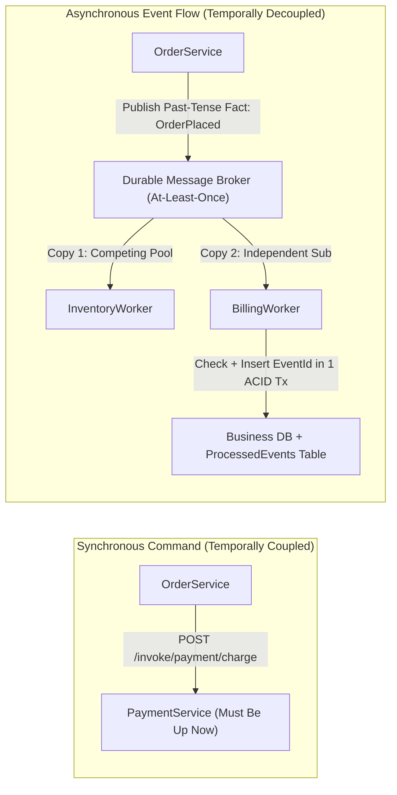
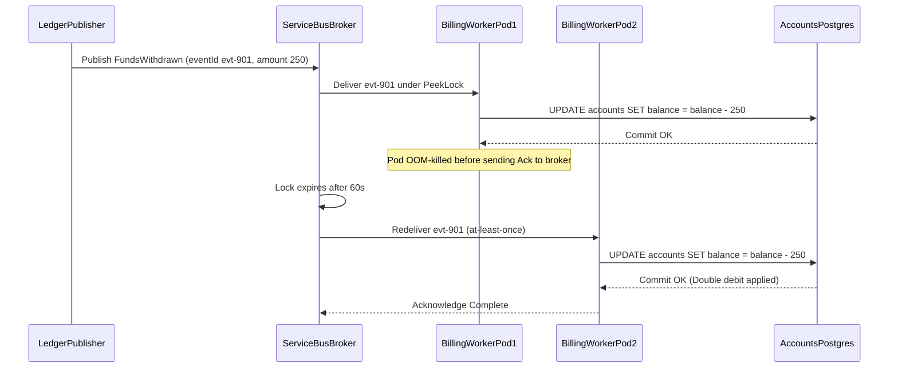

# Event-Driven Architecture Concepts

> **Prerequisites:** Basic HTTP/REST API concepts, relational database ACID transactions, Azure CLI authenticated (`az login`), and familiarity with Dapr service invocation and pub/sub from Track 6 Module 05.  
> **Estimated Reading Time:** 25 minutes  
> **Target Audience:** Backend Engineers, Distributed Systems Developers, Cloud Architects.

> [!TIP]
> **The Golden Rule of Event-Driven Architecture:** Always assume **at-least-once** delivery from every message broker—name events as immutable past-tense facts (`OrderPlaced`), reserve synchronous commands for workflows that require an immediate answer right now, and pair every side-effecting consumer with a transactional deduplication key so duplicate deliveries become harmless no-ops.

---

## Why This Matters

Every reliability decision you'll make in this track — dead-lettering, the outbox pattern, idempotent consumers, schema versioning — is a consequence of a few core ideas: that a message can arrive twice or never, that the sender and receiver run at different times, and that "the event happened" is a different kind of statement than "do this thing." Get these concepts wrong and you'll build a system that works in a demo and double-charges a customer in production. This module is deliberately about vocabulary and trade-offs before you touch a single Azure resource — because the resources only make sense once the model does.

---

## 1. Architectural Mental Model: Temporal Decoupling & The Effectively-Once Bridge

Synchronous commands force caller and callee to be healthy at the exact same millisecond (**temporal coupling**). Asynchronous events insert a durable broker between publisher and consumers (**temporal decoupling**), trading immediate consistency for resilience and independent scaling while using a transactional deduplication key to turn unavoidable at-least-once deliveries into **effectively-once** outcomes:



### Core Concepts

#### Commands vs. events

A **command** is a request to *do* something — `ChargePayment`, `ReserveInventory`. It's imperative, addressed to one specific handler, and the sender expects it to be carried out. An **event** is a statement that something *already happened* — `PaymentCharged`, `OrderPlaced`. It's a fact in the past tense, the publisher doesn't know or care who consumes it, and it can have zero, one, or many interested consumers.

This distinction drives everything downstream. A command has one owner (who processes it); an event has one owner (who emitted the fact) but any number of reactors. When you designed Dapr service invocation in track 6 module 05 — app A calling `POST /invoke/backend/method/charge` — that was a **command**: synchronous, addressed, expecting a result. When you published to a Dapr pub/sub **topic**, that was an **event**: fire-and-forget, addressed to a topic rather than a handler. Naming events in the past tense (`OrderShipped`, not `ShipOrder`) is the single cheapest habit for keeping the two straight.

#### Delivery guarantees: at-most-once, at-least-once, exactly-once

When a message crosses a network and a broker, three delivery guarantees are possible, and you must pick one consciously:

- **At-most-once**: the message is delivered zero or one times. If a consumer crashes before finishing, the message is *lost*. Cheap and simple; only acceptable when losing a message is fine (e.g. a "user is typing" signal).
- **At-least-once**: the message is delivered one or more times. The broker redelivers until the consumer explicitly acknowledges success, so a crash mid-processing means a **duplicate** later. This is the default and the realistic one — Service Bus, Event Grid, and Dapr pub/sub all give you at-least-once.
- **Exactly-once**: delivered and processed once, no loss and no duplicates. This is the one everyone wants and almost no distributed system truly provides end-to-end — it requires the broker *and* your side effect to participate in one atomic decision. In practice you **synthesize** it from at-least-once delivery plus an **idempotent consumer** (next section). The honest phrase is "effectively-once."

The practical takeaway: assume **at-least-once**, and design so a duplicate is harmless. Every module after this one is, in some sense, about surviving at-least-once delivery.

#### Idempotency: how you survive duplicates

An operation is **idempotent** if doing it twice has the same effect as doing it once. `SET balance = 100` is idempotent; `balance = balance + 100` is not. Because you're getting at-least-once delivery, your consumer *will* occasionally see the same event twice — a redelivery after a crash, a broker retry, a publisher that sent twice. If processing that event isn't idempotent, the duplicate becomes a double charge, a double email, a doubled inventory decrement.

The standard technique is a **dedup key**: every event carries a stable unique id (a `messageId` or a business key like an order id), and the consumer records which ids it has already processed — often by writing the id into the same database transaction as the side effect, then checking it on the way in. Seen it before? Acknowledge and skip. You'll implement exactly this in module 05, and the capstone requires you to write up an idempotent consumer design. Idempotency is the bridge that turns unavoidable at-least-once delivery into effectively-once behavior.

#### Coupling: temporal, and why async trades consistency for resilience

A synchronous call (track 6's service invocation) is **temporally coupled**: the caller and callee must both be up *at the same instant*, and the caller blocks and fails if the callee is down. An event on a durable queue is **temporally decoupled**: the publisher writes the event and moves on; the consumer processes it whenever it's ready — a second later or after a ten-minute outage. The broker's durability is what buys that decoupling.

That decoupling is the whole value proposition, and it comes at a price: **you give up immediate consistency**. Right after `OrderPlaced` is published, the inventory service hasn't decremented stock yet — the system is *eventually* consistent, not instantly. In exchange you get resilience (a consumer outage doesn't take down the publisher), independent scaling (a slow consumer builds a queue backlog instead of slowing the producer), and load leveling (a spike is absorbed by the queue). Event-driven architecture is this trade — **eventual consistency for resilience and scale** — made on purpose. If a workflow genuinely needs an immediate, consistent answer (is this card valid *right now*?), that's a command / synchronous call, not an event.

#### Point-to-point vs. publish/subscribe

Two delivery topologies sit under everything in this track, and they're taught in full — fan-out vs. competing consumers, and why a fire-and-forget bus and a durable queue make opposite promises — in [Pub/Sub Architecture](../../../backend/06-background-processing-and-realtime/08-pub-sub-architecture/README.md). In one line each: **point-to-point** sends each message to exactly one consumer, even when several compete for work off the same queue (how you scale a worker pool); **publish/subscribe** delivers every message to *every* interested subscriber, each with its own copy. The Dapr `publish` you did in track 6 was pub/sub; a classic work queue is point-to-point. Module 01 maps these two topologies onto the concrete Azure services (Service Bus queues vs. Service Bus topics vs. Event Hubs streams) — it's the axis the next module is organized around.

---

## 2. Taxonomic Comparison: Guarantees, Semantics & Command Reference

### Delivery Guarantees Matrix

| Guarantee | Broker Behavior | Failure Mode | Latency & Coordination Cost | Production Role |
| :--- | :--- | :--- | :--- | :--- |
| **At-Most-Once** | Deletes or fires before processing succeeds | Message lost if consumer crashes mid-work | Lowest overhead; no ack round-trip | Ephemeral telemetry, typing indicators |
| **At-Least-Once** | Retains/locks until explicit consumer acknowledgment | Duplicate deliveries on crash, timeout, or retry | Moderate; requires lock + ack handshake | Default across Service Bus, Event Grid, Dapr |
| **Effectively-Once** | At-least-once broker + consumer dedup key in ACID tx | None for idempotent state transitions | Requires durable dedup key storage per consumer | Payments, ledger debits, inventory decrements |

### Command vs. Event Comparison

| Dimension | Command (`ChargeCard`) | Event (`CardCharged`) |
| :--- | :--- | :--- |
| **Intent** | Imperative request to execute an action | Immutable past-tense fact already true |
| **Ownership** | Addressed to one specific receiving handler | Owned by emitter; 0, 1, or N unknown reactors |
| **Coupling** | Synchronous RPC or dedicated work queue | Pub/sub topic; publisher unaware of subscribers |
| **Failure Mode** | Caller handles rejection or retries directly | Consumer fails/dead-letters independently |

### Concept-to-Service Mapping

| Concept | Realized by (Azure) | Delivery topology |
| :--- | :--- | :--- |
| Command / work queue | Service Bus **queue** | point-to-point (competing consumers) |
| Event fan-out | Service Bus **topic + subscriptions**, or Event Grid | publish/subscribe |
| Ordered event log / replay | Event Hubs (Kafka-style **stream**) | log, many independent readers |
| At-least-once with ack | Service Bus, Event Grid, Dapr pub/sub | all at-least-once |

### Command Reference

This module is conceptual, so the "commands" here are the small set of `az` calls you use to *look at* the messaging services before diving in, plus the vocabulary mapping you'll reference all track.

| Command | What it does | Example |
| :--- | :--- | :--- |
| `az servicebus namespace list` | Lists Service Bus namespaces in your subscription (to confirm none are lingering) | `az servicebus namespace list -o table` |
| `az eventgrid topic list` | Lists Event Grid custom topics | `az eventgrid topic list -o table` |
| `az provider show` | Confirms a resource provider (e.g. `Microsoft.ServiceBus`) is registered on your subscription | `az provider show -n Microsoft.ServiceBus --query registrationState -o tsv` |
| `az provider register` | Registers a provider so you can create its resources | `az provider register -n Microsoft.EventGrid` |

Flag breakdown — `az provider show -n Microsoft.ServiceBus --query registrationState -o tsv`:
- `-n Microsoft.ServiceBus` — the resource provider namespace; every Azure service's resources live under one, and it must be `Registered` before you can create resources of that type.
- `--query registrationState` — a JMESPath expression pulling just the one field you care about out of the JSON, so you get `Registered` instead of a page of output.
- `-o tsv` — tab-separated output, i.e. the bare value with no quotes or formatting, ideal for scripting and quick checks.

---

## 3. Production War Story Post-Mortem: The Double-Debited Withdrawal Storm

**Severity:** SEV-1  
**Detection Time:** 22 minutes (customer support spike + ledger reconciliation mismatch)  
**Resolution Time:** 1 hour 40 minutes (hotfix deploy + manual compensating ledger credits)  
**Impact:** 1,840 customer accounts were debited twice for single ATM/ACH withdrawals during a 90-second AKS node-drain and pod OOM restart cascade.

### What Happened



### Root Cause Analysis

1. **Relative Delta SQL Without Dedup Gate:** `BillingWorker` executed `UPDATE accounts SET balance = balance - $1 WHERE id = $2` directly on each message without checking or recording the unique `eventId`.
2. **Assumed Exactly-Once Delivery:** The team assumed the broker would only deliver `FundsWithdrawn` once unless an exception was thrown—ignoring the window between DB commit and broker acknowledgment where pod eviction or network resets force at-least-once redelivery.

### The Fix & Architectural Hardening

- Added a `processed_events (event_id UUID PRIMARY KEY, processed_at TIMESTAMPTZ)` table in the same Postgres database.
- Wrapped every consumer handler in a single ACID transaction: `INSERT INTO processed_events(event_id) VALUES ($1) ON CONFLICT DO NOTHING` first; if `RowsAffected == 0`, skip the balance update and immediately acknowledge the broker message as a harmless duplicate.
- Replaced mutable relative deltas with an append-only `ledger_entries` table keyed by unique `(account_id, event_id)` so duplicate inserts fail atomically at the storage layer.

---

## 4. Multi-Language Production Implementation

Below is the canonical **Command vs. Event Envelope + Transactional Idempotent Consumer** pattern across Go, TypeScript, Python, and C#, turning at-least-once delivery into effectively-once state changes:

````carousel
```go
package eda

import (
	"context"
	"database/sql"
	"encoding/json"
	"time"
)

// DomainEvent represents an immutable past-tense fact.
type DomainEvent struct {
	EventID    string          `json:"eventId"`
	EventType  string          `json:"eventType"` // e.g., "FundsWithdrawn"
	OccurredAt time.Time       `json:"occurredAt"`
	Payload    json.RawMessage `json:"payload"`
}

type FundsWithdrawn struct {
	AccountID   string `json:"accountId"`
	AmountCents int64  `json:"amountCents"`
}

// HandleFundsWithdrawn executes idempotently inside one ACID transaction.
func HandleFundsWithdrawn(ctx context.Context, db *sql.DB, evt DomainEvent) error {
	var data FundsWithdrawn
	if err := json.Unmarshal(evt.Payload, &data); err != nil {
		return err // Permanent parse failure -> caller should dead-letter
	}

	tx, err := db.BeginTx(ctx, nil)
	if err != nil {
		return err
	}
	defer tx.Rollback()

	res, err := tx.ExecContext(ctx,
		`INSERT INTO processed_events (event_id, event_type) VALUES ($1, $2) ON CONFLICT (event_id) DO NOTHING`,
		evt.EventID, evt.EventType,
	)
	if err != nil {
		return err
	}
	if rows, _ := res.RowsAffected(); rows == 0 {
		return tx.Commit() // Duplicate redelivery -> safe no-op, ack broker
	}

	if _, err := tx.ExecContext(ctx,
		`UPDATE accounts SET balance_cents = balance_cents - $1 WHERE id = $2`,
		data.AmountCents, data.AccountID,
	); err != nil {
		return err
	}
	return tx.Commit()
}
```
<!-- slide -->
```typescript
import { Pool } from "pg";

export interface DomainEvent<T = unknown> {
  readonly eventId: string;
  readonly eventType: "FundsWithdrawn" | "OrderPlaced";
  readonly occurredAt: string;
  readonly payload: T;
}

export interface FundsWithdrawnPayload {
  readonly accountId: string;
  readonly amountCents: number;
}

export async function handleFundsWithdrawn(
  pool: Pool,
  evt: DomainEvent<FundsWithdrawnPayload>
): Promise<{ applied: boolean }> {
  const client = await pool.connect();
  try {
    await client.query("BEGIN");
    const dedup = await client.query(
      `INSERT INTO processed_events (event_id, event_type)
       VALUES ($1, $2) ON CONFLICT (event_id) DO NOTHING`,
      [evt.eventId, evt.eventType]
    );
    if (dedup.rowCount === 0) {
      await client.query("COMMIT");
      return { applied: false }; // Duplicate detected -> ack broker cleanly
    }

    await client.query(
      `UPDATE accounts SET balance_cents = balance_cents - $1 WHERE id = $2`,
      [evt.payload.amountCents, evt.payload.accountId]
    );
    await client.query("COMMIT");
    return { applied: true };
  } catch (err) {
    await client.query("ROLLBACK");
    throw err;
  } finally {
    client.release();
  }
}
```
<!-- slide -->
```python
from dataclasses import dataclass
from datetime import datetime
import psycopg


@dataclass(frozen=True)
class DomainEvent:
    event_id: str
    event_type: str  # Past-tense fact, e.g. "FundsWithdrawn"
    occurred_at: datetime
    account_id: str
    amount_cents: int


def handle_funds_withdrawn(conn: psycopg.Connection, evt: DomainEvent) -> bool:
    """Apply withdrawal once; returns True if applied, False if duplicate."""
    with conn.transaction():
        cur = conn.execute(
            """
            INSERT INTO processed_events (event_id, event_type)
            VALUES (%s, %s)
            ON CONFLICT (event_id) DO NOTHING
            """,
            (evt.event_id, evt.event_type),
        )
        if cur.rowcount == 0:
            return False  # Already processed -> safe no-op before broker ack

        conn.execute(
            "UPDATE accounts SET balance_cents = balance_cents - %s WHERE id = %s",
            (evt.amount_cents, evt.account_id),
        )
        return True
```
<!-- slide -->
```csharp
using Npgsql;

public sealed record DomainEvent<T>(
    string EventId,
    string EventType,
    DateTimeOffset OccurredAt,
    T Payload);

public sealed record FundsWithdrawn(string AccountId, long AmountCents);

public static class WithdrawalHandler
{
    public static async Task<bool> HandleAsync(
        NpgsqlDataSource db,
        DomainEvent<FundsWithdrawn> evt,
        CancellationToken ct)
    {
        await using var conn = await db.OpenConnectionAsync(ct);
        await using var tx = await conn.BeginTransactionAsync(ct);

        await using var dedupCmd = new NpgsqlCommand(
            """
            INSERT INTO processed_events (event_id, event_type)
            VALUES (@id, @type) ON CONFLICT (event_id) DO NOTHING
            """, conn, tx);
        dedupCmd.Parameters.AddWithValue("id", evt.EventId);
        dedupCmd.Parameters.AddWithValue("type", evt.EventType);

        if (await dedupCmd.ExecuteNonQueryAsync(ct) == 0)
        {
            await tx.CommitAsync(ct);
            return false; // Duplicate delivery -> safe no-op
        }

        await using var updateCmd = new NpgsqlCommand(
            "UPDATE accounts SET balance_cents = balance_cents - @amt WHERE id = @acct",
            conn, tx);
        updateCmd.Parameters.AddWithValue("amt", evt.Payload.AmountCents);
        updateCmd.Parameters.AddWithValue("acct", evt.Payload.AccountId);
        await updateCmd.ExecuteNonQueryAsync(ct);

        await tx.CommitAsync(ct);
        return true;
    }
}
```
````

---

## 5. Practical Hands-On Verification CLI Workflows

These exercises combine pencil-and-paper architectural modeling with read-only Azure CLI inspection workflows — cementing the mental model before provisioning billable resources.

1. **Classify ten messages.** Write down these ten and label each *command* or *event*, then rewrite any command-shaped name that's really an event into past tense: `SendWelcomeEmail`, `UserRegistered`, `ChargeCard`, `PaymentDeclined`, `GenerateInvoice`, `InvoiceGenerated`, `ShipOrder`, `OrderShipped`, `RecalculatePricing`, `CartAbandoned`. Verify your rule: events are facts already true; commands are requests not yet carried out.

2. **Pick the delivery guarantee.** For each scenario, decide at-most-once, at-least-once, or effectively-once (at-least-once + idempotency) and justify it in one sentence: (a) a "typing…" indicator, (b) a payment capture, (c) a telemetry heartbeat sampled once a second, (d) sending an order-confirmation email, (e) decrementing inventory. Verify: anything with a real-world side effect that must not double should land on effectively-once.

3. **Diagnose and fix: a duplicate side-effect from a non-idempotent consumer (on paper).** A billing consumer runs `UPDATE accounts SET balance = balance - :amount WHERE id = :id` on every `FundsWithdrawn` event, and support reports a customer was debited **twice** for one withdrawal. **Diagnose**: the broker delivers at-least-once, a redelivery (after a crash/retry) re-ran a *non-idempotent* subtraction, so one logical event applied twice. **Fix**: write down two concrete redesigns that make a duplicate delivery harmless — verify at least one uses a **dedup key** (the event's id recorded and checked before applying) and the other reframes the operation to be naturally idempotent (e.g. applying an absolute target balance rather than a relative delta). This is the exact bug you'll reproduce against a live broker in module 04.

4. **Draw the coupling.** On paper, sketch `OrderService -> PaymentService` as (a) a synchronous command call and (b) an event on a durable queue. For each, answer: if `PaymentService` is down for 5 minutes, what happens to an order placed at minute 2? Verify the synchronous version fails the order and the async version processes it late but successfully.

5. **Confirm the providers are registered.** You'll need these later — check now:
   ```powershell
   az provider show -n Microsoft.ServiceBus --query registrationState -o tsv
   az provider show -n Microsoft.EventGrid --query registrationState -o tsv
   ```
   If either prints `NotRegistered`, register it (this can take a minute):
   ```powershell
   az provider register -n Microsoft.EventGrid
   ```

   **Expected Output:**
   ```text
   Registered
   Registered
   ```

   > Verify: both eventually print `Registered`. This is a one-time per-subscription setup and won't cost anything.

6. **Confirm you're starting clean.** List any existing messaging resources so you know what's yours by the end of the track:
   ```powershell
   az servicebus namespace list -o table
   az eventgrid topic list -o table
   ```

   **Expected Output:**
   ```text
   (Empty table or only pre-existing namespaces you recognize)
   ```

   > Verify: note anything already present (probably nothing) so a stray namespace you forgot to delete later is obvious.

7. **Map the concepts to services.** Without looking at the table above, write out which Azure service you'd reach for given: a work queue shared by five worker replicas; one `OrderPlaced` event that three different teams each react to; a firehose of clickstream events you need to *replay* from yesterday. Then check your answers against the mapping table.

8. **Restate the core trade.** In two sentences and no jargon, write down what an event-driven system gives up and what it gets in return. Verify your answer mentions *eventual consistency* on the "gives up" side and at least two of *resilience / independent scaling / load leveling* on the "gets" side.

### Independent Challenge

Take one real workflow you understand — an e-commerce checkout, a CI pipeline, or a support-ticket lifecycle — and design its event-driven decomposition **on paper only**. Identify at least five distinct events (past-tense names), decide for each which downstream services would react to it, mark every place a duplicate delivery could cause a wrong side effect, and state how you'd make that spot idempotent. Then mark the one or two steps that genuinely *cannot* be eventually consistent and must stay synchronous commands, and say why. This draws purely on this module plus the command-vs-event and coupling ideas; no Azure resources are involved, so there is nothing to clean up — but keep your diagram, because the capstone (module 08) will ask you to build a system with exactly this shape.

<details><summary>Stuck? One hint</summary>

Start from the side effects, not the events. List every irreversible thing the workflow does (charge a card, send an email, ship a box), because those are exactly the points where a duplicate hurts and where idempotency is non-negotiable. The events then fall out naturally as the past-tense facts that *trigger* those side effects, and the "must be synchronous" steps are the ones where a human or another system is *waiting on the answer right now*.

</details>

---

## 6. Common Mistakes & Troubleshooting

- **Naming events like commands.** `ProcessOrder` as an event name invites a consumer to think it *owns* the action. Past-tense (`OrderProcessed`) keeps the fact/request distinction visible and prevents accidental coupling.
- **Assuming exactly-once from the broker.** No mainstream broker gives you true end-to-end exactly-once; assuming it means skipping idempotency and shipping double-charge bugs. Assume at-least-once, always.
- **Confusing "eventually consistent" with "eventually correct if I'm lucky."** Eventual consistency is a *guarantee* that the system converges given the events are processed — it is not an excuse to skip reliability. The convergence only happens because of dead-lettering and retries (modules 05, 07).
- **Using events where you needed an answer now.** If the caller must know the result before proceeding (card valid? seat available?), an event is the wrong tool — that's a command/synchronous call. Forcing it async adds latency and complexity for no benefit.
- **Cost pitfall (looking ahead).** These concepts are free, but the instinct they should build is that *every* event you publish later is a billable operation on Service Bus/Event Grid. Designing chatty, fine-grained events ("cursor moved") instead of meaningful business events is both bad architecture and a real cost multiplier — a lesson modules 02 and 03 make concrete.

---

## 7. Operational Validation Checkpoints

### Production Scenario Drills

<details><summary><strong>Scenario 1: Preempted Kubernetes Spot Worker Causes Double-Charge</strong></summary>

**Situation:** Your billing microservice consumes `OrderPlaced` from an at-least-once broker, charges Stripe, records `paid = true` in Postgres, and acknowledges the message. During a cluster autoscaler node eviction, a pod is terminated right after the Stripe charge succeeds but before Postgres commits or the broker acks. Two minutes later, a second pod receives the redelivered message and charges the customer's card a second time.

**What went wrong & fix:** External HTTP side effects (Stripe) cannot share an ACID transaction with your local Postgres `processed_events` table. Pass the stable `eventId` (or `orderId`) as Stripe's `Idempotency-Key` HTTP header on the charge API call, AND record `eventId` in `processed_events` locally before acknowledging the broker. Both layers reject the duplicate safely.

</details>

<details><summary><strong>Scenario 2: Modeling Real-Time Concert Seat Hold</strong></summary>

**Situation:** A product manager asks you to make the "Lock seat B-12 for user at checkout" step asynchronous by emitting a `SeatSelectionRequested` event so the checkout API responds in 5ms instead of 40ms.

**What went wrong & fix:** Seat reservation requires **immediate strong consistency** because two users clicking B-12 in the same second cannot both receive a "Checkout started" confirmation. Keep seat locking as a **synchronous command** against an authoritative lock/DB store, then emit `SeatReserved` as an **event** afterward for async analytics, cart timers, and seat-map UI broadcasts.

</details>

<details><summary><strong>Scenario 3: Non-Transactional Notification Provider</strong></summary>

**Situation:** An `InvoiceGenerated` consumer sends a confirmation email via SendGrid (which has no idempotency-key header) and marks `email_sent` in Postgres. If SendGrid returns `202 Accepted` and the worker crashes before marking Postgres, a redelivery sends a duplicate email.

**What went wrong & fix:** Accept that external email without provider-side idempotency cannot be made strictly atomic with DB state; minimize the window by writing `email_dispatching` in Postgres (using `event_id` dedup check first), calling SendGrid, and updating status—or use a single-writer outbox/state machine where duplicate emails are a documented, low-impact edge case compared to missing an invoice.

</details>

### Checkpoint Quiz

Write down your answer to each question before expanding it — checking without attempting first is the single easiest way to fool yourself into thinking you've learned this.

1. In one sentence each, what's the difference between a command and an event, and how does the past/present tense of the name reflect it?
2. Define at-most-once, at-least-once, and exactly-once delivery. Which one do real brokers give you, and how do you approximate the one everyone wants?
3. What does it mean for a consumer to be idempotent, and what's the most common technique to make one idempotent?
4. Event-driven systems trade one property away to gain others. Which property, and name two things you gain.
5. `PaymentService` is down for 5 minutes. Contrast what happens to an in-flight order under a synchronous command call vs. an event on a durable queue.
6. You publish `OrderPlaced` and three teams react to it. Is that point-to-point or publish/subscribe? What about five worker replicas pulling from one job queue?
7. Give one workflow step that should stay a synchronous command even in an otherwise event-driven system, and say why.

<details><summary>Show answers</summary>

1. A command is an imperative request to *do* something, addressed to one handler and expecting execution (`ChargeCard`); an event is a past-tense statement that something *already happened* (`CardCharged`), addressed to a topic, with any number of reactors. Past tense = it's a fact; present imperative = it's a request.
2. **At-most-once**: 0 or 1 deliveries, can lose messages. **At-least-once**: 1 or more, can duplicate. **Exactly-once**: no loss, no duplicates. Real brokers give at-least-once; you approximate exactly-once ("effectively-once") with at-least-once delivery **plus an idempotent consumer**.
3. Idempotent means processing the same event twice has the same effect as once. The most common technique is a **dedup key**: each event carries a stable unique id the consumer records (ideally in the same transaction as the side effect) and checks on arrival, skipping ones it's already seen.
4. It trades away **immediate/strong consistency** (the system is only *eventually* consistent). In return you gain resilience (consumer outages don't break the publisher), independent scaling, and load leveling (queues absorb spikes) — any two.
5. Synchronous: the call blocks and fails, so the order fails at minute 2. Async on a durable queue: the publisher writes the event and succeeds immediately; the consumer processes it once it recovers around minute 5 — late, but successful.
6. Three teams reacting to `OrderPlaced` is **publish/subscribe** (each gets its own copy). Five replicas pulling from one job queue is **point-to-point** / competing consumers (each message goes to exactly one replica).
7. Anything where the caller needs the result before continuing — e.g. validating a payment card or checking real-time seat availability at checkout. Making it async would add latency and force the user to wait for an answer the event model can't give synchronously.

</details>

---

## Further Reading & Sources

- [Pub/Sub Architecture](../../../backend/06-background-processing-and-realtime/08-pub-sub-architecture/README.md) — fan-out vs. competing consumers and durability trade-offs.

## Next

[01-queues-vs-topics-vs-streams](../01-queues-vs-topics-vs-streams/README.md) — the same three delivery topologies you just met (point-to-point, pub/sub, ordered log), now mapped onto the concrete Azure services so you know which one to reach for and why.
