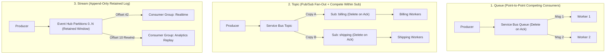
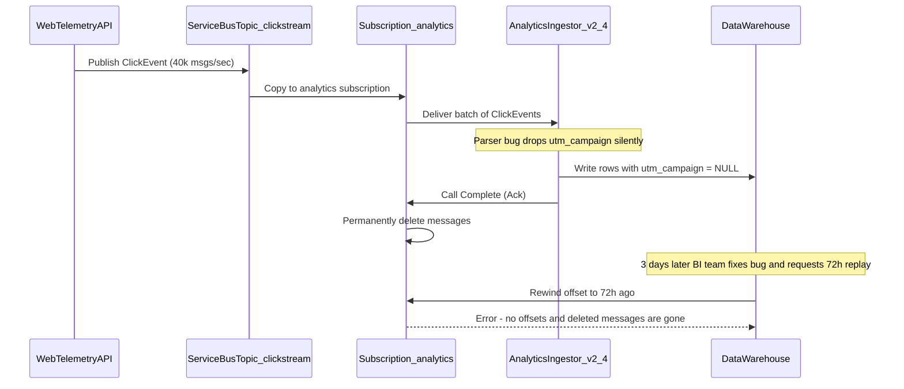

# Queues vs. Topics vs. Streams

> **Prerequisites:** Completion of [00-event-driven-architecture-concepts](../00-event-driven-architecture-concepts/README.md), Azure CLI authenticated, and `Microsoft.ServiceBus` / `Microsoft.EventHub` providers registered.  
> **Estimated Reading Time:** 30 minutes  
> **Target Audience:** Backend Engineers, Distributed Systems Architects, Platform Engineers.

> [!TIP]
> **The Golden Rule of Topology Selection:** Pick a **Queue** when one worker must complete each job once, a **Topic** when independent teams each need their own filtered copy and DLQ, and a **Stream** when consumers must rewind offsets and replay historical events—because queues and topics delete messages on acknowledgment and replay cannot be retrofitted after messages are gone.

---

## Why This Matters

"Just put it on a queue" hides three genuinely different tools with different guarantees, and picking the wrong one shows up months later as a scaling wall or a missing replay you can't add retroactively. A **queue** hands each message to one worker; a **topic** fans one message out to many independent subscribers; a **stream** is an ordered, retained log many readers replay at their own pace. This module gives you the decision framework so that when module 02 drops you into Service Bus and module 03 into Event Grid, you already know *why* you're reaching for each.

---

## 1. Architectural Mental Model: Point-to-Point vs. Fan-Out vs. Retained Log

Queues, topics, and streams differ fundamentally in **who gets a copy** and **what happens to the message after it is read**:



### Core Concepts

#### The queue: point-to-point, competing consumers

A **queue** is a single line of messages consumed by one logical reader. Put several worker replicas on the same queue and they *compete*: each message goes to exactly one of them, so adding replicas increases throughput — the **competing-consumers** pattern, and the standard way to scale a worker pool. The message is removed once a consumer acknowledges it; until then it's locked (invisible to others) so two workers don't grab the same job. This is the point-to-point topology from module 00, made concrete. In Azure this is a **Service Bus queue**. Reach for it when work must be done *once* by *one of* several interchangeable workers: image thumbnails to generate, emails to send, jobs to run.

#### The topic: publish/subscribe, one copy per subscriber

A **topic** decouples the publisher from *how many* things care. The publisher sends one message to the topic; the topic has a set of **subscriptions**, and each subscription gets its **own independent copy** of every matching message. Three teams that each need to react to `OrderPlaced` create three subscriptions; each has its own backlog, its own consumers, its own dead-letter queue, and one team falling behind doesn't affect the others. This is the publish/subscribe topology, and it's what Dapr's `publish` gave you in track 6 module 05. In Azure this is a **Service Bus topic + subscriptions**. Crucially, *within* a single subscription you're back to competing consumers — so a topic is "fan-out across subscriptions, fan-in (compete) within each." A queue is really just a topic with exactly one subscription baked in.

#### The stream: an ordered, retained log

A **stream** is a different animal: an **append-only, ordered log** of events, retained for a time window (hours to days) regardless of who has read it. Readers don't *remove* messages — they hold a **cursor** (offset) into the log and advance it. Multiple independent consumer groups can each read the whole log at their own position and *replay* from any past offset. That replay, plus strict ordering within a partition and very high throughput, is what queues and topics don't give you. In Azure this is **Event Hubs** (and the open-source equivalent everyone benchmarks against is **Apache Kafka**; Event Hubs even speaks the Kafka protocol; partitions, offsets and consumer groups are covered hands-on in [Message Brokers — Kafka](../../../backend/06-background-processing-and-realtime/10-message-brokers-kafka/README.md)). Reach for a stream when you have high-volume, ordered events that several systems consume independently and may need to reprocess: telemetry, clickstream, change-data-capture, event sourcing.

The mental model that keeps them straight:

- **Queue** — a to-do list; you take an item and it's gone.
- **Topic** — a mailing list; everyone subscribed gets their own copy.
- **Stream** — a ledger/tape; everyone reads the same durable log at their own bookmark and can rewind.

#### Ordering and how each service handles it

Ordering is where the three diverge most. A plain queue does *not* guarantee global order once you have competing consumers — worker B might finish message 2 before worker A finishes message 1. When you need related messages processed in order, Service Bus offers **sessions**: messages tagged with the same session id are locked to a single consumer and delivered in order (you'll use this in module 02). A **stream** gives ordering *per partition* natively — the log is the order — which is a big reason event sourcing lives on streams. The practical rule: if you need ordering, either use Service Bus sessions (point-to-point/pub-sub with a partition-like key) or a stream partitioned by your ordering key. Don't assume a bare queue preserves order; it generally doesn't under load.

#### Retention, replay, and why streams cost differently

The other big axis is **what happens to a message after it's read**. In a queue or topic subscription, a message is *deleted* once acknowledged — the broker's job is to deliver it and forget it, and the backlog is only the *unprocessed* messages. In a stream, every event is *retained for the whole window* whether or not anyone read it, because replay is the point — so a stream's storage and cost scale with *total event volume × retention*, not with backlog. This also shapes cost: Service Bus bills largely per operation and (on Premium) per messaging unit; Event Hubs bills per throughput unit and ingress volume. A chatty firehose is cheap-ish on a stream built for it and expensive on a topic that has to durably queue and fan out every tiny message. Match the tool to the shape of the traffic, not just the topology.

---

## 2. Taxonomic Comparison: Queues vs. Topics vs. Streams & Command Reference

### Architectural & Cost Comparison Matrix

| Dimension | Queue (Service Bus Queue) | Topic (Service Bus Topic) | Stream (Azure Event Hubs) |
| :--- | :--- | :--- | :--- |
| **Delivery Topology** | Point-to-point (competing consumers) | Fan-out across subs, compete within sub | Append-only log; many independent consumer groups |
| **Post-Read Lifecycle** | Deleted immediately on ack (`Complete`) | Each subscription's copy deleted on its ack | Retained for configured hours/days regardless of reads |
| **Replayability** | None | None | Yes — rewind offset within retention window |
| **Ordering Guarantee** | None by default; FIFO per `SessionId` if enabled | None by default; FIFO per `SessionId` per sub | Strict FIFO within each partition (`PartitionKey`) |
| **Built-In Filtering** | No | Yes (`CorrelationFilter`, `SqlFilter`) | Consumer-side filtering only |
| **Cost Driver** | Per operation (Standard) or Messaging Unit/hr | Per operation × fan-out copies | Throughput Units + ingress volume + retention storage |
| **Best Fit** | Work items, PDF rendering, transactional commands | Multi-team domain events (`OrderPlaced`) | Clickstream, IoT telemetry, CDC, event sourcing |

### Command Reference

You won't provision much here — this module is a decision framework — but these let you *look at* the three services and see the topology differences directly. Deep provisioning comes in module 02 (Service Bus) and module 03 (Event Grid).

| Command | What it does | Example |
| :--- | :--- | :--- |
| `az servicebus queue create` | Creates a point-to-point queue in a namespace | `az servicebus queue create -g rg-msg-01 --namespace-name sb-msg-01 -n jobs` |
| `az servicebus topic create` | Creates a pub/sub topic | `az servicebus topic create -g rg-msg-01 --namespace-name sb-msg-01 -n orders` |
| `az servicebus topic subscription create` | Adds an independent subscription to a topic | `az servicebus topic subscription create -g rg-msg-01 --namespace-name sb-msg-01 --topic-name orders -n billing` |
| `az eventhubs eventhub create` | Creates an Event Hub (a Kafka-style stream) | `az eventhubs eventhub create -g rg-msg-01 --namespace-name eh-msg-01 -n telemetry --partition-count 4 --retention-time 24` |
| `az servicebus queue show` | Shows a queue's live message counts (backlog) | `az servicebus queue show -g rg-msg-01 --namespace-name sb-msg-01 -n jobs --query countDetails` |

Flag breakdown — `az eventhubs eventhub create -g rg-msg-01 --namespace-name eh-msg-01 -n telemetry --partition-count 4 --retention-time 24`:
- `--namespace-name eh-msg-01` — the Event Hubs namespace (the billing/network boundary, like a Service Bus namespace).
- `-n telemetry` — the Event Hub itself, i.e. the individual stream/log.
- `--partition-count 4` — the number of **partitions**; ordering is guaranteed *within* a partition, and partitions are the unit of parallelism for readers. You can't reduce this later, so it's a real up-front decision.
- `--retention-time 24` — how many **hours** the log is retained and thus how far back consumers can replay; storage cost scales with this. (This is the knob queues/topics simply don't have — they delete on ack.)

---

## 3. Production War Story Post-Mortem: The Unreplayable Clickstream Incident

**Severity:** SEV-2  
**Detection Time:** 3 days (downstream attribution revenue mismatch noticed during weekly BI review)  
**Resolution Time:** 6 hours (new Event Hubs pipeline deployed; 72 hours of attribution unrecoverable)  
**Impact:** 72 hours of e-commerce ad-attribution events (over 18 million click events) were permanently deleted after a consumer schema bug stripped `utm_campaign`.

### What Happened



### Root Cause Analysis

1. **Destructive-Ack Broker for Telemetry Firehose:** The team used a Service Bus topic because they wanted multiple analytics pipelines later, forgetting that Service Bus deletes every subscription's copy once acknowledged.
2. **Operation Cost Spike:** At 40,000 events/sec, routing through Service Bus Standard/Premium messaging units cost 8x more than an Event Hubs stream sized for high-throughput ingestion.

### The Fix & Architectural Hardening

- Migrated high-volume clickstream ingress to **Azure Event Hubs** (`--partition-count 16 --retention-time 168`) partitioned by `sessionId`, giving 7 days of instant offset replay.
- Enabled **Event Hubs Capture** directly to Azure Data Lake Storage Gen2 (Parquet every 5 minutes) for long-term replay beyond the 7-day retention window.
- Established an architectural ADR rule: any workload requiring historical rewind or >5,000 events/sec defaults to Event Hubs; Service Bus is reserved for transactional business commands and domain events.

---

## 4. Multi-Language Production Implementation

Below is how production services contrast **Queue/Topic destructive completion** (using a `SessionId` when ordering is required) versus **Stream offset checkpointing** (preserving the retained log for independent replay) across Go, TypeScript, Python, and C#:

````carousel
```go
package topology

import (
	"context"

	"github.com/Azure/azure-sdk-for-go/sdk/messaging/azeventhubs"
	"github.com/Azure/azure-sdk-for-go/sdk/messaging/azservicebus"
)

// SendOrderedAccountEvent guarantees per-account FIFO on a Service Bus queue/topic via SessionID.
func SendOrderedAccountEvent(ctx context.Context, sender *azservicebus.Sender, accountID string, body []byte) error {
	return sender.SendMessage(ctx, &azservicebus.Message{
		Body:      body,
		SessionID: &accountID, // Pins all events for this account to one ordered session consumer
	}, nil)
}

// ConsumeStreamPartition reads a retained Event Hub partition from an offset without deleting events.
func ConsumeStreamPartition(ctx context.Context, pc *azeventhubs.PartitionClient, checkpointFn func(offset int64) error) error {
	events, err := pc.ReceiveEvents(ctx, 50, nil)
	if err != nil {
		return err
	}
	for _, evt := range events {
		// Process evt.Body idempotently; event stays in Event Hub until retention expires.
		if err := checkpointFn(evt.Offset); err != nil {
			return err
		}
	}
	return nil
}
```
<!-- slide -->
```typescript
import { ServiceBusClient } from "@azure/service-bus";
import { EventHubConsumerClient, earliestEventPosition } from "@azure/event-hubs";

// 1. Service Bus Topic/Queue: ordered per SessionId; deleted once completeMessage succeeds.
export async function processAccountQueue(sbClient: ServiceBusClient, queueName: string, accountId: string) {
  const receiver = await sbClient.acceptSession(queueName, accountId);
  try {
    const messages = await receiver.receiveMessages(10, { maxWaitTimeInMs: 5000 });
    for (const msg of messages) {
      // Handle msg.body in strict FIFO order for this accountId
      await receiver.completeMessage(msg); // Removes message from queue
    }
  } finally {
    await receiver.close();
  }
}

// 2. Event Hubs Stream: retains events; multiple consumer groups read independently via checkpoints.
export function tailClickstream(ehClient: EventHubConsumerClient) {
  return ehClient.subscribe(
    {
      processEvents: async (events, context) => {
        if (events.length === 0) return;
        // Process events; replay later simply by resetting checkpoint offset
        await context.updateCheckpoint(events[events.length - 1]);
      },
      processError: async (err) => console.error("Stream error:", err),
    },
    { startPosition: earliestEventPosition }
  );
}
```
<!-- slide -->
```python
from azure.servicebus import ServiceBusClient, ServiceBusMessage
from azure.eventhub import EventHubConsumerClient


def publish_ordered_account_command(sb_client: ServiceBusClient, queue_name: str, account_id: str, payload: bytes) -> None:
    """Service Bus removes message once consumer completes it; session_id enforces per-account FIFO."""
    with sb_client.get_queue_sender(queue_name) as sender:
        msg = ServiceBusMessage(body=payload, session_id=account_id)
        sender.send_messages(msg)


def consume_retained_stream(conn_str: str, hub_name: str, consumer_group: str) -> None:
    """Event Hubs retains events for the full retention window; readers advance their own checkpoint."""
    client = EventHubConsumerClient.from_connection_string(
        conn_str, consumer_group=consumer_group, eventhub_name=hub_name
    )

    def on_event(partition_context, event):
        # Process event.body_as_str(); other consumer groups see the same event at their own offset
        partition_context.update_checkpoint(event)

    with client:
        client.receive(on_event=on_event, starting_position="-1")  # "-1" replays from start of window
```
<!-- slide -->
```csharp
using Azure.Messaging.EventHubs.Consumer;
using Azure.Messaging.ServiceBus;

public static class TopologyExamples
{
    // Queue/Topic with SessionId: guarantees per-account FIFO, deletes on CompleteMessageAsync.
    public static async Task SendOrderedCommandAsync(ServiceBusSender sender, string accountId, BinaryData body)
    {
        var message = new ServiceBusMessage(body) { SessionId = accountId };
        await sender.SendMessageAsync(message);
    }

    // Stream (Event Hubs): reads retained partition from earliest offset without deleting log entries.
    public static async Task ReplayStreamAsync(string connStr, string hubName, string consumerGroup, CancellationToken ct)
    {
        await using var consumer = new EventHubConsumerClient(consumerGroup, connStr, hubName);
        await foreach (PartitionEvent evt in consumer.ReadEventsFromPartitionAsync(
            "0", EventPosition.Earliest, ct))
        {
            // Process evt.Data.EventBody; rewind anytime within retention window
            break;
        }
    }
}
```
````

---

## 5. Practical Hands-On Verification CLI Workflows

The first few are decision exercises; the rest create small, cheap resources (a Standard Service Bus namespace and a Basic Event Hubs namespace) so you can *see* the topology differences. Cleanup is the last step.

1. **Choose the tool, five scenarios.** Write down queue / topic / stream for each and one-sentence why: (a) five replicas generating PDF invoices from a job list; (b) `UserSignedUp` that welcome-email, analytics, and CRM-sync each react to; (c) 50k IoT readings/sec you must be able to reprocess after a bug fix; (d) a `DeleteAccount` job that must run exactly once by one worker; (e) an ordered per-account audit log several tools tail. Verify (a)/(d) → queue, (b) → topic, (c)/(e) → stream.

2. **Create the resource groups and namespaces.**
   ```powershell
   az group create -n rg-msg-01 -l eastus
   az servicebus namespace create -g rg-msg-01 -n sb-msg-01-$RANDOM --sku Standard
   ```

   **Expected Output:**
   ```text
   Name             Location    Status    Sku
   ---------------  ----------  --------  --------
   sb-msg-01-14829  eastus      Active    Standard
   ```

   Note the actual namespace name it created (the `$RANDOM` suffix keeps it globally unique). Topics require **Standard** tier — Basic has queues only.

3. **Build a queue and watch competing consumers conceptually.**
   ```powershell
   az servicebus queue create -g rg-msg-01 --namespace-name <ns> -n jobs
   az servicebus queue show -g rg-msg-01 --namespace-name <ns> -n jobs --query countDetails
   ```

   **Expected Output:**
   ```json
   {
     "activeMessageCount": 0,
     "deadLetterMessageCount": 0,
     "scheduledMessageCount": 0,
     "transferDeadLetterMessageCount": 0,
     "transferMessageCount": 0
   }
   ```

   > Verify: `activeMessageCount` is 0. This is the backlog counter — the *unprocessed* messages, which for a queue is the whole story (processed ones are deleted). Note there's no "retention" concept here.

4. **Build a topic with two independent subscriptions.**
   ```powershell
   az servicebus topic create -g rg-msg-01 --namespace-name <ns> -n orders
   az servicebus topic subscription create -g rg-msg-01 --namespace-name <ns> --topic-name orders -n billing
   az servicebus topic subscription create -g rg-msg-01 --namespace-name <ns> --topic-name orders -n shipping
   az servicebus topic subscription list -g rg-msg-01 --namespace-name <ns> --topic-name orders -o table
   ```

   **Expected Output:**
   ```text
   Name      Status    MaxDeliveryCount    RequiresSession
   --------  --------  ------------------  -----------------
   billing   Active    10                  False
   shipping  Active    10                  False
   ```

   > Verify: two subscriptions, `billing` and `shipping`. One message published to `orders` will land a **separate copy** in each — that's fan-out, and each subscription has its own independent message count.

5. **See the "queue = topic with one subscription" idea.** Note that the `orders` topic with just the `billing` subscription behaves exactly like a queue named `billing`: one publisher, one logical consumer, competing within it. Write down, in one sentence, what the *second* subscription bought you that a queue could not.

6. **Create a stream and see the difference that retention makes.**
   ```powershell
   az eventhubs namespace create -g rg-msg-01 -n eh-msg-01-$RANDOM --sku Basic
   az eventhubs eventhub create -g rg-msg-01 --namespace-name <eh-ns> -n telemetry --partition-count 2 --retention-time 1
   az eventhubs eventhub show -g rg-msg-01 --namespace-name <eh-ns> -n telemetry --query "{partitions:partitionCount, retentionHours:messageRetentionInDays}"
   ```

   **Expected Output:**
   ```json
   {
     "partitions": 2,
     "retentionHours": 1
   }
   ```

   > Verify: partitions and a retention window appear — concepts a Service Bus queue has no equivalent for. The log keeps events for the window whether or not anyone read them; that's replay.

7. **Diagnose and fix: chose a topic where a stream was needed.** Scenario: a team put a 40k-events/sec clickstream on a Service Bus **topic** with one subscription, and now analytics wants to reprocess *yesterday's* events after fixing a bug — but the messages were deleted on ack and are gone. Write down (a) why the topic can't satisfy the replay requirement, (b) which service they should have used, and (c) what makes that service able to replay. Verify your answer names retention/offsets on a **stream** (Event Hubs) as the missing capability — and note this is *not* fixable after the fact, which is the lesson.

8. **Diagnose and fix: ordering lost under competing consumers.** Scenario: a billing queue processes `AccountDebited` then `AccountCredited` for the same account, but with three worker replicas the credit sometimes posts before the debit, briefly overdrawing the account. Write down two valid fixes: one using a Service Bus feature that pins related messages to one ordered consumer, and one using a different topology entirely. Verify one answer is **sessions** (module 02 preview) keyed by account id, and the other is a **stream partitioned** by account id.

9. **Clean up.**
   ```powershell
   az group delete -n rg-msg-01 --yes --no-wait
   ```

   **Expected Output:**
   ```text
   (Deletion initiated asynchronously; verify with 'az servicebus namespace list -o table')
   ```

   > Verify: `az servicebus namespace list -o table` no longer shows your namespace once deletion completes. Standard Service Bus and Basic Event Hubs are inexpensive, but don't leave namespaces idling.

### Independent Challenge

Take the event-driven workflow you diagrammed in module 00's independent challenge and, for each event and each consumer you identified, decide whether it belongs on a **queue**, a **topic**, or a **stream**, and justify the choice against the three axes this module gave you: number of independent consumers, ordering needs, and whether replay/retention matters. Then pick the *one* place where you're least sure and provision both candidate resources briefly (a Service Bus topic vs. an Event Hub), inspect their differing properties (`countDetails` vs. partitions/retention), and write a paragraph defending your final choice. This builds on module 00's decomposition and previews the Service Bus depth of module 02. Delete the resource group the moment you've made your notes — both namespaces bill while they exist.

<details><summary>Stuck? One hint</summary>

The single most decisive question is: *does anyone need to read these events more than once, or read them again after the fact?* If yes — replay, reprocess, event sourcing, "let a new consumer catch up on history" — it's a **stream**, because only a stream retains events after they're read. If every event is handled once and then irrelevant, it's a queue (one consumer) or topic (several independent consumers). Ordering is the tie-breaker, not the primary axis.

</details>

---

## 6. Common Mistakes & Troubleshooting

- **Using a queue when you needed fan-out.** Adding a second consumer *type* to a queue makes them compete, so each message goes to only one — the second consumer silently misses half the messages. You needed a topic with two subscriptions.
- **Expecting global ordering from a queue.** Under competing consumers, order is not preserved. If you need it, use sessions (Service Bus) or partition a stream by your ordering key.
- **Choosing a topic/queue when you needed replay.** Queues and topics delete on ack; there is no "reprocess yesterday." That requirement forces a stream (Event Hubs), and it can't be retrofitted after the messages are gone.
- **Over-partitioning or under-partitioning a stream.** Partition count caps reader parallelism *and* is (effectively) fixed at creation on many tiers. Too few throttles consumers; too many fragments ordering. Size it to your target concurrency.
- **Cost pitfall — tier and topology mismatch.** Topics require Standard Service Bus (Basic is queues-only), and pushing a high-volume firehose through a topic that durably fans out every tiny message is far pricier than an Event Hub built for throughput. Match the tool to the traffic shape: low-volume business events → Service Bus; high-volume telemetry → a stream. Streams also bill for *retained* volume, so a long retention window on a firehose is a standing storage cost.

---

## 7. Operational Validation Checkpoints

### Production Scenario Drills

<details><summary><strong>Scenario 1: Two Microservices Sharing One Service Bus Queue</strong></summary>

**Situation:** You created a Service Bus queue `orders-queue` for `BillingService`. Six months later, `AnalyticsService` connects to `orders-queue` to also capture order metadata. Both services run cleanly with zero errors, yet finance notices only roughly half of all orders are being billed.

**What went wrong & fix:** A Service Bus queue implements point-to-point competing consumers. Connecting a second logical application to the same queue turned `BillingService` and `AnalyticsService` into competing consumers stealing messages from each other. Migrate to a Service Bus **Topic** (`orders`) with two dedicated **Subscriptions** (`billing-sub` and `analytics-sub`) so each gets an independent copy.

</details>

<details><summary><strong>Scenario 2: Event Hubs Consumer Scaling Bottleneck</strong></summary>

**Situation:** Your telemetry stream was provisioned with `--partition-count 2`. During Black Friday traffic, you scale your Kubernetes consumer deployment from 2 pods to 8 pods, but 6 of the pods sit completely idle while consumer lag climbs to 45 minutes.

**What went wrong & fix:** Within a single Event Hubs consumer group, at most one consumer instance can hold the lease for a given partition at a time—meaning `partitionCount` caps your maximum consumer parallelism at 2 pods. Because partition counts cannot be reduced (and on Basic/Standard tiers cannot be scaled dynamically without creating a new Event Hub), size partitions up front to your peak anticipated consumer concurrency (e.g. 16 or 32 partitions).

</details>

<details><summary><strong>Scenario 3: Per-Tenant Ordering on a Shared Topic</strong></summary>

**Situation:** An `account-updates` Service Bus topic routes `ProfileUpdated` and `SubscriptionUpgraded` events to two downstream teams, and updates for the same `tenantId` must be processed in strict order while different tenants run concurrently.

**What went wrong & fix:** Enable `--enable-session true` on each topic subscription (note: this must be set at creation time on Standard/Premium tiers) and stamp `SessionId = tenantId` on every published message. Service Bus pins each active `SessionId` to one worker at a time for FIFO ordering while load-balancing other `SessionId` values across all replicas.

</details>

### Checkpoint Quiz

Write down your answer to each question before expanding it — checking without attempting first is the single easiest way to fool yourself into thinking you've learned this.

1. In one line each: what does a queue, a topic, and a stream each do with a message after it's read?
2. Why is a Service Bus queue fairly described as "a topic with exactly one subscription"?
3. You add three worker replicas to one queue. What pattern is that, and what does it buy you? What does it cost you in terms of ordering?
4. A stream retains events for a window regardless of who read them. What capability does that enable that queues/topics can't offer?
5. Two teams both need to react to every `OrderPlaced`. Queue or topic, and why would the other choice break?
6. Name the Azure service for each: a competing-consumers work queue; a fan-out to independent subscribers; a high-volume ordered log with replay.
7. Give the two ways to get ordering for related messages, one using a Service Bus feature and one using stream partitioning.

<details><summary>Show answers</summary>

1. **Queue**: deletes the message on acknowledgement (it's consumed once). **Topic**: deletes each subscription's *copy* on that subscription's ack, but fans a copy to every subscription. **Stream**: keeps every event for the retention window regardless of reads; readers just advance an offset.
2. Because a topic fans out to its subscriptions and *within* a subscription consumers compete — so a topic with a single subscription is exactly one line of messages consumed once, which is a queue.
3. Competing consumers. It buys you horizontal throughput (more replicas = more parallel processing). It costs you global ordering — messages can complete out of order across replicas.
4. **Replay/reprocessing**: a consumer can rewind to an earlier offset and read history again (and a brand-new consumer can catch up from the beginning). Queues and topics delete on ack, so history is gone.
5. **Topic** with two subscriptions — each team gets its own independent copy. A queue would make the two teams *compete*, so each `OrderPlaced` would go to only one team and the other would miss it.
6. Competing-consumers work queue → **Service Bus queue**; fan-out to independent subscribers → **Service Bus topic + subscriptions** (or Event Grid); high-volume ordered log with replay → **Event Hubs** (Kafka-style stream).
7. Service Bus **sessions**: tag related messages with the same session id so they're locked to one consumer and delivered in order. Stream **partitioning**: partition by the ordering key so all related events land in one ordered partition.

</details>

---

## Further Reading & Sources

- [Message Brokers — RabbitMQ](../../../backend/06-background-processing-and-realtime/09-message-brokers-rabbitmq/README.md) - the same queue and fan-out topologies built from exchanges and bindings on a self-hosted broker.
- [Message Brokers — Kafka](../../../backend/06-background-processing-and-realtime/10-message-brokers-kafka/README.md) - hands-on deep dive into partitioned logs, consumer groups, and offsets.

## Next

[02-azure-service-bus-in-depth](../02-azure-service-bus-in-depth/README.md) — now go deep on the workhorse: Service Bus queues, topics and subscriptions, subscription filters, dead-letter queues, and sessions for ordering — all provisioned by hand *and* declaratively with the Terraform you learned in track 9.
