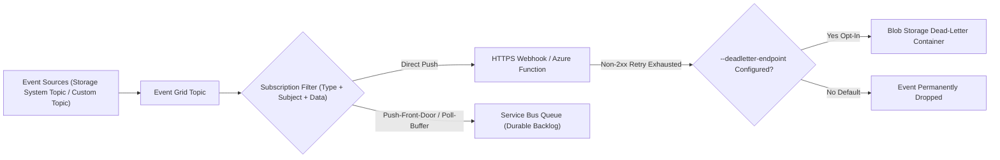
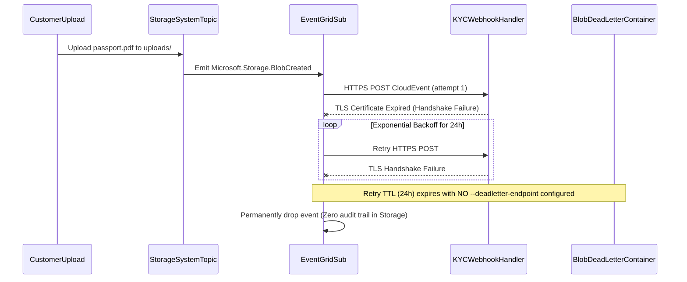

# Azure Event Grid

> **Prerequisites:** Completion of [02-azure-service-bus-in-depth](../02-azure-service-bus-in-depth/README.md), Azure CLI authenticated, and `Microsoft.EventGrid` + `Microsoft.Storage` resource providers registered.  
> **Estimated Reading Time:** 30 minutes  
> **Target Audience:** Backend Engineers, Serverless Developers, Cloud Integration Architects.

> [!TIP]
> **The Golden Rule of Azure Event Grid:** Treat Event Grid as a reactive **push** notification router—verify the exact resource `subject` format before writing prefix filters, always configure an opt-in `--deadletter-endpoint` Storage container so exhausted retries aren't silently dropped, and bridge bursty events into a Service Bus queue whenever downstream workers need durable load leveling.

---

## Why This Matters

Service Bus (module 02) is a broker *your* apps send messages through. Event Grid is the opposite instinct: it's how **Azure itself** and your apps announce that something happened — a blob was uploaded, a resource was created, a custom `OrderPlaced` fired — and how you subscribe a handler to react, with Event Grid **pushing** the event to you rather than you polling for it. The capstone requires an Event Grid subscription reacting to a *real* Azure resource event, and knowing when to reach for push-based Event Grid vs. poll-based Service Bus is a genuine architecture decision you'll make repeatedly. This module draws directly on the pub/sub topology from module 01 and contrasts hard with the Service Bus model you just learned.

> **Cost warning:** Event Grid bills **per operation** (per event ingress and delivery attempt), with a monthly free allotment. It's essentially free for lab volumes, but a high-volume event source (e.g. subscribing to *every* blob write on a busy account, or a retry storm against a broken handler) can generate a surprising number of billable operations. Clean up subscriptions and topics at the end.

---

## 1. Architectural Mental Model: Push Delivery, Hybrid Queue Buffering & Dead-Letter Opt-In

Event Grid **initiates HTTP delivery** to handlers when an event matches a subscription's type, subject, and data filters—bridging Azure-native system events either directly to HTTPS webhooks or into a poll-based Service Bus buffer:



### Core Concepts

#### The Event Grid model: sources, topics, subscriptions, handlers

Event Grid has four roles. An **event source** is whatever emits events — an Azure service (Storage, Resource Groups, Container Registry…) or your own app. A **topic** is the endpoint events are published to; there are two flavors: **system topics** (built into Azure services — you don't create them, you subscribe to a resource's events) and **custom topics** (you create one and publish your own events to it). An **event subscription** connects a topic to a **handler** and says *which* events to deliver and *where*. The handler is any supported endpoint: a webhook (HTTPS), an Azure Function, a **Service Bus queue/topic**, an Event Hub, and more. So the shape is: *source → topic → subscription (with a filter) → handler*. Compare to Service Bus: a topic with subscriptions (module 02) is structurally similar, but there the subscriber *pulls*; here Event Grid *pushes* to the handler.

#### Push vs. poll: the defining difference from Service Bus

This is the concept to internalize. **Service Bus is poll-based**: consumers connect and *pull* messages, holding a lock, completing them — the consumer controls the pace and messages wait durably in a backlog until pulled. **Event Grid is push-based**: when an event arrives, Event Grid *calls your handler's endpoint* (an HTTP POST to your webhook/Function) and expects a success response; if the handler is down or returns an error, Event Grid **retries with backoff** and eventually **dead-letters** to a storage account you configure. The trade-offs:

- Push (Event Grid) is great for **reactive, event-notification** workloads — "run this Function whenever a blob lands" — with near-real-time delivery and no consumer to keep running/polling. But your handler must be reachable and able to keep up; there's no long durable backlog you drain at leisure.
- Poll (Service Bus) is great for **work queues and load leveling** — messages pile up safely and workers pull at their own rate, ideal for smoothing spikes and for consumers that can't accept unsolicited inbound HTTP.

A common production pattern is to combine them: Event Grid **pushes** an Azure resource event *into a Service Bus queue*, so you get Azure-native event sources *and* the durable, paced, poll-based processing of Service Bus — Event Grid as the reactive front door, Service Bus as the buffered work queue behind it.

#### Event schemas: Event Grid schema vs. CloudEvents

Every Event Grid event has a defined envelope. The native **Event Grid schema** carries fields like `id`, `eventType`, `subject`, `eventTime`, `dataVersion`, and a `data` payload. Event Grid also natively supports **CloudEvents 1.0**, the CNCF-standard, vendor-neutral event envelope (`specversion`, `type`, `source`, `id`, `data`) — the same standard many systems and the Dapr pub/sub building block (module 04) use, so CloudEvents is the interoperable choice when events cross system boundaries. The `subject` and `eventType` fields are what your subscription **filters** on (next section), and `dataVersion` is your hook for the schema-versioning discipline of module 06. Choosing CloudEvents up front saves a translation later when Dapr or a third party consumes your events.

#### Filtering subscriptions

Like Service Bus subscription filters (module 02), an Event Grid subscription decides *which* events it wants — but the filter surface is different. You filter on:

- **Event types** (`--included-event-types`) — e.g. only `Microsoft.Storage.BlobCreated`, not `BlobDeleted`.
- **Subject** prefix/suffix (`--subject-begins-with` / `--subject-ends-with`) — e.g. only blobs under `/uploads/` (`subject-begins-with`) or only `.jpg` files (`subject-ends-with`). The `subject` for a blob event is the blob path, so this is how you scope to a folder or file type.
- **Advanced filters** — key/value/operator conditions on fields in the event data (e.g. `data.contentLength > 1000000`), analogous to a Service Bus SqlFilter but expressed as structured conditions.

The classic bug (a diagnose-and-fix below) is a subject filter that never matches because the `subject` format isn't what you assumed — Storage subjects look like `/blobServices/default/containers/<container>/blobs/<path>`, so a naive `--subject-begins-with /uploads/` matches nothing.

#### Delivery, retries, and dead-lettering

Because delivery is push, Event Grid owns the retry logic (unlike Service Bus, where the *consumer's* failure to complete drives redelivery). If a handler doesn't return a 2xx, Event Grid **retries with exponential backoff** over a configurable window (default up to 24 hours / a max retry count), then **dead-letters** the event to a **blob storage container** you designate on the subscription (`--deadletter-endpoint`). If you don't configure a dead-letter destination, events that exhaust retries are **dropped** — a real data-loss trap. This is the same reliability shape as Service Bus DLQ (module 02) but you must *opt in* to the dead-letter storage; it isn't automatic. You'll tie both together in module 05's reliability patterns.

---

## 2. Taxonomic Comparison: Push vs. Poll, Schemas & Command Reference

### Event Grid vs. Service Bus vs. Hybrid Architecture

| Dimension | Event Grid (Push) | Service Bus (Poll) | Hybrid (Event Grid -> Service Bus Queue) |
| :--- | :--- | :--- | :--- |
| **Delivery Initiation** | Broker pushes via HTTPS POST to handler | Consumer opens connection and pulls (PeekLock) | Event Grid pushes into Service Bus; workers pull |
| **Backlog & Load Leveling** | Short retry buffer only (max 24h TTL) | Durable ordered/unbounded backlog | Full Service Bus queue durability + Azure sources |
| **Endpoint Exposure** | Webhook requires public/VNet-reachable HTTPS + validation | Outbound-only AMQP/HTTPS from worker | Workers need no inbound HTTP endpoint |
| **Dead-Letter Behavior** | **Opt-in** (`--deadletter-endpoint` Blob container); drops without it | **Automatic** built-in `$DeadLetterQueue` per entity | Handled by both Event Grid DLQ and Service Bus DLQ |
| **Best Fit** | Reactive serverless triggers (Blob/ACR/Resource events) | Work queues, sessions, rate-limited downstreams | Production Azure resource ingestion with spiky traffic |

### Schema Field Mapping: Event Grid Native vs. CloudEvents 1.0

| Concept | Event Grid Schema | CloudEvents 1.0 (`CloudEventSchemaV1_0`) |
| :--- | :--- | :--- |
| **Envelope Version** | `metadataVersion` | `specversion` (`"1.0"`) |
| **Event Classifier** | `eventType` (`"Microsoft.Storage.BlobCreated"`) | `type` (`"Microsoft.Storage.BlobCreated"`) |
| **Producer Origin** | `topic` (ARM resource path) | `source` (URI-reference) |
| **Resource Target** | `subject` (`"/blobServices/default/..."`) | `subject` |
| **Payload Schema Hook** | `dataVersion` | `dataschema` / `datacontenttype` |

### Command Reference

| Command | What it does | Example |
| :--- | :--- | :--- |
| `az eventgrid topic create` | Creates a custom topic (your own events) | `az eventgrid topic create -g rg-eg -n topic-orders -l eastus` |
| `az eventgrid topic key list` | Gets the access key to publish to a custom topic | `az eventgrid topic key list -g rg-eg -n topic-orders --query key1 -o tsv` |
| `az eventgrid event-subscription create` | Subscribes a handler to a topic/resource, with filters | see breakdown below |
| `az eventgrid system-topic create` | Creates a system topic for an Azure resource's events | `az eventgrid system-topic create -g rg-eg -n st-storage --source <storage-id> --topic-type Microsoft.Storage.StorageAccounts -l eastus` |
| `az eventgrid event-subscription list` | Lists subscriptions (to see filters/handlers) | `az eventgrid event-subscription list --source-resource-id <id> -o table` |
| `az storage account create` | Creates a Storage account to use as an event *source* and a dead-letter *sink* | `az storage account create -g rg-eg -n stegsrc$RANDOM -l eastus --sku Standard_LRS` |

Flag-by-flag — subscribing a Storage account's `BlobCreated` events to a webhook, scoped and dead-lettered:

```powershell
az eventgrid event-subscription create `
  --name uploads-sub `
  --source-resource-id $(az storage account show -g rg-eg -n <sa> --query id -o tsv) `
  --endpoint https://<your-handler>/api/blob `
  --included-event-types Microsoft.Storage.BlobCreated `
  --subject-begins-with /blobServices/default/containers/uploads/blobs/ `
  --event-delivery-schema CloudEventSchemaV1_0 `
  --deadletter-endpoint $(az storage account show -g rg-eg -n <sa> --query id -o tsv)/blobServices/default/containers/deadletter
```

- `--source-resource-id` — the Azure resource whose events you want (here, a Storage account). Event Grid creates/uses the system topic under the hood.
- `--endpoint` — the **handler**: where Event Grid pushes events (a webhook URL here; could be a Function, Service Bus queue id, etc.).
- `--included-event-types Microsoft.Storage.BlobCreated` — deliver only blob *creation* events, not deletes/other types.
- `--subject-begins-with .../containers/uploads/blobs/` — scope to blobs in the `uploads` container. **Note the full subject path** — the common filter bug is using just `/uploads/`.
- `--event-delivery-schema CloudEventSchemaV1_0` — deliver as **CloudEvents** (interoperable) instead of the native Event Grid schema.
- `--deadletter-endpoint .../deadletter` — where undeliverable events go after retries exhaust; **without this, they're dropped**.

---

## 3. Production War Story Post-Mortem: The Unconfigured Dead-Letter Silent Event Drop

**Severity:** SEV-1  
**Detection Time:** 2 days (customer support escalation on stuck KYC verifications)  
**Resolution Time:** 1 hour 15 minutes (TLS cert rotated + `--deadletter-endpoint` and Service Bus bridge deployed; historical uploads required Storage container scan)  
**Impact:** 3,400 customer identity documents uploaded to Blob Storage were never processed by the verification webhook during a 26-hour TLS certificate outage, and Event Grid dropped every exhausted event permanently.

### What Happened



### Root Cause Analysis

1. **Opt-In Dead-Letter Omitted:** Unlike Service Bus (which creates `$DeadLetterQueue` automatically), Event Grid drops events after retry exhaustion unless `--deadletter-endpoint` is explicitly configured.
2. **Direct Webhook Exposure Without Buffering:** Pushing directly to an application webhook meant a TLS/endpoint outage risked losing events after the 24-hour delivery TTL rather than buffering safely inside a durable queue.

### The Fix & Architectural Hardening

- Provisioned a dedicated Storage dead-letter container (`--deadletter-endpoint <sa-id>/blobServices/default/containers/deadletter`) on every Event Grid subscription via IaC policy checks.
- Re-architected critical ingestion pipelines to use the **Push-Front-Door / Poll-Buffer** pattern (`--endpoint-type servicebusqueue`) so Event Grid pushes into Service Bus where messages persist indefinitely until workers process them.
- Added Azure Monitor alerts on `DeliveryFailedEvents` and `DeadLetteredEvents`.

---

## 4. Multi-Language Production Implementation

Below is the production **Event Grid Webhook Validation Handshake (both Native `SubscriptionValidationEvent` and CloudEvents 1.0 `OPTIONS` Abuse Protection) + CloudEvents Custom Topic Publisher** in Go, TypeScript, Python, and C#:

````carousel
```go
package eventgrid

import (
	"bytes"
	"encoding/json"
	"io"
	"net/http"
)

type CloudEvent struct {
	SpecVersion string          `json:"specversion"`
	Type        string          `json:"type"`
	Source      string          `json:"source"`
	ID          string          `json:"id"`
	Subject     string          `json:"subject,omitempty"`
	Data        json.RawMessage `json:"data"`
}

func EventGridWebhookHandler(w http.ResponseWriter, r *http.Request) {
	// 1. CloudEvents 1.0 HTTP Abuse Protection handshake (OPTIONS)
	if r.Method == http.MethodOptions {
		origin := r.Header.Get("WebHook-Request-Origin")
		if origin != "" {
			w.Header().Set("WebHook-Allowed-Origin", origin)
			w.Header().Set("WebHook-Allowed-Rate", "*")
		}
		w.WriteHeader(http.StatusOK)
		return
	}

	body, err := io.ReadAll(r.Body)
	if err != nil {
		http.Error(w, "read error", http.StatusBadRequest)
		return
	}

	// 2. Native Event Grid SubscriptionValidation handshake (POST array)
	var nativeEvents []struct {
		EventType string `json:"eventType"`
		Data      struct {
			ValidationCode string `json:"validationCode"`
		} `json:"data"`
	}
	if bytes.HasPrefix(bytes.TrimSpace(body), []byte("[")) && json.Unmarshal(body, &nativeEvents) == nil {
		if len(nativeEvents) > 0 && nativeEvents[0].EventType == "Microsoft.EventGrid.SubscriptionValidationEvent" {
			w.Header().Set("Content-Type", "application/json")
			_ = json.NewEncoder(w).Encode(map[string]string{
				"validationResponse": nativeEvents[0].Data.ValidationCode,
			})
			return
		}
	}

	// 3. Process CloudEvent idempotently before returning 200 OK
	var evt CloudEvent
	if err := json.Unmarshal(body, &evt); err != nil {
		http.Error(w, "invalid payload", http.StatusBadRequest)
		return
	}
	w.WriteHeader(http.StatusOK)
}
```
<!-- slide -->
```typescript
import express, { Request, Response } from "express";

const app = express();
app.use(express.json({ type: ["application/json", "application/cloudevents+json"] }));

app.options("/api/events", (req: Request, res: Response) => {
  // CloudEvents 1.0 webhook validation handshake
  const requestOrigin = req.header("WebHook-Request-Origin");
  if (requestOrigin) {
    res.setHeader("WebHook-Allowed-Origin", requestOrigin);
    res.setHeader("WebHook-Allowed-Rate", "*");
  }
  res.status(200).send();
});

app.post("/api/events", async (req: Request, res: Response) => {
  const payload = req.body;

  // Native Event Grid validation handshake
  if (Array.isArray(payload) && payload[0]?.eventType === "Microsoft.EventGrid.SubscriptionValidationEvent") {
    return res.json({ validationResponse: payload[0].data.validationCode });
  }

  // CloudEvents 1.0 delivery (specversion, id, type, source, data)
  if (payload?.specversion === "1.0") {
    console.log(`Received CloudEvent ${payload.type} id=${payload.id}`);
    // Return 200 ONLY after durable persistence/enqueue; non-2xx triggers Event Grid backoff retry
    return res.status(200).send("OK");
  }

  return res.status(400).send("Unsupported event envelope");
});
```
<!-- slide -->
```python
from fastapi import FastAPI, Request, Response
from fastapi.responses import JSONResponse
import httpx

app = FastAPI()


@app.options("/api/events")
async def cloudevents_handshake(request: Request) -> Response:
    """Echo WebHook-Allowed-Origin for CloudEvents 1.0 subscription provisioning."""
    origin = request.headers.get("WebHook-Request-Origin", "*")
    return Response(
        status_code=200,
        headers={"WebHook-Allowed-Origin": origin, "WebHook-Allowed-Rate": "*"},
    )


@app.post("/api/events")
async def handle_event(request: Request) -> Response:
    body = await request.json()

    # Native Event Grid validation handshake
    if isinstance(body, list) and body and body[0].get("eventType") == "Microsoft.EventGrid.SubscriptionValidationEvent":
        return JSONResponse({"validationResponse": body[0]["data"]["validationCode"]})

    # Process CloudEvent 1.0 safely before returning 200
    event_id = body.get("id")
    event_type = body.get("type")
    print(f"Handled event id={event_id} type={event_type}")
    return Response(status_code=200)


async def publish_cloudevent(endpoint: str, sas_key: str, event: dict) -> None:
    """Publishes a CloudEvents 1.0 payload to an Event Grid custom topic."""
    async with httpx.AsyncClient() as client:
        resp = await client.post(
            endpoint,
            json=event,
            headers={"aeg-sas-key": sas_key, "Content-Type": "application/cloudevents+json; charset=utf-8"},
        )
        resp.raise_for_status()
```
<!-- slide -->
```csharp
using Azure;
using Azure.Messaging;
using Azure.Messaging.EventGrid;
using Azure.Messaging.EventGrid.SystemEvents;
using Microsoft.AspNetCore.Mvc;

[ApiController]
[Route("api/events")]
public sealed class EventGridWebhookController : ControllerBase
{
    [HttpOptions]
    public IActionResult ValidateCloudEvents()
    {
        if (Request.Headers.TryGetValue("WebHook-Request-Origin", out var origin))
        {
            Response.Headers["WebHook-Allowed-Origin"] = origin.ToString();
            Response.Headers["WebHook-Allowed-Rate"] = "*";
        }
        return Ok();
    }

    [HttpPost]
    public async Task<IActionResult> ReceiveAsync([FromBody] BinaryData rawBody)
    {
        // CloudEvents 1.0 parsing
        CloudEvent cloudEvent = CloudEvent.Parse(rawBody);
        if (cloudEvent.Type == "Microsoft.EventGrid.SubscriptionValidationEvent")
        {
            var data = cloudEvent.Data!.ToObjectFromJson<SubscriptionValidationEventData>();
            return Ok(new SubscriptionValidationResponse { ValidationResponse = data.ValidationCode });
        }

        // Persist or enqueue idempotently using cloudEvent.Id before returning 200 OK
        await Task.CompletedTask;
        return Ok();
    }

    public static Task PublishCustomCloudEventAsync(Uri topicEndpoint, string key, object orderData)
    {
        var client = new EventGridPublisherClient(topicEndpoint, new AzureKeyCredential(key));
        var evt = new CloudEvent("/orders/api", "OrderPlaced", orderData);
        return client.SendEventAsync(evt);
    }
}
```
````

---

## 5. Practical Hands-On Verification CLI Workflows

These use a Storage account as a real Azure event source and (optionally) a Service Bus queue as a handler, all cheap/free at lab volume. For a webhook handler with zero code, a common trick is a request-inspection site (e.g. a throwaway RequestBin-style endpoint) *or* — cleaner and fully in-Azure — route events to a **Service Bus queue** handler and peek them in the portal Explorer. Cleanup is the last exercise.

1. **Set up.**
   ```powershell
   az group create -n rg-eg -l eastus
   az storage account create -g rg-eg -n stegsrc$RANDOM -l eastus --sku Standard_LRS
   ```
   Record the storage account name as `<sa>`. Create two containers — one you'll upload to, one for dead-letters:
   ```powershell
   az storage container create --account-name <sa> -n uploads
   az storage container create --account-name <sa> -n deadletter
   ```

   **Expected Output:**
   ```json
   {
     "created": true
   }
   ```

2. **Route Storage events to a Service Bus queue handler.** Create a small Service Bus namespace + queue to *receive* the pushed events (this is the push→queue bridge pattern):
   ```powershell
   az servicebus namespace create -g rg-eg -n sb-eg-$RANDOM --sku Standard
   az servicebus queue create -g rg-eg --namespace-name <sbns> -n blob-events
   ```

3. **Subscribe blob-created events to the queue, scoped to `uploads`.**
   ```powershell
   $saId = az storage account show -g rg-eg -n <sa> --query id -o tsv
   $qId  = az servicebus queue show -g rg-eg --namespace-name <sbns> -n blob-events --query id -o tsv
   az eventgrid event-subscription create --name uploads-sub `
     --source-resource-id $saId `
     --endpoint-type servicebusqueue --endpoint $qId `
     --included-event-types Microsoft.Storage.BlobCreated `
     --subject-begins-with /blobServices/default/containers/uploads/blobs/
   az eventgrid event-subscription list --source-resource-id $saId -o table
   ```

   **Expected Output:**
   ```text
   Name         Topic                             ProvisioningState    EndpointType
   -----------  --------------------------------  -------------------  ---------------
   uploads-sub  st-storage-...                    Succeeded            ServiceBusQueue
   ```

   > Verify: `az eventgrid event-subscription list --source-resource-id $saId -o table` shows `uploads-sub` with provisioning state `Succeeded`.

4. **Fire a real Azure resource event.** Upload a blob to `uploads`:
   ```powershell
   "hello" | Out-File -Encoding ascii ./sample.txt
   az storage blob upload --account-name <sa> -c uploads -n sample.txt -f ./sample.txt
   ```
   Then peek the `blob-events` Service Bus queue in the portal Explorer.
   > Verify: a `Microsoft.Storage.BlobCreated` event arrived — pushed by Event Grid because a blob was created. You reacted to a genuine Azure resource event, exactly what the capstone requires.

5. **See the event schema.** Inspect the peeked message body.
   > Verify: it has `eventType` = `Microsoft.Storage.BlobCreated`, a `subject` = the blob path, an `eventTime`, and a `data` object with the blob URL and size. Note the `subject` format — you'll need it for filters.

6. **Re-run with CloudEvents schema.** Delete and recreate the subscription adding `--event-delivery-schema CloudEventSchemaV1_0`, upload another blob, and peek again.
   > Verify: the envelope now uses CloudEvents fields (`specversion`, `type`, `source`, `id`, `data`) instead of the native Event Grid fields — the same standard Dapr pub/sub uses (module 04). Write down one reason you'd choose CloudEvents.

7. **Create a custom topic and publish your own event.**
   ```powershell
   az eventgrid topic create -g rg-eg -n topic-orders -l eastus
   $ep  = az eventgrid topic show -g rg-eg -n topic-orders --query endpoint -o tsv
   $key = az eventgrid topic key list -g rg-eg -n topic-orders --query key1 -o tsv
   ```
   Subscribe the same `blob-events` queue (or a new one) to `topic-orders`, then POST a hand-crafted `OrderPlaced` event to `$ep` with the key. (Any HTTP client works; the body is an Event Grid schema array with your `eventType`, `subject`, and `data`.)
   > Verify: your custom event flows through Event Grid to the handler — you've now used Event Grid as a *custom* pub/sub, not just for Azure resource events.

8. **Diagnose and fix: a subscription filter that never matches.** Create a subscription with a *wrong* subject filter:
   ```powershell
   az eventgrid event-subscription create --name broken-sub `
     --source-resource-id $saId --endpoint-type servicebusqueue --endpoint $qId `
     --included-event-types Microsoft.Storage.BlobCreated `
     --subject-begins-with /uploads/
   ```
   Upload a blob to `uploads` and peek the queue.
   > Observe: `broken-sub` delivers **nothing**. **Diagnose**: the Storage `subject` is `/blobServices/default/containers/uploads/blobs/sample.txt`, **not** `/uploads/...` — so `--subject-begins-with /uploads/` can never match. **Fix**: recreate with `--subject-begins-with /blobServices/default/containers/uploads/blobs/`. Lesson: always check the *actual* `subject` format (exercise 5) before writing a prefix filter; a filter that never matches looks healthy and silently receives zero events.

9. **Diagnose and fix: dropped events with no dead-letter.** Point a subscription at an **unreachable** webhook (a URL that returns 500 or doesn't exist) with **no** `--deadletter-endpoint`, upload a blob, and wait past the retry window (or inspect metrics).
   > Observe: Event Grid retries with backoff and, on exhaustion, the event is **dropped** — gone, unrecoverable. **Diagnose**: push delivery failed and there was no dead-letter destination configured. **Fix**: recreate the subscription with `--deadletter-endpoint <sa-id>/blobServices/default/containers/deadletter`; now exhausted events land as blobs in `deadletter` where you can inspect and replay them. This is the Event Grid analogue of Service Bus's DLQ (module 02), except you must **opt in** to it.

10. **Clean up.**
    ```powershell
    az group delete -n rg-eg --yes --no-wait
    ```

    **Expected Output:**
    ```text
    (Deletion initiated asynchronously; verify with 'az eventgrid topic list -o table')
    ```

    > Verify: `az eventgrid topic list -o table` and `az servicebus namespace list -o table` no longer show these resources once deletion completes.

### Independent Challenge

Build the **push-front-door / poll-buffer** pattern end to end: an Event Grid subscription on a real Storage account's `BlobCreated` events, scoped by subject to a single container and by event type, **pushing into a Service Bus queue**, which a consumer then drains at its own pace by polling (peek in the Explorer is fine). Configure a dead-letter destination on the Event Grid subscription and *prove* it works by temporarily making delivery fail. Then write a short paragraph arguing when you'd use pure Event Grid (push to a Function), pure Service Bus (app-to-app work queue), or this hybrid — referencing the push/poll trade-off from this module and the durable-backlog idea from module 02. This combines module 01's topic topology, module 02 (Service Bus as a handler + DLQ), and this module. Delete the resource group when done — Event Grid operations and the Standard Service Bus namespace both bill while they exist.

<details><summary>Stuck? One hint</summary>

The bridge is `--endpoint-type servicebusqueue` with `--endpoint` set to the Service Bus queue's **resource id** (not a connection string, not a URL) — get it from `az servicebus queue show --query id -o tsv`. Once events are landing in the queue, the "poll" half is just receiving from that queue exactly as you did in module 02; Event Grid has already done the reactive part. To prove dead-lettering, the easiest failure to force is a subscription whose handler is an endpoint that reliably errors, combined with a configured `--deadletter-endpoint` — then watch the `deadletter` container for blobs.

</details>

---

## 6. Common Mistakes & Troubleshooting

- **Assuming the `subject` format.** Storage blob subjects are long (`/blobServices/default/containers/<c>/blobs/<path>`), not `/container/path`. Guessing the prefix produces a filter that matches nothing.
- **No dead-letter destination.** Without `--deadletter-endpoint`, events that exhaust retries are **silently dropped**. Configure a storage container for dead-letters on anything that matters.
- **Confusing push with poll.** Event Grid *calls your handler*; your handler must be reachable and return 2xx quickly. If you need a durable backlog you drain slowly, put a Service Bus queue behind Event Grid rather than expecting Event Grid to hold events for you.
- **Webhook validation not handled.** Custom webhook handlers must answer Event Grid's subscription **validation handshake** (echo the validation code) or the subscription won't provision. Azure handler types (Service Bus, Functions, Event Hubs) skip this — a reason to prefer them in labs.
- **Forgetting `dataVersion`/CloudEvents up front.** Emitting events with no version field or in a proprietary shape makes module 06's schema evolution painful and Dapr interop harder. Prefer CloudEvents with a version.
- **Cost pitfall — event volume.** Event Grid bills per operation. Subscribing to *every* event on a chatty source (all blob writes on a busy account) or a broken handler causing endless retries multiplies operations fast. Scope filters tightly and fix failing handlers promptly; a retry storm is both an incident and a bill.

---

## 7. Operational Validation Checkpoints

### Production Scenario Drills

<details><summary><strong>Scenario 1: CloudEvents Subscription Creation Fails With Webhook Validation Error</strong></summary>

**Situation:** You run `az eventgrid event-subscription create` using `--event-delivery-schema CloudEventSchemaV1_0` pointing to your custom HTTPS webhook. Your POST route already echoes `validationCode` for `SubscriptionValidationEvent`, yet provisioning fails with `Webhook validation handshake failed for ... Http OPTIONS failed`.

**What went wrong & fix:** CloudEvents 1.0 uses the HTTP **Abuse Protection** handshake (`OPTIONS` method with `WebHook-Request-Origin` header), NOT the native `SubscriptionValidationEvent` POST payload. Add an `OPTIONS` handler on your route that echoes `WebHook-Allowed-Origin` (and `WebHook-Allowed-Rate`) with HTTP `200 OK`.

</details>

<details><summary><strong>Scenario 2: Event Grid Retrying Healthy Uploads Due to Slow Sync Processing</strong></summary>

**Situation:** Your webhook handler runs a 40-second video transcode synchronously before returning `200 OK`. Event Grid logs show `DeliveryTimedOut` and keeps redelivering duplicates of the same `BlobCreated` event every few minutes.

**What went wrong & fix:** Event Grid webhook HTTP requests have a strict 60-second (often 30s default) delivery timeout before treating the attempt as failed. Never execute slow heavy jobs inline in a push webhook: switch to the **Push-Front-Door / Poll-Buffer** pattern by subscribing Event Grid directly to a **Service Bus queue** (`--endpoint-type servicebusqueue`) and let your worker pool drain and transcode asynchronously under PeekLock.

</details>

<details><summary><strong>Scenario 3: Blob Storage Trigger Firing on Dead-Letter Writes (Infinite Loop)</strong></summary>

**Situation:** You subscribed to `Microsoft.Storage.BlobCreated` on Storage account `stprod` without a subject filter, and set `--deadletter-endpoint` to a `deadletter` container inside the *same* Storage account `stprod`. When your handler throws 500, dead-lettering writes a blob to `stprod/deadletter/`, triggering another `BlobCreated` event!

**What went wrong & fix:** Always scope BlobCreated subscriptions tightly with `--subject-begins-with /blobServices/default/containers/uploads/blobs/` (never leave an unfiltered Storage subscription when dead-lettering to the same account), or place the dead-letter container in a separate Storage account.

</details>

### Checkpoint Quiz

Write down your answer to each question before expanding it — checking without attempting first is the single easiest way to fool yourself into thinking you've learned this.

1. Name the four roles in the Event Grid model (source, topic, subscription, handler) and what a *system* topic is vs. a *custom* topic.
2. State the core difference between Event Grid and Service Bus in terms of who initiates delivery, and give one workload each is better suited to.
3. Describe the hybrid pattern that uses both, and what each service contributes.
4. What three things can an Event Grid subscription filter on? Which one trips people up on Storage events, and why?
5. What does Event Grid do when a handler keeps failing, and what must you configure so failed events aren't lost?
6. What is CloudEvents and why might you choose it over the native Event Grid schema?
7. Your subscription's provisioning succeeded but it delivers zero events even though blobs are being uploaded. Give the two most likely causes.

<details><summary>Show answers</summary>

1. **Source** (what emits events — an Azure service or your app), **topic** (the publish endpoint), **subscription** (connects topic→handler with a filter), **handler** (the endpoint events are pushed to). A **system topic** is built-in to an Azure service (you subscribe to a resource's events); a **custom topic** is one you create to publish your own events to.
2. Event Grid **pushes** (it calls your handler); Service Bus is **poll**-based (consumers pull). Event Grid suits reactive event-notification ("run on blob upload"); Service Bus suits durable work queues / load leveling where consumers pull at their own pace.
3. Event Grid **pushes** an Azure resource event **into a Service Bus queue**; Event Grid provides Azure-native sources and reactive delivery, Service Bus provides the durable, paced, poll-based backlog behind it.
4. **Event types**, **subject** (begins-with/ends-with), and **advanced filters** on event data. Subject trips people up on Storage because the real subject is `/blobServices/default/containers/<c>/blobs/<path>`, not `/container/path`, so naive prefixes never match.
5. It **retries with exponential backoff** over a window, then **dead-letters** the event to a **blob storage container** you configured via `--deadletter-endpoint`. Without that endpoint, exhausted events are dropped.
6. CloudEvents is the CNCF vendor-neutral event envelope (1.0). Choose it for **interoperability** — it's understood by many systems and by Dapr pub/sub, so events crossing boundaries need no translation.
7. (a) A **filter that can't match** — e.g. a wrong `--subject-begins-with` (the Storage subject format) or an event-type filter excluding the events. (b) The **handler is failing** (returning non-2xx / unreachable) so nothing is accepted — and with no dead-letter, you'd also be losing them.

</details>

---

## Further Reading & Sources

- CNCF CloudEvents 1.0 Specification & Azure Event Grid HTTP Webhook Validation Handshake.

## Next

[04-dapr-pubsub-in-depth](../04-dapr-pubsub-in-depth/README.md) — back to the Dapr pub/sub you met in track 6 module 05, now understood properly: the component model, its at-least-once guarantee, topic-level access control, and what Dapr's abstraction buys you (and costs you) versus talking to Service Bus directly like you did in module 02.
